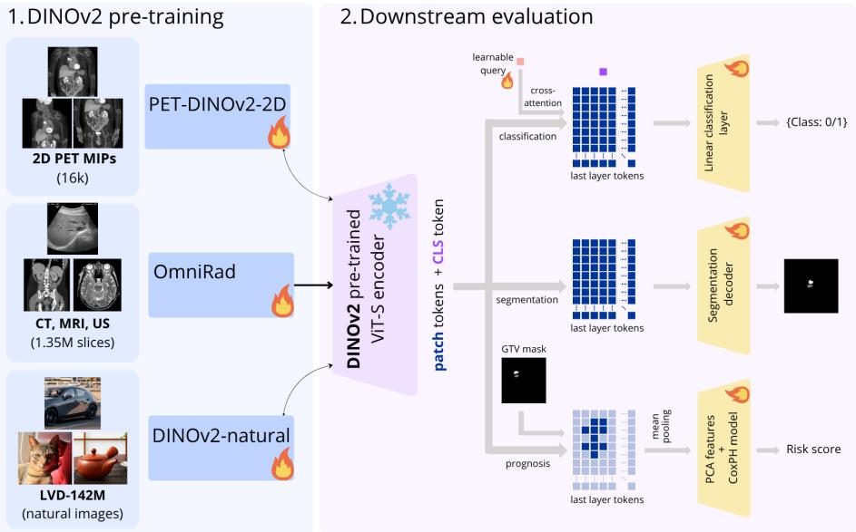
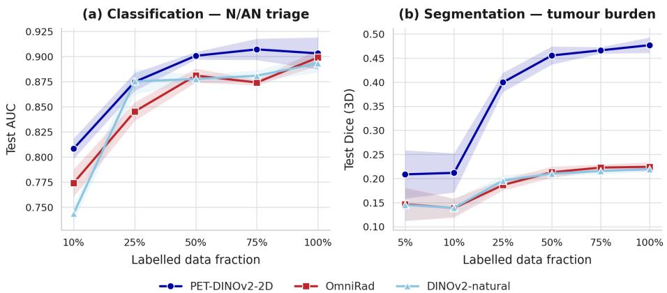

# DINOv2 for PET: A Pre-Training Domain Benchmark Across Classification, Segmentation, and Prognosis

Roxanne De Maeyer1,2,3, Yannick Brackenier1, Vicky De Ridder1, Simon DeKeyser1, Maarten Larmuseau1, and Jef Vandemeulebroucke2,3

1 Nuclivision bv, Edward Pynaertkaai 87, 9000 Gent, Belgium 2 Vrije Universiteit Brussel (VUB), Pleinlaan 2, 1050 Brussel, Belgium 3 imec, Kapeldreef 75, 3001 Leuven, Belgium

Abstract. DINO (self-DIstillation with NO labels) has become a standard for self-supervised pre-training, producing features that generalise across datasets and downstream tasks. In medical imaging it has been adopted mainly for radiology (X-ray, CT and MRI), where even naturalimage DINO features transfer well.

In the literature, these features have been reported to transfer worse to functional imaging such as PET. Yet PET-specific DINO models have barely been introduced, and even less validated across multiple tasks and datasets.

We present PET-DINOv2-2D, the first DINOv2 model pre-trained on 2D PET, and benchmark it against open-source encoders: the original DINOv2 (pre-trained on the LVD-142M natural-image dataset) and OmniRad (pre-trained on CT, MRI and ultrasound). Using the same lightweight heads for every backbone, and despite far less pre-training data, PET-DINOv2-2D matches or outperforms both on three downstream PET tasks: normal/abnormal classification, lesion segmentation and recurrence-free survival prognosis. Its advantage is largest when few labels are available, suggesting that PET pre-training gives more transferable, label-eficient features. Code is made available at https: //github.com/nuclivision/pet-dinov2-2d/.

Keywords: DINO · Self-Supervised Pre-training · PET imaging.

## 1 Introduction

Self-supervised learning (SSL) has produced the first medical-imaging foundation models: a frozen encoder serving many downstream tasks through a small head. One pre-training objective usually suits only one task family: Wald et al. [25] show contrastive pre-training favours classification while generative pre-training favours segmentation. DINO [5], and especially DINOv2 [20], addresses this by learning features for both global and dense tasks. Baharoon et al. [3] confirm this: a frozen natural-image DINOv2 matches or beats every baseline on X-ray, CT and MRI, and is the only model to generalise across tasks.

PET is primarily an oncological modality: its functional uptake signal is used to detect, delineate and assess tumours, making a general-purpose PET foundation model particularly valuable. However, this cross-modality transfer breaks down on PET: natural-image DINO features that excel on X-ray/CT/MRI lose ground on PET/CT, attributed to PET’s functional rather than structural signal [17]. Pre-training DINO directly on PET has barely been explored: to our knowledge only two works do so [16,13], each on a single task, and Lin et al. train on UDPET [15] alone (≈ 1500 scans, 2 scanners). Other SSL PET encoders likewise report gains on only one task [10,21].

Testing whether this gap reflects a structural-vs-functional or merely a naturalvs-medical shift requires more than a single natural-image baseline. We therefore (1) pre-train our own DINOv2 on a dedicated, largely open-source PET dataset, and (2) benchmark natural-image, radiology (CT/MRI), and PET encoders across three core oncological tasks: lesion triage (detection), tumour-burden segmentation (delineation), and recurrence-free survival (prognosis) (Fig. 1).

## Our Contributions:

– We present the first PET-pre-trained DINOv2 that is evaluated beyond one downstream task (on patient-level classification, dense prediction, and survival prognosis) and benchmarked head-to-head against natural-image and radiology (CT/MRI) foundation models under a single frozen-encoder protocol.

– We pre-train on multiple PET datasets rather than a single source, a prerequisite for a model intended to generalise as a foundation model.

– We show that strong downstream performance is achievable with a frozen encoder and a lightweight head, on both global and dense tasks.

## 1.1 DINOv2 pre-training and baselines

DINO [5] trains a student ViT against an EMA teacher on the CLS tokens only, giving strong image-level but weaker dense features. One of the additions of DINOv2 [20] is the iBOT [27] loss on masked patch tokens, helping the features serve both global and dense tasks. We build on DINOv2, as the newer DINOv3 [22] is designed for a billion-image, billion-parameter regime less suited to the smaller datasets common in medical imaging.

We benchmark PET-DINOv2-2D (our PET pre-trained DINOv2) against two frozen DINOv2 baselines, all with a ViT-S architecture: natural-image DI-NOv2 [20] trained on LVD-142M, further referred to as “DINOv2-natural”, and OmniRad [26], a DINOv2 pre-trained on RadImageNet [19] (1.35M CT, MRI and ultrasound slices). OmniRad is the CT/MRI counterpart that lets us separate the radiology-vs-PET axis from the natural-vs-medical one. For all tasks we deliberately keep encoders frozen and heads lightweight, so any diference reflects the pre-training data rather than model capacity. An important caveat is that the pre-training dataset size of OmniRad is only ≈ $\frac { 1 } { 1 0 0 }$ of LVD-142M.

  
Fig. 1. Study overview. We ask whether the pre-training domain of a DINO encoder governs how well its frozen features transfer to PET. Three ViT-S encoders share the same architecture but difer in pre-training data: natural images (DINOv2), CT/MRI (OmniRad) and PET (our PET-DINOv2-2D). Each is used as a frozen feature extractor for three downstream PET tasks: patient-level Normal/Abnormal classification, lesion segmentation, and recurrence-free survival prognosis. Every encoder is paired with the same lightweight task head.

We match each encoder’s input to its pre-training: PET-DINOv2-2D takes the single-channel slice at patch size 16 as it is pre-trained on raw, normalised single-uptake value (SUV), whereas the patch-14 OmniRad and DINOv2-natural take a log-SUV slice replicated to three channels, adjusting the PET long-tail intensity range similarly to that of natural or CT & MRI images. In every case the slice is cropped to the nearest multiple of the encoder’s patch size.

## 1.2 PET pre-training data

No large-scale open-source PET dataset comparable to CheXpert [11] or RadImageNet in radiology exists yet. We therefore train PET-DINOv2-2D on existing open-source PET datasets plus collected private data, all in accordance with the Declaration of Helsinki. The datasets used for pre-training are listed in Tab. 1.

The complete pre-training data consists of 4194 3D PET volumes. To pretrain a 2D model on them we use Maximum Intensity Projections (MIPs): 4 oblique MIPs per volume, giving 16,776 2D images. To our knowledge, MIPs have not been used for SSL pre-training before. We choose them for PET specifically: tumour uptake typically stands out above healthy-organ background in a projection, MIPs keep one image per patient so patient-level labels stay intact, and nuclear medicine physicians routinely read MIPs for quick triage. A projection also concentrates signal: most of a single PET slice is low-uptake background, whereas each MIP captures the whole volume’s uptake. The main trade-of is a hiding efect, where a small lesion behind a high-uptake organ can be projected away. Pre-training on individual axial, coronal and sagittal slices avoids this, but has to handle the per-slice sparsity, which we leave as future work.

<table><tr><td>Dataset name</td><td>PET tracer</td><td># Subjects # Scans</td><td></td></tr><tr><td>ACRIN-NSCLC [14]</td><td>FDG</td><td>242</td><td>435</td></tr><tr><td>AutoPET [8]</td><td>FDG</td><td>1014</td><td>1014</td></tr><tr><td>HECKTOR [1]</td><td>FDG</td><td>680</td><td>680</td></tr><tr><td>NSCLC-Radiogenomics [4]</td><td>FDG</td><td>211</td><td>240</td></tr><tr><td>UDPET [15]</td><td>FDG</td><td>1447</td><td>1447</td></tr><tr><td>Private datasets</td><td>FDG, PSMA, DOTA</td><td>378</td><td>378</td></tr></table>

Table 1. Pre-training data

Across pre-training and all three downstream tasks, PET volumes are resampled to 2 mm (3 mm for segmentation) isotropic resolution and cropped or padded to 256 × 256 in-plane before 2D extraction (MIPs for classification and prognosis, slices for segmentation). For classification and segmentation we additionally probe data eficiency by training on nested subsets of each fold’s training pool and report performance against the labelled-data fraction.

## 1.3 Classification

Data The downstream cohort is a private multicentre FDG-PET dataset with 1,911 patients from three clinical centres. All data was collected in accordance with the Declaration of Helsinki. This cohort is disjoint from the pre-training data (no shared patients or scans), so the classification comparison is free of pre-training leakage.

Each scan has a patient-level binary label (normal vs. abnormal); Table 2 gives the distribution and image specifications per centre. Labels were assigned per centre, with negatives followed up for six months to rule out missed findings. We hold out a centre- and label-stratified test set of 191 patients (10%), tune with 5-fold cross-validation on the rest, then re-train with 8 seeds on the full training set and report on the test set.

Table 2. Downstream classification dataset
<table><tr><td></td><td>Centre 1</td><td>|Centre 2</td><td>|Centre 3</td></tr><tr><td>Dataset size (patients)</td><td>521</td><td>692</td><td>698</td></tr><tr><td>Number of abnormal patients (AN)</td><td>238 (45.7%)</td><td>347 (50.1%)|349 (50.0%)</td><td></td></tr></table>

Architecture of the head On a frozen encoder (features cached per patient), the head consumes the full token sequence per view (CLS + patch tokens, $( N { + } 1 ) \times D$ , D=384 for ViT-S). Since N/AN triage can hinge on a small lesion that a global CLS averages away, all tokens are kept and re-weighted:

– Per-view pooling: cross-attention with one learnable latent query over the N+1 tokens (8 heads, attention dropout 0.3), then a residual LayerNorm + MLP, giving one D-vector per view.

– Patient pooling: mean of the per-view descriptors over the MIP views.

– Classifier: Dropout(0.5) + linear $D \to 2 .$

Training: only the latent pooler and linear classifier are trained, using crossentropy loss, AdamW [18] at learning rate $5 \times 1 0 ^ { - 4 }$ (constant, no warm-up), for 150 epochs at an efective batch of 32. Head and optimisation are identical across all backbones, so performance diferences reflect feature quality.

## 1.4 Segmentation

Data We evaluate dense prediction on the DeepPSMA dataset [12], segmenting total tumour burden on the PSMA-PET scans. From the 100 labelled patients we hold out a (randomly sampled, splitting used a fixed seed of 42) test set of 10 and split the remaining 90 into a 5-fold cross-validation. For each patient we build a labelled pool (slices with ≥ 1 lesion voxel) and an empty pool (no lesion, mean signal $> 0 . 2 \times$ the brightest slice). Training samples slices at random with 10% lesion-free; testing steps through every slice.

Architecture of the head We chose Primus as a lightweight segmentation head: Primus [24] is skip-free, decoding only from the deepest frozen token grid (∼ 0.2M parameters). All inputs are SUV-clipped to [0, 20]. The head training is optimised with AdamW at a base learning rate of $1 \times 1 0 ^ { - 3 }$ for an efective batch of 8, a 10-epoch linear warm-up followed by cosine annealing. The loss is an equal-weight combination of a dynamic cross-entropy and a focal-Tversky term $( \alpha { = } 0 . 3 , \beta { = } 0 . 7 , \gamma { = } 0 . 7 5 )$ . Between-backbone diferences are assessed by a paired Wilcoxon signed-rank test over the 6×5=30 (data-fraction, fold) Dice pairs.

## 1.5 Prognosis

Data We evaluate prognosis on the HECKTOR 2025 recurrence-free survival (RFS) task [1,2], predicting time to relapse from FDG-PET MIPs. The usable set has 651 patients, of whom 132 relapsed and 519 (79.7%) are censored. Given the limited data and the ranking nature of the task, we do not repeat the lowdata sweep for prognosis (too few events per fold).

Each patient uses the same oblique sagittal MIPs as the other tasks, encoded once by the frozen backbone. We fuse routine clinical covariates (age, sex, treatment, HPV status, WHO performance status, tobacco and alcohol use) and the log metabolic tumour volume from the GTV segmentation. Missing values (flagged with a binary missingness indicator) are median-imputed from trainingfold statistics.

Architecture of the head Every backbone is evaluated with the same protocol on its frozen, cached token features:

– Pooling: GTV-masked mean over patch tokens, then mean over the MIP views, giving one vector per patient.

Reduction + fusion: PCA (16 components) on the image features, with or without concatenated z-score-standardised clinical covariates and log-MTV. Risk model: a penalised Cox proportional-hazards model [6] trained on the neg. Cox partial log-likelihood, mapping the fused vector to a scalar log-risk. Train/val split: the PCA, clinical-feature standardisation, and missingvalue imputation are all fit on the training fold only, then applied unchanged to the validation fold.

We use centre-grouped 5-fold cross-validation (no centre in both train and validation), matching HECKTOR’s unseen-centre test split. As censoring is heavy and centre-dependent, we report Uno’s IPCW C-index [23] as primary metric, alongside Harrell’s C [9]. Each backbone yields one pooled out-of-fold risk score per patient, and between-encoder diferences are tested with a paired patientlevel bootstrap (B=2000; 95% CIs, two-sided p) [7].

## 2 Results & Discussion

## 2.1 Classification

Figure 2(a) reports test AUC on the held-out triage set as a function of the labelled-data fraction, each curve averaged over 8 training seeds (shaded bands: ±1 SD). PET-DINOv2-2D attains the highest AUC at every fraction except 25% and the full-data regime (100%), where it ties DINOv2-natural, and its margin is largest in the low-label regime ( +0.055 AUC at 10%). Taking DINOv2-natural, which is the strongest, most widely used baseline, as the pre-specified primary comparison, PET-DINOv2-2D shows a statistical significant improvement at 10%, 50%, and 75% labelled data (paired Wilcoxon and t-test, Holm-corrected, $p < 0 . 0 5 )$ . It likewise exceeds OmniRad at 25%, 50%, and 75% (paired t-test, Holm-corrected, $p \leq 0 . 0 1$ ; the Wilcoxon test is limited here by the discreteness of n=8). All encoders converge at 100% labelled data, where the diferences are not significant. This is a first, soft confirmation our hypothesis: a PET-specific DINOv2, despite far less pre-training data, is a stronger feature extractor for PET tasks.

## 2.2 Segmentation

Figure 2(b) reports volumetric (3D, sagittal-stack) Dice on DeepPSMA vs. labelled data fraction. The skip-free Primus decodes only from the deepest frozen tokens, so it depends entirely on the features.

Under Primus, PET-DINOv2-2D dominates at every fraction, winning all 30/30 paired (fraction, fold) comparisons against both DINOv2-natural and OmniRad (Wilcoxon signed-rank, $p < 1 0 ^ { - 8 } )$ : already at 5% of the data the PET features carry segmentation-ready structure the others lack.

  
Fig. 2. (a) Classification AUC vs. downstream data fraction on the triage PET-MIP task, (b) Held-out test Dice vs. labelled-data fraction on the DeepPSMA lesion task. Colour = backbone. Bands are ±1 SD over 8 training seeds in (a) and ±std across the 5 cross-validation models in (b).

This contrast suggests that PET-ready features are segmentation-useful under a minimal head, where PET pre-training wins decisively. With this very lightweight head and frozen encoder features, Dice score results are generally low. Using more complex decoders could improve Dice scores.

## 2.3 Prognosis

The HECKTOR 2025 challenge [1] reported best held-out-centre RFS C-indices of 0.658 and 0.602 (first and second place), both from fully end-to-end 3D PET/CT encoders fused with clinical variables; imaging alone was deemed insufficient. In contrast, even frozen 2D PET DINO features carry transferable prognostic signal under matched cross-centre evaluation. On centre-grouped folds (Table 3), image-only features from PET-DINOv2-2D are significantly more discriminative than those of DINOv2-natural $( \varDelta C _ { \mathrm { U n o } } = 0 . 0 5 9 , p = 0 . 0 2 2 )$ and the radiology-pre-trained OmniRad $( \varDelta C _ { \mathrm { U n o } } = 0 . 0 5 4 , p = 0 . 0 4 3$ ; both also significant under Harrell’s C, $p = 0 . 0 1 6$ and 0.028). PET-DINOv2-2D is moreover the only encoder whose image-only discrimination is comparable to the clinical baseline (Uno C 0.617 vs. 0.623, overlapping 95% CIs) and the only one whose fused image+clinical model exceeds clinical alone (0.634 vs. 0.623), whereas naturalimage and OmniRad features remain below the clinical reference.

Table 3. Recurrence-free survival discrimination on HECKTOR (centre-grouped 5- fold CV; PCA=16). Image-only C-indices are pooled out-of-fold; 95% CIs and p (vs. PET-DINOv2-2D) are from a paired patient bootstrap. Best image-only value in bold; ${ } ^ { * } p < 0 . 0 5$ . Harrell-based $\varDelta \left( p \right)$ vs. PET-DINOv2-2D: DINOv2-natural +.063 (.016), OmniRad +.058 (.028).
<table><tr><td></td><td colspan="2">Image only</td><td rowspan="2">Δ vs. PET-DINOv2 (image only) ∆Uno (p)</td><td rowspan="2">Img+clin.</td></tr><tr><td>Encoder</td><td>Har.</td><td>Uno [95% CI]</td></tr><tr><td>PET-DINOv2-2D</td><td>0.610</td><td>0.617[.566,.667]</td><td></td><td>0.622 /0.634</td></tr><tr><td>OmniRad</td><td>0.552</td><td>0.564[.511,.618]</td><td>−.054 (.043*)</td><td>0.596 / 0.606</td></tr><tr><td>DINOv2-natural</td><td>0.547</td><td>0.558 [.505,.611]</td><td>−.059 (.022*)</td><td>0.584 / 0.596</td></tr><tr><td colspan="5">Clinical only (reference): Harrell 0.618, Uno 0.623</td></tr></table>

## 3 Conclusion

We introduced PET-DINOv2-2D, the first DINOv2 self-supervised on 2D PET, pre-trained on maximum-intensity projections from several PET datasets. Keeping every encoder frozen behind the same lightweight heads, we compared PET pre-training against the natural-image DINOv2 and radiology-pre-trained Omni-Rad on classification, segmentation and recurrence-free survival prognosis. PET pre-training gave the strongest features whenever labels were limited: it led classification in the low-data regime, outperformed both non-PET encoders on segmentation under a lightweight skip-free decoder, and gave the only image-only prognostic features matching the clinical baseline. OmniRad (CT/MRI) tracked natural-image DINOv2 throughout, while its pre-training dataset is also substantially smaller (factor 100). The transfer gap reflects overall a structural-vsfunctional shift rather than a generic natural-vs-medical one.

Our study has three main limitations. First, HECKTOR (the prognosis set) was part of PET-DINOv2-2D’s label-free pre-training but not the baselines’, so prognosis is not leakage-free; we treat it as corroborating, and the two leakagefree tasks (classification on a disjoint cohort, and DeepPSMA segmentation, absent from pre-training) show the same ranking, supporting our claim that the advantage is not a memorisation artefact. Second, our encoder uses patch size 16 against the baselines’ 14 in accordance with DINOv1 and DINOv3, but per the DINO literature a larger patch should if anything weaken performance, meaning it does not explain its lead. Third, our PET pre-training set is comparatively small and MIP-based; future work includes slice-based pre-training to increase 2D diversity and remove the mismatch with the segmentation input.

Overall, the pre-training domain matters for PET: its functional signal less well captured by natural-image or CT/MRI pre-training, and an in-domain PET DINOv2 transfers better across tasks despite far less pre-training data.

## References

1. HECKTOR 2025: HEad and neCK TumOR lesion segmentation, diagnosis and prognosis challenge. https://hecktor25.grand-challenge.org (2025)

2. Andrearczyk, V., Oreiller, V., Hatt, M., Depeursinge, A.: Overview of the HECK-TOR challenge at MICCAI 2022: Automatic head and neck tumor segmentation and outcome prediction in PET/CT. In: Head and Neck Tumor Segmentation and Outcome Prediction. HECKTOR 2022. Lecture Notes in Computer Science, vol. 13626. Springer, Cham (2023). https://doi.org/10.1007/978-3-031-27420-6\_1

3. Baharoon, M., Qureshi, W., Ouyang, J., Xu, Y., Aljouie, A., Peng, W.: Evaluating General Purpose Vision Foundation Models for Medical Image Analysis: An Experimental Study of DINOv2 on Radiology Benchmarks (Sep 2024). https://doi.org/10.48550/arXiv.2312.02366

4. Bakr, S., Gevaert, O., Echegaray, S., Ayers, K., Zhou, M., Shafiq, M., Zheng, H., Zhang, W., Leung, A., Kadoch, M., Shrager, J., Quon, A., Rubin, D., Plevritis, S., Napel, S.: Data for NSCLC Radiogenomics (Version 4) (2017). https://doi.org/ 10.7937/K9/TCIA.2017.7hs46erv

5. Caron, M., Touvron, H., Misra, I., Jégou, H., Mairal, J., Bojanowski, P., Joulin, A.: Emerging Properties in Self-Supervised Vision Transformers (May 2021). https: //doi.org/10.48550/arXiv.2104.14294

6. Cox, D.R.: Regression Models and Life-Tables. Journal of the Royal Statistical Society Series B: Statistical Methodology 34(2), 187–202 (Jan 1972). https:// doi.org/10.1111/j.2517-6161.1972.tb00899.x

7. Efron, B., Tibshirani, R.: An Introduction to the Bootstrap. No. 57 in Monographs on Statistics and Applied Probability, Chapman & Hall, New York (1993)

8. Gatidis, S., Kuestner, T.: A whole-body FDG-PET/CT dataset with manually annotated tumor lesions (FDG-PET-CT-Lesions). Dataset (2022). https://doi. org/10.7937/gkr0-xv29

9. Harrell, F.E., Calif, R.M., Pryor, D.B., Lee, K.L., Rosati, R.A.: Evaluating the yield of medical tests. JAMA 247(18), 2543–2546 (May 1982)

10. Huang, J., Chen, S., Liang, X., Yang, X., Zhang, Z., Sun, Y., Wang, Y., Tan, T.: C2MAOT: Cross-modal Complementary Masked Autoencoder with Optimal Transport for Cancer Segmentation in PET-CT Images

11. Irvin, J., Rajpurkar, P., Ko, M., Yu, Y., Ciurea-Ilcus, S., Chute, C., Marklund, H., Haghgoo, B., Ball, R., Shpanskaya, K., Seekins, J., Mong, D.A., Halabi, S.S., Sandberg, J.K., Jones, R., Larson, D.B., Langlotz, C.P., Patel, B.N., Lungren, M.P., Ng, A.Y.: CheXpert: A Large Chest Radiograph Dataset with Uncertainty Labels and Expert Comparison (2019). https://doi.org/10.48550/ARXIV.1901. 07031

12. Jackson, P., Hofman, M., Buteau, J.P., McIntosh, L., Sun, Y.: A Repository of Annotated PSMA and FDG PET/CT Images for Algorithm Development in Staging of mCRPC for Treament with 177Lu-PSMA Therapy (Nov 2025). https://doi.org/10.5281/ZENODO.15281784

13. Khatri, U., Kwon, G.R.: Explainable Vision Transformer with Self-Supervised Learning to Predict Alzheimer’s Disease Progression Using 18F-FDG PET. Bioengineering 10(10), 1225 (Oct 2023). https: //doi.org/10.3390/bioengineering10101225

14. Kinahan, P., Muzi, M., Bialecki, B., Herman, B., Coombs, L.: Data from the ACRIN 6668 Trial NSCLC-FDG-PET (Version 2). https://doi.org/10.7937/ tcia.2019.30ilqfcl

15. Kuangyu, S., Wang, H., Chen, Y., Liu, F., Zhu, H., Viscione, M., Guo, R., Rominger, A., Li, B., Shi, X.: UDPET: Ultra-low Dose PET Imaging Challenge Dataset. https://papers.miccai.org/miccai-2025/0959-Paper0232 (Sep 2025)

16. Lin, Y.N.S., Wang, S., Safari, M., Yang, X.: Beyond Natural Images: A Dual-Stream DINOv3 Framework for PET/CT Segmentation

17. Liu, C., Chen, Y., Shi, H., Lu, J., Jian, B., Pan, J., Cai, L., Wang, J., Yu, J., Gao, Z., Zhang, X., Bai, L., Zhang, Y., Li, J., Bercea, C.I., Ouyang, C., Chen, C., Xiong, Z., Wiestler, B., Wachinger, C., Duncan, J.S., Rueckert, D., Bai, W., Arcucci, R.: Does DINOv3 Set a New Medical Vision Standard? Benchmarking 2D and 3D Classification, Segmentation, and Registration (Jan 2026). https://doi. org/10.48550/arXiv.2509.06467

18. Loshchilov, I., Hutter, F.: Decoupled Weight Decay Regularization (Jan 2019). https://doi.org/10.48550/arXiv.1711.05101

19. Mei, X., Liu, Z., Robson, P.M., Marinelli, B., Huang, M., Doshi, A., Jacobi, A., Cao, C., Link, K.E., Yang, T., Wang, Y., Greenspan, H., Deyer, T., Fayad, Z.A., Yang, Y.: RadImageNet: An Open Radiologic Deep Learning Research Dataset for Efective Transfer Learning. Radiology: Artificial Intelligence 4(5), e210315 (Jul 2022). https://doi.org/10.1148/ryai.210315

20. Oquab, M., Darcet, T., Moutakanni, T., Vo, H., Szafraniec, M., Khalidov, V., Fernandez, P., Haziza, D., Massa, F., El-Nouby, A., Assran, M., Ballas, N., Galuba, W., Howes, R., Huang, P.Y., Li, S.W., Misra, I., Rabbat, M., Sharma, V., Synnaeve, G., Xu, H., Jegou, H., Mairal, J., Labatut, P., Joulin, A., Bojanowski, P.: DINOv2: Learning Robust Visual Features without Supervision (Feb 2024). https://doi. org/10.48550/arXiv.2304.07193

21. Peng, Y., Kim, J., Feng, D., Bi, L.: Automatic Tumor Segmentation via False Positive Reduction Network for Whole-Body Multi-Modal PET/CT Images (Sep 2022). https://doi.org/10.48550/arXiv.2209.07705

22. Siméoni, O., Vo, H.V., Seitzer, M., Baldassarre, F., Oquab, M., Jose, C., Khalidov, V., Szafraniec, M., Yi, S., Ramamonjisoa, M., Massa, F., Haziza, D., Wehrstedt, L., Wang, J., Darcet, T., Moutakanni, T., Sentana, L., Roberts, C., Vedaldi, A., Tolan, J., Brandt, J., Couprie, C., Mairal, J., Jégou, H., Labatut, P., Bojanowski, P.: DINOv3 (Aug 2025). https://doi.org/10.48550/arXiv.2508.10104

23. Uno, H., Cai, T., Pencina, M.J., D’Agostino, R.B., Wei, L.J.: On the C-statistics for evaluating overall adequacy of risk prediction procedures with censored survival data. Statistics in Medicine 30(10), 1105–1117 (May 2011). https://doi.org/10. 1002/sim.4154

24. Wald, T., Roy, S., Isensee, F., Ulrich, C., Ziegler, S., Trofimova, D., Stock, R., Baumgartner, M., Köhler, G., Maier-Hein, K.: Primus: Enforcing Attention Usage for 3D Medical Image Segmentation (Apr 2026). https://doi.org/10.48550/ arXiv.2503.01835

25. Wald, T., Ulrich, C., Suprijadi, J., Ziegler, S., Nohel, M., Peretzke, R., Köhler, G., Maier-Hein, K.H.: An OpenMind for 3D medical vision self-supervised learning (Apr 2025). https://doi.org/10.48550/arXiv.2412.17041

26. Zedda, L., Loddo, A., Ruberto, C.D.: OmniRad: A Radiological Foundation Model for Multi-Task Medical Image Analysis (Feb 2026). https://doi.org/10.48550/ arXiv.2602.04547

27. Zhou, J., Wei, C., Wang, H., Shen, W., Xie, C., Yuille, A., Kong, T.: iBOT: Image BERT Pre-Training with Online Tokenizer (Jan 2022). https://doi.org/10. 48550/arXiv.2111.07832