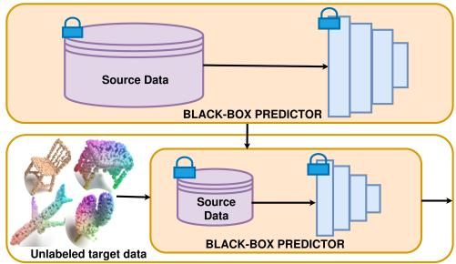
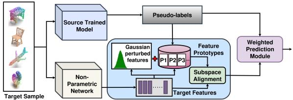
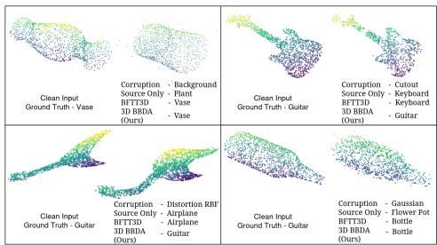
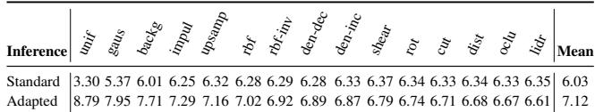
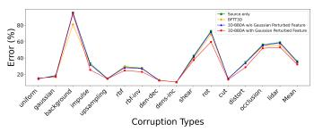

# 3D-BBDA: Backpropagation-Free Black-Box Domain Adaptation for Robust 3D Point Cloud Recognition

Shivangi Rai\*, Kunal Jangid\*, Vaibhav Kumar†, Vinod K Kurmi Department of Data Science and Engineering,   
Indian Institute of Science Education and Research Bhopal, India {shivangir23, kunal24, vaibhav, vinodkk}@iiserb.ac.in

## Abstract

Robust 3D point-cloud recognition is critical for robotics, mapping, and urban sensing, yet point-cloud classifiers often suffer performance drops under domain shifts caused by sensor changes, environmental variation, and acquisition artifacts. Many existing adaptation methods are difficult to deploy in practice because they require access to source data or the internal parameters of the source model, which may be restricted by privacy, licensing, or security constraints. We present 3D-BBDA, a backpropagationfree black-box domain adaptation framework that adapts a source-trained predictor to unlabeled target data using only black-box outputs. Our method performs pseudo-label guided prototype-based alignment and employs a weighted prediction module to fuse source logits with alignment logits, reducing sensitivity to noisy pseudo-labels. To stabilize prototype memory when pseudo-label coverage is incomplete, we construct a Gaussian-perturbed prototype prior from unlabeled target predictions and use it as a fallback for missing or unreliable class prototypes during alignment. Experiments on four corrupted 3D benchmarks demonstrate consistent improvements over strong baselines. On ModelNet-40C, 3D-BBDA achieves mean errors of 32.08% (PointNet) and 29.62% (GDANet), outperforming Source-only (35.88% / 34.03%) and BFTT3D (33.78% / 32.36%). 3D-BBDA requires only a single forward pass with no gradient updates making it suitable for real-time, privacy-preserving deployment in transferable 3D recognition pipelines. Project page is available at https://visdomlab.github.io/3D\_BBDA

## 1. Introduction

Robust 3D perception is fundamental to autonomous systems, including mobile robots, autonomous vehicles, unmanned aerial platforms, and urban mapping solutions.

These systems rely heavily on point cloud data acquired from LiDAR, depth cameras, and other 3D sensors for object recognition, navigation, and interaction in unstructured environments. In real deployments, perception models often operate under changing environmental conditions, sensor variations, and acquisition artifacts that induce domain shifts, leading to significant performance degradation [19, 21]. Ensuring robustness under such distributional shifts is critical for the safe and reliable deployment of AIdriven robotic systems.

While unsupervised domain adaptation (UDA) attempts to transfer knowledge from labeled source domains to unlabeled target domains [7, 23], most UDA methods require access to source data or source model parameters during adaptation [16]. In practical robotic deployments, this assumption is often unrealistic. Perception models may be proprietary, certified, or frozen after training, and source datasets may be inaccessible due to privacy, storage, or licensing constraints [20]. Moreover, online gradientbased fine-tuning is frequently infeasible on edge robotic platforms due to computational and safety considerations. These limitations motivate black-box and source-free adaptation strategies that rely on inference-time observations.

Black-Box Domain Adaptation (BBDA) addresses this setting by treating the source model as an immutable predictor and adapting only through its outputs [11, 15, 16]. However, existing BBDA research has primarily focused on 2D vision tasks. Extending BBDA to 3D point clouds is non-trivial due to unordered structures, irregular spatial distributions, and varying density patterns. Furthermore, existing approaches often depend on backpropagation or source statistics for alignment, limiting their applicabilit in strictly constrained deployment scenarios. These highlight a critical research gap, necessitating novel approaches tailored to the unique characteristics of 3D point clouds under black-box constraints. Additionally, these methods typically enforce the use of the same network architecture as the source model, which restricts the flexibility to adopt different architectures for the target model during adaptation [16, 33]. This limitation hinders the ability to tailor target networks to specific tasks or computational constraints. The self-training generates pseudo-labels of the target and adapts the network with re-training, however, learning with pseudo-labels leads to error accumulation which degrades the performance of the model. To handle this issue, some of the existing work leverages back-propagation free approach for getting the adaptive prediction at the time of inference [27, 36]. However, the use of source data for the alignment makes it non-feasible.

  
Figure 1. Overview of the BBDA setting for 3D point cloud data. A pretrained source model acts as a black-box predictor and uses target data for adaptation.

The BBDA setting for 3D point cloud data remains largely unexplored within domain adaptation research, illustrated in Fig. 1. We study 3D point-cloud adaptation under the joint constraints of source-free, black-box, and backpropagation-free deployment: source training data and source-model internals are unavailable, the frozen source model is accessed only through its predictions, and no gradient-based parameter updates are performed at test time. Unlike conventional domain adaptation approaches that rely on access to both source data and the corresponding model, the black-box paradigm restricts access solely to the pre-trained source model, which is treated as an immutable black box(Table 1).

In this work, we address a stricter and practically motivated setting. We propose a novel Backpropagationfree Black-box Domain Adaptationframeworkfor 3D point cloud data (3D-BBDA), that performs adaptation without accessing source data or source model internals and without updating any parameters at test-time. By avoiding parameter updates, the model eliminates the risk of error accumulation that could degrade performance over time. The source model is treated purely as a black-box predictor. The goal is to reduce domain gap between source and target domains.

A prototype-based alignment module is leveraged to align the feature space of the source and target domains. A non-parametric network is used to extract features from the target samples. For each corruption, the features from the target samples are extracted using a non-parametric network, and they are assigned labels based on the pseudo labels obtained from the pre-trained source model through the assumption that the pseudo labels are the ground truth. Based on these pseudo-labels, the prototype for each class is generated by taking the mean features corresponding to each label. Further, these class-wise prototypes are used to align the samples. To avoid losing information from the source domain, a weighted prediction module is used to obtain the final prediction by integrating the source model and the non-parametric network.

To ensure stability under sparse or incomplete pseudolabel assignments, we further construct a Gaussianperturbed prototype prior that provides fallback class prototypes when target pseudo-label coverage is missing or unreliable. Finally, a weighted prediction module fuses source predictions with alignment-based predictions, balancing source generalization with target-specific correction while avoiding error accumulation. The resulting framework requires no source data, no source-model parameter access, and no gradient updates, making it suitable for privacy-preserving and deployment-constrained 3D recognition. The main contributions are summarized as:

• We formulate and address backpropagation-free blackbox domain adaptation for 3D point cloud recognition, under strict source-free and parameter-free constraints motivated by robotic deployment scenarios.

• We propose a pseudo-label guided prototype-based alignment module for adapting target features without accessing source data or source model internals.

• We introduce a Gaussian-perturbed prototype prior that stabilizes prototype memory when pseudo-label coverage is incomplete under severe target shifts.

• We conduct extensive experiments across multiple corrupted 3D benchmarks, demonstrating consistent robustness gains with negligible inference overhead.

## 2. Related Work

Deep architectures such as PointNet [18], and GDANet [30], as well as recent transformer-based models (DAPoinTr [14], and P3Former [29]), achieve strong in-domain performance but can be brittle under distribution shifts (e.g., sensor noise, occlusion, density changes, corruption), motivating adaptation for robust deployment.

Unsupervised domain adaptation (UDA) aligns labeled source and unlabeled target domains, leveraging geometric priors and self-training, e.g., SRDAN [35], graph-based self-distillation [2], and FAST3D [6]. However, UDA typically requires source data and often access to model internals, which may be infeasible under privacy, licensing constraints, or data portability constraints. Source-free domain adaptation (SFDA) relaxes the source-data requirement but commonly still relies on access to source-model components and pseudo-labeling, which can suffer from confirmation bias and error accumulation.

BBDA further restricts the setting by allowing only black-box predictions from the source model while prohibiting source data. Prior BBDA/SFDA approaches study augmentation and self-learning with uncertainty-aware filtering [9, 11] and teacher/prototype mechanisms to mitigate noisy labels and forgetting [5, 8, 12]. Test-time adaptation (TTA) adapts models using unlabeled test data; in 3D, recent work explores reconstruction/augmentation and prototype-based strategies [10, 24, 25, 37]. Closest to our deployment constraints, BFTT3D [27] performs backpropagation-free 3D test-time adaptation via prototype memory for feature alignment, but it uses source data to build the prototype memory. It has conflicts with strict source-free and privacy-constrained deployment.

<table><tr><td>Setting</td><td>Source data</td><td>Model internals</td><td>Target BP</td></tr><tr><td>Source-free</td><td>No</td><td>Allowed</td><td>Allowed</td></tr><tr><td>Black-box</td><td>No</td><td>No</td><td>Allowed</td></tr><tr><td>Backprop.-free</td><td>Allowed</td><td>Allowed</td><td>No</td></tr><tr><td>3D-BBDA</td><td>No</td><td>No</td><td>No</td></tr><tr><td colspan="4">Property</td></tr><tr><td>Source data during adaptation</td><td></td><td>BFTT3D</td><td>3D-BBDA</td></tr><tr><td>Source-model internals</td><td></td><td>Required Required</td><td>No No</td></tr><tr><td>Source-model gradients</td><td></td><td>No</td><td>No</td></tr><tr><td>Prototype source</td><td></td><td>Source features</td><td></td></tr><tr><td>Missing-class completion</td><td></td><td></td><td>Target pseudo-labels Gaussian target prior</td></tr><tr><td>Source/adaptation fusion</td><td></td><td>No No</td><td>Yes</td></tr><tr><td></td><td></td><td></td><td></td></tr><tr><td>Black-box source interface</td><td></td><td>No</td><td>Yes</td></tr></table>

Table 1. Top: distinction between source-free, black-box, and backpropagation-free adaptation constraints. “Allowed” means the setting alone does not prohibit that access. Bottom: key differences between BFTT3D and 3D-BBDA.

In contrast, we address a stricter and practically motivated regime: backpropagation-free black-box adaptation for 3D point clouds, requiring neither source data nor source-model internals (or gradient updates), while improving robustness under corrupted target conditions, and architecture-agnostic adaptation strategies. Unlike BFTT3D, which constructs its adaptation memory using source information, 3D-BBDA replaces source-derived prototypes with pseudo-label-guided target prototypes, completes missing classes using an unlabeled target prior, and fuses the resulting prediction with black-box source output.

## 3. Methodology

## 3.1. Problem Statement

We address the Black-box domain adaptation problem in 3D point cloud data for the classification task using source trained model as the pre-trained black-box predictor $( F _ { S } ) ,$ i.e., only prediction outputs are accessible, trained with labeled source domain data $\{ x _ { i } ^ { s } , y _ { i } ^ { s } \} _ { i = } ^ { n _ { s } }$ =1 under the domain $D _ { s } ,$ where $n _ { s }$ represents the number of source samples (Fig. 2). For adaptation, we have unlabeled target domain data $\{ x _ { i } ^ { t } \} _ { i = 1 } ^ { n _ { t } }$ under domain $D _ { t }$ , where $n _ { t }$ represents number of target samples. Here, we make use of a non-parametric network $( F _ { n n } )$ following the convention of [27]. The objective of the proposed 3D-BBDA framework is to adapt the source model $( F _ { S } )$ to the target domain at the test time and infer target labels $\{ y _ { i } ^ { t } \} _ { i = 1 } ^ { n _ { t } }$ using pre-trained source model, a non-parametric network $( F _ { n n } )$ and unlabeled target data $\{ x _ { i } ^ { t } \} _ { i = 1 } ^ { n _ { t } }$ in the absence of source data or internal parameters, ensuring robust perception across unseen conditions. It is summarized in Algorithm in supplementary material.

  
Figure 2. Overview of 3D-BBDA, where target features from a non-parametric network are aligned via prototype generation and shared-subspace alignment. A Gaussian-perturbed prototype prior completes missing class prototypes, and final predictions fuse source and alignment outputs via weighted prediction.

Closed-set assumption. We consider the closed-set adaptation setting, where the source and target domains share the same label space, $\mathcal { V } _ { s } = \mathcal { V } _ { t } = \{ 1 , . . . , C \}$ . Although target labels are unavailable during adaptation, each target sample is assumed to belong to one of the C source classes. This assumption enables class-wise prototype construction from black-box pseudo-labels and the subsequent fusion with source-model predictions.

## 3.2. Feature Extraction From Non-parametric Network

For clarity, $\boldsymbol { x } _ { i } ^ { t }$ denotes the i-th target point-cloud sample in $\mathcal { D } _ { t } ,$ , whereas $x _ { t , i }$ in the following feature extraction equations denotes an individual 3D point within the corresponding target point cloud. A non-parametric network, PointNN [34], is utilized to extract robust features from the target domain. Trigonometric functions first encode its x, $y ,$ and z coordinates into channel embeddings of size d. For each channel $s \in \{ x , y , z \}$ , the channel embeddingas:

$$
g ( x _ { t , i } ) ^ { ( s ) } = \left\{ \begin{array} { l l } { \sin ( \alpha x _ { t , i } ^ { ( s ) } / \beta ^ { \frac { i } { d } } ) , } & { i = 2 k } \\ { \cos ( \alpha x _ { t , i } ^ { ( s ) } / \beta ^ { \frac { i } { d } } ) , } & { i = 2 k + 1 } \end{array} \right. \in \mathbb { R } ^ { d / 3 }\tag{1}
$$

Here, $\alpha$ and $\beta$ represent wavelength and scale hyperparameters. These channel-wise embeddings from $x , y , z$ coordinates are concatenated to obtain raw embedding $f _ { \mathrm { r a w } , t , i }$ as:

$$
\begin{array} { r l } { f _ { \mathrm { r a w } , t , i } = \left[ g ( x _ { t , i } ) ^ { ( X ) } , g ( x _ { t , i } ) ^ { ( Y ) } , g ( x _ { t , i } ) ^ { ( Z ) } \right] } & { { } \in \mathbb { R } ^ { d } } \end{array}\tag{2}
$$

Further, Farthest Point Sampling (FPS) is employed to downsample the local center points $x _ { \mathrm { c e n } }$ from all points in the dataset. Following this, k-Nearest Neighbors (k-NN) is used to group $N _ { \mathrm { c t } }$ neighboring points $( x _ { \mathrm { n b } } )$ for each center point $x _ { \mathrm { c e n } }$ . Using a combination of both center and neighbor information, the expanded center feature $\tilde { f } _ { \mathrm { c e n } }$ for $x _ { \mathrm { c e n } }$ as:

$$
\tilde { f } _ { \mathrm { c e n } } = \mathrm { C o n c a t } ( f _ { \mathrm { c e n } } , f _ { \mathrm { n b } , j } ) , j \in N _ { \mathrm { c e n } }\tag{3}
$$

Here, $f _ { \mathrm { c e n } }$ is feature of point $x _ { \mathrm { c e n } } , f _ { \mathrm { n b } }$ denotes the feature of point $x _ { \mathrm { n b } } .$ and $\mathcal { N } _ { \mathrm { c e n } }$ refers to the set of neighboring points

for center point $x _ { \mathrm { c e n } }$ . To show the spatial distribution of neighboring points $x _ { \mathrm { n b } } .$ , feature $\tilde { f } _ { \mathrm { c e n } }$ is further reweighted by its relative position encoding $g ( \Delta _ { \mathrm { n b } } )$ to the center point as

$$
\tilde { f } _ { \mathrm { c e n } } ^ { w } = ( \tilde { f } _ { \mathrm { c e n } } + g ( \Delta _ { \mathrm { n b } } ) ) \odot g ( \Delta _ { \mathrm { n b } } )\tag{4}
$$

where ⊙ represents element-wise multiplication and $\Delta _ { \mathrm { n b } }$ is the relative position of $x _ { \mathrm { n b } }$ to its center point $x _ { \mathrm { c e n } }$ . Finally, the max pooling and average pooling are used to reduce the dimensionality of the information of $\tilde { f } _ { \mathrm { c e n } } ^ { w }$ as:

$$
\tilde { f } _ { \mathrm { c e n } } ^ { p } = \mathbf { M a x P o o l } ( \tilde { f } _ { \mathrm { c e n } } ^ { w } ) + \mathbf { A v g P o o l } ( \tilde { f } _ { \mathrm { c e n } } ^ { w } )\tag{5}
$$

Finally, a global pooling operation is applied to get the feature $f _ { t , i } \in \mathbb { R } ^ { d }$ for $x _ { t , i }$ . The extracted features are used as a basis for prototype generation in the subsequent phase of our alignment framework.

## 3.3. Prototype-based Alignment Module

For each input point cloud $x _ { t , i } .$ , the corresponding pseudolabel $\hat { y } _ { i } ^ { t }$ is obtained through $F _ { S }$ . Simultaneously, through a non-parametric network, target features $\left( f _ { t , i } \right)$ are extracted. The extracted features are assigned their corresponding pseudo labels. Target-buffer protocol. The minibatch size of 24 is used only for data loading and feature extraction and does not define the prototype-construction set. Target features and their black-box pseudo-labels are accumulated over the unlabeled target buffer, and class prototypes are then constructed from this accumulated buffer. The resulting prototype memory is kept fixed while sharedsubspace alignment is performed over target blocks of 128 samples, with $W$ recomputed for each alignment block. A feature prototype $( P _ { i } )$ corresponding to each class i is generated by taking the mean features of all the assigned samples to that class as:

$$
\begin{array} { r } { P _ { i } = \frac { 1 } { n _ { i } } \sum _ { j = 1 } ^ { n _ { i } } f _ { j } } \end{array}\tag{6}
$$

where $n _ { i }$ is the number of samples assigned to class i and $f _ { j }$ represents the feature of $j ^ { t h }$ sample assigned to class $i .$

## 3.3.1. Gaussian-perturbed prototype prior

Under severe domain shift, pseudo-labeling may yield incomplete class coverage, where some classes receive no assigned target samples. In such cases, the corresponding prototype in Equation 6 cannot be computed, which may destabilize the subsequent alignment step. To maintain a class-complete prototype memory, we construct a Gaussian-perturbed prototype prior from unlabeled target predictions and use it to complete missing class prototypes during alignment. Specifically, an unlabeled Gaussianperturbed target stream is passed through the black-box source predictor $F _ { S }$ and the frozen non-parametric encoder $F _ { n n }$ . The resulting pseudo-labels and features are used to compute a class-aligned prototype prior $\{ P _ { i } ^ { g } \} _ { i = 1 } ^ { C }$ . For class i, let $\mathbf { \mathcal { S } } _ { i } ^ { g }$ denote the set of Gaussian-perturbed target samples assigned to class $i ,$ and let $n _ { i } ^ { g } \ = \ | \cal { S } _ { i } ^ { g } |$ . If a class is missing even in the Gaussian-perturbed stream, we use the global mean of available Gaussian-perturbed prototypes as a conservative fallback:

$$
P _ { i } ^ { g } = \left\{ { \begin{array} { l l } { { \frac { 1 } { n _ { i } ^ { g } } } \sum _ { k \in { \cal S } _ { i } ^ { g } } f _ { t , k } ^ { g } , } & { \mathrm { i f } \ : n _ { i } ^ { g } > 0 , } \\ { { \frac { 1 } { | { \cal C } _ { g } ^ { + } | } } \sum _ { j \in { \cal C } _ { g } ^ { + } } P _ { j } ^ { g } , } & { \mathrm { i f } \ : n _ { i } ^ { g } = 0 , } \end{array} } \right.\tag{7}
$$

where $\mathcal { C } _ { g } ^ { + } ~ = ~ \{ j ~ \mid ~ n _ { j } ^ { g } ~ > ~ 0 \}$ is the set of classes with available Gaussian-perturbed prototypes. This prior is computed from unlabeled target predictions and does not require source samples, target labels, source-model parameters, or gradient updates.

Prototype completion. For a target stream $d ,$ pseudolabeling may leave some classes with no assigned samples. Let $S _ { i } ^ { ( \bar { d } ) }$ denote the set of target samples in stream d assigned to class i, and let $n _ { i } ^ { ( d ) } = | S _ { i } ^ { ( d ) } |$ . The completed prototype for class i is computed as

$$
\begin{array} { r } { \tilde { P } _ { i } ^ { ( d ) } = \left\{ \begin{array} { l l } { \frac { 1 } { n _ { i } ^ { ( d ) } } \sum _ { k \in \mathcal { S } _ { i } ^ { ( d ) } } f _ { t , k } ^ { ( d ) } , } & { \mathrm { i f } n _ { i } ^ { ( d ) } > 0 , } \\ { P _ { i } ^ { g } , } & { \mathrm { i f } n _ { i } ^ { ( d ) } = 0 . } \end{array} \right. } \end{array}\tag{8}
$$

The completed prototype memory $\{ \tilde { P } _ { i } ^ { ( d ) } \} _ { i = 1 } ^ { C }$ is then used for shared-subspace alignment. This completion step provides fallback class prototypes for missing pseudo-labeled classes while preserving the backpropagation-free, blackbox, and source-free constraints of 3D-BBDA.

## 3.3.2. Reducing domain shift through shared subspace projection and alignment

Domain shifts occur when target features diverge from the distribution of learned prototypes, rendering direct alignment inadequate. It begins by computing cosine similarity normalized feature vectors from the target domain and prototype memory to guide classification [27]. Consider a target feature vector $G _ { t } = [ g _ { t , 1 } , g _ { t , 2 } , . . . , g _ { t , n _ { t } } ]$ and prototype memory $P = [ P _ { 1 } , P _ { 2 } , . . . , P _ { c } ]$ . The cosine similarity as:

$$
\begin{array} { r } { K = \frac { { \widetilde { G } } _ { t } \cdot { \widetilde { P } } } { \| { \widetilde { G } } _ { t } \| \| { \widetilde { P } } \| } } \end{array}\tag{9}
$$

Here, vector $\widetilde { G } _ { t }$ represents the normalized feature vector of $G _ { t }$ , expressed as $\begin{array} { r } { \widetilde { G } _ { t } ~ = ~ \frac { G _ { t } } { \Vert G _ { t } \Vert } } \end{array}$ , where $\| G _ { t } \|$ denotes the magnitude of $G _ { t }$ . Similarly, $P$ represents the normalized prototype memory vector, given by $\begin{array} { r } { { \cal \tilde { P } } = \frac { { \cal P } } { \| { \cal P } \| } } \end{array}$ , where $\| P \|$ represents the magnitude of $P .$ . This similarity leads to classification by assigning a weighting to the influence of each prototype. The output logits with pseudo label $y _ { i }$ as:

$$
l _ { a m } = \phi ( K _ { y _ { i } } ) , \quad \phi ( x ) = \exp ( - \beta ( 1 - x ) ) ,\tag{10}
$$

with $\beta$ as a scaling hyperparameter. To explicitly reduce the distribution gap between prototypes $( f ^ { \ast } )$ and target features $( f _ { t } ^ { * } )$ , both are projected into a shared subspace using a mapping function $\psi ( . )$ . The disparity between these domains is reduced by calculating the statistical distance between their mean representations:

<table><tr><td>Method</td><td>Backbone</td><td>unif</td><td>gaus</td><td>backg</td><td>impul</td><td>upsamp</td><td>rbf</td><td>rbf-inv</td><td>den-dec</td><td>dens-inc</td><td>shear</td><td>rot</td><td>cut</td><td>dist</td><td>oclu</td><td>lidar</td><td>Mean ↓</td></tr><tr><td>Source-only</td><td rowspan="10"></td><td>14.63</td><td>18.68</td><td>95.30</td><td>33.39</td><td>15.03</td><td>29.46</td><td>27.63</td><td>12.93</td><td>10.49</td><td>42.71</td><td>72.81</td><td>14.95</td><td>34.85</td><td>56.28</td><td>59.00</td><td>35.88</td></tr><tr><td>TENT [25]</td><td>14.71</td><td>18.35</td><td>90.36</td><td>27.03</td><td>15.36</td><td>28.28</td><td>26.66</td><td>13.86</td><td>12.36</td><td>40.68</td><td>65.68</td><td>15.76</td><td>33.87</td><td>56.56</td><td>59.85</td><td>34.62</td></tr><tr><td>BN [13]</td><td>14.83</td><td>18.84</td><td>89.63</td><td>27.47</td><td>15.15</td><td>28.69</td><td>26.66</td><td>14.59</td><td>12.40</td><td>40.44</td><td>65.88</td><td>16.25</td><td>34.68</td><td>57.58</td><td>60.21</td><td>34.89</td></tr><tr><td>SHOT [15]</td><td>14.91</td><td>17.22</td><td>90.44</td><td>25.61</td><td>14.51</td><td>27.07</td><td>25.85</td><td>13.78</td><td>12.20</td><td>39.95</td><td>65.80</td><td>16.21</td><td>32.98</td><td>56.93</td><td>60.29</td><td>34.25</td></tr><tr><td>LAME [1]</td><td>76.64 PointNet</td><td>84.67</td><td>95.95</td><td>95.48</td><td>67.83</td><td>93.37</td><td>91.72</td><td>59.92</td><td>34.81</td><td>96.45</td><td>97.50</td><td>68.52</td><td>92.53</td><td>95.99</td><td>95.95</td><td>83.16</td></tr><tr><td>DSS [28]</td><td>14.20</td><td>18.71</td><td>94.13</td><td>33.12</td><td>14.33</td><td>29.31</td><td>27.55</td><td>13.31</td><td>10.92</td><td>41.42</td><td>66.31</td><td>15.45</td><td>34.10</td><td>56.31</td><td>59.33</td><td>35.23</td></tr><tr><td>BFTT3D [27]</td><td>14.55</td><td>18.27</td><td>80.75</td><td>31.93</td><td>14.83</td><td>28.97</td><td>27.19</td><td>12.76</td><td>10.49</td><td>39.71</td><td>68.56</td><td>14.67</td><td>34.04</td><td>54.13</td><td>55.88</td><td>33.78</td></tr><tr><td>PURGE-GATE (PG-SP†) [31]</td><td>15.44</td><td>19.37</td><td>93.40</td><td>36.63</td><td>15.19</td><td>30.59</td><td>27.76</td><td>13.61</td><td>10.74</td><td>42.59</td><td>72.45</td><td>14.91</td><td>33.83</td><td>56.52</td><td>59.68</td><td>36.18</td></tr><tr><td>DINE-3D [16]</td><td>34.90 15.36</td><td>32.10</td><td>96.02</td><td>40.68</td><td>33.08</td><td>43.27</td><td>42.44</td><td>30.00</td><td>28.11</td><td>50.36</td><td>66.42</td><td>30.38</td><td>46.23</td><td>59.01</td><td>64.99 53.02</td><td>46.53</td></tr><tr><td>3D-BBDA (Ours)</td><td>21.73</td><td>16.95</td><td>93.63</td><td>25.49</td><td>14.58</td><td>24.67</td><td>23.08</td><td>12.70</td><td>10.58</td><td>37.50</td><td>59.56</td><td>13.60</td><td>28.68</td><td>51.84</td><td></td><td>32.08</td></tr><tr><td rowspan="6">Source-only BFTT3D [27] PURGE-GATE (PG-SP†) [31]</td><td rowspan="6">GDANet</td><td>21.08</td><td>27.17 28.02</td><td>60.95 57.76</td><td>39.99</td><td>30.27</td><td>23.28</td><td>21.81</td><td>24.47</td><td>18.67</td><td>17.89</td><td>43.67</td><td>21.12</td><td>20.96</td><td>64.83</td><td>72.83</td><td>34.03</td></tr><tr><td></td><td>29.78</td><td>31.85</td><td>36.44</td><td>27.04</td><td>21.98</td><td>21.49</td><td>21.57</td><td>17.24</td><td>16.75</td><td>41.87</td><td>20.14</td><td>19.49</td><td>63.32</td><td>72.06</td><td>32.36</td></tr><tr><td></td><td>23.18 38.13</td><td>63.30</td><td>37.80 43.94</td><td>31.48</td><td>24.39</td><td>22.65</td><td>24.35</td><td>19.77</td><td>17.99</td><td>44.25</td><td>22.00</td><td>20.79</td><td>65.32</td><td>73.58</td><td>32.61</td></tr><tr><td>DINE-3D [16]</td><td>39.01 20.47</td><td>23.16 48.37</td><td></td><td>43.33</td><td>44.04</td><td>42.88</td><td>38.38</td><td>34.67</td><td>33.70</td><td>55.19</td><td>34.06 18.14</td><td>42.83</td><td>72.43</td><td>74.89</td><td>46.72</td></tr><tr><td>3D-BBDA (Ours)</td><td></td><td></td><td>33.17</td><td>26.27</td><td>21.53</td><td>20.55</td><td>19.93</td><td>16.91</td><td>15.40</td><td>34.80</td><td></td><td>19.61</td><td>58.62</td><td>67.40</td><td>29.62</td></tr><tr><td></td><td></td><td></td><td></td><td></td><td></td><td></td><td></td><td></td><td></td><td></td><td></td><td></td><td></td><td></td><td></td></tr></table>

Table 2. Performance under ModelNet-40C corruptions with PointNet and GDANet (Trained from Scratch).
<table><tr><td>Method</td><td>| Backbone</td><td>unif</td><td>gaus</td><td>backg</td><td>impul</td><td>upsamp</td><td>rbf</td><td>rbf-inv</td><td>den-dec</td><td>dens-inc</td><td>shear</td><td>rot</td><td>cut</td><td>dist</td><td>oclu</td><td>lidar</td><td>Mean ↓</td></tr><tr><td>Source-only</td><td rowspan="9"></td><td>52.78</td><td>58.68</td><td>89.58</td><td>64.41</td><td>50.69</td><td>51.74</td><td>49.31</td><td>43.75</td><td>41.49</td><td>57.12</td><td>60.42</td><td>44.97</td><td>51.39</td><td>93.06</td><td>95.14</td><td>60.30</td></tr><tr><td>SHOT [15]</td><td>57.8</td><td>37.7</td><td>85.0</td><td>66.2</td><td>58.4</td><td>64.1</td><td>64.7</td><td>34.0</td><td>33.6</td><td>63.7</td><td>67.2</td><td>34.6</td><td>59.6</td><td>91.0</td><td>91.6</td><td>60.6</td></tr><tr><td>DUA [17]</td><td>71.9</td><td>56.7</td><td>86.1</td><td>78.3</td><td>68.8</td><td>70.9</td><td>65.2</td><td>37.1</td><td>34.4</td><td>69.9</td><td>74.0</td><td>36.7</td><td>68.8</td><td>92.4</td><td>90.8</td><td>66.8</td></tr><tr><td>TENT [25]</td><td>59.8</td><td>38.5</td><td>83.8</td><td>64.3</td><td>59.2</td><td>64.3</td><td>62.9</td><td>34.6</td><td>33.6</td><td>64.1</td><td>64.9</td><td>33.0</td><td>60.4</td><td>91.2</td><td>89.9</td><td>60.3</td></tr><tr><td>BFTT3D [27]</td><td>53.30</td><td>57.99</td><td>89.41</td><td>65.62</td><td>50.87</td><td>51.39</td><td>48.44</td><td>42.36</td><td>41.15</td><td>56.60</td><td>59.72</td><td>43.75</td><td>51.04</td><td>92.88</td><td>95.14</td><td>59.98</td></tr><tr><td>PURGE-GATE (PG-SP†) [31]</td><td>52.67</td><td>59.55</td><td>86.40</td><td>64.20</td><td>51.46</td><td>52.67</td><td>50.09</td><td>44.23</td><td>42.51</td><td>56.97</td><td>61.62</td><td>45.09</td><td>51.29</td><td>93.12</td><td>95.01</td><td>60.46</td></tr><tr><td>DINE-3D [16]</td><td>65.17</td><td>63.34</td><td>90.30</td><td>67.53</td><td>60.81</td><td>61.50</td><td>58.29</td><td>58.52</td><td>52.55</td><td>61.73</td><td>70.22</td><td>57.83</td><td>64.31</td><td>95.87</td><td>96.39</td><td>68.29</td></tr><tr><td>3D-BBDA (Ours)</td><td>52.26</td><td>57.47</td><td>87.85</td><td>63.54</td><td>50.35</td><td>52.43</td><td>47.92</td><td>42.36</td><td>39.76</td><td>56.42</td><td>59.38</td><td>43.92</td><td>50.87</td><td>92.88</td><td>94.79</td><td>59.48</td></tr><tr><td>Source-only</td><td rowspan="7">GDANet</td><td>71.18</td><td>40.80</td><td>83.16</td><td>71.53</td><td>75.00</td><td>68.75</td><td>68.58</td><td>43.40</td><td>35.59</td><td>66.84</td><td>71.70</td><td>38.19</td><td>70.83</td><td>92.71</td><td>94.10</td><td>66.16</td></tr><tr><td>BFTT3D [27]</td><td>72.57</td><td>41.15</td><td>83.16</td><td>71.70</td><td>74.48</td><td>69.27</td><td>69.10</td><td>42.19</td><td>34.38</td><td>67.36</td><td>71.18</td><td>37.15</td><td>71.18</td><td>92.88</td><td>94.10</td><td>66.12</td></tr><tr><td>PURGE-GATE (PG-SP†) [31]</td><td>71.08</td><td>40.28</td><td>79.35</td><td>70.05</td><td>75.04</td><td>69.19</td><td>68.67</td><td>43.72</td><td>35.80</td><td>66.78</td><td>71.43</td><td>37.52</td><td>70.74</td><td>92.43</td><td>93.63</td><td>65.71</td></tr><tr><td>DINE-3D [16]</td><td>75.90</td><td>52.15 39.58</td><td>81.30</td><td>75.96</td><td>74.64</td><td>73.95</td><td>77.45</td><td>55.54</td><td>51.46</td><td>78.43</td><td>80.32</td><td>51.75</td><td>78.08</td><td>88.18</td><td>88.93</td><td>72.27</td></tr><tr><td>3D-BBDA (Ours)</td><td>71.35</td><td></td><td>82.29</td><td>70.66</td><td>75.35</td><td>69.44</td><td>68.06</td><td>42.36</td><td>34.20</td><td>65.97</td><td>71.70</td><td>37.85</td><td>69.79</td><td>92.19</td><td>93.75</td><td>65.64</td></tr><tr><td></td><td></td><td></td><td></td><td></td><td></td><td></td><td></td><td></td><td></td><td></td><td></td><td></td><td></td><td></td><td></td><td></td></tr></table>

Table 3. Performance under ScanObjectNN-C corruptions with PointNet and GDANet (Trained from Scratch).

$$
\begin{array} { r } { \mathrm { D i s t } ( P , G _ { t } ) = \left. \frac { 1 } { n _ { p } } \sum _ { i = 1 } ^ { n _ { p } } f _ { i } ^ { * } - \frac { 1 } { n _ { t } } \sum _ { i = 1 } ^ { n _ { t } } f _ { t } ^ { * } \right. _ { 2 } ^ { 2 } . } \end{array}\tag{11}
$$

where $n _ { p }$ and $n _ { t }$ represent the number of prototype features and target features, respectively. Now, we introduce a kernel similarity matrix $K$ and a scaling matrix $L ,$ , which encodes similarities between prototypes and test data points as $K _ { i , j } = \langle \psi ( { x } _ { i } ) , \psi ( { x } _ { j } ) \rangle$ . The value of $L _ { i , j }$ is defined as:

$$
L _ { i , j } = \left\{ \begin{array} { l l } { \frac { 1 } { n _ { t } ^ { 2 } } } & { \mathrm { i f } x _ { i } , x _ { j } \in G _ { t } , } \\ { \frac { 1 } { n _ { p } ^ { 2 } } } & { \mathrm { i f } x _ { i } , x _ { j } \in P , } \\ { - \frac { 1 } { n _ { p } n _ { t } } } & { \mathrm { o t h e r w i s e } . } \end{array} \right.\tag{12}
$$

where $x _ { i }$ and $x _ { j }$ are points being compared. The equation assigns values to $L _ { i , j }$ based on whether both points belong to the target domain $( G _ { t } )$ , the prototype $( P )$ , or are from different domains. To further refine the alignment, the transformation matrix W is optimized by minimizing the trace regularization objective:

$$
\mathrm { m i n } _ { W } \mathrm { t r } ( W ^ { T } K L K W ) + \mu \mathrm { t r } ( W ^ { T } W ) ,\tag{13}
$$

where $\mu$ controls the complexity of $W ~ \in ~ \mathbb { R } ^ { ( n _ { p } + n _ { t } ) \times m }$ and the centering matrix is $\begin{array} { r } { \dot { H } ~ = ~ I - \frac { 1 } { n _ { p } + n _ { t } } { \bf 1 1 } ^ { T } ~ \in \qquad } \end{array}$ $\mathbb { R } ^ { \left( n _ { p } + n _ { t } \right) \times \left( n _ { p } + n _ { t } \right) }$ . The optimal solution of W is obtained from the m largest eigenvectors of $( K L K + \mu I ) ^ { - 1 } K H K$ The resulting transformation projects the target-derived prototypes $( f ^ { * } )$ and target features $( f _ { t } ^ { * } )$ in Eq. 11 into the shared latent subspace through $\mathbf { W } ^ { T } \mathbf { K } \ \in \ \mathbb { R } ^ { m \times ( n _ { p } + n _ { t } ) }$ thereby reducing domain divergence. By aligning global statistics and local similarities, the model improves robustness under domain shift.

## 3.4. Weighted Prediction Module

In order to make our framework robust against the limited number of target samples, using alone the prediction from the alignment module might not work well as it deals with target features only. And we do not want to lose the information of the source model as it will be helpful in cases, where our target sample is close in distribution to the source domain. Additionally, using only the output from the source model might not work well due to the internal covariate shift arising because of the domain gap in source and target distribution. Thus, in order to incorporate the prediction from both, the source model and the alignment module, we adopt a weighted prediction module as:

$$
{ l _ { \mathrm { f i n a l } } = \lambda \cdot l _ { s } + ( 1 - \lambda ) \cdot l _ { a m } }\tag{14}
$$

Here, $l _ { s }$ is the logits obtained from the pre-trained source model, $l _ { a m }$ is the logits obtained from the alignment module, $l _ { f i n a l }$ is the final logit which will be used for prediction, and λ is the weight assigned to the prediction from the source model. We use a predefined λ because we wanted to intentionally assign less weight to the source model’s predictions to reduce the impact of noisy labels on the final prediction. We treat λ as a fixed hyperparameter controlling the contribution of the source prediction. The originally reported benchmark-specific values were selected through one-time offline validation sweeps analogous to Table 6 and were subsequently kept fixed for all samples and corruption types within each benchmark. This validation uses labels only for offline hyperparameter selection and is not part of the adaptation pipeline; no target labels are accessed during pseudo-label generation, prototype construction, alignment, or inference. To assess whether 3D-BBDA depends on benchmark-specific selection, we additionally fix a single global $\lambda = 0 . 1$ and transfer it unchanged across datasets. This setting still improves Source-only by +3.67, +1.06, and +2.76 percentage points on ModelNet40-C, ScanObjectNN-C, and ShapeNet-$\mathbf { C } ,$ respectively (Table 7). Table 11 shows that this strategy makes our framework less sensitive to noisy predictions.

<table><tr><td>Method</td><td>Backbone</td><td>unif</td><td>gaus</td><td>backg</td><td>impul</td><td>upsamp</td><td>rbf</td><td>rbf-inv</td><td>den-dec</td><td>dens-inc</td><td>shear</td><td>rot</td><td>cut</td><td>dist</td><td>Mean ↓</td></tr><tr><td>Source-only</td><td rowspan="6">PointNet</td><td rowspan="6">35.87</td><td>22.96 23.80</td><td>18.10 17.78</td><td>48.45</td><td>29.11</td><td>43.64</td><td>42.91</td><td>20.02</td><td>17.27</td><td>49.20</td><td>66.46</td><td>21.96</td><td>50.29</td><td>35.86</td></tr><tr><td>BFTT3D [27]</td><td>34.76</td><td></td><td>43.64</td><td>28.44</td><td>40.54</td><td>39.56</td><td>19.41</td><td>17.20</td><td>44.40</td><td>57.61</td><td>21.13</td><td>45.90</td><td>33.40</td></tr><tr><td>PURGE-GATE (PG-SP†) [31]</td><td>37.19</td><td>24.33</td><td>18.46</td><td>50.38 29.82</td><td>44.32</td><td>43.61</td><td>20.51</td><td>17.53</td><td>49.64</td><td>66.92</td><td>22.32</td><td>50.38</td><td>36.57</td></tr><tr><td>DINE-3D [16]</td><td>59.75</td><td>59.73</td><td>57.67</td><td>65.22 59.76</td><td>62.20</td><td>63.29</td><td>58.39</td><td>57.65</td><td>62.95</td><td>64.70</td><td>57.36</td><td>63.09</td><td>60.90</td></tr><tr><td>3D-BBDA (Ours)</td><td>33.29</td><td>23.27</td><td>18.08 43.12</td><td>28.14</td><td>37.05</td><td>36.23</td><td>19.53</td><td>17.84</td><td>43.17</td><td>61.46</td><td>20.91</td><td>43.38</td><td>32.74</td></tr><tr><td>Source-only</td><td>29.35</td><td>26.14</td><td>13.61</td><td>37.82</td><td>15.57</td><td>24.17 24.09</td><td></td><td>21.29</td><td>16.30</td><td>21.68</td><td>33.15 22.32</td><td>23.17</td><td>23.74</td></tr><tr><td rowspan="6">BFTT3D [27] PURGE-GATE (PG-SP†) [31]</td><td rowspan="6">GDANet</td><td>44.86 30.67</td><td>47.38</td><td>28.12</td><td>47.43</td><td>28.09</td><td>44.38</td><td>43.88</td><td>32.77</td><td>28.99</td><td>40.98</td><td>56.76</td><td>33.17</td><td>44.71</td><td>40.12</td></tr><tr><td></td><td>27.23</td><td>14.13</td><td>36.25</td><td>15.79</td><td>25.02</td><td>25.10</td><td>21.93</td><td>17.30</td><td>21.93</td><td>34.19</td><td>23.13</td><td>24.24</td><td>24.38</td></tr><tr><td>DINE-3D [16]</td><td>55.11 55.48</td><td></td><td>54.99 53.03</td><td>55.27</td><td>56.23</td><td>54.43</td><td>53.63</td><td>54.54</td><td>55.02</td><td>54.92</td><td>52.62</td><td>56.37</td><td>54.74</td></tr><tr><td>3D-BBDA (Ours)</td><td>27.45</td><td>24.90</td><td>13.82</td><td>35.09</td><td>15.81 23.70</td><td>23.37</td><td></td><td>20.54</td><td>16.25 20.76</td><td>31.06</td><td>21.65</td><td>22.72</td><td>22.85</td></tr><tr><td></td><td></td><td></td><td></td><td></td><td></td><td></td><td></td><td></td><td></td><td></td><td></td><td></td><td></td></tr></table>

Table 4. Performance under ShapeNet-C corruptions with PointNet and GDANet (Trained from Scratch).
<table><tr><td>Method</td><td>unif</td><td>gaus</td><td>backg</td><td>impul</td><td>upsamp</td><td>rbf</td><td>rbf-inv</td><td>den-dec</td><td>dens-inc</td><td>shear</td><td>rot</td><td>cut</td><td>dist</td><td>Mean ↓</td></tr><tr><td>Source-only</td><td>89.45</td><td>57.20</td><td>85.85</td><td>89.81</td><td>88.79</td><td>89.76</td><td>89.71</td><td>31.48</td><td>31.28</td><td>89.51</td><td>89.76</td><td>31.58</td><td>90.02</td><td>73.40</td></tr><tr><td>BFTT3D [27]</td><td>89.45</td><td>57.20</td><td>85.80</td><td>89.81</td><td>88.79</td><td>89.76</td><td>89.61</td><td>31.43</td><td>31.17</td><td>89.51</td><td>89.66</td><td>31.48</td><td>89.66</td><td>73.33</td></tr><tr><td>PURGE-GATE (PG-SP†) [31]</td><td>89.11</td><td>57.21</td><td>85.84</td><td>89.47</td><td>88.55</td><td>89.37</td><td>89.52</td><td>31.34</td><td>31.24</td><td>89.31</td><td>89.26</td><td>31.60</td><td>89.67</td><td>73.19</td></tr><tr><td>DINE-3D [16]</td><td>91.21</td><td>58.33</td><td>90.05</td><td>87.03</td><td>91.79</td><td>89.93</td><td>86.06</td><td>51.93</td><td>51.26</td><td>86.74</td><td>85.62</td><td>51.01</td><td>90.73</td><td>77.82</td></tr><tr><td>3D-BBDA (Ours)</td><td>88.22</td><td>55.92</td><td>85.91</td><td>88.17</td><td>88.22</td><td>88.22</td><td>88.12</td><td>30.66</td><td>30.92</td><td>88.84</td><td>88.84</td><td>31.38</td><td>88.01</td><td>72.42</td></tr></table>

Table 5. Performance under SydneyUrban-C corruptions with PointNet backbone (Trained from Scratch).
<table><tr><td>λ</td><td>0</td><td>0.1</td><td>0.2</td><td>0.5</td><td>0.8</td></tr><tr><td>Mean Error (%) ↓</td><td>54.45</td><td>32.08</td><td>32.74</td><td>34.85</td><td>35.57</td></tr></table>

Table 6. Sensitivity to fusion weight λ on ModelNet40-C with PointNet.
<table><tr><td>Dataset</td><td>Source-only ↓</td><td>3D-BBDA↓</td><td>Gain ↑</td></tr><tr><td>ModelNet40-C</td><td>35.86</td><td>32.19</td><td>+3.67</td></tr><tr><td>ScanObjectNN-C</td><td>60.55</td><td>59.49</td><td>+1.06</td></tr><tr><td>ShapeNet-C</td><td>35.87</td><td>33.11</td><td>+2.76</td></tr><tr><td>Average</td><td>44.09</td><td>41.59</td><td>+2.49</td></tr></table>

Table 7. Performance with a single global fusion weight λ = 0.1 transferred unchanged across datasets using PointNet.

## 4. Experimental Setup

## 4.1. Datasets

ScanObjectNN-C [26]: 15 different corruptions are utilized to build this dataset from 581 samples (object-only test set) to evaluate robustness. ModelNet-40C [22]: It is a robust benchmark comprising 15 corruption types applied to the original 2468 test set samples, introducing real-world noise to evaluate our model on real-world challenges. ShapeNet-C [3]: It is a large-scale point cloud dataset with 51,127 shapes across 55 categories. with 13 types of corruptions to the test set similar to ModelNet-40-C [22]. SydneyUrban-C: Sydney Urban Objects Dataset [4] contains 631 urban road objects scanned with a Velodyne HDL-64E LIDAR, collected in Sydney, Australia. For experiments, we applied 13 types of corruptions to the test set, similar to ModelNet-40C [22], for 14 classes. It provides labeled real object instances and the LiDAR viewpoint.

## 4.2. Implementation Details

We use PyTorch library on NVIDIA A100 GPU (80GB). PointNet and GDANet are used as a backbone for source models. The batch size is 24, with 1024 points per sample and corruption severity 5. Target features and black-box pseudo-labels are accumulated across batches to construct the prototype memory; shared-subspace alignment is then performed in 128-sample blocks, with W recomputed for each block. There are no gradient updates, just a single pass. For ModelNet-40C and ScanObjectNN-C datasets, λ value is 0.1 and 0.2, respectively. For ShapeNet-C and SydneyUrban-C, λ values are 0.05 for PointNet and 0.3 for the GDANet model. For evaluation metrics, we use average classification errors (%), a decrease in error represents improved performance. Backbones are trained from scratch (independently trained) for the source model on the corresponding clean training sets to validate robustness of 3D-BBDA. We utilize pre-trained PointNet backbone only for the ModelNet40 dataset. We use same hyperparameters as in the baseline [27]. The point-NN model is used for a non-parametric network. While our evaluation focuses on established corruption benchmarks, these perturbations emulate common sensing and environmental effects encountered in robotics (e.g., noise, occlusion, density, and motion-induced distortions).

Native PURGE-GATE PG-SF operates on Transformerspecific CLS/Q/K representations and is therefore not directly applicable to PointNet/GDANet. We implement a controlled PG-SP port by applying purging to the earliest 64-D point-wise representation using source-derived embedding statistics with † as shown in Table 2-5.

DINE-3D‡ denotes a controlled feature-space port of DINE [16], originally proposed for 2D black-box domain adaptation. We use same frozen PointNN target features as 3D-BBDA while retaining DINE’s source-probability distillation, EMA memory, information-maximization, MixUp, and target fine-tuning objectives. Unlike 3D-BBDA, DINE-3D requires target-side backpropagation.

## 5. Results & Discussion

## ModelNet-40C

Table 2 reports corruption robustness on ModelNet-40C. With PointNet, 3D-BBDA achieves lowest mean error (32.08%), improving over Source-only (35.88%) and BFTT3D (33.78%). Gains are particularly pronounced under challenging geometric and sensing shifts, including rotation (59.56 vs. 68.56), distortion (28.68 vs. 34.04), and impulse (25.49 vs. 31.93). With GDANet, 3D-BBDA further reduces mean error to 29.62%, outperforming Source-only (34.03%) and BFTT3D (32.36%). The strongest improvement occur under difficult corruptions such as occlusion (58.62 vs. 63.32) and lidar (67.40 vs.

<table><tr><td>Case</td><td>setting</td><td>λ</td><td>unif</td><td>gaus</td><td>backg</td><td>impul</td><td>upsamp</td><td>rbf</td><td>rbf-inv</td><td>den-dec</td><td>dens-inc</td><td>shear</td><td>rot</td><td>cut</td><td>dist</td><td>oclu</td><td>lidar</td><td>Mean ↓</td></tr><tr><td>Case 1</td><td>only Source (ls)</td><td>1</td><td>14.63</td><td>18.68</td><td>95.30</td><td>33.39</td><td>15.03</td><td>29.46</td><td>27.63</td><td>12.93</td><td>10.49</td><td>42.71</td><td>72.81</td><td>14.95</td><td>34.85</td><td>56.28</td><td>59.00</td><td>35.88</td></tr><tr><td>Case 2</td><td>alignment module (lam)</td><td>0</td><td>46.08</td><td>43.38</td><td>92.48</td><td>47.79</td><td>46.57</td><td>49.71</td><td>50.20</td><td>44.20</td><td>42.77</td><td>55.15</td><td>72.75</td><td>43.87</td><td>55.23</td><td>62.66</td><td>63.93</td><td>54.45</td></tr><tr><td></td><td></td><td>0.1</td><td>15.36</td><td>16.95</td><td>93.63</td><td>25.49</td><td>14.58</td><td>24.67</td><td>23.08</td><td>12.70</td><td>10.58</td><td>37.50</td><td>59.56</td><td>13.60</td><td>28.68</td><td>51.84</td><td>53.02</td><td>32.08</td></tr><tr><td>Case 3</td><td>Combination of</td><td>0.2</td><td>14.22</td><td>16.50</td><td>94.77</td><td>26.59</td><td>13.68</td><td>24.75</td><td>22.79</td><td>12.21</td><td>10.29</td><td>38.32</td><td>63.73</td><td>13.28</td><td>30.60</td><td>53.59</td><td>55.76</td><td>32.74</td></tr><tr><td></td><td></td><td>0.5</td><td>14.38</td><td>17.65</td><td>95.06</td><td>31.37</td><td>14.46</td><td>27.74</td><td>26.43</td><td>12.58</td><td>10.62</td><td>40.73</td><td>70.87</td><td>14.67</td><td>33.05</td><td>54.98</td><td>58.17</td><td>34.85</td></tr><tr><td></td><td>ls and lam</td><td>0.8</td><td>14.58</td><td>18.34</td><td>95.10</td><td>32.97</td><td>14.87</td><td>28.80</td><td>27.25</td><td>12.75</td><td>10.54</td><td>42.16</td><td>72.30</td><td>14.83</td><td>34.64</td><td>55.88</td><td>58.62</td><td>35.57</td></tr></table>

Table 8. Ablation on different λ values used in the weighted prediction module on the ModelNet-40C dataset with PointNet backbone.
<table><tr><td>Disjoint Sets</td><td>Alignment set</td><td>Prototype set</td><td>Method</td><td>unif</td><td>gaus</td><td>backg</td><td>impul</td><td>upsamp</td><td>rbf</td><td>rbf-inv</td><td>den-dec</td><td>dens-inc</td><td>shear</td><td>rot</td><td>cut</td><td>dist</td><td>oclu</td><td>lidar Mean ↓</td></tr><tr><td rowspan="2">a,b,c,d</td><td>a</td><td>b,c,d</td><td>Source-only</td><td>14.87</td><td>19.28</td><td>95.51</td><td>32.84</td><td>14.95</td><td>29.49</td><td>28.92</td><td>13.24</td><td>10.54</td><td>43.30</td><td>72.63</td><td>14.38</td><td>33.50</td><td>58.17 59.40</td><td></td><td>36.07</td></tr><tr><td>a</td><td>b,c,d</td><td>3D-BBDA (Ours)</td><td>15.93</td><td>18.22</td><td>93.87</td><td>25.00</td><td>15.69</td><td>24.67</td><td>28.19</td><td>12.50</td><td>11.52</td><td>36.76</td><td>72.30</td><td>12.91</td><td>29.58</td><td>54.00</td><td>54.66</td><td>33.72</td></tr><tr><td rowspan="2">a,b,c,d</td><td>a,b</td><td>c,d</td><td>Source-only</td><td>13.64</td><td>20.51</td><td>95.51</td><td>32.03</td><td>14.87</td><td>29.00</td><td>24.35</td><td>14.30</td><td>10.70</td><td>43.22</td><td>73.45</td><td>15.36</td><td>34.72</td><td>55.56</td><td>58.99</td><td>35.75</td></tr><tr><td>a,b</td><td>c,d</td><td>3D-BBDA (Ours)</td><td>15.28</td><td>18.55</td><td>94.28</td><td>26.88</td><td>15.20</td><td>25.25</td><td>21.24</td><td>14.30</td><td>10.54</td><td>39.05</td><td>76.06</td><td>14.62</td><td>30.47</td><td>52.37</td><td>55.07</td><td>33.94</td></tr><tr><td rowspan="2">a,b,c,d</td><td>c,d</td><td>a,b</td><td>Source-only</td><td>13.83</td><td>18.67</td><td>95.50</td><td>32.00</td><td>12.67</td><td>31.17</td><td>31.67</td><td>12.33</td><td>9.83</td><td>44.17</td><td>71.33</td><td>14.83</td><td>34.17</td><td>56.17</td><td>60.67</td><td>35.93</td></tr><tr><td>c,d</td><td>a,b</td><td>3D-BBDA (Ours)</td><td>16.00</td><td>17.33</td><td>90.33</td><td>26.00</td><td>14.50</td><td>28.83</td><td>24.83</td><td>13.00</td><td>9.17</td><td>56.00</td><td>78.33</td><td>14.83</td><td>28.83</td><td>53.33</td><td>54.83</td><td>35.08</td></tr></table>

Table 9. Ablation on the use of disjoint sets for prototype creation and alignment sets on ModelNet-40C dataset using PointNet fo validation of our method. Here, a, b, c, and d are disjoint sets, each representing 25% of the target samples.

72.06), showing that 3D-BBDA is effective across backbones. ScanObjectNN-C Table 3 summarizes results on ScanObjectNN-C, which exhibits stronger real-scan characteristics and larger shifts. Despite the increased difficulty, 3D-BBDA achieves the best mean error from 60.30% to 59.48% on PointNet and from 66.16% to 65.64% on GDANet. Improvements are consistent across many corruptions (e.g., uniform: −1.04% on PointNet and −1.22% on GDANet vs. BFTT3D), indicating stable adaptation even when pseudo-label noise is higher. We note that several UDA/SFDA baselines in Table 3 allow source access and/or gradient-based updates, which are outside our strict blackbox, source-free, and backpropagation-free setting, prioritizing privacy-preserving adaptation and architectural flexibility. ShapeNet-C Table 4 shows that 3D-BBDA generalizes to the larger-scale ShapeNet-C benchmark. With Point-Net trained from scratch, 3D-BBDA reduces mean error from 35.86% (Source-only) to 32.74% and improves over BFTT3D (33.40%), with notable gains under RBF/RBFinv, shear, and distance shifts. With GDANet, 3D-BBDA achieves the lowest mean error (22.85%) compared to Source-only (23.74%), while BFTT3D degrades substantially (40.12%), suggesting that source-dependent prototype construction can be brittle when transferring across datasets and backbones. These results indicate that 3D-BBDA delivers more stable, backbone-robust adaptation under strict source-free constraints, while remaining competitive across a wide range of realistic corruption patterns.

SydneyUrban-C Table 5 evaluates robustness on SydneyUrban-C, a real-world LiDAR object dataset corrupted using the same protocol as ModelNet-40C [22]. Although absolute errors are high due to the stronger domain gap, 3D-BBDA consistently improves robustness over both Source-only and BFTT3D, reducing the mean error from 73.40% to 72.42%. These results provide evidence that the proposed black-box, backpropagation-free adaptation remains beneficial when moving from synthetic benchmarks to real LiDAR point clouds.

Qualitative comparison under various corruptions Fig.

3 presents qualitative comparisons of point cloud classification performance under various corruption types, including background, cutout, distortion rbf, and Gaussian noise. While the baseline approaches (Source Only and BFTT3D) frequently misclassify corrupted samples, our proposed 3D-BBDA consistently preserves the correct semantic labels. These results highlight that 3D-BBDA effectively handles distributional shifts and maintains classification reliability

## 6. Ablation Analysis

Analysis of Module Contributions Through λ Table 8 analyzes the contribution of each component by varying λ (Eq. 14). Case 1 (λ = 1): Using only the source model predictions yields a mean error of 35.86%, corresponding to the source-only baseline. Case 2 (λ = 0): Relying solely on the alignment module increases the mean error to 54.45%, indicating that alignment without the source prior is unstable under severe corruption. Case 3 (0 < λ < 1): Combining both components reduces the mean error to 32.08%, outperforming either module individually. These results validate that the source model provides stable predictions when the target distribution is close to the source, while the alignment module captures domainspecific shifts. Their weighted fusion effectively balances generalization and adaptation, thereby improving robustness to corruption.

Validating the Prototype-based Alignment Module

  
Figure 3. Qualitative comparison under common corruptions on ModelNet-40C. 3D-BBDA better preserves correct predictions than Source-only and BFTT3D [27].

<table><tr><td>Method</td><td>unif</td><td>gaus</td><td>backg</td><td>impul</td><td>upsamp</td><td>rbf</td><td>rbf-inv</td><td>den-dec</td><td>dens-inc</td><td>shear</td><td>rot</td><td>cut</td><td>dist</td><td>oclu</td><td>lidar</td><td>Mean ↓</td></tr><tr><td>BFTT3D [27]</td><td>0.584</td><td>0.539</td><td>0.083</td><td>0.524</td><td>0.633</td><td>0.529</td><td>0.541</td><td>0.628</td><td>0.642</td><td>0.492</td><td>0.297</td><td>0.594</td><td>0.521</td><td>0.572</td><td>0.742</td><td>0.528</td></tr><tr><td>3D-BBDA (Ours)</td><td>0.442</td><td>0.421</td><td>0.142</td><td>0.448</td><td>0.486</td><td>0.409</td><td>0.425</td><td>0.575</td><td>0.584</td><td>0.311</td><td>0.049</td><td>0.572</td><td>0.407</td><td>0.370</td><td>0.378</td><td>0.401</td></tr></table>

Table 10. Comparison of ECE between BFTT3D and 3D-BBDA on ModelNet-40C.

<table><tr><td>Noise |</td><td>unif</td><td>gaus</td><td>backg</td><td>impul</td><td>upsamp</td><td>rbf</td><td>rbf-inv</td><td>den-dec</td><td>dens-inc</td><td>shear</td><td>rot</td><td>cut</td><td>dist</td><td>oclu</td><td>lidar</td><td>| Mean ↓</td></tr><tr><td>5%</td><td>15.36</td><td>16.87</td><td>93.83</td><td>26.10</td><td>14.62</td><td>24.31</td><td>23.41</td><td>12.62</td><td>10.29</td><td>37.21</td><td>63.36</td><td>13.73</td><td>29.21</td><td>52.78</td><td>52.74</td><td>32.43</td></tr><tr><td>20%</td><td>15.24</td><td>17.08</td><td>94.28</td><td>27.37</td><td>14.46</td><td>25.29</td><td>24.35</td><td>12.38</td><td>10.21</td><td>38.64</td><td>64.58</td><td>13.36</td><td>30.02</td><td>52.29</td><td>54.00</td><td>32.90</td></tr><tr><td>50%</td><td>14.91</td><td>17.36</td><td>94.93</td><td>29.45</td><td>14.05</td><td>26.23</td><td>24.35</td><td>12.05</td><td>10.74</td><td>40.85</td><td>67.69</td><td>13.03</td><td>31.62</td><td>53.27</td><td>56.29</td><td>33.79</td></tr><tr><td>80%</td><td>14.34</td><td>17.69</td><td>95.10</td><td>31.99</td><td>14.22</td><td>28.15</td><td>26.10</td><td>12.54</td><td>10.29</td><td>42.65</td><td>72.02</td><td>13.85</td><td>33.46</td><td>55.11</td><td>58.70</td><td>35.08</td></tr><tr><td>100%</td><td>14.87</td><td>17.97</td><td>95.02</td><td>34.60</td><td>15.07</td><td>30.51</td><td>27.98</td><td>13.48</td><td>10.91</td><td>44.85</td><td>73.86</td><td>15.69</td><td>36.56</td><td>57.27</td><td>59.56</td><td>36.55</td></tr></table>

Table 11. Quality of the pseudo-labels over proposed 3D-BBDA.

  
Table 12. Standard vs. adapted inference time (ms) across ModelNet40-C corruptions.

To evaluate the robustness of the prototype-based alignment module, we construct four disjoint subsets $( a , b , c ,$ and d), each containing 25% of the target samples, as shown in Table 9. Prototypes are generated from one subset while alignment is performed on another, enforcing generalization across unseen target samples. Across different prototype–alignment combinations, the proposed module consistently achieves lower error than the source-only baseline, demonstrating that the alignment mechanism effectively transfers information beyond the samples used for prototype construction.

Effect of the Gaussian-perturbed prototype prior Fig. 4 illustrates the effect of the Gaussian-perturbed prototype prior under sparse pseudo-label settings. By constructing a class-aligned prior from unlabeled Gaussian-perturbed target predictions and using it to complete missing class prototypes, the resulting prototype memory becomes more stable for shared-subspace alignment. As a result, 3D-BBDA with the Gaussian-perturbed prototype prior achieves lower error across most corruption types, with smaller gains under background corruption.

Calibration Analysis We evaluate prediction reliability using Expected Calibration Error (ECE), which measures the alignment between predicted confidence and empirical accuracy. Table 10 shows that 3D-BBDA consistently yields lower ECE values than BFTT3D across corruptions, indicating improved confidence calibration under domain shifts. Better calibration enhances reliability in safety-critical applications such as robotics and autonomous systems.

Sensitivity to noisy pseudo-labels and scalability on realworld Table 11 analyzes robustness to noisy pseudo-labels. Although performance degrades as noise increases, the reduction is gradual rather than catastrophic. Even under substantial noise levels, the method maintains stable performance, suggesting resilience to imperfect pseudo-labels that may arise from real-world sensing variability.

Computational overhead Table 12 reports the per-sample inference time, where 3D-BBDA requires 7.12 ms/sample compared with 6.03 ms/sample for standard inference, corresponding to a 1.09 ms prediction-stage overhead. Table 13 further separates the additional buffer/block-level adaptation costs from per-sample prediction. Prototype construction is performed once for the accumulated target buffer, while shared-subspace alignment is recomputed for each 128-sample target block. Each target sample requires one forward pass through the frozen source model, with no backward pass or parameter update.

<table><tr><td>Operation</td><td>Frequency</td><td>Time</td></tr><tr><td>Prototype construction</td><td>per target buffer</td><td>198.29 ms</td></tr><tr><td>Gaussian prior/completion</td><td>per target condition</td><td>350.65 ms</td></tr><tr><td>Shared-subspace alignment</td><td>per 128-sample block</td><td>669.26 ms</td></tr><tr><td>Standard inference</td><td>per sample</td><td>6.03 ms</td></tr><tr><td>Prediction-stage inference</td><td>per sample</td><td>7.12 ms</td></tr></table>

Table 13. Runtime decomposition of 3D-BBDA on ModelNet40- C with PointNet. Buffer/block-level adaptation costs are reported.

<table><tr><td>Variant</td><td>Error ↓</td></tr><tr><td>With W</td><td>32.08</td></tr><tr><td>Without W</td><td>33.47</td></tr></table>

Figure 4. Error across ModelNet-40C corruptions with and without the Gaussian-perturbed prior.  
Table 14. Effect of W (mean error, %).

Effect of Shared-Subspace Alignment We ablate the shared-subspace transformation W by comparing prototype-based prediction with and without W as given in Table 14. On ModelNet40-C/PointNet, incorporating W reduces the mean error from 33.47% to 32.08%, an improvement of 1.39%. This confirms that sharedsubspace alignment provides additional benefit beyond prototype-based prediction alone.

## 7. Conclusion

We proposed 3D-BBDA, a backpropagation-free black-box domain adaptation framework for 3D point cloud classification that requires neither source data nor source model internals. The method combines pseudo-label guided prototype alignment with a Gaussian-perturbed prototype prior completion strategy to stabilize adaptation under sparse pseudolabels, and a weighted prediction module to balance source priors with target-specific correction. Experiments on multiple corrupted 3D benchmarks demonstrate consistent robustness gains with minimal overhead, enabling real-time and privacy-preserving deployment. We validate robustness and real-time feasibility via standard corruption benchmarks and inference overhead measurements.

## Acknowledgments

This work was supported by Indian Space Research Organisation under Grant No. RespondAI, P.No.ISRO/RES/3/1147/26-27. Shivangi Rai gratefully acknowledges the financial support provided through the Visvesvaraya PhD Fellowship by the Ministry of Electronics and Information Technology (MeitY), Government of India.

## References

[1] Malik Boudiaf, Romain Mueller, Ismail Ben Ayed, and Luca Bertinetto. Parameter-free online test-time adaptation. In Proceedings of the IEEE/CVF Conference on Computer Vision and Pattern Recognition, pages 8344–8353, 2022. 5

[2] Adriano Cardace, Riccardo Spezialetti, Pierluigi Zama Ramirez, Samuele Salti, and Luigi Di Stefano. Selfdistillation for unsupervised 3d domain adaptation. In Proceedings of the IEEE/CVF Winter Conference on Applications of Computer Vision, pages 4166–4177, 2023. 2

[3] Hamidreza Dastmalchi, Aijun An, Ali Cheraghian, Shafin Rahman, and Sameera Ramasinghe. Test-time adaptation of 3d point clouds via denoising diffusion models. In 2025 IEEE/CVF Winter Conference on Applications of Computer Vision (WACV), pages 1566–1576. IEEE, 2025. 6

[4] Mark De Deuge, Alastair Quadros, Calvin Hung, and Bertrand Douillard. Unsupervised feature learning for classification of outdoor 3d scans. In Australasian Conference on Robotics and Automation (ACRA), 2013. Accessed: 2026- 03-02. 6

[5] Jianshe Duan, Yachao Zhang, and Yanyun Qu. Source-free domain adaptation for point cloud semantic segmentation. In 2024 IEEE International Conference on Multimedia and Expo (ICME), pages 1–6. IEEE, 2024. 3

[6] Christian Fruhwirth-Reisinger, Michael Opitz, Horst Possegger, and Horst Bischof. Fast3d: Flow-aware self-training for 3d object detectors. arXiv preprint arXiv:2110.09355, 2021. 2

[7] Yaroslav Ganin, Evgeniya Ustinova, Hana Ajakan, Pascal Germain, Hugo Larochelle, Franc¸ois Laviolette, Mario March, and Victor Lempitsky. Domain-adversarial training of neural networks. Journal of machine learning research, 17(59):1–35, 2016. 1

[8] Deepti Hegde and Vishal M Patel. Attentive prototypes for source-free unsupervised domain adaptive 3d object detection. In Proceedings ofthe IEEE/CVF Winter Conference on Applications of Computer Vision, pages 3066–3076, 2024. 3

[9] Deepti Hegde, Velat Kilic, Vishwanath Sindagi, A Brinton Cooper, Mark Foster, and Vishal M Patel. Source-free unsupervised domain adaptation for 3d object detection in adverse weather. In 2023 IEEE International Conference on Robotics and Automation (ICRA), pages 6973–6980. IEEE, 2023. 3

[10] Jincen Jiang, Qianyu Zhou, Yuhang Li, Xinkui Zhao, Meili Wang, Lizhuang Ma, Jian Chang, Jian Jun Zhang, and Xuequan Lu. Pcotta: Continual test-time adaptation

for multi-task point cloud understanding. arXiv preprint arXiv:2411.00632, 2024. 3

[11] Jingjing Li, Zhiqi Yu, Zhekai Du, Lei Zhu, and Heng Tao Shen. A comprehensive survey on source-free domain adap tation. IEEE Transactions on Pattern Analysis and Machine Intelligence, 2024. 1, 3

[12] Qing Li, Chuan Yan, Qi Hao, Xiaojiang Peng, and Li Liu. Graph attentive dual ensemble learning for unsupervised domain adaptation on point clouds. Pattern Recognition, page 110690, 2024. 3

[13] Yanghao Li, Naiyan Wang, Jianping Shi, Jiaying Liu, and Xiaodi Hou. Revisiting batch normalization for practical do main adaptation. arXiv preprint arXiv:1603.04779, 2016. 5

[14] Yinghui Li, Qianyu Zhou, Jingyu Gong, Ye Zhu, Richard Dazeley, Xinkui Zhao, and Xuequan Lu. Dapointr: Domain adaptive point transformer for point cloud completion. arXiv preprint arXiv:2412.19062, 2024. 2

[15] Jian Liang, Dapeng Hu, and Jiashi Feng. Do we really need to access the source data? source hypothesis transfer for unsupervised domain adaptation. In International conference on machine learning, pages 6028–6039. PMLR, 2020. 1, 5

[16] Jian Liang, Dapeng Hu, Jiashi Feng, and Ran He. Dine: Domain adaptation from single and multiple black-box predictors. In Proceedings of the IEEE/CVF conference on computer vision and pattern recognition, pages 8003–8013, 2022. 1, 2, 5, 6

[17] M Jehanzeb Mirza, Jakub Micorek, Horst Possegger, and Horst Bischof. The norm must go on: Dynamic unsupervised domain adaptation by normalization. In Proceedings ofthe IEEE/CVF conference on computer vision and pattern recognition, pages 14765–14775, 2022. 5

[18] Charles R Qi, Hao Su, Kaichun Mo, and Leonidas J Guibas. Pointnet: Deep learning on point sets for 3d classification and segmentation. In Proceedings of the IEEE conference on computer vision and pattern recognition, pages 652–660, 2017. 2

[19] Can Qin, Haoxuan You, Lichen Wang, C-C Jay Kuo, and Yun Fu. Pointdan: A multi-scale 3d domain adaption network for point cloud representation. Advances in Neural In formation Processing Systems, 32, 2019. 1

[20] Shivangi Rai, Rini Smita Thakur, Kunal Jangid, and Vinod K Kurmi. Label calibration in source free domain adaptation. In 2025 IEEE/CVF Winter Conference on Applications of Computer Vision (WACV), pages 6446–6455. IEEE, 2025. 1

[21] Yu Ren, Yang Cong, Jiahua Dong, and Gan Sun. Uni3da: Universal 3d domain adaptation for object recognition. IEEE Transactions on Circuits and Systems for Video Technology, 33(1):379–392, 2022. 1

[22] Jiachen Sun, Qingzhao Zhang, Bhavya Kailkhura, Zhiding Yu, Chaowei Xiao, and Z Morley Mao. Benchmarking ro bustness of 3d point cloud recognition against common cor ruptions. arXiv preprint arXiv:2201.12296, 2022. 6, 7

[23] Eric Tzeng, Judy Hoffman, Kate Saenko, and Trevor Darrell. Adversarial discriminative domain adaptation. In Proceed ings ofthe IEEE conference on computer vision and pattern recognition, pages 7167–7176, 2017. 1

[24] Tuan-Anh Vu, Srinjay Sarkar, Zhiyuan Zhang, Binh-Son Hua, and Sai-Kit Yeung. Test-time augmentation for 3d point

cloud classification and segmentation. In 2024 International Conference on 3D Vision (3DV), pages 1543–1553. IEEE, 2024. 3

[25] Dequan Wang, Evan Shelhamer, Shaoteng Liu, Bruno Olshausen, and Trevor Darrell. Tent: Fully test-time adaptation by entropy minimization. arXiv preprint arXiv:2006.10726, 2020. 3, 5

[26] Jie Wang, Lihe Ding, Tingfa Xu, Shaocong Dong, Xinli Xu, Long Bai, and Jianan Li. Sample-adaptive augmentation for point cloud recognition against real-world corruptions. In Proceedings of the IEEE/CVF International Conference on Computer Vision, pages 14330–14339, 2023. 6

[27] Yanshuo Wang, Ali Cheraghian, Zeeshan Hayder, Jie Hong, Sameera Ramasinghe, Shafin Rahman, David Ahmedt-Aristizabal, Xuesong Li, Lars Petersson, and Mehrtash Harandi. Backpropagation-free network for 3d test-time adaptation. In Proceedings of the IEEE/CVF Conference on Computer Vision and Pattern Recognition, pages 23231–23241, 2024. 2, 3, 4, 5, 6, 7, 8

[28] Yanshuo Wang, Jie Hong, Ali Cheraghian, Shafin Rahman, David Ahmedt-Aristizabal, Lars Petersson, and Mehrtash Harandi. Continual test-time domain adaptation via dynamic sample selection. In Proceedings of the IEEE/CVF Winter Conference on Applications of Computer Vision, pages 1701–1710, 2024. 5

[29] Zeqi Xiao, Wenwei Zhang, Tai Wang, Chen Change Loy, Dahua Lin, and Jiangmiao Pang. Position-guided point cloud panoptic segmentation transformer. International Journal of Computer Vision, pages 1–16, 2024. 2

[30] Mutian Xu, Junhao Zhang, Zhipeng Zhou, Mingye Xu, Xiaojuan Qi, and Yu Qiao. Learning geometry-disentangled representation for complementary understanding of 3d object point cloud. In Proceedings of the AAAI conference on artificial intelligence, pages 3056–3064, 2021. 2

[31] Moslem Yazdanpanah, Ali Bahri, Mehrdad Noori, Sahar Dastani, Gustavo Adolfo Vargas Hakim, David Osowiechi, Ismail Ben Ayed, and Christian Desrosiers. Purge-gate: Backpropagation-free test-time adaptation for point clouds classification via token purging. In Proceedings of the IEEE/CVF International Conference on Computer Vision, pages 27640–27649, 2025. 5, 6, 2

[32] Moslem Yazdanpanah, Ali Bahri, Mehrdad Noori, Sahar Dastani, Samuel Barbeau, David Osowiechi, Gustavo Adolfo Vargas Hakim, Ismail Ben Ayed, and Christian Desrosiers. Revisiting layer normalization for point cloud test time adaptation. In Proceedings of the IEEE/CVF Winter Conference on Applications of Computer Vision, pages 537–546, 2026. 4

[33] Jingyi Zhang, Jiaxing Huang, Xueying Jiang, and Shijian Lu. Black-box unsupervised domain adaptation with bidirectional atkinson-shiffrin memory. In Proceedings of the IEEE/CVF International Conference on Computer Vision, pages 11771–11782, 2023. 2

[34] Renrui Zhang, Liuhui Wang, Ziyu Guo, Yali Wang, Peng Gao, Hongsheng Li, and Jianbo Shi. Parameter is not all you need: Starting from non-parametric networks for 3d point cloud analysis. arXiv preprint arXiv:2303.08134, 2023. 3

[35] Weichen Zhang, Wen Li, and Dong Xu. Srdan: Scaleaware and range-aware domain adaptation network for crossdataset 3d object detection. In Proceedings ofthe IEEE/CVF conference on computer vision and pattern recognition, pages 6769–6779, 2021. 2

[36] Youjia Zhang, Youngeun Kim, Young-Geun Choi, Hongyeob Kim, Huiling Liu, and Sungeun Hong. Backpropagation-free test-time adaptation via probabilistic gaussian alignment. arXiv preprint arXiv:2508.15568, 2025. 2

[37] Tianpei Zou, Sanqing Qu, Zhijun Li, Alois Knoll, Lianghua He, Guang Chen, and Changjun Jiang. Hgl: Hierarchical geometry learning for test-time adaptation in 3d point cloud segmentation. In European Conference on Computer Vision, pages 19–36. Springer, 2025. 3

# Supplementary Material of 3D-BBDA: Backpropagation-Free Black-Box Domain Adaptation for Robust 3D Point Cloud Recognition

## 1. Detailed Comparison with BFTT3D

BFTT3D is the closest prior method to 3D-BBDA because both avoid test-time backpropagation and employ nonparametric target representations together with prototypebased shared-subspace alignment. The primary methodological distinction is therefore not the introduction of a completely new subspace-alignment objective, but the reformulation of this pipeline under a stricter source-free, logits-only black-box interface. Table 4 summarizes the component-wise relationship.

The distinction in Table 4 also clarifies which parts of the pipeline are retained rather than newly derived. 3D-BBDA does not claim the shared-subspace alignment objective itself as a new contribution. Instead, the method changes the information available to this alignment: source-derived memory is removed and replaced by pseudo-label-guided target prototypes, missing classes are completed from an unlabeled Gaussian-perturbed target prior, and the resulting alignment prediction is fused with the black-box source prediction. These changes are what enable the alignment framework to operate under the joint source-free, blackbox, and backpropagation-free constraints.

## 2. Algorithm

Algorithm 1 summarizes the complete 3D-BBDA inference procedure. The method first constructs a fixed targetderived prototype memory from accumulated features and pseudo-labels, then performs block-wise shared-subspace alignment and weighted prediction fusion.

## 3. When Does 3D-BBDA Provide Larger Gains?

The main experiments show that the magnitude of adaptation gain varies substantially across datasets and corruption types. To better understand this behavior, we analyze three properties of the black-box pseudo-label stream: source confidence, predictive entropy, and pseudo-label class coverage. Table 1 summarizes these dataset-level diagnostics together with the corresponding adaptation gains.

For target sample $\boldsymbol { x } _ { i } ^ { t } ,$ , let $p _ { s } ( y \mid x _ { i } ^ { t } )$ denote the softmax probability obtained from the black-box source logits. We compute the mean source confidence as

<table><tr><td>Dataset</td><td>Confidence</td><td>Entropy</td><td>Coverage (%)</td><td>Gain (%) ↑</td></tr><tr><td>ModelNet40-C</td><td>0.533</td><td>0.559</td><td>96.17</td><td>3.68</td></tr><tr><td>ScanObjectNN-C</td><td>0.703</td><td>0.315</td><td>99.11</td><td>0.70</td></tr><tr><td>ShapeNet-C</td><td>0.913</td><td>0.057</td><td>98.32</td><td>2.16</td></tr></table>

Table 1. Dataset-level diagnostic statistics for the controlled Point-Net analysis. Gain is the reduction in classification error relative to Source-only. These statistics are used only to understand the behavior of the adaptation mechanism and do not replace the primary benchmark results.
<table><tr><td>Diagnostic</td><td>r with gain</td><td>p</td></tr><tr><td>Source confidence</td><td>-0.515</td><td>0.0004</td></tr><tr><td>Predictive entropy</td><td>+0.471</td><td>0.0014</td></tr><tr><td>Class coverage</td><td>-0.288</td><td>0.0608</td></tr><tr><td>Missing classes</td><td>+0.315</td><td>0.0394</td></tr></table>

Table 2. Correlation between black-box pseudo-label diagnostics and the adaptation gain across 43 corruption conditions. These results are diagnostic rather than causal.

$$
\mathrm { C o n f } = \frac { 1 } { n _ { t } } \sum _ { i = 1 } ^ { n _ { t } } \operatorname* { m a x } _ { c } p _ { s } ( c \mid x _ { i } ^ { t } ) ,
$$

and normalized predictive entropy as

$$
\mathrm { E n t } = - \frac { 1 } { n _ { t } \log C } \sum _ { i = 1 } ^ { n _ { t } } \sum _ { c = 1 } ^ { C } p _ { s } ( c \mid x _ { i } ^ { t } ) \log p _ { s } ( c \mid x _ { i } ^ { t } ) .
$$

Pseudo-label class coverage is defined as the fraction of the $C$ classes receiving at least one pseudo-labeled target sample before Gaussian-prior completion.

To obtain a finer-grained view, we pool the 43 corruption conditions from ModelNet40-C, ScanObjectNN-C, and ShapeNet-C and measure the Pearson correlation between the available pseudo-label diagnostics and the adaptation gain. The resulting correlations are reported in Table 2.

The strongest relationship is observed for sourceprediction uncertainty. Lower source confidence is associated with larger adaptation gains $( r ~ = ~ - 0 . 5 1 5 )$ , while higher predictive entropy is associated with larger gains $( r = 0 . 4 7 1 )$ . This is consistent with 3D-BBDA being most useful when the source prediction is degraded enough that the target-derived prototype branch can provide a complementary correction.

<table><tr><td>Dataset</td><td>Corruption</td><td>Gain (%) ↑</td></tr><tr><td rowspan="5">ModelNet40-C</td><td>Rotation</td><td>+10.86</td></tr><tr><td>Impulse</td><td>+8.06</td></tr><tr><td>Distortion</td><td>+6.12</td></tr><tr><td>LiDAR</td><td>+5.88</td></tr><tr><td>Density-inc.</td><td>+0.04</td></tr><tr><td rowspan="5">ShapeNet-C</td><td>RBF-inv</td><td>+4.53</td></tr><tr><td>RBF</td><td>+4.09</td></tr><tr><td>Distortion</td><td>+3.87</td></tr><tr><td>Shear</td><td>+3.78</td></tr><tr><td>Density-inc.</td><td>≈0</td></tr></table>

Table 3. Examples of large and near-zero adaptation gains. Gains are reported as the reduction in error relative to the corresponding Source-only prediction.

Representative examples of large and near-zero adaptation gains are reported in Table 3.

Importantly, this trend should not be interpreted as “lower confidence always implies better adaptation.” The target pseudo-labels must remain sufficiently informative to construct meaningful class prototypes. If the black-box predictor becomes confidently wrong or collapses its predictions onto only a subset of classes, the target-derived prototype memory can also become biased.

SydneyUrban-C provides a useful complementary failure mode. The black-box source predictor has high mean confidence (0.940) and low predictive entropy (0.063), but its pseudo-label stream covers only approximately 68.1% of the 14-class label space, corresponding to about 4.46 missing classes on average before completion. Thus, high confidence does not necessarily imply a high-quality pseudolabel distribution: the predictor can be confidently concentrated on an incomplete subset of classes.

The Gaussian prior prevents such missing classes from leaving the prototype memory undefined, but it cannot fully recover the class-discriminative information that is absent from the original pseudo-label assignments. This helps explain why the improvement on SydneyUrban-C is positive but comparatively modest.

Overall, these diagnostics suggest that 3D-BBDA benefits most from an intermediate regime: source predictions are sufficiently degraded for target-side correction to be useful, but remain sufficiently informative to form meaningful pseudo-label groups. Very confident class collapse and extremely noisy pseudo-label streams both restrict the amount of useful corrective information available to the prototype branch. We emphasize that this analysis establishes empirical associations rather than a causal prediction rule for

adaptation gain.

## 4. Details of Controlled Recent Baseline Ports

Recent adaptation methods differ substantially in the information they assume available at test time. We therefore distinguish native implementations from controlled ports and explicitly document the access assumptions used for each comparison. Table 5 summarizes the information-access and architecture assumptions of these recent baselines.

## 4.1. Controlled PURGE-GATE [31] Port

Native PURGE-GATE PG-SF is designed for Transformer point-cloud architectures and relies on CLS and attention Q/K representations. These quantities are not available in PointNet or GDANet and, more importantly, would not be accessible through the logits-only black-box interface assumed by 3D-BBDA.

For the PointNet/GDANet comparison, we therefore construct a controlled PG-SP† port. Purging is applied to the earliest 64-dimensional point-wise representation available in each backbone, and source-derived embedding statistics are used according to the PG-SP formulation. No target-side backpropagation is performed.

## 4.2. Controlled 2D→3D DINE [16] Port

DINE was originally proposed for domain adaptation from black-box 2D predictors. To evaluate whether a direct transfer of a 2D BBDA objective is sufficient for the 3D corruption setting, we construct DINE-3D‡ as a controlled featurespace port.

For comparability, DINE-3D uses the same frozen PointNN target representation used by 3D-BBDA. We retain the principal optimization components of DINE, including source-probability distillation, EMA-based prediction memory, information-maximization objectives, MixUp, and target-side fine-tuning. Consequently, unlike 3D-BBDA, DINE-3D requires backpropagation through the target-side adaptation model. As shown in Table 6, the direct DINE port does not transfer favorably to these 3D corruption benchmarks. For example, on ModelNet40-C/PointNet its mean error is 46.53%, compared with 35.88% for Source-only and 32.08% for 3D-BBDA. A similar degradation is observed across the remaining dataset/backbone combinations.

We emphasize that this experiment should not be interpreted as showing that the original DINE method is intrinsically unsuitable for 3D data. DINE-3D‡ is a controlled feature-space port designed to answer a narrower question raised by the reviewers: whether directly transferring an established 2D black-box adaptation objective to the same 3D target representation is sufficient. Under this controlled transfer, the answer is negative.

<table><tr><td>Aspect</td><td>BFTT3D</td><td>3D-BBDA (Ours)</td></tr><tr><td>Problem setting</td><td>Backpropagation-free 3D test-time adaptation.</td><td>Source-free, logits-only black-box, backpropagation-free 3D adaptation.</td></tr><tr><td>Core intuition</td><td>Construct a prototype memory and align target representations with this memory without gradient-based pa-</td><td>Retain prototype-based alignment while re- placing source-dependent adaptation memory with a memory constructed entirely from un-</td></tr><tr><td>Source data during adaptation</td><td>Required for constructing the source- derived adaptation memory.</td><td>labeled target data and black-box predictions. Not required.</td></tr><tr><td>Source-model inter- face</td><td>Uses source-derived feature/prototype information.</td><td>Frozen source model is accessed only through its final predictions/logits.</td></tr><tr><td>Test-time backpropa- gation</td><td>No.</td><td>No.</td></tr><tr><td>Target representa-</td><td>Non-parametric target representation.</td><td>Frozen PointNN representation independent of</td></tr><tr><td>tion Prototype source</td><td>Source-derived feature memory.</td><td>the source-model architecture. Unlabeled target features grouped according to</td></tr><tr><td>Prototype construc-</td><td></td><td>black-box pseudo-labels. For each pseudo-class, accumulated target fea-</td></tr><tr><td>tion</td><td>Prototype/memory information origi- nates from the source domain.</td><td>tures assigned to that class are averaged to con- struct the class prototype.</td></tr><tr><td>Missing-class proto- types</td><td>No explicit target-only completion mechanism.</td><td>Missing pseudo-label classes are completed using the Gaussian-perturbed target prototype</td></tr><tr><td>Shared-subspace alignment</td><td>Aligns source-derived prototype mem- ory with target features</td><td>prior. Retains the shared-subspace alignment princi- ple, but replaces source-derived memory with completed target-derived prototypes. W is es-</td></tr><tr><td>Role of source sam-</td><td></td><td>timated from target-derived prototypes and tar- get features.</td></tr><tr><td>ples in alignment</td><td>Source information enters through the source-derived adaptation memory.</td><td>No source samples or source features partici- pate in the alignment; the alignment depends only on  $n _ { p }$  target-derived prototypes and tar-</td></tr><tr><td>Prediction from</td><td>Prototype/alignment similarity pro-</td><td>get features. Prototype similarities provide alignment logits</td></tr><tr><td>alignment</td><td>vides the adapted prediction.</td><td> $l _ { a m }$  after target-only prototype completion and shared-subspace projection.</td></tr><tr><td>Use of source predic- tion</td><td>No explicit weighted source/alignment logit fusion.</td><td>Black-box source logits are retained and fused with alignment logits:  $l _ { \mathrm { f i n a l } } ~ = ~ \lambda l _ { s } + ( 1 -$ </td></tr><tr><td>Robustness to incom-</td><td>Relies on the source-derived prototype</td><td>λ)lam. Gaussian completion explicitly maintains a</td></tr><tr><td>plete pseudo-label coverage Adaptation memory</td><td>memory.</td><td>class-complete prototype memory when target pseudo-label assignments are incomplete.</td></tr><tr><td></td><td>Source-derived memory whose size de- pends on the stored source representa- tions.</td><td>One completed target-derived prototype per class; memory therefore grows linearly with C.</td></tr><tr><td>Memory entries (C = 55)</td><td>8,907.</td><td>55 (161.9× fewer).</td></tr><tr><td>Alignment-system size (C = 55)</td><td></td><td></td></tr><tr><td></td><td></td><td></td></tr><tr><td></td><td></td><td></td></tr><tr><td></td><td>Backpropagation-free prototype-based</td><td></td></tr><tr><td></td><td></td><td></td></tr><tr><td></td><td></td><td></td></tr><tr><td></td><td></td><td></td></tr><tr><td></td><td></td><td>183.</td></tr><tr><td></td><td></td><td></td></tr><tr><td></td><td></td><td></td></tr><tr><td></td><td></td><td></td></tr><tr><td></td><td>9,035.</td><td></td></tr><tr><td></td><td></td><td></td></tr><tr><td></td><td></td><td></td></tr><tr><td>Architecture/interface</td><td></td><td>Source architecture is opaque to the adaptation</td></tr><tr><td></td><td>Requires the source-derived informa-</td><td></td></tr><tr><td>dependence</td><td></td><td></td></tr><tr><td></td><td>tion needed to construct its prototype</td><td>mechanism; only its final predictions are con-</td></tr><tr><td></td><td></td><td></td></tr><tr><td></td><td></td><td></td></tr><tr><td></td><td>memory.</td><td>sumed.</td></tr><tr><td></td><td></td><td></td></tr><tr><td></td><td></td><td></td></tr><tr><td></td><td></td><td></td></tr><tr><td></td><td></td><td></td></tr><tr><td>Contribution bound-</td><td></td><td></td></tr><tr><td></td><td></td><td>Retains the prototype/shared-subspace</td></tr><tr><td></td><td></td><td></td></tr><tr><td></td><td></td><td></td></tr><tr><td></td><td></td><td></td></tr><tr><td></td><td></td><td></td></tr><tr><td></td><td></td><td></td></tr><tr><td>ary</td><td></td><td></td></tr><tr><td></td><td></td><td>alignment principle but reformulates it for</td></tr><tr><td></td><td></td><td></td></tr><tr><td></td><td></td><td></td></tr><tr><td></td><td></td><td></td></tr><tr><td></td><td></td><td></td></tr><tr><td></td><td></td><td></td></tr><tr><td></td><td></td><td></td></tr><tr><td></td><td>3D test-time adaptation.</td><td></td></tr><tr><td></td><td></td><td></td></tr><tr><td></td><td></td><td>strict source-free black-box deployment</td></tr><tr><td></td><td></td><td></td></tr><tr><td></td><td></td><td></td></tr><tr><td></td><td></td><td></td></tr><tr><td></td><td></td><td></td></tr><tr><td></td><td></td><td></td></tr></table>

Table 4. Detailed methodological comparison between BFTT3D and 3D-BBDA. 3D-BBDA retains the prototype-based shared subspace alignment principle but removes source-derived adaptation memory. The memory and alignment-system sizes correspond to ShapeNet-C with C = 55 and PointNet.

<table><tr><td>Method</td><td>Source data</td><td>Source internals</td><td>Target BP</td><td>Architecture-specific</td><td>Evaluation type</td></tr><tr><td>3D-BBDA</td><td>No</td><td>No (logits only)</td><td>No</td><td>No</td><td>Native</td></tr><tr><td>PURGE-GATE PG-SF</td><td>No</td><td>CLS/Q/K</td><td>No</td><td>Transformer</td><td>Native method</td></tr><tr><td>PURGE-GATE PG-SP†</td><td>Source-derived statistics</td><td>Point features</td><td>No</td><td>Controlled port</td><td>PointNet/GDANet</td></tr><tr><td>DINE-3D‡</td><td>No</td><td>Source probabilities only</td><td>Yes</td><td>No</td><td>Controlled 2D→3D port</td></tr><tr><td>LN-TTA</td><td>No</td><td>LN/token representations</td><td>No</td><td>Transformer</td><td>PointTransformer only</td></tr></table>

Table 5. Information-access assumptions of the recent baselines. † denotes our controlled PointNet/GDANet port of PURGE-GATE PG-SP. ‡ denotes our controlled feature-space baselinesport of the 2D black-box adaptation method DINE.

<table><tr><td>Dataset</td><td>Backbone</td><td>PG-SP†</td><td>DINE-3D‡</td><td>3D-BBDA</td></tr><tr><td>ModelNet40-C</td><td>PointNet</td><td>36.18</td><td>46.53</td><td>32.08</td></tr><tr><td rowspan="3">ScanObjectNN-C</td><td>GDANet</td><td>32.61</td><td>46.72</td><td>29.62</td></tr><tr><td>PointNet</td><td>60.46</td><td>68.29</td><td>59.48</td></tr><tr><td>GDANet</td><td>65.71</td><td>72.27</td><td>65.64</td></tr><tr><td rowspan="2">ShapeNet-C</td><td>PointNet</td><td>36.57</td><td>60.90</td><td>32.74</td></tr><tr><td>GDANet</td><td>24.38</td><td>54.74</td><td>22.85</td></tr><tr><td>SydneyUrban-C</td><td>PointNet</td><td>73.19</td><td>77.82</td><td>72.42</td></tr></table>

Table 6. Mean corruption error (%, ↓) for the controlled PURGE-GATE and DINE ports.

## 4.3. Comparison with LN-TTA [32]

LN-TTA is a recent backpropagation-free test-time adaptation method designed for Transformer-based point-cloud architectures. Its adaptation mechanism relies on LayerNormrelated representations and Transformer-specific tokens, including the CLS token. In contrast, the PointNet and GDANet backbones used in our main experiments are BatchNorm-based architectures and do not provide these Transformer-specific representations.

Consequently, LN-TTA cannot be applied unchanged under our PointNet/GDANet evaluation protocol. A numerical comparison would require either replacing the source backbone with a Transformer or modifying LN-TTA to operate on representations for which its original adaptation mechanism was not defined. Such a comparison would therefore conflate the adaptation method with a change in backbone or constitute a non-equivalent reimplementation.

We therefore do not include LN-TTA in the main quantitative tables. Instead, we explicitly report this architectural incompatibility. This distinction also highlights the difference in deployment assumptions: LN-TTA requires access to specific internal LayerNorm/token representations, whereas 3D-BBDA treats the frozen source model as a black box and accesses only its final prediction outputs.

Algorithm 1 3D-BBDA inference procedure.   
Input: Source-trained black-box predictor $\overline { { F _ { S } } }$ , unlabeled target  
domain data $\{ x _ { i } ^ { t } \} _ { i = 1 } ^ { n _ { t } }$ , non-parametric network $F _ { n n }$   
Output: Predicted target labels $\{ y _ { i } ^ { t } \} _ { i = 1 } ^ { n _ { t } }$   
1: Extract target features $\{ f _ { t , i } \} _ { i = 1 } ^ { n _ { t } }$ using $F _ { n n }$ (Eqs. (1)–(5)).   
2: Query $F _ { S }$ once for each target sample to obtain source logits   
$l _ { s , i }$ and pseudo-labels $\boldsymbol { \hat { y } } _ { i } ^ { t } .$   
3: Accumulate target features and pseudo-labels and construct   
class prototypes $\{ P _ { i } \}$ using Eq. (6).   
4: Complete missing class prototypes using the Gaussian   
perturbed prototype prior (Eqs. (7)–(8)).   
5: Partition the target samples into alignment blocks of 128 sam  
ples.   
6: for each target alignment block do   
7: Compute the shared-subspace transformation W using   
the fixed prototype memory and current target block   
(Eqs. (11)–(13)).   
8: Compute prototype similarities and alignment logits $l _ { a m }$   
(Eqs. (9)–(10)).   
9: Fuse source and alignment logits using Eq. (14):   
${ l } _ { \mathrm { f i n a l } } = \lambda { l } _ { s } + ( 1 - \lambda ) { l } _ { a m } .$   
10: end for   
11: Return predicted target labels $\{ y _ { i } ^ { t } \} _ { i = 1 } ^ { n _ { t } }$ 1 from ${ l } _ { \mathrm { f i n a l } } .$