# 3D Gaussian Splatting within Self-Learned Neural View-Dependent Color Fields

Yixiao Yang1 Yu-Shen Liu1∗ Zhizhong Han2

1School of Software, Tsinghua University, Beijing, China 2Department of Computer Science, Wayne State University, Detroit, USA yangyixi25@mails.tsinghua.edu.cn, liuyushen@tsinghua.edu.cn h312h@wayne.edu

## Abstract

3D Gaussian Splatting (3DGS) has become a vital tool in novel view synthesis. 3D Gaussian functions with attributes like color, opacity, and scale are stacked together to explicitly model a radiance field. However, discrete 3D Gaussians usually produce poor depth with few geometry details but lots of floaters, which hinders the effective modeling of smooth radiance fields. To address this issue, we propose to learn a radiance field within a continuous view-dependent color field parameterized by neural networks. With continuous constraints in color, the bias on low-frequency signals of neural networks can highly encourage the geometry modeling to contribute to high-frequency color variations on images, getting rid of solely relying on the color attribute itself. Moreover, we impose a constraint to improve the Lipschitz continuity of the neural color field, making large changes of each Gaussian’s color also match with large changes of its position in terms of a ratio. To this end, we additionally introduce novel self-learning strategies to improve the learning of the neural view-dependent color field without any external knowledge or priors, aiming for better generalization on unseen scenes. Our numerical and visual comparisons on widely used benchmarks justify our idea and show better ability of high fidelity geometry recovery in 3DGS. Project page: https://github.com/yangyixi21/Neural-Color-Fields-3DGS.

## 1 Introduction

3DGS [1] has become a crucial representation for radiance fields due to its high efficiency and good quality in rendering. 3DGS employs discrete 3D Gaussians with additional attributes like color, scale, and opacity to approximate a continuous and smooth radiance field, which can be rendered into RGB, depth, and normal images. While the approximation does not make up the discrete essence of 3D Gaussians, which usually struggles to fit high-frequency color change, resulting in rough and incomplete geometry recovery.

Recent effort focuses on constraints that can directly get imposed on geometry. These methods usually employ various strategies such as continuous distance fields [2], multi-view consistency [3], and monocular or geometry consistent priors [4, 5], leading to better surface inference. However, these strategies suffer from sensitive mappings from signed/unsigned distances to density, extensive verification of consistency across multiple views in iterative optimization, or limited generalization ability of external knowledge or priors, respectively. Thus, more general solutions are still expected for smoother radiance fields represented through 3DGS.

To overcome this obstacle, we instead impose constraints on 3D Gaussian color within a neural view-dependent color field that can be learned without a need of any external prior or data-driven strategy. During a splatting procedure, each Gaussian first gets a color estimation from an implicit neural network, and then use it along with other learnable attributes like scale and opacity for alpha blending. Our motivation is two fold, both of which significantly improve the geometry inference of 3DGS within a smoother color field. First, the inherent spectral bias of the neural network towards low-frequency color signals encourages the geometry modeling to explain high-frequency color variations in images. Second, we impose a constraint to improve the Lipschitz continuity of this neural color field, which ensures that significant changes in a Gaussian’s color must correspond to significant shifts in its position. To this end, we parameterize a view-dependent color field using a neural network and introduce novel strategies to improve the learning of the neural view-dependent color field along with the learning of 3D Gaussians, without a need of external priors or data-driven strategies, leading to better generalization on various unseen scenes. We justify our idea on widely used benchmarks in numerical and visual evaluations, which shows our superiority over the latest 3DGS variations as well. Our contributions are listed below.

• We introduce 3DGS within a neural view-dependent color field and novel self-supervision to learn the color field along with the learning of Gaussians with 3DGS.

• We introduce a novel perspective of improving geometry inference with 3DGS by imposing continuous constraints on color, which encourages high-frequency geometry recovery.

• We report the state-of-the-art performance on the widely used benchmarks and show advantages over other 3DGS variations.

## 2 Related Work

## 2.1 Neural Radiance Fields and 3D Gaussian Splatting

NeRF [6] achieves photorealistic view synthesis with an implicit MLP representation, but suffers from high training and rendering costs. Subsequent works therefore explored hybrid grid-based and point-based representations [7, 8, 9]. Recently, 3D Gaussian Splatting (3DGS) [1] has emerged as an efficient explicit scene representation. It models scenes with anisotropic 3D Gaussians and uses spherical harmonics to capture view-dependent colors, enabling real-time rendering with high fidelity. However, 3DGS often struggles within textureless regions and recover high-frequency geometry details, leading to incomplete geometry and noisy depth. Our method builds on 3DGS and improves its attribute representation for better geometry reconstruction.

## 2.2 Geometry Reconstruction and Regularization in 3DGS

Since the geometric inference through 3DGS [1] is usually unsatisfactory, a significant body of work has focused on improving its geometric reconstruction capabilities, typically by introducing geometric constraints or modifying the representation. For example, 2DGS [10] considers view-dependent effects as a source of noise and proposes to model the scene using 2D Gaussians embedded in 3D space. By flattening 3D ellipsoids into 2D planes, these primitives adhere more closely to object surfaces, achieving clearer surfaces and fewer floating artifacts. Similarly, PGSR [3] also improves depth rendered by 3DGS [1]. It proposes a novel geometry modeling with depth and enhances the smoothness and multi-view consistency by introducing various constraints. GSPrior [11] derives self constrained geometric priors from a TSDF grid fused from rendered depths. For sparse-view surface reconstruction, DP-GS [12] propagates high-confidence depths with normal priors, while VGGS [13] uses VGGT-derived geometric priors with anchor-calibrated depth estimation and relative depth consistency. MaterialRefGS [14] uses multi-view material consistency for reflective scenes. Another line of work integrates geometric priors. For instance, SuGaR [15] regularizes the 3D Gaussians to align with the underlying surface and extracts a mesh from the Gaussian representation, thereby improving geometric consistency. Moreover, Anysplat [16] learns priors to generate Gaussians.

## 2.3 Neural Implicit Fields and Regularization

Neural implicit fields [17] represent continuous signals with networks that favor low frequencies [18]. Frequency consolidation priors [19] recover high-frequency geometry. While positional encoding [20] typically counters this bias in NeRFs, we argue this inherent smoothness can serve as a geometric regularizer for explicit 3D Gaussian Splatting. NeRFPrior [21] and VRP-UDF [22] use radiance-field and volume-rendering priors for reconstruction, respectively; SparseRecon [23] enforces feature and depth consistency. Moreover, recent methods like Splatfields [24], GOF [25], and NeRF-GS [26] utilize networks to model Gaussian attributes, while others [27, 28, 29, 30] incorporate high-dimensional feature fields. To improve stability, Lipschitz continuity prevents disproportionate output changes. For 3D geometry, constraining the Lipschitz constant aids learning from noisy data [31], with recent works constructing 1-Lipschitz neural distance fields for robust estimation [32]. Level-set alignment [33] improves SDF gradient consistency. Crucially, Lipschitz constraints can link geometry and appearance. PermutoSDF [34] limits color field variation to force high-frequency signals into geometric structures. Distinct from these methods, we propose a direct approach that constrains the neural color field’s Lipschitz constant, forcing large color variations to correspond to significant geometric changes and preventing overfitting to high-frequency noise.

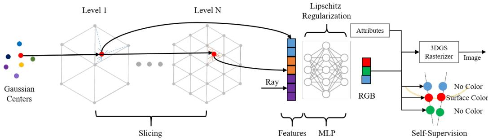  
Figure 1: Overview of our framework. We first use Gaussian centers to query multi-resolution feature grids to obtain features. Then, together with view directions, we employ an MLP to predict view-dependent colors for each Gaussian. The predicted colors and Gaussian attributes are then rendered by the differentiable rasterizer. We impose self-learned supervision on the neural color field.

## 3 Methods

## 3.1 Overview and Background

Overview. As shown in Fig. 1, we learn 3D Gaussians $\{ G _ { j } \} _ { j = 1 } ^ { J }$ (with center $m _ { j }$ , opacity $o _ { j }$ , scale $s _ { j } .$ , color $\boldsymbol { c } _ { j } )$ from RGB images $\{ V _ { i } \} _ { i = 1 } ^ { I }$ via 3DGS. We also learn a neural implicit function $F ( f _ { j } , r )$ that maps a feature $f _ { j }$ and a ray direction r pointing to a Gaussian to a view-dependent color $c _ { j } ^ { r } .$ During splatting, each Gaussian queries $F$ for its color before alpha blending. The color field is learned with rendering supervision and a novel self-supervision, leading to smoother radiance fields and better geometry.

Rendering with 3DGS. With camera pose $\mathbf { \nabla } p _ { i }$ , we render RGB $V _ { i } ^ { \prime }$ and depth $D _ { i } ^ { \prime }$ by splatting the Gaussians $\{ G _ { j } \} _ { j = 1 } ^ { J }$ below. We can learn 3D Gaussians by minimizing the discrepancy $L _ { I m g }$ in Eq. (8) between the rendered $\{ V _ { i } ^ { \prime } , D _ { i } ^ { \prime } \}$ and the observed $\{ V _ { i } , D _ { i } \}$ , where the depth rendering is optional,

$$
\{ V _ { i } ^ { \prime } , D _ { i } ^ { \prime } \} = s p l a t t i n g ( \{ G _ { j } \} , p _ { i } ) .\tag{1}
$$

## 3.2 Neural View-dependent Color Fields

We use an implicit function $F$ to represent the view-dependent color field using a neural network. For each Gaussian $G _ { j }$ , we first employ a hash feature grid H to model the spatial feature $f$ in 3D. We use its center $m _ { j }$ to interpolate a feature $f _ { j }$ from the grid H, which is then used to predict a color $\boldsymbol { c } _ { j } ^ { r }$ through the neural network, where r is the normalized direction from the camera center to the Gaussian center $m _ { j }$ . The MLP is queried once per camera–Gaussian pair, and the predicted color is shared across its projected footprint,

$$
\begin{array} { r } { \pmb { c } _ { j } ^ { r } = \pmb { F } ( \pmb { f } _ { j } , \pmb { r } ) , \quad \mathrm { w h e r e } \quad \pmb { f } _ { j } = \pmb { H } ( \pmb { m } _ { j } ) . } \end{array}\tag{2}
$$

To improve the efficiency of feature interpolation from H, we do not follow INGP [8] which uses a cubical grid and linearly interpolate features from the hashed eight corners of the containing cell. Instead, we adopt a tetrahedral lattice [34, 35] which only needs four corners in each cell in interpolation. It reduces both of the storage and the computation complexity by a factor of two.

## 3.3 Self-Learning of Neural View-dependent Color Field

We learn the hash feature lattice H and the implicit function F from the radiance field represented by current Gaussians $\{ G _ { j } \}$ in iterative optimization. We use four kinds of supervision signals, one is from the 2D rendering error to the observation, the other three are from the 3D space. It is intuitive to use the 2D rendering error to update both of H and $F ,$ since the whole framework is differentiable based on 3DGS, thus, we will focus on introducing the 3D supervision below.

On Surface Sampling. As illustrated in Fig. 2, we produce samples on the estimated surface to learn the view-dependent color field. We first render a depth map $\hat { D _ { i } ^ { \prime } }$ with a camera pose $\mathbf { \Delta } _ { p _ { i } }$ , and regard the 3D points $\pi ^ { - 1 } ( D _ { i } ^ { \prime } )$ back-projected from $\pmb { D } _ { i } ^ { \prime }$ as the training samples, where $\pi ^ { \dot { - } 1 }$ denotes the back projection. We collect the coordinates $\pi ^ { - 1 } ( D _ { i } ^ { \prime } )$ of these points, the ray direction from the center of the i-th camera to each 3D Gaussian, and the color on the image $V _ { i }$ as the supervision. The rationale behind this supervision is that the color we see on images corresponds to the color on the surface. Then, we minimize the prediction error to the color on ${ \check { V } } _ { i } .$

$$
L _ { O n } = | | F ( \pmb { H } ( \pi ^ { - 1 } ( \pmb { D } _ { i } ^ { \prime } ) ) , \pi ^ { - 1 } ( \pmb { D } _ { i } ^ { \prime } ) - \pmb { p } _ { i } ^ { t } ) - \pmb { V } _ { i } | | _ { 2 } ^ { 2 } ,\tag{3}
$$

where $\mathbf { \Delta } _ { p _ { i } ^ { t } } ^ { t }$ is the center of the i-th camera.

Free Space Sampling before and behind the Surface. Given the estimated surface intersections $\pi ^ { - 1 } ( \bar { \pmb { D } _ { i } ^ { \prime } } )$ , we assume that the space before and slightly behind each intersection should be empty. We therefore sample points along each ray around the intersection, as shown in Fig. 2, and constrain their colors to be zero. Specifically, we sample $\mathbf { } e _ { i } \sim \mathcal { N } ( D _ { i } ^ { \prime } , \delta ^ { 2 } )$ and split the samples into points before the surface $e _ { i } ^ { - }$ and behind the surface $e _ { i } ^ { + }$ , which are weighted with different confidence,

$$
L _ { B e f o r e } = \| F ( H ( e _ { i } ^ { - } ) , e _ { i } ^ { - } - p _ { i } ^ { t } ) \| _ { 2 } ^ { 2 } , \quad L _ { B e h i n d } = \| F ( H ( e _ { i } ^ { + } ) , e _ { i } ^ { + } - p _ { i } ^ { t } ) \| _ { 2 } ^ { 2 } .\tag{4}
$$

Lipschitz Continuity of the color Field. We impose a Lipschitz constraint on $F$ to encourage smoothness in the neural color field and prevent high-frequency color variation from being explained by appearance alone. This encourages large color changes to align with geometric variation. Formally, $\dot { F }$ is k-Lipschitz continuous if,

$$
| F ( H ( m ) ) - F ( H ( m ^ { \prime } ) ) | \leq k | m - m ^ { \prime } | ,\tag{5}
$$

where we omit the ray direction r for simplicity, and k bounds the rate of change of where we omit the ray direction r for sim $F .$

We employ recent work [31] to softly add the k-Lipschitz constraints through the weights of neural networks. For a given MLP layer $y =$ $g ( W _ { u } x + b _ { u } )$ , we employ a learnable Lipschitz bound $k _ { u }$ for each layer to replace the original weight $W _ { u }$ with $\overline { { W _ { u } } }$

$$
\overline { { { W _ { u } } } } = n o r m a l i z a t i o n ( W _ { u } , s o f t p l u s ( k _ { u } ) ) ,\tag{6}
$$

where $s o f t p l u s ( k _ { u } ) = l n ( 1 + e ^ { k _ { u } } )$ and the normalization scales each row of $W _ { u }$ such that the absolute value of the row-sum is less than or equals to $s o f t p l u s ( k _ { u } )$ . The Lipschitz bound for the whole network is the product of the perlayer Lipschitz constraint, which is what we regularize over all layers,

$$
L _ { L i p } = \prod _ { u = 1 } ^ { U } s o f t p l u s ( k _ { u } ) .\tag{7}
$$

## 3.4 Loss and Details

Loss. We conduct the optimization through 3DGS to learn spatial feature lattice H, the function $F _ { \mathrm { { ; } } }$ , and the Gaussians $\{ G _ { j } \}$ from RGB images,

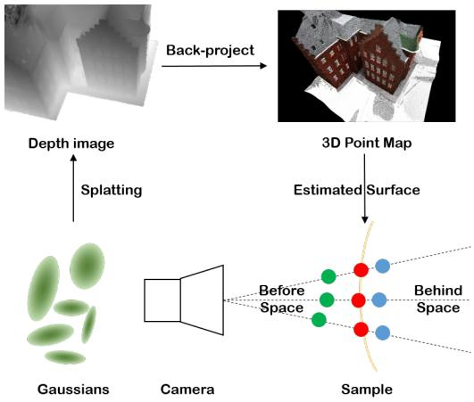  
Figure 2: Illustration of our 3D supervision sampling strategy. Given the rendered depth $D _ { i } ^ { \prime } ,$ we back-project each pixel to obtain the surface intersection. (a) On-surface: the intersection point $( \pi ^ { - 1 } ( D _ { i } ^ { \prime } )$ , red) is supervised by the ground-truth color in $V _ { i } \ ( \mathrm { E q . \ } ( 3 ) )$ . (b) Free space: points $e _ { i }$ sampled along the ray around the intersection are constrained to have no color before $( e _ { i } ^ { - }$ , green) and behind $( e _ { i } ^ { + }$ , blue) the surface (Eq. (4)).

$$
\operatorname* { m i n } _ { H , F , \{ G _ { j } \} } L _ { I m g } + \alpha L _ { O n } + \beta L _ { B e f o r e } + \gamma L _ { B e h i n d } + \eta L _ { L i p } ,\tag{8}
$$

where $L _ { I m g }$ is the rendering error from 3DGS, and α, β, γ, and η are balance weights. We impose different weights on sampling before and behind the estimated surface since we got higher confidence that there is no points before the surface while there is uncertainty behind the estimated surface.

Implementation Details. To ensure a stable and efficient training, we adopt three key strategies. First, we utilize a 3D bounding box to mark the near front. The proposed neural color field (Hash Grid + MLP) is applied exclusively to Gaussians within this box to capture fine details, while background Gaussians retain standard Spherical Harmonics. Second, we employ gradient detachment to decouple appearance from geometry, detaching gradients for Gaussian attributes (e.g., position m) during 3D supervision $( L _ { O n , B e f o r e , B e h i n d } )$ so these losses only update the feature grid H and implicit network F. Third, we use the asymmetric sampling for free-space supervision, applying distinct variances for points sampled along the ray before and behind the surface.

Regarding the network architecture, we use a 4-layer MLP for color decoding. We set the hash grid to 18 levels with 32 feature dimensions for DTU [36] and increase this to 20 levels with 48 dimensions for the TnT [37] and Mip-NeRF [38] 360 datasets. Sampling variances are set to $\delta _ { b e f o r e } = 0 . 1 , \delta _ { b e h i n d } = 0 . 0 1$ for DTU, and increased to 1.0 and 0.1 for other datasets. Loss weights α, β, γ in Eq. (8) are 0.05 for TnT and 0.01 otherwise. Lipschitz constraints regarding Eq. (7) with $\eta = 1 \dot { 0 } ^ { - 6 }$ are imposed after 10k iterations within a total of 30k. The Geometry is extracted via TSDF fusion (voxel size 0.004) and the marching cubes algorithm using Open3D [39]. On Mip-NeRF 360, we adhere to the standard protocol by holding out 1/8 of images for testing.

## 4 Experiments

## 4.1 Experimental Setup

Datasets. To comprehensively evaluate the effectiveness of our method, we conduct extensive experiments across three standard benchmarks covering both object-level details and large-scale real-world scenes including DTU [36], TnT [37], and Mip-NeRF360 [38].

Baselines. We compare our method with state-of-the-art 3DGS variants, including 3DGS [1], 2DGS [10], PGSR [3], and FastGS [40], as well as SplatFields [24], which also uses MLP-predicted attributes. For real-world scenes without ground-truth meshes, we further compare rendering quality with Instant-NGP [8], Mip-NeRF 360 [38], and BakedSDF [41]. We conduct all the experiments on a single NVIDIA GeForce RTX 3090.

Evaluation Metrics. We evaluate the geometry using Chamfer Distance (CD) on DTU and F-score on TnT, following the official protocols and previous methods. For novel view synthesis on Mip-NeRF 360, we report PSNR, SSIM, and LPIPS, which are widely used metrics evaluating rendering quality.

Table 1: CD comparison on DTU. The top 3 are ranked as 1st , 2nd and 3rd .
<table><tr><td>Methods</td><td>24</td><td>37</td><td>40</td><td>55</td><td>63</td><td>65</td><td>69</td><td>83</td><td>97</td><td>105</td><td>106</td><td>110</td><td>114</td><td>118</td><td>122</td><td>Mean</td><td>Time</td></tr><tr><td>SplatFields [24]</td><td>3.76</td><td>4.20</td><td>4.35</td><td>2.16</td><td>4.31</td><td>5.93</td><td>3.03</td><td>3.03</td><td>3.44</td><td>2.49</td><td>5.31</td><td>4.94</td><td>4.19</td><td>3.33</td><td>2.85</td><td>3.82</td><td>1h</td></tr><tr><td>Mini-Splatting [42]</td><td>2.05</td><td>1.24</td><td>1.55</td><td>1.11</td><td>2.14</td><td>1.82</td><td>1.59</td><td>2.12</td><td>1.87</td><td>1.57</td><td>1.48</td><td>2.20</td><td>1.78</td><td>1.29</td><td>1.33</td><td>1.67</td><td>6.5m</td></tr><tr><td>AnySplat [16]</td><td>2.93</td><td>2.95</td><td>2.15</td><td>2.65</td><td>4.09</td><td>2.68</td><td>1.94</td><td>2.85</td><td>2.25</td><td>2.55</td><td>2.24</td><td>4.30</td><td>2.21</td><td>2.00</td><td>2.37</td><td>2.68</td><td>3m</td></tr><tr><td>FastGS [40]</td><td>2.66</td><td>2.04</td><td>2.45</td><td>2.22</td><td>3.73</td><td>2.62</td><td>1.81</td><td>2.53</td><td>2.21</td><td>2.30</td><td>2.54</td><td>2.38</td><td>2.81</td><td>1.54</td><td>1.67</td><td>2.37</td><td>3.1m</td></tr><tr><td>3DGS [i]</td><td>1.97</td><td>1.37</td><td>2.11</td><td>1.73</td><td>3.52</td><td>2.56</td><td>1.67</td><td>1.93</td><td>1.75</td><td>1.84</td><td>1.72</td><td>2.24</td><td>1.57</td><td>1.43</td><td>1.33</td><td>1.92</td><td>22.3m</td></tr><tr><td>2DGS [10]</td><td>0.48</td><td>0.91</td><td>0.39</td><td>0.39</td><td>1.01</td><td>0.83</td><td>0.81</td><td>1.36</td><td>1.27</td><td>0.76</td><td>0.70</td><td>1.40</td><td>0.40</td><td>0.76</td><td>0.52</td><td>0.80</td><td>20.5m</td></tr><tr><td>PGSR [3]</td><td>0.37</td><td>0.55</td><td>0.39</td><td>0.36</td><td>0.78</td><td>0.58</td><td>0.49</td><td>1.10</td><td>0.64</td><td>0.59</td><td>0.47</td><td>0.56</td><td>0.32</td><td>0.37</td><td>0.35</td><td>0.53</td><td>32.5m</td></tr><tr><td>Ours(FastGS)</td><td>1.43</td><td>1.14</td><td>1.75</td><td>1.15</td><td>2.59</td><td>1.37</td><td>1.67</td><td>2.38</td><td>1.80</td><td>1.05</td><td>1.84</td><td>2.61</td><td>0.98</td><td>1.54</td><td>1.60</td><td>1.66</td><td>12.3m</td></tr><tr><td>Ours(3DGS)</td><td>0.82</td><td>0.88</td><td>1.64</td><td>1.05</td><td>1.94</td><td>1.00</td><td>1.18</td><td>1.21</td><td>1.29</td><td>0.73</td><td>0.93</td><td>2.07</td><td>0.64</td><td>0.82</td><td>0.70</td><td>1.13</td><td>30.1m</td></tr><tr><td>Ours(2DGS)</td><td>0.55</td><td>0.73</td><td>0.43</td><td>0.43</td><td>1.24</td><td>0.81</td><td>0.86</td><td>1.12</td><td>1.23</td><td>0.64</td><td>0.80</td><td>1.30</td><td>0.40</td><td>0.59</td><td>0.48</td><td>0.77</td><td>25.1m</td></tr><tr><td>Ours(PGSR)</td><td>0.33</td><td>0.55</td><td>0.38</td><td>0.34</td><td>0.78</td><td>0.50</td><td>0.50</td><td>1.05</td><td>0.66</td><td>0.58</td><td>0.47</td><td>0.50</td><td>0.31</td><td>0.38</td><td>0.35</td><td>0.51</td><td>42.4m</td></tr></table>

## 4.2 Evaluations

Comparisons on DTU. We first evaluate our method by comparing it with other 3DGS variations on DTU, as reported in Tab. 1. To evaluate our general capability of working with various 3DGS variations, we report our results with vanilla 3DGS [1], 2DGS [10], FastGS [40], and PGSR [3]. We include vanilla 3DGS to highlight our performance without additional losses for geometry inference since the additional constraints used by 2DGS [10], FastGS [40], and PGSR [3] are redundant to what we can improve, which weakens our improvements. The comparison shows that our method improves the average reconstruction accuracy of all four backbones. Specifically, our method improves the performance by 30.0% over FastGS, 41.1% over 3DGS, and 3.8% over 2DGS in average, which can be also observed in visual comparison in Fig. 4 (a). For PGSR, our method further reduces the average CD from 0.53 to 0.51. PGSR already achieves strong reconstruction accuracy through geometry-oriented constraints, which may partially overlap with the effects of our regularization and

Table 2: Comparisons of rendering quality on DTU. The top 3 are ranked as
<table><tr><td>Method</td><td>PSNR↑</td><td>SSIM↑</td><td>LPIPS↓</td></tr><tr><td rowspan="5">SplatFields [24] Mini-Splatting [42] FastGS [40] 3DGS [1]</td><td>24.14</td><td>0.813</td><td>0.241</td></tr><tr><td>30.39</td><td>0.946</td><td>0.071</td></tr><tr><td>30.84</td><td>0.950</td><td>0.073</td></tr><tr><td>32.56</td><td>0.953</td><td>0.063</td></tr><tr><td>32.32</td><td>0.955</td><td>0.058</td></tr><tr><td>2DGS [10] Ours(FastGS)</td><td>31.06</td><td>0.951</td><td>0.070</td></tr><tr><td>Ours(3DGS)</td><td>32.77</td><td>0.956</td><td>0.065</td></tr><tr><td>Ours(2DGS)</td><td>32.61</td><td>0.955</td><td>0.060</td></tr></table>

leave less room for further performance improvements on DTU. Nevertheless, this additional gain demonstrates that our method can complement an already strong geometry-constrained backbone.

GT  
SplatFields  
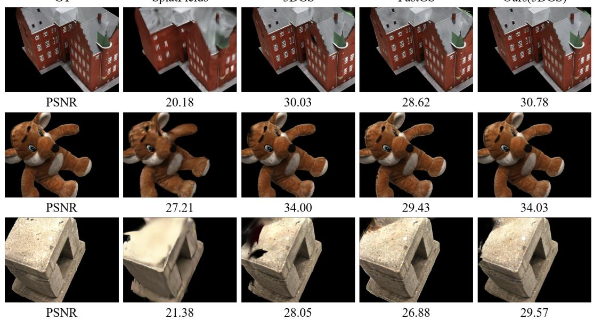  
3DGS  
FastGS  
Ours(3DGS)  
Figure 3: Visual comparison of rendering on DTU dataset.

Moreover, our geometry inference also outperform other 3DGS variations like Mini-Splatting [42], SplatFields [24], and Anysplat [16]. Compared to Splatfields and Anysplat which also leverage an MLP to predict the Gaussian attributes in either overfitting or data-driven manner, our methods merely predict color, and only add constraints on color, which can push attributes related to geometry to match high-frequency color change. To highlight the improvement, we show visual comparison in Fig. 4 (a), where our method recovers more complete and compact surfaces.

Tab. 2 and Fig. 3 also report our comparable performance in novel view synthesis. Although we use neural networks to model the color field, the bias of neural networks on low-frequency color change does not hurt our appearance modeling in radiance fields, since our method can encourage larger geometry change to make up the weakness of lowfrequency color change with the Lipschitz constraint. For the efficiency, the use of neural network slightly slows down the training.

Table 3: Comparisons of rendering quality on TnT. The top 3 are ranked as 1st , 2nd and 3rd .
<table><tr><td>Method</td><td>PSNR↑</td><td>SSIM↑</td><td>LPIPS↓</td></tr><tr><td rowspan="2">SplatFields [24] FastGS [40]</td><td>15.99</td><td>0.518</td><td>0.650</td></tr><tr><td>25.67</td><td>0.841</td><td>0.241</td></tr><tr><td rowspan="2">3DGS [i]</td><td>24.37</td><td>0.812</td><td>0.265</td></tr><tr><td>25.13</td><td>0.834</td><td>0.225</td></tr><tr><td rowspan="2">Ours(FastGS) Ours(3DGS)</td><td>24.76</td><td>0.849</td><td>0.245</td></tr><tr><td></td><td></td><td></td></tr></table>

Comparisons on TnT. Tab. 4 shows results on the large-scale TnT dataset with FastGS and 3DGS backbones. Our method improves F-score for both variants, demonstrating better geometry reconstruction on realistic large-scale scenes, similar to our improvements shown in Fig. 5. Although

Input

  
CD

SplatFields

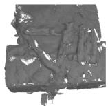  
4.20

FastGS

  
CD

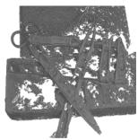

3DGS

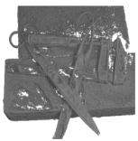  
2.04

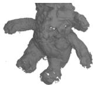  
2.49

Ours(2DGS)

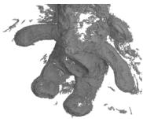  
1.37

  
2.30

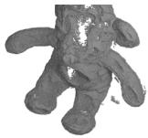  
1.84  
0.73

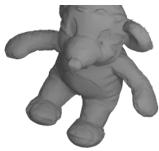  
0.94

(a) Comparison with State-of-the-Art Methods.  
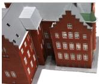

FastGS  
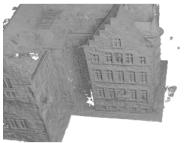

Ours(FastGS)  
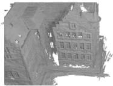

Ours(3DGS)

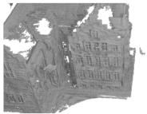

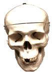

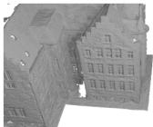

1.43

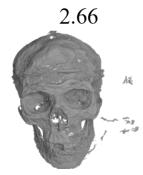

0.82

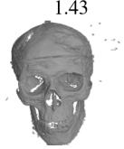

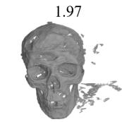

2.22

CD

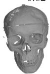

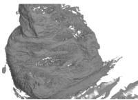  
2.81

1.15

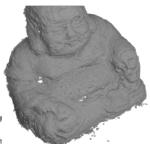  
0.98

1.73

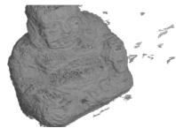

1.57

1.05

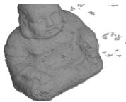

0.64

(b) Improvements on Various Backbones.

Figure 4: Performance on the DTU dataset. (a) Comparison of Ours (2DGS) with existing Gaussian Splatting methods. (b) Improvements over FastGS and 3DGS backbones.

Table 4: F-score comparisons on Tanks And Temples dataset [37].
<table><tr><td>Methods</td><td>Barn</td><td>Caterpillar</td><td>Courthouse</td><td>Ignatius</td><td>Meetingroom</td><td>Truck</td><td>Mean</td></tr><tr><td rowspan="3">SplatFields [24] FastGS [40] 3DGS [1]</td><td>0.02</td><td>0.03</td><td>0.01</td><td>0.05</td><td>0.01</td><td>0.05</td><td>0.03</td></tr><tr><td>0.10</td><td>0.09</td><td>0.07</td><td>0.09</td><td>0.02</td><td>0.12</td><td>0.08</td></tr><tr><td>0.13</td><td>0.08</td><td>0.09</td><td>0.25</td><td>0.06</td><td>0.18</td><td>0.13</td></tr><tr><td>Ours(FastGS) Ours(3DGS)</td><td>0.11 0.17</td><td>0.10 0.14</td><td>0.07 0.10</td><td>0.14 0.28</td><td>0.04 0.09</td><td>0.16 0.19</td><td>0.11 0.16</td></tr></table>

SplatFields is also MLP-based, it does not scale well to large scenes. In contrast, our spatial feature grid and neural color field generalize better under challenging indoor and outdoor lighting.

Comparisons on MipNeRF-360. We report our performance in novel view synthesis on MipNeRF-360 in Tab. 5. Our comparable performance indicates that our method can promptly encourage geometry change to match with the large color change since we used a neural network that is biased on low-frequency signals to model the color field. Moreover, we also show our advantage with more complete surfaces and geometry details in geometry inference in Fig. 6.

## 4.3 Ablation Study and Analysis

In this section, we conduct ablation studies on the key components of our framework to validate their effectiveness. Specifically, we investigate the contribution of (1) the Lipschitz continuity constraint on the color field, (2) the sampling strategy (both on surface sampling and free space sampling), and (3) the justification of our design.

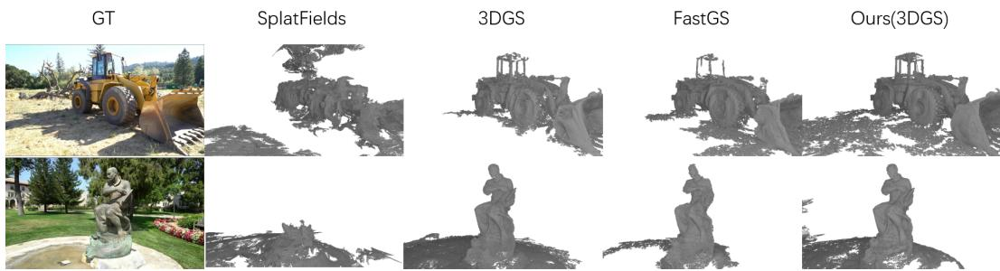  
Figure 5: Visual comparisons of geometry inference on TnT [37]. Table 5: Comparisons of rendering quality on MipNeRF-360.

<table><tr><td></td><td colspan="3">Indoor Scene</td><td colspan="3">Outdoor Scene</td></tr><tr><td></td><td>PSNR↑</td><td>SSIM↑</td><td>LPIPS↓</td><td>PSNR↑</td><td>SSIM↑</td><td>LPIPS↓</td></tr><tr><td rowspan="4">NeRF[6] Instant-NGP [8] MipNeRF 360 [38]</td><td>26.84</td><td>0.790</td><td>0.370</td><td>21.46</td><td>0.458</td><td>0.515</td></tr><tr><td>29.15</td><td>0.880</td><td>0.216</td><td>22.90</td><td>0.566</td><td>0.371</td></tr><tr><td>31.72</td><td>0.917</td><td>0.180</td><td>24.47</td><td>0.691</td><td>0.283</td></tr><tr><td>27.06</td><td>0.839</td><td>0.258</td><td>22.47</td><td>0.585</td><td>0.349</td></tr><tr><td rowspan="3">SplatFields [24] FastGS [40] 3DGS [i]</td><td>17.07</td><td>0.528</td><td>0.189</td><td>18.44</td><td>0.361</td><td>0.694</td></tr><tr><td>31.28</td><td>0.924</td><td>0.184</td><td>24.53</td><td>0.695</td><td>0.322</td></tr><tr><td>30.41</td><td>0.920</td><td>0.189</td><td>24.64</td><td>0.731</td><td>0.272</td></tr><tr><td>Ours(FastGS)</td><td>30.67</td><td>0.921</td><td>0.189</td><td>24.35</td><td>0.686</td><td>0.332</td></tr><tr><td>Ours(3DGS)</td><td>30.43</td><td>0.926</td><td>0.199</td><td>24.44</td><td>0.723</td><td>0.283</td></tr></table>

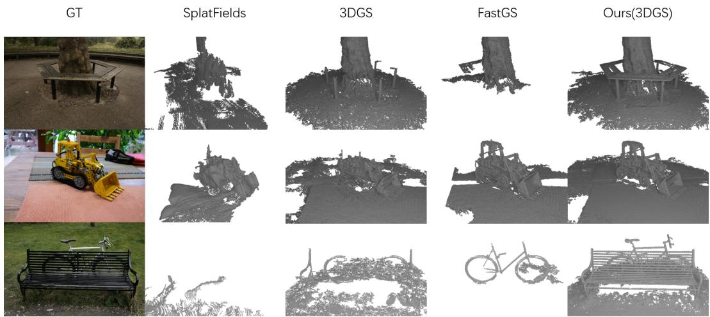  
Figure 6: Visual comparisons between our method on MipNeRF-360 [38].

Table 6: Ablation Study on DTU. Impact of different modules on geometry extraction (CD ↓).  
Table 7: View-Dependence Analysis.
<table><tr><td>Method</td><td>1 |Base</td><td>w/  $L _ { L i p }$ </td><td>w/ Samp.</td><td>Full</td></tr><tr><td>CD</td><td>1.29</td><td>1.23</td><td>1.17</td><td>1.13</td></tr></table>

<table><tr><td>Mode</td><td>CD↓</td><td>PSNR↑</td><td>SSIM↑</td><td>LPIPS ↓</td></tr><tr><td>Non-View</td><td>1.86</td><td>31.40</td><td>0.946</td><td>0.076</td></tr><tr><td>View-Dependent</td><td>1.13</td><td>32.77</td><td>0.956</td><td>0.065</td></tr></table>

Impact of Lipschitz Regularization $L _ { L i p } .$ We first investigate the role of our Lipschitz constraint. As discussed in Section 3.3, imposing Lipschitz regularization $L _ { L i p }$ in Eq. (7) on the color network encourages smoothness in the implicit field. This smoothness ensures that high-frequency color variations in the input images correspond to significant geometric changes, rather than significantly being absorbed by the neural network’s capacity, leading to richer geometric details, as shown by “Baseline” vs. $\cdots \mathrm { w } / L _ { L i p } \mathrm { , , }$ in Tab. 6. Moreover, $L _ { L i p }$ reduces floating artifacts caused by Gaussians overfitting appearance attributes at incorrect geometric positions, improving the CD from 1.29 to 1.23.

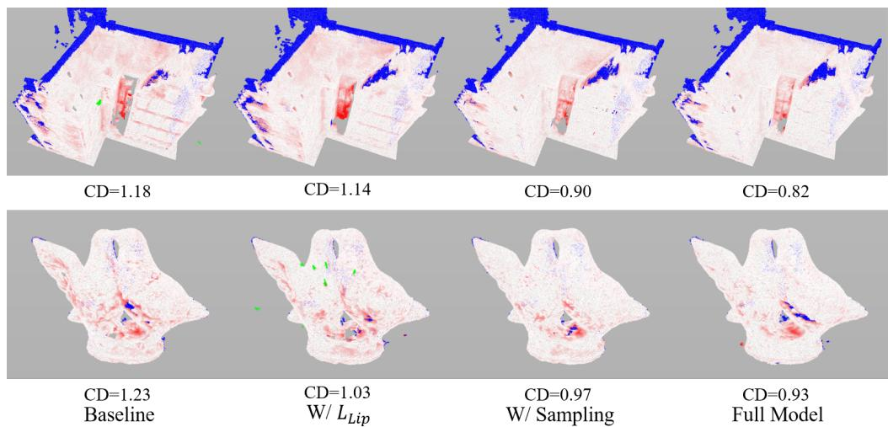  
Figure 7: Error map visualization. White-to-red denotes increasing error, green marks distances beyond the cutoff, and blue indicates points outside the evaluated region.  
Table 9: Ablation on sampling strategies.

Table 8: Impact of hash table capacity on geometry reconstruction on DTU [36].
<table><tr><td>Hash Size</td><td> $2 ^ { 9 }$ </td><td> $2 ^ { 1 2 }$ </td><td> $2 ^ { 1 5 }$ </td><td> $2 ^ { 1 8 }$ </td></tr><tr><td>CD↓</td><td>1.41</td><td>1.14</td><td>1.10</td><td>1.13</td></tr></table>

<table><tr><td>Sampling Strategy</td><td>Surface</td><td>Surface+Front</td><td>Surface+Back</td><td>Full</td></tr><tr><td>CD↓</td><td>1.62</td><td>1.31</td><td>1.18</td><td>1.13</td></tr></table>

Impact of Self-supervised Sampling. Our sampling strategy plays a crucial role in surface smoothing and refinement. By enforcing the color network to output the ground-truth color at the estimated surface depth (mean depth) while predicting zero color for points sampled before and behind the surface, we create a strong spatial constraint. To minimize the rendering error under this supervision, the MLP implicitly guides the Gaussians to concentrate around the mean depth and increases their opacity to form a solid surface. This concentration effect eliminates fuzzy boundaries and results in a much smoother and cleaner reconstruction, significantly lowering the CD to 1.17, as shown by “w/Sampling” in Tab. 6. Moreover, we also justify that the supervision from both of the sampling before and after the estimated surface can improve the geometry inference. The full model combines both strategies and achieves the best result, with CD reduced to 1.13 in Tab. 6. Overall, the Lipschitz regularization improves detail and suppresses overfitting, while sampling supervision promotes surface smoothness.

Hash Table Capacity. We first investigate the effect of the hash table capacity on geometry reconstruction. As shown in Table 8, increasing the hash size from $2 ^ { 9 }$ to 215 significantly improves the reconstruction accuracy, as a larger table provides higher feature capacity and reduces hash collisions. However, further increasing the size to 218 slightly degrades the performance, which may be caused by over-parameterization and reduced regularization. A capacity of 215 achieves the lowest CD in this ablation.

Sampling Strategy. We further analyze different sampling strategies around the surface. As shown in Table 9, using only surface samples leads to inferior reconstruction quality. Introducing additional samples in front of the surface significantly improves the performance, as these samples provide constraints for the free space. Sampling behind the surface further improves the reconstruction accuracy by introducing interior occupancy information. The best performance is achieved when both front and back samples are used, demonstrating the effectiveness of modeling both free space and interior regions.

View-Dependent vs. Non-View-Dependent. We model the view-dependent color field with an MLP for high-fidelity rendering. Removing the ray direction leaves the Gaussian locations to be the only factor that determines the color, which hurts the rendering, highlighting its impact. As shown in Tab. 7, view-dependent color fields outperform non-view-dependent ones in both rendering and geometry inference.

Estimated Depth Update Interval. We study how often the estimated depth is updated for selfsupervision. Tab. 10 compares the performance with update intervals of {1, 100, 300, 500} iterations. More frequent updates yield better performance, because the MLP observes richer coordinate variations despite noisy early estimates.

Table 10: Depth Update Interval. Impact of update frequency on geometry.
<table><tr><td>Interval</td><td>1</td><td>100</td><td>300</td><td>500</td></tr><tr><td>CD↓</td><td>1.13</td><td>1.54</td><td>1.51</td><td>1.53</td></tr></table>

Visualization of View-Dependent Color Fields. Fig. 8 visualizes the learned view-dependent color field on a 2D slice under a fixed view direction. We sample 3D points around the rendered depth and query their colors with the trained MLP. The colors fade rapidly away from the surface, confirming the correctness of the learned field.

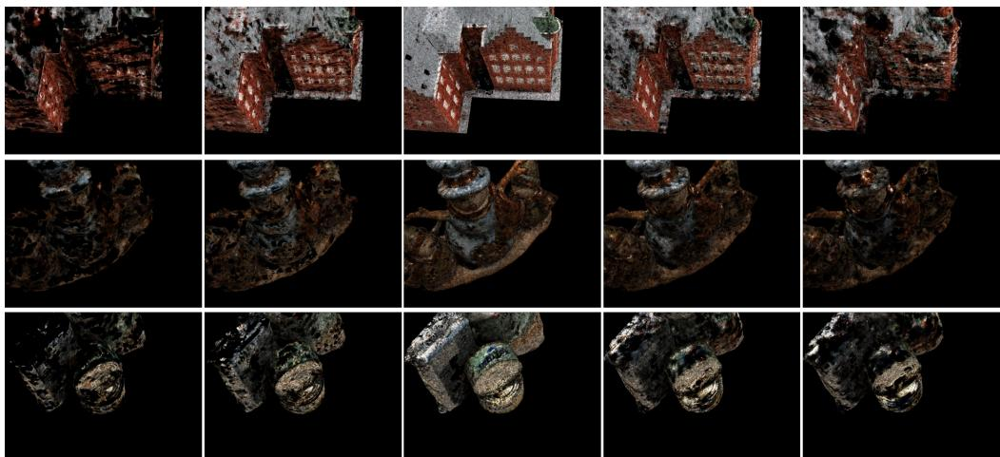  
Figure 8: Visualization of the view-dependent color field. From left to right, we show MLP-predicted colors on a 2D slice moving from the front to the back of the object along the viewing direction.

also evaluate the modeling of opacity with an MLP. As reported in Tab. 11, unlike color-field modeling, this alternative does not improve geometry. While GOF [25] also models opacity

Table 11: Color Fields vs. Opacity Fields.
<table><tr><td>Method</td><td>Ours(color)</td><td>Ours(opacity)</td><td>GOF [25]</td></tr><tr><td>CD↓</td><td>0.77</td><td>2.94</td><td>0.74</td></tr></table>

and performs well, it relies on specialized rendering and additional normal and densification constraints, highlighting the simplicity and effectiveness of our color-field formulation.

Difference to More Complex Constraints on Geometry. We show that continuous color fields are key to geometry recovery in 3DGS. Prior works add stronger geometric constraints (e.g., multi-view depth consistency, monocular depth/normal priors) at the cost of heavier computation. Instead, we provide a simpler and more general solution for geometry inference.

More Ablation Studies. Further discussion of the Lipschitz-only comparison and ablations on front and back sampling variances are provided in Appendix C.

## 5 Conclusion

We propose to constrain smoothness in radiance field for improving geometry inference with 3DGS. We model the radiance field within a neural view-dependent color field that is parameterized by a neural network. By leveraging spectral bias of neural network and Lipschitz regularization, our method encourages geometry to better align with color variation while maintaining the rendering quality. Our self-learning strategy requires no external priors and improves the learning of the color field. Extensive experiments on benchmarks demonstrate superior geometry reconstruction over recent 3DGS variants.

## Acknowledgments and Disclosure of Funding

This work was partially supported by Deep Earth Probe and Mineral Resources Exploration – National Science and Technology Major Project (2024ZD1003405) and the National Natural Science Foundation of China (62272263).

## References

[1] Bernhard Kerbl, Georgios Kopanas, Thomas Leimkühler, and George Drettakis. 3D Gaussian Splatting for Real-Time Radiance Field Rendering. ACM Transactions on Graphics, 42(4): 1–14, 2023. Article 139.

[2] Wenyuan Zhang, Yu-Shen Liu, and Zhizhong Han. Neural Signed Distance Function Inference through Splatting 3D Gaussians Pulled on Zero-Level Set. In Advances in Neural Information Processing Systems, volume 37, pages 101856–101879, 2024.

[3] Danpeng Chen, Hai Li, Weicai Ye, Yifan Wang, Weijian Xie, Shangjin Zhai, Nan Wang, Haomin Liu, Hujun Bao, and Guofeng Zhang. PGSR: Planar-Based Gaussian Splatting for Efficient and High-Fidelity Surface Reconstruction. IEEE Transactions on Visualization and Computer Graphics, 31(9):6100–6111, September 2025.

[4] Zehao Yu, Songyou Peng, Michael Niemeyer, Torsten Sattler, and Andreas Geiger. MonoSDF: Exploring Monocular Geometric Cues for Neural Implicit Surface Reconstruction. In Advances in Neural Information Processing Systems, volume 35, pages 25018–25032, 2022.

[5] Wenyuan Zhang, Yixiao Yang, Han Huang, Liang Han, Kanle Shi, Yu-Shen Liu, and Zhizhong Han. MonoInstance: Enhancing Monocular Priors via Multi-view Instance Alignment for Neural Rendering and Reconstruction. In Proceedings of the IEEE/CVF Conference on Computer Vision and Pattern Recognition, pages 21642–21653, 2025.

[6] Ben Mildenhall, Pratul P. Srinivasan, Matthew Tancik, Jonathan T. Barron, Ravi Ramamoorthi, and Ren Ng. NeRF: Representing Scenes as Neural Radiance Fields for View Synthesis. In Proceedings ofthe European Conference on Computer Vision, pages 405–421. Springer, 2020.

[7] Sara Fridovich-Keil, Alex Yu, Matthew Tancik, Qinhong Chen, Benjamin Recht, and Angjoo Kanazawa. Plenoxels: Radiance Fields Without Neural Networks. In Proceedings of the IEEE/CVF Conference on Computer Vision and Pattern Recognition, pages 5501–5510, 2022.

[8] Thomas Müller, Alex Evans, Christoph Schied, and Alexander Keller. Instant neural graphics primitives with a multiresolution hash encoding. ACM Transactions on Graphics, 41(4):1–15, July 2022. Article 102.

[9] Qiangeng Xu, Zexiang Xu, Julien Philip, Sai Bi, Zhixin Shu, Kalyan Sunkavalli, and Ulrich Neumann. Point-NeRF: Point-Based Neural Radiance Fields. In Proceedings ofthe IEEE/CVF Conference on Computer Vision and Pattern Recognition, pages 5438–5448, 2022.

[10] Binbin Huang, Zehao Yu, Anpei Chen, Andreas Geiger, and Shenghua Gao. 2D Gaussian Splatting for Geometrically Accurate Radiance Fields. In ACM SIGGRAPH 2024 Conference Papers, pages 1–11, 2024. Article 32.

[11] Takeshi Noda, Yu-Shen Liu, and Zhizhong Han. 3D Gaussian Splatting with Self-Constrained Priors for High Fidelity Surface Reconstruction. In Proceedings ofthe IEEE/CVF Conference on Computer Vision and Pattern Recognition, pages 26041–26051, 2026.

[12] Liang Han, Bangcai Wei, Junsheng Zhou, Yu-Shen Liu, and Zhizhong Han. Sparse-View Surface Reconstruction Using Gaussian Splatting Through High-Confidence Depth Propagation with Normal Priors. In Proceedings of the European Conference on Computer Vision, pages 491–511. Springer, 2026.

[13] Peng Xiang, Liang Han, Hui Zhang, Yu-Shen Liu, and Zhizhong Han. VGGS: VGGT-guided Gaussian Splatting for Efficient and Faithful Sparse-View Surface Reconstruction. In Proceedings ofthe AAAI Conference on Artificial Intelligence, volume 40, pages 10969–10977, 2026.

[14] Wenyuan Zhang, Jimin Tang, Weiqi Zhang, Yi Fang, Yu-Shen Liu, and Zhizhong Han. MaterialRefGS: Reflective Gaussian Splatting with Multi-view Consistent Material Inference. In Advances in Neural Information Processing Systems, volume 38, pages 89896–89917, 2025.

[15] Antoine Guédon and Vincent Lepetit. SuGaR: Surface-Aligned Gaussian Splatting for Efficient 3D Mesh Reconstruction and High-Quality Mesh Rendering. In Proceedings of the IEEE/CVF Conference on Computer Vision and Pattern Recognition, pages 5354–5363, 2024.

[16] Lihan Jiang, Yucheng Mao, Linning Xu, Tao Lu, Kerui Ren, Yichen Jin, Xudong Xu, Mulin Yu, Jiangmiao Pang, Feng Zhao, Dahua Lin, and Bo Dai. AnySplat: Feed-forward 3D Gaussian Splatting from Unconstrained Views. ACM Transactions on Graphics, 44(6):1–16, 2025. Article 257.

[17] Baorui Ma, Zhizhong Han, Yu-Shen Liu, and Matthias Zwicker. Neural-Pull: Learning Signed Distance Functions from Point Clouds by Learning to Pull Space onto Surfaces. In Proceedings of the 38th International Conference on Machine Learning, volume 139 of Proceedings of Machine Learning Research, pages 7246–7257. PMLR, 2021.

[18] Nasim Rahaman, Aristide Baratin, Devansh Arpit, Felix Draxler, Min Lin, Fred Hamprecht, Yoshua Bengio, and Aaron Courville. On the Spectral Bias of Neural Networks. In Proceedings of the 36th International Conference on Machine Learning, volume 97 of Proceedings of Machine Learning Research, pages 5301–5310. Proceedings of Machine Learning Research, 2019.

[19] Chao Chen, Yu-Shen Liu, and Zhizhong Han. Sharpening Neural Implicit Functions with Frequency Consolidation Priors. In Proceedings of the AAAI Conference on Artificial Intelligence, volume 39, pages 2025–2033, 2025.

[20] Matthew Tancik, Pratul Srinivasan, Ben Mildenhall, Sara Fridovich-Keil, Nithin Raghavan, Utkarsh Singhal, Ravi Ramamoorthi, Jonathan Barron, and Ren Ng. Fourier Features Let Networks Learn High Frequency Functions in Low Dimensional Domains. In Advances in Neural Information Processing Systems, volume 33, pages 7537–7547, 2020.

[21] Wenyuan Zhang, Emily Yue-ting Jia, Junsheng Zhou, Baorui Ma, Kanle Shi, Yu-Shen Liu, and Zhizhong Han. NeRFPrior: Learning Neural Radiance Field as a Prior for Indoor Scene Reconstruction. In Proceedings ofthe IEEE/CVF Conference on Computer Vision and Pattern Recognition, pages 11317–11327, 2025.

[22] Wenyuan Zhang, Chunsheng Wang, Kanle Shi, Yu-Shen Liu, and Zhizhong Han. VRP-UDF: Toward Unbiased Learning of Unsigned Distance Functions From Multi-View Images With Volume Rendering Priors. IEEE Transactions on Pattern Analysis and Machine Intelligence, 48 (5):5844–5861, 2026.

[23] Liang Han, Xu Zhang, Haichuan Song, Kanle Shi, Yu-Shen Liu, and Zhizhong Han. SparseRecon: Neural Implicit Surface Reconstruction from Sparse Views with Feature and Depth Consistencies. In Proceedings of the IEEE/CVF International Conference on Computer Vision, pages 28514–28524, 2025.

[24] Marko Mihajlovic, Sergey Prokudin, Siyu Tang, Robert Maier, Federica Bogo, Tony Tung, and Edmond Boyer. SplatFields: Neural Gaussian Splats for Sparse 3D and 4D Reconstruction. In Proceedings of the European Conference on Computer Vision, pages 313–332. Springer, 2024.

[25] Zehao Yu, Torsten Sattler, and Andreas Geiger. Gaussian Opacity Fields: Efficient Adaptive Surface Reconstruction in Unbounded Scenes. ACM Transactions on Graphics, 43(6):1–13, 2024. Article 271.

[26] Shuangkang Fang, I-Chao Shen, Takeo Igarashi, Yufeng Wang, ZeSheng Wang, Yi Yang, Wenrui Ding, and Shuchang Zhou. NeRF Is a Valuable Assistant for 3D Gaussian Splatting. In Proceedings ofthe IEEE/CVF International Conference on Computer Vision, pages 26230– 26240, 2025.

[27] T. Berriel Martins and Javier Civera. Feature Splatting for Better Novel View Synthesis with Low Overlap. arXiv preprint arXiv:2405.15518, 2024. URL https://arxiv.org/abs/2405. 15518.

[28] Ri-Zhao Qiu, Ge Yang, Weijia Zeng, and Xiaolong Wang. Language-Driven Physics-Based Scene Synthesis and Editing via Feature Splatting. In Proceedings of the European Conference on Computer Vision, pages 368–383. Springer, 2024.

[29] Shijie Zhou, Haoran Chang, Sicheng Jiang, Zhiwen Fan, Zehao Zhu, Dejia Xu, Pradyumna Chari, Suya You, Zhangyang Wang, and Achuta Kadambi. Feature 3DGS: Supercharging 3D Gaussian Splatting to Enable Distilled Feature Fields. In Proceedings of the IEEE/CVF Conference on Computer Vision and Pattern Recognition, pages 21676–21685, 2024.

[30] Zhan Li, Zhang Chen, Zhong Li, and Yi Xu. Spacetime Gaussian Feature Splatting for Real-Time Dynamic View Synthesis. In Proceedings of the IEEE/CVF Conference on Computer Vision and Pattern Recognition, pages 8508–8520, 2024.

[31] Hsueh-Ti Derek Liu, Francis Williams, Alec Jacobson, Sanja Fidler, and Or Litany. Learning Smooth Neural Functions via Lipschitz Regularization. In ACM SIGGRAPH 2022 Conference Proceedings, pages 1–13, 2022. Article 31.

[32] Guillaume Coiffier and Louis Béthune. 1-Lipschitz Neural Distance Fields. Computer Graphics Forum, 43(5):e15128, 2024.

[33] Baorui Ma, Junsheng Zhou, Yu-Shen Liu, and Zhizhong Han. Towards Better Gradient Consistency for Neural Signed Distance Functions via Level Set Alignment. In Proceedings of the IEEE/CVF Conference on Computer Vision and Pattern Recognition, pages 17724–17734, 2023.

[34] Radu Alexandru Rosu and Sven Behnke. PermutoSDF: Fast Multi-View Reconstruction With Implicit Surfaces Using Permutohedral Lattices. In Proceedings of the IEEE/CVF Conference on Computer Vision and Pattern Recognition, pages 8466–8475, 2023.

[35] Jun Gao, Wenzheng Chen, Tommy Xiang, Alec Jacobson, Morgan McGuire, and Sanja Fidler. Learning Deformable Tetrahedral Meshes for 3D Reconstruction. In Advances in Neural Information Processing Systems, volume 33, pages 9936–9947. Curran Associates, Inc., 2020.

[36] Henrik Aanæs, Rasmus Ramsbøl Jensen, George Vogiatzis, Engin Tola, and Anders Bjorholm Dahl. Large-Scale Data for Multiple-View Stereopsis. International Journal of Computer Vision, 120(2):153–168, 2016.

[37] Arno Knapitsch, Jaesik Park, Qian-Yi Zhou, and Vladlen Koltun. Tanks and Temples: Benchmarking Large-Scale Scene Reconstruction. ACM Transactions on Graphics, 36(4):1–13, 2017. Article 78.

[38] Jonathan T Barron, Ben Mildenhall, Dor Verbin, Pratul P Srinivasan, and Peter Hedman. Mip-NeRF 360: Unbounded Anti-Aliased Neural Radiance Fields. In Proceedings ofthe IEEE/CVF Conference on Computer Vision and Pattern Recognition, pages 5470–5479, 2022.

[39] Qian-Yi Zhou, Jaesik Park, and Vladlen Koltun. Open3D: A Modern Library for 3D Data Processing. arXiv preprint arXiv:1801.09847, 2018. URL https://arxiv.org/abs/1801. 09847.

[40] Shiwei Ren, Tianci Wen, Yongchun Fang, and Biao Lu. FastGS: Training 3D Gaussian Splatting in 100 Seconds. In Proceedings ofthe IEEE/CVF Conference on Computer Vision and Pattern Recognition, pages 26094–26103, 2026.

[41] Lior Yariv, Peter Hedman, Christian Reiser, Dor Verbin, Pratul P. Srinivasan, Richard Szeliski, Jonathan T. Barron, and Ben Mildenhall. BakedSDF: Meshing Neural SDFs for Real-Time View Synthesis. In ACM SIGGRAPH 2023 Conference Proceedings, pages 1–9. Association for Computing Machinery, 2023. Article 46.

[42] Guangchi Fang and Bing Wang. Mini-Splatting: Representing Scenes with a Constrained Number of Gaussians. In Proceedings of the European Conference on Computer Vision, pages 165–181. Springer, 2024.

## A Overview

This appendix provides additional implementation details, ablation studies, and discussions for our method. Our approach improves geometry inference in 3D Gaussian Splatting (3DGS [1]) through a continuous neural view-dependent color field.

Section B presents additional implementation details of our framework. Section C clarifies the Lipschitz-only comparison and analyzes the front and back sampling variances. Section D discusses the limitations of our method and potential future research directions.

## B Additional Implementation Details

## B.1 The Color Field

As mentioned in the framework, we utilize a 3D bounding box to delineate the foreground region. For 3D Gaussians situated within this bounding box, we employ our proposed neural color field (Hash Grid + MLP) to predict color attributes, whereas Gaussians outside this region continue to use standard Spherical Harmonics (SH) as the color representation. This design aims to ensure the hash grid and MLP can be trained with adequate 3D Gaussians.

This bounding box is not only used for color modeling but also limits the sampling for geometric supervision. During the optimization process, we restrict the sampling of surface points, as well as the asymmetric sampling of free-space points (before and behind the surface), exclusively to the interior of this bounding box.

## B.2 Details of Sampling Strategy

Our method samples points on the estimated surface and in the free space for geometry inference. Here, we provide further implementation details regarding how these surface points are accurately derived from the volumetric rendering process.

Depth Normalization. In standard 3DGS [1], the expected depth for a pixel is rendered via volume rendering as $\begin{array} { r } { d = \sum _ { i } w _ { i } z _ { i } } \end{array}$ , where $w _ { i }$ is the blending weight computed from the opacity α and transmittance. However, the accumulated opacity $\mathcal { A } = \overline { { \sum } } _ { i } w _ { i }$ does not always sum to 1, particularly in regions representing the sky, object edges, or thin structures. This results in a rendered depth value that effectively includes a "zero-depth" contribution from the background, biasing the surface estimate closer to the camera than it actually is.

Inspired by 2DGS [10], we rectify this by normalizing the rendered depth before back-projection. The corrected depth $D ^ { \prime }$ is computed as:

$$
D ^ { \prime } = \frac { d } { A + \epsilon } ,\tag{9}
$$

where ϵ is a small constant for numerical stability. This normalization ensures that the depth value corresponds to the actual geometric surface location, independent of the background’s contribution.

Validity Filtering. To prevent supervising the network with unreliable geometric cues, we introduce a validity mask based on the accumulated opacity. We set a minimum opacity threshold $\tau = 0 . 1$ We only perform surface and free-space sampling on pixels where ${ \mathcal { A } } > \tau .$ . This strategy filters out regions with low confidence, such as the sky or translucent artifacts at object boundaries, ensuring that our geometric supervision is applied only to solid, reliable surfaces.

Back-Projection Logic. Once valid pixels and their normalized depths $D ^ { \prime }$ are obtained, we backproject them into 3D world space to generate the sampling points. Let K be the camera intrinsic matrix and R, t be the camera rotation and translation (camera-to-world). For a pixel coordinate $( u , v )$ , the ray direction in the world space, denoted as $\mathbf { r } _ { d } ,$ is computed as,

$$
\mathbf { r } _ { d } = \mathbf { R } \cdot \mathbf { K } ^ { - 1 } \cdot [ u , v , 1 ] ^ { T } .\tag{10}
$$

The corresponding 3D surface point $\mathbf { x } _ { s u r f }$ is then recovered by guiding the ray with the normalized depth,

$$
\mathbf { x } _ { s u r f } = \mathbf { t } + D ^ { \prime } ( u , v ) \cdot \mathbf { r } _ { d } .\tag{11}
$$

These coordinates $\mathbf { x } _ { s u r f }$ serve as the centers for our sampling strategy. We then sample points following a Gaussian distribution along the ray direction centered at $\mathbf { x } _ { s u r f }$ to supervise the neural view-dependent color field.

## C Additional Ablation Study

We provide further discussion of the contribution of Lipschitz regularization and additional ablations on the sampling variances used for front and back sampling on the DTU dataset [36]. The Chamfer Distance (CD) is used as the evaluation metric for geometry reconstruction.

## Contribution of Lipschitz Regularization

Table 6 shows that Lipschitz regularization reduces averaged CD from 1.29 to 1.23 on DTU. Although sampling provides a larger gain, the two mechanisms serve complementary roles: Lipschitz regularization encourages smoother color decoding, while sampling supplies spatial supervision. The reported full configuration achieves the lowest CD of 1.13, consistent with their intended complementary effects. The base and Lipschitz-only configurations differ only in whether Lipschitz regularization is enabled, all other settings are kept unchanged.

Table A.1: Effect of front sampling variance.  
Table A.2: Effect of back sampling variance.
<table><tr><td>Front Var.</td><td>0.01</td><td>0.1</td><td>1.0</td></tr><tr><td>CD↓</td><td>1.14</td><td>1.13</td><td>1.57</td></tr></table>

<table><tr><td>Back Var.</td><td>0.01</td><td>0.1</td><td>1.0</td></tr><tr><td>CD↓</td><td>1.13</td><td>1.16</td><td>1.30</td></tr></table>

Sampling Variance. We also study the influence of the sampling variance used for front and back sampling. As shown in Tables A.1 and A.2, a moderate variance achieves the best performance. When the variance is too small, the sampled points concentrate near the surface and provide limited spatial coverage. On the other hand, overly large variance introduces noisy samples that deviate far from the surface, which degrades the reconstruction accuracy. Based on these results, we set the front variance to 0.1 and the back variance to 0.01 in our final model.

## D Discussion

Our method is designed as a complementary regularization for improving geometry inference in 3D Gaussian Splatting through a neural view-dependent color field. As such, its effectiveness depends on the amount of geometry supervision already present in the backbone, and its computational overhead depends on the relative training cost of the underlying Gaussian optimization.

## D.1 Analysis of Outdoor Scenes

Table 5 shows a rendering-quality trade-off on outdoor scenes. For 3DGS, PSNR/SSIM/LPIPS change from 24.64/0.731/0.272 to 24.44/0.723/0.283, with a similar trend for FastGS. Our method primarily targets geometry refinement, and Fig. 6 shows more complete reconstructed surfaces in the displayed examples. These observations suggest that improved surface completeness can coexist with a small reduction in rendering quality. However, without ground-truth geometry evaluation, the geometric evidence remains qualitative, and rendering metrics alone do not establish improved geometric accuracy. The current comparison also does not isolate the cause of the outdoor degradation, which remains a limitation of our method.

## D.2 Analysis of Highly Reflective Regions

We examine a highly reflective region in DTU scan65, comparing standard 3DGS, MLP-only, and Lip-only, where Lip-only adds Lipschitz regularization to MLP-only. Figures A.1 and A.2 show the rendering and mesh comparisons, respectively. Both neural color field variants recover more complete surfaces than 3DGS in the highlighted region. Table A.3 summarizes rendering quality in the selected image ROI and geometry quality in the corresponding 3D ROI. Compared with MLP-only, Lip-only reduces local CD from 7.5207 to 7.2516 mm while improving PSNR, SSIM, and LPIPS. Compared with 3DGS, Lip-only achieves lower CD and better SSIM and LPIPS, although its PSNR remains lower. These results show that Lipschitz regularization can improve local geometry while retaining view-dependent appearance in this reflective example; they do not establish uniform improvements across all reflective regions.

Table A.3: Rendering and geometry quality in the selected highly reflective region of DTU scan65. Distance metrics are in millimeters; CD is the mean of the two directional distances. Best results are in bold.
<table><tr><td>Method</td><td>PSNR↑</td><td>SSIM↑</td><td>LPIPS↓</td><td>s2d↓</td><td>d2s↓</td><td>CD↓</td></tr><tr><td>3DGS</td><td>30.4028</td><td>0.9538</td><td>0.1218</td><td>9.3344</td><td>18.1979</td><td>13.7661</td></tr><tr><td>MLP-only</td><td>29.1195</td><td>0.9567</td><td>0.1169</td><td>3.9021</td><td>11.1394</td><td>7.5207</td></tr><tr><td>Lip-only</td><td>29.3406</td><td>0.9589</td><td>0.1058</td><td>3.3971</td><td>11.1062</td><td>7.2516</td></tr></table>

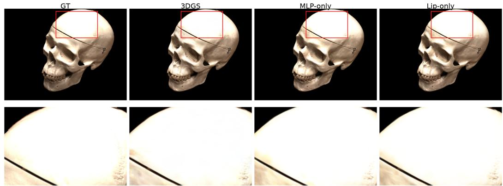  
Figure A.1: Rendering comparison in a highly reflective region of DTU scan65. Columns show the ground-truth image, 3DGS, MLP-only, and Lip-only. The bottom row enlarges the regions marked by red boxes.

## D.3 Compatibility with Strong Geometry-Constrained Backbones

Our improvements are most visible on backbones with relatively weak or moderate geometry regularization, such as vanilla 3DGS [1] and FastGS [40]. For backbones that already impose strong geometry-oriented constraints, the room for further improvement is naturally smaller, because of the performance ceiling on the benchmark. This behavior is also consistent with our observations on methods such as 2DGS [10] and PGSR [3]. These approaches already incorporate strong geometric priors or multi-view consistent constraints, which partially overlap with the role of our sampling and Lipschitz-based regularization. Therefore, when our method is integrated into such backbones, the additional gain may become marginal.

We emphasize that this does not indicate incompatibility. Rather, it reflects the intended role of our method as a lightweight complementary module rather than a replacement for heavily geometryconstrained pipelines. In other words, our method is most beneficial when the backbone still leaves optimization headroom for geometry refinement, while its marginal benefit decreases as the backbone itself becomes increasingly geometry-aware.

## D.4 Runtime Overhead on Fast Backbones

Our method introduces a neural color field, implemented with a hash-grid encoder and an MLP, to predict view-dependent colors. This additional module incurs an extra training cost that is relatively stable across backbones. As a result, the relative runtime increase becomes more pronounced on highly accelerated methods such as FastGS [40]. This is because FastGS substantially shortens the optimization time of the Gaussian backbone itself, making the training of the neural field account for a larger fraction of the total runtime.

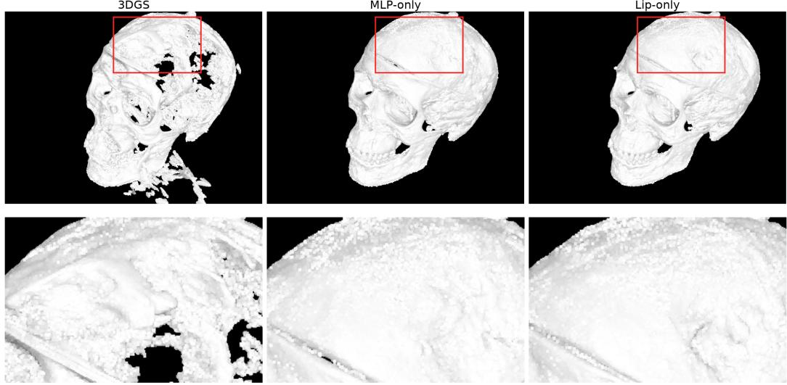  
Figure A.2: Mesh comparison for DTU scan65. Columns show 3DGS, MLP-only, and Lip-only, with enlarged views of the highlighted region below. Both neural color field variants reduce the missing surface regions visible in the 3DGS reconstruction.

Therefore, the larger slowdown observed on FastGS [40] should be understood as a quality–efficiency trade-off rather than selective integration. Our method remains compatible with different 3DGS variants, but the practical trade-off differs depending on whether the backbone is bottlenecked by Gaussian optimization or by the added neural field. This also explains why the relative overhead is less severe on slower backbones such as vanilla 3DGS [1].

## D.5 Limitations

Although our method improves the geometric fidelity of 3DGS, several limitations remain.

Our approach introduces an MLP to predict view-dependent colors instead of relying solely on the discrete color attributes of Gaussians. This design cannot be directly fused with the original rasterization pipeline and therefore introduces additional computational overhead during rendering. Moreover, the neural color field requires additional parameters, which increases the memory consumption compared to standard 3DGS [1].

## E Code and Experimental Results

We will organize and upload the code framework and experimental results to our public repository: https://github.com/yangyixi21/Neural-Color-Fields-3DGS.

## NeurIPS Paper Checklist

## 1. Claims

Question: Do the main claims made in the abstract and introduction accurately reflect the paper’s contributions and scope?

Answer: [Yes]

Justification: The main claims in the abstract and introduction regarding the proposed method and its performance are accurately supported by the method described in Section 3 and the experimental results presented in Section 4.

Guidelines:

• The answer [N/A] means that the abstract and introduction do not include the claims made in the paper.

• The abstract and/or introduction should clearly state the claims made, including the contributions made in the paper and important assumptions and limitations. A [No] or [N/A] answer to this question will not be perceived well by the reviewers.

• The claims made should match theoretical and experimental results, and reflect how much the results can be expected to generalize to other settings.

• It is fine to include aspirational goals as motivation as long as it is clear that these goals are not attained by the paper.

## 2. Limitations

Question: Does the paper discuss the limitations of the work performed by the authors?

Answer: [Yes]

Justification: The limitations of the work, including experimental constraints and assumptions, are discussed in the appendix.

Guidelines:

• The answer [N/A] means that the paper has no limitation while the answer [No] means that the paper has limitations, but those are not discussed in the paper.

• The authors are encouraged to create a separate “Limitations” section in their paper.

• The paper should point out any strong assumptions and how robust the results are to violations of these assumptions (e.g., independence assumptions, noiseless settings, model well-specification, asymptotic approximations only holding locally). The authors should reflect on how these assumptions might be violated in practice and what the implications would be.

• The authors should reflect on the scope of the claims made, e.g., if the approach was only tested on a few datasets or with a few runs. In general, empirical results often depend on implicit assumptions, which should be articulated.

• The authors should reflect on the factors that influence the performance of the approach. For example, a facial recognition algorithm may perform poorly when image resolution is low or images are taken in low lighting. Or a speech-to-text system might not be used reliably to provide closed captions for online lectures because it fails to handle technical jargon.

• The authors should discuss the computational efficiency of the proposed algorithms and how they scale with dataset size.

• If applicable, the authors should discuss possible limitations of their approach to address problems of privacy and fairness.

• While the authors might fear that complete honesty about limitations might be used by reviewers as grounds for rejection, a worse outcome might be that reviewers discover limitations that aren’t acknowledged in the paper. The authors should use their best judgment and recognize that individual actions in favor of transparency play an important role in developing norms that preserve the integrity of the community. Reviewers will be specifically instructed to not penalize honesty concerning limitations.

## 3. Theory assumptions and proofs

Question: For each theoretical result, does the paper provide the full set of assumptions and a complete (and correct) proof?

## Answer: [N/A]

Justification: The paper does not include theoretical results. The proposed method and loss function are introduced as a methodological design, validated experimentally in Section 4, without formal theorems or proofs.

## Guidelines:

• The answer [N/A] means that the paper does not include theoretical results.

• All the theorems, formulas, and proofs in the paper should be numbered and crossreferenced.

• All assumptions should be clearly stated or referenced in the statement of any theorems.

• The proofs can either appear in the main paper or the supplemental material, but if they appear in the supplemental material, the authors are encouraged to provide a short proof sketch to provide intuition.

• Inversely, any informal proof provided in the core of the paper should be complemented by formal proofs provided in appendix or supplemental material.

• Theorems and Lemmas that the proof relies upon should be properly referenced.

## 4. Experimental result reproducibility

Question: Does the paper fully disclose all the information needed to reproduce the main experimental results of the paper to the extent that it affects the main claims and/or conclusions of the paper (regardless of whether the code and data are provided or not)?

Answer: [Yes]

Justification: The paper fully discloses the information needed to reproduce the main results. The proposed method is described in Section 3, and the experimental details and hyperparameter settings are provided in Section 3 and the appendix.

Guidelines:

• The answer [N/A] means that the paper does not include experiments.

• If the paper includes experiments, a [No] answer to this question will not be perceived well by the reviewers: Making the paper reproducible is important, regardless of whether the code and data are provided or not.

• If the contribution is a dataset and/or model, the authors should describe the steps taken to make their results reproducible or verifiable.

• Depending on the contribution, reproducibility can be accomplished in various ways. For example, if the contribution is a novel architecture, describing the architecture fully might suffice, or if the contribution is a specific model and empirical evaluation, it may be necessary to either make it possible for others to replicate the model with the same dataset, or provide access to the model. In general. releasing code and data is often one good way to accomplish this, but reproducibility can also be provided via detailed instructions for how to replicate the results, access to a hosted model (e.g., in the case of a large language model), releasing of a model checkpoint, or other means that are appropriate to the research performed.

• While NeurIPS does not require releasing code, the conference does require all submissions to provide some reasonable avenue for reproducibility, which may depend on the nature of the contribution. For example

(a) If the contribution is primarily a new algorithm, the paper should make it clear how to reproduce that algorithm.

(b) If the contribution is primarily a new model architecture, the paper should describe the architecture clearly and fully.

(c) If the contribution is a new model (e.g., a large language model), then there should either be a way to access this model for reproducing the results or a way to reproduce the model (e.g., with an open-source dataset or instructions for how to construct the dataset).

(d) We recognize that reproducibility may be tricky in some cases, in which case authors are welcome to describe the particular way they provide for reproducibility. In the case of closed-source models, it may be that access to the model is limited in some way (e.g., to registered users), but it should be possible for other researchers to have some path to reproducing or verifying the results.

## 5. Open access to data and code

Question: Does the paper provide open access to the data and code, with sufficient instructions to faithfully reproduce the main experimental results, as described in supplemental material?

## Answer: [No]

Justification: The implementation is being prepared for public release at https://github. com/yangyixi21/Neural-Color-Fields-3DGS. The repository currently contains documentation only. Method and experimental details are provided in Section 3 and the appendix.

Guidelines:

• The answer [N/A] means that paper does not include experiments requiring code.

• Please see the NeurIPS code and data submission guidelines (https://neurips.cc/ public/guides/CodeSubmissionPolicy) for more details.

• While we encourage the release of code and data, we understand that this might not be possible, so [No] is an acceptable answer. Papers cannot be rejected simply for not including code, unless this is central to the contribution (e.g., for a new open-source benchmark).

• The instructions should contain the exact command and environment needed to run to reproduce the results. See the NeurIPS code and data submission guidelines (https: //neurips.cc/public/guides/CodeSubmissionPolicy) for more details.

• The authors should provide instructions on data access and preparation, including how to access the raw data, preprocessed data, intermediate data, and generated data, etc.

• The authors should provide scripts to reproduce all experimental results for the new proposed method and baselines. If only a subset of experiments are reproducible, they should state which ones are omitted from the script and why.

• At submission time, to preserve anonymity, the authors should release anonymized versions (if applicable).

• Providing as much information as possible in supplemental material (appended to the paper) is recommended, but including URLs to data and code is permitted.

## 6. Experimental setting/details

Question: Does the paper specify all the training and test details (e.g., data splits, hyperparameters, how they were chosen, type of optimizer) necessary to understand the results?

Answer: [Yes]

Justification: All key training and test details (e.g., data splits, hyperparameters, optimizer) are described in Section 3 and the appendix, with sufficient completeness to understand the results.

Guidelines:

• The answer [N/A] means that the paper does not include experiments.

• The experimental setting should be presented in the core of the paper to a level of detail that is necessary to appreciate the results and make sense of them.

• The full details can be provided either with the code, in appendix, or as supplemental material.

## 7. Experiment statistical significance

Question: Does the paper report error bars suitably and correctly defined or other appropriate information about the statistical significance of the experiments?

Answer: [No]

Justification: Due to the computational cost of 3D reconstruction experiments, results are reported from a single run with a fixed random seed, without error bars. The deterministic components of the pipeline are explicitly controlled, and the key comparisons are conducted under identical conditions.

Guidelines:

• The answer [N/A] means that the paper does not include experiments.

• The authors should answer [Yes] if the results are accompanied by error bars, confidence intervals, or statistical significance tests, at least for the experiments that support the main claims of the paper.

• The factors of variability that the error bars are capturing should be clearly stated (for example, train/test split, initialization, random drawing of some parameter, or overall run with given experimental conditions).

• The method for calculating the error bars should be explained (closed form formula, call to a library function, bootstrap, etc.)

• The assumptions made should be given (e.g., Normally distributed errors).

• It should be clear whether the error bar is the standard deviation or the standard error of the mean.

• It is OK to report 1-sigma error bars, but one should state it. The authors should preferably report a 2-sigma error bar than state that they have a 96% CI, if the hypothesis of Normality of errors is not verified.

• For asymmetric distributions, the authors should be careful not to show in tables or figures symmetric error bars that would yield results that are out of range (e.g., negative error rates).

• If error bars are reported in tables or plots, the authors should explain in the text how they were calculated and reference the corresponding figures or tables in the text.

## 8. Experiments compute resources

Question: For each experiment, does the paper provide sufficient information on the computer resources (type of compute workers, memory, time of execution) needed to reproduce the experiments?

Answer: [Yes]

Justification: The type of GPU, approximate runtime per experiment, and total compute used are reported in Section 4

Guidelines:

• The answer [N/A] means that the paper does not include experiments.

• The paper should indicate the type of compute workers CPU or GPU, internal cluster, or cloud provider, including relevant memory and storage.

• The paper should provide the amount of compute required for each of the individual experimental runs as well as estimate the total compute.

• The paper should disclose whether the full research project required more compute than the experiments reported in the paper (e.g., preliminary or failed experiments that didn’t make it into the paper).

## 9. Code of ethics

Question: Does the research conducted in the paper conform, in every respect, with the NeurIPS Code of Ethics https://neurips.cc/public/EthicsGuidelines?

Answer: [Yes]

Justification: The authors have reviewed the NeurIPS Code of Ethics and confirm that the research conforms to it in every respect. The paper uses only well-established public datasets and does not involve human subjects, sensitive data, or potentially harmful applications.

Guidelines:

• The answer [N/A] means that the authors have not reviewed the NeurIPS Code of Ethics.

• If the authors answer [No], they should explain the special circumstances that require a deviation from the Code of Ethics.

• The authors should make sure to preserve anonymity (e.g., if there is a special consideration due to laws or regulations in their jurisdiction).

## 10. Broader impacts

Question: Does the paper discuss both potential positive societal impacts and negative societal impacts of the work performed?

## Answer: [N/A]

Justification: This work is foundational research on a core 3D reconstruction algorithm and is not tied to specific downstream applications that would directly yield societal impacts.

## Guidelines:

• The answer [N/A] means that there is no societal impact of the work performed.

• If the authors answer [N/A] or [No], they should explain why their work has no societal impact or why the paper does not address societal impact.

• Examples of negative societal impacts include potential malicious or unintended uses (e.g., disinformation, generating fake profiles, surveillance), fairness considerations (e.g., deployment of technologies that could make decisions that unfairly impact specific groups), privacy considerations, and security considerations.

• The conference expects that many papers will be foundational research and not tied to particular applications, let alone deployments. However, if there is a direct path to any negative applications, the authors should point it out. For example, it is legitimate to point out that an improvement in the quality of generative models could be used to generate Deepfakes for disinformation. On the other hand, it is not needed to point out that a generic algorithm for optimizing neural networks could enable people to train models that generate Deepfakes faster.

• The authors should consider possible harms that could arise when the technology is being used as intended and functioning correctly, harms that could arise when the technology is being used as intended but gives incorrect results, and harms following from (intentional or unintentional) misuse of the technology.

• If there are negative societal impacts, the authors could also discuss possible mitigation strategies (e.g., gated release of models, providing defenses in addition to attacks, mechanisms for monitoring misuse, mechanisms to monitor how a system learns from feedback over time, improving the efficiency and accessibility of ML).

## 11. Safeguards

Question: Does the paper describe safeguards that have been put in place for responsible release of data or models that have a high risk for misuse (e.g., pre-trained language models, image generators, or scraped datasets)?

Answer: [N/A]

Justification: The paper does not release models or data that pose a high risk for misuse. The proposed method is a 3D reconstruction technique that does not inherently involve generative models for disinformation or scraped datasets with safety concerns.

Guidelines:

• The answer [N/A] means that the paper poses no such risks.

• Released models that have a high risk for misuse or dual-use should be released with necessary safeguards to allow for controlled use of the model, for example by requiring that users adhere to usage guidelines or restrictions to access the model or implementing safety filters.

• Datasets that have been scraped from the Internet could pose safety risks. The authors should describe how they avoided releasing unsafe images.

• We recognize that providing effective safeguards is challenging, and many papers do not require this, but we encourage authors to take this into account and make a best faith effort.

## 12. Licenses for existing assets

Question: Are the creators or original owners of assets (e.g., code, data, models), used in the paper, properly credited and are the license and terms of use explicitly mentioned and properly respected?

Answer: [Yes]

Justification: All existing assets used in this work (DTU, Tanks and Temples, and Mip-NeRF360) are properly credited by citing the original papers that introduced them.

Guidelines:

• The answer [N/A] means that the paper does not use existing assets.

• The authors should cite the original paper that produced the code package or dataset.

• The authors should state which version of the asset is used and, if possible, include a URL.

• The name of the license (e.g., CC-BY 4.0) should be included for each asset.

• For scraped data from a particular source (e.g., website), the copyright and terms of service of that source should be provided.

• If assets are released, the license, copyright information, and terms of use in the package should be provided. For popular datasets, paperswithcode.com/datasets has curated licenses for some datasets. Their licensing guide can help determine the license of a dataset.

• For existing datasets that are re-packaged, both the original license and the license of the derived asset (if it has changed) should be provided.

• If this information is not available online, the authors are encouraged to reach out to the asset’s creators.

## 13. New assets

Question: Are new assets introduced in the paper well documented and is the documentation provided alongside the assets?

Answer: [N/A]

Justification: No implementation code, model checkpoints, or new datasets are publicly released with this version. The implementation and accompanying documentation are being prepared for public release.

Guidelines:

• The answer [N/A] means that the paper does not release new assets.

• Researchers should communicate the details of the dataset/code/model as part of their submissions via structured templates. This includes details about training, license, limitations, etc.

• The paper should discuss whether and how consent was obtained from people whose asset is used.

• At submission time, remember to anonymize your assets (if applicable). You can either create an anonymized URL or include an anonymized zip file.

## 14. Crowdsourcing and research with human subjects

Question: For crowdsourcing experiments and research with human subjects, does the paper include the full text of instructions given to participants and screenshots, if applicable, as well as details about compensation (if any)?

Answer: [N/A]

Justification: The paper does not involve crowdsourcing or research with human subjects.   
All experiments rely on publicly available benchmark datasets.

Guidelines:

• The answer [N/A] means that the paper does not involve crowdsourcing nor research with human subjects.

• Including this information in the supplemental material is fine, but if the main contribution of the paper involves human subjects, then as much detail as possible should be included in the main paper.

• According to the NeurIPS Code of Ethics, workers involved in data collection, curation, or other labor should be paid at least the minimum wage in the country of the data collector.

## 15. Institutional review board (IRB) approvals or equivalent for research with human subjects

Question: Does the paper describe potential risks incurred by study participants, whether such risks were disclosed to the subjects, and whether Institutional Review Board (IRB) approvals (or an equivalent approval/review based on the requirements of your country or institution) were obtained?

## Answer: [N/A]

Justification: The paper does not involve crowdsourcing or research with human subjects, and therefore did not require IRB approval.

## Guidelines:

• The answer [N/A] means that the paper does not involve crowdsourcing nor research with human subjects.

• Depending on the country in which research is conducted, IRB approval (or equivalent) may be required for any human subjects research. If you obtained IRB approval, you should clearly state this in the paper.

• We recognize that the procedures for this may vary significantly between institutions and locations, and we expect authors to adhere to the NeurIPS Code of Ethics and the guidelines for their institution.

• For initial submissions, do not include any information that would break anonymity (if applicable), such as the institution conducting the review.

## 16. Declaration of LLM usage

Question: Does the paper describe the usage of LLMs if it is an important, original, or non-standard component of the core methods in this research? Note that if the LLM is used only for writing, editing, or formatting purposes and does not impact the core methodology, scientific rigor, or originality of the research, declaration is not required.

## Answer: [N/A]

Justification: The core method development in this research does not involve LLMs as any important, original, or non-standard components. LLMs were only used for minor writing polishing, which does not require declaration per NeurIPS policy.

## Guidelines:

• The answer [N/A] means that the core method development in this research does not involve LLMs as any important, original, or non-standard components.

• Please refer to our LLM policy in the NeurIPS handbook for what should or should not be described.