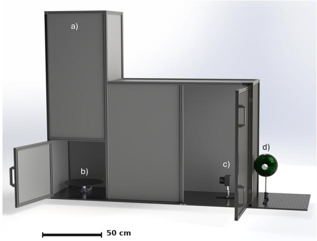
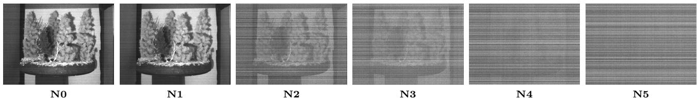
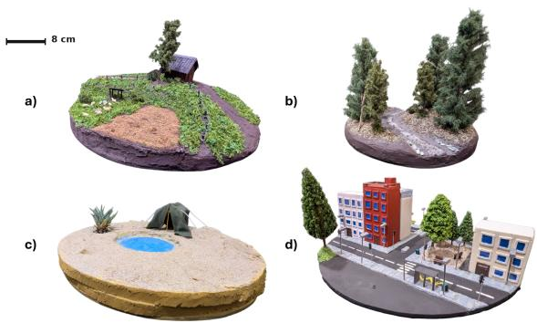
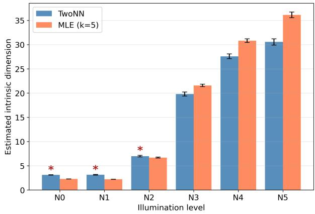
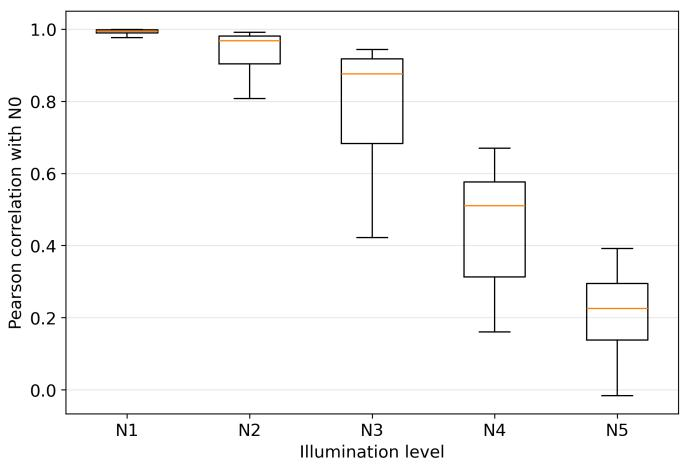
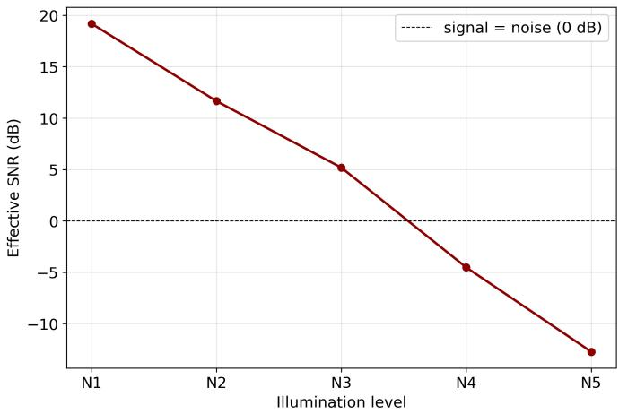

# 3L-D: A Low-Light Level Dataset from a Sensor-Agnostic, Alignment-Preserving Acquisition Framework

Léo Ruef1, Maurgène Ghezal1, Valentin Gorse1, Astrid Dufaure1, Esteban Monsalvo1, François Atteia1, and Ludovic Escoubas1

13L-OPTRONICS, 2 rue Marc Donadille, 13013 Marseille, France

## Abstract

Supervised low-light image and video enhancement has achieved remarkable progress, yet current models remain fundamentally constrained by the limitations of existing datasets. Prevailing methods typically rely on uncontrolled ambient captures, camera parameter manipulation (e.g., exposure or ISO adjustments), or neutral density filters, failing to replicate authentic night-sky near-infrared spectral content and genuine low-photon noise distributions. Furthermore, capturing dynamic paired sequences without introducing warping artifacts or sensor-specific biases remains an open challenge. In this paper, we introduce 3L-Dataset, a physically calibrated low-light image and video dataset generated using a modular, sensor-agnostic acquisition framework. Our test bench faithfully reproduces the standardized Midavaine night level scale from Level 1 (full moon, ∼1000 mlx) down to Level 5 (overcast moonless night, ∼0.1 mlx), spanning the visible to near-infrared spectrum across diverse realistic environments, including countryside, forest, urban, and desert scale models. Using high-precision programmable mechanical actuation, our acquisition framework guarantees sub-pixel spatial alignment across synchronized sextuplets, each composed of one reference image and five corresponding images acquired at the five standardized night levels, without post-processing image warping. We evaluate multiple representative deep learning baselines across varying night levels, revealing critical trade-ofs between reconstruction fidelity, perceptual quality, and inference latency under severe photon starvation. The modular acquisition framework can be adapted to diferent cameras, optical systems, sensor technologies, and resolutions, enabling the dataset to be continuously expanded.

## 1 Introduction

The recent advancements in deep learning have significantly improved the performance of low-light enhancement algorithms, yet the efectiveness of these models remains fundamentally limited by the scarcity of diverse and accurately registered training data. Capturing highquality video in low-light conditions is essential for critical applications such as surveillance, robotics, or defense, but it is an inherently ill-posed problem due to the complex interaction between photon noise, sensor gain, and temporal artifacts. While synthetic datasets are often used to bridge the data gap, they frequently fail to replicate the authentic distortions and spatiotemporal incoherent noise found in real-world scenarios. Furthermore, existing datasets that provide real-world pairs often sufer from sensor-specific biases or registration inaccuracies, which can introduce artifacts and limit the generalizability of trained models across diferent imaging hardware.

Multiple low-light datasets exist, but often lack correspondence with real outdoor nighttime conditions. For instance, LOL[1], LSRW[2] or SIDD[3] focus on simulating low-light conditions through camera parameter manipulation, in particular integration time and ISO. This approach leads to two key limitations: daytime images do not carry the near-infrared spectral content (780 - 1100 nm) that dominates natural nighttime illumination, and modifying camera parameters artificially alters noise distributions, inflating electronic noise independently of the actual photon flux. MIT-Adobe FiveK[4] takes a diferent approach by using post-processing tools to retouch raw images, achieving a low-light appearance through tone mapping and curve adjustment rather than actual low illumination capture, thereby retaining the noise statistics and spectral content of daylight images. SMOID [5] uses neutral density (ND) filters to reduce the photon flux reaching the sensor. Although ND filters are generally designed to provide approximately uniform attenuation in the visible spectrum, their transmission may vary in the near-infrared. Consequently, they may fail to preserve the visible-to-near-infrared ratio characteristic of natural low-light conditions. The resulting illumination spectrum can therefore difer from that observed under natural nighttime environments. ND filters can also introduce color shifts and optical aberrations. More broadly, characterizing illumination using a single lux value is insuficient for high-end applications, such as aerospace or tactical vi sion, since lux does not describe the spectral distribution of the illumination or its visible-to-near-infrared balance. Performance should instead be validated against precise atmospheric and celestial night levels.

In this paper, we introduce a novel low-light image and video dataset developed by 3L-OPTRONICS to meet the strict demands of professional vision systems. The dataset is generated using a modular acquisition method designed to accommodate diferent cameras, optical systems, and sensor configurations. It is acquired under physically calibrated illumination conditions that repli cate natural nighttime environments, grounded in the Midavaine night level scale [6], ranging from Level 1 (full moon, clear sky, ∼1000 mlx) to Level 5 (moonless, overcast, ∼0.1 mlx), and covering the full spectral range from visible to near-infrared. This standardized photometric protocol ensures that every scene is characterized by precise and reproducible radiometric values, providing a scientifically grounded foundation for supervised learning. Fully registered sextuplet video sequences are provided across multiple sensor configurations. For each scene and temporal instant, the acquisition protocol produces a synchronized sextuplet consisting of one reference image acquired under the reference illumination (N0) and five corresponding low-light images acquired at Night levels N1 to N5.This organization is richer than conventional paired datasets, while remaining compatible with pairbased supervised learning.

The main contributions of this work are as follows:

• A large-scale low-light image and video dataset acquired under physically calibrated nighttime illumination, covering the full range of Midavaine night levels and organized into aligned sextuplets.

• A modular acquisition framework enabling the generation of aligned sextuplet data with diferent cameras, optical systems, and hardware configurations, while preserving pixel-level spatial alignment.

• A diverse set of scenes matching real-world outdoor environments, including countryside, forest, urban, and desert scenarios.

• Benchmark evaluations of low-light enhancement and denoising methods on the proposed dataset.

A representative sample of the dataset and the associated resources is publicly available at: https://3l-d. github.io/3L-Dataset/.

## 2 Dataset Overview

## 2.1 Standardized Illumination

The low-light illumination used in this study was designed to replicate night vision conditions. This work is based on the research of T. Midavaine [6], who modelled the illuminance conditions encountered on Earth, particularly at night. In this situation, the perceived illumination on the ground varies depending on various sources such as the moon, stars, the Milky Way, etc. T. Midavaine defines night levels ranging from Night 1 to Night 5, with specific sky situations for each level. The diferent night levels, their conditions and their associated ground illuminance values are listed in Table 1.

<table><tr><td rowspan=1 colspan=1>Night level</td><td rowspan=1 colspan=1>Conditions</td><td rowspan=1 colspan=1>Ground illuminance [mlx]</td></tr><tr><td rowspan=1 colspan=1>1</td><td rowspan=1 colspan=1>Full moon + clear sky</td><td rowspan=1 colspan=1>1000 to 40</td></tr><tr><td rowspan=1 colspan=1>2</td><td rowspan=1 colspan=1>Full moon + cloud cover</td><td rowspan=1 colspan=1>40 to 10</td></tr><tr><td rowspan=1 colspan=1>3</td><td rowspan=1 colspan=1>Crescent moon + clear sky</td><td rowspan=1 colspan=1>10 to 2</td></tr><tr><td rowspan=1 colspan=1>4</td><td rowspan=1 colspan=1>Moonless + clear sky</td><td rowspan=1 colspan=1>2 to 0.7</td></tr><tr><td rowspan=1 colspan=1>5</td><td rowspan=1 colspan=1>Moonless + cloud cover</td><td rowspan=1 colspan=1>0.7 to 0.1</td></tr></table>

Table 1: Night levels and conditions [6]

Each night level is associated with a specific illuminance spectrum which we reproduce in our test bench (Fig. 1). The illumination system used is a patented device designed to reproduce the spectrum of diferent night levels. The system provides uniform, difused lighting across the scene area. A precision luxmeter and a spectrometer are used to calibrate the illuminance on the scene. The resulting image is therefore dependent on the scene’s albedo.

  
Figure 1: Modelisation of our low-light dataset generation setup with : a) Light-proof enclosure, b) High-precision rotary stage, c) Acquisition system, d) External lightning system

For each scene and temporal instant, the acquisition protocol produces a synchronized sextuplet which consists of one reference image acquired under nominal illumination and five corresponding low-light images acquired at Night levels 1 to 5. The six images share the same scene content and temporal position, providing a richer representation of the illumination transition than a conventional image pair. This organization also allows the extraction of standard reference-to-low-light pairs for supervised enhancement and restoration tasks.

To make the sextuplet structure explicit, Fig. 2 shows six aligned images acquired from the same scene at the same temporal instant. In this representation, N0 denotes the reference image acquired under nominal illumination, while N1 to N5 correspond to the five standardized Midavaine night levels. The scene content and spatial geometry remain unchanged, while the illumination level and the associated low-light degradation progressively evolve.

## 2.2 Scene Composition and Material Diversity

In order to reproduce as faithfully as possible real-world scenarios - such as the city, the countryside, the forest, etc - scale models (Example on Fig. 3) have been designed by 3L-OPTRONICS using carefully selected materials that accurately reflect the albedo as well as the textures of these environments. While the models are not composed exclusively of natural materials, the materials used have been chosen for their abiliy to closely match the albedo properties of real-world sceneries. In order to cover a wide range of situations, four models were originally built; others are currently being designed and built.

## 2.3 Camera and Sensor Diversity

The proposed dataset generation method is designed to be compatible with a wide range of imaging systems. The modular acquisition setup allows diferent cameras, optical systems, sensor technologies, resolutions, and imaging configurations to be integrated without modifying the illumination protocol or the overall acquisition procedure. This flexibility makes it possible to generate comparable low-light data for various camera types, from embedded and industrial systems to high-resolution scientific or consumer cameras.

For each imaging system, the relevant camera and optical parameters can be configured while preserving the same scene content, illumination levels, and acquisition protocol. The method can therefore be adapted to different focal lengths, fields of view, sensor formats, and spectral sensitivities. This flexibility of the acquisition method facilitates the extension of the dataset to new hardware configurations and enables the study of low-light enhancement methods under a broader range of imaging conditions.

## 2.4 Registration and Alignment

A fundamental challenge in generating supervised datasets for low-light video enhancement is ensuring perfect pixelwise alignment between the noisy low-light frames and the clear day-light ground truth. While existing methodologies often rely on post-capture image registration or non-rigid warping to correct for mechanical tolerances, such techniques can inadvertently alter low-level noise characteristics or introduce spatial artifacts. Our acquisition framework mitigates these issues by shifting the burden of registration from post-processing software to high-precision hardware complemented with software validation.

## 2.4.1 Mechanical Precision and Motion Control

To achieve repeatable motion profiles across varying illumination levels, we utilize a high-precision controlled mechanical actuation system. The platform ofers an ex ceptional spatial resolution, allowing identical trajectories to be executed for the reference sequence and the five low-light sequences corresponding to Midavaine levels 1 to 5. This ensures that all six frames within each sextuplet remain spatially and temporally aligned. By strictly controlling the angular velocity and positioning of the scene objects, we ensure that the temporal and spatial coordinates of each frame remain consistent throughout the acquisition process, efectively decoupling the motion from the sensor’s integration time.

## 2.4.2 Mathematical Framework for Alignment Validation

To rigorously quantify the mechanical registration accuracy, we employ the principle of optical flow, which operates under the brightness constancy assumption. This hypothesis suggests that the intensity of a specific pixel $I ( x , y , t )$ remains constant despite a small displacement $( \Delta x , \Delta y )$ over a temporal interval $\Delta t .$ , leading to the fundamental constraint equation:

$$
\frac { \partial I } { \partial x } u + \frac { \partial I } { \partial y } v + \frac { \partial I } { \partial t } = 0\tag{1}
$$

where $u = d x / d t$ and $v = d y / d t$ represent the horizontal and vertical components of the flow vector, respectively. While standard diferential methods are often sensitive to noise, a critical factor in low-light imaging, our framework utilizes the Farneback algorithm for dense estimation. This method approximates the local neighborhood of each pixel using a quadratic polynomial expansion:

$$
f ( \mathbf { x } ) \approx \mathbf { x } ^ { T } \mathbf { A } \mathbf { x } + \mathbf { b } ^ { T } \mathbf { x } + c\tag{2}
$$

By monitoring the displacement of these polynomial surfaces between the ground truth and the test sequences, we can detect even subtle mechanical drifts or microvibrations. To provide a comprehensive evaluation of the alignment integrity, we look beyond the standard Root Mean Square Error (RMSE). While RMSE ofers a useful global average, it is intrinsically sensitive to outliers and stochastic noise spikes that frequently occur in low-SNR environments. To achieve a more representative measure of the system’s mechanical performance, we prioritize the median flow magnitude and the 95th percentile (P95) of the displacement field.

The median flow magnitude serves as our primary indicator of global registration, representing the typical displacement experienced by the majority of pixels in the scene. A sub-pixel median confirms that the bulk of the image remains perfectly aligned with the ground truth. Simultaneously, we utilize the P95 as a conservative upper bound for mechanical tolerances. By ensuring that 95% of the flow vectors fall below a specific threshold (e.g., < 0.8 pixels), we can confidently rule out significant mechanical drifts, vibrations, or synchronization errors that might otherwise compromise the temporal consistency of the video.

  
Figure 2: Example of an aligned sextuplet acquired from the same scene at the same temporal instant. N0 corresponds to the reference image acquired under nominal illumination, while N1 to N5 correspond to the five standardized night levels.

  
Figure 3: Examples of scale models created by 3L-OPTRONICS to replicate real-world environments: a) Countryside, b) Forest, c) Desert, d) City.

Our experimental results indicate that the highprecision motion control maintains a median displacement significantly below the sub-pixel threshold. This level of registration is crucial for training state-of-the-art architectures, which are highly sensitive to spatial inconsistencies during the loss calculation phase. By providing natively registered data, our framework eliminates the need for histogram matching or warping prior to training, preserving the original sensor noise profile.

The alignment measurements reported in this section were obtained using a specific night-vision sensor configuration. The numerical values, including the median flow magnitude and the P95 displacement, are therefore dependent on the characteristics of the imaging system and may vary with the sensor pixel pitch, spatial resolution, optical configuration, and sampling geometry. Additional validation experiments are being conducted with other imagers to assess the transferability of these alignment results across diferent imaging systems. The alignment procedure itself remains applicable to these configurations, while the resulting displacement statistics should be interpreted with respect to the sensor and optical setup used.

## 2.4.3 SNR Limitations and Structural Consistency

While the aforementioned optical flow validation is highly efective for Midavaine levels 1 and 2, extreme low-light conditions (levels 3 to 5) present significant challenges for gradient-based registration. At these intensities, the integration of photon noise and a dominant noise floor leads to severe photon starvation, which can cause the brightness constancy constraint to fail. Consequently, direct pixel-wise validation via Farneback becomes statistically unreliable as the structural signal is masked by stochastic noise.

To ensure dataset integrity across the entire radiometric range, our framework relies on the principle of mechanical temporal consistency. Since the high-precision platform and the optical assembly remain strictly untouched and programmatically controlled between the ground truth (100% illumination) and the sequential captures (levels 1– 5), the registration measured at higher SNR levels serves as a reliable proxy for the entire sequence.

We assume that by establishing a sub-pixel alignment baseline at level 1 and 2, the geometric relationship between the sensor and the scene remains invariant for the subsequent levels where the signal is too low for tradi tional software-based verification.

## 2.5 Intrinsic dimension and dataset variety

The manifold hypothesis states that natural images, although embedded in a very high-dimensional pixel space, concentrate near a low-dimensional manifold whose di mension reflects the number of independent factors of variation in the data [7]. This intrinsic dimension (ID) has been shown to be a relevant descriptor of image datasets: natural images have an ID far lower than their number of pixels, and datasets with a lower ID are easier to learn and require fewer samples to generalise [8, 9].

The ID is also implicitly captured by generative models [10] and is used to characterise the data in inverse problems [11]. Moreover, image data do not necessarily lie on a single manifold: diferent classes or subsets may occupy distinct manifolds of diferent dimensions, which is known as the union of manifolds hypothesis [12]. Estimating the ID of our dataset therefore provides three types of information: whether the images are structured and learnable (low ID), whether some acquisition conditions introduce additional sources of variation (increase in ID), and whether the diferent subsets share the same structure or explore diferent regions of the image space.

We estimated the ID for each illumination level using two complementary estimators: TwoNN, based on the ratio of the distances to the first two nearest neighbours [13], and the maximum-likelihood estimator (MLE) with $k = 5$ neighbours [14]. As both estimators tend to underestimate the ID in high dimension and are sensitive to noise [15], our analysis relies on the relative evolution of the ID across illumination levels rather than on its absolute values. The analysis was carried out on raw pixels, which characterise the data themselves, and on ResNet-18 features, which are less sensitive to global brightness and better reflect scene content. Since all illumination levels are pixel-aligned and depict the same scenes, any change in ID between levels can be attributed to the acquisition conditions rather than to the content.

  
Figure 4: Intrinsic dimension per illumination level on raw pixels, estimated with TwoNN and MLE (k = 5), from N0 (daylight reference) to N5 (darkest). Error bars give one standard deviation over 30 bootstrap samples; asterisks mark levels where the TwoNN estimate is unstable.

For the reference level N0, the ID is very low (TwoNN ≈ 3.1, MLE ≈ 2.2 on raw pixels) and remains unchanged at N1 (Fig. 4). The clean images therefore lie on a low-dimensional manifold, consistent with the manifold hypothesis. This ID is lower than those reported for standard image datasets [8], which is expected for video frames whose content is strongly correlated over time. The ID then increases sharply with decreasing illumination, reaching about 7 at N2, 20 at N3 and 31 to 36 at N5. Since all levels are pixel-aligned and depict exactly the same scenes, this increase cannot be explained by additional content: it reflects the contribution of noise, which adds random directions to the data at the finest scale, where nearest-neighbour estimators operate. This interpretation is supported by the loss of content measured in Fig. 5, which follows the same progression as the ID, and by the ResNet-18 feature space, where the same trend is observed with a smaller amplitude (MLE ≈ 25 at N5), showing that the network partly filters this noise.

The resulting loss of information is quantified in Fig. 5 by the correlation between each frame and its pixelaligned reference. The content is almost fully preserved at N1 $( \rho = 0 . 9 9$ , efective SNR of 19 dB) and remains dominant up to N3 $\left( \rho = 0 . 8 8 , 5 ~ \mathrm { d B } \right)$ . The SNR crosses 0 dB between N3 and N4: at N4 $( \rho = 0 . 5 1 , - 4 . 5 \mathrm { d B } )$ and N5 $( \rho = 0 . 2 3 , - 1 2 . 7 \ \mathrm { d B } )$ , noise prevails and most of the scene content is lost, while the wider spread of the correlations shows that frames are not degraded uniformly. This progressive loss of content mirrors the increase in ID observed in Fig. 4.

The diversity of the content was also studied on the reference level N0 (analysis not detailed here). Each sequence taken individually has a low ID, as expected for video data in which consecutive frames are strongly related, whereas frames from diferent sequences are typically 2.44 times further apart (ratio of median distances) than frames from the same sequence (ResNet-18 features). The diferent sequences therefore explore distinct regions of the image space, indicating that the dataset covers varied scene content.

Overall, this analysis shows that the clean images of our dataset lie on a low-dimensional manifold, which supports the manifold hypothesis and indicates a structured, learnable distribution. Decreasing illumination does not add diversity to the data: it degrades the content through noise, which artificially increases the ID, and from N4 onward most of the scene content is lost. No evidence of a union of distinct manifolds was found, since the diferences in ID between levels are explained by noise rather than by distinct underlying structures [12].

## 3 Benchmarks

## 3.1 Comparison With Existing Datasets

Table 2 compares the proposed dataset against existing low-light benchmarks. Most datasets rely on uncontrolled real-world illumination [16, 17, 18, 19, 20, 1, 21, 22, 23, 24, 25], without specifying the photometric conditions of the capture, while others use neutral density filters [5, 26, 27], which introduce distortions and do not match any physically relevant night level. A common limitation of dynamic datasets is the absence of alignment: DUS[17] and DRV[18] provide no ground truth for their dynamic sequences, and ND filter-based datasets achieve alignment only by restricting motion to a single degree of freedom. The proposed dataset addresses these shortcomings simultaneously: it is the only benchmark based on the Midavaine night level scale, providing standardized and reproducible radiometric conditions covering the full range of natural nighttime illumination. It further provides aligned sextuplet sequences with pixel-level registration under dynamic conditions. The proposed acquisition method can be adapted to multiple camera, lens, and sensor configurations, allowing new hardware and scene compositions to be integrated on demand. This makes the dataset a continuously expandable resource for low-light research.

  
Figure 5: Content preservation per illumination level on raw pixels. Left: distribution of the Pearson correlation between each frame and its pixel-aligned daylight reference (N0). Right: efective signal-to-noise ratio derived from the median correlation, $\mathrm { S N R } = \rho ^ { 2 } / ( \bar { 1 } - \rho ^ { 2 } )$ ; the dashed line marks equal signal and noise power (0 dB).

## 3.2 Representative LLIE Models Assessment

To evaluate the efectiveness of our dataset for low-light image enhancement, we conducted a benchmark involving several representative deep learning architectures. The selected methods cover a range of enhancement paradigms, including lightweight enhancement networks, GAN-based approaches, Retinex-based models, and recent state-space or transformer-based restoration networks. Specifically, we evaluated SCI [28], EnlightenGAN [29], Zero-DCE [30], KinD [31], URetinex-Net++ [32], WaveMamba [33], MambaIR [34], and RetinexFormer [35].

## Training setup.

Although the dataset is organized into aligned sextuplets, supervised training was performed using conventional image pairs extracted from each sextuplet. For each night level, a pair was formed between the reference image and its corresponding low-light image. This protocol preserves compatibility with the original training procedures of the evaluated methods while taking advantage of the richer multi-level structure of the dataset. All evaluated networks were trained using the proposed dataset on a single NVIDIA GeForce RTX 4090 GPU. The publicly available implementations were adapted only when necessary to support the organization and input format of our dataset. The original architectures, method-specific loss functions, and enhancement principles were preserved to remain faithful to the original methods. Inference times were measured on the same GPU for all models. For the benchmark presented in this paper, the data were acquired using a high-performance night-vision sensor. The quantitative evaluation therefore focuses on Night levels N3 to N5, which provide the most challenging conditions for this imaging system while remaining representative of severe low-light enhancement scenarios.

Table 3 reports the results obtained by training several representative state-of-the-art low-light enhancement architectures on the proposed dataset. The purpose of this benchmark is not to establish a ranking between the evaluated methods, but to verify that the dataset can be efectively used with diferent enhancement paradigms. All the networks were successfully trained using the proposed data, and the obtained results remain coherent across the diferent night levels.

As the illumination decreases from N3 to N5, PSNR and SSIM generally decrease, reflecting the increasing dificulty of the enhancement task under more severe low-light conditions. At the same time, the models maintain meaningful performance without collapsing, indicating that the dataset provides a well-calibrated level of dificulty. The proposed data are therefore suficiently informative to enable efective supervised training, while remaining challenging enough to reveal the progressive degradation associated with lower illumination levels. Inference times are reported for completeness and are not intended as a comparative ranking of the evaluated architectures.

Table 2: Comprehensive comparison of video and image datasets in low-light conditions. S and D denote static and dynamic scenes, respectively. 1D indicates a single type of motion. D\* indicates stop motion.
<table><tr><td>Name</td><td>Light</td><td>Motion</td><td>Images/Videos</td><td>Resolution</td><td>Ground Truth</td><td>Alignment</td></tr><tr><td>BVI-LOWLIGHT[16]</td><td>Real</td><td>S</td><td>13,200</td><td>4240×2832</td><td>√</td><td>√</td></tr><tr><td>DUS (Static)[17]</td><td>Real</td><td>S</td><td>3,630</td><td>2160×1280</td><td>√</td><td>√</td></tr><tr><td>DUS (Dynamic)[17]</td><td>Real</td><td>D</td><td>15,000</td><td>2160×1280</td><td>X</td><td>X</td></tr><tr><td>DRV (Static)[18]</td><td>Real</td><td>S</td><td>20,847</td><td>5496×3672</td><td>√</td><td>√</td></tr><tr><td>DRV (Dynamic)[18]</td><td>Real</td><td>D</td><td>2,397</td><td>5496×3672</td><td>X</td><td>X</td></tr><tr><td>SMOID[5]</td><td>ND Filter</td><td>1D</td><td>35,800</td><td>1800×1000</td><td>√</td><td>√</td></tr><tr><td>RViDeNet[19]</td><td>Real</td><td>D*</td><td>385</td><td>1920×1080</td><td>√</td><td>√</td></tr><tr><td>SDSD[26]</td><td>ND Filter</td><td>1D</td><td>37,500</td><td>1920×1080</td><td>√</td><td>√</td></tr><tr><td>DID[27]</td><td>ND Filter</td><td>1D</td><td>41,038</td><td>2560×1440</td><td>√</td><td>√</td></tr><tr><td>SID[20]</td><td>Real</td><td>S</td><td>5,094</td><td>4240×2832,6000×4000</td><td>√</td><td>√</td></tr><tr><td>LOL[1]</td><td>Real</td><td>S</td><td>500</td><td>600×400</td><td>√</td><td>√</td></tr><tr><td>VE-LÓL[21]</td><td>Real</td><td>Mixed</td><td>&gt;2,500</td><td>1080×920</td><td>√</td><td>Mixed</td></tr><tr><td>DarkVision[22]</td><td>Real</td><td>D/S</td><td>320,667</td><td>2464×2056, 2448×2048, 2048×2048</td><td>√</td><td>√</td></tr><tr><td>ELD[23]</td><td>Real</td><td>S</td><td>240</td><td>Various</td><td>√</td><td>√</td></tr><tr><td>LDV[24]</td><td>Real</td><td>D</td><td>115</td><td>1920×1080</td><td>√</td><td>Mixed</td></tr><tr><td>Ev-LowLight[25]</td><td>Real</td><td>D</td><td>&gt;15,000</td><td>346×260</td><td>√</td><td>√</td></tr><tr><td>Ours</td><td>Standardized night level</td><td>D</td><td>&gt;5,000</td><td>Various</td><td>√</td><td>√</td></tr></table>

## 4 Conclusion

In this paper, we introduced a novel low-light image and video dataset designed to address the fundamental limitations of existing benchmarks. Unlike prior works that simulate nighttime conditions through camera parameter manipulation, post-processing, or neutral density filters, the proposed dataset is grounded in physically calibrated illumination conditions based on the Midavaine night level scale, covering the full range of natural outdoor nighttime environments with a spectral range from visible to near-infrared.

The modular acquisition method can accommodate a wide range of cameras, optical systems, and hardware configurations, while providing registered sextuplet sequences under dynamic scene conditions. At each temporal instant, a sextuplet contains one reference frame and five corresponding low-light frames acquired at standardized night levels. This richer organization preserves compatibility with conventional paired training while enabling multi-level analysis of low-light degradation. This richer organization preserves the advantages of conventional paired training while enabling multi-level analysis of lowlight degradation. Scene diversity is ensured by scale models replicating real-world outdoor environments, including countryside, forest, urban, and desert scenarios. The registration and alignment pipeline guarantees pixellevel spatial consistency across all acquisitions, validated through a rigorous mathematical framework and subject to explicit SNR limitations. Benchmark evaluations of state-of-the-art low-light enhancement and denoising methods confirm the challenging nature of our dataset across progressive degradation of low light levels (N3 to N5). Crucially, the noticeable performance drop observed across all evaluated baselines as night levels deepen underscores the benchmark’s ability to expose current architectural trade-ofs between visual fidelity, perceptual consistency, and computational latency. The benchmark also indicates that lightweight or weakly supervised approaches, such as SCI, EnlightenGAN, and Zero-DCE, may require further adaptation when applied to physically captured scenes with complex content and realistic photon-starvation noise. Their limited performance on the proposed dataset suggests that results obtained on simpler low-light benchmarks, such as LOL, may not directly transfer to more challenging acquisition condi tions. This observation further highlights the importance of evaluating enhancement methods on datasets that reproduce realistic illumination, sensor noise, and spectral characteristics.

The modular design of the acquisition setup allows the dataset to be continuously expanded with new sensors, configurations and scene compositions.

Table 3: Evaluation of representative low-light image enhancement networks trained on the proposed dataset at diferent night levels. The purpose of this benchmark is to assess the applicability of the dataset and the consistency of the results across illumination levels, rather than to rank the evaluated methods. Higher values are better for PSNR and SSIM, whereas lower values are better for LPIPS, NIQE, and inference time.
<table><tr><td>Method</td><td>Year</td><td>Night level</td><td>PSNR (dB) ↑</td><td>SSIM ↑</td><td></td><td>LPIPS ↓ NIQE ↓</td><td>Inference time (ms) ↓</td></tr><tr><td rowspan="3">KinD [31]</td><td rowspan="3">2019</td><td>N3</td><td>41.98</td><td>0.9298</td><td>0.0277</td><td>16.01</td><td>87.22</td></tr><tr><td>N4</td><td>39.87</td><td>0.9232</td><td>0.0584</td><td>18.47</td><td>87.22</td></tr><tr><td>N5</td><td>38.41</td><td>0.9051</td><td>0.0766</td><td>19.96</td><td>87.22</td></tr><tr><td rowspan="3">Zero-DCE [30]</td><td rowspan="3">2020</td><td>N3</td><td>37.90</td><td>0.8693</td><td>0.7785</td><td>10.47</td><td>26.21</td></tr><tr><td>N4</td><td>37.71</td><td>0.8678</td><td>0.7769</td><td>10.57</td><td>26.17</td></tr><tr><td>N5</td><td>37.67</td><td>0.8671</td><td>0.7738</td><td>10.71</td><td>26.19</td></tr><tr><td rowspan="3">EnlightenGAN [29]</td><td rowspan="3">2021</td><td>N3</td><td>36.66</td><td>0.8676</td><td>0.0801</td><td>24.04</td><td>58.14</td></tr><tr><td>N4</td><td>36.55</td><td>0.8648</td><td>0.0803</td><td>26.82</td><td>58.14</td></tr><tr><td>N5</td><td>36.53</td><td>0.8642</td><td>0.0804</td><td>26.73</td><td>58.14</td></tr><tr><td rowspan="3">SCI [28]</td><td rowspan="3">2022</td><td>N3</td><td>33.21</td><td>0.7698</td><td>0.1571</td><td>11.59</td><td>2.12</td></tr><tr><td>N4</td><td>33.08</td><td>0.7656</td><td>0.1579</td><td>11.63</td><td>1.49</td></tr><tr><td>N5</td><td>32.73</td><td>0.7536</td><td>0.1610</td><td>12.78</td><td>1.49</td></tr><tr><td rowspan="3">RetinexFormer [35]</td><td rowspan="3">2023</td><td>N3</td><td>44.64</td><td>0.9687</td><td>0.0210</td><td>17.78</td><td>541.14</td></tr><tr><td>N4</td><td>42.18</td><td>0.9595</td><td>0.0277</td><td>19.70</td><td>541.45</td></tr><tr><td>N5</td><td>37.73</td><td>0.9001</td><td>0.0322</td><td>21.20</td><td>541.49</td></tr><tr><td rowspan="3">MambaIR [34]</td><td rowspan="3">2024</td><td>N3</td><td>51.85</td><td>0.9614</td><td>0.0011</td><td>21.36</td><td>9199.43</td></tr><tr><td>N4</td><td>50.79</td><td>0.9572</td><td>0.0012</td><td>22.36</td><td>9202.46</td></tr><tr><td>N5</td><td>50.02</td><td>0.9505</td><td>0.0014</td><td>21.75</td><td>9202.87</td></tr><tr><td rowspan="3">WaveMamba [33]</td><td rowspan="3">2024</td><td>N3</td><td>54.80</td><td>0.9808</td><td>0.0013</td><td>21.71</td><td>1322.63</td></tr><tr><td>N4</td><td>52.32</td><td>0.9725</td><td>0.0015</td><td>22.43</td><td>1321.06</td></tr><tr><td>N5</td><td>50.80</td><td>0.9639</td><td>0.0016</td><td>22.02</td><td>1318.58</td></tr><tr><td rowspan="3">URetinex-Net++ [32]</td><td rowspan="3">2025</td><td>N3</td><td>40.95</td><td>0.9158</td><td>0.0311</td><td>20.87</td><td>254.01</td></tr><tr><td>N4</td><td>38.41</td><td>0.8976</td><td>0.0342</td><td>22.04</td><td>253.37</td></tr><tr><td>N5</td><td>37.44</td><td>0.8813</td><td>0.0349</td><td>22.44</td><td>253.46</td></tr></table>

## References

[1] Chen Wei, Wenjing Wang, Wenhan Yang, and Jiaying Liu. Deep retinex decomposition for low-light enhancement. arXiv preprint arXiv:1808.04560, 2018.

[2] Jiang Hai, Zhu Xuan, Ren Yang, Yutong Hao, Fengzhu Zou, Fang Lin, and Songchen Han. R2rnet: Low-light image enhancement via real-low to realnormal network. Journal of Visual Communication and Image Representation, 90:103712, 2023.

[3] Abdelrahman Abdelhamed, Stephen Lin, and Michael S. Brown. A high-quality denoising dataset for smartphone cameras. In IEEE Conference on Computer Vision and Pattern Recognition (CVPR), June 2018.

[4] Vladimir Bychkovsky, Sylvain Paris, Eric Chan, and Frédo Durand. Learning photographic global tonal

adjustment with a database of input/output image pairs. In CVPR 2011, pages 97–104. IEEE, 2011.

[5] Haiyang Jiang and Yinqiang Zheng. Learning to see moving objects in the dark. In Proceedings of the IEEE/CVF International Conference on Computer Vision (ICCV), pages 7324–7333, 2019.

[6] Thierry MIDAVAINE. Imagerie à bas niveau de lumière-fondamentaux et perspectives. Techniques de l’ingénieur, 2012.

[7] Yoshua Bengio, Aaron Courville, and Pascal Vincent. Representation learning: A review and new perspectives. IEEE transactions on pattern analysis and machine intelligence, 35(8):1798–1828, 2013.

[8] Phillip Pope, Chen Zhu, Ahmed Abdelkader, Micah Goldblum, and Tom Goldstein. The intrinsic dimen sion of images and its impact on learning. arXiv preprint arXiv:2104.08894, 2021.

[9] Nicholas Konz, Hanxue Gu, Haoyu Dong, and Maciej A Mazurowski. The intrinsic manifolds of radiological images and their role in deep learning. In International Conference on Medical Image Computing and Computer-Assisted Intervention, pages 684–694. Springer, 2022.

[10] Jan Pawel Stanczuk, Georgios Batzolis, Teo Deveney, and Carola-Bibiane Schönlieb. Difusion models encode the intrinsic dimension of data manifolds. In Forty-first International Conference on Machine Learning, 2024.

[11] Paola Causin and Alessio Marta. Estimating dataset dimension via singular metrics under the manifold hypothesis: Application to inverse problems. arXiv preprint arXiv:2507.07291, 2025.

[12] Bradley CA Brown, Anthony L Caterini, Brendan Leigh Ross, Jesse C Cresswell, and Gabriel Loaiza-Ganem. Verifying the union of manifolds hypothesis for image data. arXiv preprint arXiv:2207.02862, 2022.

[13] Elena Facco, Maria d’Errico, Alex Rodriguez, and Alessandro Laio. Estimating the intrinsic dimension of datasets by a minimal neighborhood information. Scientific reports, 7(1):12140, 2017.

[14] Elizaveta Levina and Peter J. Bickel. Maximum likelihood estimation of intrinsic dimension. In Advances in Neural Information Processing Systems, volume 17, 2004.

[15] Luca Candelori, Alexander G. Abanov, Jefrey Berger, Cameron J. Hogan, Vahagn Kirakosyan, Kharen Musaelian, Ryan Samson, James E. T. Smith, Dario Villani, Martin T. Wells, et al. Robust estimation of the intrinsic dimension of data sets with quantum cognition machine learning. arXiv preprint arXiv:2409.12805, 2024.

[16] Nantheera Anantrasirichai, Ruirui Lin, Alexandra Malyugina, and David Bull. Bvi-lowlight: Fully registered benchmark dataset for low-light video enhancement. arXiv preprint arXiv:2402.01970, 2024.

[17] Kristina Monakhova, Stephan R Richter, Laura Waller, and Vladlen Koltun. Dancing under the stars: video denoising in starlight. In Proceedings of the IEEE/CVF Conference on Computer Vision and Pattern Recognition, pages 16241–16251, 2022.

[18] Chen Chen, Qifeng Chen, Minh N Do, and Vladlen Koltun. Seeing motion in the dark. In Proceedings of the IEEE/CVF International conference on computer vision, pages 3185–3194, 2019.

[19] Huanjing Yue, Cong Cao, Lei Liao, Ronghe Chu, and Jingyu Yang. Supervised raw video denoising with a benchmark dataset on dynamic scenes.

In Proceedings of the IEEE/CVF conference on computer vision and pattern recognition, pages 2301– 2310, 2020.

[20] Chen Chen, Qifeng Chen, Jia Xu, and Vladlen Koltun. Learning to see in the dark. In Proceedings of the IEEE conference on computer vision and pattern recognition, pages 3291–3300, 2018.

[21] Jiaying Liu, Dejia Xu, Wenhan Yang, Minhao Fan, and Haofeng Huang. Benchmarking low-light image enhancement and beyond. International Journal of Computer Vision, 129:1153–1184, 2021.

[22] Bo Zhang, Yuchen Guo, Runzhao Yang, Zhihong Zhang, Jiayi Xie, Jinli Suo, and Qionghai Dai. Dark vision: a benchmark for low-light image/video perception. arXiv preprint arXiv:2301.06269, 2023.

[23] Kaixuan Wei, Ying Fu, Jiaolong Yang, and Hua Huang. A physics-based noise formation model for extreme low-light raw denoising. In Proceedings of the IEEE/CVF Conference on Computer Vision and Pattern Recognition, pages 2758–2767, 2020.

[24] Ren Yang. Ntire 2021 challenge on quality enhancement of compressed video: Dataset and study. In Proceedings of the IEEE/CVF Conference on Computer Vision and Pattern Recognition, pages 667–676, 2021.

[25] Lei Sun, Yuhan Bao, Jiajun Zhai, Jingyun Liang, Yulun Zhang, Kaiwei Wang, Danda Pani Paudel, and Luc Van Gool. Low-light image enhancement using event-based illumination estimation. In Proceedings of the IEEE/CVF International Conference on Computer Vision (ICCV), 2025.

[26] Ruixing Wang, Xiaogang Xu, Chi-Wing Fu, Jiangbo Lu, Bei Yu, and Jiaya Jia. Seeing dynamic scene in the dark: A high-quality video dataset with mechatronic alignment. In Proceedings of the IEEE/CVF international conference on computer vision, pages 9700–9709, 2021.

[27] Huiyuan Fu, Wenkai Zheng, Xicong Wang, Jiaxuan Wang, Heng Zhang, and Huadong Ma. Dancing in the dark: A benchmark towards general low-light video enhancement. In Proceedings of the IEEE/CVF International Conference on Computer Vision, pages 12877–12886, 2023.

[28] Long Ma, Tengyu Ma, Risheng Liu, Xin Fan, and Zhongxuan Luo. Toward fast, flexible, and robust low-light image enhancement. In 2022 IEEE/CVF Conference on Computer Vision and Pattern Recognition (CVPR), pages 5627–5636. IEEE, 2022.

[29] Yifan Jiang, Xinyu Gong, Ding Liu, Yu Cheng, Chen Fang, Xiaohui Shen, Jianchao Yang, Pan Zhou, and Zhangyang Wang. Enlightengan: Deep light enhancement without paired supervision. IEEE transactions on image processing, 30:2340–2349, 2021.

[30] Chunle Guo, Chongyi Li, Jichang Guo, Chen Change Loy, Junhui Hou, Sam Kwong, and Runmin Cong. Zero-reference deep curve estimation for low-light image enhancement. In 2020 IEEE/CVF Conference on Computer Vision and Pattern Recognition (CVPR), pages 1777–1786. Ieee, 2020.

[31] Yonghua Zhang, Jiawan Zhang, and Xiaojie Guo. Kindling the darkness: A practical low-light image enhancer. In Proceedings of the 27th ACM international conference on multimedia, pages 1632– 1640, 2019.

[32] Wenhui Wu, Jian Weng, Pingping Zhang, Xu Wang, Wenhan Yang, and Jianmin Jiang. Uretinex-net: Retinex-based deep unfolding network for low-light image enhancement. In 2022 IEEE/CVF Conference on Computer Vision and Pattern Recognition (CVPR), pages 5891–5900. IEEE, 2022.

[33] Wenbin Zou, Hongxia Gao, Weipeng Yang, and Tongtong Liu. Wave-mamba: Wavelet state space model for ultra-high-definition low-light image enhancement. In Proceedings of the 32nd ACM international conference on multimedia, pages 1534–1543, 2024.

[34] Hang Guo, Jinmin Li, Tao Dai, Zhihao Ouyang, Xudong Ren, and Shu-Tao Xia. Mambair: A simple baseline for image restoration with state-space model. In European conference on computer vision, pages 222–241. Springer, 2024.

[35] Yuanhao Cai, Hao Bian, Jing Lin, Haoqian Wang, Radu Timofte, and Yulun Zhang. Retinexformer: One-stage retinex-based transformer for low-light image enhancement. In 2023 IEEE/CVF international conference on computer vision (ICCV), pages 12470– 12479. IEEE, 2023.