# ANCHORCOMPLETE: RECOVERING COMPLETE SCENE MESHES FROM PARTIAL POINT CLOUDS

Weirong Chen1,2∗ Ismail El-Yamany3∗ Ganlin Zhang1,2 Chuanxia Zheng3# Andrea Vedaldi4 Daniel Cremers1,2

1Technical University of Munich 2Munich Center for Machine Learning 3Nanyang Technological University 4University of Oxford Project page: wrchen530.github.io/anchor-complete

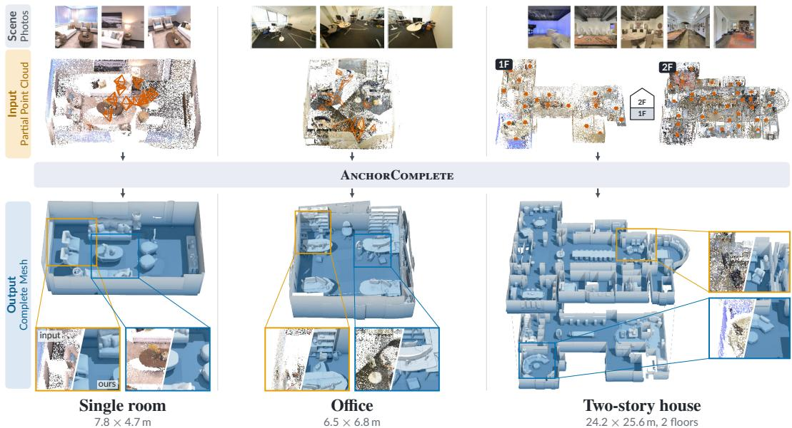  
Figure 1: Completed scene meshes generated by ANCHORCOMPLETE. From a sparse, noisy point cloud, ANCHORCOMPLETE recovers a complete, metric-scale mesh, shown with the house’s floors pulled apart and insets that pair the input with our mesh. One model covers all three scales and fills in what the input never observed.

## ABSTRACT

Most image-based 3D reconstructors primarily recover visible surfaces, producing partial point clouds with large holes and missing areas, while leaving geometry outside the observed views unresolved. To address this gap, we introduce ANCHOR-COMPLETE, a framework that reconstructs complete scene meshes from partial point reconstructions. Our design addresses two key challenges: anchoring generation to the observed geometry and scaling completion to scenes of different scales. First, we introduce a partial-point conditioning module that combines global scene tokens with local spatial evidence to anchor generation to the input point cloud. Second, we introduce metric-scale coarse-to-fine generation, which establishes a global scene layout and progressively refines it within windows of fixed physical size. Each window inherits the coarser geometry, preserving scene structure while recovering fine details at any scene size. We instantiate these designs on top of TRELLIS.2. The resulting model produces complete scene meshes that remain faithful to the observed geometry, providing a more coherent digital representation of the physical environment. Experiments on Replica and SCRREAM show that ANCHORCOMPLETE consistently outperforms strong baselines in complete-scene reconstruction, particularly under sparse-view settings.

## 1 INTRODUCTION

We study the problem of recovering a complete 3D mesh of a scene given only a partial observation, such as the output of a 3D reconstructor or a 3D scanner. A robust solution to this problem would benefit downstream applications such as novel-view AR/VR rendering (Xie et al., 2026), large-scale physical simulation (Savva et al., 2019; Szot et al., 2021), and robotics (Liu et al., 2023a), where complete scene meshes are often required for rendering, collision detection, and physical interaction.

Addressing this problem requires tackling two coupled challenges: (i) preserving fidelity to the observed geometry and (ii) scaling completion to any physical scene size. Recently, feed-forward 3D reconstructors like DUSt3R (Wang et al., 2024) and its variants (Leroy et al., 2024; Wang et al., 2025b;a; Yang et al., 2025; Sun et al., 2024; Keetha et al., 2025; Wang et al., 2026), as well as online SLAM systems like DROID-SLAM (Teed & Deng, 2021) and VGGT-SLAM (Maggio et al., 2025), have made it possible to obtain dense point clouds of scenes in a single forward pass by scaling the model and training data to directly regress 3D points from image observations. However, completion is not part of their formulation, so unobserved regions remain large holes, limiting their applicability in many downstream applications.

Early completion methods (Han et al., 2017; Lyu et al., 2021; Yu et al., 2021; Zhou et al., 2021) focus on completing point clouds of single objects in normalized coordinate spaces and thus do not scale to scene-level inputs. While Amodal3R (Wu et al., 2025), SAM 3D (Team et al., 2025), ShapeR (Siddiqui et al., 2026), and CoLa3D (Cai et al., 2026) extend foundational 3D generators (Zhang et al., 2023; 2024; Hunyuan3D et al., 2025a; Xiang et al., 2024; 2025; Li et al., 2025a) to occluded geometry, they mainly address separate object completion in normalized coordinate spaces and do not directly condition on partial point observations, so they may not remain faithful to the geometry actually observed by the cameras. Recent scene completion methods like PaSCo (Cao et al., 2024), NOVA3R (Chen et al., 2026b), and Seen2Scene (Meng et al., 2026) aim to generate complete scene geometry. While promising, these models typically complete within the given field of view, without considering geometry outside the camera view. They also do not output a complete mesh, but rather a point cloud or a voxel grid, which may not be directly usable for downstream applications.

Seeking to close this gap, we introduce ANCHORCOMPLETE, a generative framework that takes as input a partial point cloud, such as one recovered from sparse RGB observations, and outputs a complete scene mesh (Figure 1). We build on the TRELLIS (Xiang et al., 2024; 2025), but adapting it to scene completion poses two key challenges: faithfully preserving observed geometry and scaling to scenes of varying spatial extent. When an entire scene is normalized into a single cube, the physical size of each mesh cell increases with the scene extent.

We address these challenges with two main components. Partial-point conditioning anchors generation to the input through a hybrid scheme that combines global cross-attention to transformer-encoded anchor tokens with local spatial injection of observed voxels into the noisy latent. Metric-scale coarse-to-fine generation covers the scene with an octree of fixed physical size windows, each refining its coarser parent, which keeps the layout consistent across windows while adding detail at any scene size. Together, they enable faithful and scalable scene completion from sparse observations.

We evaluate our method on the Replica (Straub et al., 2019) and SCRREAM (Jung et al., 2024) datasets, where we reconstruct complete indoor scenes under standard and sparse-view settings. Our experiments demonstrate that ANCHORCOMPLETE recovers more complete scene geometry than the baselines while remaining faithful to the visible input, and degrades more slowly as camera coverage drops. Our contributions are:

• We take a step towards recovering complete meshes of scenes from partial point clouds, without requiring densely sampled posed images, oriented normals, or per-scene optimization. For this new problem setting, we formulate strong baselines and evaluation protocols.

• We introduce ANCHORCOMPLETE, a generative framework that contributes two architectural components: (1) partial-point conditioning and (2) metric-scale coarse-to-fine generation on an octree of fixed physical size windows, which decouples mesh resolution from scene extent; together they enable generative mesh completion at scene scale while remaining anchored to the observed reconstruction.

• ANCHORCOMPLETE achieves the best $\mathrm { C D } _ { \mathrm { a l l } }$ and F-scores on Replica and SCRREAM, and degrades more slowly than the visible-surface baselines we evaluate as input views decrease.

## 2 RELATED WORK

Visible-surface reconstruction. DUSt3R (Wang et al., 2024) and MASt3R (Leroy et al., 2024) regress dense pixel-aligned point maps from unposed image collections, marking a shift toward generalizable, pose-free 3D reconstruction. Building on this paradigm, several recent works (Wang et al., 2025a;b; Lin et al., 2025; Yang et al., 2025; Sun et al., 2024; Keetha et al., 2025; Wang et al., 2025c; Chen et al., 2026a; Wang et al., 2026) extend it to multi-view settings, while online dense SLAM systems (Teed & Deng, 2021; Murai et al., 2025; Liu et al., 2025; Maggio et al., 2025) integrate such reconstruction into camera-trajectory estimation. Surface fitters such as Poisson and Screened Poisson reconstruction (Kazhdan et al., 2006; Kazhdan & Hoppe, 2013), and learned methods such as NKSR and NoKSR (Huang et al., 2023; Li et al., 2025b), convert oriented points into smooth implicit surfaces. All remain tied to camera-visible geometry: occluded regions go unmodeled, and surfaces fitted across holes follow smoothness rather than any prior over the unobserved scene. We instead complete those regions with a learned generative prior.

Generative 3D priors. Generative 3D methods synthesize complete geometry from images, text, layouts, or latent representations. Image-space methods such as Text2Room (Höllein et al., 2023), Invisible Stitch (Engstler et al., 2025), and GenRC (Li et al., 2024) iteratively inpaint and lift RGB-D views, while foundation 3D generators (Zhang et al., 2023; 2024; Xiang et al., 2024; Hunyuan3D et al., 2025a; Li et al., 2025a; Xiang et al., 2025) and amodal methods (Wu et al., 2025; Team et al., 2025; Siddiqui et al., 2026) recover complete object geometry from image or text prompts. Scene-scale approaches (Shriram et al., 2025; Wu et al., 2024; Ju et al., 2024; Roessle et al., 2024; Bahmani et al., 2023; Yang et al., 2024a;b; Feng et al., 2023) generate rooms from learned scene representations or layouts. However, these priors are not directly constrained by the metric geometry of a specific partial reconstruction, motivating our point-conditioned formulation.

Completion from partial 3D geometry. Completion methods condition on partial 3D input to infer missing geometry. Object-centric approaches (Yuan et al., 2018; Yu et al., 2021; Zhou et al., 2022; Chu et al., 2023; Han et al., 2017; Lyu et al., 2021; Zhou et al., 2021) complete point clouds or shapes, while scene methods (Dai et al., 2018; 2020) predict occupancy or SDFs from partial voxel grids, typically at limited resolution. More recent generative models such as Hunyuan3D-Omni (Hunyuan3D et al., 2025b) and ShapeR (Siddiqui et al., 2026) condition foundation 3D generators on partial geometry but remain object-scale. At scene scale, PaSCo (Cao et al., 2024), NOVA3R (Chen et al., 2026b), Points-to-3D (Xia et al., 2026b), Seen2Scene (Meng et al., 2026), GenRecon (Schmid et al., 2026) and Surflo (Guédon et al., 2026) explore occupancy, amodal reconstruction, latent generation, or chunk-based completion. Seen2Scene is the closest baseline to our setting. Maintaining fidelity to observed geometry while plausibly completing missing regions remains a central challenge in scene completion. We condition a pretrained 3D generative prior on a raw scene-scale partial reconstruction and output a completed mesh in the original scene coordinate frame (Section 3).

## 3 METHOD

We develop ANCHORCOMPLETE, a generative model that recovers a complete scene mesh M from a partial point cloud P obtained from feed-forward 3D reconstruction (Wang et al., 2025a; Lin et al., 2025), SLAM (Teed & Deng, 2021; Maggio et al., 2025), or 3D scanning (Dai et al., 2017). The key challenge is to hallucinate plausible geometry in unobserved regions while preserving the observed structure. Our model, illustrated in Figure 2, builds on TRELLIS.2 (Xiang et al., 2025) and adapts it to scene-level completion through partial-point conditioning and metric-scale coarse-to-fine generation. We first review TRELLIS in Section 3.1, then present partial-point conditioning in Section 3.2 and the coarse-to-fine octree that extends the generator from a single normalized cube to metric scale in Section 3.3, followed by training details in Section 3.4.

## 3.1 PRELIMINARIES: TRELLIS

TRELLIS (Xiang et al., 2024) is a foundational 3D asset generator that takes a text prompt or image as the condition c and outputs various 3D representations, including meshes M, Gaussian splats G, and radiance fields R. For flexibility, TRELLIS represents the given 3D asset O with a set of Structured Latents (SLATs) $\mathcal { Z } = \{ \boldsymbol { z } _ { i } , \dot { \boldsymbol { p } } _ { i } \} _ { i = 1 } ^ { L }$ on a predefined $H \times W \times D$ spatial grid Ω, where

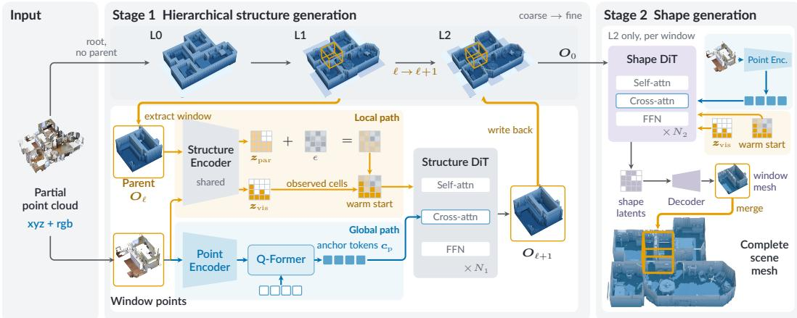  
Figure 2: Overview of ANCHORCOMPLETE. From a partial, colored point cloud, Stage 1 generates a metric-scale octree coarse to fine, one window at a time, and Stage 2 generates shape latents on the finest level, which are decoded, merged and meshed once. Each window is conditioned on its parent occupancy and visible points through the local path (warm start) and on its points through anchor tokens read by cross-attention (global path).

$L \ll H W D$ is the number of active voxels, $\pmb { p } _ { i } \in \mathbb { R } ^ { 3 }$ is the 3D coordinate of the i-th active voxel, and $z _ { i } \in \mathbb { R } ^ { C }$ is the corresponding latent feature encoding local geometry and appearance information.

The TRELLIS pipeline consists of two VAEs and two corresponding rectified-flow generation stages (Albergo & Vanden-Eijnden, 2022; Lipman et al., 2022; Liu et al., 2023b). The structure VAE $( \mathcal { E } _ { \mathrm { s } } , \mathcal { D } _ { \mathrm { s } } )$ compresses a dense binary voxel grid ${ \cal O } \in \{ 0 , 1 \} ^ { \dot { H } \times W \times D }$ into a latent representation $\begin{array} { r } { z _ { \mathrm { s } } \in \mathbb { R } ^ { \frac { H } { s } \times \frac { \dot { W } } { s } \times \frac { D } { s } \times C } } \end{array}$ , which is decoded to model the coarse geometry. The SLAT VAE $( \mathcal { E } _ { \mathrm { s l } } , \mathcal { D } _ { \mathrm { s l } } )$ encodes the Structured Latents (SLATs) Z together with voxelized multi-view image features into $z _ { \mathrm { s l } } \in \mathbb { R } ^ { L \times C }$ , which is decoded into various 3D representations.

During generation, a flow transformer T first generates the structure latent z from Gaussian noise conditioned on text or image tokens c. The sampled latent is decoded into the active voxel support $\{ p _ { i } \} _ { i = 1 } ^ { L }$ , which determines the coarse spatial layout. A sparse flow transformer $\mathcal { T } _ { \mathrm { s l } }$ then generates the local SLAT features $\{ z _ { i } \} _ { i = 1 } ^ { L }$ on this support, again conditioned on c, and the resulting SLAT Z is decoded into the desired 3D output. TRELLIS.2 (Xiang et al., 2025) retains this two-stage design but replaces the second-stage SLAT features with an O-Voxel shape latent. We build on TRELLIS.2 and extend it with partial-point conditioning and scalable scene-level generation.

## 3.2 PARTIAL POINT CONDITIONING

Unlike image-conditioned 3D generators (Zhang et al., 2024; Hunyuan3D et al., 2025a; Xiang et al., 2024; 2025), we condition scene completion directly on partial point observations. This is advantageous for several reasons: (1) Completeness: the observed points delineate the visible scene boundary, providing direct geometric evidence of where completion is needed; (2) Accuracy: the condition is directly grounded in 3D geometry, maintaining better fidelity to the visible geometry; (3) Efficiency: the observed points $\mathcal { P } = \{ p _ { i } \} _ { i = 1 } ^ { N }$ can be uniformly subsampled to a fixed size $\dot { N } ,$ avoiding conditioning costs that grow with the number of input images; and (4) Composability: point-based inputs can be chunked for scalable local processing, and the outputs can be directly merged in the same scene coordinate frame. In particular, we take a hybrid conditioning approach via (1) global cross-attention to anchor tokens encoded from the point cloud and (2) local spatial injection of visible-voxel evidence into the structure latent; both paths are shown in Figure 2. The two pathways are ablated in Section 4.

Global Anchor Tokens. We design a simple architecture to extract anchor tokens from the input point observations $\mathcal { P } = \{ p _ { i } \} _ { i = 1 } ^ { N }$ . In particular, we implement the point-cloud encoder ${ \mathcal E } _ { \mathfrak p }$ using a transformer architecture inspired by the point encoder of NOVA3R (Chen et al., 2026b), but with its per-point features taken from a pretrained Utonia backbone (Zhang et al., 2026). To this end, we first extract high-dimensional features $\{ f _ { i } \} _ { i = 1 } ^ { N }$ for all N input points with the frozen Utonia backbone.

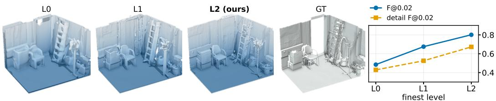  
Figure 3: Coarse-to-fine levels. The same model stopped at levels 0, 1 and 2 on a room corner of a real-world scene, with the mean F-scores of Table 2(b) on the right. Only level 2 separates the ladder rungs and the legs of the chair.

The encoder then uses m learnable queries ${ \mathcal { F } } ^ { q }$ and the full set of point features $\mathcal { F } ^ { ( k , v ) } = \{ f _ { i } \} _ { i = 1 } ^ { N }$ as the keys and values for the encoder’s cross-attention layers, where $m \ll N$ is a fixed number of point tokens. The anchor tokens are further refined by several interleaved self-attention and cross-attention blocks. The resulting anchor tokens $\pmb { c } _ { \mathfrak { p } } \in \mathbb { R } ^ { m \times \breve { C } _ { \mathrm { x a } } }$ , where $C _ { \mathrm { x a } }$ is the cross-attention feature dimension, are then fed to the TRELLIS.2 flow model as global conditioning tokens through cross-attention, replacing the original image/text conditioning tokens in both stages. We use $m = 7 6 8$ anchor tokens. The encoder also reads the point colours and, in the metric-scale model of Section 3.3, two per-point attributes: an observed-point flag and the expected depth-noise level.

Local Spatial Injection. To further encourage spatial consistency between the generated geometry and the input point cloud, we introduce a local spatial conditioning path that injects visible-point evidence directly into the first-stage structure latent space. Inspired by condition injection strategies in image editing (Avrahami et al., 2023), we first voxelize the point observations $\mathcal { P }$ into a binary 3D grid ${ \cal O } _ { \mathrm { v i s } } \in \{ 0 , 1 \} ^ { H \times W \times D }$ , setting a voxel to 1 if it contains at least one observed point and to 0 otherwise. It is then encoded with the pretrained structure encoder ${ \mathcal E } _ { \mathrm { s } }$ to obtain partial-geometry features $z _ { \mathrm { v i s } } ~ \in ~ \mathbb { R } ^ { \frac { H } { s } \times \frac { W } { s } \times \frac { D } { s } \times C }$ . In parallel, we downsample $O _ { \mathrm { v i s } }$ to obtain a 3D binary mask $\begin{array} { r } { O _ { \mathrm { v i s } , m } \in \{ 0 , 1 \} ^ { \frac { H } { s } \times \frac { W } { s } \times \frac { D } { s } } } \end{array}$ , indicating which latent cells correspond to visible regions. The visible evidence enters Stage 1 in two ways. First, it initializes the flow: rather than starting from Gaussian noise everywhere, we replace the initial sample at visible cells by ${ z _ { \mathrm { v i s } } }$

$$
z _ { s } ^ { ( 1 ) } = O _ { \mathrm { v i s } , m } \odot z _ { \mathrm { v i s } } + ( { \bf 1 } - O _ { \mathrm { v i s } , m } ) \odot \epsilon , \qquad \epsilon \sim \mathcal { N } ( { \bf 0 } , I ) ,\tag{1}
$$

where $ { \boldsymbol { z } } _ { s } ^ { ( 1 ) }$ is the latent the sampler starts from. Second, the mask is available at every denoising step: we concatenate $O _ { \mathrm { v i s } , m }$ to the noisy latent and feed the result back to the denoiser, so it can separate observed from unobserved cells throughout sampling. Stage 2 uses both as well: it receives ${ z } _ { \mathrm { v i s } } .$ , read at its voxels, with a per-voxel visibility flag at every denoising step, and its initial sample takes, on observed voxels, the shape latents encoded from the visible points.

## 3.3 METRIC-SCALE COARSE-TO-FINE GENERATION

A single normalized cube is stretched to fit the whole input, so its cells grow with the scene. In a small room this hardly matters, but in a large apartment each cell ends up several centimetres wide and thin parts such as chair legs or shelf boards disappear. A finer cube does not help either, since a resolution that suits the apartment is wasted on a bathroom. We therefore stop tying the cell size to the scene and generate it coarse to fine.

Multi-Levels. Level 0 is the single cube itself: it sees the whole scene at once and gives the overall layout of the rooms, even if the details are rough. Levels 1 and 2 then cover the occupied space with windows of a fixed physical size, the level-2 windows half as wide as the level-1 windows, so each level’s $5 1 2 ^ { 3 }$ mesh grid has a fixed cell size regardless of scene size, and further levels $3 , 4 , \ldots$ . would halve the window again; Figure 3 shows what each level resolves. In observed regions, the window follows the input geometry; in unobserved regions, it is initialized from the parent prediction and primarily refines that prediction rather than synthesizing a new layout. Inside a window, both stages of Section 3.2 run unchanged on the window’s crop of the input; the model never needs to know how large the scene is. All levels use the sparse-structure and O-Voxel latents of TRELLIS.2 (Xiang et al., 2025).

Parent warm start. A window at level ℓ+1 does not start from scratch. We encode its parent’s occupancy, $z _ { \mathrm { p a r } } = \mathcal { E } _ { \mathrm { s } } ( O _ { \ell } )$ , and use it as the starting point wherever the input has no points:

$$
z _ { s } ^ { ( 1 ) } = O _ { \mathrm { v i s } , m } \odot z _ { \mathrm { v i s } } + ( { \bf 1 } - O _ { \mathrm { v i s } , m } ) \odot \big ( \alpha z _ { \mathrm { p a r } } + \sqrt { 1 - \alpha ^ { 2 } } \epsilon \big ) , \qquad \epsilon \sim \mathcal { N } ( { \bf 0 } , I ) ,\tag{2}
$$

with $\alpha = 0 . 8 ( \alpha = 0$ recovers Equation (1)). Where the input saw the scene, the window follows the observation; where it did not, the window starts from the parent’s guess and mostly sharpens it instead of inventing a new room. Since every window inherits the same coarse layout, neighbouring windows agree on where the walls and furniture are. Windows overlap by a quarter of their width and keep only their centre. At the finest level we run Stage 2, merge the decoded windows into a common grid and extract a single mesh, thereby avoiding explicit mesh stitching.

## 3.4 TRAINING

We fine-tune two flow models in TRELLIS.2 with our new conditioning: one predicts the active voxels $\{ p _ { i } \} _ { i = 1 } ^ { L }$ , and the other predicts the shape latents $\{ z _ { i } \} _ { i = 1 } ^ { L }$ on this support. Each model $v _ { \theta }$ operates in a latent space z and is trained to remove Gaussian noise $\mathbf { \epsilon } \epsilon \sim \mathcal { N } ( \mathbf { 0 } , \mathbf { I } )$ added to the target latent $z _ { \mathrm { 0 } } .$ i.e. $z _ { t } = ( 1 - t ) z _ { 0 } + t \epsilon$ , where $t \sim \mathcal { U } ( 0 , 1 )$ is a random interpolation timestep. Formally, each model vθ is trained to predict the rectified-flow velocity:

$$
\begin{array} { r } { \mathcal { L } ( \pmb { \theta } ) = \mathbb { E } _ { ( z _ { 0 } , \mathbf { c } _ { p } ) , t , \epsilon } \left[ \| v _ { \pmb { \theta } } ( z _ { t } , \mathbf { c } _ { p } , t ) - ( \epsilon - z _ { 0 } ) \| _ { 2 } ^ { 2 } \right] , } \end{array}\tag{3}
$$

where $\mathbf { c } _ { p }$ denotes the encoded partial point observations. The loss is applied independently to both stages, and we fine-tune the newly introduced conditioning modules and the denoisers from the pretrained generative prior. The warm start of Equation (1) and the mask concatenation are active during both training and inference. For the metric-scale model (Section 3.3), both stages are trained on windows: each sample crops a window and the depth points of 2–8 views that see it, drawing levels 1 and 2 most often. The parent of Equation (2) is the next coarser level: usually $( p = 0 . 7 )$ a prediction (the single cube for level 1, an earlier model’s for level 2), otherwise a damaged ground-truth parent, so the model learns to correct imperfect parents rather than copy them.

## 4 EXPERIMENTS

## 4.1 EXPERIMENTAL SETUP

Evaluation datasets. We evaluate on two indoor datasets with ground-truth geometry for both visible and occluded regions: Replica (Straub et al., 2019) with 8 photorealistic indoor reconstructions with high-quality meshes and densely sampled trajectories, and SCRREAM (Jung et al., 2024) with 12 real-world captures with accurate per-scene ground truth, which we treat as our primary real-world benchmark. Note that, we do not use any of the training scenes from these datasets.

Training data construction. We train ANCHORCOMPLETE on InternScenes (Zhong et al., 2025) and SAGE (Xia et al., 2026a). We use around 16k scenes from InternScenes, whose watertight glTF meshes serve as complete supervision M, and around 7k rooms from SAGE, whose complete meshes are used the same way; both cover observed surfaces and occluded regions. Per scene we render multi-view RGB-D (InternScenes with BlenderProc (Denninger et al., 2023)) at 640×480 and an $8 5 ^ { \circ }$ horizontal field of view, placing cameras with an area-adaptive multi-anchor sampler plus corner viewpoints for coverage. Details are in the appendix.

Metrics. Following prior work (Wang et al., 2024; 2025a; Chen et al., 2026b; Guédon et al., 2026), we report Chamfer Distance (CD) and F-score, using ground-truth poses to crop the visible mesh within the input view frustums. We decompose CD into accuracy (prediction-to-GT) and completeness (GT-to-prediction). $\mathrm { C D } _ { \mathrm { v i s } }$ is symmetric over the visible region, while $\mathrm { C D } _ { \mathrm { a l l } }$ combines visible-region accuracy with full-scene completeness. F-scores at 0.1 and 0.05 m use the same regions as $\mathrm { C } \bar { \mathrm { D } } _ { \mathrm { a l l } }$ lower CD and higher F are better. Accuracy is computed only for predictions inside the input-view frustums, since completion outside the observed region is inherently multi-modal and the ground truth represents only one valid realization. See Section A.2 for details.

Ours  
GT  
Input  
Table 1: Quantitative reconstruction evaluation on Replica (Straub et al., 2019) and SCR-REAM (Jung et al., 2024) with $N _ { \mathrm { v i e w s } } = 4 .$ . The best result in each metric column is shown in bold, and the second best is underlined. ∗ denotes our scene finetune of TRELLIS, with its output aligned to the input cloud; the unstarred row is the released object-pretrained model. Runtime is per-scene reconstruction on an RTX PRO 6000 Max-Q.
<table><tr><td rowspan="2">Method</td><td colspan="4">Replica</td><td colspan="4">SCRREAM</td><td rowspan="2">Runtime ↓</td></tr><tr><td> $\mathrm { C D } _ { \mathrm { v i s } } \downarrow$ </td><td> $\mathrm { C D } _ { \mathrm { a l l } } \downarrow$ </td><td> $\mathrm { F _ { 0 . 1 } } \ \uparrow$ </td><td> $\mathrm { F _ { 0 . 0 5 } \uparrow }$ </td><td> $\mathrm { C D } _ { \mathrm { v i s } } \downarrow$ </td><td> $\mathrm { C D } _ { \mathrm { a l l } } \downarrow$ </td><td> $\mathrm { F _ { 0 . 1 } } \ \uparrow$ </td><td> $\mathrm { F _ { 0 . 0 5 } \uparrow }$ </td></tr><tr><td colspan="9">Feed-forward dense reconstruction</td><td></td></tr><tr><td>VGGT-Ω (Wang et al., 2026)</td><td>0.062</td><td>0.230</td><td>0.560</td><td>0.412</td><td>0.062</td><td>0.247</td><td>0.582</td><td>0.433</td><td>&lt;1s</td></tr><tr><td>DA3 (Lin et al., 2025)</td><td>0.048</td><td>0.220</td><td>0.611</td><td>0.508</td><td>0.052</td><td>0.227</td><td>0.607</td><td>0.453</td><td>&lt;1s</td></tr><tr><td>CUT3R (Wang et al., 2025b)</td><td>0.244</td><td>0.360</td><td>0.355</td><td>0.214</td><td>0.189</td><td>0.359</td><td>0.455</td><td>0.311</td><td>&lt;1s</td></tr><tr><td>PI-3 (Wang et al., 2025c)</td><td>0.053</td><td>0.224</td><td>0.573</td><td>0.426</td><td>0.096</td><td>0.253</td><td>0.485</td><td>0.315</td><td>&lt;1s</td></tr><tr><td colspan="9">Image-based Generation</td><td></td></tr><tr><td>TRELLIS (Xiang et al., 2024)</td><td>0.537</td><td>0.584</td><td>0.239</td><td>0.127</td><td>0.346</td><td>0.416</td><td>0.262</td><td>0.160</td><td>~4 s</td></tr><tr><td>TRELLIS* (Xiang et al., 2024)</td><td>0.244</td><td>0.288</td><td>0.308</td><td>0.150</td><td>0.221</td><td>0.264</td><td>0.323</td><td>0.170</td><td>~4 s</td></tr><tr><td>GenRC (Li et al., 2024)</td><td>0.355</td><td>0.366</td><td>0.161</td><td>0.076</td><td>0.295</td><td>0.332</td><td>0.191</td><td>0.091</td><td>~6.6 min</td></tr><tr><td>Surflo (Guédon et al., 2026)</td><td>0.162</td><td>0.318</td><td>0.442</td><td>0.288</td><td>0.094</td><td>0.270</td><td>0.482</td><td>0.325</td><td>~1.2 min</td></tr><tr><td colspan="9">Scene completion</td><td></td></tr><tr><td>SG-NN (Dai et al., 2020)</td><td>0.085</td><td>0.214</td><td>0.600</td><td>0.415</td><td>0.111</td><td>0.225</td><td>0.518</td><td>0.308</td><td>18 s</td></tr><tr><td>NKSR (Huang et al., 2023)</td><td>0.057</td><td>0.211</td><td>0.633</td><td>0.527</td><td>0.066</td><td>0.209</td><td>0.614</td><td>0.457</td><td>1 s</td></tr><tr><td>Seen2Scene (Meng et al., 2026)</td><td>0.070</td><td>0.132</td><td>0.777</td><td>0.647</td><td>0.075</td><td>0.167</td><td>0.692</td><td>0.525</td><td>~10.4 min</td></tr><tr><td>ANCHORCOMPLETE (ours)</td><td>0.055</td><td>0.067</td><td>0.819</td><td>0.684</td><td>0.057</td><td>0.076</td><td>0.786</td><td>0.584</td><td>~3 min</td></tr></table>

TRELLIS\*  
NKSR  
SGNN  
Seen2Scene  
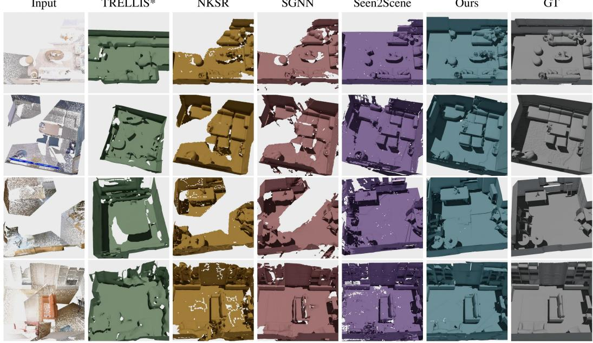  
Figure 4: Qualitative reconstruction results on Replica (Straub et al., 2019) and SCR-REAM (Jung et al., 2024). Given the same DA3 point cloud as input, our method achieves better scene completion performance.

Baselines. We compare against three groups, grouped as in Table 1. i) Feed-forward dense reconstruction: VGGT-Ω (Wang et al., 2026), DA3 (Lin et al., 2025), CUT3R (Wang et al., 2025b), and PI-3 (Wang et al., 2025c) predict dense geometry from images but target visible surfaces only; none outputs a mesh, so we convert all of them with the same pipeline. ii) Image-based generation: TRELLIS (Xiang et al., 2024), GenRC (Li et al., 2024) and Surflo (Guédon et al., 2026) test whether generative priors alone recover missing geometry. iii) Scene completion: SG-NN (Dai et al., 2020), NKSR (Huang et al., 2023), and Seen2Scene (Meng et al., 2026) take partial point clouds and predict complete surfaces, matching our input-output setting most closely. We run Seen2Scene using the authors’ released code and checkpoints. Its input is a TSDF volume fused from the same DA3 depth maps used by our model, using VDBFusion with 1.1 cm voxels. Both methods are evaluated using the same code after the same Sim(3) alignment.

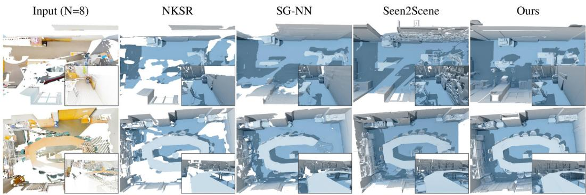  
Figure 5: Real-world scenes. Two real-world rooms from eight views, top-down with an inside view inset (same camera in every column); NKSR (Huang et al., 2023), SG-NN (Dai et al., 2020), Seen2Scene (Meng et al., 2026) and ANCHORCOMPLETE take the same input. The baselines leave surfaces holed where coverage thins, while ours closes them.

Implementation details. We initialize both stages of ANCHORCOMPLETE from the TRELLIS.2 (Xiang et al., 2025) image-to-3D checkpoints. The point-cloud encoder $\mathcal { E } _ { \mathrm { p } }$ keeps the Utonia backbone (Zhang et al., 2026) frozen; only the four-layer Q-Former that turns its features into the $m { = } 7 6 8$ anchor tokens is trained. Both denoisers are 30-block DiTs with 1536 channels, 12 attention heads and rotary position embeddings. Stage 1 operates on the 8-channel $1 6 ^ { 3 }$ sparse-structure latent, which is decoded into a $6 4 ^ { 3 }$ occupancy grid and max-pooled to the $3 2 ^ { 3 }$ support of Stage 2; Stage 2 generates the 32-channel O-Voxel latent on that support, from which the mesh is extracted on a $5 \mathrm { { i } 2 ^ { 3 } }$ grid. Both stages are trained independently using AdamW with learning rate $2 \times 1 0 ^ { - 5 }$ , weight decay 0.01, batch size 1 per GPU and 10% condition dropout, each fine-tuned for 40k steps on four NVIDIA L40 GPUs. At inference each stage takes 12 flow steps. Additional details are provided in the appendix.

## 4.2 COMPLETE SCENE RECONSTRUCTION

Table 1 evaluates complete-scene reconstruction at $N _ { \mathrm { v i e w s } } { = } 4$ ANCHORCOMPLETE leads the complete-region metrics on both datasets against every baseline. On the visible region DA3 (Lin et al., 2025) obtains the best $\mathrm { C D } _ { \mathrm { v i s } }$ with ANCHORCOMPLETE close behind, so the completion gains do not cost visible-surface fidelity; CUT3R (Wang et al., 2025b) struggles even there, likely because four views give little coverage of a full room. Surflo (Guédon et al., 2026) can generate complete meshes, but it still lags behind ANCHORCOMPLETE by a wide margin, likely because it is trained mainly on object-centric data. Surface fitting such as NKSR (Huang et al., 2023) smooths visible points into surfaces but still lags, showing smoothing alone cannot recover unseen geometry, while TREL-LIS (Xiang et al., 2024) without partial-point conditioning drifts off the captured scene. TRELLIS∗, our scene-level fine-tuned version of the same prior, improves substantially over the released object model but still trails ANCHORCOMPLETE by a wide margin on both datasets, indicating that our advantage comes from conditioning on the observed geometry rather than from scene-level training.

Figure 4 provides qualitative comparisons under the same four-view setting. ANCHORCOMPLETE keeps the visible surface and closes back walls and out-of-view floor where the feed-forward and surface-fitting baselines leave holes. TRELLIS∗ returns a plausible room unrelated to the input cloud. Seen2Scene (Meng et al., 2026), the completion baseline closest to our setting, returns a far flatter result, without the furniture relief and wall structure ANCHORCOMPLETE preserves.

Real-world scenes. Figure 5 takes the model outside the benchmarks, onto two real-world rooms reconstructed from eight views, with NKSR, SG-NN and Seen2Scene run on the same input. All three recover the room layout; the inside views are where they differ, as the baselines leave surfaces ragged and holed where coverage thins while ours closes them. These rooms have no complete ground-truth mesh, so they are shown qualitatively rather than scored.

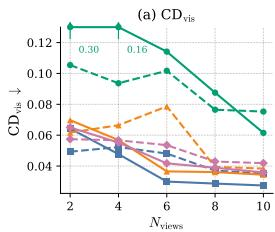

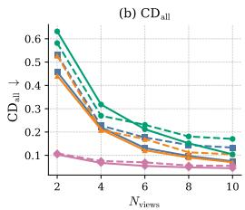  
DA3 NKSR Surflo Ours

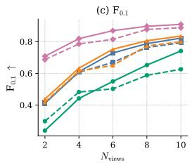

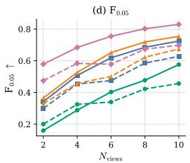  
Replica SCRREAM

Figure 6: Sparse-view robustness on Replica (Straub et al., 2019) and SCRREAM (Jung et al., 2024) (mean across scenes).  
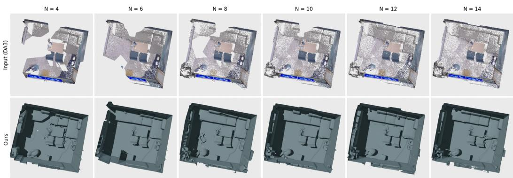  
Figure 7: Sparse-view conditional scene completion. The DA3 input (top) loses coverage as views are removed, while our completion (bottom) stays closed across the range. Bottom row: ANCHORCOMPLETE at level 0, $N { = } 4$ to 14 views; Replica provides 10 input frames per scene, so $N { = } 1 2$ and 14 add held-out frames of the same sequence.

## 4.3 ROBUSTNESS TO SPARSE INPUT VIEWS

To evaluate robustness to sparse input views, we uniformly subsample each scene’s saved views to $N _ { \mathrm { v i e w s } } \in \{ 2 , 4 , 6 , 8 , 1 0 \}$ } and report the same metrics as in Table 1 (Figure 6), comparing against DA3 (Lin et al., 2025), NKSR (Huang et al., 2023) and Surflo (Guédon et al., 2026) as representative baselines. ANCHORCOMPLETE leads $\mathrm { C D } _ { \mathrm { a l l } }$ and the F-scores at every view count we test, against DA3, NKSR and Surflo, with the largest gains in the sparsest setting: the gap to NKSR in $\mathrm { C D } _ { \mathrm { a l l } }$ is widest at $N { = } 2$ on both datasets. It also degrades less as views decrease, maintaining higher F-scores from N=10 to $N { = } 2$ than visible-surface baselines. At $N { = } 1 0 .$ , its $\mathrm { F _ { 0 . 0 5 } }$ is 0.829 vs. 0.754 for NKSR on Replica and 0.697 vs. 0.674 on SCRREAM. $\mathrm { C D } _ { \mathrm { v i s } }$ remains slightly better for DA3, especially at very sparse views, since it reconstructs only observed surfaces while our model generates complete geometry. Figure 7 shows that, as views are removed, the DA3 cloud becomes increasingly incomplete whereas our reconstruction remains complete. In addition, Figure 11 in the appendix shows that ANCHORCOMPLETE can generate diverse plausible completions from the same partia observation, suggesting that it does not simply memorize a single dataset-specific shape prior.

## 4.4 ABLATION STUDY

We ablate on Replica (Straub et al., 2019) to analyze the contributions of key design choices in ANCHORCOMPLETE.

Importance of Partial-point Conditioning. Partial-point conditioning anchors the generative prior through two complementary paths (Section 3.2), ablated in Table 2(a): global anchor tokens, encoded from the input cloud and read via cross-attention, and local spatial injection, which injects the visible cloud into the structure latent. Removing local injection causes the largest drop, especially in visible-region fidelity $\left( \mathrm { C D } _ { \mathrm { v i s } } \right)$ , since per-voxel evidence localizes the observed geometry. Removing global anchor tokens causes a smaller drop, as the tokens supply scene-level context rather than localization.

Table 2: Ablation study. (a) Partial-point conditioning on Replica (Straub et al., 2019) $( N _ { \mathrm { v i e w s } } { = } 4 ;$ the two ablated rows are trained on the TRELLIS backbone) and (b) the finest level of the coarse-tofine generation on held-out scenes; distances in metres.
<table><tr><td colspan="8">(a) Partial-point conditioning</td></tr><tr><td>Method</td><td>Global</td><td>Local</td><td> $\mathrm { C D } _ { \mathrm { v i s } }$ </td><td> $\mathrm { C D } _ { \mathrm { a l l } }$ </td><td> $\mathrm { F _ { 0 . 1 } }$ </td><td> $\mathrm { { F _ { 0 . 0 5 } } }$ </td><td> $\mathrm { { F _ { 0 . 0 2 } } }$ </td></tr><tr><td>TRELLIS*</td><td>x</td><td>x</td><td>0.244</td><td>0.288</td><td>0.308</td><td>0.150</td><td>0.030</td></tr><tr><td>w/o local injection</td><td>√</td><td>x</td><td>0.072</td><td>0.105</td><td>0.749</td><td>0.532</td><td>0.131</td></tr><tr><td>w/o global tokens</td><td>x</td><td>√</td><td>0.060</td><td>0.086</td><td>0.787</td><td>0.652</td><td>0.219</td></tr><tr><td>Ours</td><td>√</td><td>√</td><td>0.055</td><td>0.067</td><td>0.819</td><td>0.684</td><td>0.252</td></tr></table>

<table><tr><td colspan="2">(b) Coarse-to-fine levels</td></tr><tr><td>Finest  $_ \mathrm { A c c }$ </td><td>Comp  $\mathrm { { F _ { 0 . 0 5 } } }$   $\mathrm { { F } _ { 0 . 0 2 } }$   $\mathrm { F _ { 0 . 0 2 } ^ { d e t } }$ </td></tr><tr><td></td><td>l = 0 0.045 0.046 0.835 0.485 0.429</td></tr><tr><td></td><td>l = 1 0.038 0.036 0.873 0.675 0.526</td></tr></table>

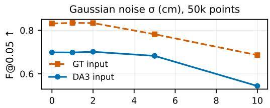

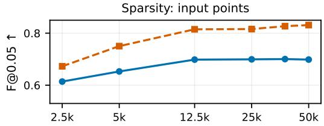  
Figure 8: Input robustness. $\mathrm { F _ { 0 . 0 5 } }$ as the input is perturbed with Gaussian noise at a fixed 50k points (left) or thinned out (right), with no retraining, each on the DA3 cloud and on ground-truth points. The model is unaffected by noise up to the voxel scale and by sparsity down to a quarter of the points.

Coarse-to-Fine Levels. Table 2(b) and Figure 3 evaluate the pipeline after levels 0, 1, and 2 on five held-out real-world scenes and one Matterport3D house. Each finer level halves the mesh-cell size and recovers more geometric detail, substantially improving both the overall and high-curvature F-scores while reducing the accuracy error.

Robustness to Imperfect Inputs. All results above condition on raw DA3 clouds without confidence filtering. We additionally perturb the inputs without retraining (Figure 8). Performance remains stable when retaining only a quarter of the input points and under Gaussian noise up to approximately the voxel scale. More severe sparsification or noise causes a gradual decline, consistent with the model’s reliance on spatially accurate anchors. Similar trends on ground-truth and DA3 points indicate that these results reflect the model’s response to the perturbations rather than an interaction with DA3-specific errors.

## 5 CONCLUSION

We presented ANCHORCOMPLETE, a generative framework for recovering complete scene meshes from partial point clouds. Our approach combines partial-point conditioning with metric-scale coarseto-fine generation on an octree of fixed-size windows, which keeps the mesh resolution fixed in metres regardless of scene extent and generates complete scene geometry directly in the original scene coordinate frame. ANCHORCOMPLETE improves complete-scene reconstruction over the baselines while maintaining high fidelity to the observed geometry. We further demonstrate robustness to sparseview inputs and strong performance on real-world scenes, highlighting its potential for applications that require complete digital representations of physical environments.

Acknowledgements. We would like to thank Felix Wimbauer and Shenhan Qian for their insightful discussions. This work was supported by the ERC Advanced Grant “SIMULACRON” (agreement #884679), the GNI Project “AI4Twinning”, and the DFG project CR 250/26-1 “4DYoutube”. Chuanxia Zheng is supported by NTU SUG-NAP and National Research Foundation, Singapore, under its NRF Fellowship Award NRF-NRFF17-2025-0009. Andrea Vedaldi is supported by a Royal Society Faraday Discovery Fellowship FDF\S2\251003.

## AI USE STATEMENT

We used generative AI tools only to suggest local improvements to grammar and phrasing during manuscript preparation. We did not use generative AI tools for research ideation, experimental design, data analysis, interpretation of results, or the formulation of scientific claims. All AI-assisted edits were reviewed and revised by the authors, who take full responsibility for the final content of this work.

## ETHICS STATEMENT

This work addresses complete scene-mesh reconstruction from partial point clouds, evaluated on publicly available research datasets (InternScenes, SAGE, Replica, SCRREAM). We are not aware of ethical concerns specific to this research, including risks to human subjects, dataset consent issues, or foreseeable dual-use harms beyond those already associated with general-purpose 3D reconstruction and generative modeling research.

## REPRODUCIBILITY STATEMENT

We describe the model architecture, training data construction, and evaluation protocol in Sections 3 and 4 of the main text, with the camera sampler in Section A.1 and the remaining implementation details, metric definitions, and evaluated scene subsets in Section A.2. We plan to release code and pretrained checkpoints upon publication to support independent verification of the reported results.

## REFERENCES

Michael S Albergo and Eric Vanden-Eijnden. Building normalizing flows with stochastic interpolants. arXiv preprint arXiv:2209.15571, 2022.

Omri Avrahami, Ohad Fried, and Dani Lischinski. Blended latent diffusion. ACM transactions on graphics (TOG), 42(4):1–11, 2023.

Sherwin Bahmani, Jeong Joon Park, Despoina Paschalidou, Xingguang Yan, Gordon Wetzstein, Leonidas Guibas, and Andrea Tagliasacchi. Cc3d: Layout-conditioned generation of compositional 3d scenes. In Proceedings ofthe IEEE/CVF International Conference on Computer Vision, pp. 7171–7181, 2023.

Xudong Cai, Yongcai Wang, Deying Li, and Chuanxia Zheng. Cola3d: Composable latent 3d decomposition. In Advances in neural information processing systems, 2026.

Anh-Quan Cao, Angela Dai, and Raoul De Charette. Pasco: Urban 3d panoptic scene completion with uncertainty awareness. In Proceedings of the IEEE/CVF Conference on Computer Vision and Pattern Recognition, pp. 14554–14564, 2024.

Lin-Zhuo Chen, Jian Gao, Yihang Chen, Ka Leong Cheng, Yipengjing Sun, Liangxiao Hu, Nan Xue, Xing Zhu, Yujun Shen, Yao Yao, et al. Geometric context transformer for streaming 3d reconstruction. arXiv preprint arXiv:2604.14141, 2026a.

Weirong Chen, Chuanxia Zheng, Ganlin Zhang, Andrea Vedaldi, and Daniel Cremers. NOVA3R: Nonpixel-aligned visual transformer for amodal 3D reconstruction. In Proceedings ofthe International Conference on Learning Representations (ICLR), 2026b.

Ruihang Chu, Enze Xie, Shentong Mo, Zhenguo Li, Matthias Nießner, Chi-Wing Fu, and Jiaya Jia. Diffcomplete: Diffusion-based generative 3d shape completion. Advances in neural information processing systems, 36:75951–75966, 2023.

Angela Dai, Angel X Chang, Manolis Savva, Maciej Halber, Thomas Funkhouser, and Matthias Nießner. ScanNet: Richly-annotated 3D reconstructions of indoor scenes. In Proc. CVPR, 2017.

Angela Dai, Daniel Ritchie, Martin Bokeloh, Scott Reed, Jürgen Sturm, and Matthias Nießner. Scancomplete: Large-scale scene completion and semantic segmentation for 3d scans. In Proceedings ofthe IEEE Conference on Computer Vision and Pattern Recognition, pp. 4578–4587, 2018.

Angela Dai, Christian Diller, and Matthias Nießner. Sg-nn: Sparse generative neural networks for self-supervised scene completion of rgb-d scans. In Proceedings of the IEEE/CVF Conference on Computer Vision and Pattern Recognition, pp. 849–858, 2020.

Maximilian Denninger, Dominik Winkelbauer, Martin Sundermeyer, Wout Boerdijk, Markus Knauer, Klaus H. Strobl, Matthias Humt, and Rudolph Triebel. BlenderProc2: A procedural pipeline for photorealistic rendering. Journal ofOpen Source Software, 8(82):4901, 2023.

Paul Engstler, Andrea Vedaldi, Iro Laina, and Christian Rupprecht. Invisible stitch: Generating smooth 3D scenes with depth inpainting. In Proceedings ofthe International Conference on 3D Vision (3DV), 2025.

Weixi Feng, Wanrong Zhu, Tsu-jui Fu, Varun Jampani, Arjun Akula, Xuehai He, Sugato Basu, Xin Eric Wang, and William Yang Wang. Layoutgpt: Compositional visual planning and generation with large language models. Advances in Neural Information Processing Systems, 36:18225–18250, 2023.

Antoine Guédon, Shu Nakamura, Nicolas Dufour, Jiahui Lei, Ko Nishino, and Angjoo Kanazawa. Surflo: Consistent 3d surface flow model with global state. arXiv preprint arXiv:2606.13644, 2026.

Xiaoguang Han, Zhen Li, Haibin Huang, Evangelos Kalogerakis, and Yizhou Yu. High-resolution shape completion using deep neural networks for global structure and local geometry inference. In Proc. ICCV, 2017.

Lukas Höllein, Ang Cao, Andrew Owens, Justin Johnson, and Matthias Nießner. Text2Room: Extracting textured 3D meshes from 2D text-to-image models. In Proc. ICCV, 2023.

Jiahui Huang, Zan Gojcic, Matan Atzmon, Or Litany, Sanja Fidler, and Francis Williams. Neural kernel surface reconstruction. In Proceedings of the IEEE/CVF Conference on Computer Vision and Pattern Recognition, pp. 4369–4379, 2023.

Team Hunyuan3D, Shuhui Yang, Mingxin Yang, Yifei Feng, Xin Huang, Sheng Zhang, Zebin He, Di Luo, Haolin Liu, Yunfei Zhao, Qingxiang Lin, Zeqiang Lai, Xianghui Yang, Huiwen Shi, Zibo Zhao, Bowen Zhang, Hongyu Yan, Lifu Wang, Sicong Liu, Jihong Zhang, Meng Chen, Liang Dong, Yiwen Jia, Yulin Cai, Jiaao Yu, Yixuan Tang, Dongyuan Guo, Junlin Yu, Hao Zhang, Zheng Ye, Peng He, Runzhou Wu, Shida Wei, Chao Zhang, Yonghao Tan, Yifu Sun, Lin Niu, Shirui Huang, Bojian Zheng, Shu Liu, Shilin Chen, Xiang Yuan, Xiaofeng Yang, Kai Liu, Jianchen Zhu, Peng Chen, Tian Liu, Di Wang, Yuhong Liu, Linus, Jie Jiang, Jingwei Huang, and Chunchao Guo. Hunyuan3D 2.1: From images to high-fidelity 3D assets with production-ready PBR material. arXiv, 2506.15442, 2025a.

Team Hunyuan3D, Bowen Zhang, Chunchao Guo, Haolin Liu, Hongyu Yan, Huiwen Shi, Jingwei Huang, Junlin Yu, Kunhong Li, Penghao Wang, et al. Hunyuan3d-omni: A unified framework for controllable generation of 3d assets. arXiv preprint arXiv:2509.21245, 2025b.

Xiaoliang Ju, Zhaoyang Huang, Yijin Li, Guofeng Zhang, Yu Qiao, and Hongsheng Li. Diffindscene: Diffusion-based high-quality 3d indoor scene generation. In Proceedings of the IEEE/CVF Conference on Computer Vision and Pattern Recognition, pp. 4526–4535, 2024.

HyunJun Jung, Weihang Li, Shun-Cheng Wu, William Bittner, Nikolas Brasch, Jifei Song, Eduardo Pérez-Pellitero, Zhensong Zhang, Arthur Moreau, Nassir Navab, and Benjamin Busam. Scrream : Scan, register, render and map:a framework for annotating accurate and dense 3d indoor scenes with a benchmark, 2024. URL https://arxiv.org/abs/2410.22715.

Michael Kazhdan and Hugues Hoppe. Screened poisson surface reconstruction. ACM Transactions on Graphics (ToG), 32(3):1–13, 2013.

Michael Kazhdan, Matthew Bolitho, and Hugues Hoppe. Poisson surface reconstruction. In Proceed ings ofthefourth Eurographics symposium on Geometry processing, volume 7, 2006.

Nikhil Keetha, Norman Müller, Johannes Schönberger, Lorenzo Porzi, Yuchen Zhang, Tobias Fischer, Arno Knapitsch, Duncan Zauss, Ethan Weber, Nelson Antunes, Jonathon Luiten, Manuel Lopez-Antequera, Samuel Rota Bulò, Christian Richardt, Deva Ramanan, Sebastian Scherer, and Peter Kontschieder. MapAnything: universal feed-forward metric 3D reconstruction. arXiv, 2509.13414, 2025.

Vincent Leroy, Yohann Cabon, and Jerome Revaud. Grounding image matching in 3d with MASt3R. In Proc. ECCV, 2024.

Ming-Feng Li, Yueh-Feng Ku, Hong-Xuan Yen, Chi Liu, Yu-Lun Liu, Albert Y Chen, Cheng-Hao Kuo, and Min Sun. GenRC: generative 3D room completion from sparse image collections. In Proc. ECCV, 2024.

Yangguang Li, Zi-Xin Zou, Zexiang Liu, Dehu Wang, Yuan Liang, Zhipeng Yu, Xingchao Liu, Yuan-Chen Guo, Ding Liang, Wanli Ouyang, et al. Triposg: High-fidelity 3d shape synthesis using large-scale rectified flow models. IEEE Transactions on Pattern Analysis and Machine Intelligence, 2025a.

Zhen Li, Weiwei Sun, Shrisudhan Govindarajan, Shaobo Xia, Daniel Rebain, Kwang Moo Yi, and Andrea Tagliasacchi. NoKSR: kernel-free neural surface reconstruction via point cloud serialization. arXiv, 2502.12534, 2025b.

Haotong Lin, Sili Chen, Junhao Liew, Donny Y. Chen, Zhenyu Li, Guang Shi, Jiashi Feng, and Bingyi Kang. Depth anything 3: Recovering the visual space from any views. arXiv, 2511.10647, 2025.

Yaron Lipman, Ricky T. Q. Chen, Heli Ben-Hamu, Maximilian Nickel, and Matt Le. Flow matching for generative modeling. arXiv.cs, abs/2210.02747, 2022.

Bo Liu, Yifeng Zhu, Chongkai Gao, Yihao Feng, Qiang Liu, Yuke Zhu, and Peter Stone. LIBERO: benchmarking knowledge transfer for lifelong robot learning. In Proc. NeurIPS, 2023a.

Xingchao Liu, Chengyue Gong, and qiang liu. Flow straight and fast: Learning to generate and transfer data with rectified flow. In Proc. ICLR, 2023b.

Yuzheng Liu, Siyan Dong, Shuzhe Wang, Yingda Yin, Yanchao Yang, Qingnan Fan, and Baoquan Chen. Slam3r: Real-time dense scene reconstruction from monocular rgb videos. In Proceedings of the Computer Vision and Pattern Recognition Conference, pp. 16651–16662, 2025.

Zhaoyang Lyu, Zhifeng Kong, Xudong Xu, Liang Pan, and Dahua Lin. A conditional point diffusionrefinement paradigm for 3D point cloud completion. In Proc. ICLR, 2021.

Dominic Maggio, Hyungtae Lim, and Luca Carlone. VGGT-SLAM: Dense RGB SLAM optimized on the sl(4) manifold. In Proc. NeurIPS, 2025.

Quan Meng, Yujin Chen, Lei Li, Matthias Nießner, and Angela Dai. Seen2scene: Completing realistic 3d scenes with visibility-guided flow. arXiv preprint arXiv:2603.28548, 2026.

Riku Murai, Eric Dexheimer, and Andrew J Davison. Mast3r-slam: Real-time dense slam with 3d reconstruction priors. In Proceedings ofthe Computer Vision and Pattern Recognition Conference, pp. 16695–16705, 2025.

Junfeng Ni, Yu Liu, Ruijie Lu, Zirui Zhou, Song-Chun Zhu, Yixin Chen, and Siyuan Huang. Decompositional neural scene reconstruction with generative diffusion prior. In Proceedings ofthe Computer Vision and Pattern Recognition Conference, pp. 6022–6033, 2025.

Barbara Roessle, Norman Müller, Lorenzo Porzi, Samuel Rota Bulò, Peter Kontschieder, Angela Dai, and Matthias Nießner. L3DG: Latent 3D Gaussian diffusion. arXiv, 2410.13530, 2024.

Manolis Savva, Abhishek Kadian, Oleksandr Maksymets, Yili Zhao, Erik Wijmans, Bhavana Jain, Julian Straub, Jia Liu, Vladlen Koltun, Jitendra Malik, Devi Parikh, and Dhruv Batra. Habitat: A Platform for Embodied AI Research. In Proc. ICCV, 2019.

Katharina Schmid, Nicolas von Lützow, Jozef Hladky, Angela Dai, and Matthias Nießner. Gen-\` recon: Bridging generative priors for multi-view 3d scene reconstruction. arXiv preprint arXiv:2605.23888, 2026.

Johannes Lutz Schönberger and Jan-Michael Frahm. Structure-from-motion revisited. In Proc. CVPR, 2016.

Jaidev Shriram, Alex Trevithick, Lingjie Liu, and Ravi Ramamoorthi. RealmDreamer: text-driven 3d scene generation with inpainting and depth diffusion. In Proc. 3DV, 2025.

Yawar Siddiqui, Duncan Frost, Samir Aroudj, Armen Avetisyan, Henry Howard-Jenkins, Daniel DeTone, Pierre Moulon, Qirui Wu, Zhengqin Li, Julian Straub, et al. Shaper: Robust conditional 3d shape generation from casual captures. arXiv preprint arXiv:2601.11514, 2026.

Julian Straub, Thomas Whelan, Lingni Ma, Yufan Chen, Erik Wijmans, Simon Green, Jakob J Engel, Raul Mur-Artal, Carl Ren, Shobhit Verma, et al. The Replica dataset: A digital replica of indoor spaces. arXiv, 1906.05797, 2019.

Libo Sun, Jia-Wang Bian, Huangying Zhan, Wei Yin, Ian D. Reid, and Chunhua Shen. Sc-depthv3: Robust self-supervised monocular depth estimation for dynamic scenes. PAMI, 46(1), 2024.

Andrew Szot, Alex Clegg, Eric Undersander, Erik Wijmans, Yili Zhao, John Turner, Noah Maestre, Mustafa Mukadam, Devendra Chaplot, Oleksandr Maksymets, Aaron Gokaslan, Vladimir Vondrus, Sameer Dharur, Franziska Meier, Wojciech Galuba, Angel Chang, Zsolt Kira, Vladlen Koltun, Jitendra Malik, Manolis Savva, and Dhruv Batra. Habitat 2.0: Training home assistants to rearrange their habitat. In Proc. NeurIPS, 2021.

SAM 3D Team, Xingyu Chen, Fu-Jen Chu, Pierre Gleize, Kevin J Liang, Alexander Sax, Hao Tang, Weiyao Wang, Michelle Guo, Thibaut Hardin, Xiang Li, Aohan Lin, Jiawei Liu, Ziqi Ma, Anushka Sagar, Bowen Song, Xiaodong Wang, Jianing Yang, Bowen Zhang, Piotr Dollár, Georgia Gkioxari, Matt Feiszli, and Jitendra Malik. SAM 3D: 3Dfy anything in images. arXiv, 2511.16624, 2025.

Zachary Teed and Jia Deng. DROID-SLAM: deep visual SLAM for monocular, stereo, and RGB-D cameras. In Proc. NeurIPS, 2021.

Zachary Teed, Lahav Lipson, and Jia Deng. Deep patch visual odometry. arXiv.cs, abs/2208.04726, 2022.

Jianyuan Wang, Minghao Chen, Nikita Karaev, Andrea Vedaldi, Christian Rupprecht, and David Novotny. VGGT: Visual geometry grounded transformer. In Proceedings ofthe IEEE Conference on Computer Vision and Pattern Recognition (CVPR), 2025a.

Jianyuan Wang, Minghao Chen, Shangzhan Zhang, Nikita Karaev, Johannes Schönberger, Patrick Labatut, Piotr Bojanowski, David Novotny, Andrea Vedaldi, and Christian Rupprecht. Vggt-ω. In Proc. CVPR, 2026.

Qianqian Wang, Yifei Zhang, Aleksander Holynski, Alexei A Efros, and Angjoo Kanazawa. Continuous 3d perception model with persistent state. In Proceedings ofthe Computer Vision and Pattern Recognition Conference, pp. 10510–10522, 2025b.

Shuzhe Wang, Vincent Leroy, Yohann Cabon, Boris Chidlovskii, and Jerome Revaud. DUSt3R: Geometric 3D vision made easy. In Proc. CVPR, 2024.

Yifan Wang, Jianjun Zhou, Haoyi Zhu, Wenzheng Chang, Yang Zhou, Zizun Li, Junyi Chen, Jiangmiao Pang, Chunhua Shen, and Tong He. π3: Permutation-equivariant visual geometry learning. arXiv preprint arXiv:2507.13347, 2025c.

Tianhao Wu, Chuanxia Zheng, Frank Guan, Andrea Vedaldi, and Tat-Jen Cham. Amodal3R: Amodal 3D reconstruction from occluded 2D images. In Proceedings ofthe International Conference on Computer Vision (ICCV), 2025.

Zhennan Wu, Yang Li, Han Yan, Taizhang Shang, Weixuan Sun, Senbo Wang, Ruikai Cui, Weizhe Liu, Hiroyuki Sato, Hongdong Li, and Pan Ji. BlockFusion: Expandable 3D scene generation using latent tri-plane extrapolation. arXiv.cs, 2024.

Hongchi Xia, Xuan Li, Zhaoshuo Li, Qianli Ma, Jiashu Xu, Ming-Yu Liu, Yin Cui, Tsung-Yi Lin, Wei-Chiu Ma, Shenlong Wang, Shuran Song, and Fangyin Wei. Sage: Scalable agentic 3d scene generation for embodied ai. In Proceedings ofthe IEEE/CVF Conference on Computer Vision and Pattern Recognition (CVPR), pp. 22358–22368, June 2026a.

Jiatong Xia, Zicheng Duan, Anton van den Hengel, and Lingqiao Liu. Points-to-3d: Structure-aware 3d generation with point cloud priors. arXiv preprint arXiv:2603.18782, 2026b.

Jianfeng Xiang, Zelong Lv, Sicheng Xu, Yu Deng, Ruicheng Wang, Bowen Zhang, Dong Chen, Xin Tong, and Jiaolong Yang. Structured 3D latents for scalable and versatile 3d generation. arXiv, 2412.01506, 2024.

Jianfeng Xiang, Xiaoxue Chen, Sicheng Xu, Ruicheng Wang, Zelong Lv, Yu Deng, Hongyuan Zhu, Yue Dong, Hao Zhao, Nicholas Jing Yuan, and Jiaolong Yang. Native and compact structured latents for 3D generation. arXiv, 2512.14692, 2025.

Mingyang Xie, Numair Khan, Tianfu Wang, Naina Dhingra, Seonghyeon Nam, Haitao Yang, Zhuo Hui, Christopher Metzler, Andrea Vedaldi, Hamed Pirsiavash, and Lei Luo. LaVR: Latent space conditioned video re-rendering using large 4D reconstruction models. In Proceedings of the IEEE Conference on Computer Vision and Pattern Recognition (CVPR), 2026.

Jianing Yang, Alexander Sax, Kevin J Liang, Mikael Henaff, Hao Tang, Ang Cao, Joyce Chai, Franziska Meier, and Matt Feiszli. Fast3R: towards 3D reconstruction of 1000+ images in one forward pass. Proc. CVPR, 2025.

Yandan Yang, Baoxiong Jia, Peiyuan Zhi, and Siyuan Huang. PhyScene: physically interactable 3d scene synthesis for embodied AI. In Proc. CVPR, 2024a.

Yue Yang, Fan-Yun Sun, Luca Weihs, Eli VanderBilt, Alvaro Herrasti, Winson Han, Jiajun Wu, Nick Haber, Ranjay Krishna, Lingjie Liu, Chris Callison-Burch, Mark Yatskar, Aniruddha Kembhavi, and Christopher Clark. Holodeck: Language guided generation of 3d embodied AI environments. In Proc. CVPR, 2024b.

Xumin Yu, Yongming Rao, Ziyi Wang, Zuyan Liu, Jiwen Lu, and Jie Zhou. Pointr: Diverse point cloud completion with geometry-aware transformers. arXiv.cs, abs/2108.08839, 2021.

Wentao Yuan, Tejas Khot, David Held, Christoph Mertz, and Martial Hebert. Pcn: Point completion network. In 2018 international conference on 3D vision (3DV), pp. 728–737. IEEE, 2018.

Biao Zhang, Jiapeng Tang, Matthias Niessner, and Peter Wonka. 3DShape2VecSet: A 3D shape representation for neural fields and generative diffusion models. In ACM Transactions on Graphics, 2023.

Longwen Zhang, Ziyu Wang, Qixuan Zhang, Qiwei Qiu, Anqi Pang, Haoran Jiang, Wei Yang, Lan Xu, and Jingyi Yu. CLAY: A controllable large-scale generative model for creating high-quality 3D assets. In Proc. SIGGRAPH, 2024.

Yujia Zhang, Xiaoyang Wu, Yunhan Yang, Xianzhe Fan, Han Li, Yuechen Zhang, Zehao Huang, Naiyan Wang, and Hengshuang Zhao. Utonia: Toward one encoder for all point clouds. arXiv, 2026.

Weipeng Zhong, Peizhou Cao, Yichen Jin, Li Luo, Wenzhe Cai, Jingli Lin, Hanqing Wang, Zhaoyang Lyu, Tai Wang, Bo Dai, et al. Internscenes: A large-scale simulatable indoor scene dataset with realistic layouts. arXiv preprint arXiv:2509.10813, 2025.

Haoran Zhou, Yun Cao, Wenqing Chu, Junwei Zhu, Tong Lu, Ying Tai, and Chengjie Wang. Seedformer: Patch seeds based point cloud completion with upsample transformer. In European conference on computer vision, pp. 416–432. Springer, 2022.

Linqi Zhou, Yilun Du, and Jiajun Wu. 3D shape generation and completion through point-voxel diffusion. In Proc. CVPR, 2021.

## A APPENDIX

## A.1 TRAINING DATA CONSTRUCTION DETAILS

For each InternScenes room we place 1–9 camera anchors by floor area, in collision-free floor locations, and render three pitch rings at $- 1 0 ^ { \circ } , - 4 5 ^ { \circ }$ , and $+ 5 0 ^ { \circ }$ from each, with 10 uniformly spaced yaw angles per ring, giving 30 frames per anchor. Zenith and nadir views and corner cameras facing the room interior cover the boundaries that centre-facing views miss. The sampler yields approximately 40 to roughly 420 frames per scene depending on room size, 106 on average; training draws random subsets of these to form the partial point cloud.

## A.2 MORE IMPLEMENTATION DETAILS

Stage-1. The Stage-1 denoiser operates on the $1 6 ^ { 3 } \times 8$ TRELLIS.2 sparse-structure latent, with global self-attention, rotary position embeddings and adaptive layer-norm time conditioning. Crossattention attends to the 768 anchor tokens of the Utonia/Q-Former encoder. Two modifications make it visibility-aware: (i) the warm start of Equation (1), which voxelizes the input cloud, runs the frozen TRELLIS.2 sparse-structure encoder to obtain $z _ { \mathrm { v i s } } \in \mathbb { R } ^ { 8 \times 1 6 ^ { 3 } }$ , and replaces the Gaussian initial noise at visible voxels by $z _ { \mathrm { v i s } } ;$ and (ii) a VISIBLEMASKCONCAT adapter, which concatenates the binary visibility mask with the noisy latent at each denoising step and maps the result back to 8 channels with an identity-initialized 3D convolution. After 12 flow-sampling steps with classifier-free guidance (scale 5, applied for $t \in [ 0 . 6 , 1 ] )$ , the latent is decoded by the unmodified TRELLIS.2 sparse-structure decoder into $\mathrm { a 6 4 ^ { 3 } }$ occupancy field, max-pooled to the $\mathrm { \dot { 3 2 } ^ { 3 } }$ active coordinates that are passed to Stage 2.

Stage-2. The Stage-2 denoiser is sparse: it operates directly on the active coordinates produced by Stage 1, one token per active cell of the $3 2 ^ { 3 }$ grid, and generates the 32-channel O-Voxel latent. Cross-attention reads anchor tokens from its own encoder of the same design. A sparse visibility injector adds the latents of the visible voxels, with a per-voxel visibility flag, at every denoising step, and on observed voxels the initial sample is the shape latent encoded from the visible points. After 12 flow steps with classifier-free guidance (scale 3, applied for $t \in [ 0 . 6 , 1 ] )$ , the unmodified TRELLIS.2 decoder turns the latent into an O-Voxel field, from which the mesh is extracted on a $5 1 2 ^ { 3 }$ grid.

Metric definitions. Let P be points sampled from the predicted mesh, G points sampled from the complete ground-truth mesh, and $\mathcal { G } _ { \mathrm { v i s } }$ the ground-truth points returned by raycasting the input cameras, so $\bar { \mathcal { G } } _ { \mathrm { v i s } }$ is occlusion-aware. Let $\mathcal { P } _ { \mathrm { v i s } }$ be the subset of $\mathcal { P }$ inside the union of the input view frustums; this is a geometric frustum test, not an occlusion test, since occlusion of the prediction cannot be resolved without raycasting it. With $\begin{array} { r } { d ( x , S ) = \operatorname* { m i n } _ { y \in S } \| x - y \| } \end{array}$

$$
\begin{array} { r } { a = \frac { 1 } { | \mathcal { P } _ { \mathrm { v i s } } | } \displaystyle \sum _ { x \in \mathcal { P } _ { \mathrm { v i s } } } d ( x , \mathcal { G } ) , \quad \quad \quad \quad c _ { \mathrm { v i s } } = \frac { 1 } { | \mathcal { G } _ { \mathrm { v i s } } | } \displaystyle \sum _ { y \in \mathcal { G } _ { \mathrm { v i s } } } d ( y , \mathcal { P } ) , \quad \quad c _ { \mathrm { a l l } } = \frac { 1 } { | \mathcal { G } | } \displaystyle \sum _ { y \in \mathcal { G } } d ( y , \mathcal { P } ) , } \end{array}
$$

$$
\begin{array} { r l r l } & { \mathrm { C D } _ { \mathrm { v i s } } = \frac { 1 } { 2 } ( a + c _ { \mathrm { v i s } } ) , \quad } & { \qquad } & { \mathrm { C D } _ { \mathrm { a l l } } = \frac { 1 } { 2 } ( a + c _ { \mathrm { a l l } } ) , \quad } & { \qquad } & { \mathrm { F } _ { \tau } = \frac { 2 P _ { \tau } R _ { \tau } } { P _ { \tau } + R _ { \tau } } , } \end{array}
$$

with $P _ { \tau } = \vert \{ x \in \mathcal { P } _ { \mathrm { v i s } } : d ( x , \mathcal { G } ) < \tau \} \vert / \vert \mathcal { P } _ { \mathrm { v i s } } \vert$ and $R _ { \tau } = | \{ y \in \mathcal { G } : d ( y , \mathcal { P } ) < \tau \} | / | \mathcal { G } |$ . Precision is therefore restricted to the observed region while recall covers the scene, so geometry generated outside the frustums is not charged. $\mathrm { F } _ { \tau }$ is thus a completion-oriented score rather than the standard symmetric F-score, and $\mathcal { P } _ { \mathrm { v i s } }$ is non-empty in all our evaluations. We sample $1 0 ^ { 5 }$ points per mesh.

Evaluation Datasets. For Replica (Straub et al., 2019), we use 8 of the 18 scenes, following Ni et al. (2025). For SCRREAM (Jung et al., 2024), we exclude scenes whose videos focus only on a single corner of the scene.

## A.3 ADDITIONAL QUALITATIVE RESULTS

More reconstructions on Replica and SCRREAM. We provide additional top-down qualitative reconstructions on Replica (Straub et al., 2019) and SCRREAM (Jung et al., 2024) at $N _ { \mathrm { v i e w s } } { = } 4$ in Figures 9 and 10, respectively, comparing the input partial point cloud against representative baselines and ANCHORCOMPLETE. Across both datasets, our method recovers a complete room mesh, including floors, walls, and large objects in regions where the partial input has no coverage, while baselines leave visible holes wherever the cameras did not directly observe.

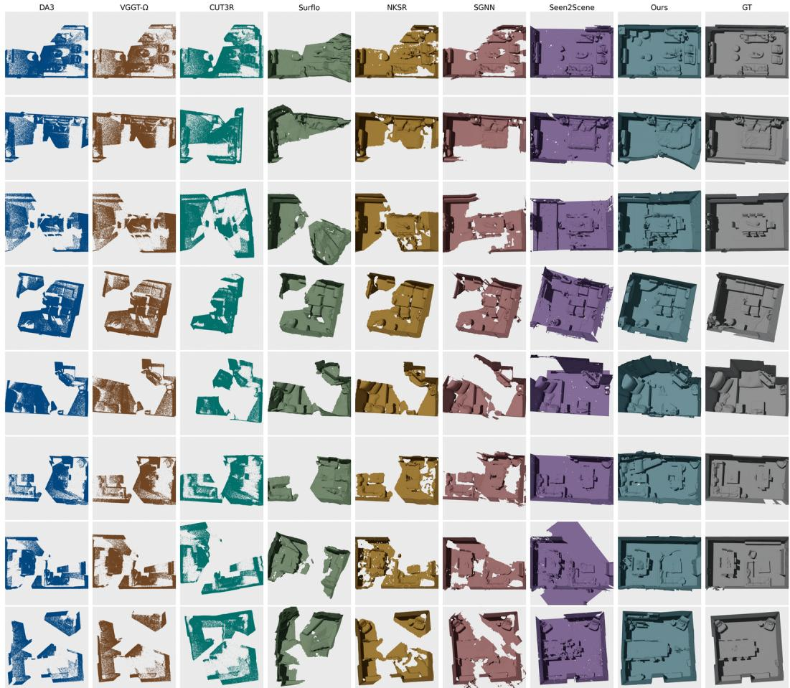  
Figure 9: Additional qualitative results on Replica (Straub et al., 2019) at N=4. Top-down views of the meshes each method reconstructs from the same partial DA3 point cloud, with the ground truth in the last column.

Generation diversity. Figure 11 runs the model with different seeds on one partial point cloud. Every sample keeps the observed walls and furniture; the variation sits in the parts the input does not cover.

## A.4 GENERALIZATION ACROSS INPUT SOURCES

The experiments above condition on point clouds produced by DA3 (Lin et al., 2025), a per-view point-map estimator. Because ANCHORCOMPLETE conditions directly on points rather than on images or estimator-specific features, it is not architecturally tied to this source. To test this, we apply ANCHORCOMPLETE, with no retraining or source-specific tuning, to partial point clouds from four acquisition paradigms: learned per-view point maps (DA3, Pi3 (Wang et al., 2025c), VGGT-Ω (Wang et al., 2026)), classical structure-from-motion and multi-view stereo (COLMAP (Schönberger & Frahm, 2016)), monocular visual SLAM (DROID-SLAM (Teed & Deng, 2021), DPVO (Teed et al., 2022)), and a simulated 32-beam LiDAR scan. All inputs are registered into the same evaluation frame and scored with the protocol used for the default DA3 setting.

Table 3 shows that ANCHORCOMPLETE remains effective across every source we test, with F0.05 ranging from 0.547 to 0.761. VGGT-Ω is the weakest of them and LiDAR the strongest, with DROID-SLAM close behind; ANCHORCOMPLETE handles all of them without tuning. In particular, the

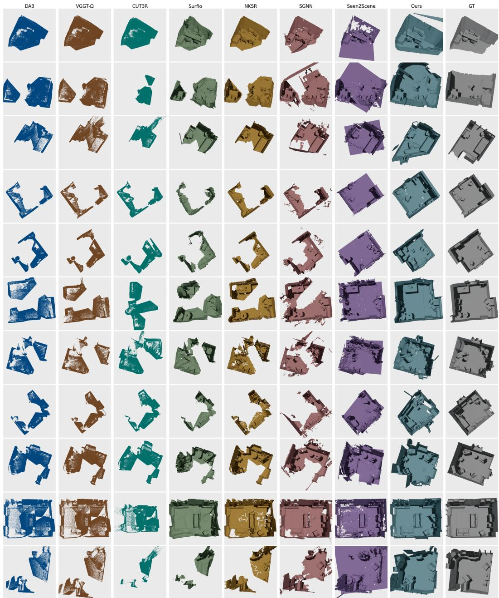  
Figure 10: Additional qualitative results on SCRREAM (Jung et al., 2024) at N=4. Top-down views of the meshes each method reconstructs from the same partial DA3 point cloud, with the ground truth in the last column.

SfM/MVS, visual-SLAM, and LiDAR rows confirm that the method is not restricted to the per-view point-map setting used elsewhere in the paper.

## A.5 FAILURE CASES

Figure 8 perturbs the point cloud synthetically, which is not how a depth estimator actually fails. To probe that, we degrade the images DA3 consumes and re-run the full pipeline on the resulting clouds. Figure 12 shows a SCRREAM scene under low light and a real-world scene under motion blur and sensor noise, with both degradations synthetically applied to real captures. Neither scene is in our training set.

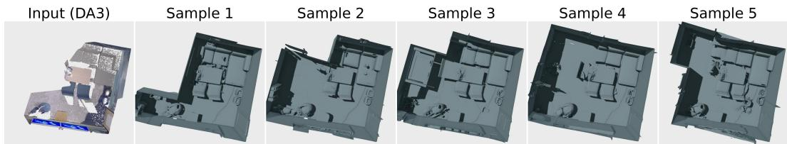  
Figure 11: Generation diversity. The input point cloud and five samples drawn from it with different seeds, rendered at level 0 with a model trained on InternScenes and SAGE. The observed structure is kept in every sample, and the samples differ only in the regions the input does not cover.

Table 3: Generalization across input point-cloud sources on Replica (Straub et al., 2019). AN-CHORCOMPLETE is evaluated without retraining on partial point clouds from multiple acquisition paradigms, using the default DA3 evaluation protocol (Table 1). Visual-SLAM and LiDAR use full trajectories/scans and therefore demonstrate source generality rather than budget-matched performance. † LiDAR uses conservative 5 cm range noise.
<table><tr><td>Category</td><td>Input source</td><td> $\mathrm { C D } _ { \mathrm { v i s } } \downarrow$ </td><td> $\mathrm { C D } _ { \mathrm { a l l } } \downarrow$ </td><td> $\mathrm { F _ { 0 . 1 } }$ </td><td>↑ F0.05 ↑</td></tr><tr><td rowspan="3">Per-view point map</td><td>DA3 (default)</td><td>0.055</td><td>0.067</td><td>0.819</td><td>0.684</td></tr><tr><td>Pi3</td><td>0.048</td><td>0.062</td><td>0.837</td><td>0.655</td></tr><tr><td>VGGT-Ω</td><td>0.068</td><td>0.079</td><td>0.746</td><td>0.547</td></tr><tr><td>SfM/MVS</td><td>COLMAP</td><td>0.069</td><td>0.084</td><td>0.770</td><td>0.641</td></tr><tr><td rowspan="2">Visual SLAM</td><td>DROID-SLAM</td><td>0.044</td><td>0.053</td><td>0.870</td><td>0.759</td></tr><tr><td>DPVO</td><td>0.046</td><td>0.055</td><td>0.872</td><td>0.713</td></tr><tr><td>LiDAR</td><td>32-beam,  $\sigma { = } 5 \mathrm { c m } ^ { \dagger }$ </td><td>0.037</td><td>0.043</td><td>0.949</td><td>0.761</td></tr></table>

The degraded imagery costs DA3 large parts of the room, and the reconstruction inherits exactly those gaps: ANCHORCOMPLETE still closes the surface it is given and produces a coherent room, but it completes around the missing observations rather than recovering them. The model is trained only on clean geometry, so it treats the input as a reliable anchor and preserves systematic upstream error rather than repairing it. Training with degraded inputs is a natural remedy we leave for future work.

## A.6 LIMITATIONS

While ANCHORCOMPLETE is robust to sparse input views (Section 4.3), it still has several limitations. First, the current model predicts geometry only: we use the inherited mesh decoder and do not model appearance. Extending the framework with RGB supervision and an appearance-aware decoder could enable textured mesh generation. Second, performance depends on the quality of the upstream geometry, so drift, scale errors, or systematic depth bias may propagate to the generated mesh. Section A.5 shows the sharper form of this: severe upstream failures are inherited rather than corrected. Third, our training and evaluation focus on indoor scenes, and generalization to outdoor, unbounded, or substantially different scene distributions remains open.

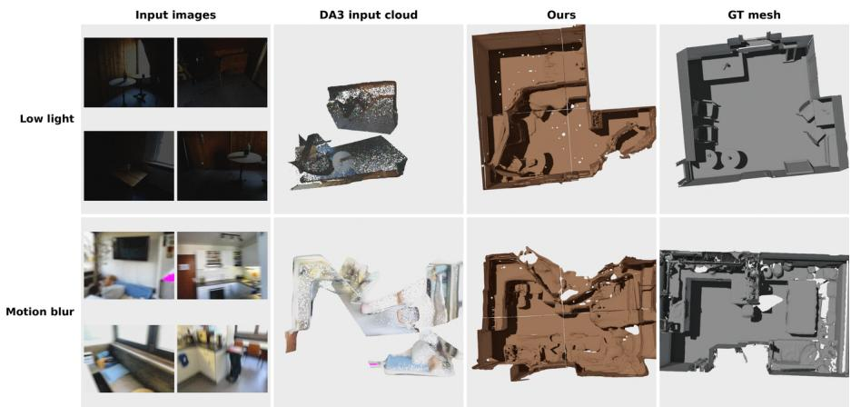  
Figure 12: Failure cases under degraded imagery. Real captures with simulated low light (top) and motion blur/noise (bottom). The degraded inputs cause DA3 to miss large scene regions, and our model completes around these gaps rather than recovering them.