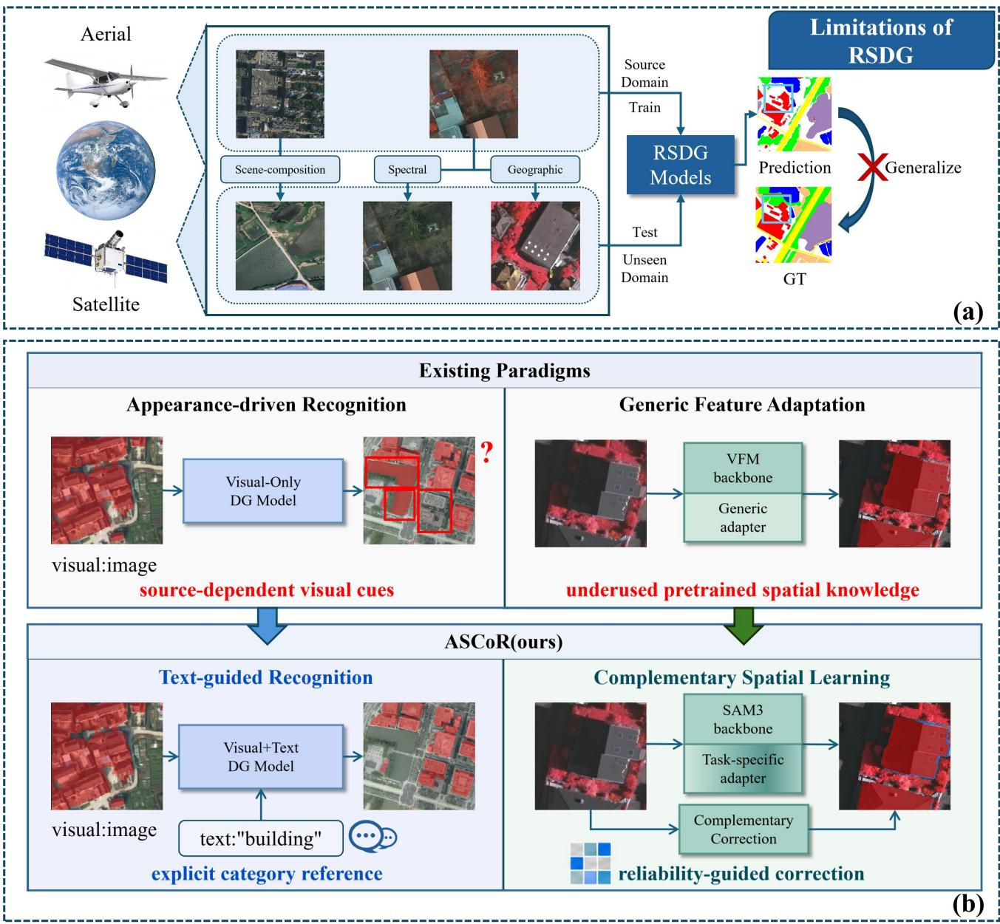
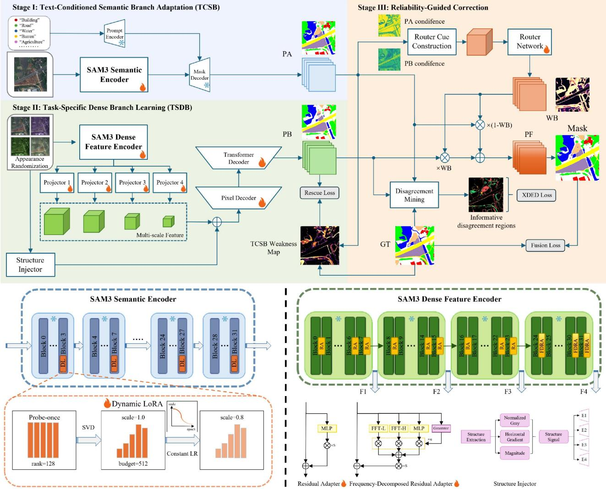
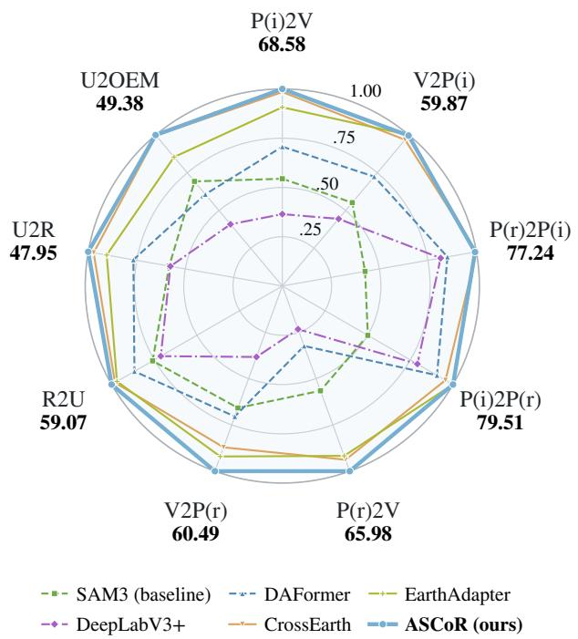
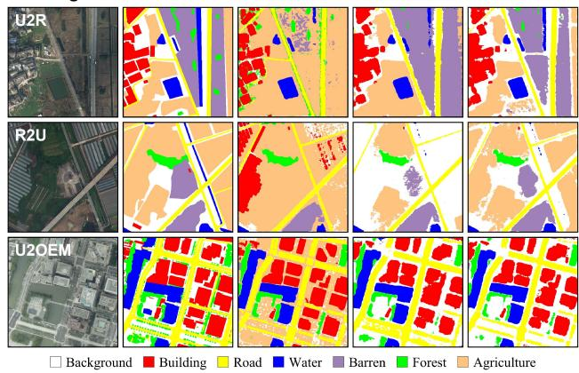
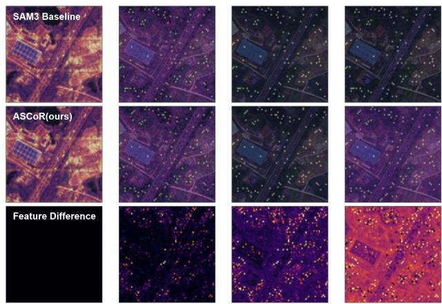
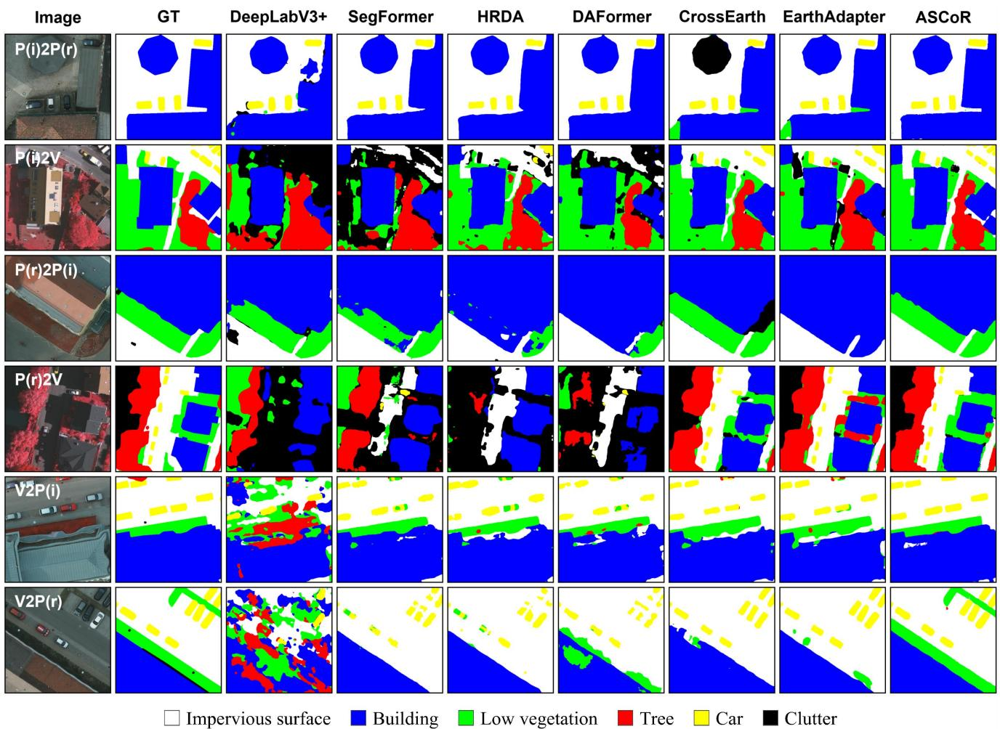
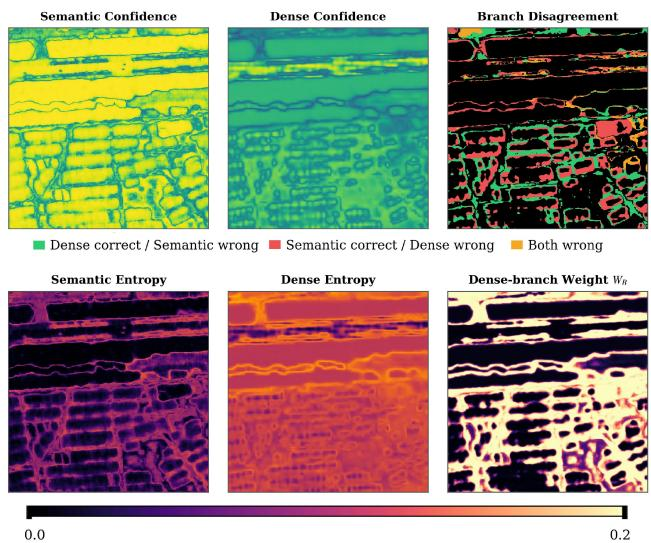
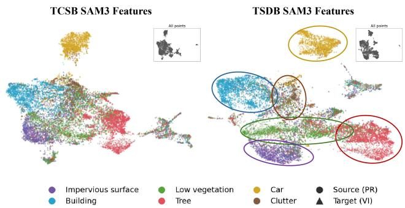

# ASCoR: Asymmetric Semantic-Spatial Learning for Remote Sensing Domain Generalization

Zitong Wanga, Shuchang Lyub,∗, Meng Lia, Qiang Wangd, Guangliang Chengc and Zhenwei Shia

aBeihang University, Xueyuan Road No.37, Haidian district, Beijing, 100191, , China

bUniversity of Science and Technology Beijing, Xueyuan Road No.30, Haidian district, Beijing, 100083, , China

cUniversity of Liverpool, Foundation Building, Brownlow Hill,, Liverpool, L693BX, , UK

dGuangdong Electronic Information Engineering Research Institute, University of Electronic Science and Technology of China, Zongbu 2nd Road No. 17, Dongguan, 523808, , China

## A R T I C L E I N F O

Keywords:   
Remote sensing   
Semantic segmentation   
Domain generalization   
Vision foundation models   
Parameter-eficient fine-tuning

## A BS T RA C T

Source-only domain generalization for remote sensing semantic segmentation aims to achieve reliable prediction in unseen domains without accessing target-domain data during training. Vision foundation models ofer transferable knowledge for this task, but its efective use faces two challenges. Category recognition remains vulnerable to source-specific visual cues. Learning task-specific dense representations also risks excessive source-domain specialization, potentially weakening pretrained transferability. To solve these problems, we propose ASCoR, an asymmetric semantic–spatial learning framework built on SAM3. We exploit SAM3’s concept-aware segmentation priors to provide explicit category guidance beyond source-domain visual observations. Specifically, the text-conditioned semantic branch associates dense predictions with class-name prompts. Its Probe-Once Dynamic Adaptive LoRA allocates a constrained adaptation budget across encoder blocks to control source-specific specialization. A complementary task-specific dense branch learns multi-scale spatial representations upon a separate frozen SAM3 image encoder. The two branches are integrated through a lightweight reliability router that applies bounded spatial correction according to local prediction reliability. The entire framework requires only source-domain supervision. Extensive experiments on the ISPRS, LoveDA, and OpenEarthMap benchmark datasets demonstrate the efectiveness of ASCoR across diverse domain shifts. On six ISPRS transfers, ASCoR achieves a state-of-the-art average mIoU of 68.61%, surpassing the previous best method by 2.69 percentage points. It further achieves the best performance on all three LoveDA/OpenEarthMap transfers, reaching 59.07%, 47.95%, and 49.38% mIoU on Rural-to-Urban, Urban-to-Rural, and Urban-to-OpenEarthMap, respectively. Systematic ablation studies assess the contribution of each component. Feature-space visualizations and spatial reliability analyses provide further insight into the framework’s cross-domain representations and complementary correction mechanism. The code is available at https://github.com/WangZitong42/ ASCoR.

## 1. Introduction

Remote sensing semantic segmentation provides pixellevel land-cover information for applications such as urban planning and environmental monitoring (Zhu et al., 2017; Ma et al., 2019). However, models trained on one domain often lose accuracy when deployed elsewhere because diferences in geographic regions, imaging sensors, and scene compositions can substantially alter the visual distribution (Wang et al., 2021; Iizuka et al., 2023; Liang et al., 2024). This gap between source-domain learning and practical deployment motivates source-only domain generalization (DG), which aims to transfer a model trained on a single labeled source domain to unseen domains without accessing target-domain data during training (Zhou et al., 2022; Rafi et al., 2024).

To facilitate such cross-domain transfer, vision foundation models (VFMs), which acquire transferable knowledge through large-scale pretraining, ofer a promising basis for extending remote sensing representations beyond the visual regularities of a single source domain (He et al., 2022; Oquab et al., 2024; Mendieta et al., 2023). Their relevance to dense prediction becomes more evident as pretrained knowledge encompasses explicit semantic concepts and structural priors: vision-language models associate visual observations with category semantics (Radford et al., 2021), whereas segmentation foundation models capture object-level spatial structure (Kirillov et al., 2023). By incorporating concept recognition into promptable segmentation, SAM3 connects these two capabilities, creating an opportunity to guide dense land-cover prediction with explicit category semantics (Carion et al., 2026).

Much of the existing research on remote sensing DG focuses on conventional segmentation networks, whose robustness is improved through appearance diversification or representation regularization (Iizuka et al., 2023; Liang et al., 2024; Wang et al., 2025b). Although these strategies address visual variability, category discrimination remains primarily dependent on source-domain visual observations, leaving predictions vulnerable to changes in class appearance. A smaller body of work introduces VFMs to obtain broader pretrained knowledge through the adaptation of generic visual representations (Gong et al., 2025; Zhang et al., 2026). Within this paradigm, the potential for extracting task-specific spatial evidence that complements category semantics remains insuficiently explored. As illustrated in Fig. 1(a), these limitations highlight the need for explicit category guidance and a more efective use of pretrained representations for dense spatial prediction.

  
Figure 1: Motivation and paradigm comparison for source-only remote sensing domain generalization. (a) Limitations of representative visual-driven DG approaches in transferring category semantics and exploiting task-specific dense representations. (b) ASCoR combines text-conditioned semantic guidance with complementary dense spatial learning through an asymmetric SAM3 framework and reliability-guided correction. Earth image credit: NASA/Apollo 17, via Wikimedia Commons (public domain).

To solve these problems, we propose ASCoR, an asymmetric semantic–spatial learning framework built on SAM3. Figure 1(b) contrasts our framework with the representative visual-driven DG paradigm. To strengthen category discrimination beyond source-domain visual cues, we exploit SAM3’s concept-aware segmentation capability to construct a text-conditioned semantic branch (TCSB). By associating dense predictions with class-name prompts, TCSB introduces an explicit semantic reference for recognizing landcover categories across variations in visual appearance.

To further exploit task-specific spatial information, we develop a complementary task-specific dense branch (TSDB) upon a separate SAM3 encoder whose pretrained weights remain frozen. Multi-scale dense decoding extracts spatially detailed representations from hierarchical features, supported by bounded structure injection that incorporates boundary and geometric cues. Complementary supervision from TCSB directs this learning toward regions where its semantic predictions are less reliable. A lightweight reliability router then estimates the local utility of the dense predictions and applies bounded spatial correction. Together, these components enable task-specific spatial evidence to supplement category-level semantic guidance.

We further introduce Probe-Once Dynamic Adaptive LoRA to control adaptation capacity within TCSB. By allocating a constrained low-rank budget across encoder blocks according to their source-task adaptation responses, this strategy supports task-specific learning with limited modification of pretrained representations. The complete framework is optimized exclusively with source-domain supervision.

Extensive experiments on the ISPRS, LoveDA, and OpenEarthMap benchmark datasets demonstrate the efectiveness of ASCoR across nine transfers. ASCoR achieves a state-of-the-art average mIoU of 68.61% on six ISPRS transfers, exceeding the previous best method by 2.69 percentage points. It also achieves the best performance on all three LoveDA/OpenEarthMap transfers. Systematic ablations establish the contributions of the proposed components, supported by feature visualizations and spatial reliability analyses that provide insight into their complementary behavior.

The main contributions of this work are summarized as follows:

• To the best of our knowledge, we are the first to introduce SAM3-based text-conditioned semantic modeling into source-only domain generalization for remote sensing semantic segmentation, providing explicit category guidance beyond source-domain visual observations.

• We develop an asymmetric semantic–spatial learning framework with reliability-guided fusion to better exploit task-specific dense representations and strengthen their complementarity with category-level semantic guidance.

• We propose Probe-Once Dynamic Adaptive LoRA to control source-specific adaptation under a constrained parameter budget, supporting efective task learning with limited modification of pretrained representations.

## 2. Related Work

## 2.1. Remote Sensing Semantic Segmentation and Domain Generalization

Remote sensing semantic segmentation assigns pixellevel land-cover labels to aerial or satellite imagery and serves as a fundamental technique for land-cover mapping, urban planning, agricultural monitoring, and environmental analysis (Zhu et al., 2017; Ma et al., 2019). CNN-based methods established dense prediction, encoderdecoder learning, and multi-scale contextual modeling as standard segmentation paradigms (Long et al., 2015; Ronneberger et al., 2015; Chen et al., 2018; Zhao et al., 2017). More recently, Transformer- and mask-classification-based architectures further improved long-range representation learning and mask-level prediction (Xie et al., 2021; Xiao et al., 2018; Cheng et al., 2021, 2022).

Despite these advances, remote sensing segmentation remains highly sensitive to domain shifts caused by geographic regions, sensors, spatial resolutions, seasons, and acquisition conditions (Wang et al., 2021; Iizuka et al., 2023; Liang et al., 2024). Such shifts may afect not only image appearance but also object scale, spatial layout, land-cover composition, and structural patterns. Domain adaptation alleviates this problem by exploiting target-domain data during training through adversarial alignment, output-space adaptation, self-training, or pseudo-label refinement (Ganin and Lempitsky, 2015; Tsai et al., 2018; Hofman et al., 2018; Zou et al., 2019; Vu et al., 2019). Remote sensing domain adaptation has likewise been investigated through curriculum learning, adaptive discrimination, and cross-city semantic alignment (Zhang et al., 2021; Chen et al., 2022b; Hong et al., 2023).

Domain generalization (DG), in contrast, trains models only on source-domain data and directly evaluates them on unseen target domains (Muandet et al., 2013; Li et al., 2018; Balaji et al., 2018; Kim et al., 2021; Zhou et al., 2022; Rafi et al., 2024). For remote sensing segmentation, FOSMix enhances robustness through frequency-based style mixing (Iizuka et al., 2023), CCDR constructs auxiliary domains using texture and style randomization while enforcing category consistency (Liang et al., 2024), and SMGPC combines style mapping with prototype-based contrastive learning for category-level generalization (Wang et al., 2025b). These methods demonstrate the efectiveness of visual-domain diversification and representation regularization. Nevertheless, explicit category semantics beyond source-domain visual observations remain relatively underexplored, particularly for source-only dense prediction under complex remote sensing shifts.

## 2.2. Vision-Language and Foundation Models for Remote Sensing

Large-scale pretraining has substantially improved the transferability of visual representations. Self-supervised models such as MAE, DINO, and DINOv2 learn generic visual features from large image collections (He et al., 2022; Caron et al., 2021; Oquab et al., 2024), while CLIP aligns visual representations with natural-language concepts through large-scale image-text supervision (Radford et al., 2021). This vision-language paradigm has also been extended to dense prediction. LSeg aligns pixel-level visual embeddings with text embeddings for language-driven semantic segmentation (Li et al., 2022), while DenseCLIP transfers CLIP knowledge from image-text matching to pixel-text matching for dense prediction (Rao et al., 2022). These studies demonstrate the potential of linguistic semantics to provide explicit category-level guidance beyond purely visual representation learning.

Foundation-model pretraining has also been actively explored for remote sensing image understanding. Continual pretraining has been used to construct geospatial foundation representations (Mendieta et al., 2023), while Scale-MAE and SatMAE incorporate scale, temporal, and multispectral characteristics into remote sensing pretraining (Reed et al., 2023; Cong et al., 2022). SpectralGPT and HyperSIGMA further extend foundation representation learning to spectral remote sensing imagery (Hong et al., 2024; Wang et al., 2025a). More recently, CrossEarth demonstrates the potential of geospatial foundation models for domain-generalized remote sensing semantic segmentation (Gong et al., 2025).

Although these studies provide increasingly transferable representations, generic foundation features do not necessarily ofer the category-aware semantics and dense spatial representations required by a specific downstream segmentation task. In particular, how to exploit linguistic semantic knowledge together with generic foundation representations for source-only remote sensing domain generalization remains insuficiently explored. Our work addresses this gap by introducing explicit category text into domain-generalized remote sensing semantic segmentation and jointly exploiting category-aware semantic guidance and task-specific dense representations.

## 2.3. SAM-style Foundation Models for Remote Sensing Interpretation

The Segment Anything Model (SAM) learns promptable, class-agnostic segmentation priors from large-scale segmentation data (Kirillov et al., 2023). Its object-level and structural representations provide a foundation for delineating land-cover objects, motivating eforts to transfer these capabilities to remote sensing imagery.

Such eforts have explored both data construction and model adaptation. SAMRS employs SAM-generated masks to scale up remote sensing segmentation data (Wang et al., 2023), while RingMo-SAM extends SAM to multimodal remote sensing imagery (Yan et al., 2023). RSPrompter introduces learnable prompting for remote sensing instance segmentation (Chen et al., 2024), and MeSAM enhances SAM with multi-scale adaptation for optical remote sensing imagery (Zhou et al., 2024). These studies establish the utility of general segmentation priors for remote sensing interpretation.

More recently, SAM3 has extended promptable segmentation to concept-aware recognition (Carion et al., 2026), opening further opportunities for category-level remote sensing interpretation. SegEarth-OV3 explores this capability through training-free open-vocabulary segmentation, combining mask outputs and presence-based category filtering (Li et al., 2025). ProC-SAM3 further develops prompt calibration and presence-guided fusion for remote sensing open-vocabulary semantic segmentation (Song et al., 2026). These studies demonstrate the potential of concept-aware priors for training-free prediction. Applying such priors to source-only domain generalization introduces a complementary challenge: learning task-specific semantic and spatial representations from a single labeled source domain while preserving transferability to unseen domains with diferent geographic and imaging conditions.

## 2.4. Parameter-Eficient Adaptation and Reliability-Guided Fusion

Parameter-eficient fine-tuning (PEFT) adapts pretrained models by updating only a small set of task-specific parameters while keeping most foundation weights frozen. Representative approaches include Adapter tuning, Visual Prompt Tuning, LoRA, and AdaptFormer (Houlsby et al., 2019; Jia et al., 2022; Hu et al., 2022; Chen et al., 2022a). Such strategies are particularly attractive for large foundation models because they reduce adaptation cost while limiting direct modification of pretrained parameters.

Recent work further investigates adaptive low-rank allocation. AdaLoRA dynamically reallocates a limited lowrank budget according to parameter importance (Zhang et al., 2023), whereas DyLoRA trains LoRA modules to operate across a range of ranks without repeated rankspecific retraining (Valipour et al., 2023). In remote sensing, SpectralX demonstrates the efectiveness of parametereficient adaptation for domain-generalized spectral foundation models (Zhang et al., 2026). Meanwhile, full fine-tuning has been shown to distort pretrained features and degrade out-of-distribution performance under large distribution shifts (Kumar et al., 2022). These observations motivate controlled foundation-model adaptation for source-only DG.

Diferent from existing adaptive LoRA methods developed primarily for general pretrained models, our Dynamic Adaptive LoRA targets hierarchical SAM3 adaptation under a constrained total rank budget. It allocates adaptation capacity according to the contribution of diferent encoder layers to downstream remote sensing semantic learning, aiming to preserve transferable foundation knowledge while acquiring task-specific representations.

Finally, the adapted semantic branch and frozen dense branch provide complementary information but may exhibit diferent reliability across categories and unseen domain shifts. A fixed fusion rule implicitly assumes stable branch quality and may therefore be suboptimal. We instead employ reliability-guided class-wise fusion to dynamically integrate category-aware semantic priors and task-specific dense predictions according to their prediction reliability.

## 3. Methodology

## 3.1. Overview

ASCoR is trained on a single labeled source domain and evaluated directly on unseen target domains. Each input is a three-channel remote sensing image with pixel-wise land-cover annotations. The framework combines explicit category guidance with task-specific spatial evidence using only source-domain supervision. Target-domain images are not used for parameter optimization.

The framework consists of a text-conditioned semantic branch (TCSB), a task-specific dense branch (TSDB), and a reliability-guided fusion module. The branches have distinct learning objectives: TCSB uses category prompts to guide semantic discrimination, whereas TSDB extracts spatial evidence targeted at the limitations of the semantic prediction. Their pretrained SAM3 weights remain frozen, with task learning concentrated in the respective adaptation and decoding components. The router subsequently determines where and to what extent the dense evidence should correct TCSB. Superscripts � and � denote TCSB and TSDB, respectively; � denotes logits, and � denotes the corresponding class probabilities obtained through softmax.

  
Figure 2: Architecture and three-stage training of ASCoR. TCSB combines category prompts with Probe-Once Dynamic Adaptive LoRA. TSDB learns complementary spatial representations through trainable adaptation, structure, and decoding modules upon frozen pretrained SAM3 weights. After both branches are frozen, the reliability router learns bounded spatial correction using source-domain supervision.

Figure 2 summarizes the architecture and three-stage training procedure.

## 3.2. Text-Conditioned Semantic Branch

TCSB introduces class-name prompts into SAM3 so that category prediction is guided by explicit semantic concepts as well as visual observations. A fixed set of land-cover concepts is used throughout each transfer task, providing a common semantic reference across changes in image appearance. Each prompt produces a dense class response, and these responses are combined into the segmentation logits. For an unprompted background or clutter category, the response is set to the negative maximum foreground response at each pixel.

To adapt SAM3 with controlled capacity, the pretrained weights remain frozen and trainable LoRA residuals are introduced into selected encoder blocks (Hu et al., 2022). Omitting transformation indices, the forward computation is

$$
\mathbf { h } ^ { \prime } = \mathbf { W } \mathbf { h } + g ( e ) \lambda \mathbf { B } _ { r _ { l } } \mathbf { A } _ { r _ { l } } D ( \mathbf { h } ) ,\tag{1}
$$

where � is the frozen weight,  denotes dropout, and $\mathbf { A } _ { r _ { I } }$ and $\mathbf { B } _ { r _ { l } }$ are the active factor slices assigned to block �. The coeficient � scales the local residual, and �(�) controls its global strength.

Uniform ranks do not account for diferences in adaptation response across encoder blocks. We therefore use a short source-domain probe to determine how the available capacity should be distributed. All candidate blocks are first adapted with a common rank $r _ { p } ,$ and the energy of their learned updates provides a source-task response score. For block � containing $M _ { l }$ adapted transformations, the score is

$$
s _ { l } = \frac { 1 } { M _ { l } } \sum _ { m = 1 } ^ { M _ { l } } \left\| \mathbf { B } _ { l , m } ^ { ( p ) } \mathbf { A } _ { l , m } ^ { ( p ) } \right\| _ { F } ^ { 2 } .\tag{2}
$$

A fixed total budget � is distributed across the � candidate blocks:

$$
\begin{array} { r l } & { \widetilde { r } _ { l } = r _ { \mathrm { m i n } } + ( B - L r _ { \mathrm { m i n } } ) \frac { s _ { l } } { \sum _ { j \in \mathcal { L } } s _ { j } } , } \\ & { \mathbf { r } ^ { * } = \Pi _ { C } ( \widetilde { \mathbf { r } } ) . } \end{array}\tag{3}
$$

Here, $\mathcal { L }$ is the candidate-block set. The projection $\Pi _ { C }$ produces integer ranks whose sum equals �, with each rank bounded by $r _ { \mathrm { m i n } }$ and $r _ { \mathrm { m a x } }$ . Stronger probe responses therefore receive more adaptation capacity without increasing the total rank budget. Adaptive-rank PEFT methods have explored importance-based allocation and multi-rank learning (Zhang et al., 2023; Valipour et al., 2023). ASCoR performs allocation once after probing, separating capacity estimation from final task learning and keeping the active rank structure fixed thereafter.

Changing the rank map also requires transferring the updates learned during probing. Simply truncating the two LoRA factors independently can discard useful directions because the efective update is determined by their product. We therefore apply compact SVD to the probed update and retain the leading singular components permitted by both the probe rank and the newly allocated rank. Let $\mathbf { U } _ { k } , \pmb { \Sigma } _ { k }$ , and $\mathbf { V } _ { k }$ denote these retained components. The retained factor initialization is

$$
\begin{array} { r } { { \bf B } _ { k } ^ { * } = { \bf U } _ { k } { \bf \Sigma } _ { k } ^ { 1 / 2 } , } \\ { { \bf A } _ { k } ^ { * } = { \bf \Sigma } _ { k } ^ { 1 / 2 } { \bf V } _ { k } ^ { \top } . } \end{array}\tag{4}
$$

These directions are transferred into the allocated factor tensors before final adaptation. The global residual strength then follows cosine decay from its initial value of one to a prescribed minimum. TCSB is optimized with standard pixel-wise cross-entropy over valid source labels.

## 3.3. Task-Specific Dense Branch

TSDB is designed to learn spatial information that supplements the text-conditioned prediction. Its pretrained SAM3 encoder weights remain frozen, while lightweight adaptation, feature projection, structure injection, and dense decoding modules are trained. Frequency-aware adaptation provides adjustment within the feature hierarchy, and selected hierarchical features are projected into a common embedding space and spatially aligned so that the decoder can combine information from multiple representation levels.

Category-level guidance alone does not explicitly determine the spatial detail required by dense land-cover prediction. Before decoding, TSDB therefore supplements the projected features with geometric cues derived from the input image. A lightweight structure encoder processes normalized grayscale and Sobel-derived edge information, providing boundary evidence alongside the learned appearance features. Denoting this structural input by � and the projected feature at level � by $\mathbf { P } _ { k }$ , the injection is

$$
\widehat { \bf P } _ { k } = { \bf P } _ { k } + \operatorname { t a n h } ( a _ { k } ) \mathcal { I } _ { k } ( { \bf S } ) ,\tag{5}
$$

where $\mathcal { I } _ { k }$ combines scale alignment with structure encoding. The learnable coeficient is bounded by the hyperbolic tangent, allowing the contribution of structural cues to be regulated separately at each feature level. The resulting features are processed by a query-based decoder following Mask2Former (Cheng et al., 2022). Its query predictions jointly encode class information and spatial masks; classweighted masks are aggregated into dense class scores and converted to logits by a logarithm.

TSDB is trained using original source images and geometrypreserving randomized views. The appearance perturbations simulate spectral, atmospheric, sensor, and frequency variations without changing pixel correspondence, allowing the original annotations to supervise both views. Training on these views exposes the dense branch to alternative appearances of the same labeled structures while retaining direct supervision on the original source images.

To encourage complementarity, the frozen TCSB additionally directs TSDB learning toward pixels that it handles less reliably. The weighting uses TCSB’s probability for the ground-truth category, so pixels receiving an incorrect highconfidence prediction can still obtain strong complementary supervision. For a randomized source image, the weight at pixel � is

$$
\omega _ { p } = \mathrm { c l i p } \big [ ( 1 - P _ { y _ { p } , p } ^ { A } ) ^ { \gamma } , 0 , \omega _ { \mathrm { m a x } } \big ] ,\tag{6}
$$

where $P _ { y , p } ^ { A }$ is TCSB’s probability for the ground-truth category on that randomized view. Pixels assigned a high probability for the correct category receive less additional emphasis. The complementary objective is a normalized weighted loss:

$$
\mathcal { L } _ { \mathrm { r e s } } = \frac { \sum _ { p \in \Omega } \omega _ { p } \ell _ { \mathrm { C E } } ( \mathbf { Z } _ { p } ^ { B } , y _ { p } ) } { \sum _ { p \in \Omega } \omega _ { p } + \epsilon } ,\tag{7}
$$

where Ω contains valid source pixels and $\ell _ { \mathrm { C E } }$ is pixel-wise cross-entropy. Predictions in this objective are evaluated on the randomized view. The weight cap controls the maximum pixel-wise emphasis, and normalization makes the objective depend on the relative distribution of complementary weights.

Let $\mathcal { L } _ { M } ^ { o }$ and $\mathcal { L } _ { M } ^ { a }$ denote the standard query-decoder segmentation losses on the original and randomized views, respectively. The complete TSDB objective is

$$
\mathcal { L } _ { B } = \frac { \mathcal { L } _ { M } ^ { o } + \lambda _ { \mathrm { a u g } } \mathcal { L } _ { M } ^ { a } } { 1 + \lambda _ { \mathrm { a u g } } } + \lambda _ { \mathrm { r e s } } ( e ) \mathcal { L } _ { \mathrm { r e s } } .\tag{8}
$$

The augmentation coeficient balances supervision across the two views, whose segmentation losses form a weighted average. The complementary coeficient gradually increases during early training, introducing greater emphasis on TCSB’s weak regions as dense prediction develops. TSDB is therefore trained both to perform the segmentation task and to acquire evidence that can supplement the semantic branch.

## 3.4. Reliability-Guided Complementary Fusion

The two branches provide diferent evidence whose relative reliability varies across categories and spatial locations. A branch with lower overall accuracy may still supply useful corrections in particular regions, so the contribution of TSDB should depend on local prediction quality. The router uses prediction-based reliability cues to estimate this complementary contribution.

Its input � concatenates both probability maps, their absolute diference, one-hot category predictions, branchwise confidence, normalized entropy, top-two probability margins, and the binary disagreement map. The class probabilities and category predictions retain semantic information; the uncertainty statistics describe the strength of each prediction, and the diference and disagreement cues identify potential corrections. Together, they allow routing to depend on both category identity and local reliability without requiring target labels.

A lightweight spatial network produces a sigmoid gate and applies bounded correction to the primary semantic prediction:

$$
\begin{array} { r l } & { { \boldsymbol { g } } _ { p } = \sigma \big ( \mathcal { G } _ { \psi } ( { \bf R } ) _ { p } \big ) , } \\ & { { \bf P } _ { p } ^ { F } = { \bf P } _ { p } ^ { A } + \beta g _ { p } ( { \bf P } _ { p } ^ { B } - { \bf P } _ { p } ^ { A } ) . } \end{array}\tag{9}
$$

Here, $\beta$ sets the maximum contribution of the dense branch. TCSB remains the primary estimate, and TSDB supplies a spatially varying residual correction. The gate allows the amount of dense evidence to vary across the image instead of imposing the same mixing weight everywhere. Its bounded contribution maintains the intended asymmetric roles of the two branches.

Router supervision measures the value of a correction using source labels. Disagreement alone does not establish that TSDB should be trusted, since either branch may be incorrect. We therefore supervise the gate according to whether TSDB increases the probability assigned to the ground-truth category. At valid disagreement pixels, the relative utility target is

$$
u _ { p } = \frac { [ P _ { y _ { p } , p } ^ { B } - P _ { y _ { p } , p } ^ { A } ] _ { + } } { \operatorname* { m a x } ( P _ { y _ { p } , p } ^ { B } , \epsilon ) } .\tag{10}
$$

The positive-part operator sets the target to zero when TSDB ofers no correct-class probability improvement. Otherwise, the target increases continuously with its relative advantage. This provides graded supervision for the correction gate based on the local relationship between the two predictions.

To encourage stable routing under appearance changes, utility learning is combined with gate consistency across geometry-preserving source views. Since these views retain pixel correspondence, their gate responses can be compared

at aligned locations:

$$
\begin{array} { r l } & { \mathcal { L } _ { \mathrm { u t i l } } = \mathbb { E } _ { p \sim \Omega _ { d } } [ \mathrm { B C E } ( g _ { p } , u _ { p } ) ] , } \\ & { \mathcal { L } _ { \mathrm { c o n s } } = \mathbb { E } _ { p \sim \Omega _ { u } } [ \mathrm { S m o o t h L } 1 ( g _ { p } , \widetilde { g } _ { p } ) ] . } \end{array}\tag{11}
$$

Here, $\Omega _ { d }$ contains valid disagreement pixels, $\Omega _ { u }$ is the valid cross-view consistency region, and $\widetilde { g } _ { p }$ is the gate from the randomized counterpart. The fused prediction also receives standard pixel-wise cross-entropy supervision, denoted by ${ \mathcal { L } } _ { \mathrm { f u s e } }$ . The complete router objective is

$$
\mathcal { L } _ { R } = \mathcal { L } _ { \mathrm { f u s e } } + \lambda _ { u } ( e ) \mathcal { L } _ { \mathrm { u t i l } } + \lambda _ { \mathrm { c o n s } } \mathcal { L } _ { \mathrm { c o n s } } .\tag{12}
$$

Both segmentation branches remain frozen during this stage, keeping the predictors fixed while the router learns their relative utility. Fused semantic supervision evaluates the combined prediction, utility learning supplies correctionspecific guidance at disagreement pixels, and cross-view consistency encourages stable gate responses under appearance perturbations. Ground-truth category probabilities are used only to construct supervision targets; inference relies entirely on the branch predictions.

## 3.5. Optimization and Training Strategy

Training proceeds in three sequential stages that separate semantic adaptation, complementary spatial learning, and reliability estimation. First, TCSB undergoes source-domain probing, the rank allocation in Eq. (3), and the SVD-based conversion in Eq. (4). It is then adapted with the fixed rank map using supervised cross-entropy and the cosine residualscale schedule.

Next, TCSB is frozen and provides a fixed semantic reference for TSDB training. Only TSDB’s adaptation, projection, structure, and decoding modules are updated using Eq. (8). This keeps the basis for complementary supervision fixed while the spatial branch learns. Finally, both segmentation branches are frozen and the router is optimized with Eq. (12), learning to combine the completed predictors without changing their representations.

At inference, the two branches process the unseen image and the router combines their predictions through Eq. (9). Each pixel is assigned the category with the highest fused probability. The complete training procedure uses only source-domain supervision.

## 4. Experiments

## 4.1. Experimental Setup

Datasets and transfer settings. We evaluate source-only domain generalization on three remote-sensing semantic segmentation benchmarks. For the ISPRS setting, Potsdam IRRG, Potsdam RGB, and Vaihingen IRRG are denoted by �(�), �(�), and �, respectively. We consider all six directed transfers among these domains. The resulting evaluation covers an unseen geographic region, an unseen spectral configuration, and their compound shift. The six-class label space contains impervious surface, building, low vegetation, tree, car, and clutter/background. For LoveDA (Wang et al.,

Datasets and protocols for the nine source-only DG transfers.
<table><tr><td>Domain shift</td><td>Source domain</td><td>Target domain</td><td>Task</td><td>Train</td><td>Eval.</td><td>Image size</td><td>Classes</td></tr><tr><td>Geographic</td><td>Potsdam IRRG</td><td>Vaihingen IRRG</td><td>P(i)2V</td><td>3456</td><td>398</td><td>512×512</td><td>6</td></tr><tr><td>Geographic</td><td>Vaihingen IRRG</td><td>Potsdam IRRG</td><td>V2P(i)</td><td>344</td><td>2016</td><td>512×512</td><td>6</td></tr><tr><td>Spectral</td><td>Potsdam RGB</td><td>Potsdam IRRG</td><td>P(r)2P(i)</td><td>3456</td><td>2016</td><td>512×512</td><td>6</td></tr><tr><td>Spectral</td><td>Potsdam IRRG</td><td>Potsdam RGB</td><td> $\mathsf { P } ( \mathrm { i } ) 2 \mathsf { P } ( \mathsf { r } )$ </td><td>3456</td><td>2016</td><td>512×512</td><td>6</td></tr><tr><td> $\mathtt { G e o g r a p h i c + s p e c t r a l }$ </td><td>Potsdam RGB</td><td>Vaihingen IRRG</td><td> $\mathsf { P } ( \mathsf { r } ) 2 \mathsf { V }$ </td><td>3456</td><td>398</td><td>512×512</td><td>6</td></tr><tr><td>Geographic + spectral</td><td>Vaihingen IRRG</td><td>Potsdam RGB</td><td> ${ \mathsf { V } } 2 { \mathsf { P } } ( { \mathsf { r } } )$ </td><td>344</td><td>2016</td><td>512×512</td><td>6</td></tr><tr><td>Scene composition</td><td>LoveDA Urban</td><td>LoveDA Rural</td><td>U2R</td><td>1156</td><td>992</td><td>1024×1024</td><td>7</td></tr><tr><td>Scene composition</td><td>LoveDA Rural</td><td>LoveDA Urban</td><td>R2U</td><td>1366</td><td>677</td><td>1024×1024</td><td>7</td></tr><tr><td>Cross-dataset</td><td>LoveDA Urban</td><td>OpenEarthMap</td><td>U2OEM</td><td>1156</td><td>384</td><td>1024×1024</td><td>7</td></tr></table>

Image size refers to prepared images/crops before resizing to 512 × 512 for network input. Both label protocols include background. OpenEarthMap uses the matched 384-image subset.

2021), Urban and Rural are treated as two distinct domains, yielding the � → � and � → � settings. We additionally evaluate $U \to \mathbf { O E M } .$ in which a model trained on LoveDA Urban is directly transferred to OpenEarthMap. LoveDA and OpenEarthMap use an aligned seven-class label space consisting of background, building, road, water, barren land, forest, and agriculture. All target domains remain unseen during training.

Evaluation protocol and metrics. For each directed transfer, we train on labeled source-domain images and compute target-domain class-wise IoU and mIoU over valid pixels. The SAM3 zero-shot baseline employs the same fixed category-name prompts as TCSB using the pretrained model parameters.

Compared methods. We include conventional segmenters (DeepLabV3+ (Chen et al., 2018) and SegFormer (Xie et al., 2021)), domain-adaptation methods (DAFormer (Hoyer et al., 2022a) and HRDA (Hoyer et al., 2022b)), and foundationmodel approaches (CrossEarth (Gong et al., 2025) and EarthAdapter (Hu et al., 2026)). Published comparison results are adopted where available; additional baselines follow their respective evaluation configurations. Performance is summarized using class-wise IoU and mIoU on each source-to-target transfer.

Implementation details. All images are resized to 512 × 512. Both branches are initialized from SAM3 while the original foundation parameters remain frozen. For TCSB, LoRA modules are inserted into encoder blocks 3, 7, 11, 15, 19, 23, 27, and 31. A source-domain probe at rank 128 estimates the contribution of individual blocks, followed by a one-time allocation of a total rank budget of 512 within [4, 256]. The converted LoRA factors are optimized using a learning rate of $5 \times 1 0 ^ { - 5 }$ . TSDB is optimized using AdamW with a learning rate of $1 \times 1 0 ^ { - 4 }$ and weight decay of 0.05. After both branches are frozen, the reliability router is optimized at $2 { \times } 1 0 ^ { - 4 }$ with maximum TSDB correction weight $\beta = 0 . 2 .$ Training and runtime measurements are conducted on an NVIDIA GeForce RTX 4090 D GPU.

## 4.2. Comparison with State-of-the-Art Methods

We compare ASCoR with representative segmentation methods across nine transfers on the ISPRS, LoveDA, and OpenEarthMap benchmark datasets. Figure 3 summarizes the overall performance, while Tables 2 and 3 report the class-wise results.

  
Figure 3: Overall performance comparison across nine sourceonly DG transfers on ISPRS, LoveDA, and OpenEarthMap. Each axis is normalized by the highest mIoU among the compared methods for that task; numerical annotations report the original mIoU (%).

Results on ISPRS. As reported in Table 2, ASCoR achieves the highest mIoU in four of the six directed ISPRS transfers, with an average of 68.61%. This exceeds the 65.92% mean of EarthAdapter and the 65.68% mean of CrossEarth. The strongest gains emerge under combined geographic and spectral shifts: ASCoR obtains 65.98% on � (�) → � and 60.49% on � → �(�), improving on EarthAdapter by 5.46 and 4.80 points, respectively. For �(�) → �, low vegetation, car, and clutter reach 62.43%, 68.36%, and 26.88% IoU. On the reverse � → �(�) transfer, tree IoU rises to 54.83%, compared with 32.76% for EarthAdapter. ASCoR also leads �(�) → � and $P ( i )  P ( r )$ . In the remaining two directions, the gaps to the best reported mIoU are just 0.21 points on � → �(�) and 0.56 points on $P ( r )  P ( i )$ . These results show the strength of the learned representations across geographical, spectral, and compound shifts.

Table 2  
Per-class IoU and mIoU (%) on six ISPRS transfers. Bold and underlined values indicate the best and second-best results. Surf: impervious surface; Bldg: building; Vegt: low vegetation; Clut: clutter/background. SAM3 denotes the zero-shot baseline.
<table><tr><td>Method</td><td>Backbone</td><td>Task</td><td>Surf</td><td>Bldg</td><td>Vegt</td><td>Tree</td><td>Car Clut</td><td>mloU</td><td>Task</td><td>Surf</td><td>Bldg Vegt</td><td>Tree</td><td>Car</td><td>Clut</td><td>mloU</td></tr><tr><td>SAM3 (baseline)</td><td>SAM3</td><td rowspan="8">P(i)2V</td><td rowspan="8"></td><td>9.47 83.46 60.94</td><td>20.32</td><td>48.36</td><td>60.25</td><td>2.12</td><td rowspan="8">37.33 25.02</td><td>17.17 70.15 29.32</td><td>9.37 29.17</td><td>35.27</td><td>62.51 4.51</td><td>33.17</td></tr><tr><td>DeepLabV3+</td><td>R101</td><td>9.15</td><td>17.60</td><td>52.28 7.61</td><td>2.54</td><td></td><td>39.45</td><td>24.92</td><td>37.42 0.00</td><td>26.72</td></tr><tr><td>SegFormer</td><td>MiT-B5</td><td>60.58 74.72</td><td>27.68</td><td>63.69 33.38</td><td>7.56</td><td>44.60</td><td>66.01 70.94 48.53</td><td>13.19 65.98</td><td>3.00</td><td>44.61</td></tr><tr><td>DAFormer</td><td>MiT-B5</td><td>61.48 75.53</td><td>42.87 66.57</td><td>34.52</td><td>9.99 48.49</td><td>62.22 70.86</td><td>43.09 13.86</td><td>64.31</td><td>6.95</td><td>43.55</td></tr><tr><td>HRDA</td><td>MiT-B5</td><td>64.14 76.65</td><td>42.06</td><td>65.11 28.72</td><td>13.52</td><td>V2P(i)</td><td>68.64 77.24 46.33 11.05</td><td>64.12</td><td>6.48</td><td>45.64</td></tr><tr><td>CrossEarth</td><td>ViT-L</td><td>83.60 91.70</td><td>63.80</td><td>70.20 59.50</td><td>36.30</td><td>48.37 67.50</td><td>77.10 80.80 61.30 38.90</td><td>82.90</td><td>8.40</td><td></td></tr><tr><td>EarthAdapter</td><td>DINOv2-L</td><td>77.28 88.16</td><td>59.37 71.71</td><td></td><td>58.01 18.64 62.20</td><td></td><td colspan="2">186.98 63.56 45.27</td><td>86.33 2.16</td><td>58.20 60.08</td></tr><tr><td>ASCoR (ours)</td><td>SAM3</td><td rowspan="11">80.87 73.68</td><td rowspan="6">88.57 17.17 70.15</td><td colspan="3">765.15 74.66 69.13</td><td colspan="2">33.10 68.58 33.17</td><td colspan="3">72.81 85.04 54.81 60.29 27.22 75.39 31.86 33.39</td><td>4.54</td><td>59.87</td></tr><tr><td>SAM3 (baseline)</td><td>SAM3 R101</td><td rowspan="10">P(r)2P(i)</td><td colspan="3">9.37 35.27 76.42 46.36</td><td rowspan="7">62.51 4.51</td><td rowspan="7"></td><td colspan="3">66.51</td><td>4.58</td><td>39.83</td></tr><tr><td>DeepLabV3+</td><td></td><td></td><td>71.00 87.87</td><td>25.44 63.46</td><td>66.95 81.76 52.62</td><td>69.82 88.01</td><td>18.29</td><td>62.91</td></tr><tr><td>SegFormer</td><td>MiT-B5</td><td>82.12 89.98 51.51</td><td>72.27 89.69</td><td>27.35 68.82</td><td>80.22 92.38</td><td>56.55 56.28</td><td>89.56 19.50</td><td>65.75</td></tr><tr><td>DAFormer</td><td>MiT-B5</td><td>82.06 89.03 44.03</td><td>71.77 88.05</td><td>22.21 66.19 P(i)2P(r)</td><td>81.95 92.06 67.02</td><td>68.85 89.84</td><td>32.54</td><td>72.04</td></tr><tr><td>HRDA</td><td>MiT-B5</td><td>81.94 84.24 36.89</td><td>70.07 89.69</td><td>18.97 63.63</td><td>80.59 90.97 66.14</td><td>70.85 88.58</td><td>31.63 71.46</td><td></td></tr><tr><td>CrossEarth</td><td>ViT-L</td><td>86.10 91.50 73.80</td><td>79.70</td><td>91.9043.80 77.80</td><td>86.3093.50 73.80</td><td>74.00 91.20</td><td>37.20 76.00</td><td></td></tr><tr><td>EarthAdapter</td><td>DINOv2-L</td><td>86.40 90.58</td><td>73.01 80.30</td><td>93.13 42.06</td><td>77.58</td><td>87.80 94.32 78.29 87.71</td><td>78.26</td><td>93.27 44.85 79.46</td></tr><tr><td>ASCoR (ours)</td><td>SAM3</td><td></td><td>86.47 92.36 9.47 83.46</td><td>72.16 78.98 94.49</td><td>38.95 77.24 2.12 37.33</td><td rowspan="6">23.33</td><td>94.29 27.22 75.39 31.86 33.39 66.51</td><td>78.24 78.71</td><td>93.75</td><td>44.38 79.51 4.58 39.83</td></tr><tr><td>SAM3 (baseline)</td><td>SAM3</td><td rowspan="5">P(r)2V</td><td rowspan="5">5.11 48.83 40.59 57.49 44.41</td><td rowspan="5">52.13 7.36 367.72 1.84 23.62 28.82</td><td>20.32 48.36 60.25 25.28 0.79 1.60</td><td rowspan="5">15.38 28.73</td><td rowspan="6">55.26 70.42</td><td rowspan="6">34.93 25.18 35.00</td><td rowspan="7">25.15 30.52 2.05 67.31</td><td rowspan="7">0.00 23.18 0.98 36.44</td></tr><tr><td>DeepLabV3+</td><td>R101 MiT-B5</td></tr><tr><td>SegFormer</td><td>MiT-B5</td><td>1.58 54.44 58.86 73.10 43.86</td></tr><tr><td>DAFormer</td><td>MiT-B5</td><td>0.29 4.59 23.97 1.30 21.37 59.25 V2P(r)</td></tr><tr><td>HRDA</td><td>ViT-L</td><td>61.92 3.36 3.87 24.67 1.46 23.28</td></tr><tr><td>CrossEarth</td><td></td><td>78.10 89.30</td><td>55.20 72.50 61.90 14.5061.90</td><td>72.50 73.60 58.70 22.40 81.10 7.60</td></tr><tr><td>EarthAdapter</td><td>DINOv2-L</td><td></td><td>76.2586.49 79.74 88.86 62.43 69.61 68.36 26.88 65.98</td><td>51.15 73.26 58.8417.1360.52</td><td></td><td>71.0582.7361.18</td><td>32.76 84.57 1.83 55.69</td></tr><tr><td>ASCoR (ours)</td><td>SAM3</td><td></td><td></td><td></td><td></td><td></td><td>74.71 85.93 64.21 54.83 79.72</td><td></td><td>3.56 60.49</td></tr></table>

Results on LoveDA and OpenEarthMap. Table 3 shows the best overall mIoU in all three transfers: 59.07% for � → �, 47.95% for � → �, and 49.38% for � → OEM. On � → �, ASCoR leads in building (65.87%), forest (58.34%), and road (58.30%) segmentation. On � → �, the improvements are especially clear for barren land (17.38%) and forest (35.82%). The cross-dataset � → OEM transfer further achieves 70.02% building IoU, 70.44% water IoU, and 45.44% road IoU, demonstrating strong semantic and structural transfer to imagery collected under a diferent dataset protocol. The results cover both urban–rural scene changes and the more challenging cross-dataset setting.

## 4.3. Component Generalization across Domain Shifts

We examine the contributions of the three components under representative scene-composition $( U \to R ) .$ , spectral $( P ( r ) \to P ( i ) )$ , and joint geographic–spectral $( P ( r ) \to V )$

changes. Uniform LoRA employs the same eight adapted SAM3 blocks and the same rank budget of 512 as TCSB, with rank 64 in each block. The uniform- and adaptiverank variants therefore evaluate the allocation strategy under a matched backbone and adaptation budget. Likewise, the fixed- and learned-fusion variants use identical trained branches, isolating the contribution of reliability-guided correction from changes in backbone capacity.

Table 4 shows how the components contribute across diferent transfers. Adaptive rank allocation raises the threetask mean from 62.51% with uniform LoRA to 62.82% with TCSB. Combining the dense predictions of TSDB with TCSB increases accuracy in all three settings, highlighting complementary information across the branches. Adding the reliability router yields further improvements of 0.50, 0.17, and 0.61 points over fixed fusion, giving the complete framework the highest mean of 63.72%. The results demonstrate that source-guided dense features and spatial reliability cues provide complementary benefits to the category-conditioned semantic predictions.

## 4.4. Class-wise Complementarity Analysis

To understand how the weaker auxiliary TSDB can still improve the primary branch, we report the complete classwise decomposition on � → � in Table 5. This transfer contains substantial changes in scene composition and object appearance and therefore provides a suitable diagnostic setting.

Uniform fixed-rank adaptation improves the zero-shot result by 17.71 mIoU points. Dynamic allocation further increases the TCSB score by 1.23 points, with marked improvements for water, barren land, and forest. TSDB provides additional evidence for background, buildings, and water. The fixed combination reaches 47.45%, and reliabilityguided fusion increases mIoU to 47.95%. This progression illustrates how the two branches jointly recover dificult categories in the � → � transfer.

Table 3  
Per-class IoU and mIoU (%) on LoveDA and OpenEarthMap. Bold and underlined values rank first and second within each transfer. Bkgd: background; Bldg: building; Rd: road; Wtr: water; Barr: barren; Frst: forest; Agri: agriculture.
<table><tr><td>Method</td><td>Bkgd Bldg</td><td>Rd</td><td>Wtr Barr</td><td>Frst</td><td>Agri</td><td>mloU (%)</td></tr><tr><td colspan="5">Performance comparison: LoveDA Rural →</td><td colspan="2">LoveDA Urban</td></tr><tr><td>SAM3 (baseline)</td><td>17.87 53.01</td><td>55.71</td><td>58.74</td><td>34.85 50.69</td><td>43.31</td><td>44.88</td></tr><tr><td>DeepLabV3+ R101</td><td>34.56 48.35</td><td>38.70</td><td>56.61 34.02</td><td>36.27</td><td>45.92</td><td>42.06</td></tr><tr><td>SegFormer-B5</td><td>34.06 52.63</td><td>54.30</td><td>71.79</td><td>43.53 38.81</td><td>52.77</td><td>49.70</td></tr><tr><td>DAFormer</td><td>35.49 52.74</td><td>51.51</td><td>73.10</td><td>45.03 47.13</td><td>53.20</td><td>51.17</td></tr><tr><td>HRDA</td><td>38.80 51.19</td><td>48.06</td><td>72.47</td><td>46.01</td><td>34.60 56.65</td><td>49.68</td></tr><tr><td>CrossEarth</td><td>39.80 63.30</td><td>57.30</td><td>75.90</td><td>51.80</td><td>55.00 62.50</td><td>57.90</td></tr><tr><td>EarthAdapter</td><td>42.16 60.19</td><td>58.12</td><td>75.21</td><td>53.08</td><td>50.09 61.64</td><td>57.21</td></tr><tr><td>ASCoR (ours)</td><td>42.63 65.87</td><td>58.30</td><td>74.70</td><td>51.62</td><td>58.34 62.04</td><td>59.07</td></tr></table>

<table><tr><td colspan="5">Performance comparison: LoveDA Urban → LoveDA Rural</td></tr><tr><td>SAM3 (baseline)</td><td>2.27 36.29 43.41</td><td>53.12 10.68</td><td>13.68 36.10</td><td>27.94</td></tr><tr><td>DeepLabV3+ R101</td><td>46.92 27.89 29.93</td><td>30.14 9.45</td><td>19.43 29.69</td><td>27.64</td></tr><tr><td>SegFormer-B5</td><td>57.02 47.55 37.13</td><td>64.56 8.86</td><td>3.34 47.78</td><td>38.03</td></tr><tr><td>DAFormer</td><td>49.29 43.45 33.17</td><td>64.52 4.38</td><td>14.48 48.28</td><td>36.79</td></tr><tr><td>HRDA</td><td>55.27 32.09 36.48</td><td>59.86 6.67</td><td>18.26 52.07</td><td>37.24</td></tr><tr><td>CrossEarth</td><td>57.50 61.50 48.50</td><td>65.60 9.60</td><td>25.40 58.20</td><td>46.60</td></tr><tr><td>EarthAdapter</td><td>33.61 53.00 44.51</td><td>68.44 16.44</td><td>35.01 52.67</td><td>43.38</td></tr><tr><td>ASCoR (ours)</td><td>53.40 57.76 49.62</td><td>66.85 17.38</td><td>35.82 54.79</td><td>47.95</td></tr></table>

<table><tr><td colspan="7">Performance comparison: LoveDA Urban → OpenEarthMap</td></tr><tr><td>SAM3 (baseline)</td><td>7.98 48.38</td><td>46.96</td><td>66.59</td><td>9.53 42.00</td><td>18.08</td><td>34.22</td></tr><tr><td>DeepLabV3+ R101</td><td>41.00 26.71</td><td>22.73</td><td>18.14 6.78</td><td>13.39</td><td>12.59</td><td>20.19</td></tr><tr><td>SegFormer-B5</td><td>35.81 45.16</td><td>26.42</td><td>18.22 2.58</td><td>30.97</td><td>22.16</td><td>25.90</td></tr><tr><td>DAFormer</td><td>35.06 45.18</td><td>25.26</td><td>33.45</td><td>4.91 36.90</td><td>29.26</td><td>30.00</td></tr><tr><td>HRDA</td><td>41.99 44.03</td><td>20.57</td><td>33.72</td><td>5.62 31.93</td><td>32.09</td><td>29.99</td></tr><tr><td>CrossEarth</td><td>47.60 65.10</td><td>39.90</td><td>69.90</td><td>13.20 42.40</td><td>66.30</td><td>49.20</td></tr><tr><td>EarthAdapter</td><td>41.71 51.32</td><td>25.25</td><td>63.04</td><td>6.63 45.89</td><td>61.51</td><td>42.19</td></tr><tr><td>ASCoR (ours)</td><td>49.51 70.02</td><td>45.44</td><td>70.44</td><td>4.98 51.81</td><td>53.46</td><td>49.38</td></tr></table>

Table 4

Component ablation across three representative transfers. Values are mIoU (%).
<table><tr><td>TCSB</td><td>AR</td><td>TSDB</td><td>Router</td><td>U2R</td><td> ${ \mathsf { P } } ( { \mathsf { r } } ) 2 { \mathsf { P } } ( { \mathsf { i } } )$ </td><td>P(r)2V</td><td>Avg.</td></tr><tr><td>一</td><td>一</td><td>一</td><td>一</td><td>27.94</td><td>33.17</td><td>37.33</td><td>32.81</td></tr><tr><td>√</td><td>一</td><td>一</td><td>一</td><td>45.65</td><td>76.78</td><td>65.10</td><td>62.51</td></tr><tr><td>√</td><td>√</td><td>一</td><td>一</td><td>46.88</td><td>76.88</td><td>64.69</td><td>62.82</td></tr><tr><td>一</td><td>一</td><td>√</td><td>一</td><td>35.01</td><td>69.98</td><td>51.74</td><td>52.24</td></tr><tr><td>√</td><td>√</td><td>√</td><td>一</td><td>47.45</td><td>77.07</td><td>65.37</td><td>63.30</td></tr><tr><td>√</td><td>√</td><td>√</td><td>√</td><td>47.95</td><td>77.24</td><td>65.98</td><td>63.72</td></tr></table>

AR: probe-once adaptive rank allocation in TCSB. Without AR, TCSB uses uniform rank 64. The all-dash row denotes zero-shot SAM3. Dual-branch variants without the router use a fixed TSDB weight of 0.1.

## 4.5. Analysis of the Reliability-Router Objective

We next isolate the optimization terms used to learn the reliability router. Both branches remain frozen in this experiment, isolating the contribution of the router objective.

Table 6 isolates the efect of the router objective with both branches fixed. Fused semantic supervision achieves 47.93% mIoU. Incorporating relative utility increases the score to 47.94%, and cross-view consistency further raises it to 47.95%. These incremental gains complement the larger improvements from adding TSDB and learning spatially adaptive fusion, as shown in Table 4.

Image  
GT  
Baseline  
Fixed-rank  
ASCoR  
  
Figure 4: Qualitative comparison on the R2U, U2R, and U2OEM transfers. Columns show the input image, ground truth (GT), zero-shot SAM3, uniform fixed-rank LoRA, and ASCoR, illustrating segmentation diferences under urban– rural and cross-dataset shifts.

## 4.6. Parameter Eficiency

Table 7 distinguishes physically allocated task-specific parameters from the subset that is active under the final rank configuration. This distinction is necessary because Dynamic Adaptive LoRA retains maximum-rank tensors for flexible allocation but activates only the slices selected by the learned rank map.

The complete framework contains 1.721B resident parameters, of which 40.302M (2.341%) are task-specific. Stage-wise optimization keeps the largest number of simultaneously trainable parameters to 27.715M, equivalent to 1.61% of the complete model. Router learning updates only 4,033 parameters, and the final forward computation activates 30.865M task-specific parameters (1.793%). This design concentrates task learning in a small set of parameters while retaining the pretrained representations of both branches. The two SAM3 encoders account for most of the total model size and inference cost.

## 4.7. Runtime Overhead of Reliability-Guided Fusion

To isolate the cost of the learned fusion mechanism, we compare it with fixed dual-branch fusion while keeping both branch forward passes identical. Runtime is measured at 512×512 resolution with batch size one on an RTX 4090 D. We exclude image-decoding time, perform three warm-up iterations, and report the median of 20 CUDA-synchronized measurements.

The learned router adds approximately 1.50 ms per image to the complete dual-branch pipeline, corresponding

Table 8  
Table 5  
Class-wise component ablation on LoveDA Urban → Rural. Values are IoU and mIoU (%).
<table><tr><td>TCSB</td><td>AR</td><td>TSDB</td><td>Router</td><td>Bkgd</td><td>Bldg</td><td>Road</td><td>Water</td><td>Barren</td><td>Forest</td><td>Agri</td><td>mloU</td></tr><tr><td>一</td><td>一</td><td>一</td><td>一</td><td>2.27</td><td>36.29</td><td>43.41</td><td>53.12</td><td>10.68</td><td>13.68</td><td>36.10</td><td>27.94</td></tr><tr><td>√</td><td>一</td><td>一</td><td>一</td><td>54.04</td><td>60.53</td><td>49.46</td><td>63.86</td><td>11.05</td><td>24.43</td><td>56.16</td><td>45.65</td></tr><tr><td>√</td><td>√</td><td>一</td><td>一</td><td>49.53</td><td>55.23</td><td>48.57</td><td>66.02</td><td>17.71</td><td>35.76</td><td>55.35</td><td>46.88</td></tr><tr><td>一</td><td>一</td><td>√</td><td>一</td><td>52.06</td><td>46.33</td><td>36.76</td><td>61.61</td><td>12.91</td><td>7.38</td><td>28.02</td><td>35.01</td></tr><tr><td>√</td><td>√</td><td>√</td><td>一</td><td>51.50</td><td>56.46</td><td>49.07</td><td>66.41</td><td>17.53</td><td>35.91</td><td>55.28</td><td>47.45</td></tr><tr><td>√</td><td>√</td><td>√</td><td>√</td><td>53.41</td><td>57.75</td><td>49.62</td><td>66.85</td><td>17.38</td><td>35.82</td><td>54.79</td><td>47.95</td></tr></table>

AR: probe-once adaptive rank allocation in TCSB. Without AR, TCSB uses uniform rank 64. The all-dash row denotes zero-shot SAM3. Dual-branch variants without the router use a fixed TSDB weight of 0.1.

## Table 6

Ablation of the reliability-router objective on LoveDA Urban → Rural. Both branches and all inference settings remain fixed.
<table><tr><td> ${ \mathcal L } _ { \mathrm { f u s e } }$ </td><td> $\mathcal { L } _ { \mathrm { u t i l } }$ </td><td> $\mathcal { L } _ { \mathrm { { c o n s } } }$ </td><td>mloU (%)</td><td>Gain (pp)</td></tr><tr><td>√</td><td>一</td><td>一</td><td>47.93</td><td>一</td></tr><tr><td>√</td><td>√</td><td>一</td><td>47.94</td><td>+0.01</td></tr><tr><td>√</td><td>√</td><td>√</td><td>47.95</td><td>+0.02</td></tr></table>

## Table 7

Parameter analysis. “Trainable” counts physically allocated task-specific parameters, following the conventional PEFT reporting protocol. “Active” counts parameters participating in the final forward computation.
<table><tr><td>Model/component</td><td>(M)</td><td>Total Trainable (M)</td><td>Ratio (%)</td><td>Active (M)</td></tr><tr><td>TCSB</td><td>853.09</td><td>12.583</td><td>1.475</td><td>3.146</td></tr><tr><td>TSDB</td><td>868.22</td><td>27.715</td><td>3.192</td><td>27.715</td></tr><tr><td>Complete framework 1721.32</td><td></td><td>40.302</td><td>2.341</td><td>30.865</td></tr></table>

Inference latency of fixed and learned dual-branch fusion. The reported time includes both branches and the corresponding fusion operation.
<table><tr><td>Fusion strategy</td><td> $P ( r )  P ( i )$ </td><td> $P ( r ) \to V$ </td><td></td><td>Average Overhead</td></tr><tr><td>Fixed  $w _ { B } = 0 . 1$ </td><td>525.51</td><td>522.33</td><td>523.92</td><td>一</td></tr><tr><td>Reliability-guided</td><td>527.02</td><td>523.83</td><td>525.42</td><td> $+ 0 . 2 9 \%$ </td></tr></table>

to 0.29% overhead relative to fixed fusion. Most inference time is spent computing the two SAM3 branch predictions, while reliability-guided correction requires little additional computation.

## 4.8. Qualitative and Diagnostic Analysis

Qualitative segmentation results. Figure 4 compares the unadapted SAM3 baseline, fixed-rank adaptation, and AS-CoR on the three LoveDA/OpenEarthMap transfers. The baseline shows fragmented land-cover regions and confusion among visually similar classes. Source-domain adaptation restores more coherent regions; ASCoR further improves object boundaries and the continuity of roads, farmland, and built-up structures in these examples.

Figure 5 presents examples from all six ISPRS transfers. Under combined geographic and spectral changes, conventional segmentation methods show missing structures and fragmented predictions. ASCoR maintains more consistent building footprints, surface regions, and linear boundaries, agreeing with its strong performance on the challenging $P ( r ) \to V$ and $V  P ( r )$ tasks.

Adaptive rank and representation evolution. Probeonce allocation assigns more low-rank capacity to later SAM3 encoder blocks, concentrating adaptation where taskspecific semantic features emerge. Figure 6 compares the pretrained SAM3 baseline and ASCoR at blocks 3, 15, 23, and 31. Diferences are relatively small in shallow responses and become more prominent in deeper blocks, where the adapted representation emphasizes land-cover structures and their boundaries. The deeper diference maps also highlight object interiors, suggesting changes in regional responses beyond boundaries.

Block 3  
Block 15  
Block 23  
Block 31  
  
Figure 6: Feature responses of pretrained SAM3 and ASCoR on $R \to U$ at blocks 3, 15, 23, and 31. The bottom row shows their diferences; warmer colors indicate stronger responses.

Complementary correction behavior. Figure 7 illustrates the spatially varying reliability of the two branches. Their confidence and entropy maps highlight diferent regions of uncertainty, while the disagreement map identifies locations where dense predictions can rescue errors from TCSB.

Figure 5: Qualitative comparison across the six directed ISPRS transfers among Potsdam IRRG, Potsdam RGB, and Vaihingen IRRG. Columns show the input image, ground truth (GT), DeepLabV3+, SegFormer, HRDA, DAFormer, CrossEarth, EarthAdapter, and ASCoR, covering geographic, spectral, and combined domain shifts.  
  
Figure 7: Spatial reliability analysis on the R2U transfer, showing branch-wise confidence and entropy, inter-branch disagreement, and learned TSDB correction weights.

The router assigns higher TSDB weights around selected boundaries and complex structures. This pattern reflects spatially varying contributions from the dense branch.

  
Figure 8: UMAP of TCSB (left) and TSDB (right) on �(�) → �. Colors indicate semantic classes; circles and triangles denote source and target samples, respectively.

Feature-space visualization. Figure 8 presents UMAP projections of TCSB and TSDB features for the �(�) → � transfer. Both branches preserve recognizable semantic groupings across geographic and spectral changes: building features occupy a broad region, trees extend toward a separate region, and cars form an especially compact cluster. Source and target samples overlap within several category groups, reflecting transferable category organization. The diferences between the two feature arrangements further reveal how category-aware semantics and dense spatial modeling provide distinct yet complementary representations, consistent with the fusion improvements in Table 4.

## 5. Conclusion

We introduced ASCoR, an asymmetric dual-branch SAM3 framework for source-only domain generalization in remote-sensing semantic segmentation. TCSB uses categoryconditioned SAM3 predictions and Probe-Once Dynamic Adaptive LoRA to preserve transferable semantics under a constrained adaptation budget. TSDB learns dense multiscale and structural features from a separate frozen foundation encoder. A lightweight reliability router combines their complementary predictions through spatially adaptive correction.

Across six ISPRS transfers, ASCoR achieves 68.61% average mIoU and ranks first on four directions, including the challenging joint geographic–spectral transfers. The two remaining directions are within 0.56 percentage points of the best results. ASCoR also attains the highest mIoU on all three LoveDA/OpenEarthMap transfers, reaching 59.07%, 47.95%, and 49.38%. Component studies highlight the gains from adaptive rank allocation, complementary dense representations, and reliability-guided fusion. The framework updates at most 1.61% of its resident parameters during any training stage, while router inference adds only 0.29% latency. These findings establish asymmetric foundationmodel adaptation as an efective strategy for transferable dense land-cover understanding.

## Acknowledgments

This work was supported by the Natural Science Foundation of Sichuan Province (Grant No. 2026NSFSC0223).

## References

Balaji, Y., Sankaranarayanan, S., Chellappa, R., 2018. Metareg: Towards domain generalization using meta-regularization. Advances in neural information processing systems 31.

Carion, N., Gustafson, L., Hu, Y.T., Debnath, S., Hu, R., Suris Coll-Vinent, D., Ryali, C., Alwala, K.V., Khedr, H., Huang, A., Lei, J., Ma, T., Guo, B., Kalla, A., Marks, M., Greer, J., Wang, M., Sun, P., R"adle, R., Afouras, T., Mavroudi, E., Xu, K., Wu, T.H., Zhou, Y., Momeni, L., Hazra, R., Ding, S., Vaze, S., Porcher, F., Li, F., Li, S., Kamath, A., Cheng, H.K., Dollar, P., Ravi, N., Saenko, K., Zhang, P., Feichtenhofer, C., 2026. SAM 3: Segment anything with concepts, in: Vondrick, C., Hariharan, B., Rafel, C., Pinto, L., Yang, D., Faust, A. (Eds.), International Conference on Learning Representations, pp. 138846– 138923. URL: https://proceedings.iclr.cc/paper\_files/paper/2026/ file/e0982cbc81401df3430ee1ff780dc7a2-Paper-Conference.pdf.

Caron, M., Touvron, H., Misra, I., Jégou, H., Mairal, J., Bojanowski, P., Joulin, A., 2021. Emerging properties in self-supervised vision transformers, in: Proceedings of the IEEE/CVF international conference on computer vision, pp. 9650–9660.

Chen, K., Liu, C., Chen, H., Zhang, H., Li, W., Zou, Z., Shi, Z., 2024. RSPrompter: Learning to prompt for remote sensing instance segmentation based on visual foundation model. IEEE Transactions on Geoscience and Remote Sensing 62, 1–17.

Chen, L.C., Zhu, Y., Papandreou, G., Schrof, F., Adam, H., 2018. Encoderdecoder with atrous separable convolution for semantic image segmentation, in: Proceedings of the European conference on computer vision (ECCV), pp. 801–818.

Chen, S., Ge, C., Tong, Z., Wang, J., Song, Y., Wang, J., Luo, P., 2022a. AdaptFormer: Adapting vision transformers for scalable visual recognition. Advances in Neural Information Processing Systems 35, 16664– 16678.

Chen, X., Pan, S., Chong, Y., 2022b. Unsupervised domain adaptation for remote sensing image semantic segmentation using region and category adaptive domain discriminator. IEEE Transactions on Geoscience and Remote Sensing 60, 1–13.

Cheng, B., Misra, I., Schwing, A.G., Kirillov, A., Girdhar, R., 2022. Masked-attention mask transformer for universal image segmentation, in: Proceedings of the IEEE/CVF conference on computer vision and pattern recognition, pp. 1290–1299.

Cheng, B., Schwing, A., Kirillov, A., 2021. Per-pixel classification is not all you need for semantic segmentation. Advances in neural information processing systems 34, 17864–17875.

Cong, Y., Khanna, S., Meng, C., Liu, P., Rozi, E., He, Y., Burke, M., Lobell, D., Ermon, S., 2022. Satmae: Pre-training transformers for temporal and multi-spectral satellite imagery. Advances in Neural Information Processing Systems 35, 197–211.

Ganin, Y., Lempitsky, V., 2015. Unsupervised domain adaptation by backpropagation, in: International conference on machine learning, PMLR. pp. 1180–1189.

Gong, Z., Wei, Z., Wang, D., Hu, X., Ma, X., Chen, H., Jia, Y., Deng, Y., Ji, Z., Zhu, X., et al., 2025. Crossearth: Geospatial vision foundation model for domain generalizable remote sensing semantic segmentation. IEEE Transactions on Pattern Analysis and Machine Intelligence .

He, K., Chen, X., Xie, S., Li, Y., Dollár, P., Girshick, R., 2022. Masked autoencoders are scalable vision learners, in: Proceedings of the IEEE/CVF Conference on Computer Vision and Pattern Recognition, pp. 16000–16009.

Hofman, J., Tzeng, E., Park, T., Zhu, J.Y., Isola, P., Saenko, K., Efros, A., Darrell, T., 2018. Cycada: Cycle-consistent adversarial domain adaptation, in: International conference on machine learning, Pmlr. pp. 1989–1998.

Hong, D., Zhang, B., Li, H., Li, Y., Yao, J., Li, C., Werner, M., Chanussot, J., Zipf, A., Zhu, X.X., 2023. Cross-city matters: A multimodal remote sensing benchmark dataset for cross-city semantic segmentation using high-resolution domain adaptation networks. Remote Sensing of Environment 299, 113856.

Hong, D., Zhang, B., Li, X., Li, Y., Li, C., Yao, J., Yokoya, N., Li, H., Ghamisi, P., Jia, X., et al., 2024. Spectralgpt: Spectral remote sensing foundation model. IEEE transactions on pattern analysis and machine intelligence 46, 5227–5244.

Houlsby, N., Giurgiu, A., Jastrzebski, S., Morrone, B., De Laroussilhe, Q., Gesmundo, A., Attariyan, M., Gelly, S., 2019. Parameter-eficient transfer learning for nlp, in: International conference on machine learning, PMLR. pp. 2790–2799.

Hoyer, L., Dai, D., Van Gool, L., 2022a. Daformer: Improving network architectures and training strategies for domain-adaptive semantic segmentation, in: 2022 IEEE/CVF Conference on Computer Vision and Pattern Recognition (CVPR), IEEE. pp. 9914–9925.

Hoyer, L., Dai, D., Van Gool, L., 2022b. Hrda: Context-aware highresolution domain-adaptive semantic segmentation, in: European conference on computer vision, Springer. pp. 372–391.

Hu, E.J., Shen, Y., Wallis, P., Allen-Zhu, Z., Li, Y., Wang, S., Wang, L., Chen, W., 2022. LoRA: Low-rank adaptation of large language models, in: International Conference on Learning Representations.

Hu, X., Gong, Z., Wang, Y., Jia, Y., Lin, F., Gao, D., An, K., Han, J., Sun, Z., Luo, G., et al., 2026. Earth-adapter: Bridge the geospatial domain gaps with a frequency-guided mixture of adapters, in: Proceedings of the AAAI Conference on Artificial Intelligence, pp. 4941–4949.

Iizuka, R., Xia, J., Yokoya, N., 2023. Frequency-based optimal style mix for domain generalization in semantic segmentation of remote sensing

images. IEEE Transactions on Geoscience and Remote Sensing 62, 1– 14.

Jia, M., Tang, L., Chen, B.C., Cardie, C., Belongie, S., Hariharan, B., Lim, S.N., 2022. Visual prompt tuning, in: European conference on computer vision, Springer. pp. 709–727.

Kim, D., Yoo, Y., Park, S., Kim, J., Lee, J., 2021. Selfreg: Self-supervised contrastive regularization for domain generalization, in: Proceedings of the IEEE/CVF international conference on computer vision, pp. 9619– 9628.

Kirillov, A., Mintun, E., Ravi, N., Mao, H., Rolland, C., Gustafson, L., Xiao, T., Whitehead, S., Berg, A.C., Lo, W.Y., et al., 2023. Segment anything, in: Proceedings of the IEEE/CVF International Conference on Computer Vision, pp. 4015–4026.

Kumar, A., Raghunathan, A., Jones, R., Ma, T., Liang, P., 2022. Fine-tuning can distort pretrained features and underperform out-of-distribution, in: International Conference on Learning Representations.

Li, B., Weinberger, K.Q., Belongie, S., Koltun, V., Ranftl, R., 2022. Language-driven semantic segmentation, in: International Conference on Learning Representations.

Li, D., Yang, Y., Song, Y.Z., Hospedales, T., 2018. Learning to generalize: Meta-learning for domain generalization, in: Proceedings of the AAAI conference on artificial intelligence.

Li, K., Zhang, S., Wang, Y., Deng, Y., Wang, Z., Meng, D., Cao, X., 2025. Segearth-ov3: Exploring sam 3 for open-vocabulary semantic segmentation in remote sensing images. arXiv preprint arXiv:2512.08730 .

Liang, C., Li, W., Dong, Y., Fu, W., 2024. Single domain generalization method for remote sensing image segmentation via category consistency on domain randomization. IEEE Transactions on Geoscience and Remote Sensing 62, 1–16.

Long, J., Shelhamer, E., Darrell, T., 2015. Fully convolutional networks for semantic segmentation, in: Proceedings of the IEEE Conference on Computer Vision and Pattern Recognition, pp. 3431–3440.

Ma, L., Liu, Y., Zhang, X., Ye, Y., Yin, G., Johnson, B.A., 2019. Deep learning in remote sensing applications: A meta-analysis and review. ISPRS Journal of Photogrammetry and Remote Sensing 152, 166–177.

Mendieta, M., Han, B., Shi, X., Zhu, Y., Chen, C., 2023. Towards geospatial foundation models via continual pretraining, in: Proceedings of the IEEE/CVF International Conference on Computer Vision, pp. 16806– 16816.

Muandet, K., Balduzzi, D., Schölkopf, B., 2013. Domain generalization via invariant feature representation, in: International Conference on Machine Learning, PMLR. pp. 10–18.

Oquab, M., Darcet, T., Moutakanni, T., Vo, H.V., Szafraniec, M., Khalidov, V., Fernandez, P., Haziza, D., Massa, F., El-Nouby, A., Assran, M., Ballas, N., Galuba, W., Howes, R., Huang, P.Y., Li, S.W., Misra, I., Rabbat, M., Sharma, V., Synnaeve, G., Xu, H., Jegou, H., Mairal, J., Labatut, P., Joulin, A., Bojanowski, P., 2024. DINOv2: Learning robust visual features without supervision. Transactions on Machine Learning Research URL: https://openreview.net/forum?id=a68SUt6zFt. featured Certification.

Radford, A., Kim, J.W., Hallacy, C., Ramesh, A., Goh, G., Agarwal, S., Sastry, G., Askell, A., Mishkin, P., Clark, J., et al., 2021. Learning transferable visual models from natural language supervision, in: International conference on machine learning, PmLR. pp. 8748–8763.

Rafi, T.H., Mahjabin, R., Ghosh, E., Ko, Y.W., Lee, J.G., 2024. Domain generalization for semantic segmentation: A survey. Artificial Intelligence Review 57, 247.

Rao, Y., Zhao, W., Chen, G., Tang, Y., Zhu, Z., Huang, G., Zhou, J., Lu, J., 2022. DenseCLIP: Language-guided dense prediction with contextaware prompting, in: Proceedings of the IEEE/CVF Conference on Computer Vision and Pattern Recognition, pp. 18082–18091.

Reed, C.J., Gupta, R., Li, S., Brockman, S., Funk, C., Clipp, B., Keutzer, K., Candido, S., Uyttendaele, M., Darrell, T., 2023. Scale-mae: A scaleaware masked autoencoder for multiscale geospatial representation learning, in: Proceedings of the IEEE/CVF International Conference on Computer Vision, pp. 4088–4099.

Ronneberger, O., Fischer, P., Brox, T., 2015. U-net: Convolutional networks for biomedical image segmentation, in: International Conference on

Medical image computing and computer-assisted intervention, Springer. pp. 234–241.

Song, Y., Liu, N., Yin, H., Gao, Y., Yang, C., Ming, Q., 2026. Promptcalibrated sam 3 for open-vocabulary remote-sensing semantic segmentation. IEEE Geoscience and Remote Sensing Letters 23, 6015205– 6015205. doi:10.1109/LGRS.2026.3713378.

Tsai, Y.H., Hung, W.C., Schulter, S., Sohn, K., Yang, M.H., Chandraker, M., 2018. Learning to adapt structured output space for semantic segmentation, in: Proceedings of the IEEE Conference on Computer Vision and Pattern Recognition, pp. 7472–7481.

Valipour, M., Rezagholizadeh, M., Kobyzev, I., Ghodsi, A., 2023. Dy-LoRA: Parameter-eficient tuning of pre-trained models using dynamic search-free low-rank adaptation, in: Proceedings of the 17th Conference of the European Chapter of the Association for Computational Linguistics, Association for Computational Linguistics. pp. 3274–3287. doi:10.18653/v1/2023.eacl-main.239.

Vu, T.H., Jain, H., Bucher, M., Cord, M., Pérez, P., 2019. Advent: Adversarial entropy minimization for domain adaptation in semantic segmentation, in: Proceedings of the IEEE/CVF conference on computer vision and pattern recognition, pp. 2517–2526.

Wang, D., Hu, M., Jin, Y., Miao, Y., Yang, J., Xu, Y., Qin, X., Ma, J., Sun, L., Li, C., et al., 2025a. Hypersigma: Hyperspectral intelligence comprehension foundation model. IEEE Transactions on Pattern Analysis and Machine Intelligence .

Wang, D., Zhang, J., Du, B., Xu, M., Liu, L., Tao, D., Zhang, L., 2023. Samrs: Scaling-up remote sensing segmentation dataset with segment anything model. Advances in Neural Information Processing Systems 36, 8815–8827.

Wang, J., Zheng, Z., Ma, A., Lu, X., Zhong, Y., 2021. LoveDA: A remote sensing land-cover dataset for domain adaptive semantic segmentation, in: Vanschoren, J., Yeung, S. (Eds.), Proceedings of the Neural Information Processing Systems Track on Datasets and Benchmarks. URL: https://datasets-benchmarks-proceedings.neurips.cc/paper\_files/ paper/2021/file/4e732ced3463d06de0ca9a15b6153677-Paper-round2.pdf.

Wang, Y., Hu, X., Hu, Y., Sun, Z., Zhang, S., Chen, L., 2025b. Boosting domain generalization in remote sensing image segmentation via style mapping and general prototypical contrast. International Journal of Computer Vision 133, 8526–8545.

Xiao, T., Liu, Y., Zhou, B., Jiang, Y., Sun, J., 2018. Unified perceptual parsing for scene understanding, in: Proceedings of the European conference on computer vision (ECCV), pp. 418–434.

Xie, E., Wang, W., Yu, Z., Anandkumar, A., Alvarez, J.M., Luo, P., 2021. Segformer: Simple and eficient design for semantic segmentation with transformers. Advances in Neural Information Processing Systems 34, 12077–12090.

Yan, Z., Li, J., Li, X., Zhou, R., Zhang, W., Feng, Y., Diao, W., Fu, K., Sun, X., 2023. Ringmo-sam: A foundation model for segment anything in multimodal remote-sensing images. IEEE Transactions on Geoscience and Remote Sensing 61, 1–16.

Zhang, B., Chen, T., Wang, B., 2021. Curriculum-style local-to-global adaptation for cross-domain remote sensing image segmentation. IEEE Transactions on Geoscience and Remote Sensing 60, 1–12.

Zhang, Q., Chen, M., Bukharin, A., He, P., Cheng, Y., Chen, W., Zhao, T., 2023. Adaptive budget allocation for parameter-eficient fine-tuning, in: The Eleventh International Conference on Learning Representations.

Zhang, Y., Li, W., Zhang, M., Han, J., Tao, R., Liang, S., 2026. Spectralx: Parameter-eficient domain generalization for spectral remote sensing foundation models. ISPRS Journal of Photogrammetry and Remote Sensing 239, 774–792.

Zhao, H., Shi, J., Qi, X., Wang, X., Jia, J., 2017. Pyramid scene parsing network, in: Proceedings of the IEEE conference on computer vision and pattern recognition, pp. 2881–2890.

Zhou, K., Liu, Z., Qiao, Y., Xiang, T., Loy, C.C., 2022. Domain generalization: A survey. IEEE transactions on pattern analysis and machine intelligence 45, 4396–4415.

Zhou, X., Liang, F., Chen, L., Liu, H., Song, Q., Vivone, G., Chanussot, J., 2024. Mesam: Multiscale enhanced segment anything model for optical

remote sensing images. IEEE Transactions on Geoscience and Remote Sensing 62, 1–15.

Zhu, X.X., Tuia, D., Mou, L., Xia, G.S., Zhang, L., Xu, F., Fraundorfer, F., 2017. Deep learning in remote sensing: A comprehensive review and list of resources. IEEE Geoscience and Remote Sensing Magazine 5, 8–36.

Zou, Y., Yu, Z., Liu, X., Kumar, B., Wang, J., 2019. Confidence regularized self-training, in: Proceedings of the IEEE/CVF international conference on computer vision, pp. 5982–5991.