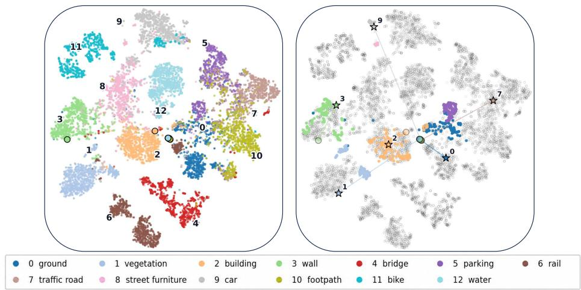
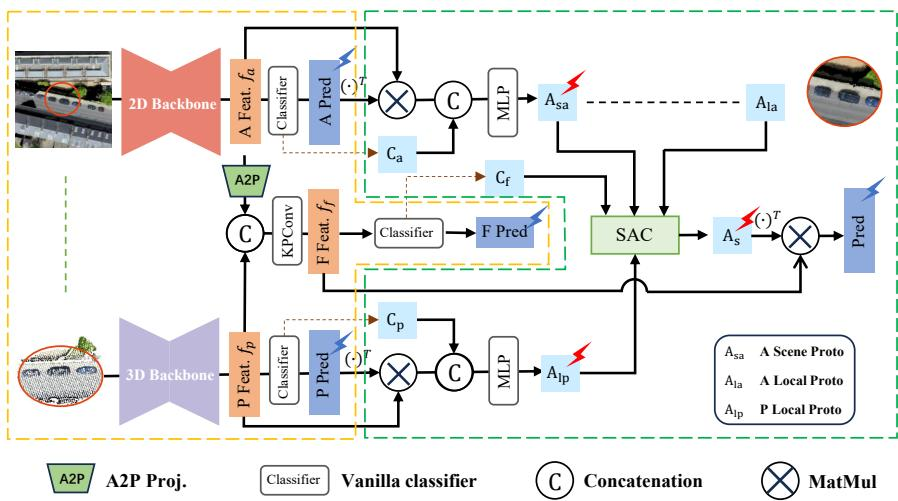
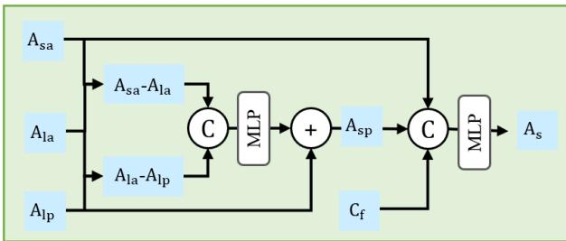
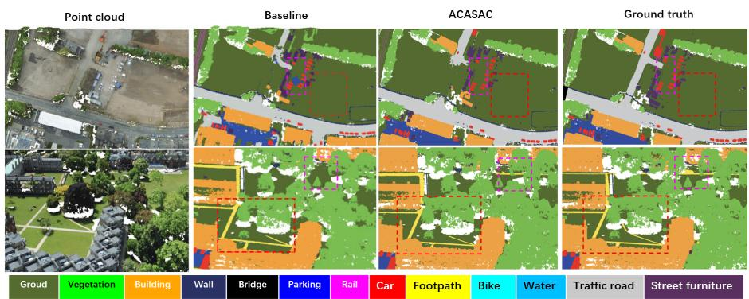
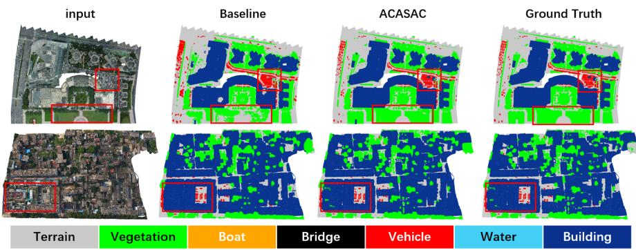

# Aerial Content-Aware Sample-Adaptive Classifier for Urban Photogrammetric Point Cloud Segmentation

Chong Liu1,2,3, Yonghua Lu4, and Zhanglin Cheng3⋆

1Southern University of Science and Technology 2Shenzhen University of Advanced Technology

3Shenzhen VisuCA Key Lab, Shenzhen Institutes of Advanced Technology, Chinese Academy of Sciences

4Urban Planning & Design Institute of Shenzhen

Abstract. Urban photogrammetric point clouds are commonly processed as local 3D patches, limiting the context available for distinguishing geometrically similar categories. Orthographic projection of the same data yields a co-registered digital orthophoto map (DOM)/RGB-D representation that supports eficient large-context modeling but compresses vertical geometry. Existing projection–point methods mainly fuse these two representations at the feature level while retaining a classifier shared across all samples. We present the Aerial Content-Aware Sample-Adaptive Classifier (ACASAC), which complements feature fusion with decision-level adaptation. A point-aligned aerial region bridges the full aerial crop and local 3D patch. ACASAC models scene-to-local variation within the projection and the representation discrepancy between aligned 2D and 3D supports, then transfers both relations to refine the local point class representation. The refined representation, scene-level aerial context, and fixed fused-head prior jointly form a classifier for the current sample. ACASAC improves the fixed dual-representation head by 2.1 and 2.7 mIoU points on SensatUrban and UrbanBIS, respectively, and by 2.1–2.3 points across four tested encoder combinations.

Keywords: urban point cloud semantic segmentation · sample-adaptive classifier · digital orthophoto map · class prototype · multimodal fusion

## 1 Introduction

Semantic segmentation of urban photogrammetric point clouds is fundamental to 3D scene understanding in applications such as autonomous systems, digital twins, and smart-city management. Urban scenes cover substantially larger spatial extents, exhibit strongly non-uniform point densities, and contain semantic categories that are dificult to distinguish from local geometry alone. Trafic roads, footpaths, and parking areas, for example, may all appear as locally flat surfaces, while their identities depend on surrounding buildings, road networks, vegetation, and object co-occurrence. Reliable urban point-cloud segmentation therefore requires both fine-grained 3D structure and contextual information beyond a sampled point neighborhood.

A photogrammetric point cloud can be represented either as irregular 3D points or as a regular DOM/RGB-D grid generated by orthographic projection. The point representation preserves local geometry but is typically processed within spatially limited patches, whereas the projected representation enables eficient large-context modeling at the cost of compressed vertical structure. Both representations therefore provide complementary spatial organizations of a common source rather than independent observations.

Projection-based methods use this complementarity to extend contextual reasoning beyond local 3D neighborhoods. BEVSeg [33] performs semantic inference in a bird’s-eye-view space, while Orth. [17] predicts from orthographic RGB and elevation images before transferring the resulting labels back to 3D points. Dual-branch approaches retain the point representation: APNet [22] introduces geometry-aware 2D–3D fusion, and DAPSS [18] incorporates pretrained DOM guidance and adaptive multimodal fusion. These methods improve representation learning, but their final classifier is generally shared across samples.

  
Fig. 1. t-SNE visualization of fused point features and classifier prototypes on the SensatUrban test set. The left panel shows the dataset-level feature distribution using 1,000 sampled points per class. The right panel illustrates the sample-specific displacement from fixed classifier prototypes to the adaptive prototypes generated by ACASAC. Small dots denote point features, large circles denote fixed prototypes, and stars denote ACASAC prototypes.

These methods mainly focus on representation-level fusion, while their final classifier is generally shared across all samples. Feature fusion provides each point with additional context, but it does not explicitly adapt the class representations used for prediction. This limitation is relevant to urban scenes, where category presence, frequency, co-occurrence, and spatial layout vary considerably across regions. A globally fixed classifier must accommodate these heterogeneous sample distributions using a single set of decision directions, which may be suboptimal for locally ambiguous categories. Although sample-adaptive and prototype-based classifiers have been explored in image and point-cloud segmentation [13,19,21,28,31,32], adapting a local point classifier using a broader point-cloud-derived projection has received less attention.

Directly relating the full projected crop to the local point patch is non-trivial because they difer simultaneously in spatial support and representation form. The former covers a broader region through a regular 2D grid, whereas the latter describes a smaller region through irregular 3D samples. We therefore introduce the point-aligned local projected region as an intermediate bridge. The method constructs class prototypes from the full projected crop, the projected region aligned with the sampled points, and the local point features. The relation between the two projected supports characterizes the change from local to broader context, while the relation between the aligned projected and point supports describes how the same local region is represented in 2D and 3D. These two relations are transferred to refine the local point class representation, which is combined with scene-level aerial context and the fixed fused-head classifier prior.

Fig. 1 provides a prototype-based visualization of this motivation. The left panel shows multimodal fusion forms meaningful class clusters at the dataset level, while several categories remain close in the two-dimensional embedding. The right panel illustrates how the adaptive prototypes for one sample are displaced from the fixed classifier prototypes. While t-SNE does not directly reflect separability in the original high-dimensional space, these observations are consistent with the sample-dependent feature variation considered here.

The main contributions are summarized as follows:

– We formulate urban photogrammetric point-cloud segmentation as a dual-representation decision-adaptation problem. In addition to fusing point-cloud-derived projection features with local 3D features, the proposed method adapts the classifier to the semantic composition of the current projection-crop–point-patch sample.

We introduce a point-aligned local projected representation as a bridge between broader projected context and local 3D observations. It organizes their discrepancy into a cross-scale relation within the projected representation and a locally aligned projection–point relation, which are transferred to correct the local point class representation while retaining the fixed classifier prior.

– Extensive experiments on SensatUrban and UrbanBIS demonstrate that ACASAC consistently outperforms matched fixed classifiers, CAC, and SSA-Seg under the same multimodal fusion setting. Ablation studies further support the contributions of scene-level aerial context, cross-modal relation transfer, and prototype-guided training.

## 2 Related Work

## 2.1 Point-based Methods

Point-based methods directly learn geometric representations from irregular point clouds. PointNet [14] introduces permutation-invariant point-wise learning, while PointNet++ [15] extends it with hierarchical local aggregation. KPConv [20] employs learnable kernel-point convolutions, and Point Transformer [29] models local interactions with self-attention. For large-scale scenes, RandLA-Net [8] greatly improves eficiency through random sampling and lightweight local aggregation, inspiring subsequent urban point-cloud methods [3,5,6,24,25]. Nevertheless, point-based networks mainly aggregate information within local 3D neighborhoods, making large-context reasoning relatively expensive.

## 2.2 Hybrid Segmentation Methods

Hybrid methods exploit complementary image context and 3D geometry [2,12,27]. On the one hand, KPRNet [10] maps features from 2D projections back to 3D space, while 3D-MiniNet [1] utilizes structured projections for fast processing. Furthermore, Robert et al. [16] learn to aggregate multi-view image features based on viewing conditions and benchmark diferent fusion stages. When applied to aerial urban scenes, BEVSeg [33] pioneered the projection of point clouds into a digital orthophoto map (DOM). Subsequently, Orth. [17] fused DOM and elevation maps using KNN for 2D-to-3D back-projection. Along similar lines, APNet [22] achieves geometry-aware multimodal fusion, whereas DAPSS [18] incorporates pretrained DOM priors with adaptive fusion. Nonetheless, the aforementioned approaches predominantly optimize feature extraction and fusion, leaving the final classification still governed by globally shared parameters.

## 2.3 Dynamic Classifiers

Recent studies [11,19,28,30] revisit the classification stage by constructing class representations from contextual information. ISNet [9] introduces class-level contextual representations to enhance pixel features. CAC [21] generates sampleadaptive semantic prototypes from coarse predictions and contextual features, with a ground-truth-guided classifier providing distillation supervision during training. SSA-Seg [13] further models both semantic and spatial prototype adaptation: coarse masks guide class-wise semantic and spatial centers, while a training-only teacher constrains adaptation through response-, semantic-, and spatial-domain distillation. ECAC [19] additionally employs a memory bank to construct representative global class prototypes. For 3D point clouds, NAPL [31] predicts an adaptive number of prototypes for intra-class geometric diversity. In contrast, ACASAC conditions a local point classifier on a broader projection and transfers cross-support and locally aligned projection–point relations.

## 3 Method

## 3.1 Overview

  
Fig. 2. The pipeline of our method. Tensors of the same shape are color-coded identically, with blue and red lightning symbols indicating cross-entropy supervision and knowledge distillation, respectively. The correspondence of A2P is established by the DOM mapping stored during data preparation following [18].

Fig. 2 illustrates the overall pipeline of the proposed method for point cloud semantic segmentation, which integrates dual-modal feature fusion with dynamic classification.

The left dashed box depicts the multi-modal fusion. Given a paired aerial image and point cloud, dual encoders extract image features $\pmb { f } _ { a } \in \dot { \mathbb { R } } ^ { H W \times D }$ and point features $\pmb { f } _ { p } \in \mathbb { R } ^ { N \times D }$ . After aerial-to-point projection, KPConv aggregates them into fused point features $\pmb { f } _ { f } \in \mathbb { R } ^ { N \times D }$ . Branch-specific linear classifiers $C _ { a } ,$ $C _ { p } ,$ and $C _ { f } \in \mathbb { R } ^ { C \times D }$ generate coarse predictions for the aerial, point-cloud, and fused branches, respectively.

The right dashed box illustrates the dynamic classification process of ACASAC. Drawing inspiration from CAC [21], we formulate content-aware prototypes $\pmb { A } \in \mathbb { R } ^ { C \times D }$ for each modality individually by characterizing and harnessing the latent distributions governing their coarse class-feature spaces. Section 3.2 introduces the proposed Sample-Adaptive Classifier (SAC), which models the intra-modal scene-to-local discrepancy within the aerial domain alongside the inter-modal discrepancy across aerial and point-cloud contexts, and derives a scene-conditioned point-cloud prototype $A _ { \mathrm { s p } } .$ . Section 3.3 presents the overall training scheme, including the supervision and distillation objectives used to optimize the proposed framework.

## 3.2 Sample-Adaptive Classifier

  
Fig. 3. Illustration of the proposed SAC.

The core idea of SAC is to transfer two complementary relations: the sceneto-local discrepancy within the aerial modality and the local discrepancy between the aerial and point-cloud modalities. These relations are anchored at the local point-cloud prototypes to predict scene-conditioned point-cloud prototypes.

Following CAC [21], each unimodal prototype is generated from a branch feature set $\bar { \pmb f } \in \mathbb { R } ^ { S \times \bar { D } }$ and its vanilla classifier $\bar { C } \in \mathbb { R } ^ { C \times D }$ . The coarse probabilities are $\pmb { p } = \sigma ( \pmb { f } \pmb { C } ^ { \top } )$ , where σ applies softmax along the class dimension. They estimate a contextual class center that is combined with the fixed classifier prior:

$$
\begin{array} { c } { { ( C _ { P } ) _ { c , : } = \displaystyle \frac { \sum _ { j = 1 } ^ { S } p _ { j , c } { \bf f } _ { j , : } } { \sum _ { j = 1 } ^ { S } p _ { j , c } + \epsilon } } , } \\ { { A = \theta ( C _ { P } \oplus C ) . } } \end{array}\tag{1}
$$

Here, $\epsilon = 0 . 0 1$ stabilizes classes with little support, ⊕ denotes concatenation, and the two-layer projector θ maps each class vector back to width D. The scenelevel and local aerial prototypes $\pmb { A } _ { \mathrm { s a } }$ and $A _ { \mathrm { l a } }$ share the image-branch classifier and projector, whereas the local point-cloud prototype $\pmb { A } _ { \mathrm { l p } }$ uses a separate pointbranch classifier and projector. Applying Eq. (1) to the full aerial sample, its point-aligned local support, and the local point features yields $A _ { \mathrm { s a } } , ~ A _ { \mathrm { l a } } .$ and $\mathbf { \bar { A } } _ { \mathrm { l p } } \in \mathbb { R } ^ { \bar { C } \times D }$ , respectively.

Although $\pmb { A } _ { \mathrm { s a } }$ and $A _ { \mathrm { l a } }$ are both generated from aerial features, they describe diferent spatial supports. The former covers the complete aerial sample, whereas the latter is restricted to the point-cloud extent.

As shown in Fig. 3, SAC defines the scene-to-local aerial discrepancy as $\varDelta A _ { \mathrm { s l } } = A _ { \mathrm { s a } } - A _ { \mathrm { l a } }$ and the locally aligned cross-modal discrepancy as $\varDelta A _ { 1 } =$ $A _ { \mathrm { l a } } - A _ { \mathrm { l p } }$ . It then jointly transfers these two relations to the point-cloud domain:

$$
\begin{array} { c } { { \varDelta A _ { \mathrm { s p } } = g _ { r } ( \varDelta A _ { \mathrm { s l } } \oplus \varDelta A _ { \mathrm { l } } ) , } } \\ { { A _ { \mathrm { s p } } = A _ { \mathrm { l p } } + \varDelta A _ { \mathrm { s p } } . } } \end{array}\tag{2}
$$

The class-wise projector $g _ { r } : \mathbb { R } ^ { C \times 2 D }  \mathbb { R } ^ { C \times D }$ contains two linear layers. In the final line of Eq. (2), $\pmb { A } _ { \mathrm { l p } }$ acts as the anchor and the predicted relation residual supplies the scene-level and cross-modal correction, producing the sceneconditioned point-cloud prototype $A _ { \mathrm { s p } }$

The final classifier combines the fixed fused-head prior, the transferred pointcloud prototype, and the scene-level aerial prototype. It then predicts the fused point features by cosine similarity:

$$
\begin{array} { r l } & { A _ { s } = \gamma ( { C _ { f } } \oplus A _ { \mathrm { s p } } \oplus A _ { \mathrm { s a } } ) , } \\ & { Z ^ { f } = \eta ( f _ { f } ) \eta ( A _ { s } ) ^ { \top } , } \\ & { P ^ { f } = \sigma ( Z ^ { f } ) . } \end{array}\tag{3}
$$

Here, $\gamma : \mathbb { R } ^ { 3 D }  \mathbb { R } ^ { D }$ is a two-layer class-wise projector, $\eta ( \cdot )$ denotes row-wise $\ell _ { 2 }$ normalization, $Z ^ { f } ~ \in ~ \mathbb { R } ^ { N \times C }$ denotes the final logits, and $P ^ { f }$ denotes the corresponding class probabilities.

## 3.3 Training Objective

As illustrated in Fig. 2, the training objective contains three groups that correspond directly to the cumulative configurations in Table 5: final ACASAC prediction supervision, intermediate representation supervision, and oracle-guided prototype supervision.

Final prediction supervision. The final classifier $A _ { s }$ produces the logits $Z ^ { f }$ defined above. Given the point-wise labels $Y ^ { f }$ , the primary segmentation loss is

$$
\mathcal { L } _ { \mathrm { c e } } = \mathrm { C E } ( Z ^ { f } , Y ^ { f } ) .\tag{4}
$$

Intermediate representation supervision. Branch-specific vanilla classifiers supervise the aerial, point-cloud, and fused representations before the sampleadaptive classifier. Let $\boldsymbol { B } = \{ a , p , f \}$ and $\pmb { Z } _ { 0 } ^ { b ^ { \ast } } = \pmb { f } _ { b } \pmb { C } _ { b } ^ { \top } \in \mathbb { R } ^ { N _ { b } \times C }$ denote the coarse logits of branch $b ,$ where $N _ { a } = H W$ and $N _ { p } = N _ { f } = N$ . The aerial target $\mathbf { Y } ^ { a }$ contains pixel-wise labels, while $Y ^ { p }$ and $Y ^ { f }$ contain point-wise labels. The intermediate representation loss is

$$
{ \mathcal { L } } _ { \mathrm { r e p } } = \sum _ { b \in { \mathcal { B } } } { \mathrm { C E } } ( Z _ { 0 } ^ { b } , Y ^ { b } ) .\tag{5}
$$

Oracle-guided prototype supervision. The adaptive prototypes are estimated from soft coarse predictions and may therefore inherit errors from the early predictions. To provide an ideal training target, we construct a trainingonly oracle prototype $A ^ { o }$ from the fused point features $f _ { f }$ and their point-wise ground-truth labels $Y ^ { f }$ . Specifically, the one-hot ground-truth assignments replace the coarse probabilities p in Eq. (1) to compute the oracle class centers ${ \cal C } _ { P } ^ { o } ,$ which are combined with the fused-head prior and mapped by an oracle-specific projector as $A ^ { o } = \theta _ { o } ( C _ { P } ^ { o } \oplus C _ { f } )$ . Because $\theta _ { o }$ is independent of the student projectors, the oracle prediction is explicitly optimized by cross-entropy. The resulting

$A ^ { o }$ serves as a ground-truth-conditioned upper-bound target for the dynamic classifier, representing the ideal scene-adaptive prototype under the available labels.

Following CAC [21], $A ^ { o }$ then supervises the scene-level aerial prototype $A _ { \mathrm { s a } } ,$ the local point-cloud prototype $\pmb { A } _ { \mathrm { l p } }$ , and the final dynamic classifier $A _ { s }$ through the class-wise KL-divergence paths marked by red lightning in Fig. 2. The distillation aligns the class-response distribution induced by each student with that of the oracle. This guidance has two roles: it teaches each student to infer the ideal prototype from its corresponding sample-specific feature distribution, and it aligns the three students within a common class-distribution space. The complete prototype-guidance objective is

$$
\mathcal { L } _ { \mathrm { p r o t o } } = \mathcal { L } _ { \mathrm { c e } } ^ { \mathrm { o } } + \mathcal { L } _ { \mathrm { K L } } ^ { \mathrm { s a } } + \mathcal { L } _ { \mathrm { K L } } ^ { \mathrm { l p } } + \mathcal { L } _ { \mathrm { K L } } ^ { s } ,\tag{6}
$$

where $\mathcal { L } _ { \mathrm { c e } } ^ { \mathrm { o } }$ supervises the prediction produced by the oracle-specific projector $\theta _ { o } ,$ and the other three terms denote the class-wise KL distillation losses for $A _ { \mathrm { s a } } , \ A _ { \mathrm { l p } } ,$ , and $A _ { s }$ , respectively, following the design of CAC [21]. As shown in Table 5, adding $\mathcal { L } _ { \mathrm { p r o t o } }$ to $\mathcal { L } _ { \mathrm { c e } } + \mathcal { L } _ { \mathrm { r e p } }$ improves mIoU from 66.67% to 68.18%. This cumulative result supports the complete prototype-guidance group but does not isolate the contribution of its four constituent terms. The oracle prototype and its projector are discarded during inference.

The overall training objective is defined as the sum of the three loss groups:

$$
\mathcal { L } = \mathcal { L } _ { \mathrm { c e } } + \mathcal { L } _ { \mathrm { r e p } } + \mathcal { L } _ { \mathrm { p r o t o } } .\tag{7}
$$

## 4 Experiments

## 4.1 Experimental Setup

Evaluation Metrics. We adopt overall accuracy (OA) and mean intersection over union (mIoU) for evaluation.

Datasets. SensatUrban [7] is a UAV-based urban photogrammetric pointcloud dataset covering 7.64 km2 in three UK cities and 13 semantic classes. We use the oficial split of 33 training, 4 validation, and 6 test blocks. UrbanBIS [23] contains nearly 2.5 billion annotated points from six metropolitan scenes, covering approximately 10.78 km2 and seven classes. We use its oficial split of 106 training, 39 validation, and 48 test scenes.

Implementation Details. Following DAPSS [18], we adopt the same protocol to construct aligned image–point cloud pairs. SensatUrban is voxelized at 0.2 m, while UrbanBIS uses its oficial 0.3 m resolution, No additional data augmentation is applied.. During training, each sample contains 10, 000 locally sampled points and a corresponding 512×512 image crop. All models are trained on a single NVIDIA RTX 4090 for 100 epochs with a batch size of 16 using Adam with an initial learning rate of 0.01, and ExponentialLR with a decay factor of 0.95. Classifier comparisons use seeds 100, 1111, and 1234.

Table 1. Comparison with diferent methods on the SensatUrban [7] and UrbanBIS [23] test sets (%).
<table><tr><td></td><td></td><td colspan="2">SensatUrban</td><td colspan="2">UrbanBIS</td></tr><tr><td>Method</td><td>Input</td><td>OA</td><td>mIoU</td><td>OA</td><td>mIoU</td></tr><tr><td>PointNet++ [15]</td><td>PC</td><td>84.3</td><td>32.9</td><td>86.9</td><td>33.4</td></tr><tr><td>RandLA-Net [8]</td><td>PC</td><td>89.8</td><td>52.7</td><td>92.4</td><td>61.9</td></tr><tr><td>KPConv [20]</td><td>PC</td><td>93.2</td><td>57.6</td><td>95.1</td><td>63.6</td></tr><tr><td>PT [29]</td><td>PC</td><td>91.4</td><td>60.6</td><td>94.7</td><td>70.1</td></tr><tr><td>PointNAT [26]</td><td>PC</td><td>93.8</td><td>65.2</td><td>96.2</td><td>72.5</td></tr><tr><td>BEVSeg [33]</td><td>RGB</td><td>91.4</td><td>61.2</td><td>91.3</td><td>62.8</td></tr><tr><td>Orth. [17]</td><td>RGBD</td><td>93.0</td><td>62.5</td><td>91.6</td><td>65.3</td></tr><tr><td>APNet [22]</td><td>PC+RGB</td><td>94.0</td><td>65.2</td><td>94.8</td><td>72.0</td></tr><tr><td>DAPSS [18]</td><td>PC+RGBD</td><td>93.9</td><td>65.9</td><td></td><td></td></tr><tr><td>Baseline (Linear)</td><td>PC+RGBD</td><td>94.2</td><td>66.1±0.2</td><td>95.3</td><td>72.5±0.3</td></tr><tr><td>Baseline (Cosine)</td><td>PC+RGBD</td><td>94.0</td><td>65.5±0.2</td><td>95.1</td><td>72.0±0.3</td></tr><tr><td>+CAC</td><td>PC+RGBD</td><td>94.3</td><td>66.9±0.3</td><td>95.6</td><td>73.8±0.6</td></tr><tr><td>+SSA-Seg</td><td>PC+RGBD</td><td>94.2</td><td>67.2±0.4</td><td>95.4</td><td>74.1±0.8</td></tr><tr><td>+ACASAC</td><td>PC+RGBD</td><td>94.5</td><td>68.2±0.4</td><td>96.3</td><td>75.2±0.7</td></tr></table>

  
Fig. 4. Qualitative comparison on SensatUrban.

## 4.2 Quantitative And Qualitative Results

Figures 4 and 5 illustrate how the sample-adaptive head changes local predictions. On SensatUrban, the fixed-head baseline labels the surface beneath a car as parking, whereas ACASAC recovers the correct class by using surrounding context. On UrbanBIS, ACASAC produces cleaner boundaries in noisy residential and parking scenes, especially in mixed-class regions. These examples are consistent with scene-conditioned classification reducing the influence of locally atypical features; they provide qualitative evidence rather than isolating this mechanism.

  
Fig. 5. Qualitative comparison on UrbanBIS.

Table 1 compares ACASAC with previously classical methods and with classifier variants evaluated in the shared multimodal framework. All in-house variants share the encoders, fused features, data splits, 100-epoch training schedule, and model-selection protocol. CAC, SSA-Seg, and ACASAC report mean mIoU ± standard deviation over three random seeds. On SensatUrban, ACASAC achieves 94.5% OA and 68.2% mean mIoU, exceeding the fixed linear and cosine heads by 2.1 and 2.7 mIoU points, respectively. On UrbanBIS, its 75.2% mean mIoU exceeds the two fixed heads by 2.7 and 3.2 points. ACASAC also improves the mean mIoU over CAC and SSA-Seg by 1.3 and 1.0 points on SensatUrban and by 1.4 and 1.1 points on UrbanBIS. Across the three random-seed runs, ACASAC consistently achieves higher mIoU than both adaptive alternatives on the two datasets. The in-house rows therefore compare complete classifier variants under a shared configuration, whereas comparisons with published methods characterize complete-system competitiveness.

Table 2. Per-class comparison on the SensatUrban [7] test set (%).
<table><tr><td>Method</td><td>OA</td><td>mIoU</td><td>Ground</td><td>Veg.</td><td>Build.</td><td>Wall</td><td>Bridge</td><td>Park.</td><td>Rail</td><td>Road</td><td>Furn.</td><td>Car</td><td>Foot.</td><td>Bike</td><td>Water</td></tr><tr><td>DeepLabV3+ [4]</td><td>90.2</td><td>60.6</td><td>76.0</td><td>90.8</td><td>92.6</td><td>62.9</td><td>58.2</td><td>60.0</td><td>51.2</td><td>59.9</td><td>36.2</td><td>75.2</td><td>42.5</td><td>2.2</td><td>80.4</td></tr><tr><td>RandLA-Net [8]]</td><td>91.4</td><td>52.0</td><td>82.8</td><td>91.4</td><td>90.3</td><td>58.2</td><td>22.8</td><td>48.7</td><td>24.8</td><td>62.3</td><td>30.8</td><td>73.1</td><td>39.1</td><td>0.0</td><td>51.8</td></tr><tr><td>Ours(Baseline)</td><td>94.2</td><td>66.1</td><td>87.0</td><td>98.7</td><td>96.2</td><td>77.2</td><td>58.4</td><td>62.3</td><td>55.6</td><td>61.9</td><td>48.2</td><td>84.7</td><td>45.7</td><td>0.1</td><td>83.8</td></tr><tr><td>Ours(ACASAC)</td><td>94.5</td><td>68.2</td><td>87.8</td><td>98.8</td><td>96.4</td><td>77.5</td><td>64.8</td><td>65.9</td><td>60.7</td><td>63.6</td><td>49.7 84.6</td><td></td><td>49.9</td><td>2.5</td><td>84.1</td></tr></table>

Table 2 shows that multimodal fusion outperforms either unimodal branch, while replacing the fixed head with ACASAC further improves overall performance and benefits 12 of the 13 semantic classes.

Table 3. Ablation of the prototype information used by ACASAC on SensatUrban (mIoU, %).
<table><tr><td>Prototype</td><td>mIoU</td></tr><tr><td> $\gamma ( C _ { f } )$ </td><td>65.71</td></tr><tr><td rowspan="4"> $\gamma ( C _ { f } \oplus A _ { \mathrm { l a } } )$   $\gamma ( C _ { f } \oplus A _ { \mathrm { l p } } )$   $\gamma ( C _ { f } \oplus A _ { \mathrm { s a } } )$   $\gamma ( C _ { f } \oplus A _ { \mathrm { l p } } \oplus A _ { \mathrm { l a } } )$ </td><td>66.88</td></tr><tr><td>66.95</td></tr><tr><td>67.31</td></tr><tr><td>67.27</td></tr><tr><td rowspan="4"> $\gamma ( C _ { f } \oplus A _ { \mathrm { l p } } \oplus A _ { \mathrm { s a } } )$   $\gamma ( { \pmb C } _ { f } \oplus { \pmb A } _ { \mathrm { l p } } \oplus { \pmb A } _ { \mathrm { l a } } \oplus { \pmb A } _ { \mathrm { s a } } )$   $\gamma ( C _ { f } \oplus ( A _ { \mathrm { l p } } + g _ { r } ( \varDelta A _ { \mathrm { s l } } \oplus \mathbf { 0 } ) ) )$   $\gamma ( C _ { f } \oplus ( A _ { \mathrm { l p } } + g _ { r } ( \mathbf { 0 } \oplus \varDelta A _ { \mathrm { l } } ) ) )$   $\gamma ( C _ { f } \oplus ( A _ { \mathrm { l p } } + g _ { r } ( \varDelta A _ { \mathrm { s l } } \oplus \varDelta A _ { \mathrm { l } } ) ) )$ </td><td>67.43 67.76</td></tr><tr><td></td></tr><tr><td>67.03</td></tr><tr><td>67.15 67.64</td></tr><tr><td> $\gamma ( C _ { f } \oplus A _ { \mathrm { s p } } \oplus A _ { \mathrm { s a } } )$ </td><td>68.18</td></tr></table>

## 4.3 Ablation Study

Table 3 evaluates the prototype information used by ACASAC. Starting from the fixed classifier prior at 65.71% mIoU, introducing the local aerial and local point-cloud prototypes individually increases performance to 66.88% and 66.95%, respectively. Their direct combination reaches 67.27%, indicating modest complementarity between the two locally aligned representations. Among the individual prototypes, the scene-level aerial prototype achieves the highest result of 67.31%, which is consistent with the broader projected support providing a more efective contextual cue.

Directly combining the local point-cloud and scene-level aerial prototypes without the local aerial bridge yields 67.43% mIoU. Adding the local aerial prototype increases this result to 67.76%, supporting the usefulness of the pointaligned aerial representation in connecting the local point and broader aerial supports. This comparison nevertheless evaluates direct prototype fusion and does not independently isolate the causal contribution of the bridge.

Within the relation-transfer variants, using only the scene-to-local or the locally aligned cross-modal relation obtains 67.03% and 67.15% mIoU, respectively. Jointly modeling both relations raises performance to 67.64%, exceeding the two single-relation variants by 0.61 and 0.49 points. The complete ACASAC configuration further incorporates the scene-level aerial prototype and achieves the highest tested result of 68.18%. It outperforms the relation-transferred prototype alone by 0.54 points and the direct concatenation of all raw prototypes by 0.42 points. These single-run results are consistent with the two relations providing complementary information and with structured relation transfer offering a useful inductive bias over direct prototype concatenation; they do not establish statistically significant or independently causal efects.

Table 4 evaluates ACASAC across diferent point-cloud and image backbone combinations. Although these backbones provide unimodal features of varying

Table 4. Efect of multimodal feature encoders on ACASAC on SensatUrban (mIoU, %).
<table><tr><td>3D backbone</td><td>2D backbone</td><td>Static</td><td>ACASAC</td><td>Δ</td></tr><tr><td>RandLA</td><td>DeepLabV3+</td><td>66.1</td><td>68.2</td><td>+2.1</td></tr><tr><td>RandLA</td><td>SAM</td><td>67.5</td><td>69.7</td><td>+2.2</td></tr><tr><td>PT</td><td>DeepLabV3+</td><td>66.7</td><td>68.9</td><td>+2.2</td></tr><tr><td>PT</td><td>SAM</td><td>68.2</td><td>70.5</td><td>+2.3</td></tr></table>

quality, ACASAC consistently improves over the matched static head in all tested configurations.

Table 5. Ablation of the training objectives on SensatUrban (mIoU, %).
<table><tr><td>Training objective</td><td>mIoU</td></tr><tr><td> $\mathcal { L } = \mathcal { L } _ { \mathrm { c e } }$ </td><td>62.83</td></tr><tr><td> $\mathcal { L } = \mathcal { L } _ { \mathrm { c e } } + \mathcal { L } _ { \mathrm { r e p } }$ </td><td>66.67</td></tr><tr><td> $\mathcal { L } = \mathcal { L } _ { \mathrm { c e } } + \mathcal { L } _ { \mathrm { r e p } } + \mathcal { L } _ { \mathrm { p r o t o } }$ </td><td>68.18</td></tr></table>

Table 5 shows a cumulative improvement as auxiliary supervision is introduced. Training with only $\mathcal { L } _ { \mathrm { c e } }$ yields 62.83% mIoU. Adding $\mathcal { L } _ { \mathrm { r e p } }$ , which supervises the aerial, point-cloud, and fused intermediate logits, raises performance to 66.67%, a gain of 3.84 points. Further including $\mathcal { L } _ { \mathrm { p r o t o } }$ , which combines oracleguided response distillation and oracle-logit supervision for $A _ { \mathrm { s a } }$ and $A _ { \mathrm { l p } } .$ increases mIoU to 68.18% by another 1.51 points. The complete objective therefore improves the final-supervision-only setting by 5.35 points. These cumulative results support the contribution of both auxiliary loss groups.

## 5 Conclusion

In this paper, we present the Aerial Content-Aware Sample-Adaptive Classifier (ACASAC) for multimodal urban point-cloud segmentation. ACASAC combines the fixed fused-head prior with scene-level aerial and relation-transferred pointcloud prototypes to adapt the classifier to each paired sample. Experiments on SensatUrban and UrbanBIS, together with prototype and encoder ablations, demonstrate consistent improvements over matched fixed and adaptive heads within the evaluated settings.

Acknowledgments. This work was supported in part by Guangdong Major Project of Basic and Applied Basic Research (2023B0303000016), and the Shenzhen Science and Technology Program (CJGJZD20240729141906008).

## References

1. Alonso, I., Riazuelo, L., Montesano, L., Murillo, A.C.: 3D-MiniNet: Learning a 2D representation from point clouds for fast and eficient 3D LIDAR semantic segmentation. IEEE Robot. Autom. Lett. 5(4), 5432–5439 (2020). 10.1109/LRA. 2020.3007440

2. Bai, X., Hu, Z., Zhu, X., et al.: TransFusion: Robust LiDAR-camera fusion for 3D object detection with transformers. In: Proc. CVPR. pp. 1080–1089 (2022). 10.1109/CVPR52688.2022.00116

3. Chen, J., Zhao, Y., Meng, C., Liu, Y.: Multi-feature aggregation for semantic segmentation of an urban scene point cloud. Remote Sens. 14(20), 5134 (2022). 10.3390/rs14205134

4. Chen, L.C., Zhu, Y., Papandreou, G., Schrof, F., Adam, H.: Encoder-decoder with atrous separable convolution for semantic image segmentation. In: Proc. ECCV, vol. 11211, pp. 833–851. Springer, Cham (2018). 10.1007/978-3-030-01234-2\_49

5. Deng, S., Dong, Q.: GA-NET: Global attention network for point cloud semantic segmentation. IEEE Signal Process. Lett. 28, 1300–1304 (2021). 10.1109/LSP.2021. 3082851

6. Hu, Q., Yang, B., Fang, G., et al.: SQN: Weakly-supervised semantic segmentation of large-scale 3D point clouds. In: Proc. ECCV. pp. 600–619. Springer, Cham (2022). 10.1007/978-3-031-19812-0\_35

7. Hu, Q., Yang, B., Khalid, S., Xiao, W., Trigoni, N., Markham, A.: SensatUrban: Learning semantics from urban-scale photogrammetric point clouds. Int. J. Comput. Vis. 130(2), 316–343 (2022). 10.1007/s11263-021-01554-9

8. Hu, Q., Yang, B., Xie, L., et al.: RandLA-Net: Eficient semantic segmentation of large-scale point clouds. In: Proc. CVPR. pp. 11105–11114 (2020). 10.1109/ CVPR42600.2020.01112

9. Jin, Z., Liu, B., Chu, Q., Yu, N.: ISNet: Integrate image-level and semantic-level context for semantic segmentation. In: Proc. ICCV. pp. 7169–7178 (2021). 10.1109/ ICCV48922.2021.00710

10. Kochanov, D., Nejadasl, F.K., Booij, O.: KPRNet: Improving projection-based Li-DAR semantic segmentation. arXiv:2007.12668 (2020). 10.48550/arXiv.2007.12668

11. Liang, C., Wang, W., Miao, J., Yang, Y.: GMMSeg: Gaussian mixture based generative semantic segmentation models. In: Proc. NeurIPS. vol. 35, pp. 31360–31375 (2022). 10.52202/068431-2274

12. Liu, Z., Tang, H., Amini, A., et al.: BEVFusion: Multi-task multi-sensor fusion with unified bird’s-eye view representation. In: Proc. ICRA. pp. 2774–2781 (2023). 10.1109/ICRA48891.2023.10160968

13. Ma, X., Ni, Z., Chen, X.: SSA-Seg: Semantic and spatial adaptive pixel-level classifier for semantic segmentation. In: Proc. NeurIPS. vol. 37, pp. 93690–93713 (2024). 10.52202/079017-2971

14. Qi, C.R., Su, H., Mo, K., Guibas, L.J.: PointNet: Deep learning on point sets for 3D classification and segmentation. In: Proc. CVPR. pp. 77–85 (2017). 10.1109/ CVPR.2017.16

15. Qi, C.R., Yi, L., Su, H., Guibas, L.J.: PointNet++: Deep hierarchical feature learning on point sets in a metric space. In: Proc. NeurIPS. vol. 30 (2017)

16. Robert, D., Vallet, B., Landrieu, L.: Learning multi-view aggregation in the wild for large-scale 3D semantic segmentation. In: Proc. CVPR. pp. 5565–5574 (2022). 10.1109/CVPR52688.2022.00549

17. Rong, M., Shen, S.: 3D semantic segmentation of aerial photogrammetry models based on orthographic projection. IEEE Trans. Circuits Syst. Video Technol. 33(12), 7425–7437 (2023). 10.1109/TCSVT.2023.3273224

18. Song, Z., Guo, M., Wu, L., Liu, H., Huang, Y., Liu, Z.: DAPSS: A novel network for DOM assisted oblique photography point cloud semantic segmentation. IEEE J. Sel. Top. Appl. Earth Obs. Remote Sens. 18, 18264–18280 (2025). 10.1109/ JSTARS.2025.3582804

19. Tang, H., Zhao, Y., Xu, M., Wang, J., Wu, Q.: Classifier enhancement using extended context and domain experts for semantic segmentation. IEEE Trans. Multimed. 28, 2888–2899 (2026). 10.1109/TMM.2026.3651068

20. Thomas, H., Qi, C.R., Deschaud, J.E., Marcotegui, B., Goulette, F., Guibas, L.J.: KPConv: Flexible and deformable convolution for point clouds. In: Proc. ICCV. pp. 6410–6419 (2019). 10.1109/ICCV.2019.00651

21. Tian, Z., Cui, J., Jiang, L., et al.: Learning context-aware classifier for semantic segmentation. Proc. AAAI Conf. Artif. Intell. 37(2), 2438–2446 (2023). 10.1609/ aaai.v37i2.25340

22. Wei, W., Oswald, M.R., Nejadasl, F.K., Gevers, T.: APNet: Urban-level scene segmentation of aerial images and point clouds. In: Proc. ICCVW. pp. 1747–1756 (2023). 10.1109/ICCVW60793.2023.00191

23. Yang, G., Xue, F., Zhang, Q., Xie, K., Fu, C.W., Huang, H.: UrbanBIS: A largescale benchmark for fine-grained urban building instance segmentation. In: Proc. SIGGRAPH. pp. 1–11 (2023). 10.1145/3588432.3591508

24. Yoo, S., Jeong, Y., Jameela, M., Sohn, G.: Human vision based 3D point cloud semantic segmentation of large-scale outdoor scenes. In: Proc. CVPRW. pp. 6577– 6586 (2023). 10.1109/CVPRW59228.2023.00699

25. Yoo, S., Jeong, Y., Sheikholeslami, M.M., Sohn, G.: EyeNet++: A multiscale and multidensity approach for outdoor 3-D semantic segmentation inspired by the human visual field. IEEE Trans. Geosci. Remote Sens. 63, 1–19 (2025). 10.1109/TGRS.2025.3589287

26. Zeng, Z., Qiu, H., Zhou, J., Dong, Z., Xiao, J., Li, B.: PointNAT: Large-scale point cloud semantic segmentation via neighbor aggregation with transformer. IEEE Trans. Geosci. Remote Sens. 62, 1–18 (2024). 10.1109/TGRS.2024.3407761

27. Zhan, W., Chen, J.: SADNet: Space-aware DeepLab network for urban-scale point clouds semantic segmentation. Int. J. Appl. Earth Obs. Geoinf. 129, 103827 (2024). 10.1016/j.jag.2024.103827

28. Zhang, W., Ma, M., Jiang, Y., et al.: Center-guided classifier for semantic segmentation of remote sensing images. IEEE Trans. Geosci. Remote Sens. 64, 1–16 (2026). 10.1109/TGRS.2026.3657453

29. Zhao, H., Jiang, L., Jia, J., Torr, P.H.S., Koltun, V.: Point transformer. In: Proc. ICCV. pp. 16239–16248 (2021). 10.1109/ICCV48922.2021.01595

30. Zhao, Q., Wang, D., Zhou, Y., Li, J., Irampaye, R.: Few to big: Prototype expansion network via difusion learner for few-shot 3D point cloud semantic segmentation. IEEE Trans. Multimed. pp. 1–12 (2026). 10.1109/TMM.2026.3729118, Early Access

31. Zhao, Y., Wang, J., Li, X., et al.: Number-adaptive prototype learning for 3D point cloud semantic segmentation. In: Proc. ECCV Workshops, pp. 695–703. Springer, Cham (2023). 10.1007/978-3-031-25066-8\_41

32. Zhou, T., Wang, W., Konukoglu, E., Van Gool, L.: Rethinking semantic segmentation: A prototype view. In: Proc. CVPR. pp. 2572–2583 (2022). 10.1109/ CVPR52688.2022.00261

33. Zou, Z., Li, Y.: Eficient urban-scale point clouds segmentation with BEV projection. arXiv:2109.09074 (2021). 10.48550/arXiv.2109.09074