# Align Once to Explain  : Feature Alignment for Scalable B-cosification of Foundational Vision Transformers

Raphael Maser\*, Siddhartha Gairola\*, Sukrut Rao, Bernt Schiele Max Planck Institute for Informatics, Saarland Informatics Campus, Saarbrücken, Germany {raphael.maser,siddhartha.gairola,sukrut.rao,schiele}@mpi-inf.mpg.de

Project Page ΩCode Models

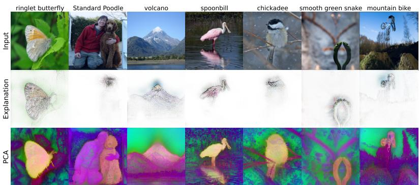

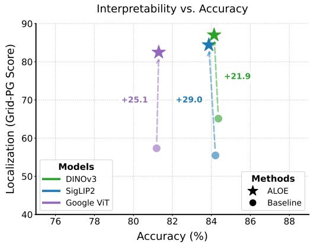  
Figure 1. ALOE: performant, preserves semantics, explains faithfully.— Left: Explanations and representations. ALOE enables inherently interpretable B-cos: W(x) [11] attributions (row 2) that are object-centric and class-specific. The accompanying PCA visualizations (row 3; RGB = first three principal components of the final image representation for our ALOE aligned DINOv3 [72] model) preserve global feature geometry—indicating aligned semantics with improved explainability (cf. Fig. 5). Right: Performance vs. interpretability. Across ViT-B/16 backbones, ALOE substantially boosts localization quality on GridPG [10, 81] while maintaining competitive ImageNet [65] accuracy relative to the corresponding foundation models (Supervised [25], DINOv3 [72], SigLIP2 [76]). Baseline denotes each teacher explained with AttnLRP [1].

## Abstract

Foundational vision models have become the de facto standard for many vision tasks due to their strong performance. However, they are notoriously opaque and remain hard to interpret. We present ALOE (ALign Once to Explain), a one-time, label-free feature alignment approach that efficiently converts foundational vision models into inherently interpretable B-cos [11] variants. Once aligned, the B-cos backbone is used as a drop-in replacement across several downstream tasks—amortizing the cost of interpretability. ALOE is robust across pre-training paradigms (supervised, self-supervised, vision–-language) and can preserve teacher-level generalization with orders of magnitude less data than training from scratch. On classification, it

strongly outperforms vanilla B-cosification (e.g., +10.5 p.p. top-1 on ImageNet for DINOv3 ViT-B/16), retains strong linear probing, k-NN, and zero-shot transfer competitive with foundational backbones (DINOv3 [72], SigLIP2 [76]) across diverse downstream datasets. It also preserves spatially structured features useful for dense prediction, while yielding well-localized and highly human-interpretable explanations by design.

## 1. Introduction

Large-scale vision foundation models, including selfsupervised encoders in the DINO family [12, 55, 72] and contrastive vision-language models such as CLIP [60] and SigLIP [76, 80], are powerful and versatile feature extractors that achieve state-of-the-art performance across a diverse set of downstream tasks. Trained on billions of images and image-text pairs, these models serve as generalpurpose building blocks across various domains, from finegrained recognition to medical imaging, often replacing their fully supervised, domain-specific counterparts [72]. However, their decision-making processes remain largely opaque, which hinders their use in sensitive and safetycritical applications. Post-hoc explanation methods aim to mitigate this issue, but can be noisy and not always faithful to the underlying model being explained [2, 3, 61].

An alternative line of work develops inherently interpretable architectures that yield model-faithful explanations by design. They introduce architectural constraints that lead to human-interpretable, faithful summaries of the model's computations; examples include prototype-based models [17, 24, 51], dynamic linear models [6, 10], and concept-bottleneck models [37, 54, 62]. A prominent example is the family of B-cos Networks [6, 11], which replace linear transforms with bias-free B-cos transforms that promote weight-input alignment to enhance interpretability and enable a faithful summary of the model's decision. To avoid training these models from scratch, recent work proposed B-cosification' [4], an approach that efficiently transforms existing models to their B-cos variants post-hoc at a fraction of the full training cost. However, despite strong gains on fully-supervised convolutional backbones and competitive results on a CLIP ResNet [32] backbone, the B-cosification recipe provides only modest improvements for Vision Transformers (ViTs) [25], sometimes failing to match the performance of training from scratch. Since most modern foundation models are ViT-based, this significantly limits its practical utility and broader adoption.

In this work, we propose a scalable approach to efficiently transform existing foundation models into Bcos variants, that is practically useful for modern ViTs. Specifically, we explore feature-alignment methods for fine-grained matching between a pre-trained foundational teacher and its B-cosified student without any labeled supervision. We conduct a comprehensive study of key design choices, including which features/layers to align, alignment losses, model scales, and alignment dataset sizes. Unlike [4], our approach, ALOE (ALign Once to Explain) (Fig. 4), is a general-purpose recipe that requires only a single alignment of the backbone irrespective of the pre-training paradigm, such as fully-supervised, self-supervised, or contrastive vision-language training. Once aligned, the backbone can be used as a drop-in replacement across downstream tasks, amortizing the cost of interpretability.

Despite its simplicity, ALOE is surprisingly effective and highly data and compute efficient. For example, while training SigLIP2 [76] from scratch required ≈10B images and ≈12B alt-texts, ALOE B-cosifies such a model while maintaining its generalization with only a small unlabeled alignment set: even 150k YFCC15M images already keep the ImageNet top-1 gap below 0.50 p.p. (Fig. 9), and the full 15M-image alignment set reaches 83.87%vs. 84.21% for the SigLIP2 teacher (see Fig. 1). This makes the onetime alignment overhead clearly preferable to full retraining for achieving interpretability. Moreover, ALOE consistently outperforms vanilla B-cosification [4] across pretraining paradigms, improving ImageNet-1k linear-probe accuracy by +8.82 to +10.50 p.p. for the SigLIP2 and DI-NOv3 ViT-B/16 models shown in Fig. 2. Our models also deliver strong linear-probing and zero-shot performance across datasets, preserve spatially structured features useful for dense prediction, and provide faithful, well-localized explanations (Fig. 1).

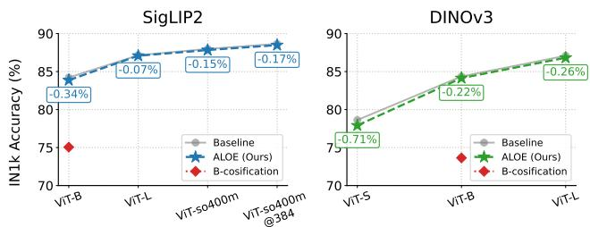

(a) ImageNet-1k linear-probe accuracy (%).  
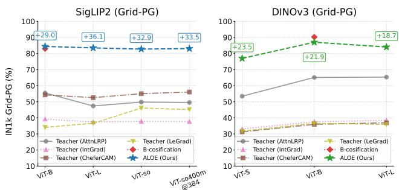  
(b) Grid-PG (localization) Score (%).  
Figure 2. ALOE vs. B-cosification [4]. ALOE consistently outperforms vanilla B-cosification in ImageNet-1k linear-probe accuracy across model scales for both SigLIP2 [76] and DINOv3 [72] (see (a)). It reaches performance close to the original SigLIP2 and DINOv3 baselines while significantly improving localization scores (Grid-PG, see (b))—even compared against different SOTA post-hoc attribution methods.

## In summary, our contributions are:

(1) We propose ALOE (ALign Once to Explain), a universal, one-time, label-free feature-alignment approach that enables efficient transformation of foundational ViT backbones into inherently interpretable B-cos variants while preserving downstream utility.

(2) We conduct a detailed study of the design choices and provide key insights into alignment targets (layer-wise vs. pooled; single vs. multi-layer), loss families (MSE, cosine, SigLIP, InfoNCE), model scales, and alignment

dataset sizes.

We make the following key empirical findings:

(F1) Generality: ALOE B-cos ViTs outperform Bcosified [4] baselines in classification, retain strong linear probing, k-NN, and zero-shot transfer performance competitive with foundational backbones (DI-NOv3, SigLIP2), preserve spatially structured features for dense prediction, and provide faithful and well-localized explanations (e.g., +8.82 to +10.50 p.p. ImageNet-1k linear-probe accuracy over [4] for the SigLIP2 and DINOv3 ViT-B/16 models).

(F2) Data efficiency: feature alignment with as few as 150k unlabeled images keeps the SigLIP2 ImageNet top-1 gap below 0.50 p.p. (Fig. 9); full 15M-image alignment reduces the gap to 0.34 p.p., using far less data than billion-scale pre-training.

With ALOE we establish a practical path to scalable trustworthy vision foundation models that are faithful by design, strong in transfer tasks, and easy to adopt.

## 2. Related work

Large-scale vision foundation models trained on billionscale datasets are de facto backbones for transfer learning and zero-shot tasks. These include self-supervised ViT encoders in the DINO family [12, 55, 72] and contrastive vision-language encoders such as CLIP [60] and SigLIP/SigLIP2 [76, 80]. Supervised ViTs pre-trained on large datasets (e.g., ImageNet21k/22k [39] or proprietary corpora) also serve as strong backbones for downstream usage [25, 39]. Such encoders are also used by large visionlanguage models and generative models together with a pretrained LLM for multimodal understanding [21, 44]. In this work, we transform modern vision foundation models into an inherently interpretable B-cos backbone via a single alignment step, while preserving downstream utility.

Inherently interpretable models. To understand deep neural networks (DNNs), post-hoc attribution methods spanning gradient- [5, 15, 70, 73] activation- [14, 36, 67, 77], and perturbation-based [59] methods have been typically used, with the resulting explanation maps summarizing input regions contributing to the model's decision. In contrast, inherently interpretable architectures enforce structural constraints to give human-understandable, modelfaithful summaries of the computation. These include prototype-based models [17, 24, 51], dynamic-linear models [6, 10], and concept-bottleneck models [37, 54, 57, 62]. B-cos networks [11] replace linear layers with bias-free Bcos transforms that promote weight-input alignment, producing faithful, well-localized explanations by design and have gained recent prominence [27, 56]. The cost of training such models from scratch at foundation scale motivated B-cosification [4], which transforms existing networks to Bcos variants post hoc. While B-cosification showed gains on supervised CNNs and for a CLIP ResNet model, the transformation recipe falls short in performance for ViTs, limiting applicability to foundation models. We therefore propose a scalable approach to transform ViT-based foundation backbones into inherently interpretable B-cos variants.

Knowledge distillation (KD) transfers behavior from a pre-trained model (‘teacher’ T) to a smaller model (student' S) using soft targets or intermediate features, often for compression. Logit-based KD [33] which aligns output distributions between T and S has been extended with featurelevel and attention-based alignment objectives [58, 64, 79], layer-wise and multi-stage schemes [82], and token-level distillation for ViTs [75]. Recent works [56] also leverage explanation map similarity objectives which improve faithfulness over logit-only KD, and improve robustness under distribution shifts. To reduce reliance on annotations, label-free KD techniques use unlabeled or synthetic data [52, 69]. In contrast to compression as a goal, we use a one-time, label-free feature alignment objective— akin to KD—to convert a frozen vision foundation model into an inherently interpretable B-cos counterpart. Our universal recipe retains the teacher's general-purpose features, provides model faithful explanations, and requires orders of magnitude fewer images than full billion-scale pretraining.

## 3. Background: B-cos networks

In this section we briefly review B-cos networks [11] (Sec. 3.1) and the B-cosification [4] (Sec. 3.2) recipe proposed for CNNs, before presenting our approach (Sec. 4).

## 3.1. B-cos networks

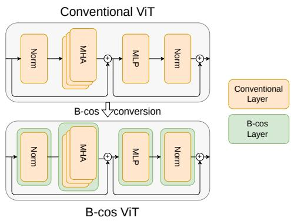  
Figure 3. Conventional vs. B-cos ViT. We replace linear/MLP layers with bias-free B-cos transforms and uncentered normalization, keeping self-attention and residuals intact. This yields a dynamic-linear B-cos ViT with inherently faithful explanations via W(x)x (Sec. 3.1).

B-cos networks [11] are inherently interpretable architectures that provide faithful and human-interpretable explanations of model decisions. To do this, bias-free, dynamic-linear B-cos transforms are used in place of linear transforms that induce weight-input alignment across the model and provide faithful explanations that constitute an exact decomposition of the model's computation. The B-cos transform [6] is given by:

$$
\mathbf { B } \mathbf { - } \mathbf { c o s } ( \mathbf { x } ; \mathbf { w } ) = \left( \left| \mathbf { c o s } ( \mathbf { x } , \mathbf { w } ) \right| ^ { B - 1 } \times \widehat { \mathbf { w } } \right) ^ { \top } \mathbf { x } = \mathbf { w } ( \mathbf { x } ) ^ { \top } \mathbf { x } ,\tag{1}
$$

where B controls the alignment strength, cos is the cosine similarity between input x and weights $\mathbf { w } ,$ and $\widehat { \textbf { w } } =$ $\mathbf { w } / \lVert \mathbf { w } \rVert _ { 2 }$ . Stacking such units builds a dynamic-linear network that produces an exact, faithful summary $\mathbf { y } ( \mathbf { x } ) \mathbf { \Psi } =$ $\mathbf { W } ( \mathbf { x } ) \mathbf { x } ,$ where $\mathbf { W } ( \mathbf { x } )$ is the effective input-dependent $\mathrm { d y } .$ namic linear weight from the full model. Increasing $B { > } 1$ promotes weight-input alignment, making $\mathbf { W } ( \mathbf { x } )$ more task-relevant and interpretable. The cosine term raised to the power of $B { - } 1$ provides the non-linearity needed for learning while preserving model expressivity. B-cos variants of standard CNNs (e.g., B-cos ResNets [32]) can then be constructed—such models use B-cos transforms in place of convolutional and linear layers, remove activations, and remove all biases including in normalization layers. B-cos ViTs (Fig. 3) similarly replace linear layers in the patch embedding, MLP blocks, and projection heads with Bcos layers. Notably, self-attention, being already dynamiclinear [11], is left unchanged, as are positional embeddings.

Such models were shown to provide competitive performance while significantly improving interpretability [11], however, the need to train them from scratch remained a significant limitation to their adoption as compared to using already trained conventional models.

## 3.2. B-cosification recipe

To alleviate the need to retrain B-cos variants of existing models, ‘B-cosification' [4] was proposed as a means to transform a pre-trained conventional model into its Bcos variant by making targeted architectural modifications followed by supervised fine-tuning for few epochs on the original task. Broadly, the transformation involves replacing linear transforms with corresponding B-cos transforms (Eq. (1)) with $B \ = \ 2$ and removing biases from all layers including normalization layers. In contrast to the original B-cos architecture [11], point-wise activation functions (ReLU/GELU) are left in and weights are not unit normalized, as it preserves the distribution of the learnt weights without harming interpretability. Following [11], 3-channel image inputs given by $( r , g , b )$ are preprocessed to 6-channels $( r , g , b , 1 - r , 1 - g , 1 - b )$ to allow visualizing explanations in color, with a transform to the first layer weights to maintain equivalence.

However, this recipe was designed with a focus on supervised CNNs, and was relatively ineffective for ViT-based architectures. In our work, we propose a scalable featurealignment approach that is highly effective for modern ViTbased foundation models.

## 4. ALOE: ALign Once to Explain

In this section, we introduce ALOE (ALign Once to Explain), a one-time, label-free feature-alignment procedure that converts a ViT-based foundation encoder into a B-cos [11] counterpart and aligns it to a frozen teacher via representation matching $\mathrm { ( F i g . 4 ) }$ . We first describe the teacher–student setup and the architecture-preserving transformation used to initialize the student (Sec. 4.1). Next, we detail what is aligned and where in the network, including ViT-specific tokens (e.g., [CLS] and registers) and intermediate layers used to guide alignment (Sec. 4.2). Finally, we describe our setup (Sec. 4.3) and show how the aligned, inherently interpretable backbone can be used as a dropin component across downstream tasks, thereby amortizing the cost of interpretability (Sec. 4.4).

## 4.1. Teacher-student setup

B-cos conversion. Given a frozen teacher encoder $\tau$ (supervised, self-supervised, or vision-language), we construct a B-cos student S by applying the architecturepreserving transformation recipe [4] (see Sec. 3.2), which preserves functional behavior where possible while requiring only minimal edits needed for inherent interpretability.

Preserving special tokens. Unlike CNNs, modern ViTs use special tokens such as [CLS] and register tokens $( e . g .$ in DINOv3) that are crucial for performance. Given this, we keep these special-token pathways identical to those of the teacher so subsequent alignment can match tokens one-toone and preserve the base model's computational routing.

These steps yield a bias-free, 6-input channel B-cos student that architecturally mirrors the teacher closely and is ready for label-free alignment.

## 4.2. Label-free alignment

After conversion (Sec. 4.1), we align the B-cos student S to the frozen teacher T using unlabeled images and a cosine-similarity objective. Our aim is to make the aligned B-cos backbone a drop-in substitute for the foundation teacher. This motivates (i) a global guidance term to preserve the geometry of the final embedding space—critical for downstream tasks (classification, dense prediction, zeroshot transfer)—and (ii) token-level, depth-wise guidance to preserve intermediate computations and improve optimization stability. Therefore, we propose a multi-layer objective that is applied across selected depths of the two models during training.

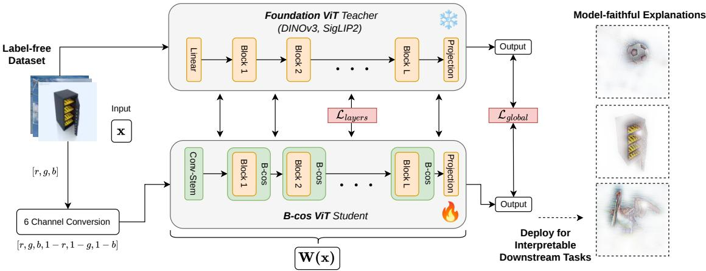  
Figure 4. Align Once to Explain. (1) Transform to B-cos—convert a Foundation ViT encoder into a bias-free, dynamic-linear backbone (Sec. 4.1). (2) Align once—label-free feature alignment with cosine distance objective between foundational teacher and B-cos student, on unlabeled images (Sec. 4.2). (3) Deploy—freeze the aligned B-cos backbone for linear probing and zero-shot transfer; faithful, welllocalized explanations follow directly from $W ( \mathbf { x } )$ (i.e., model summary), amortizing interpretability across tasks (Sec. 5.1).

Alignment objective. For an input $\mathbf { x } ,$ let $E _ { \star } ( \mathbf { x } )$ denote the model's last-layer image representation, and let $h _ { \star , t } ^ { \ell } ( \mathbf { x } )$ be the token-level features at transformer block l for token t. We combine a global term with depth-wise layer guidance:

$$
\mathcal { L } = \lambda _ { \mathrm { g } } \mathcal { L } _ { \mathrm { g l o b a l } } + \lambda _ { \mathrm { l } } \mathcal { L } _ { \mathrm { l a y e r s } } ,\tag{2}
$$

$$
\mathcal { L } _ { \mathrm { g l o b a l } } = \sum _ { \mathbf { x } \in \mathcal { B } } \frac { 1 } { | \mathcal { B } | } \Big ( 1 - \cos \big ( E _ { \mathcal { S } } ( \mathbf { x } ) , E _ { \mathcal { T } } ( \mathbf { x } ) \big ) \Big ) ,\tag{3}
$$

$$
\begin{array} { r l } {  { \mathcal { L } _ { \mathrm { l a y e r s } } = \sum _ { \mathbf { x } \in \mathcal { B } } \frac { 1 } { | \mathcal { B } | } \sum _ { \ell \in \mathcal { L } _ { \mathrm { d e p t h } } } \frac { 1 } { | \mathcal { T } _ { \mathrm { t o k } } ^ { \ell } ( \mathbf { x } ) | } } \quad } & { } \\ & { \qquad \times \sum _ { t \in \mathcal { T } _ { \mathrm { t o k } } ^ { \ell } ( \mathbf { x } ) } \bigl ( 1 - \cos \bigl ( h _ { \mathcal { S } , t } ^ { \ell } ( \mathbf { x } ) , h _ { \mathcal { T } , t } ^ { \ell } ( \mathbf { x } ) \bigr ) \bigr ) , } \end{array}\tag{4}
$$

where $\tau _ { \mathrm { t o k } } ^ { \ell } ( \mathbf { x } )$ denotes the set of teacher tokens at depth l.

We use cosine as our default alignment loss because it is scale-invariant and robust across teacher sizes and pretraining paradigms. Feature scales vary widely in practice; cosine normalizes this mismatch and directly optimizes angular agreement, which aligns well with objectives used during pre-training [72, 80]. We also experimented with compatible objectives (MSE, SigLIP, InfoNCE) and found cosine to be the most stable across pre-trained teachers; ablations are reported in Sec. 5.2. In contrast, MSE is sensitive to absolute scale, and contrastive variants (InfoNCE/SigLIP) introduce batch negatives that likely distort the teacher's local geometry.

Targets and depth-wise guidance. We supervise at three evenly spaced depths $\mathcal { L } _ { \mathrm { d e p t h } } = \{ \lfloor L / 3 \rfloor , \lfloor 2 L / 3 \rfloor , L \}$ for a transformer of depth $L \ ( i . e . , 1 / 3 , 2 / 3$ , and full depth). We align exactly the semantics-carrying tokens used by each teacher (e.g., [CLS ]/registers for DINOv3; attention pooling for SigLIP2; Tab. 1), ensuring one-to-one routing and preserving the teacher's computational pathways—crucial for faithful B-cos explanations.

Table 1. Tokens used for alignment (Sec. 4.2) for each model.
<table><tr><td>Model</td><td>Global Feature</td><td>Layer-wise Features</td></tr><tr><td>Supervised [25] Final [CLS]</td><td></td><td>Image tokens, [CLS]</td></tr><tr><td>DINOv3 [72]</td><td>Final [CLS]</td><td>Image tokens, [CLS], register tokens</td></tr><tr><td>SigLIP2 [76]</td><td>Attention-pooled final embedding</td><td>Image tokens</td></tr></table>

This multi-scale supervision improves optimization stability and final alignment. Because the student S mirrors the teacher T in width, no projection heads are required. In practice, $( \lambda _ { \mathrm { g } } , \lambda _ { \mathrm { l } } ) \ = \ ( 1 , 1 )$ works well across all models. We ablate the design choices—including the alignment objective and feature depths—to select the final configuration empirically (Sec. 5.2).

## 4.3. Implementation and training setup

We now describe the implementation and training setup for feature alignment.

Datasets. We use the unlabeled, web-scale image sets CC3M [68], CC12M [13], and YFCC15M [22] for alignment. The input resolution follows the teacher's default (typically 224×224). For our main results (Tab. 2), we report numbers for models trained on YFCC15M.

Teachers and students. Teachers T are strong ViT-based foundation encoders spanning three pre-training paradigms: (i) Supervised ViT-B/16 [25]; (ii) DINOv3 (self-supervised) ViT-S/16, ViT-B/16, and ViT-L/16 [72]; (iii) SigLIP2 (contrastive vision-language) ViT-B/16, ViT-L/16, ViTso400m/16, and ViT-so400m/14@384 [76]. B-cos students S are constructed using the architecture-preserving conversion recipe (Sec. 3.2) and initialized to mirror T in width, depth, and token layout, enabling one-to-one alignment (Sec. 4.2). As shown in Fig. 4, the linear patch embedding is replaced by a B-cos convolutional stem with the same overall stride, so the student's token grid matches the teacher's (see Sec. A for SigLIP2 so400m/14@384).

Augmentations. We apply random resized crops and horizontal flips as augmentations to prevent overfitting while preserving T-S feature geometry during alignment.

Optimization. We freeze T and optimize S with AdamW [45] and a cosine learning-rate schedule, with mixed precision enabled. We follow an early-stopping criterion to train until the loss on a held-out validation set stops decreasing; we fix B=2, keep additive biases at zero, and use no explicit weight normalization (cf. Sec. 3.2). Gradient norm clipping of 1.0 (with no weight decay) is used to stabilize large models. We sweep learning rates over 3e-3, 1e-3, and 5e-4 and select the model with the lowest alignment loss on the held-out split (a randomly sampled 30k subset of images from the training set). We use a batch size of 1024 for all experiments. All unmarked results use checkpoints trained with the updated B-cos implementation and without the temporary weight-norm stabilization term that earlier checkpoints used to counter a potential training instability; †marks results from earlier checkpoints, including the ablations (see Sec. B). B-cosification [4] baselines use the original public implementation.

Loss arguments. Unless specified: $( \lambda _ { \mathrm { g } } , \lambda _ { \mathrm { l } } ) ~ = ~ ( 1 , 1 ) \colon$ cosine-similarity alignment loss; and depth supervision at $\{ \lfloor { L } / { 3 } \rfloor , \lfloor { 2 L } / { 3 } \rfloor , L \}$ . We ablate alignment objectives, feature depths, model sizes, and dataset scales in Sec. 5.2.

## 4.4. Evaluation protocols and downstream usage

Train minimally, explain everywhere. Once aligned, the Bcos backbone is used as a drop-in encoder across tasks; explanations are model-inherent (derived from W(x) [11]) and require no task-specific interpretability tuning.

Linear probing (LP). We evaluate the aligned representation quality of S by training a linear head on frozen features, reporting top-1 accuracy on the validation sets of 10 downstream classification datasets (including IN1k) following the standard protocol [55] (see Sec. 5.1). To speed up evaluation, we do not apply augmentations during probing.

k-NN evaluation. To assess feature quality without additional training, we use a weighted k-NN classifier on frozen embeddings. We pre-compute features on the training split and use k=20, a robust choice across datasets [12] and report accuracy (%) on the validation split(s).

Zero-shot evaluation. For the contrastive vision-language setting (SigLIP2), we use the ALOE-aligned B-cos image encoder as a drop-in replacement while keeping the original text encoder unchanged. We use the 80 ImageNet prompt templates of [60], averaging text embeddings per class; temperature and normalization follow the default settings. We evaluate zero-shot classification on standard benchmarks [60, 80] and report accuracy (%).

Dense prediction. We evaluate dense prediction by training a linear depth head on frozen features and reporting NYUv2 [71] depth metrics.

Evaluating explanations. We evaluate explanation quality using the Grid Pointing Game (GridPG) [10, 81] for localization and pixel-deletion for faithfulness. For conventional models, we compare against several post-hoc methods (AttnLRP [1], Integrated Gradients [73], LeGrad [8] CheferCAM [16], and LIME [63]); we also report results on a human preference study. Implementation details and additional results are provided in the appendix Sec. A and Sec. C.2.

## 5. Results

In Sec. 5.1, we compare ALOE to baselines on the settings and metrics described in Sec. 4.4. Detailed ablations on alignment objectives, feature depths, model scales, and dataset size are provided in Sec. 5.2.

## 5.1. Main results

Linear evaluation of frozen features. We compare ALOE to (i) the original foundational models and (ii) Bcosification [4]. All use the same linear protocol and input resolution (see Sec. 4.4).

In Table 2, we report linear probing results on frozen features on ten datasets ([18]). ALOE improves markedly over B-cosification across ten datasets. For ViT-B/16, average gains vs. B-cosification are: +6.05 p.p. (from 74.56% → 80.61%) for fully supervised; +8.82 p.p. (79.96% → 88.78%) for SigLIP2; and +19.28 p.p. (70.71% → 89.99%) for DINOv3. ALOE also closely matches its teachers (e.g., SigLIP2 average 88.78% vs. teacher 89.69%; DINOv3 89.99% vs. 90.20%). On ImageNet-1k linear probing, the SigLIP2-aligned B-ViT-B/16 reaches 83.87%; larger SigLIP2-aligned variants reach 87.08% and 87.83% for B-ViT-L/16 and B-ViT-so400m/16 (Sec. C.1).

Table 2. Linear-probe accuracy on base architectures (ViT-B/16). ALOE substantially outperforms vanilla B-cosification while remaining competitive with the original foundation models. Teachers are shown in gray; best interpretable model in bold. Note: For DINOv3 B-cosification we follow the supervised fine-tuning protocol [4] since the original work did not have a self-supervised baseline. All Bcosification baselines use the original public implementation (Sec. B).
<table><tr><td>Feature</td><td>Inh. Inter.</td><td>IN1k</td><td>Cal101</td><td>Flowers</td><td>Food</td><td>Aircr</td><td>DTD</td><td>Cars</td><td>SUN</td><td>C10</td><td>C100</td><td>Avg.</td></tr><tr><td>Sup. [25]</td><td>X</td><td>81.19</td><td>97.43</td><td>99.33</td><td>86.22</td><td>41.31</td><td>74.44</td><td>57.39</td><td>74.19</td><td>97.07</td><td>86.56</td><td>79.51</td></tr><tr><td>B-cosif. [4]</td><td>√</td><td>77.65</td><td>96.35</td><td>95.83</td><td>78.18</td><td>37.07</td><td>71.15</td><td>46.06</td><td>66.83</td><td>95.00</td><td>81.43</td><td>74.56</td></tr><tr><td>ALOE (ours)</td><td>√</td><td>81.30</td><td>97.32</td><td>99.44</td><td>86.73</td><td>43.96</td><td>75.55</td><td>61.59</td><td>74.99</td><td>97.53</td><td>87.67</td><td>80.61</td></tr><tr><td></td><td></td><td>+3.65</td><td>+0.97</td><td>+3.61</td><td>+8.55</td><td>+6.89</td><td>+4.40</td><td>+15.53</td><td>+8.16</td><td>+2.53</td><td>+6.24</td><td>+6.05</td></tr><tr><td>SigLIP2 [76]</td><td>x</td><td>84.21</td><td>98.88</td><td>99.21</td><td>94.44</td><td>75.48</td><td>85.74</td><td>95.42</td><td>81.70</td><td>96.95</td><td>84.91</td><td>89.69</td></tr><tr><td>B-cosif. [4]</td><td>√</td><td>75.05</td><td>97.52</td><td>94.14</td><td>83.74</td><td>45.04</td><td>79.18</td><td>73.70</td><td>75.68</td><td>94.44</td><td>81.11</td><td>79.96</td></tr><tr><td>ALOE (ours)</td><td>√</td><td>83.87</td><td>98.32</td><td>98.84</td><td>94.20</td><td>72.47</td><td>83.03</td><td>94.31</td><td>81.52</td><td>96.71</td><td>84.53</td><td>88.78</td></tr><tr><td></td><td></td><td>+8.82</td><td>+0.80</td><td>+4.70</td><td>+10.46</td><td>+27.43</td><td>+3.85</td><td>+20.61</td><td>+5.84</td><td>+2.27</td><td>+3.42</td><td>+8.82</td></tr><tr><td>DINOv3[72]</td><td>X</td><td>84.36</td><td>98.88</td><td>99.55</td><td>94.12</td><td>80.40</td><td>83.98</td><td>94.51</td><td>78.74</td><td>98.22</td><td>89.24</td><td>90.20</td></tr><tr><td>B-cosif. [4]</td><td>√</td><td>73.64</td><td>95.18</td><td>82.68</td><td>68.24</td><td>41.67</td><td>68.02</td><td>50.90</td><td>58.25</td><td>92.04</td><td>76.44</td><td>70.71</td></tr><tr><td>ALOE (ours)</td><td>√</td><td>84.14</td><td>98.77</td><td>99.55</td><td>93.86</td><td>80.19</td><td>83.42</td><td>94.41</td><td>78.23</td><td>98.01</td><td>89.35</td><td>89.99</td></tr><tr><td></td><td></td><td>+10.50</td><td>+3.59</td><td>+16.87</td><td>+25.62</td><td>+38.52</td><td>+15.40</td><td>+43.51</td><td>+19.98</td><td>+5.97</td><td>+12.91</td><td>+19.28</td></tr></table>

(a) k-NN Accuracy
<table><tr><td>Method</td><td>IN1k (%)</td><td>Avg (%)</td></tr><tr><td>DINOv3 [72]</td><td>82.28</td><td>83.71</td></tr><tr><td>B-cosif. [4]</td><td>71.03</td><td>50.78</td></tr><tr><td>ALOE</td><td>81.56</td><td>83.38</td></tr></table>

(b) Zero-shot Accuracy
<table><tr><td>Method</td><td>@1 (%)</td></tr><tr><td>SigLIP2 [76]</td><td>78.07</td></tr><tr><td>B-cosif. [4]</td><td>58.66</td></tr><tr><td>ALOE</td><td>77.17</td></tr></table>

Table 3. Downstream and Zero-shot Evaluations. (a) k-NN results (k=20). (b) Zero-shot ImageNet top-1 accuracy (SigLIP2 ViT-B/16, 80-prompt template). In both evaluation settings, ALOE substantially outperforms vanilla B-cosification and remains highly competitive with the original teacher models.

Similar trends hold for k-NN evaluation. In Table 3a we report accuracy on IN1k [65] for ALOE vs B-cosification; we get +10.53 p.p. on IN1k and +32.60 p.p. averaged across datasets (see Sec. C.1 for additional results).

Zero-shot classification. ALOE preserves strong zeroshot transfer and outperforms B-cosification. On ImageNet-1k (zero-shot@1) with SigLIP2 ViT-B/16, ALOE achieves 77.17% vs. B-cosification 58.66%, close to the SigLIP2 teacher at 78.07% (Tab. 3b).

Dense prediction. Beyond image-level recognition, ALOE also preserves spatially structured features useful for dense prediction. On monocular depth estimation with a linear probe (ViT-B/16), ALOE substantially outperforms Bcosification on both relative and absolute metrics, improving relative $\delta _ { 1 }$ from 0.83 to 0.93 and reducing RMSE from 0.46 to 0.33, while approaching the DINOv3 teacher (0.95/0.28); see Sec. C.1 for more dense results, including surface normals and multiview correspondence.

PCA Visualization. To visualize alignment quality, we project last-layer features to RGB using the first three principal components with shared scaling per teacher-student pair. As shown in Fig. 5, ALOE preserves the teacher's global feature geometry (e.g., DINOv3 vs. ALOE), indicating aligned semantics while being inherently interpretable.

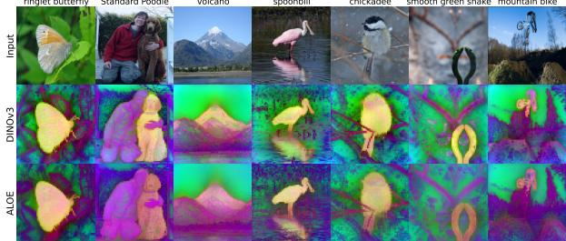

Figure 5. PCA Visualization. DINOv3 (row 2) vs. ALOE (row 3) last layer features visualized with 3 principal components and mapped to joint RGB space, preserves global feature geometry that indicates aligned semantics while being inherently interpretable.  
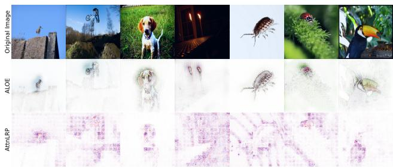  
Figure 6. Explanation quality. Comparison between model inherent (B-cos: W(x) [11]) explanations after ALOE vs a popular strong method for visualizing vision transformers, AttnLRP [1].

Interpretability. We evaluate explanation quality for: (a) model-inherent B-cos attributions W(x)x from our ALOEaligned models, and (b) post-hoc attributions on conventional models (AttnLRP [1] here). Following [11], we report GridPG (higher is better), and defer additional faithfulness metrics, human evaluation, and post-hoc comparisons to Sec. C.2. Across supervised, SigLIP2, and DINOv3 teachers, ALOE yields higher localization scores than AttnLRP (see Fig. 1, right). For example, for the SigLIP2 model, ALOE attains 84.4% vs. teacher (AttnLRP) 55.5%, and is competitive with B-cosification.

In Fig. 6, we show qualitative explanation maps, ALOE (B-cos: $W ( x ) )$ and teacher (AttnLRP) for a DINOv3 ViT-B/16 model. The explanations for ALOE (row 2) appear to align with class-discriminant patterns in the input and resemble the class objects. This is a result of alignment pressure during optimization (cf. [6]). In contrast, the AttnLRP explanations are sparse and noisy (row 3).

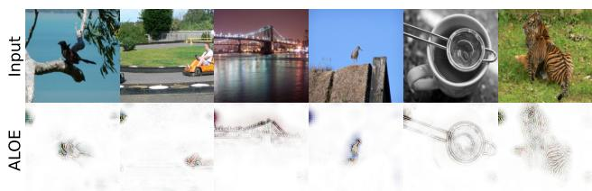  
Figure 7. VLM Zero-Shot Explanations. ALOE aligned B-cos models (SigLIP2 teacher) yield zero-shot model-inherent explanations for VLMs, where the input prompt to the text encoder is "this is a photo of {class name}". The explanations are visually well aligned with class-specific features.

[...] man in a white shirt playing tennis. He is in the middle of a swing, holding a tennis racket [...]  
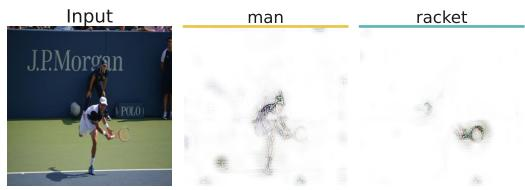  
Figure 8. Token-level Visual Grounding with $\mathbf { A } \mathbf { L } \mathbf { O } \mathbf { E } ^ { \dagger }$ . By propagating relevance through the LLaVA-MORE [21] Gemma-2-9B [74] backbone (using AttnLRP) and extracting visual explanations from our B-cos SigLIP2 encoder, we achieve fine-grained localization for individual generated tokens. The relevance maps highlight well their corresponding semantic regions in the input image. Further examples and failure cases are shown in Sec. D. †Earlier CVPR-version checkpoint [47]; see Appendix B.

In Fig. 7, we show zero-shot explanations for ALOE ViT-B/16 models aligned with SigLIP2. This lets us use the model as an explainable visual backbone combined with the corresponding text encoder. We use the prompt “this is a photo of {class name}" to compute similarities between text and visual features. The resulting explanations are highly localized and class-specific, yielding inherently explainable vision-language models.

Multimodal LLMs. More broadly, our aligned SigLIP2 backbones can also serve as interpretable visual encoders within multimodal large language models (MLLMs). In preliminary experiments with a LLaVA-style Gemma-2-9B backbone [74], they enable fine-grained visual grounding for individual generated tokens (see Fig. 8), suggesting that ALOE can extend beyond pure vision tasks. Since the current setup still relies on AttnLRP [1] to propagate relevance through the language model, we defer a fuller treatment of end-to-end inherently interpretable MLLMs to future work.

## 5.2. Ablations

We ablate key design choices: multi-layer feature alignment, model scale, data efficiency and alignment objectives. For all ablations, we train for 40 epochs. These ablations use earlier-implementation runs (†, Sec. B): we first compared alignment objectives using only the global term, and then used the selected objective to ablate feature depth.

Table 4. Feature depth ablation†. Average LP accuracy over 10 datasets for SigLIP2 ViT-B/16 (cosine loss). †Earlier CVPRversion checkpoint [47]; see Appendix B.
<table><tr><td>Pool</td><td>+L</td><td> $+ \{ 2 / 3 , L \}$ </td><td> $+ \{ 1 / 3 , 2 / 3 , L \}$ </td><td>+All</td></tr><tr><td>80.86</td><td>83.06</td><td>88.66</td><td>88.79</td><td>88.41</td></tr></table>

Feature Depth. We ablate loss placement across depth(s): global-only; global+L; global+{[2L/3], L}; $g l o b a l + \{ \lfloor { L } / { 3 } \rfloor , \lfloor { 2 L } / { 3 } \rfloor , L \}$ ; and global+all. For SigLIP2 ViT-B/16 (Tab. 4), average LP accuracy improves with increasing depth and peaks at $\{ \lfloor { L } / { 3 } \rfloor , \lfloor { 2 L } / { 3 } \rfloor , L \}$ ; supervising all layers slightly degrades performance (88.41 vs. 88.79). We thus use 3 evenly spaced depths.

Model scale. We see consistent gains in accuracy with increasing model size. For this we align DINOv3 and SigLIP2 teachers (and their B-cos students). Larger models close the gap to the teacher foundation model (see Fig. 2).

Data efficiency. Using only unlabeled YFCC15M [22], ALOE maintains nearly flat ImageNet-1k top-1 linearprobe accuracy when the alignment data shrinks from 100% to 0.1%, staying within 0.78 p.p.; see Fig. 9 for SigLIP2. Already at 1% of YFCC15M (150k images), the model is within 0.42 p.p. of the SigLIP2 teacher, highlighting the strong data efficiency of our one-time feature-alignment procedure.

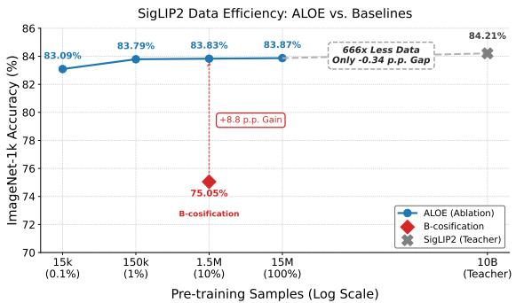  
Figure 9. Data efficiency of ALOE. ImageNet top-1 linear-probe accuracy for ALOE aligned SigLIP2 (ViT-B/16) across varying amounts of YFCC15M data (0.1%-100%). Across these settings, including the full-data distillation, ALOE remains nearly flat (83.09%–83.87%). Already at 1% (150k images), it reaches 83.79%, within 0.42 p.p. of the SigLIP2 teacher (84.21%) and 8.74 p.p. above the B-cosification reference. The 100% setting reaches 83.87%, leaving only a 0.34 p.p. gap to the teacher.

Alignment objectives. Under identical settings with only the global alignment term (Tab. C8), cosine and SigLIP are most consistent across models, MSE and InfoNCE showed inconsistencies. Given the ease of application and simplicity we adopt cosine by default

## 6. Conclusion

We presented ALOE (ALign Once to Explain), a simple yet effective framework that converts ViT-based foundational encoders into inherently interpretable B-cos variants. By preserving special tokens and aligning both global embeddings and token-level features at a few depths with a cosine objective, ALOE yields backbones that achieve competitive performance as compared to conventional foundation models across a diverse set of downstream tasks, provide faithful, well-localized explanations by design, and scale across pre-training paradigms and model sizes with modest amounts of unlabeled data.

Compared to B-cosification [4], ALOE removes the need for supervised fine-tuning, addresses the ViT performance gap, and preserves contrastive zero-shot utility—offering a resource-efficient path to interpretable backbones at foundation scale. We show empirically that our proposed recipe can already recover most of the teacher's generalization from a small unlabeled alignment set, even with only 150k images in the SigLIP2 data-scaling ablation. Taken together, ALOE offers a practical path to scalable, trustworthy vision backbones: align once, reuse broadly, and amortize the cost of interpretability.

## 7. Citing this work

This is the arXiv version of a paper accepted at CVPR 2026.

Please cite the CVPR version [47]. BibTeX entry given below:

## CVPR version:

## Acknowledgements

Computations were performed on the HPC systems at the Max Planck Computing and Data Facility (MPCDF). We thank Bart Pogodzinski and Wolfgang Boettcher for valuable feedback on the manuscript.

## References

[1] Reduan Achtibat, Sayed Mohammad Vakilzadeh Hatefi, Maximilian Dreyer, Aakriti Jain, Thomas Wiegand, Sebastian Lapuschkin, and Wojciech Samek. AttnLRP: attentionaware layer-wise relevance propagation for transformers. In ICML, 2024. 1, 6, 7, 8, 15, 21, 28

[2] Julius Adebayo, Justin Gilmer, Michael Muelly, Ian Goodfellow, Moritz Hardt, and Been Kim. Sanity Checks for Saliency Maps. In NeurIPS, 2018. 2

[3] Julius Adebayo, Michael Muelly, Harold Abelson, and Been Kim. Post Hoc Explanations may be Ineffective for Detecting Unknown Spurious Correlation. In ICLR, 2021. 2

[4] Shreyash Arya, Sukrut Rao, Moritz Böhle, and Bernt Schiele. B-cosification: Transforming Deep Neural Networks to be Inherently Interpretable. In NeurIPS, 2024. 2, 3, 4, 6, 7, 9, 16, 17, 18, 19

[5] Sebastian Bach, Alexander Binder, Grégoire Montavon, Frederick Klauschen, Klaus-Robert Müller, and Wojciech Samek. On Pixel-wise Explanations for Non-Linear Classifier Decisions by Layer-wise Relevance Propagation. PloS one, 10(7), 2015. 3

[6] Moritz Böhle, Mario Fritz, and Bernt Schiele. B-cos Networks: Alignment is All We Need for Interpretability. In CVPR, 2022. 2, 3, 4, 8, 15

[7] Lukas Bossard, Matthieu Guillaumin, and Luc Van Gool. Food-101-mining discriminative components with random forests. In ECCV. Springer, 2014. 14

[8] Walid Bousselham, Angie Boggust, Sofian Chaybouti, Hendrik Strobelt, and Hilde Kuehne. LeGrad: An Explainability Method for Vision Transformers via Feature Formation Sensitivity. In ICCV, 2025. 6, 15, 21

[9] Ralph Allan Bradley and Milton E Terry. Rank analysis of incomplete block designs: I. the method of paired comparisons. Biometrika, 39(3/4), 1952. 22

[10] Moritz Böhle, Mario Fritz, and Bernt Schiele. Convolutional Dynamic Alignment Networks for Interpretable Classifications. In CVPR, 2021. 1, 2, 3, 6, 15

[11] Moritz Böhle, Navdeeppal Singh, Mario Fritz, and Bernt Schiele. B-cos Alignment for Inherently Interpretable CNNs and Vision Transformers. IEEE TPAMI, 2024. 1, 2, 3, 4, 6, 7,8, 15, 21

[12] Mathilde Caron, Hugo Touvron, Ishan Misra, Hervé Jégou, Julien Mairal, Piotr Bojanowski, and Armand Joulin. Emerging Properties in Self-Supervised Vision Transformers. In ICCV, 2021. 1, 3, 6

[13] Soravit Changpinyo, Piyush Sharma, Nan Ding, and Radu Soricut. Conceptual 12M: Pushing web-scale image-text pre-training to recognize long-tail visual concepts. In CVPR, 2021.5

[14] Aditya Chattopadhyay, Anirban Sarkar, Prantik Howlader, and Vineeth N Balasubramanian. Grad-CAM++: Improved Visual Explanations for Deep Convolutional Networks. In WACV, 2018. 3

[15] Hila Chefer, Shir Gur, and Lior Wolf. Generic Attention-Model Explainability for Interpreting Bi-Modal and Encoder-Decoder Transformers. In ICCV, 2021. 3

[16] Hila Chefer, Shir Gur, and Lior Wolf. Transformer interpretability beyond attention visualization. In CVPR, 2021. 6, 15, 21

[17] Chaofan Chen, Oscar Li, Daniel Tao, Alina Barnett, Cynthia Rudin, and Jonathan K Su. This Looks Like That: Deep Learning for Interpretable Image Recognition. In NeurIPS, 2019.2,3

[18] Xinlei Chen, Saining Xie, and Kaiming He. An empirical study of training self-supervised vision transformers. In ICCV, 2021. 6

[19] Mehdi Cherti, Romain Beaumont, Ross Wightman, Mitchell Wortsman, Gabriel Ilharco, Cade Gordon, Christoph Schuhmann, Ludwig Schmidt, and Jenia Jitsev. Reproducible Scaling Laws for Contrastive Language-Image Learning. In CVPR, 2023. 14, 18, 19

[20] Mircea Cimpoi, Subhransu Maji, Iasonas Kokkinos, Sammy Mohamed, and Andrea Vedaldi. Describing textures in the wild. In CVPR, 2014. 14

[21] Federico Cocchi, Nicholas Moratelli, Davide Caffagni, Sara Sarto, Lorenzo Baraldi, Marcella Cornia, and Rita Cucchiara. LLaVA-MORE: A comparative study of llms and visual backbones for enhanced visual instruction tuning. In ICCVW, 2025. 3, 8, 15, 28

[22] Yufeng Cui, Lichen Zhao, Feng Liang, Yangguang Li, and Jing Shao. Democratizing contrastive language-image pretraining: A clip benchmark of data, model, and supervision. arXiv preprint arXiv:2203.05796, 2022. 5, 8

[23] Angela Dai, Angel X. Chang, Manolis Savva, Maciej Halber, Thomas Funkhouser, and Matthias Nießner. ScanNet: Richly-annotated 3D reconstructions of indoor scenes. In CVPR, 2017. 14, 19, 20

[24] Jon Donnelly, Alina Jade Barnett, and Chaofan Chen. Deformable ProtoPNet: An Interpretable Image Classifier using Deformable Prototypes. In CVPR, 2022. 2, 3

[25] Alexey Dosovitskiy, Lucas Beyer, Alexander Kolesnikov, Dirk Weissenborn, Xiaohua Zhai, Thomas Unterthiner, Mostafa Dehghani, Matthias Minderer, Georg Heigold, Sylvain Gelly, Jakob Uszkoreit, and Neil Houlsby. An Image is Worth 16x16 Words: Transformers for Image Recognition at Scale. In ICLR, 2021. 1, 2, 3, 5, 6, 7, 14, 17, 18, 21

[26] Mohamed El Banani, Amit Raj, Kevis-Kokitsi Maninis, Abhishek Kar, Yuanzhen Li, Michael Rubinstein, Deqing Sun, Leonidas Guibas, Justin Johnson, and Varun Jampani. Probing the 3d awareness of visual foundation models. In CVPR, 2024.14, 19, 20, 28

[27] Siddhartha Gairola, Moritz Böhle, Francesco Locatello, and Bernt Schiele. How to Probe: Simple Yet Effective Techniques for Improving Post-hoc Explanations. In ICLR, 2025. 3,22

[28] Google Research. SigLIP2 vision encoder checkpoint (ViT-B/16, 224), 2025. Identifier: google/siglip2-base-patch16- 224.14

[29] Google Research. SigLIP2 vision encoder checkpoint (ViT-L/16, 256), 2025. Identifier: google/siglip2-large-patch16- 256.

[30] Google Research. SigLIP2 vision encoder checkpoint (so400m/16, 256), 2025. Identifier: google/siglip2-so400mpatch16-256. 14

[31] Google Research. Vit-b/16 supervised checkpoint (224), 2025. Identifier: google/vit-base-patch16-224. 14

[32] Kaiming He, Xiangyu Zhang, Shaoqing Ren, and Jian Sun. Deep Residual Learning for Image Recognition. In CVPR, 2016.2,4

[33] Geoffrey Hinton, Oriol Vinyals, and Jeff Dean. Distilling the knowledge in a neural network. arXiv preprint arXiv:1503.02531, 2015.3

[34] Gabriel Ilharco, Mitchell Wortsman, Ross Wightman, Cade Gordon, Nicholas Carlini, Rohan Taori, Achal Dave, Vaishaal Shankar, Hongseok Namkoong, John Miller, Hannaneh Hajishirzi, Ali Farhadi, and Ludwig Schmidt. Open-CLIP, 2021. 14, 18, 19

[35] Varun Jampani, Kevis-Kokitsi Maninis, Andreas Engelhardt, Arjun Karpur, Karen Truong, Kyle Sargent, Stefan Popov, Andre Araujo, Ricardo Martin-Brualla, Kaushal Patel, Daniel Vlasic, Vittorio Ferrari, Ameesh Makadia, Ce Liu, Yuanzhen Li, and Howard Zhou. NAVI: Categoryagnostic image collections with high-quality 3D shape and pose annotations. In NeurIPS, 2023. 14, 19, 20

[36] Peng-Tao Jiang, Chang-Bin Zhang, Qibin Hou, Ming-Ming Cheng, and Yunchao Wei. LayerCAM: Exploring Hierarchical Class Activation Maps for Localization. IEEE TIP, 30, 2021.3

[37] Pang Wei Koh, Thao Nguyen, Yew Siang Tang, Stephen Mussmann, Emma Pierson, Been Kim, and Percy Liang. Concept Bottleneck Models. In ICML, 2020. 2, 3

[38] Narine Kokhlikyan, Vivek Miglani, Miguel Martin, Edward Wang, Bilal Alsallakh, Jonathan Reynolds, Alexander Melnikov, Natalia Kliushkina, Carlos Araya, Siqi Yan, and

Orion Reblitz-Richardson. Captum: A Unified and Generic Model Interpretability Library for PyTorch. arXiv preprint arXiv:2009.07896, 2020. 15

[39] Alexander Kolesnikov, Lucas Beyer, Xiaohua Zhai, Joan Puigcerver, Jessica Yung, Sylvain Gelly, and Neil Houlsby. Big transfer (BiT): General visual representation learning. In ECCV. Springer, 2020. 3

[40] Jonathan Krause, Michael Stark, Jia Deng, and Li Fei-Fei. 3D object representations for fine-grained categorization. In ICCVW, 2013. 14

[41] Alex Krizhevsky, Geoffrey Hinton, et al. Learning Multiple Layers of Features from Tiny Images. Technical Report, Computer Science Department, University of Toronto, 2009. 14

[42] L'ubor Ladický, Bernhard Zeisl, and Marc Pollefeys. Discriminatively trained dense surface normal estimation. In ECCV. Springer, 2014. 14

[43] Fei-Fei Li, Marco Andreeto, Marc'Aurelio Ranzato, and Pietro Perona. Caltech 101, 2022. 14

[44] Haotian Liu, Chunyuan Li, Qingyang Wu, and Yong Jae Lee. Visual instruction tuning. In NeurIPS, 2023. 3

[45] Ilya Loshchilov and Frank Hutter. Decoupled Weight Decay Regularization. In ICLR, 2019. 6

[46] Subhransu Maji, Esa Rahtu, Juho Kannala, Matthew Blaschko, and Andrea Vedaldi. Fine-grained visual classification of aircraft. arXiv preprint arXiv:1306.5151, 2013. 14

[47] Raphael Maser, Siddhartha Gairola, Sukrut Rao, and Bernt Schiele. Align once to explain: Feature alignment for scalable B-cosification of foundational vision transformers. In CVPR, 2026. 8, 9, 15, 23, 29, 30

[48] Meta AI. DINOv3 ViT-B/16 pretrain checkpoint (224), 2025. Identifier: facebook/dinov3-vitb16-pretrain-1vd1689m. 14

[49] Meta AI. DINOv3 ViT-L/16 pretrain checkpoint (224), 2025. Identifier: facebook/dinov3-vitl16-pretrain-1vd1689m.

[50] Meta AI. DINOv3 ViT-S/16 pretrain checkpoint (224), 2025. Identifier: facebook/dinov3-vits16-pretrain-1vd1689m. 14

[51] Meike Nauta, Ron Van Bree, and Christin Seifert. Neural Prototype Trees for Interpretable Fine-grained Image Recognition. In CVPR, 2021. 2, 3

[52] Gaurav Kumar Nayak, Konda Reddy Mopuri, Vaisakh Shaj, Venkatesh Babu Radhakrishnan, and Anirban Chakraborty. Zero-Shot Knowledge Distillation in Deep Networks. In ICML, 2019.3

[53] Maria-Elena Nilsback and Andrew Zisserman. Automated flower classification over a large number of classes. In ICVGIP, 2008. 14

[54] Tuomas Oikarinen, Subhro Das, Lam M Nguyen, and Tsui-Wei Weng. Label-Free Concept Bottleneck Models. In ICLR, 2023.2,3

[55] Maxime Oquab, Timothée Darcet, Théo Moutakanni, Huy V. Vo, Marc Szafraniec, Vasil Khalidov, Pierre Fernandez, Daniel Haziza, Francisco Massa, Alaaeldin El-Nouby, Mido Assran, Nicolas Ballas, Wojciech Galuba, Russell Howes, Po-Yao Huang, Shang-Wen Li, Ishan Misra, Michael Rabbat, Vasu Sharma, Gabriel Synnaeve, Hu Xu, Herve Jegou,

Julien Mairal, Patrick Labatut, Armand Joulin, and Piotr Bojanowski. DINOv2: Learning robust visual features without supervision. TMLR, 2024. 1, 3, 6

[56] Amin Parchami-Araghi, Moritz Böhle, Sukrut Rao, and Bernt Schiele. Good Teachers Explain: Explanation-Enhanced Knowledge Distillation. In ECCV, 2024. 3

[57] Amin Parchami-Araghi, Sukrut Rao, Jonas Fischer, and Bernt Schiele. FaCT: Faithful concept traces for explaining neural network decisions. In NeurIPS, 2025. 3

[58] Wonpyo Park, Dongju Kim, Yan Lu, and Minsu Cho. Relational knowledge distillation. In CVPR, 2019. 3

[59] Vitali Petsiuk, Abir Das, and Kate Saenko. RISE: Randomized Input Sampling for Explanation of Black-box Models. In BMVC, 2018. 3

[60] Alec Radford, Jong Wook Kim, Chris Hallacy, Aditya Ramesh, Gabriel Goh, Sandhini Agarwal, Girish Sastry, Amanda Askell, Pamela Mishkin, Jack Clark, et al. Learning Transferable Visual Models from Natural Language Supervision. In ICML, 2021. 1, 3, 6, 14

[61] Sukrut Rao, Moritz Böhle, and Bernt Schiele. Towards Better Understanding Attribution Methods. In CVPR, 2022. 2

[62] Sukrut Rao, Sweta Mahajan, Moritz Böhle, and Bernt Schiele. Discover-then-Name: Task-Agnostic Concept Bottlenecks via Automated Concept Discovery. In ECCV, 2024. 2,3

[63] Marco Tulio Ribeiro, Sameer Singh, and Carlos Guestrin. "Why Should I Trust You?" Explaining the Predictions of any Classifier. In KDD, 2016. 6, 15, 21, 22

[64] Adriana Romero, Nicolas Ballas, Samira Ebrahimi Kahou, Antoine Chassang, Carlo Gatta, and Yoshua Bengio. FitNets: Hints for thin deep nets. In ICLR, 2015. 3

[65] Olga Russakovsky, Jia Deng, Hao Su, Jonathan Krause, Sanjeev Satheesh, Sean Ma, Zhiheng Huang, Andrej Karpathy, Aditya Khosla, Michael Bernstein, Alexander C. Berg, and Li Fei-Fei. ImageNet Large Scale Visual Recognition Challenge. IJCV, 115(3), 2015. 1, 7, 14

[66] Wojciech Samek, Alexander Binder, Grégoire Montavon, Sebastian Lapuschkin, and Klaus-Robert Müller. Evaluating the Visualization of What a Deep Neural Network has Learned. IEEE TNNLS, 28(11), 2017. 15

[67] Ramprasaath R Selvaraju, Michael Cogswell, Abhishek Das, Ramakrishna Vedantam, Devi Parikh, and Dhruv Batra. Grad-CAM: Visual Explanations from Deep Networks via Gradient-Based Localization. In ICCV, 2017. 3

[68] Piyush Sharma, Nan Ding, Sebastian Goodman, and Radu Soricut. Conceptual Captions: A Cleaned, Hypernymed, Image Alt-Text Dataset for Automatic Image Captioning. In ACL, 2018. 5

[69] Hyunjune Shin and Dong-Wan Choi. Teacher as a lenient expert: Teacher-agnostic data-free knowledge distillation. In AAAI, 2024. 3

[70] Avanti Shrikumar, Peyton Greenside, and Anshul Kundaje. Learning Important Features through Propagating Activation Differences. In ICML, 2017. 3

[71] Nathan Silberman, Derek Hoiem, Pushmeet Kohli, and Rob Fergus. Indoor segmentation and support inference from rgbd images. In ECCV, 2012. 6, 14, 28

[72] Oriane Siméoni, Huy V Vo, Maximilian Seitzer, Federico Baldassarre, Maxime Oquab, Cijo Jose, Vasil Khalidov, Marc Szafraniec, Seungeun Yi, Michaël Ramamonjisoa, Marc Szafraniec, Seungeun Yi, Michaël Ramamonjisoa, et al. DINOv3. arXiv preprint arXiv:2508.10104, 2025. 1, et al. DINOv3. arXiv preprint arXiv:2508.10104, 2025. 1, 2, 3, 5, 6, 7, 14, 17, 18, 19, 21 2, 3, 5, 6, 7, 14, 17, 18, 19, 21

[73] Mukund Sundararajan, Ankur Taly, and Qiqi Yan. Axiomatic Attribution for Deep Networks. In ICML, 2017. 3, 6, 15, 21 [74] Gemma Team, Morgane Riviere, Shreya Pathak, Pier Giuseppe Sessa, Cassidy Hardin, Surya Bhupatiraju, Léonard Hussenot, Thomas Mesnard, Bobak Shahriari Alexandre Ramé. Johan Ferret. Peter Liu. Pouva Tafti. Abe Friesen, Michelle Casbon, Sabela Ramos, Ravin Kumar, Charline Le Lan, Sammy Jerome, Anton Tsitsulin, Nino Vieillard, Piotr Stanczyk, Sertan Girgin, Nikola Momchev, Matt Hoffman, Shantanu Thakoor, Jean-Bastien Grill, Behnam Neyshabur, Olivier Bachem, Alanna Walton, Aliaksei Severyn, Alicia Parrish, Aliya Ahmad, Allen Hutchison. Alvin Abdagic, Amanda Carl, Amy Shen, Andy Brock, Andy Coenen, Anthony Laforge, Antonia Paterson, Ben Bastian, Bilal Piot, Bo Wu, Brandon Royal, Charlie Chen, Chintu Kumar, Chris Perry, Chris Welty, Christopher A. Choquette-Choo, Danila Sinopalnikov, David Weinberger, Dimple Vijaykumar, Dominika Rogozińska, Dustin Herbison, Elisa Bandy, Emma Wang, Eric Noland, Erica Moreira, Evan Senter, Evgenii Eltyshev, Francesco Visin, Gabriel Rasskin, Gary Wei, Glenn Cameron, Gus Martins, Hadi Hashemi, Hanna Klimczak-Plucińska, Harleen Batra, Harsh Dhand, Ivan Nardini, Jacinda Mein, Jack Zhou, James Svensson, Jeff Stanway, Jetha Chan, Jin Peng Zhou, Joana Carrasqueira, Joana Iljazi, Jocelyn Becker, Joe Fernandez, Joost van Amersfoort, Josh Gordon, Josh Lipschultz, Josh Newlan, Ju yeong Ji, Kareem Mohamed, Kartikeya Badola, Kat Black, Katie Millican, Keelin Mc-Donell, Kelvin Nguyen, Kiranbir Sodhia, Kish Greene, Lars Lowe Sjoesund, Lauren Usui, Laurent Sifre, Lena Heuermann, Leticia Lago, Lilly McNealus, Livio Baldini Soares, Logan Kilpatrick, Lucas Dixon, Luciano Martins, Machel Reid, Manvinder Singh, Mark Iverson, Martin Görner, Mat Velloso, Mateo Wirth, Matt Davidow, Matt Miller, Matthew Rahtz, Matthew Watson, Meg Risdal Mehran Kazemi, Michael Moynihan, Ming Zhang, Minsuk Kahng, Minwoo Park, Mofi Rahman, Mohit Khatwani, Natalie Dao, Nenshad Bardoliwalla, Nesh Devanathan, Neta Dumai, Nilay Chauhan, Oscar Wahltinez, Pankil Botarda, Parker Barnes, Paul Barham, Paul Michel, Pengchong Jin, Petko Georgiev, Phil Culliton, Pradeep Kuppala, Ramona Comanescu, Ramona Merhej, Reena Jana, Reza Ardeshir Rokni, Rishabh Agarwal, Ryan Mullins, Samaneh Saadat, Sara Mc Carthy, Sarah Cogan, Sarah Perrin, Sébastien M. R. Arnold, Sebastian Krause, Shengyang Dai, Shruti Garg, Shruti Sheth, Sue Ronstrom, Susan Chan, Timothy Jordan, Ting Yu, Tom Eccles, Tom Hennigan, Tomas Kocisky, Tulsee Doshi, Vihan Jain, Vikas Yadav, Vilobh Meshram, Vishal Dharmadhikari, Warren Barkley, Wei Wei, Wenming Ye, Woohyun Han, Woosuk Kwon, Xiang Xu, Zhe Shen, Zhitao Gong, Zichuan Wei, Victor Cotruta, Phoebe Kirk, Anand Rao, Minh Giang, Ludovic Peran, Tris Warkentin, Eli Collins, Joelle Barral, Zoubin Ghahramani,

Raia Hadsell, D. Sculley, Jeanine Banks, Anca Dragan, Slav Petrov, Oriol Vinyals, Jeff Dean, Demis Hassabis, Koray Kavukcuoglu, Clement Farabet, Elena Buchatskaya, Sebastian Borgeaud, Noah Fiedel, Armand Joulin, Kathleen Kenealy, Robert Dadashi, and Alek Andreev. Gemma 2: Improving open language models at a practical size. arXiv preprint arXiv:2408.00118, 2024. 8, 15, 28

[75] Hugo Touvron, Matthieu Cord, Matthijs Douze, Francisco Massa, Alexandre Sablayrolles, and Hervé Jégou. Training data-efficient image transformers & distillation through attention. In ICML, 2021. 3

[76] Michael Tschannen, Alexey Gritsenko, Xiao Wang, Muhammad Ferjad Naeem, Ibrahim Alabdulmohsin, Nikhil Parthasarathy, Talfan Evans, Lucas Beyer, Ye Xia, Basil Mustafa, et al. SigLIP 2: Multilingual vision-language encoders with improved semantic understanding, localization and dense features. arXiv preprint arXiv:2502.14786, 2025. 1, 2, 3, 4, 5, 6, 7, 14, 17, 18, 19, 21

[77] Haofan Wang, Zifan Wang, Mengnan Du, Fan Yang, Zijian Zhang, Sirui Ding, Piotr Mardziel, and Xia Hu. Score-CAM: Score-Weighted Visual Explanations for Convolutional Neural Networks. In CVPRW, 2020. 3

[78] Jianxiong Xiao, James Hays, Krista A Ehinger, Aude Oliva, and Antonio Torralba. SUN database: Large-scale scene recognition from abbey to zoo. In CVPR, 2010. 14

[79] Sergey Zagoruyko and Nikos Komodakis. Paying more attention to attention: Improving the performance of convolutional neural networks via attention transfer. arXiv preprint arXiv:1612.03928, 2016. 3

[80] Xiaohua Zhai, Basil Mustafa, Alexander Kolesnikov, and Lucas Beyer. Sigmoid Loss for Language Image Pre-Training. In ICCV, 2023. 1, 3, 5, 6

[81] Jianming Zhang, Sarah Adel Bargal, Zhe Lin, Jonathan Brandt, Xiaohui Shen, and Stan Sclaroff. Top-Down Neural Attention by Excitation Backprop. IJCV, 126(10), 2018. 1,6,15

[82] Zikai Zhou, Yunhang Shen, Shitong Shao, Linrui Gong, and Shaohui Lin. Rethinking centered kernel alignment in knowledge distillation. arXiv preprint arXiv:2401.11824, 2024.3

# ALign Once to Explain  : Feature Alignment for Scalable B-cosification of Foundational Vision Transformers

## Appendix

In this appendix to our work on scalable B-cosification of foundational Vision Transformers, we provide:   
(A) Implementation Details 14   
Model checkpoints, datasets, evaluation protocols, and metrics   
(B) Earlier Checkpoints and Dagger Notation .15   
A note on the updated B-cos implementation, the B-cosification baselines, updated arXiv checkpoints, and dagger  
marked results.   
(C) Additional Quantitative Results .   
Downstream performance (LP/k-NN, zero-shot, dense prediction), data scaling experiments, alignment objective analysis   
and interpretability evaluations   
(D) Additional Qualitative Results . . ..24   
Zero-shot explanations, comparisons to popular post-hoc methods, and depth estimation visualizations.

## A. Implementation Details

In this section we provide additional implementation details that complement the main paper (Sec. 4.4), including details about the teacher checkpoints, datasets used for downstream evaluations, and finally the attribution methods along with the interpretability metrics we use.

Teacher checkpoints. For our feature-alignment step (Sec. 4.2) with pre-trained vision foundational models ([25, 72, 76]), we align to frozen teacher encoders of publicly available checkpoints and keep the associated text encoders for visionlanguage models unchanged (for SigLIP2 [76] zero-shot). Table A1 lists the exact model IDs and native image resolutions we use.

Table A1. Teacher encoders used for alignment. We adopt each teacher's native evaluation resolution and keep their weights frozen during alignment.
<table><tr><td>Family</td><td>Architecture</td><td>Eval res.</td><td>Identifier</td></tr><tr><td colspan="4">Fully Supervised Models [31]</td></tr><tr><td>Supervised [25]</td><td>ViT-B/16</td><td>224×224</td><td>google/vit-base-patch16-224</td></tr><tr><td colspan="4">Vision–Language Models [28-30]</td></tr><tr><td>SigLIP2 [76]</td><td>ViT-B/16</td><td>224×224</td><td>google/siglip2-base-patch16-224</td></tr><tr><td>SigLIP2 [76]</td><td>ViT-L/16</td><td>256×256</td><td>google/siglip2-large-patch16-256</td></tr><tr><td>SigLIP2 [76]</td><td>ViT-so400m/16</td><td>256×256</td><td>google/siglip2-so400m-patch16-256</td></tr><tr><td>SigLIP2 [76]</td><td>ViT-so400m/14@384</td><td>384×384</td><td>google/siglip2-so400m-patch14-384</td></tr><tr><td colspan="4">Self-Supervised Models [48–50]</td></tr><tr><td>DINOv3 [72]</td><td>ViT-S/16</td><td>224×224</td><td>facebook/dinov3-vits16-pretrain-lvd1689m</td></tr><tr><td>DINOv3 [72]</td><td>ViT-B/16</td><td>224×224</td><td>facebook/dinov3-vitb16-pretrain-lvd1689m</td></tr><tr><td>DINOv3 [72]</td><td>ViT-L/16</td><td>224×224</td><td>facebook/dinov3-vitl16-pretrain-lvd1689m</td></tr></table>

Input resolutions. Alignment and evaluation follow the teacher's native resolution (Table A1): 224×224 for Supervised ViT-B/16 and all DINOv3 models; 224×224 for SigLIP2-B/16; 256×256 for SigLIP2-L/16 and SigLIP2-so400m/16, and 384×384 for SigLIP2-so400m/14@384. For the conv-stem B-cos counterpart of SigLIP2-so400m/14@384, replacing the patch embedding by a stride-16 convolution changes the effective patch size from 14 to 16; we therefore evaluate this aligned model at 432×432 and denote it as B-ViT-so400m/16@432 in the tables.

Evaluation datasets. Linear Probing (LP) and k-NN share the same 10 datasets: IN1K [65], CALTECH101 [43], FLOW-ERS102 [53], F0OD101 [7], FGVC-AIRCRAFT [46], DTD [20], STANFORD CARS [40], SUN397 [78], CIFAR-10 [41], CIFAR-100 [41]. Dense linear probing for depth uses NYUv2 [71].

Dense linear probing for depth. We train a linear depth head on frozen features, and optimize with an L1 objective on inverse depth plus a scale-invariant gradient prior, following the Probe3D [26] protocol. Inputs are resized to the teacher's native resolution and center-cropped; no test-time augmentation is used. We evaluate on the standard NYUv2 [71] split and report both relative and absolute metrics: $\delta _ { 1 }$ ↑ (fraction of pixels satisfying max $\cdot ( \hat { d } / d , d / \hat { d } ) < 1 . 2 5$ , where d is predicted depth and d is ground-truth depth; higher is better) and RMSE↓ (lower is better).

Surface normals estimation. We also evaluate surface normal estimation on NYUv2 [42, 71] following the Probe3D [26] protocol by training a linear head on frozen features, and report $\delta _ { 1 } , \delta _ { 2 } , \delta _ { 3 } ,$ and RMSE.

Multiview correspondence. We evaluate multiview correspondence with Probe3D [26] on two different datasets: NAVI [35] and ScanNet [23], reporting recall at standard error thresholds over view pairs from the same 3D scene.

Zero-shot (SigLIP2 [76]). We replace only the image encoder with its ALOE-aligned B-cos counterpart; the SigLIP2 text encoder, prompt templates, temperature, and normalization follow the originals [60, 76]. We report ImageNet [65] top-1 accuracy with the OpenCLIP 80-prompt template ([19, 34]), averaging text embeddings over the prompts of each class Zero-shot explanations use the single prompt “this is a photo of {class name}".

Multimodal large language model token grounding. For the multimodal large language model (MLLM) examples, we pair our ALOE-aligned SigLIP2 B-cos encoder with a LLaVA-MORE [21] Gemma-2-9B [74] language backbone. Relevance is propagated through the language model with AttnLRP [1], after which we extract model-inherent visual explanations from the B-cos encoder to obtain token-level grounding maps.

Attribution methods visualized. For the inherently interpretable B-cos models [11], explanations are model-inherent $\mathbf { W } ( \mathbf { x } ) \mathbf { x }$ [6]. For conventional teachers, we visualize AttnLRP [1], LeGrad [8] and CheferCAM [16] (using the authors' original implementation), and Integrated Gradients [73] as well as LIME [63] (from the captum library [38]). Where applicable, we use authors' recommended defaults.

Interpretability metrics. We evaluate model attributions with (i) the Grid Pointing Game (GridPG) [10, 81] for localization and (ii) Pixel Deletion [66] for faithfulness, following standard protocol from prior work.

GridPG. We build $N \times N$ grids (we use $2 \times 2 )$ from images of distinct classes that are individually and confidently correctly classified. For each class i, we measure the fraction of positive attribution mass inside its corresponding grid cell. Let $A ( p )$ be the attribution at pixel p and $A ^ { + } ( p ) = \operatorname* { m a x } ( A ( p ) , 0 )$ its positive part; the localization score for cell i is

$$
L _ { i } = \frac { \sum _ { p \in \mathrm { c e l l } _ { i } } A ^ { + } ( p ) } { \sum _ { j = 1 } ^ { N ^ { 2 } } \sum _ { p \in \mathrm { c e l l } _ { j } } A ^ { + } ( p ) } ,
$$

and the GridPG score is the average of $L _ { i }$ over several grids (grids with zero total positive mass are discarded).

Pixel Deletion. We rank $1 6 \times 1 6$ pixel blocks by attribution score from most to least important and iteratively set the pixels in the highest-ranked blocks to zero, plotting the target-class probability versus the fraction of blocks removed; larger drops (steeper curves) indicate attributions that are more consistent with model decisions.

## B. Earlier Checkpoints and Dagger Notation

This arXiv version uses updated ALOE checkpoints trained with the updated B-cos implementation and without the temporary weight-norm stabilization term for all unmarked results (without †). This includes the main classification, zero-shot, dense-prediction, data-scaling, localization, and faithfulness results. Compared with the CVPR-version checkpoints [47], the updated checkpoints slightly improve recognition performance while leaving explanation quality essentially unchanged.

Results marked with †use earlier CVPR-version ALOE checkpoints [47]. In this version, the remaining earlier-checkpoint material is the alignment-objective and feature-depth ablations (Tabs. C8 and 4), the token-level LVLM visual-grounding examples (main Fig. 8 and supplementary Figs. D6 to D8), and the human user-study material (Fig. C5 and Tab. C7).

The earlier checkpoints were trained with a temporary weight-norm stabilization term,

$$
\mathcal { L } _ { \mathrm { r e g } } = \alpha \sum _ { \ell \in \mathcal { P } } \left( \| \mathbf { W } _ { \ell } ^ { ( T ) } \| _ { F } - \| \mathbf { W } _ { \ell } ^ { ( S ) } \| _ { F } \right) ^ { 2 } ,\tag{B.1}
$$

to prevent potentially unstable weight-norm growth in longer training runs. This potential instability stems from the scaling of the unnormalized B-cos transform in the public B-cosification code². For an activation x and weight row ${ \bf w } _ { j } .$ the legacy scale used

$$
\left( \frac { | \mathbf { w } _ { j } ^ { \top } \mathbf { x } | } { \| \mathbf { x } \| _ { 2 } } \right) ^ { B - 1 }\tag{B.2}
$$

instead of the unnormalized-weight form

$$
\left( \frac { | \mathbf { w } _ { j } ^ { \top } \mathbf { x } | } { \| \mathbf { x } \| _ { 2 } \| \mathbf { w } _ { j } \| _ { 2 } } \right) ^ { B - 1 } = | \cos ( \mathbf { x } , \mathbf { w } _ { j } ) | ^ { B - 1 } .\tag{B.3}
$$

Thus the legacy path scales the dynamic B-cos factor by an additional $\| \mathbf { w } _ { j } \| _ { 2 } ^ { B - 1 }$ (one extra weight-norm factor for $B = 2 )$ The layer remains dynamic-linear, so explanations stay exact, but outputs and gradients become coupled to the weight norms,

which can destabilize training when these grow. Our released implementation keeps both paths for reproducibility, and all updated arXiv checkpoints use the unnormalized-weight form. The stabilization term was used for stability, not as a performance-improving regularizer.

B-cosification baselines. All B-cosification [4] baselines are trained with the original public implementation, i.e., with the legacy scale above, matching the published method. They are therefore not marked with †.

## C. Additional Quantitative Results

Table C1. Linear-probe accuracy on frozen features. ALOE B-cos ViTs substantially outperform B-cosification while remaining competitive with the original foundation models on ImageNet-1k and on the 10-dataset average. All models use the same protocol and resolution. Teachers are shown in gray; best per block in bold (for B-cos models where a vanilla B-cosification baseline exists). √: denotes inherently interpretable models (vs. not X).
<table><tr><td>Feature</td><td>Arch</td><td>Inter.</td><td>IN1k</td><td>Cal101</td><td>Flowers</td><td>Food</td><td>Aircr</td><td>DTD</td><td>Cars</td><td>SUN</td><td>C10</td><td>C100</td><td>Avg.</td></tr><tr><td colspan="10">Fully Supervised Pre-Training</td><td></td><td></td><td></td><td></td></tr><tr><td>Sup. [25]</td><td>ViT-B/16</td><td>x</td><td>81.19</td><td>97.43</td><td>99.33</td><td>86.22</td><td>41.31</td><td>74.44</td><td>57.39</td><td>74.19</td><td>97.07</td><td>86.56</td><td>79.51</td></tr><tr><td>B-cosif. [4]</td><td>B-ViT-B/16</td><td></td><td>77.65</td><td>96.35</td><td>95.83</td><td>78.18</td><td>37.07</td><td>71.15</td><td>46.06</td><td>66.83</td><td>95.00</td><td>81.43</td><td>74.56</td></tr><tr><td>ALOE</td><td>B-ViT-B/16</td><td></td><td>81.30</td><td>97.32</td><td>99.44</td><td>86.73</td><td>43.96</td><td>75.55</td><td>61.59</td><td>74.99</td><td>97.53</td><td>87.67</td><td>80.61</td></tr><tr><td></td><td></td><td></td><td>+3.65</td><td>+0.97</td><td>+3.61</td><td>+8.55</td><td>+6.89</td><td>+4.40</td><td>+15.53</td><td>+8.16</td><td>+2.53</td><td>+6.24</td><td>+6.05</td></tr><tr><td colspan="10">Vision Language Pre-training</td><td></td><td></td><td></td><td></td></tr><tr><td>SigLIP2 [76]</td><td>ViT-B/16</td><td>x</td><td>84.21</td><td>98.88</td><td>99.21</td><td>94.44</td><td>75.48</td><td>85.74</td><td>95.42</td><td>81.70</td><td>96.95</td><td>84.91</td><td>89.69</td></tr><tr><td>B-cosif. [4]</td><td>B-ViT-B/16</td><td>√</td><td>75.05</td><td>97.52</td><td>94.14</td><td>83.74</td><td>45.04</td><td>79.18</td><td>73.70</td><td>75.68</td><td>94.44</td><td>81.11</td><td>79.96</td></tr><tr><td>ALOE</td><td>B-ViT-B/16</td><td></td><td>83.87 +8.82</td><td>98.32 +0.80</td><td>98.84 +4.70</td><td>94.20 +10.46</td><td>72.47 +27.43</td><td>83.03 +3.85</td><td>94.31 +20.61</td><td>81.52 +5.84</td><td>96.71</td><td>84.53</td><td>88.78</td></tr><tr><td colspan="10"></td><td></td><td>+2.27</td><td>+3.42</td><td>+8.82</td></tr><tr><td>Larger Architectures</td><td></td><td></td><td></td><td></td><td></td><td></td><td></td><td></td><td></td><td></td><td></td><td></td><td></td></tr><tr><td>SigLIP2 [76]</td><td>ViT-L/16</td><td>x</td><td>87.15</td><td>98.99</td><td>99.44</td><td>96.44</td><td>84.25</td><td>87.61</td><td>96.33</td><td>84.11</td><td>97.83</td><td>87.77</td><td>91.99</td></tr><tr><td>SigLIP2 [76]</td><td>ViT-so400m/16</td><td>x</td><td>87.98</td><td>99.10</td><td>99.77</td><td>97.01</td><td>84.04</td><td>88.56</td><td>96.61</td><td>84.67</td><td>98.58</td><td>89.76</td><td>92.61</td></tr><tr><td>SigLIP2 [76]</td><td>ViT-so400m/14@384</td><td>x</td><td>88.65 87.08</td><td>99.21</td><td>99.77</td><td>97.45</td><td>85.09</td><td>88.67</td><td>96.81</td><td>85.23</td><td>98.52</td><td>89.60</td><td>92.90</td></tr><tr><td>ALOE ALOE</td><td>B-ViT-L/16 B-ViT-so400m/16</td><td></td><td>87.83</td><td>98.77 99.10</td><td>99.55 99.77</td><td>96.38</td><td>81.85</td><td>87.05</td><td>96.20</td><td>84.23 84.51</td><td>98.04</td><td>87.79 89.91</td><td>91.69 92.37</td></tr><tr><td>ALOE</td><td>B-ViT-so400m/16@432</td><td></td><td>88.48</td><td>99.21</td><td>99.77</td><td>96.87 97.37</td><td>82.48 83.17</td><td>88.33 89.00</td><td>96.38 96.74</td><td>85.07</td><td>98.56 98.43</td><td>89.74</td><td>92.70</td></tr><tr><td colspan="10"></td><td></td><td></td><td></td><td></td></tr><tr><td colspan="10"></td><td></td><td></td><td></td><td></td></tr><tr><td>Smaller Architectures DINOv3 [72]</td><td>ViT-S/16</td><td>x</td><td>78.62</td><td>97.99</td><td>99.77</td><td>89.59</td><td>72.89</td><td>80.85</td><td>91.59</td><td>74.41</td><td>96.25</td><td>85.04</td><td>86.70</td></tr><tr><td colspan="10">ALOE</td><td></td><td></td><td></td><td></td></tr><tr><td></td><td>B-ViT-S/16</td><td>√</td><td>77.91</td><td>98.10</td><td>99.77</td><td>88.82</td><td>71.75</td><td>80.02</td><td>91.30</td><td>73.88</td><td>95.50</td><td>84.26</td><td>86.13</td></tr><tr><td>Base Architecture DINOv3 [72]</td><td>ViT-B/16</td><td>x</td><td>84.36</td><td>98.88</td><td>99.55</td><td>94.12</td><td>80.40</td><td>83.98</td><td>94.51</td><td>78.74</td><td>98.22</td><td>89.24</td><td>90.20</td></tr><tr><td colspan="10">B-cosif. [4]</td><td></td><td></td><td></td><td></td></tr><tr><td>ALOE</td><td>B-ViT-B/16 B-ViT-B/16</td><td>√ √</td><td>73.64</td><td>95.18</td><td>82.68</td><td>68.24</td><td>41.67</td><td>68.02</td><td>50.90</td><td>58.25</td><td>92.04</td><td>76.44</td><td>70.71</td></tr><tr><td></td><td></td><td></td><td>84.14 +10.50</td><td>98.77 +3.59</td><td>99.55 +16.87</td><td>93.86 +25.62</td><td>80.19 +38.52</td><td>83.42 +15.40</td><td>94.41 +43.51</td><td>78.23 +19.98</td><td>98.01 +5.97</td><td>89.35 +12.91</td><td>89.99 +19.28</td></tr><tr><td colspan="10">Larger Architectures</td><td></td><td></td><td></td><td></td></tr><tr><td>DINOv3 [72]</td><td>ViT-L/16</td><td>x</td><td>87.08</td><td>98.77</td><td>99.66</td><td>95.91</td><td>80.22</td><td>87.33</td><td>94.74</td><td>80.82</td><td>99.14</td><td>93.27</td><td>91.69</td></tr><tr><td>ALOE</td><td>B-ViT-L/16</td><td></td><td>86.82</td><td>98.77</td><td>99.66</td><td>95.87</td><td>79.14</td><td>86.32</td><td>94.82</td><td>80.32</td><td>99.16</td><td>92.99</td><td>91.39</td></tr></table>

In this section, we expand the quantitative evaluation along two axes: (1) downstream performance, and (2) interpretability/faithfulness. In Sec. C.1, for downstream performance, we report k-NN on frozen features (Tab. C2), zero-shot transfer for SigLIP2 (Tab. C3), dense prediction tasks (Tabs. C4 and C5, Fig. C1), and data-efficiency analyses (Fig. C2). In Sec. C.2, for interpretability and faithfulness, we quantify localization with GridPG (Tab. C6) and evaluate stability via pixel-deletion tests (Fig. C3). Additionally, we also report results on a human preference study. Unless noted otherwise, protocols match the main paper (see Sec. 4.4) and Sec. A.

Table C2. k-NN accuracy on frozen features. For the k-NN (k = 20) evaluation setting, ALOE B-cos ViTs again significantly outperform B-cosification [4] while remaining competitive with the original foundation models on ImageNet-1k and on the 10-dataset average. All models use the same protocol and resolution (see Sec. 4.4). Teachers are shown in gray; best per block in bold (for B-cos models). √: denotes inherently interpretable models (vs. not X).
<table><tr><td>Feature</td><td>Arch</td><td>Inter.</td><td>IN1k</td><td>Cal101</td><td>Flowers</td><td>Food</td><td>Aircr</td><td>DTD</td><td>Cars</td><td>SUN</td><td>C10</td><td>C100</td><td>Avg.</td></tr><tr><td colspan="10">Fully Supervised Pre-Training</td><td></td><td></td><td></td><td></td></tr><tr><td>Sup. [25]</td><td>ViT-B/16</td><td>x</td><td>80.70</td><td>92.07</td><td>87.61</td><td>78.98</td><td>22.02</td><td>62.89</td><td>29.96</td><td>68.62</td><td>96.38</td><td>82.42</td><td>70.17</td></tr><tr><td>B-cosif. [4]</td><td>B-ViT-B/16</td><td>」</td><td>77.05</td><td>89.58</td><td>75.13</td><td>65.00</td><td>19.14</td><td>59.20</td><td>23.45</td><td>56.74</td><td>93.14</td><td>74.57</td><td>63.30</td></tr><tr><td>ALOE (ours)</td><td>B-ViT-B/16</td><td></td><td>80.76</td><td>92.29</td><td>87.61</td><td>79.73</td><td>23.04</td><td>63.50</td><td>31.38</td><td>68.98</td><td>96.65</td><td>83.20</td><td>70.71</td></tr><tr><td></td><td></td><td></td><td>+3.71</td><td>+2.71</td><td>+12.48</td><td>+14.73</td><td>+3.90</td><td>+4.30</td><td>+7.93</td><td>+12.24</td><td>+3.51</td><td>+8.63</td><td>+7.41</td></tr><tr><td colspan="10">Vision Language Pre-training</td><td></td><td></td><td></td><td></td></tr><tr><td>SigLIP2 [76]</td><td>ViT-B/16</td><td>x</td><td>80.39</td><td>97.54</td><td>89.73</td><td>93.21</td><td>65.17</td><td>76.61</td><td>92.41</td><td>75.72</td><td>95.54</td><td>79.84</td><td>84.62</td></tr><tr><td>B-cosif. [4]</td><td>B-ViT-B/16</td><td>V</td><td>68.42</td><td>94.14</td><td>74.87</td><td>76.16</td><td>25.45</td><td>72.43</td><td>49.57</td><td>68.46</td><td>91.74</td><td>72.63</td><td>69.39</td></tr><tr><td>ALOE (ours)</td><td>B-ViT-B/16</td><td></td><td>79.97 +11.55</td><td>97.09 +2.95</td><td>89.06 +14.19</td><td>92.62 +16.46</td><td>62.65 +37.20</td><td>76.06 +3.63</td><td>90.46 +40.89</td><td>75.49 +7.03</td><td>95.19</td><td>79.47 +6.84</td><td>83.81 +14.42</td></tr><tr><td colspan="10">Larger Architectures</td><td></td><td>+3.45</td><td></td><td></td></tr><tr><td></td><td></td><td>x</td><td></td><td></td><td></td><td></td><td></td><td></td><td></td><td></td><td></td><td></td><td></td></tr><tr><td>SigLIP2 [76]</td><td>ViT-L/16</td><td></td><td>83.76</td><td>97.87</td><td>94.97</td><td>95.55</td><td>73.79</td><td>78.06</td><td>93.47</td><td>77.17</td><td>96.61</td><td>82.62</td><td>87.39</td></tr><tr><td>SigLIP2 [76]</td><td>ViT-so400m/16</td><td>x</td><td>84.51</td><td>97.87</td><td>91.07</td><td>96.12</td><td>74.42</td><td>78.29</td><td>93.56</td><td>77.63</td><td>97.74</td><td>84.85</td><td>87.61</td></tr><tr><td>SigLIP2 [76]</td><td>ViT-so400m/14@384</td><td>x</td><td>85.08 83.89</td><td>98.32</td><td>90.29</td><td>96.61</td><td>72.98</td><td>78.68</td><td>94.01</td><td>77.42</td><td>97.62</td><td>84.74</td><td>87.58</td></tr><tr><td>ALOE (ours) ALOE (ours)</td><td>B-ViT-L/16 B-ViT-so400m/16</td><td></td><td>84.56</td><td>97.21 97.43</td><td>89.73 90.73</td><td>95.53</td><td>71.54 71.30</td><td>76.56 79.12</td><td>92.79 93.12</td><td>77.74 77.63</td><td>96.75 97.85</td><td>83.09 85.50</td><td>86.48</td></tr><tr><td></td><td>ALOE (ours) B-ViT-so400m/16@432</td><td></td><td>85.13</td><td>97.21</td><td>91.51</td><td>96.07 96.55</td><td>72.44</td><td>77.62</td><td>93.34</td><td>77.54</td><td>97.60</td><td>84.90</td><td>87.33 87.38</td></tr><tr><td colspan="10">Self-Supervised Pre-training</td><td></td><td></td><td></td><td></td></tr><tr><td colspan="10">Smaller Architectures</td><td></td><td></td><td></td><td></td></tr><tr><td>DINOv3 [72]</td><td>ViT-S/16</td><td>x</td><td>76.92</td><td>94.30</td><td>93.52</td><td>85.89</td><td>51.77</td><td>75.50</td><td>83.74</td><td>67.97</td><td>95.73</td><td>81.55</td><td>80.69</td></tr><tr><td colspan="10">ALOE (ours)</td><td></td><td></td><td>80.10</td><td></td></tr><tr><td></td><td>B-ViT-S/16</td><td>√</td><td>75.83</td><td>93.63</td><td>92.52</td><td>84.59</td><td>50.24</td><td>74.66</td><td>82.68</td><td>66.94</td><td>95.25</td><td></td><td>79.64</td></tr><tr><td>Base Architecture DINOv3 [72]</td><td>ViT-B/16</td><td>x</td><td>82.28</td><td>94.97</td><td>87.72</td><td>91.37</td><td>58.59</td><td>77.84</td><td>88.94</td><td>72.44</td><td>97.32</td><td>85.67</td><td>83.71</td></tr><tr><td colspan="10">B-cosif. [4]</td><td></td><td></td><td>61.18</td><td></td></tr><tr><td></td><td>B-ViT-B/16 B-ViT-B/16</td><td>√ √</td><td>71.03 81.56</td><td>83.33</td><td>41.27</td><td>44.97</td><td>16.25</td><td>44.64</td><td>22.90</td><td>34.86</td><td>87.32</td><td></td><td>50.78</td></tr><tr><td>ALOE (ours)</td><td></td><td></td><td>+10.53</td><td>94.30 +10.97</td><td>88.05 +46.78</td><td>90.49 +45.52</td><td>58.11 +41.86</td><td>77.56 +32.92</td><td>88.24 +65.34</td><td>72.15 +37.29</td><td>97.61 +10.29</td><td>85.75 +24.57</td><td>83.38 +32.60</td></tr><tr><td colspan="10">Larger Architectures</td><td></td><td></td><td></td><td></td></tr><tr><td>DINOv3 [72]</td><td>ViT-L/16</td><td>x</td><td>84.77</td><td>94.19</td><td>83.48</td><td>93.79</td><td>57.42</td><td>77.06</td><td>90.61</td><td>74.38</td><td>98.47</td><td>90.01</td><td>84.42</td></tr><tr><td>ALOE (ours)</td><td>B-ViT-L/16</td><td></td><td>83.71</td><td>93.52</td><td>91.18</td><td>93.26</td><td>56.73</td><td>76.45</td><td>90.23</td><td>72.56</td><td>99.03</td><td>90.46</td><td>84.71</td></tr></table>

## C.1. Downstream performance

LP on frozen features. Across ten datasets, ALOE B-ViTs substantially outperform B-cosification while remaining competitive with their teachers (Tab. C1). Gains are especially pronounced on fine-grained or texture-heavy benchmarks (e.g., CARS, AIRCR, DTD, FOOD).

k-NN on frozen features. Similar to the LP performance Tab. C1 our models substantially outperform B-cosification while preserving most of the baseline's capabilities, indicating that alignment preserves discriminative structure in feature space without additional fine-tuning (see Tab. C2).

Zero-shot (SigLIP2 [76]). Replacing the SigLIP2 image encoder with its ALOE counterpart preserves strong zero-shot classification performance and markedly outperforms B-cosification with the OpenCLIP 80-prompt template ([19, 34]), while staying close to teacher performance (Tab. C3).

Dense linear probing (depth estimation). On monocular depth estimation with ViT-B/16, ALOE approaches the teacher and surpasses B-cosification on both relative and absolute metrics (Tab. C4) by a large margin. This indicates that aligned B-cos features remain useful for dense prediction, not only global image classification.

Table C3. Zero-shot ImageNet-1k with SigLIP2 prompts. We replace the SigLIP2 image encoder with the ALOE-aligned B-cos counterpart and evaluate zero-shot classification with the OpenCLIP 80-prompt template [19, 34]. Values are ImageNet top-1 accuracy (%). Teachers are shown in gray; $\checkmark$ denotes inherently interpretable B-cos models (X are not). For ViT-B/16, ALOE substantially outperforms B-cosification and remains competitive with the teacher; similar trends hold for larger models. The ∆ (row 4) reports ALOE minus Bcosification.
<table><tr><td>Architecture</td><td>Inh. Inter.</td><td>Zero-shot Acc.</td></tr><tr><td colspan="3">Base architecture</td></tr><tr><td>SigLIP2 [76] — ViT-B/16</td><td>x</td><td>78.07</td></tr><tr><td>B-cosif. [4] — B-ViT-B/16</td><td>√</td><td>58.66</td></tr><tr><td>ALOE (ours) — B-ViT-B/16</td><td>√</td><td>77.17</td></tr><tr><td>∆ (ALOE vs. B-cosif.)</td><td></td><td>+18.51</td></tr><tr><td colspan="3">Larger architectures</td></tr><tr><td>SigLIP2 [76] —ViT-L/16</td><td>X</td><td>82.26</td></tr><tr><td>SigLIP2 [76] 5] — ViT-so400m/16</td><td>X</td><td>82.56</td></tr><tr><td>SigLIP2 [76] — ViT-so400m/14@384</td><td>X</td><td>83.54</td></tr><tr><td>ALOE (ours) — B-ViT-L/16</td><td></td><td>81.87</td></tr><tr><td>ALOE (ours) — B-ViT-so400m/16</td><td>√</td><td>82.34</td></tr><tr><td>ALOE (ours) — B-ViT-so400m/16@432</td><td>√</td><td>83.25</td></tr></table>

Table C4. Dense linear probing for monocular depth (ViT-B/16). We report relative and absolute depth metrics; higher is better for $\delta _ { 1 }$ and lower is better for RMSE. The $\Delta$ (row 4) reports ALOE minus B-cosification.
<table><tr><td rowspan="2">Method</td><td rowspan="2">Inh. Inter.</td><td colspan="2">Relative</td><td colspan="2">Absolute</td></tr><tr><td> $\delta _ { 1 } \uparrow$ </td><td>RMSE↓</td><td> $\delta _ { 1 } \uparrow$ </td><td>RMSE↓</td></tr><tr><td>DINOv3 [72]</td><td>X</td><td>0.9542</td><td>0.2779</td><td>0.7998</td><td>0.4748</td></tr><tr><td>B-cosif. [4]</td><td>√</td><td>0.8311</td><td>0.4604</td><td>0.6503</td><td>0.6804</td></tr><tr><td>ALOE (ours)</td><td>√</td><td>0.9316</td><td>0.3275</td><td>0.7089</td><td>0.5845</td></tr><tr><td>∆ (ALOE vs. B-cosif.)</td><td></td><td>+0.1005</td><td>-0.1329</td><td>+0.0586</td><td>-0.0959</td></tr></table>

Table C5. Surface Normals Estimation (ViT-B/16). We report angular accuracy metrics $( \delta _ { n } \colon$ fraction of pixels whose angular error is below the n-th threshold) and RMSE using Probe3D [26]. Higher is better for δ metrics; lower is better for RMSE. The $\Delta$ (row 4) reports ALOE minus B-cosification
<table><tr><td>Method</td><td>Inh. Inter.</td><td> $\delta _ { 1 } \uparrow$ </td><td> $\delta _ { 2 } \uparrow$ </td><td> $\delta _ { 3 } \uparrow$ </td><td>RMSE↓</td></tr><tr><td>DINOv3 [72]</td><td>X</td><td>0.57</td><td>0.77</td><td>0.83</td><td>23.7</td></tr><tr><td>B-cosif.</td><td>√</td><td>0.38</td><td>0.61</td><td>0.70</td><td>31.7</td></tr><tr><td>ALOE (ours)</td><td>√</td><td>0.54</td><td>0.75</td><td>0.82</td><td>24.9</td></tr><tr><td>∆ (ALOE vs. B-cosif.)</td><td></td><td>+0.16</td><td>+0.14</td><td>+0.12</td><td>-6.8</td></tr></table>

Surface normal estimation. On surface normal estimation, ALOE again approaches the teacher and clearly outperforms B-cosification across all angular accuracy metrics and RMSE (Tab. C5). In particular, ALOE improves over B-cosification by +0.16, +0.14, and +0.12 on $\delta _ { 1 } , \delta _ { 2 }$ , and $\delta _ { 3 } ,$ respectively, while reducing RMSE by 6.8. This further indicates that aligned B-cos features preserve spatial structure useful for dense prediction beyond image-level recognition.

Multiview correspondence. Multiview correspondence attempts to match two images with different viewing angles from the same 3D scene. Using the Probe3D framework [26], we also evaluated the multiview correspondence on two different datasets (NAVI [35] and ScanNet [23]). The results are averaged over the different viewing angles and are shown for predefined error margins (1, 2, and 5 cm for NAVI; 5, 10, and $2 0 \mathrm { p x }$ for ScanNet). Figure C1 shows the evaluation results for this experiment.

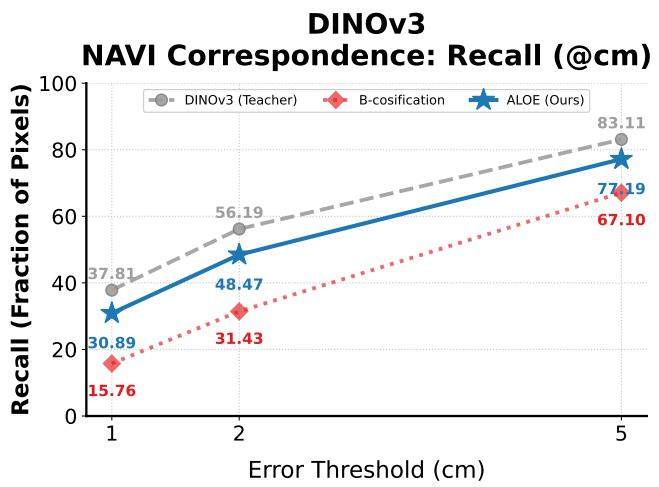

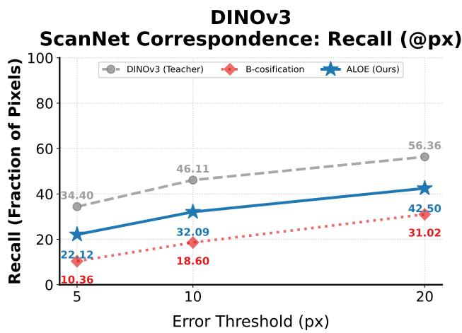  
Figure C1. Multiview correspondence. Evaluated on two different datasets (left: NAVI [35], right: ScanNet [23]) using Probe3D [26]. ALOE increases performance substantially over B-cosification and narrows the gap to the teacher model.

Data efficiency. In addition to SigLIP2 (as demonstrated in Fig. 9 of the main paper), we report data-scaling results for DINOv3 that shows a similar trend (Fig. C2).

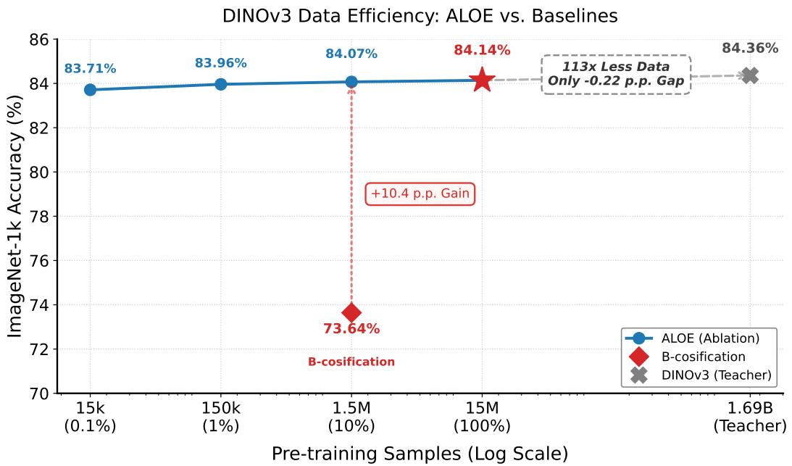  
Figure C2. Data efficiency of ALOE for DINOv3 on YFCC15M (ViT-B/16). We vary the amount of unlabeled YFCC15M data used for label-free alignment from 0.1% (15k images) to 100% (15M images) and report ImageNet-1k linear-probe accuracy. Across these settings, including the full-data distillation, ALOE remains nearly flat (83.71%-84.14%). At 10% (1.5M images), it already substantially outperforms B-cosification (+10.4 p.p.). The 100% setting reaches 84.14%, leaving only a 0.22 p.p. gap to the DINOv3 teacher (84.36%).

<table><tr><td rowspan="2">Model</td><td colspan="2">Lin. Probe ↑</td><td colspan="2">k-NN↑</td><td colspan="5">Grid-PG ↑</td><td rowspan="2"> $\pmb { \Delta } _ { \mathrm { G r i d P G } }$ </td></tr><tr><td>Teacher (X)</td><td>ALOE (√)</td><td>Teacher (X)</td><td>ALOE (✓)</td><td>LRP</td><td>IG</td><td>LeG</td><td>Chf</td><td>ALOE (✓)</td></tr><tr><td colspan="10">Vision–language teacher: SigLIP2 [76]</td></tr><tr><td>ViT-B/16</td><td>84.21</td><td>83.87</td><td>80.39</td><td>79.97</td><td>55.47</td><td>39.22</td><td>34.10</td><td>54.27</td><td>84.42</td><td>+28.95</td></tr><tr><td>ViT-L/16</td><td>87.15</td><td>87.08</td><td>83.76</td><td>83.89</td><td>47.39</td><td>37.46</td><td>36.62</td><td>52.57</td><td>83.48</td><td>+36.09</td></tr><tr><td>ViT-so/16</td><td>87.98</td><td>87.83</td><td>84.51</td><td>84.56</td><td>49.81</td><td>37.82</td><td>46.09</td><td>55.03</td><td>82.75</td><td>+32.94</td></tr><tr><td>ViT-so/14@384</td><td>88.65</td><td>88.48</td><td>85.08</td><td>85.13</td><td>49.54</td><td>37.71</td><td>45.18</td><td>56.03</td><td>83.07</td><td>+33.53</td></tr><tr><td colspan="10">Self-supervised teacher: DINOv3 [72]</td></tr><tr><td>ViT-S/16</td><td>78.62</td><td>77.91</td><td>76.92</td><td>75.83</td><td>53.46</td><td>33.11</td><td>31.72</td><td>31.27</td><td>76.98</td><td>+23.52</td></tr><tr><td>ViT-B/16</td><td>84.36</td><td>84.14</td><td>82.28</td><td>81.56</td><td>65.11</td><td>37.61</td><td>36.61</td><td>35.94</td><td>87.01</td><td>+21.90</td></tr><tr><td>ViT-L/16</td><td>87.08</td><td>86.82</td><td>84.77</td><td>83.71</td><td>65.33</td><td>38.47</td><td>35.90</td><td>36.92</td><td>84.04</td><td>+18.71</td></tr><tr><td colspan="10">Supervised teacher: ViT [25]</td></tr><tr><td>ViT-B/16</td><td>81.19</td><td>81.30</td><td>80.70</td><td>80.76</td><td>57.34</td><td>44.43</td><td></td><td></td><td>82.48</td><td>+25.14</td></tr></table>

Table C6. Localization (Grid-PG) vs. recognition. ALOE improves Grid-PG substantially across backbones and teachers while maintaining competitive linear-probe and k-NN accuracy on ImageNet-1k. Grid-PG is reported for Teacher using AttnLRP (LRP) [1], Integrated Gradients (IG) [73], LeGrad (LeG) [8], and CheferCAM (Chf) [16], while ALOE uses model inherent B-cos attributions. ∆GridpG is ALOE minus the teacher with AttnLRP (LRP). √: denotes inherently interpretable models. Fields marked with - (LeGrad and CheferCAM on the supervised ViT) were not implemented for this architecture.

## C.2. Interpretability and faithfulness

Localization (GridPG). ALOE aligned models yield substantial improvements in GridPG localization across pre-training paradigms and backbones while maintaining competitive performance in both recognition and dense prediction tasks. Compared to conventional teacher models explained with post-hoc attribution methods (AttnLRP [1], Integrated Gradients [73], LeGrad [8], and CheferCAM [16]), inherently interpretable B-cos explanations from ALOE achieve consistently higher localization scores. The gains are substantial across SigLIP2, DINOv3, and supervised ViT backbones, with ∆GridPG ranging from +18.71 to +36.09, showing that aligned B-cos models provide more localized, class-specific attributions without sacrificing downstream accuracy.

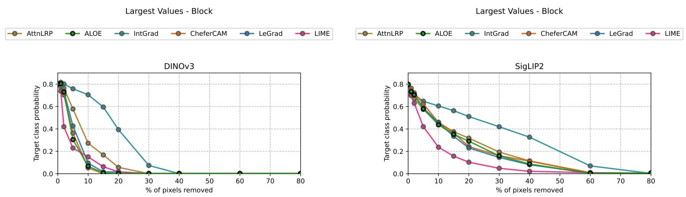  
Figure C3. Perturbation stability of explanations on ViT-B/16. Target-class probability vs. percentage of top-attributed 16 × 16 pixel blocks removed (lower curves are better). Across both teachers—DINOv3 (left) and SigLIP2 (right)—removing the blocks ranked highest by ALOE (ours) model-inherent B-cos attributions W(x)x [11] causes a rapid drop in model confidence, indicating faithful localization. Interestingly, LIME [63] attributions cause the fastest initial drop for both teachers and perform best overall for SigLIP2, while ALOE remains competitive

Post-hoc Localization: Standard DINOv3 vs. ALOE B-cos Models

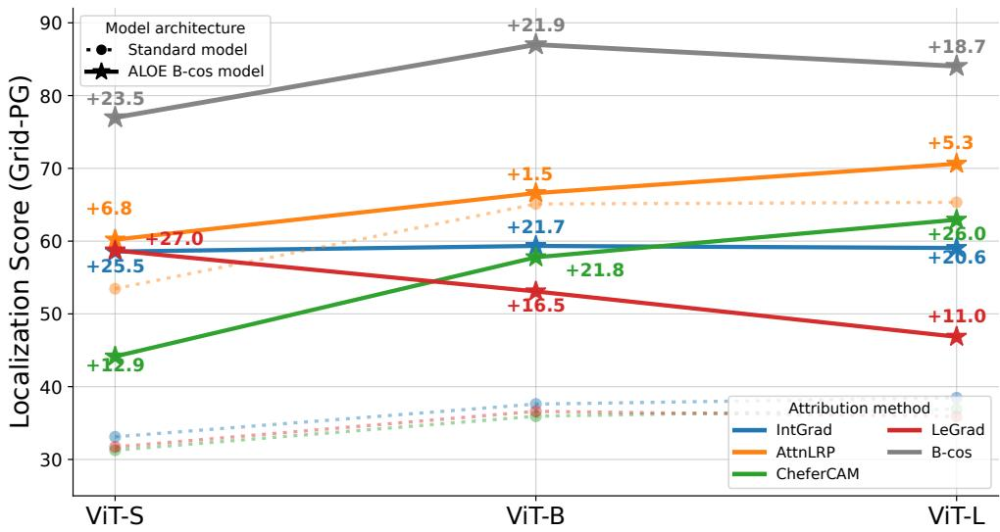  
Figure C4. GridPG on standard DINOv3 and ALOE. We compute GridPG scores on DINOv3 ViT-S/B/L teachers and their aligned ALOE counterparts using the same post-hoc attribution methods. Applying post-hoc methods to ALOE models increases localization strongly across most methods, narrowing the gap to inherent B-cos explanations.

Faithfulness under pixel perturbation. In pixel-deletion tests on ViT-B/16 (Fig. C3), target-class probability for ALOE (using model-inherent $\mathbf { W } ( \mathbf { x } ) \mathbf { x } )$ drops very fast when 16 × 16 pixel blocks with the highest attribution are removed, outperforming AttnLRP and Integrated Gradients for both DINOv3 and SigLIP2. Interestingly, LIME [63] attributions cause the fastest initial drop for both teachers and perform best overall for SigLIP2, while ALOE remains competitive. The faster decay indicates more faithful attributions that better reflect the model's decision computations. The usage of blocks instead of single pixels is necessitated by the inclusion of CheferCAM, LIME and LeGrad which work internally at token-granularity; thus providing less fine-grained attribution maps compared to B-cos, AttnLRP or IntGrad.

Post-hoc methods increase localization score. Applying the same post-hoc methods to the aligned ALOE models (see Fig. C4) substantially increases the GridPG score by up to +27.0 p.p., which narrows the gap to the score achieved by the inherent explanation mechanism. This works especially well for CheferCAM, LeGrad, and IntGrad, while AttnLRP improves less because it already achieves relatively high scores on the standard teacher. This suggests that B-cos models generally increase object localization, independent of the attribution method (similar findings were also presented in [27]).

Human user study. We also performed a human user study in which the subjective preferences of different attribution methods for DINOv3 ViT-B/16 were evaluated. 41 users on Amazon Mechanical Turk performed 50 trials, each consisting of a random image with 2 attribution maps from randomly drawn attribution methods (AttnLRP, IntGrad, Chefer, LeGrad, LIME, B-cos). An example for one trial is shown in Fig. C5. The predicted class of the image was provided, and the user had to choose the explanation that best helped them understand the model's prediction. We fitted a Bradley-Terry (BT) model [9] to the outcome of the study in order to derive the pairwise win-probabilities between attribution methods. BT is similar to logistic regression on the one-hot encoded study data, where the winning class receives the score +1 and the negative —1 (with 1 as the target value). The derived BT weights indicate the overall performance relative to the other models. By computing the sigmoid of the difference $\beta _ { 1 } - \beta _ { 2 }$ between the weights of two attribution methods, we can derive the probability of method 1 winning against method 2. The probabilities, together with the BT-scores, are shown in Tab. C7. ALOE is preferred over all post-hoc baselines (> 50% win rate) while being the most compute-efficient method.

## C.3. Ablations

We present the table on ablation for alignment objectives as reported in Sec. 5.2 of the main paper.

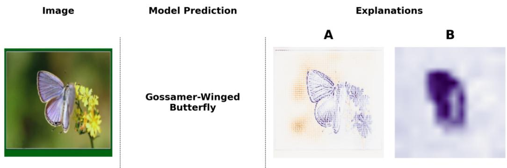  
Figure C5. Example for the User $\mathbf { S t u d y } ^ { \dagger }$ . Users were given two attribution maps from randomly drawn methods and had to decide which attribution map helps them best to understand the model's prediction. Blue shows positive attributions while yellow shows negative ones. †Earlier CVPR-version checkpoint [47]; see Appendix B.

Table C7. Human Evaluation†. ALOE achieves the highest Bradley-Terry (BT) score and outperforms all baselines in pairwise comparisons (Win Rate $> 5 0 \% )$ . †Earlier CVPR-version checkpoint [47]; see Appendix B.
<table><tr><td>Method</td><td>BT Score ↑</td><td>ALOE Win Rate ↑</td></tr><tr><td>ALOE</td><td>0.97</td><td></td></tr><tr><td>IntGrad</td><td>0.41</td><td>63.5%</td></tr><tr><td>AttnLRP</td><td>0.11</td><td>70.2%</td></tr><tr><td>CheferCAM</td><td>-0.11</td><td>74.5%</td></tr><tr><td>LeGrad</td><td>-0.59</td><td>82.6%</td></tr><tr><td>LIME</td><td>-0.79</td><td>85.3%</td></tr></table>

Table C8. Alignment objective ablation†. IN1k top-1 (%) using only the global alignment term $( { \mathcal { L } } _ { \mathrm { g l o b a l } } ,$ no layer-wise terms); the selected objective was then extended to intermediate depths (Tab. 4). †Earlier CVPR-version checkpoint [47]; see Appendix B.
<table><tr><td>Loss</td><td>MSE</td><td>Cosine</td><td>SigLIP</td><td>InfoNCE</td></tr><tr><td>DINOv3</td><td>83.9</td><td>84.0</td><td>83.7</td><td>83.5</td></tr><tr><td>SigLIP2</td><td>75.5</td><td>75.8</td><td>76.0</td><td>75.7</td></tr><tr><td>Google ViT</td><td>81.0</td><td>81.1</td><td>81.1</td><td>81.0</td></tr></table>

Alignment objectives. Under identical settings with only the global alignment term (Tab. C8), cosine and $S i g L I P$ are most consistent across models, MSE and InfoNCE showed inconsistencies. Given the ease of application and simplicity we adopt cosine by default

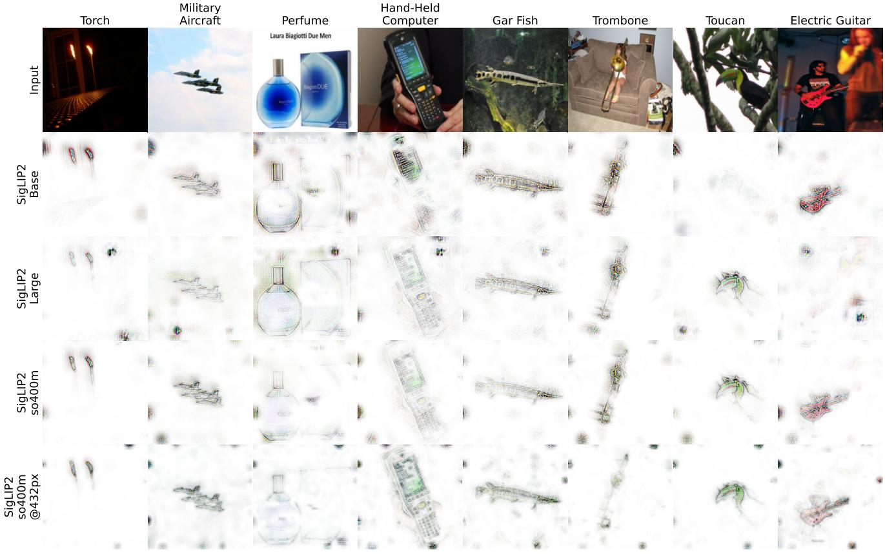  
Figure D1. Zero-shot, model-inherent VLM explanations. RGB explanations of ALOE (ours) using W(x)x attributions, given the fixed text prompt “this is a photo of {class name}". Our explanations are sharply localized on class-relevant regions.

## D. Additional Qualitative Results

In this section, we complement the quantitative results with qualitative evidence across three settings: (i) zero-shot, modelinherent explanations (Figure D1), (ii) side-by-side comparisons against popular post-hoc attribution methods (Figures D2 to D4), (iii) dense predictions from a linear depth probe (Figure D5), and multimodal large language model explanations (Figs. D6 to D8).

Zero-shot, model-inherent VLM explanations. In Figure D1, we visualize zero-shot predictions by swapping the SigLIP2 image encoder with its ALOE-aligned B-cos counterpart while keeping the original text encoder and prompts. The resulting inherent explanations localize the class-relevant regions (e.g., discriminative parts, textures) without any additional tuning. Notably, maps remain well-aligned and class-specific, consistent with our zero-shot accuracy in Tab. C3.

Comparisons with popular attribution methods. Figures D2 to D4 contrast ALOE (ours)—which uses model-inherent Bcos attributions W(x)x—with AttnLRP, Integrated Gradients, LeGrad, CheferCAM, and LIME. Across diverse categories, ALOE produces more object-centric explanations with sharper boundaries and less background noise. The six-channel encoding preserves color semantics, yielding explanations that align with class-specific parts and textures. These trends also mirror our quantitative gains in GridPG and pixel-perturbation stability (Tab. C6 and Fig. C3). All examples for this use DINOv3-based backbones (ViT-B/16) with linear probes trained on ImageNet-1k.

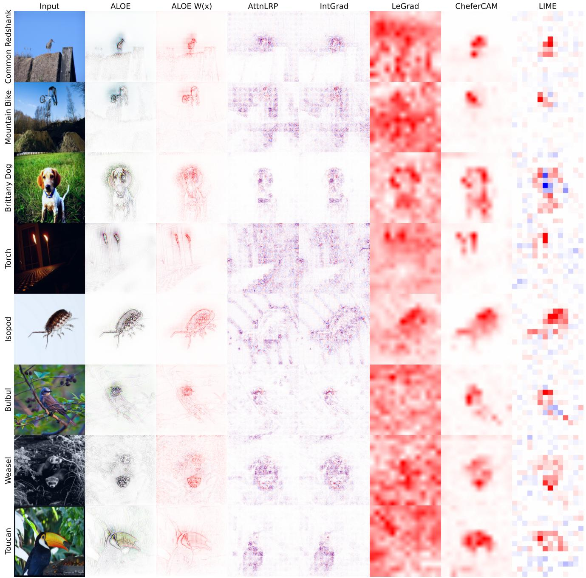  
Figure D2. Qualitative attribution comparisons. Example 1: Visualizations for ALOE (ours)—using model-inherent B-cos attributions W(x)x—versus popular post-hoc methods (AttnLRP, Integrated Gradients (IntGrad), LeGrad, CheferCAM, and LIME). ALOE produces sharper, better-localized, and color-faithful highlight maps with less background noise, focusing on class-relevant object regions consistently across examples.

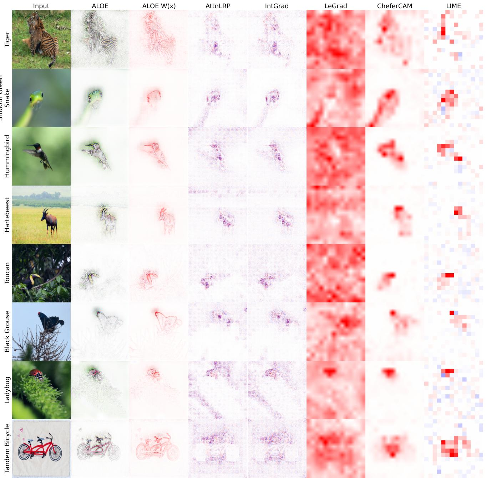  
Figure D3. Qualitative attribution comparisons. Similar to Figure D2.

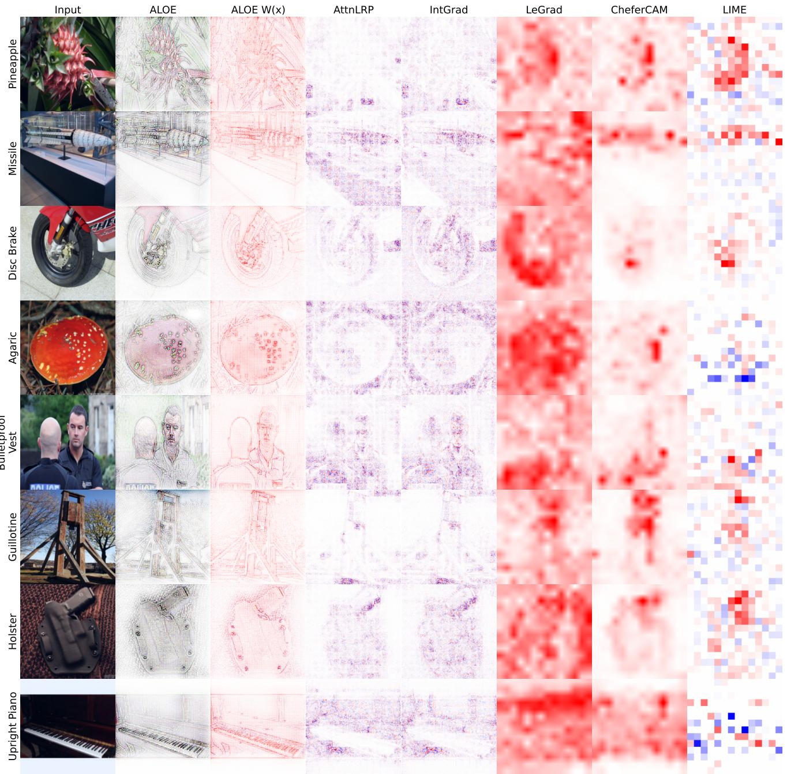  
Figure D4. Qualitative attribution comparisons-not well-localized examples. Visualizations for ALOE (ours)—using model-inherent B-cos attributions W (x)x—versus popular post-hoc methods (AttnLRP, Integrated Gradients (IntGrad), LeGrad, CheferCAM, and LIME). We highlight failure cases where explanations lack localization, suggesting a reliance on background context. Given that B-cos attributions are mathematically faithful to the model's linear transformation, these diffuse heatmaps could also expose model-level shortcuts rather than “explanation failure."

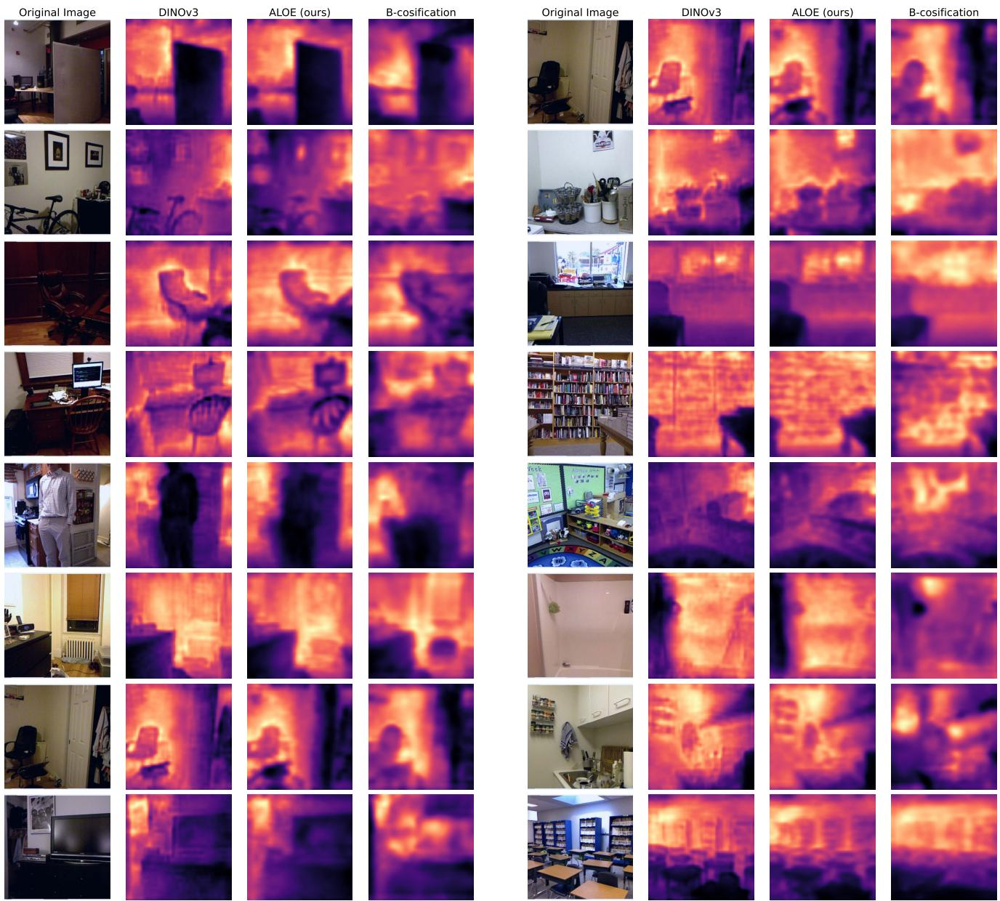  
Figure D5. Depth Estimation. Visualization of predicted depth maps for ALOE (ours), DINOv3 and B-cosification on the NYUv2 [71] depth-estimation dataset using the Probe3D [26] protocol. ALOE-aligned features yield depth maps with coherent geometry that visually are very similar to the DINOv3 teacher model. The depth maps from the vanilla B-cosification model seem to be more noisy and blurred.

Depth maps (dense linear probing). Figure D5 shows monocular depth outputs from a shallow linear head trained on frozen features (ViT-B/16). ALOE-aligned features yield depth maps with coherent geometry that are visually very similar to the DINOv3 teacher. These visuals complement the relative/absolute depth metrics in Tab. C4, underscoring that the aligned B-cos backbone provides useful dense representations—not only global classification signals—while retaining inherent interpretability. The depth maps from the vanilla B-cosification model seem to be noisier and more blurred.

Multimodal large language model explanations. In addition to the explanations in Fig. 8, we provide further examples—including failure cases—in Figs. D6 to D8. Using AttnLRP [1], we propagate relevance through the LLaVA-MORE [21] Gemma-2-9B [74] backbone, utilizing B-cos inherent explanations from the ALOE SigLIP2 vision encoder. Notably, Fig. D7 and Fig. D8 demonstrate instances where explanations fail to match predictions. We suspect that this discrepancy likely stems from three factors: the model relying on spurious associations, reliance on previous tokens restricting the visionto-language information flow, or AttnLRP fundamentally generating unfaithful explanations. As we discussed earlier, since the current setup still relies on AttnLRP to propagate relevance through the language model, we defer a fuller treatment of end-to-end inherently interpretable MLLMs to future work.

The image captures a man skillfully riding a wave on a surfboard, showcasing his surfing abilities. The surfer is in the middle of the wave, with the surfboard positioned beneath him. The scene is set in the ocean, with the wave providing the perfect opportunity for the surfer to perform a trick. The surfer's body is

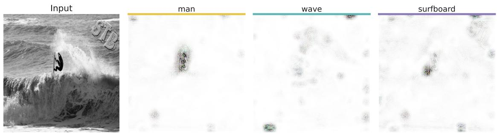  
Figure D6. Token-level Visual Grounding via AttnLRP and ALOE†. We generate visual explanations by leveraging the inherent Bcos interpretability of the ALOE †SigLIP2 vision backbone, using AttnLRP to propagate relevance from LLaVA-MORE's Gemma-2-9B language model. †Earlier CVPR-version checkpoint [47]; see Appendix B.

The image features a man standing next to a large elephant, with the elephant's trunk resting on his shoulder. The man appears to be enjoying the moment, as he is smiling. The elephant is positioned on the left side of the image, occupying a significant portion of the scene. The man is standing in front of

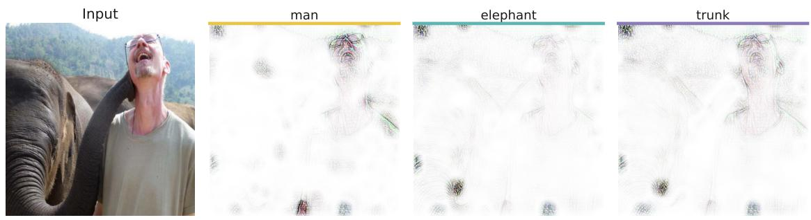  
Figure D7. Token-level Visual Grounding via AttnLRP and ALOE†. Similar to Fig. D6. †Earlier CVPR-version checkpoint [47]; see Appendix B.

The image features a group of five young children sitting on the grass, each with a frisbee in front of them. They are all facing the camera, posing for a picture. The frisbees are placed in various positions, with some closer to the children and others slightly further away. The children are spread out across the  
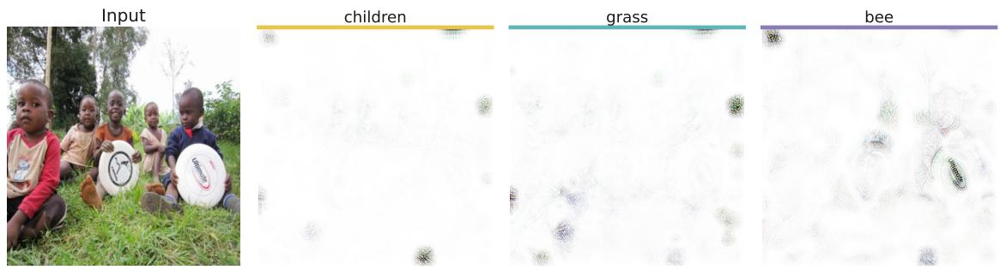  
Figure D8. Token-level Visual Grounding via AttnLRP and ALOE†. Similar to Figs. D6 and D7. †Earlier CVPR-version checkpoint [47]; see Appendix B.