# ArabGeoText: Tool-Augmented Vision–Language Models for Arabic Geospatial Text Spotting

Yakoub Bazi, Sarah Alsaleh, Mohamad M. Al Rahhal, Mohamed A. Mekhtiche, and Mansour Zuair

Abstract—Geospatial text spotting involves locating and transcribing geographic labels, such as road names, district names, and landmarks, in raster maps. These labels are often small, densely arranged, and arbitrarily oriented. Although Arabic text recognition has been studied extensively in documents and natural scenes, Arabic geospatial text spotting remains underexplored. We introduce ARABGEOTEXT, an Arabic-centric benchmark covering 970 geographic locations in Riyadh and Jeddah, with 17,875 manually annotated text instances per view type. For each location, we pair an OpenStreetMap (OSM) rendering with a composite created by overlaying that rendering on the corresponding remote sensing (RS) imagery. The paired views preserve label content and pixel geometry, allowing evaluation across different backgrounds. Geographic partitions support in-city and city-disjoint evaluation of detection, recognition, and end-to-end spotting. Experiments with direct Qwen3.5-4B spotting show difficulties in recovering all labels within a tile. We therefore propose a tool-augmented vision– language framework that combines YOLO26 localization and crop rectification with Qwen3.5-4B recognition adapted through low-rank adaptation (LoRA). The framework outperforms direct LoRA-adapted Qwen3.5-4B spotting across both image views and test cities. With localization held fixed, reader adaptation further improves recognition over the pretrained zero-shot reader. The dataset and code will be made publicly available at https://github.com/yakoubbazi/ArabGeoText.

Index Terms—geospatial text spotting, Arabic OCR, Open-StreetMap, vision–language models (VLMs), tool-augmented recognition

## I. INTRODUCTION

Geographic names identify roads, districts, and landmarks, complementing the physical features visible in remote sensing (RS) imagery. Extracting these names from raster maps and map–imagery composites supports place-name search and geographic image interpretation, and helps link map content to geographic databases [1]. Geographic information systems can provide names as structured records, but these records may be unavailable when only a rendered image is available. In that case, names must be recovered directly from pixels. Geospatial text spotting addresses this task by locating visible text instances and producing their transcriptions.

The spatial arrangement of map text differs from that of conventional document text. Labels follow geographic features, appear at different orientations, and compete for space with symbols, linework, and neighboring labels. Small characters and curved text further complicate extraction. The ICDAR MapText competitions address related detection, recognition, and linking tasks on historical maps [2], [3]. In map–imagery composites, labels also appear against the textures and structures of the underlying RS scene. Arabic introduces further recognition difficulties through connected letter forms and characters distinguished by dots, which can be difficult to resolve at small text sizes [4].

Existing Arabic recognition resources cover handwritten and printed text [5], [6], natural scenes [4], document understanding [7], and synthetic documents and calligraphy [8], [9]. These resources cover several aspects of Arabic recognition, but do not provide the paired map and map–imagery setting considered here. Paired views allow the same geographic labels to be evaluated under different visual conditions, while geographic partitions distinguish performance within the training city from transfer to a city excluded from training.

We introduce ARABGEOTEXT, an Arabic-centric benchmark for geospatial text spotting covering 970 locations in Riyadh and Jeddah, Saudi Arabia. Each location provides paired OpenStreetMap (OSM) renderings and RS imagery overlaid with OSM (RS+OSM), preserving identical label content and pixel geometry. The benchmark contains 17,875 manually annotated text instances per view type, with polygons and transcriptions for predominantly Arabic text, together with Latin-script, mixed-script, and numeric or symbolic labels naturally present in the maps. The training, validation, and incity test partitions are drawn from Riyadh, while Jeddah is reserved for city-disjoint testing.

We also examine the use of vision–language models (VLMs) for geospatial text spotting. VLMs have been applied to RS image captioning, visual question answering, and grounding [10]–[12], while text recognition systems use visual encoders and language decoders to recover transcriptions from image inputs [13], [14]. Recognizing a supplied text region, however, differs from recovering every label in a complete map tile. Direct full-tile spotting requires the model to identify numerous small instances, predict their boundaries, and associate each region with a transcription in a single generated response. Crop-level recognition allows the model to process each localized instance separately.

We therefore propose a tool-augmented VLM framework that separates text localization from recognition. A YOLO26 instance-segmentation model [15] localizes text regions, which are extracted, rectified, and resized before recognition by Qwen3.5-4B [16]. The reader is adapted to geospatial text using low-rank adaptation (LoRA) [17]. We also evaluate the pretrained reader without task-specific adaptation, using identical detections and crop preparation to isolate the effect of reader adaptation. For comparison, we adapt the same VLM backbone to generate polygons and transcriptions directly from complete tiles.

Experiments show that the proposed framework outperforms direct LoRA-adapted Qwen3.5-4B spotting across both image views and test cities. With localization held fixed, reader adaptation further improves recognition over the pretrained zero-shot reader.

The main contributions are summarized as follows:

• We introduce ARABGEOTEXT, an Arabic-centric geospatial text-spotting benchmark with paired OSM and RS+OSM views, manually annotated polygons and transcriptions, and geographic partitions supporting in-city and city-disjoint evaluation.

• We propose a tool-augmented VLM framework that combines specialized text localization and crop rectification with LoRA-adapted recognition of geographic labels.

• We evaluate direct and tool-augmented spotting under a common protocol and analyze the effects of reader adaptation, joint transcription, model scale, and inference cost.

The remainder of this paper is organized as follows. Section II reviews related work. Sections III and IV describe the benchmark and spotting framework, respectively. Section V presents the experimental setup and main results, Section ?? discusses the additional analyses, and Section VI concludes the paper.

## II. RELATED WORK

## A. Map Text Spotting and Arabic Text Recognition

Map text extraction requires the localization and recognition of labels whose orientation, spacing, and placement are influenced by geographic features. Existing systems integrate text extraction and linking within pipelines for historical maps [1], while dedicated competitions evaluate detection, recognition, and the linking of separate words into geographic names [2], [3]. Hyper-local feature sampling and positional representations have also been used to detect and recognize long, rotated labels [18]. Complementary approaches address text linking by combining textual content, visual features, and polygon geometry [19]. These studies highlight the roles of local appearance and spatial relationships in map understanding. Their historical-map setting, however, differs from the contemporary digital maps and map–imagery composites considered here, where the same rendered labels can be examined against different backgrounds.

Arabic text recognition has been studied across handwritten and printed text [5], [6], as well as text in natural scenes [4]. More recent resources broaden the evaluation to document understanding [7], synthetic book-style text [8], and calligraphic text and multimodal understanding [9]. These resources cover diverse Arabic recognition settings, but do not examine geographic labels in paired map and map–imagery views. In our dataset, fixed label content and geometry allow background effects to be examined, while the city-based partitions support evaluation of geographic generalization.

B. Vision–Language Models for Text and Geospatial Understanding

Vision–language approaches to text processing combine recognition, localization, and reasoning in different ways. Encoder–decoder models formulate text recognition as sequence generation using pretrained visual and language representations [13]. More recent approaches unify optical character recognition across scene and document images, supporting whole-page processing and region-level recognition guided by coordinates or visual cues [14]. Compact vision–language models also incorporate text spotting alongside document parsing [20]. Evaluation spans diverse text-processing tasks [21], as well as visual document grounding and referring [22]. The requirements differ across these settings. Recognition from a supplied crop focuses on transcription, whereas fullimage spotting also requires localization and the association of each transcription with its spatial extent. Tool-assisted approaches obtain fine-grained evidence by invoking expert agents to ground multimodal reasoning in visual and textual elements [23].

In RS, vision–language models have been developed for image captioning and question answering [10], as well as multisensor interpretation [11]. Geographic data also provide supervision for constructing image–language training data [24], training foundation models with structured map information [25], and aligning image-patch representations with geographic semantics [26]. Other work uses paired aerial images and rendered maps to generate geographically informed captions for domain adaptation [27]. These approaches primarily use geographic information to support image interpretation. Related visual-grounding methods address spatial localization through adaptive modality guidance [28], unified prediction of horizontal boxes, oriented boxes, and masks [29], or progressive visual search in large scenes [30]. These methods locate objects specified by referring expressions, whereas text spotting detects and transcribes the text visible in an image. Our work addresses Arabic text spotting in geospatial images by combining text-region localization with vision– language recognition. We compare this approach with direct prediction of text regions and transcriptions from the full image.

## III. THE ARABGEOTEXT DATASET

ARABGEOTEXT covers 970 geographic locations in Riyadh and Jeddah, Saudi Arabia. Each location is represented by an OSM rendering and a corresponding RS+OSM composite, both of size 1024×1024 pixels. The dataset therefore contains 1 940 annotated images, with 17 875 text instances in each view type. The paired views preserve the same label content and pixel geometry, allowing comparisons of text spotting across the two backgrounds.

## A. Data Collection and Annotation

We collect standard OpenStreetMap renderings and optical satellite imagery from Esri World Imagery over the same geographic bounds at zoom level 18. The map renderings contain predominantly Arabic geographic labels. We create each RS+OSM composite by overlaying the map rendering on the corresponding satellite image with a map opacity of 0.63. This value keeps geographic labels visible while retaining details of the underlying RS image. Both views are used for text spotting. Figure 1 shows representative paired examples.

Several annotators manually labeled the images using Label Studio [31]. Each visible text instance fully contained within a tile is annotated with a polygon and a transcription in the displayed script. Annotators drew polygons directly on the images, without automatic detection proposals or annotations derived from the underlying vector records. The polygons delineate both oriented and curved labels. The same annotation protocol was used for both cities, and the annotation records underwent automatic consistency checks before merging. Text clipped by a tile boundary is not annotated; its treatment during evaluation is described in Section V-B.

The Riyadh locations are divided into 500 training, 108 validation, and 109 Test-I locations. All 253 Jeddah locations are reserved for Test-II. Each location belongs to a single partition, and its paired views remain together. Test-I evaluates performance on held-out locations within the training city, while Test-II evaluates transfer to a city excluded from training.

## B. Statistical Analysis

Table I summarizes the number of images and labels in each partition, together with label size and orientation. The statistics are reported per view type; each location is counted once rather than once for each paired image. Text height is measured as the short side of the rotated bounding rectangle. Images from Riyadh contain an average of 20.5–21.7 labels, compared with 11.6 in Jeddah. Jeddah images contain fewer labels, but their text is smaller. The median height is 15.4 px in Test-II, compared with 18.4 px in training. Labels below 12 px account for 13.4% of Test-II instances, compared with 1.8% in training. Rotated labels are more common in Riyadh: 81.5%– 86.2% are inclined more than $1 5 ^ { \circ }$ from horizontal, compared with 46.5% in Jeddah.

Table II summarizes script composition and vocabulary overlap with the training partition. The Unique column counts distinct transcriptions, with repeated labels counted only once. Arabic is the main script in all partitions. It accounts for 91.2% of training labels and 74.0% of Test-II labels. Latin-script labels are more common in Test-II, where they account for 24.3% of instances, compared with 8.3% in training.

The frequency of labels already seen in training also differs between the two test partitions. In Test-I, 43.2% of label instances have a transcription found in training. This proportion falls to 15.0% in Test-II. When repeated transcriptions are counted only once, the overlap is 26.2% for Test-I and 6.4% for Test-II. Most labels in Test-II therefore have transcriptions absent from the benchmark training set. Evaluation on Jeddah therefore involves differences in text size, orientation, script, and vocabulary.

Figure 2 illustrates sample labels from the training, Test-I, and Test-II partitions. Labels are sampled across the frequency range; font size does not indicate how often a label occurs.

## IV. VLM-BASED GEOSPATIAL TEXT SPOTTING

We study two ways to recover geospatial text from a complete image tile: jointly predicting locations and transcriptions with a VLM, or recognizing regions supplied by a specialized localization tool. We evaluate three configurations: direct VLM spotting, tool-augmented spotting with zero-shot recognition, and tool-augmented spotting with adapted recognition.

## A. Task Formulation

Let $I _ { i }$ be an input tile in either the OSM or RS+OSM view. Its annotation is a variable-size set

$$
\mathcal { V } _ { i } = \{ ( p _ { i j } , t _ { i j } ) \} _ { j = 1 } ^ { n _ { i } } ,\tag{1}
$$

where $p _ { i j }$ is the polygon enclosing the jth text instance, $t _ { i j }$ is its transcription, and $n _ { i }$ is the number of annotated instances. Although Arabic predominates in ARABGEOTEXT, the task includes all annotated scripts and numeric or symbolic labels.

Given $N _ { \mathrm { t r } }$ annotated training images, the task is to recover the locations and transcriptions of text instances in an unseen tile. For a test image I, the model predicts

$$
\widehat { \mathcal { V } } ( I ) = \big \{ ( \hat { p } _ { j } , \hat { t } _ { j } ) \big \} _ { j = 1 } ^ { \hat { n } } ,\tag{2}
$$

where the predicted instance count nˆ may differ from the reference count. The validation partition is used for model selection, while the test partitions are reserved for final evaluation. Figure 3 summarizes the three approaches.

## B. Direct VLM Spotting

In direct spotting, the VLM generates a structured response. Qwen3.5-4B receives the full tile and an instruction to locate and transcribe its text. Each annotation set is serialized into a target response $a _ { i }$ containing the polygon coordinates and transcription of every instance. Coordinates are expressed on a normalized integer grid, and a common response format is used across samples so that generated outputs can be parsed into instance sets. Each training example consists of the triplet $( I _ { i } , q _ { \mathrm { s p o t } } , a _ { i } )$ , where $q _ { \mathrm { s p o t } }$ is the spotting instruction.

We adapt the pretrained VLM through supervised instruction tuning with LoRA [17]. For a pretrained weight matrix ${ \bf W } _ { 0 } \in \mathbb { R } ^ { d \times k }$ , LoRA introduces trainable matrices $\mathbf { A } \in \mathbb { R } ^ { r \times k }$ and $\mathbf { B } \in \mathbb { R } ^ { d \times r }$ , with $r \ll \operatorname* { m i n } ( d , k )$ . The resulting transformation is

$$
\mathbf { h } = \mathbf { W } _ { 0 } \mathbf { x } + { \frac { \alpha } { r } } \mathbf { B } \mathbf { A } \mathbf { x } ,\tag{3}
$$

where α controls the update scale. The pretrained weights remain frozen, and only the LoRA parameters are optimized. The rank, scaling parameter, and target modules are specified in Section V-A.

Let $\begin{array} { c c l } { { a _ { i } } } & { { = } } & { { \left( a _ { i , 1 } , \ldots , a _ { i , L _ { i } } \right) } } \end{array}$ denote the tokenized target response, $\Theta _ { 0 }$ the frozen pretrained parameters, and $\theta _ { \mathrm { { L } } }$ the trainable LoRA parameters. Training minimizes the responsetoken negative log-likelihood

$$
\mathcal { L } _ { \mathrm { s p o t } } = - \sum _ { i = 1 } ^ { N _ { \mathrm { t r } } } \sum _ { k = 1 } ^ { L _ { i } } \log p _ { \Theta _ { 0 } , \theta _ { \mathrm { L } } } \left( a _ { i , k } ~ | ~ I _ { i } , q _ { \mathrm { s p o t } } , a _ { i , < k } \right) ,\tag{4}
$$

Riyadh, train· 42 instances

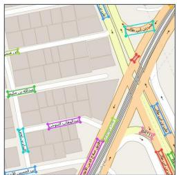

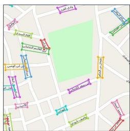  
Riyadh, train·50 instances

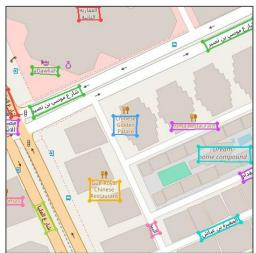  
Riyadh, train·45 instances

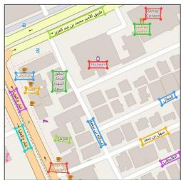  
Riyadh, Test-I· 44 instances

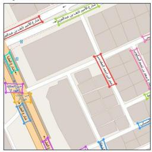  
Riyadh, Test-I· 39 instances

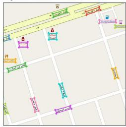  
Jeddah, Test-II· 43 instances

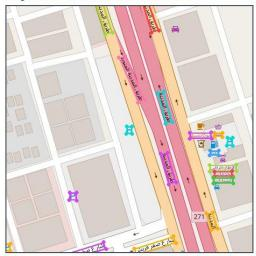  
Jeddah, Test-II· 41 instances

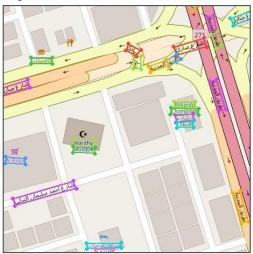  
Jeddah, Test-II· 50 instances

(a) OSM  
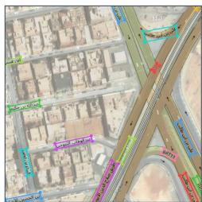

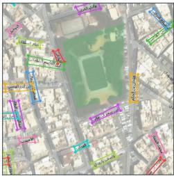  
Riyadh, train·50 instances

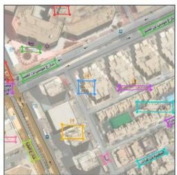  
Riyadh, train·45 instances

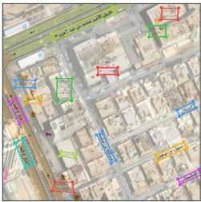  
Riyadh, Test-I· 44 instances

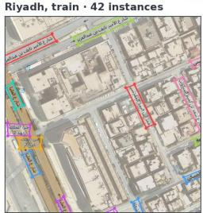  
Riyadh, Test-I· 39 instances

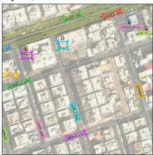  
Jeddah, Test-II· 43 instances

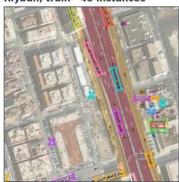  
Jeddah, Test-II · 41 instances

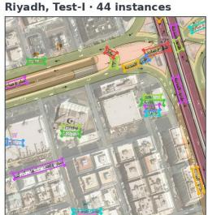  
Jeddah, Test-II· 50 instances

(b) RS+OSM  
Fig. 1. Paired examples from ARABGEOTEXT: (a) OSM renderings and (b) RS+OSM composites. Colored polygons mark annotated text instances. The examples show cropped regions; the displayed instance counts refer to the complete tiles.  
TABLE I  
DATASET STATISTICS PER VIEW TYPE. HEIGHT DENOTES MEDIAN TEXT HEIGHT; SMALL AND ROT. DENOTE THE PERCENTAGES OF LABELS BELOW 12 PX AND INCLINED MORE THAN 15◦ FROM HORIZONTAL, RESPECTIVELY.
<table><tr><td rowspan="2">Partition</td><td rowspan="2">City</td><td rowspan="2">Images</td><td rowspan="2">Inst.</td><td colspan="2">Inst./image</td><td rowspan="2">Height (px)</td><td rowspan="2">Small (%)</td><td rowspan="2">Rot. (%)</td></tr><tr><td>Mean</td><td>Max</td></tr><tr><td>Train</td><td>Riyadh</td><td>500</td><td>10247</td><td>20.5</td><td>51</td><td>18.4</td><td>1.8</td><td>86.2</td></tr><tr><td>Validation</td><td>Riyadh</td><td>108</td><td>2326</td><td>21.5</td><td>106</td><td>17.9</td><td>3.9</td><td>81.5</td></tr><tr><td>Test-I</td><td>Riyadh</td><td>109</td><td>2367</td><td>21.7</td><td>59</td><td>18.2</td><td>3.2</td><td>83.6</td></tr><tr><td>Test-II</td><td>Jeddah</td><td>253</td><td>2935</td><td>11.6</td><td>50</td><td>15.4</td><td>13.4</td><td>46.5</td></tr><tr><td>Total</td><td></td><td>970</td><td>17875</td><td>18.4</td><td>106</td><td>17.9</td><td>4.2</td><td>78.7</td></tr></table>

where $a _ { i , < k }$ denotes the preceding response tokens. This objective includes both coordinates and transcriptions, so the model learns localization and recognition through a single output sequence.

At inference, the adapted VLM receives an unseen tile with the same spotting instruction. Its generated response is parsed into YbDirect(I). Both text locations and transcriptions are thus predicted from the full image.

TABLE II  
SCRIPT COMPOSITION AND VOCABULARY OVERLAP WITH TRAINING. AR., LAT., MIX., AND NUM. DENOTE ARABIC, LATIN, MIXED-SCRIPT, AND NUMERIC OR SYMBOLIC LABELS. OVERLAP IS REPORTED FOR ALL INSTANCES AND DISTINCT TRANSCRIPTIONS.
<table><tr><td></td><td colspan="4">Script (%)</td><td></td><td colspan="2">Training overlap (%)</td></tr><tr><td>Partition</td><td>Ar.</td><td>Lat.</td><td>Mix.</td><td>Num.</td><td>Unique</td><td>Inst.</td><td>Unique</td></tr><tr><td>Train</td><td>91.2</td><td>8.3</td><td>0.2</td><td>0.3</td><td>5624</td><td></td><td></td></tr><tr><td>Validation</td><td>85.9</td><td>9.9</td><td>0.1</td><td>4.1</td><td>1530</td><td>45.2</td><td>29.4</td></tr><tr><td>Test-I</td><td>91.1</td><td>7.3</td><td>0.3</td><td>1.3</td><td>1566</td><td>43.2</td><td>26.2</td></tr><tr><td>Test-II</td><td>74.0</td><td>24.3</td><td>1.3</td><td>0.4</td><td>981</td><td>15.0</td><td>6.4</td></tr></table>

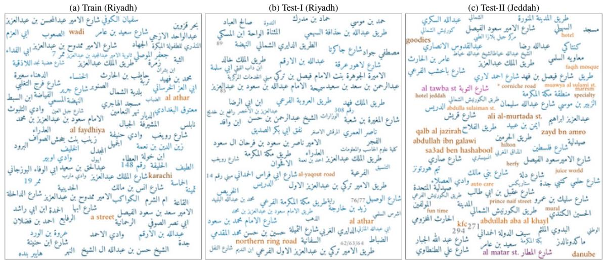  
Fig. 2. Sample label vocabulary from training, Test-I, and Test-II. Colors indicate Arabic (blue), Latin (orange), mixed-script (magenta), and numeric (gray) labels. Font size does not represent frequency.

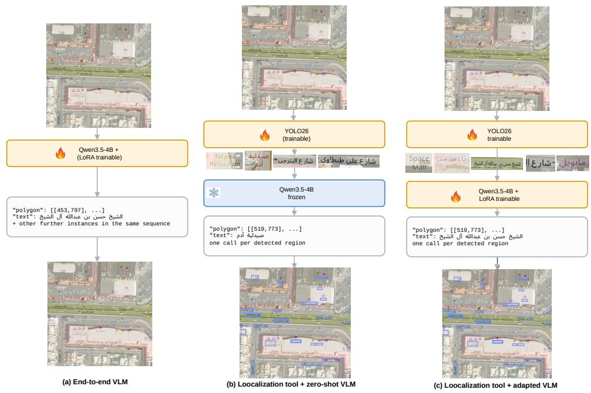  
Fig. 3. Three paradigms for VLM-based geospatial text spotting: (a) direct spotting, (b) tool-augmented spotting with zero-shot recognition, and (c) tool augmented spotting with adapted recognition.

## C. Tool-Augmented VLM Spotting

Direct generation requires the VLM to recover the geometry and content of many small, closely spaced labels in a

1024 × 1024 image. In the tool-augmented approach, a specialized tool localizes these regions, and the VLM recognizes the resulting crops. The same localization and preprocessing procedure is applied to every tile and shared by both reader variants.

1) Localization and Crop Preparation: The localization tool uses the instance-segmentation variant of YOLO26 [15], a convolutional model family for object detection and segmentation. YOLO26 combines image features at multiple scales to generate shared mask templates. These templates are combined using instance-specific weights to produce a separate mask for each detected region. We train the model on the polygon annotations of the ARABGEOTEXT training partition to segment individual text regions. It operates on the same OSM or RS+OSM tiles as the direct VLM and predicts text regions without producing transcriptions. The predicted masks define each text region for polygon localization and crop preparation. The VLM then reads the resulting crops.

For crop preparation, each predicted mask is enclosed by its minimum-area oriented rectangle. The rectangle corners are ordered consistently, and the quadrilateral is expanded by 12% of its short side before rectification with a projective transform. The rectified crop is then upscaled using bicubic interpolation while preserving its aspect ratio, with a minimum height of 48 pixels and a minimum width of 192 pixels. Figure 4 illustrates this procedure.

We denote the tool output by

$$
\mathcal { T } ( I ) = \{ ( \hat { p } _ { j } , c _ { j } ) \} _ { j = 1 } ^ { \hat { n } } ,\tag{5}
$$

where $\hat { p } _ { j }$ is the detected polygon in the original tile and $c _ { j }$ is its prepared recognition crop. The oriented rectangle is used to extract and rectify the crop; the detector polygon is retained for the final spotting output.

2) Zero-Shot and Adapted Recognition: Each crop $c _ { j }$ is processed independently by a Qwen3.5-4B reader with a fixed recognition instruction $q _ { \mathrm { r e c } }$ . We consider two settings that share the same localization and crop-preparation procedure.

In the zero-shot recognition setting, the reader uses the pretrained parameters $\Theta _ { 0 }$ defined in Section IV-B:

$$
\hat { t } _ { j } = \mathcal { R } _ { \Theta _ { 0 } } ( c _ { j } , q _ { \mathrm { r e c } } ) .\tag{6}
$$

No task-specific adaptation is applied to the reader. Here, zeroshot refers to recognition: the localization tool is trained on the benchmark training partition.

In the adapted recognition setting, the same backbone is fine-tuned with LoRA using crops extracted from the annotated text regions in the training images and paired with their reference transcriptions. At inference, crops are extracted from YOLO26 predictions. The same crop-preparation procedure is used for annotated and predicted regions. The adapted reader predicts

$$
\hat { t } _ { j } = \mathcal { R } _ { \Theta _ { 0 } , \theta _ { \mathrm { L } } ^ { \mathrm { r e c } } } \big ( c _ { j } , q _ { \mathrm { r e c } } \big ) ,\tag{7}
$$

where $\theta _ { \mathrm { { L } } } ^ { \mathrm { { r e c } } }$ denotes the reader’s trainable LoRA parameters and $\Theta _ { 0 }$ remains frozen. Adaptation follows the formulation in Section IV-B, using a crop as input and its transcription as the target in place of the full tile and polygon–text response. The loss is evaluated only on transcription tokens; the reader does not predict polygon coordinates. The same recognition instruction is used during training and inference. For either reader, each transcription is paired with its corresponding detector polygon. Using identical detections and crop preprocessing in the two settings isolates the effect of reader adaptation.

## V. EXPERIMENTS

## A. Experimental Settings

We use the Riyadh training and validation partitions described in Section III for model development. Test-I evaluates held-out performance in Riyadh, while Test-II evaluates cross-city transfer to Jeddah. All spotting configurations are evaluated on both OSM and RS+OSM inputs. For direct VLM spotting, we adapt Qwen3.5-4B with LoRA [17], using rank $r = 6 4$ and scaling parameter $\alpha = 1 2 8$ . LoRA is applied to the language decoder, while the vision encoder and multimodal projector remain frozen. Training uses an effective batch size of 16, an initial learning rate of $1 \times 1 0 ^ { - 4 }$ , cosine learning-rate decay, 5% warmup, and weight decay of 0.01. The maximum sequence length is 8192 tokens. We train for five epochs and select the checkpoint with the lowest validation loss. Inference uses greedy decoding, with polygon coordinates represented as integers on a normalized [0, 1000] grid.

For tool-augmented spotting, we use the YOLO26 instancesegmentation model [15]. The detector is trained on the combined OSM and RS+OSM training images at 1024×1024 resolution, using a single text class and a batch size of 4. Training runs for up to 100 epochs, with an early-stopping patience of 30 epochs. Predictions with confidence below 0.25 are discarded.

With the shared detector and crop-preparation procedure, the zero-shot reader uses pretrained Qwen3.5-4B and a fixed recognition instruction, without task-specific adaptation. The adapted reader is fine-tuned on 20 494 rectified training crops paired with their reference transcriptions. It uses the same LoRA configuration as the direct model, an effective batch size of $^ { 1 6 , }$ a learning rate of $1 \times 1 0 ^ { - 4 }$ with cosine decay, and a maximum sequence length of 2048 tokens. We train for five epochs and select the checkpoint with the lowest validation loss. The loss is computed only on transcription tokens. Training and inference use the same crop preprocessing and recognition instruction. All experiments are conducted on a workstation with two NVIDIA RTX A6000 GPUs, each with 48 GB of memory.

## B. Evaluation Metrics

We evaluate text detection, text recognition, and end-to-end text spotting.

Text detection. For each tile, we match predicted and reference polygons one-to-one using polygon intersection over union (IoU). Only pairs with IoU $\ge ~ 0 . 5$ are eligible. The assignment first maximizes the number of matched pairs, then uses their total IoU to resolve ties between assignments with the same number of pairs. Matching uses geometry alone, and the resulting pairs are shared across all three evaluations. Predictions are retained even when their transcriptions are empty.

Since text clipped by tile boundaries is not annotated, unmatched predictions whose polygons touch the boundary are excluded after matching. All matched predictions are scored, including those touching the boundary.

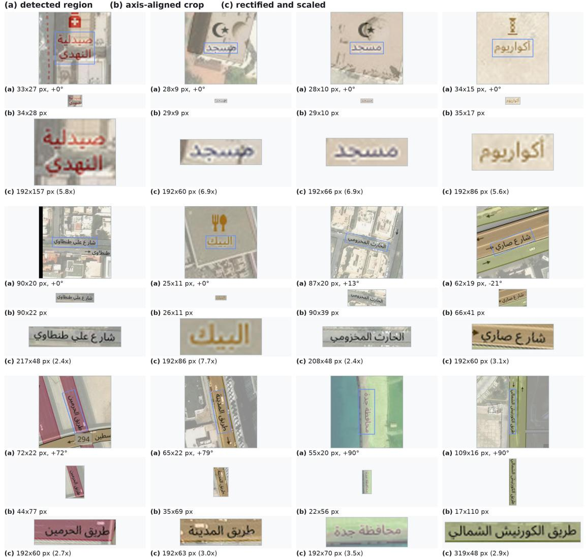  
Fig. 4. Crop preparation: (a) text region detected by YOLO26, (b) its axis-aligned crop, and (c) the rectified and upscaled crop supplied to the VLM reader.

TABLE III  
TEXT DETECTION ON ARABGEOTEXT. VALUES ARE IN %.
<table><tr><td></td><td></td><td></td><td colspan="3">Direct Qwen3.5-4B</td><td colspan="3">YOLO26</td></tr><tr><td>Input</td><td>Test set</td><td>City</td><td>P</td><td>R</td><td>H-mean</td><td>P</td><td>R</td><td>H-mean</td></tr><tr><td>OSM</td><td>Test-I</td><td>Riyadh</td><td>34.5</td><td>34.6</td><td>34.5</td><td>84.7</td><td>92.1</td><td>88.2</td></tr><tr><td>OSM</td><td>Test-II</td><td>Jeddah</td><td>46.7</td><td>48.0</td><td>47.4</td><td>75.5</td><td>77.6</td><td>76.5</td></tr><tr><td>RS+OSM</td><td>Test-I</td><td>Riyadh</td><td>36.5</td><td>32.2</td><td>34.2</td><td>84.5</td><td>92.6</td><td>88.4</td></tr><tr><td>RS+OSM</td><td>Test-II</td><td>Jeddah</td><td>38.5</td><td>37.3</td><td>37.9</td><td>76.6</td><td>80.6</td><td>78.6</td></tr></table>

Detection performance is measured by precision (P), recall (R), and H-mean (H):

$$
\begin{array} { l } { \displaystyle { P = \frac { T P } { T P + F P } , \quad R = \frac { T P } { T P + F N } , } } \\ { \displaystyle { H = \frac { 2 T P } { 2 T P + F P + F N } . } } \end{array}\tag{8}
$$

where TP is the number of matched pairs, FP is the number of unmatched predictions remaining after boundary exclusion, and FN is the number of unmatched reference instances.

Text recognition. We evaluate recognition on geometrymatched pairs. Before comparison, predicted and reference transcriptions are normalized for letter case and spacing. Let $\hat { s } _ { i }$ and $s _ { i }$ denote the normalized predicted and reference transcriptions of the ith matched pair, respectively, and let M be the number of matched pairs. We report exact-match accuracy, character error rate (CER), word error rate (WER), and one minus normalized edit distance (1-NED):

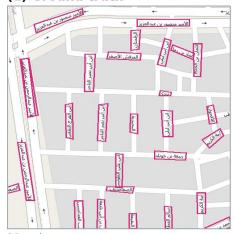

TABLE IV  
RECOGNITION AND END-TO-END SPOTTING USING QWEN3.5-4B. TOOL VARIANTS USE YOLO26 LOCALIZATION. M DENOTES GEOMETRY-MATCHED PAIRS; METRIC VALUES ARE IN %.
<table><tr><td>Input</td><td>Test set Method</td><td></td><td>M Exact ↑</td><td></td><td>CER↓</td><td></td><td></td><td>WER↓ 1-NED ↑ E2E H ↑</td></tr><tr><td rowspan="3">OSM</td><td rowspan="3">Test-I</td><td>Direct VLM</td><td>818</td><td>37.2</td><td>21.6</td><td>36.1</td><td>75.2</td><td>12.8</td></tr><tr><td>Tool (zero-shot)</td><td>2181</td><td>69.9</td><td>10.6</td><td>19.0</td><td>91.9</td><td>61.7</td></tr><tr><td>Tool (adapted)</td><td>2181</td><td>84.3</td><td>4.6</td><td>10.2</td><td>96.5</td><td>74.4</td></tr><tr><td rowspan="3">OSM</td><td rowspan="3">Test-II</td><td>Direct VLM</td><td>1409</td><td>47.1</td><td>16.3</td><td>33.5</td><td>85.0</td><td>22.3</td></tr><tr><td>Tool (zero-shot)</td><td>2277</td><td>67.9</td><td>18.9</td><td>25.3</td><td>85.7</td><td>51.9</td></tr><tr><td>Tool (adapted)</td><td>2277</td><td>74.9</td><td>9.0</td><td>18.1</td><td>93.5</td><td>57.3</td></tr><tr><td rowspan="3">RS+OSM Test-I</td><td rowspan="3"></td><td>Direct VLM</td><td>763</td><td>35.5</td><td>25.7</td><td>41.0</td><td>73.4</td><td>12.2</td></tr><tr><td>Tool (zero-shot)</td><td>2193</td><td>66.2</td><td>12.2</td><td>24.7</td><td>91.1</td><td>58.5</td></tr><tr><td>Tool (adapted)</td><td>2193</td><td>82.5</td><td>4.6</td><td>10.7</td><td>96.2</td><td>72.9</td></tr><tr><td rowspan="3">RS+OSM Test-II</td><td rowspan="3"></td><td>Direct VLM</td><td>1095</td><td>38.8</td><td>20.8</td><td>38.9</td><td>80.7</td><td>14.7</td></tr><tr><td>Tool (zero-shot)</td><td>2367</td><td>65.7</td><td>20.4</td><td>28.4</td><td>85.4</td><td>51.6</td></tr><tr><td>Tool (adapted)</td><td>2367</td><td>72.5</td><td>9.9</td><td>20.0</td><td>93.0</td><td>57.0</td></tr></table>

$$
\mathrm { E x a c t } = \frac { 1 } { M } \sum _ { i = 1 } ^ { M } \mathbf { 1 } ( \hat { s } _ { i } = s _ { i } ) ,\tag{9}
$$

$$
\mathrm { C E R } = \frac { \sum _ { i = 1 } ^ { M } d _ { \mathrm { c } } ( \hat { s } _ { i } , s _ { i } ) } { \sum _ { i = 1 } ^ { M } | s _ { i } | _ { \mathrm { c } } } ,\tag{10}
$$

$$
\mathrm { W E R } = \frac { \sum _ { i = 1 } ^ { M } d _ { \mathrm { w } } ( \hat { s } _ { i } , s _ { i } ) } { \sum _ { i = 1 } ^ { M } | s _ { i } | _ { \mathrm { w } } } ,\tag{11}
$$

$$
\mathrm { 1 - N E D } = \frac { 1 } { M } \sum _ { i = 1 } ^ { M } \left( 1 - \frac { d _ { \mathrm { c } } ( \hat { s } _ { i } , s _ { i } ) } { \operatorname* { m a x } ( | \hat { s } _ { i } | _ { \mathrm { c } } , | s _ { i } | _ { \mathrm { c } } , 1 ) } \right) ,\tag{12}
$$

where 1(·) is the indicator function. The distances $d _ { \mathrm { c } }$ and $d _ { \mathrm { w } }$ are the character-level and word-level Levenshtein distances, and | · |c and | · |w denote the corresponding sequence lengths. CER and WER are computed from the total edit errors and reference lengths, whereas 1-NED gives equal weight to each matched instance. Higher Exact and 1-NED and lower CER and WER indicate better recognition. Because recognition is scored only on matched pairs, methods with different detections may be evaluated on different subsets of text instances.

## C. Results

Table III compares the detection performance of the direct VLM and YOLO26. YOLO26 achieves higher precision and recall in all four settings. On Test-I, its H-mean reaches 88.2% on OSM and 88.4% on RS+OSM, compared with 34.5% and 34.2% for the direct VLM. The largest recall difference occurs on Test-I RS+OSM, where YOLO26 detects 92.6% of the reference instances, compared with 32.2% for the direct VLM.

On Test-II, YOLO26 retains its advantage over the direct VLM, although its H-mean falls to 76.5% on OSM and 78.6% on RS+OSM. Its detection performance is similar across the two Test-I views, with a difference of 0.2 percentage points. On Test-II, RS+OSM gives a 2.1-point higher H-mean than OSM. Figure 5 compares reference polygons and predicted text regions for both test partitions and input views.

Table IV reports recognition and end-to-end spotting performance. With zero-shot recognition, the tool-augmented pipeline achieves end-to-end H-means of 61.7% on Test-I OSM and 58.5% on Test-I RS+OSM, compared with 12.8% and 12.2% for the direct VLM. It also achieves higher endto-end H-means on both Test-II views.

(c) YOLO26  
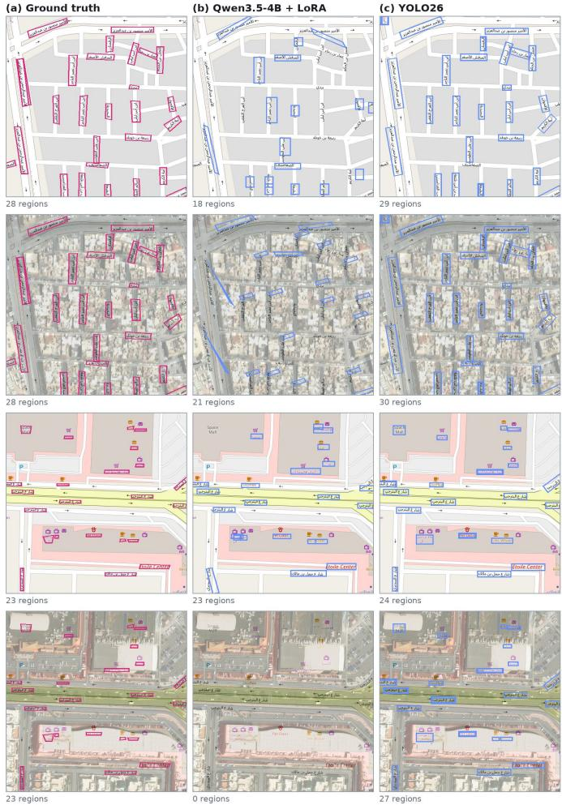  
Fig. 5. Localization examples. Rows: Test-I OSM, Test-I RS+OSM, Test-II OSM, and Test-II RS+OSM. Columns: (a) ground truth, (b) adapted direct Qwen3.5-4B, and (c) YOLO26. Reference polygons are magenta; predictions are blue.

TABLE V  
DETECTION WITH AND WITHOUT JOINT TRANSCRIPTION. VALUES ARE IN %.
<table><tr><td></td><td></td><td colspan="3">Direct VLM</td><td colspan="3">Detection-only VLM</td><td colspan="3">YOLO26</td></tr><tr><td>Input</td><td>Test set</td><td>P</td><td>R</td><td>H-mean</td><td>P</td><td>R</td><td>H-mean</td><td>P</td><td>R</td><td>H-mean</td></tr><tr><td>OSM</td><td>Test-I</td><td>34.5</td><td>34.6</td><td>34.5</td><td>42.0</td><td>48.6</td><td>45.1</td><td>84.7</td><td>92.1</td><td>88.2</td></tr><tr><td>OSM</td><td>Test-II</td><td>46.7</td><td>48.0</td><td>47.4</td><td>47.5</td><td>53.5</td><td>50.3</td><td>75.5</td><td>77.6</td><td>76.5</td></tr><tr><td>RS+OSM</td><td>Test-I</td><td>36.5</td><td>32.2</td><td>34.2</td><td>50.5</td><td>49.8</td><td>50.1</td><td>84.5</td><td>92.6</td><td>88.4</td></tr><tr><td>RS+OSM</td><td>Test-II</td><td>38.5</td><td>37.3</td><td>37.9</td><td>52.7</td><td>49.7</td><td>51.2</td><td>76.6</td><td>80.6</td><td>78.6</td></tr></table>

TABLE VI

EFFECT OF VLM SIZE ON RECOGNITION AND SPOTTING. TOOL VARIANTS SHARE YOLO26 DETECTIONS. M DENOTES GEOMETRY-MATCHED PAIRS; METRIC VALUES ARE IN %.
<table><tr><td>Input</td><td>Test set Method</td><td></td><td>VLM</td><td>M Exact ↑</td><td></td><td>CER↓ WER↓ 1-NED ↑ E2E H ↑</td><td></td><td></td><td></td></tr><tr><td rowspan="6">OSM</td><td rowspan="6">Test-I</td><td>Direct</td><td>4B</td><td>818</td><td>37.2</td><td>21.6</td><td>36.1</td><td>75.2</td><td>12.8</td></tr><tr><td>Direct</td><td>0.8B</td><td>146</td><td>34.2</td><td>26.2</td><td>38.2</td><td>72.8</td><td>2.2</td></tr><tr><td>Tool (zero-shot)</td><td>4B</td><td>2181</td><td>69.9</td><td>10.6</td><td>19.0</td><td>91.9</td><td>61.7</td></tr><tr><td>Tool (zero-shot)</td><td>0.8B</td><td>2181</td><td>38.6</td><td>15.7</td><td>40.7</td><td>85.2</td><td>34.1</td></tr><tr><td>Tool (adapted)</td><td>4B</td><td>2181</td><td>84.3</td><td>4.6</td><td>10.2</td><td>96.5</td><td>74.4</td></tr><tr><td>Tool (adapted)</td><td>0.8B</td><td>2181</td><td>76.6</td><td>5.3</td><td>13.2</td><td>94.9</td><td>67.6</td></tr><tr><td rowspan="6">OSM Test-II</td><td>Direct</td><td>4B</td><td>1409</td><td>47.1</td><td>16.3</td><td>33.5</td><td>85.0</td><td>22.3</td></tr><tr><td>Direct</td><td>0.8B</td><td>238</td><td>31.1</td><td>22.9</td><td>44.9</td><td>77.6</td><td>2.4</td></tr><tr><td>Tool (zero-shot)</td><td>4B</td><td>2277</td><td>67.9</td><td>18.9</td><td>25.3</td><td>85.7</td><td>51.9</td></tr><tr><td>Tool (zero-shot)</td><td>0.8B</td><td>2277</td><td>44.7</td><td>29.0</td><td>54.3</td><td>83.0</td><td>34.2</td></tr><tr><td>Tool (adapted)</td><td>4B</td><td>2277</td><td>74.9</td><td>9.0</td><td>18.1</td><td>93.5</td><td>57.3</td></tr><tr><td>Tool (adapted)</td><td>0.8B</td><td>2277</td><td>67.1</td><td>10.5</td><td>21.5</td><td>90.9</td><td>51.3</td></tr><tr><td rowspan="6">RS+OSM Test-I</td><td>Direct</td><td>4B</td><td>763</td><td>35.5</td><td>25.7</td><td>41.0</td><td>73.4</td><td>12.2</td></tr><tr><td>Direct</td><td>0.8B</td><td>195</td><td>24.1</td><td>28.7</td><td>47.4</td><td>68.6</td><td>1.9</td></tr><tr><td>Tool (zero-shot)</td><td>4B</td><td>2193</td><td>66.2</td><td>12.2</td><td>24.7</td><td>91.1</td><td>58.5</td></tr><tr><td>Tool (zero-shot)</td><td>0.8B</td><td>2193</td><td>37.3</td><td>16.6</td><td>44.1</td><td>85.0</td><td>33.0</td></tr><tr><td>Tool (adapted)</td><td>4B</td><td>2193</td><td>82.5</td><td>4.6</td><td>10.7</td><td>96.2</td><td>72.9</td></tr><tr><td>Tool (adapted)</td><td>0.8B</td><td>2193</td><td>72.7</td><td>6.2</td><td>15.3</td><td>94.1</td><td>64.2</td></tr><tr><td rowspan="6">RS+OSM Test-II</td><td>Direct</td><td>4B</td><td>1095</td><td>38.8</td><td>20.8</td><td>38.9</td><td>80.7</td><td>14.7</td></tr><tr><td>Direct</td><td>0.8B</td><td>285</td><td>22.5</td><td>29.4</td><td>53.0</td><td>72.7</td><td>2.2</td></tr><tr><td>Tool (zero-shot)</td><td>4B</td><td>2367</td><td>65.7</td><td>20.4</td><td>28.4</td><td>85.4</td><td>51.6</td></tr><tr><td>Tool (zero-shot)</td><td>0.8B</td><td>2367</td><td>45.5</td><td>29.7</td><td>54.9</td><td>82.6</td><td>35.8</td></tr><tr><td>Tool (adapted)</td><td>4B</td><td>2367</td><td>72.5</td><td>9.9</td><td>20.0</td><td>93.0</td><td>57.0</td></tr><tr><td>Tool (adapted)</td><td>0.8B</td><td>2367</td><td>63.2</td><td>11.3</td><td>23.6</td><td>90.0</td><td>49.6</td></tr></table>

Recognition scores are computed on matched text instances. On Test-I OSM, the direct VLM matches 818 instances, compared with 2181 for the tool-augmented variants. Their recognition scores therefore describe different subsets of labels. End-to-end H-mean accounts for both localization and transcription errors. The two tool-augmented variants use the same detected regions, allowing a direct comparison of zeroshot and adapted recognition.

Reader adaptation improves all four recognition metrics in every setting. On Test-I OSM, exact-match accuracy increases from 69.9% to 84.3%, while CER decreases from 10.6% to 4.6%. End-to-end H-mean increases from 61.7% to 74.4% on OSM and from 58.5% to 72.9% on RS+OSM. The endto-end gains are smaller on Test-II: H-mean increases from 51.9% to 57.3% on OSM and from 51.6% to 57.0% on RS+OSM. Reader adaptation also benefits the unseen city, although performance remains below that on Test-I.

TABLE VII  
AVERAGE INFERENCE TIME IN MS OVER THE TEST SETS ON ONE NVIDIA RTX A6000.
<table><tr><td>Stage</td><td>Qwen3.5-4BQwen3.5-0.8B</td><td></td></tr><tr><td>YOLO26 localization</td><td>40.5</td><td>40.5</td></tr><tr><td>Crop rectification</td><td>42.0</td><td>42.1</td></tr><tr><td>VLM recognition</td><td>1619.0</td><td>917.7</td></tr><tr><td>Total per tile</td><td>1701.5</td><td>1000.3</td></tr><tr><td>Recognition per text crop</td><td>87.4</td><td>49.5</td></tr></table>

## D. Sensitivity analysis

The tool-augmented pipeline achieves higher end-to-end spotting performance than direct generation in both test cities and input views. We examine these results further through the effect of joint transcription on localization, the influence of VLM size, and the trade-off between spotting accuracy and inference time. To assess the effect of joint transcription, we adapt Qwen3.5-4B with LoRA to predict text polygons without transcriptions. The remaining training and inference settings follow those of direct spotting.

As shown in Table V, removing transcription improves detection H-mean in all four settings. On Test-I, H-mean increases from 34.5% to 45.1% on OSM and from 34.2% to 50.1% on RS+OSM. However, the detection-only VLM still falls below YOLO26 in every setting. Joint transcription therefore appears to contribute to the localization gap, but does not fully explain it.

We next replace Qwen3.5-4B with Qwen3.5-0.8B under the same three spotting paradigms and adaptation settings. The tool-augmented variants retain the same YOLO26 detector, detected regions, and crop preparation. Table VI shows that the 0.8B model achieves end-to-end H-means of 1.9%–2.4% under direct spotting, compared with 12.2%–22.3% for the 4B model. With specialized localization and adapted recognition, the 0.8B model reaches 49.6%–67.6%. The tool-augmented pipeline improves spotting for both model sizes. Reader adaptation also narrows the performance gap between the two model sizes. On Test-I OSM, the end-to-end H-mean difference decreases from 27.6 percentage points with zeroshot recognition to 6.8 points after adaptation. The adapted 0.8B reader also achieves higher exact-match accuracy than the zero-shot 4B reader (76.6% versus 69.9%). Thus, in this setting, the adapted smaller reader outperforms the larger pretrained reader on the same detected regions.

Table VII reports inference time, which is dominated by text recognition. Using the 0.8B reader reduces total time from 1.70 to 1.00 seconds per tile, giving a 1.7× speed-up. This speed-up comes with a lower end-to-end H-mean after adaptation than that of the 4B reader.

## VI. CONCLUSION

We introduced ARABGEOTEXT, a benchmark for Arabic geospatial text spotting in Riyadh and Jeddah. Each location provides an OSM rendering and a composite formed by overlaying the rendering on satellite imagery. The paired images preserve the same labels and their pixel locations, allowing comparison between the two views. The benchmark supports evaluation within the training city and in an unseen city.

We proposed a tool-augmented framework that combines YOLO26 text localization and crop rectification with LoRAadapted VLM recognition. The framework outperforms direct full-image VLM spotting on both views and test cities. Reader adaptation further improves recognition and end-to-end spotting. Removing transcription from direct VLM generation improves detection, but a substantial gap to YOLO26 remains. These results support the use of specialized localization followed by VLM recognition for this task.

Future work will investigate adaptation to new cities with fewer labeled examples and more efficient text recognition. Extending the benchmark to additional cities would allow a broader evaluation of geographic generalization.

## FUNDING

This research was funded by the Ongoing Research Funding Program, King Saud University, grant number ORF-2026-1606.

## REFERENCES

[1] J. Kim, Z. Li, Y. Lin, M. Namgung, L. Jang, and Y.-Y. Chiang, “The mapKurator system: A complete pipeline for extracting and linking text from historical maps,” in Proceedings of the 31st ACM International Conference on Advances in Geographic Information Systems. Hamburg, Germany: Association for Computing Machinery, 2023, pp. 1–4. [Online]. Available: https://doi.org/10.1145/3589132.3625579

[2] Z. Li, Y. Lin, Y.-Y. Chiang, J. Weinman, S. Tual, J. Chazalon, J. Perret, B. Dumenieu, and N. Abadie, “ICDAR 2024 competition on historical´ map text detection, recognition, and linking,” in Document Analysis and Recognition — ICDAR 2024, ser. Lecture Notes in Computer Science, vol. 14809. Cham, Switzerland: Springer, 2024, pp. 363–380. [Online]. Available: https://doi.org/10.1007/978-3-031-70552-6 22

[3] Y. Lin, S. Tual, Z. Li, L. Jang, Y.-Y. Chiang, J. Weinman, J. Chazalon, E. Carlinet, J. Perret, N. Abadie, B. Dumenieu, T.-C. Chan, H.-´ M. Liao, W.-R. Su, M. Zou, T. Dai, R. Petitpierre, B. Vaienti, F. Kaplan, I. di Lenardo, Y. Baek, M. Hentschel, Y. Nakagome, I. Shuta, J. Lee, and C. Choi, “ICDAR 2025 competition on historical map text detection, recognition, and linking,” in Document Analysis and Recognition – ICDAR 2025, ser. Lecture Notes in Computer Science, X.-C. Yin, D. Karatzas, and D. Lopresti, Eds., vol. 16027. Cham: Springer, 2026, pp. 568–585. [Online]. Available: https://doi.org/10.1007/978-3-032-04630-7 33

[4] H. Hassan, A. El-Mahdy, and M. E. Hussein, “Arabic scene text recognition in the deep learning era: Analysis on a novel dataset,” IEEE Access, vol. 9, pp. 107 046–107 058, 2021. [Online]. Available: https://doi.org/10.1109/access.2021.3100717

[5] S. A. Mahmoud, I. Ahmad, W. G. Al-Khatib, M. Alshayeb, M. T. Parvez, V. Margner, and G. A. Fink, “KHATT: An¨ open Arabic offline handwritten text database,” Pattern Recognit., vol. 47, no. 3, pp. 1096–1112, 2014. [Online]. Available: https: //doi.org/10.1016/j.patcog.2013.08.009

[6] F. Slimane, R. Ingold, S. Kanoun, A. M. Alimi, and J. Hennebert, “A new Arabic printed text image database and evaluation protocols,” in Proceedings of the International Conference on Document Analysis and Recognition (ICDAR), Barcelona, Spain, 2009, pp. 946–950. [Online]. Available: https://doi.org/10.1109/icdar.2009.155

[7] A. Heakl, M. A. Sohail, M. Ranjan, R. Elbadry, G. S. Ahmad, M. El-Geish, O. Maher, Z. Shen, F. S. Khan, and S. Khan, “KITAB-bench: A comprehensive multi-domain benchmark for Arabic OCR and document understanding,” in Findings of the Association for Computational Linguistics: ACL 2025. Vienna, Austria: Association for Computational Linguistics, July 2025, pp. 22 006–22 024. [Online]. Available: https://aclanthology.org/2025.findings-acl.1135

[8] Y. Alhabashi, O. Nacar, S. Sibaee, A. Ammar, and W. Boulila, “SARD: A large-scale synthetic Arabic OCR dataset for book-style text recognition,” Sci. Data, vol. 13, no. 1, p. 1326, 2026. [Online]. Available: https://doi.org/10.1038/s41597-026-07780-5

[9] S. Patle, S. Ghaboura, H. Tariq, M. U. Khan, O. Thawakar, R. M. Anwer, and S. Khan, “DuwatBench: Bridging language and visual heritage through an Arabic calligraphy benchmark for multimodal understanding,” in Proceedings of the 19th Conference of the European Chapter of the Association for Computational Linguistics (Volume 1: Long Papers). Association for Computational Linguistics, 2026, pp. 5256–5269. [Online]. Available: https://doi.org/10.18653/v1/2026. eacl-long.243

[10] Y. Bazi, L. Bashmal, M. M. Al Rahhal, R. Ricci, and F. Melgani, “RS-LLaVA: A large vision-language model for joint captioning and question answering in remote sensing imagery,” Remote Sens., vol. 16, no. 9, p. 1477, 2024. [Online]. Available: https://doi.org/10.3390/rs16091477

[11] W. Zhang, M. Cai, T. Zhang, Y. Zhuang, and X. Mao, “EarthGPT: A universal multimodal large language model for multisensor image comprehension in remote sensing domain,” IEEE Trans. Geosci. Remote Sens., vol. 62, pp. 1–20, 2024. [Online]. Available: https://doi.org/10.1109/tgrs.2024.3409624

[12] X. Li, C. Wen, Y. Hu, Z. Yuan, and X. X. Zhu, “Vision-language models in remote sensing: Current progress and future trends,” IEEE Geosci. Remote Sens. Mag., vol. 12, no. 2, pp. 32–66, 2024. [Online]. Available: https://doi.org/10.1109/mgrs.2024.3383473

[13] M. Li, T. Lv, J. Chen, L. Cui, Y. Lu, D. Florencio, C. Zhang, Z. Li, and F. Wei, “TrOCR: Transformer-based optical character recognition with pre-trained models,” Proc. AAAI Conf. Artif. Intell., vol. 37, no. 11, pp. 13 094–13 102, 2023. [Online]. Available: https://doi.org/10.1609/aaai.v37i11.26538

[14] H. Wei, C. Liu, J. Chen, J. Wang, L. Kong, Y. Xu, Z. Ge, L. Zhao, J. Sun, Y. Peng, C. Han, and X. Zhang, “General OCR Theory: Towards

OCR-2.0 via a Unified End-to-end Model,” arXiv, p. arXiv:2409.01704, 2024. [Online]. Available: https://arxiv.org/abs/2409.01704

[15] G. Jocher, J. Qiu, M. Liu, S. Lyu, F. C. Akyon, and M. E. Kalfaoglu, “Ultralytics yolo26: Unified real-time end-to-end vision models,” arXiv, p. arXiv:2606.03748, 2026. [Online]. Available: https://arxiv.org/abs/2606.03748

[16] Qwen Team, “Qwen3.5: Towards native multimodal agents,” February 2026, accessed on 9 October 2026. [Online]. Available: https: //qwen.ai/blog?id=qwen3.5

[17] E. J. Hu, Y. Shen, P. Wallis, Z. Allen-Zhu, Y. Li, S. Wang, L. Wang, and W. Chen, “LoRA: Low-rank adaptation of large language models,” in International Conference on Learning Representations, 2022. [Online]. Available: https://openreview.net/forum?id=nZeVKeeFYf9

[18] Y. Lin and Y.-Y. Chiang, “Hyper-local deformable transformers for text spotting on historical maps,” in Proceedings of the 30th ACM SIGKDD Conference on Knowledge Discovery and Data Mining. Barcelona, Spain: Association for Computing Machinery, 2024, pp. 5387–5397. [Online]. Available: https://doi.org/10.1145/3637528.3671589

[19] Y. Lin, R. Olson, J. Wu, Y.-Y. Chiang, and J. Weinman, “LIGHT: Multi-modal text linking on historical maps,” in Document Analysis and Recognition – ICDAR 2025, ser. Lecture Notes in Computer Science, X.-C. Yin, D. Karatzas, and D. Lopresti, Eds., vol. 16024. Cham: Springer, 2026, pp. 60–77. [Online]. Available: https://doi.org/10.1007/978-3-032-04617-8 4

[20] C. Cui, T. Sun, S. Liang, T. Gao, Z. Zhang, J. Liu, X. Wang, C. Zhou, H. Liu, M. Lin, Y. Zhang, Y. Zhang, Y. Liu, D. Yu, and Y. Ma, “PaddleOCR-VL-1.5: Towards a multi-task 0.9B VLM for robust in-the-wild document parsing,” arXiv, p. arXiv:2601.21957, 2026. [Online]. Available: https://arxiv.org/abs/2601.21957

[22] Y. Zhou, Y. Chen, H. Lin, Y. Wu, S. Yang, Z. Qi, C. Ma, and L. Zhu, “DOGR: Towards Versatile Visual Document Grounding and Referring,” in Proceedings of the IEEE/CVF International Conference on Computer Vision, 2025, pp. 3596–3606. [Online]. Available: https://openaccess.thecvf.com/content/ICCV2025/html/ Zhou DOGR Towards Versatile Visual Document Grounding and Referring ICCV 2025 paper.html

[21] Z. Yang, J. Tang, Z. Li, P. Wang, J. Wan, H. Zhong, X. Liu, M. Yang, P. Wang, S. Bai, L. Jin, and J. Lin, “CC-OCR: A Comprehensive and Challenging OCR Benchmark for Evaluating Large Multimodal Models in Literacy,” in Proceedings of the IEEE/CVF International Conference on Computer Vision, 2025, pp. 21 744–21 754. [Online]. Available: https://openaccess.thecvf.com/content/ICCV2025/html/Yang CC-OCR A Comprehensive and Challenging OCR Benchmark for Evaluating Large ICCV 2025 paper.html

[24] D. Muhtar, Z. Li, F. Gu, X. Zhang, and P. Xiao, “LHRS-Bot: Empowering remote sensing with VGI-enhanced large multimodal language model,” in Computer Vision – ECCV 2024, ser. Lecture Notes in Computer Science, vol. 15132. Milan, Italy: Springer, 2025, pp. 440– 457. [Online]. Available: https://doi.org/10.1007/978-3-031-72904-1 26

[23] J. Chen, Y. Liu, D. Li, X. An, W. Deng, Z. Feng, Y. Zhao, and Y. Xie, “Plug-and-Play Grounding of Reasoning in Multimodal Large Language Models,” arXiv, p. arXiv:2403.19322, 2024. [Online]. Available: https://arxiv.org/abs/2403.19322

[25] L. Bai, X. Zhang, S. Zhang, Z. Zhang, H. Wang, W. Qin, and S. Du, “GeoLink: Empowering remote sensing foundation model with Open-StreetMap data,” in Advances in Neural Information Processing Systems (NeurIPS), San Diego, CA, USA, 2025.

and Pattern Recognition, 2026, pp. 14 335–14 345. [Online]. Available: https://openaccess.thecvf.com/content/CVPR2026/html/ Zhang GeoViS Geospatially Rewarded Visual Search for Remote Sensing Visual Grounding CVPR 2026 paper.html

[31] M. Tkachenko, M. Malyuk, A. Holmanyuk, and N. Liubimov, “Label Studio: Data labeling software,” 2020–2025, open-source software; accessed on 9 October 2026. [Online]. Available: https: //github.com/HumanSignal/label-studio

[26] A. Pierdominici, R. Ricci, M. Alruqimi, and F. Melgani, “OSM-CLIP: Enhancing remote sensing image–text representation learning with openstreetmap data,” Appl. Sci., vol. 16, no. 14, p. 7002, 2026. [Online]. Available: https://doi.org/10.3390/app16147002

[27] S. M. Ailuro, M. Markov, M. Mahdi, D. Boychev, L. Van Gool, and D. P. Paudel, “OSMDA: OpenStreetMap-based Domain Adaptation for Remote Sensing VLMs,” arXiv, p. arXiv:2603.11804, 2026. [Online]. Available: https://arxiv.org/abs/2603.11804

[28] S. Choudhury, P. Kurkure, and B. Banerjee, “Improving visual grounding in remote sensing images with adaptive modality guidance,” ISPRS J. Photogramm. Remote Sens., vol. 224, pp. 42–58, 2025. [Online]. Available: https://doi.org/10.1016/j.isprsjprs.2025.02.031

[29] Y. Zhou, M. Lan, X. Li, L. Feng, Y. Ke, X. Jiang, Q. Li, X. Yang, and W. Zhang, “GeoGround: A unified large vision–language model for remote sensing visual grounding,” arXiv, p. arXiv:2411.11904, 2024. [Online]. Available: https://arxiv.org/abs/2411.11904

[30] P. Zhang, Y. Zhang, L. Xu, J. Lin, Z. Guo, F. Wang, X. Yang, K. Wei, and L. Wang, “GeoViS: Geospatially Rewarded Visual Search for Remote Sensing Visual Grounding,” in Proceedings of the IEEE/CVF Conference on Computer Vision