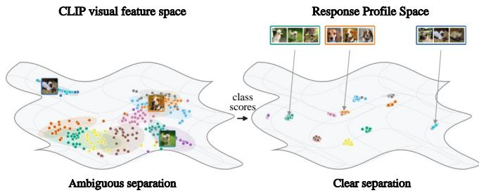
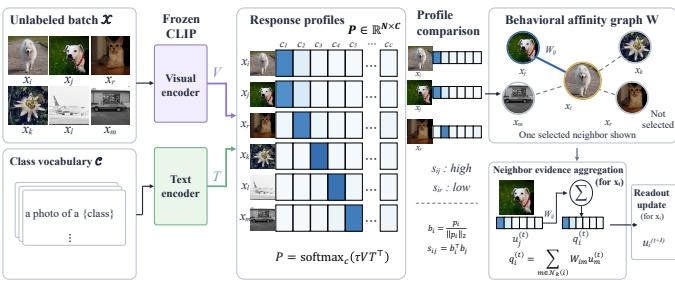
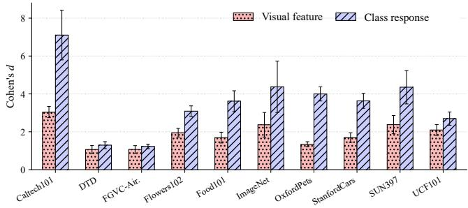
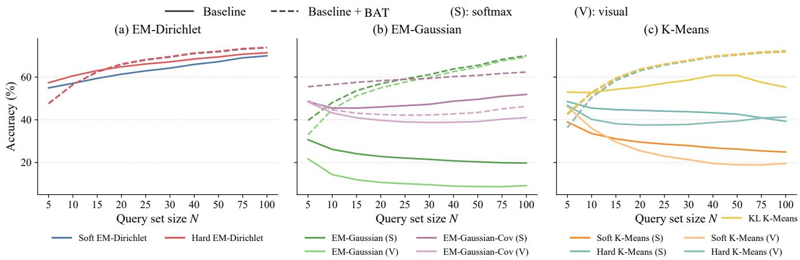
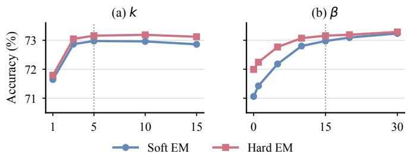

# BEHAVIORAL AFFINITY TRANSDUCTION FOR ZERO-SHOT VISION-LANGUAGE CLASSIFICATION

Junxi Huang1, Wenshuo Chen2, Xiucheng Wang1, Meitong Shen1, Shaofeng Liang2, Yuehan Kou1, Yutao Yue2,†, Nan Cheng1,∗

1School of Telecommunications Engineering, Xidian University, Xi’an, Shaanxi 710071, China 2The Hong Kong University of Science and Technology (Guangzhou), Guangzhou, China

## ABSTRACT

An image that is hard to classify on its own may have a helpful neighbor in the same unlabeled batch. Zero-shot vision-language models (VLMs) score images independently and leave this evidence unused. We study small unlabeled query batches with no labeled examples. Visual similarity can reflect pose or background, so it may connect images from different classes. Each image’s scores over the class vocabulary offer another way to choose neighbors. We introduce Behavioral Affinity Transduction (BAT), which builds a sparse graph from these class-response profiles. The graph supplies neighbor evidence during prediction. For EM-Dirichlet, it also screens candidate classes and initializes assignments. BAT plugs into direct and iterative readouts of a frozen VLM. Across diverse datasets, BAT improves the mean accuracy of every tested readout. In the main RN50 comparison, soft and hard EM-Dirichlet gain 4.22 and 2.72 percentage points.

Index Terms— Vision-language models, zero-shot classification, transductive inference, affinity graphs, class response

## 1. INTRODUCTION

Consider a small album of pet photos. One beagle is partly hidden by a blanket, while another is clearly visible. A terrier in the same room may resemble the hidden beagle more because of the background. A zero-shot vision-language model (VLM) such as CLIP scores each photo against breed names independently [1]. The clear beagle could help label the hidden one if the model knew which photos to compare. Video clips and photo collections often provide such unlabeled groups. Transductive inference uses the group to refine predictions jointly.

We study one unlabeled batch of N = 75 images with a frozen VLM and the full class vocabulary. There are no labeled support images or other test samples. EM-Dirichlet fits class distributions to batch responses [2], and StatA adapts to the classes present [3]. These methods estimate class usage across the batch. A difficult image still needs relevant peers. TransCLIP uses visual affinities [4]. ZLaP and ECALP propagate labels on image-text graphs [5, 6], with ZLaP’s transductive version using the full test set. In a batch of 75, a misplaced edge can pass evidence from the wrong image.

  
Fig. 1. OxfordPets visual and response t-SNE projections.

Occlusion can separate the beagles in visual space. Their scores over the same breed names may still agree. Figure 1 shows this pattern on OxfordPets. BAT uses the full class response to find images with similar plausible labels and joins them in a sparse graph.

BAT fits between the frozen VLM and a readout, as Fig. 2 shows. It builds one graph from cached class responses, then gathers neighboring assignments into a class message at each step. Direct prediction uses the message to revise scores. Iterative readouts use it to update assignments. EM-Dirichlet also uses the graph to screen candidate classes and initialize assignments. The encoders and class prototypes stay fixed, making BAT a plug-and-play module.

We make three contributions.

• We build a sparse graph from class responses to link images with shared category evidence.

• BAT shares one graph across seven readouts of a frozen VLM as a plug-and-play module.

• At N = 75, all seven readouts gain mean accuracy on ten datasets. Response graphs also outperform visual graphs for EM-Dirichlet.

  
Fig. 2. BAT graph construction and readout integration.

## 2. BEHAVIORAL AFFINITY TRANSDUCTION

## 2.1. Response Profiles

Given N unlabeled images and C candidate classes, let $V \in$ R $N \times D$ collect normalized visual features. Let $T \in \mathbb { R } ^ { C \times D }$ collect the corresponding text prototypes. The resulting class response matrix is

$$
P = \mathrm { s o f t m a x } _ { c } \big ( \tau V T ^ { \top } \big ) ,\tag{1}
$$

where $\tau$ controls the response scale and softmax acts across classes. Each row $p _ { i } = P _ { i }$ : contains one image’s scores over the vocabulary. We normalize it as $b _ { i } = p _ { i } / \| p _ { i } \| _ { 2 }$ . The profile retains plausible alternatives beyond the top prediction.

## 2.2. Behavioral Affinity Graph

Two samples are neighbors when their response profiles agree across the vocabulary. Let $\mathcal { N } _ { k } ( i )$ contain the min $( k , N - 1 )$ closest other query samples. BAT assigns their normalized affinity as

$$
W _ { i j } = \frac { \mathbb { I } [ j \in \mathcal { N } _ { k } ( i ) ] \exp \left( { b _ { i } ^ { \top } b _ { j } / \tau _ { g } } \right) } { \sum _ { \ell \in \mathcal { N } _ { k } ( i ) } \exp \left( { b _ { i } ^ { \top } b _ { \ell } / \tau _ { g } } \right) } ,\tag{2}
$$

where $\tau _ { g }$ controls how strongly each row favors its closest neighbors. The sparse matrix satisfies $\textstyle \sum _ { j } W _ { i j } = 1$ . Every profile uses the same class names, so each edge measures agreement in category evidence. BAT builds W once and reuses it throughout inference.

The response overlap has a simple interpretation. If class labels are drawn independently from $p _ { i }$ and $p _ { j }$ , their chance of agreement is $\sum _ { c } p _ { i c } p _ { j c }$ . BAT normalizes this overlap by the concentration of each response:

$$
b _ { i } ^ { \top } b _ { j } = \frac { \sum _ { c } p _ { i c } p _ { j c } } { \sqrt { \sum _ { c } p _ { i c } ^ { 2 } } \sqrt { \sum _ { c } p _ { j c } ^ { 2 } } } .\tag{3}
$$

Near one-hot responses connect matching classes and separate different classes. Ambiguous responses can agree through several plausible labels. Softmax also depends only on differences between class logits. Let $p ( v )$ denote the class response of a normalized feature v. For any normalized $v ^ { \prime }$ and scalar a,

$$
( v ^ { \prime } - v ) T ^ { \top } = a \mathbf { 1 } _ { C } \quad \Longrightarrow \quad p ( v ^ { \prime } ) = p ( v ) .
$$

Feature changes orthogonal to all differences between text prototypes satisfy this condition. Such changes can alter visual cosine similarity while leaving the response graph unchanged. BAT therefore selects neighbors in the geometry induced by the class vocabulary.

## 2.3. Integration Across Readouts

Let $U ^ { ( t ) } ~ \in ~ \mathbb { R } ^ { N \times C }$ denote the assignments at iteration t. Multiplication by W gathers neighboring class evidence as $Q ^ { ( t ) } \stackrel { \mathbf { \bar { \mathbf { \Lambda } } } } { = } W U ^ { ( t ) }$ . For K-means and EM readouts, each method supplies its own scores $S ^ { ( t ) }$ , and BAT adds graph evidence at the assignment step. Their updated scores and assignments are

$$
\widetilde { S } ^ { ( t ) } = S ^ { ( t ) } + \beta \log \left( Q ^ { ( t ) } + \epsilon \right) ,\tag{4}
$$

$$
U ^ { ( t + 1 ) } = \mathrm { s o f t m a x } _ { c } \Big ( \widetilde { S } ^ { ( t ) } \Big ) .\tag{5}
$$

The coefficient $\beta$ controls graph evidence, and ϵ keeps the logarithm finite. For fixed neighbor messages, the softmax update maximizes $\langle u , S _ { i : } ^ { ( t ) } + \beta \log ( Q _ { i : } ^ { ( t ) } + \epsilon ) \rangle + H ( u )$ over the class simplex. The entropy $\begin{array} { r } { H ( u ) = - \sum _ { c } u _ { c } } \end{array}$ log $u _ { c }$ retains uncertainty. For two classes c and $d ,$ the update gives

$$
\begin{array} { r l r } {  { \log \frac { u _ { i c } ^ { ( t + 1 ) } } { u _ { i d } ^ { ( t + 1 ) } } = S _ { i c } ^ { ( t ) } - S _ { i d } ^ { ( t ) } } } \\ & { } & { + \beta \log \frac { Q _ { i c } ^ { ( t ) } + \epsilon } { Q _ { i d } ^ { ( t ) } + \epsilon } . } \end{array}\tag{6}
$$

The readout score and neighbor support combine multiplicatively in the resulting assignment. A class overtakes another when its weighted neighbor log-odds exceeds the opposing score gap. Soft readouts keep the distribution. Hard readouts select its largest entry. K-means and Gaussian models apply the update during assignment. For direct prediction, BAT starts at $U ^ { ( 0 ) } ~ = ~ { \cal P }$ and runs ten steps of $\mathbf { \bar { \chi } } _ { U } ( t { + } 1 ) \ = \ \mathbf { \bar { \chi } } _ { } $ $( 1 - \gamma ) P + \gamma W U ^ { ( t ) }$ with $\gamma = 0 . 5$ . Because W is row stochastic, this update converges to $\begin{array} { r } { U ^ { \star } = ( 1 - \gamma ) \sum _ { r = 0 } ^ { \infty } \gamma ^ { r } W ^ { r } P . } \end{array}$ Here $W ^ { r } P$ gathers evidence r graph steps away, and $\gamma ^ { r }$ reduces the influence of longer paths.

  
Fig. 3. Visual and response class separation by Cohen’s d.

  
Fig. 4. Accuracy across query sizes for EM-Dirichlet, Gaussian, and K-means readouts.

## 2.4. BAT with EM-Dirichlet

EM-Dirichlet fits a Dirichlet model to each class by alternating assignment and parameter updates [2]. For input $x _ { i } = p _ { i }$ and class parameters $\alpha _ { c } ^ { ( t ) }$ , its score is

$$
\ell _ { i c } ^ { ( t ) } = \log \mathrm { D i r } \Big ( x _ { i } ; \alpha _ { c } ^ { ( t ) } \Big ) + \lambda v _ { c } ^ { ( t ) } / N ,\tag{7}
$$

where $\lambda = N \lfloor C / 5 \rfloor$ and $v _ { c } ^ { ( t ) }$ is the log batch mean assignment to class $c ,$ shifted by one. This term captures overall class usage. BAT first screens candidate classes using neighbor predictions. In the initial assignments, classes absent from this set are set to ϵ before each row is normalized to obtain ${ \widetilde { P } } .$ Graph propagation then initializes EM through

$$
\begin{array} { r l r } { \displaystyle } & { \displaystyle } & { \boldsymbol { U } ^ { ( 0 ) } = \widetilde { \boldsymbol { P } } , } \\ { \displaystyle } & { \boldsymbol { U } ^ { ( r + 1 ) } = \eta \boldsymbol { U } ^ { ( r ) } + ( 1 - \eta ) W \boldsymbol { U } ^ { ( r ) } , } & { r = 0 , \ldots , R - 1 , } \end{array}\tag{8}
$$

where η balances each response with its neighborhood. At each EM iteration, the graph adds neighboring assignments to the Dirichlet scores,

$$
u _ { i : } ^ { ( t + 1 ) } = \mathrm { s o f t m a x } _ { c } \Big ( \ell _ { i : } ^ { ( t ) } + \beta \log \Big ( Q _ { i : } ^ { ( t ) } + \epsilon \Big ) \Big ) .\tag{9}
$$

BAT computes $Q ^ { ( t ) }$ from the preceding assignments and updates all samples in parallel. Soft BAT keeps the complete distribution. Hard BAT selects one class per sample.

Response computation costs $\mathcal { O } ( N D C )$ , and pairwise affinity costs $\mathcal { O } ( N ^ { \bar { 2 } } C )$ . The graph stores $\mathcal { O } ( N k )$ edges, so each update costs $\mathcal { O } ( N k C )$ . All stages operate on cached VLM responses with one shared graph.

Table 1. EM-Dirichlet [2] accuracy on RN50 (%).
<table><tr><td rowspan="2">Dataset</td><td colspan="2">Soft</td><td colspan="2">Hard</td></tr><tr><td>Base</td><td>BAT</td><td>Base</td><td>BAT</td></tr><tr><td>Caltech101</td><td>88.42</td><td>91.28</td><td>89.54</td><td>91.29</td></tr><tr><td>DTD</td><td>47.17</td><td>49.76</td><td>48.66</td><td>50.27</td></tr><tr><td>Aircraft</td><td>19.25</td><td>22.16</td><td>20.38</td><td>22.09</td></tr><tr><td>Flowers102 71.62</td><td></td><td>75.54</td><td>73.17</td><td>75.51</td></tr><tr><td>Food101</td><td>88.21</td><td>93.01</td><td>90.39</td><td>93.10</td></tr><tr><td>ImageNet</td><td>76.67</td><td>82.26</td><td>77.32</td><td>82.59</td></tr><tr><td>Pets</td><td>87.53</td><td>93.59</td><td>91.08</td><td>93.55</td></tr><tr><td>Cars</td><td>65.72</td><td>71.81</td><td>68.09</td><td>72.43</td></tr><tr><td>SUN397</td><td>77.31</td><td>81.14</td><td>78.58</td><td>81.52</td></tr><tr><td>UCF101</td><td>68.05</td><td>71.55</td><td>69.70</td><td>71.70</td></tr><tr><td>Average</td><td>68.99</td><td>73.21</td><td>70.69</td><td>73.41</td></tr></table>

Table 2. Readout accuracy (%) across ten datasets. Gains use unrounded means.
<table><tr><td>Readout</td><td>Base +BAT</td><td>Gain</td></tr><tr><td>Direct prediction [1] 60.75</td><td>68.22</td><td>+7.47</td></tr><tr><td>Soft K-means [7] 25.26</td><td>71.82</td><td>+46.56</td></tr><tr><td>Hard K-means [8] 41.19</td><td>71.42</td><td>+30.23</td></tr><tr><td>KL K-means [9] 57.94</td><td>71.53</td><td>+13.60</td></tr><tr><td>EM-Gaussian [10] 19.69</td><td>68.46</td><td>+48.77</td></tr><tr><td>Soft EM-Dir. [2] 68.99</td><td>73.06</td><td>+4.07</td></tr><tr><td>Hard EM-Dir. [2] 70.69</td><td>73.28</td><td>+2.59</td></tr></table>

## 3. EXPERIMENTS

## 3.1. Experimental Setup

Table 1 covers ten datasets [11, 12, 13, 14, 15, 16, 17, 18, 19, 20]. Each task samples three to ten classes and $N = 7 5$ queries, retaining the full vocabulary. The main RN50 table averages 1,000 tasks per dataset over five seeds for both methods. Other RN50 readout and ablation baselines use five seeds and BAT three. The matched graph-space control uses five seeds per graph. ViT-L/14 baselines use seed 0 and BAT uses three or four seeds by dataset. Frozen RN50 uses τ = 30, $k = 5 , \tau _ { g } = 0 . 0 5 , \beta = 1 5 , \eta = 0 . 5 , \mathrm { a n d } R = 2 .$

Table 3. EM-Dirichlet [2] by backbone (%).
<table><tr><td rowspan=1 colspan=4>Backbone ReadoutBase BAT Gain</td></tr><tr><td rowspan=1 colspan=1>RN50    Soft    68.99</td><td rowspan=1 colspan=1>73.06</td><td></td><td rowspan=1 colspan=1>+4.07</td></tr><tr><td rowspan=1 colspan=1>Hard   70.69</td><td rowspan=1 colspan=2> $7 3 . 2 8 \ \pm</td><td rowspan=1 colspan=1>2 . 5 9$ </td></tr><tr><td rowspan=1 colspan=1>ViT-L/14Soft    77.898</td><td rowspan=1 colspan=1>1.71</td><td></td><td rowspan=1 colspan=1>+3.83</td></tr><tr><td rowspan=1 colspan=1>Hard   79.16</td><td rowspan=1 colspan=1>81.83</td><td></td><td rowspan=1 colspan=1>+2.67</td></tr></table>

Table 4. Graph quality across ten datasets.
<table><tr><td>Metric</td><td>Visual Response</td></tr><tr><td>Same@5 (%) 11.29</td><td>14.64</td></tr><tr><td>Weighted Same@5 (%) 17.62</td><td>29.70</td></tr><tr><td>Oracle ratio (%) 67.26</td><td>83.81</td></tr></table>

## 3.2. Main Results

Across ten datasets, BAT raises soft EM-Dirichlet from 68.99% to 73.21% and hard EM-Dirichlet from 70.69% to 73.41% (Table 1). Both improve on every dataset. The largest soft gains occur on Cars (6.09 points), Pets (6.06), and ImageNet (5.59). The gains include fine-grained datasets and the broader ImageNet task.

## 3.3. Readouts and Backbones

All seven readouts gain mean accuracy at N = 75 (Table 2). K-means and Gaussian readouts benefit most as graph messages guide assignments. EM-Dirichlet gains 4.07 and 2.59 points. With ViT-L/14, soft and hard BAT reach 81.71% and 81.83% (Table 3).

## 3.4. Graph and Component Analysis

Response profiles improve the neighborhoods BAT uses. Cohen’s d rises from 1.87 for visual features to 3.54 for class responses (Fig. 3). Same@5 rises from 11.29% to 14.64%, and weighted Same@5 from 17.62% to 29.70% (Table 4). Oracle ratio normalizes Same@5 by its task-wise maximum.

A matched five-seed control at N = 75 favors response graphs by about half a point for both EM-Dirichlet modes (Table 5).

Removing refinement, initialization, or screening costs 1.88, 0.52, or 0.34 points, respectively (Table 6). Refinement contributes at every assignment step.

Table 5. EM-Dirichlet accuracy by graph space (%).
<table><tr><td>Graph space</td><td>Soft</td><td>Hard</td></tr><tr><td>Visual</td><td>71.62</td><td>71.89</td></tr><tr><td>Response</td><td>72.13</td><td>72.37</td></tr></table>

Table 6. Soft EM-Dirichlet component ablation (%).
<table><tr><td>Configuration</td><td>Accuracy (%) Drop</td></tr><tr><td>Full BAT</td><td>73.06 0.00</td></tr><tr><td>No graph refinement</td><td>71.18 1.88</td></tr><tr><td>No graph initialization</td><td>72.54 0.52</td></tr><tr><td>No candidate screening</td><td>72.72 0.34</td></tr><tr><td>EM-Dirichlet [2] baseline</td><td>68.99 4.07</td></tr></table>

  
Fig. 5. EM-Dirichlet accuracy sensitivity to k and $\beta .$

Table 7. EM-Dirichlet [2] latency on an RTX 4080.
<table><tr><td>Readout Base (ms)</td><td></td><td></td><td>BAT (ms) Reduction (%)</td></tr><tr><td>Soft</td><td>471.51</td><td>452.68</td><td>3.99</td></tr><tr><td>Hard</td><td>456.56</td><td>451.05</td><td>1.21</td></tr></table>

## 3.5. Query Size, Sensitivity, and Cost

Figure 4 shows gains from N = 20 onward, reaching 3.79 and 2.53 points for soft and hard EM-Dirichlet at $N = 1 0 0 .$ Figure 5 shows gains leveling off after k = 5, with β most influential at low values. A few compatible neighbors can change a class ranking. Table 7 shows latency reductions of 3.99% and 1.21%.

## 4. CONCLUSION

Each image’s class response helps identify useful neighbors in an unlabeled batch. BAT turns their assignments into evidence for seven readouts of a frozen VLM. At N = 75, the response graph selects more same-label neighbors than a visual graph, and every readout gains mean accuracy across ten datasets.

Acknowledgments. Generative AI was used to translate Chinese text into English.

## 5. REFERENCES

[1] Alec Radford, Jong Wook Kim, Chris Hallacy, Aditya Ramesh, Gabriel Goh, Sandhini Agarwal, Girish Sastry, Amanda Askell, Pamela Mishkin, Jack Clark, Gretchen Krueger, and Ilya Sutskever, “Learning transferable visual models from natural language supervision,” in Proceedings of the 38th International Conference on Machine Learning. 2021, pp. 8748–8763, PMLR.

[2] Segol´ ene Martin, Yunshi Huang, Fereshteh Shakeri,\` Jean-Christophe Pesquet, and Ismail Ben Ayed, “Transductive zero-shot and few-shot CLIP,” in Proceedings of the IEEE/CVF Conference on Computer Vision and Pattern Recognition, 2024, pp. 28816–28826.

[3] Maxime Zanella, Clement Fuchs, Christophe´ De Vleeschouwer, and Ismail Ben Ayed, “Realistic test-time adaptation of vision-language models,” in Proceedings of the IEEE/CVF Conference on Computer Vision and Pattern Recognition, 2025, pp. 25103–25112.

[4] Maxime Zanella, Benoˆıt Gerin, and Ismail Ben Ayed,´ “Boosting vision-language models with transduction,” in Advances in Neural Information Processing Systems, 2024, vol. 37.

[5] Vladan Stojnic, Yannis Kalantidis, and Giorgos To-´ lias, “Label propagation for zero-shot classification with vision-language models,” in Proceedings of the IEEE/CVF Conference on Computer Vision and Pattern Recognition, 2024, pp. 23209–23218.

[6] Yushu Li, Yongyi Su, Adam Goodge, Kui Jia, and Xun Xu, “Efficient and context-aware label propagation for zero-/few-shot training-free adaptation of visionlanguage model,” in International Conference on Learning Representations, 2025.

[7] Arindam Banerjee, Srujana Merugu, Inderjit S. Dhillon, and Joydeep Ghosh, “Clustering with bregman divergences,” Journal ofMachine Learning Research, vol. 6, no. 58, pp. 1705–1749, 2005.

[8] Stuart P. Lloyd, “Least squares quantization in PCM,” IEEE Transactions on Information Theory, vol. 28, no. 2, pp. 129–137, 1982.

[9] Florent Chiaroni, Malik Boudiaf, Amar Mitiche, and Ismail Ben Ayed, “Simplex clustering via sBeta with applications to online adjustment of black-box predictions,” IEEE Transactions on Pattern Analysis and Machine Intelligence, vol. 46, no. 12, pp. 9123–9138, 2024.

[10] Christopher M. Bishop, Pattern Recognition and Machine Learning, Springer, 2006.

[11] Li Fei-Fei, Robert Fergus, and Pietro Perona, “Oneshot learning of object categories,” IEEE Transactions on Pattern Analysis and Machine Intelligence, vol. 28, no. 4, pp. 594–611, 2006.

[12] Mircea Cimpoi, Subhransu Maji, Iasonas Kokkinos, Sammy Mohamed, and Andrea Vedaldi, “Describing textures in the wild,” in Proceedings of the IEEE Conference on Computer Vision and Pattern Recognition, 2014.

[13] Subhransu Maji, Juho Kannala, Esa Rahtu, Matthew Blaschko, and Andrea Vedaldi, “Fine-grained visual classification of aircraft,” Tech. Rep., University of Oxford, 2013.

[14] Maria-Elena Nilsback and Andrew Zisserman, “Automated flower classification over a large number of classes,” in Indian Conference on Computer Vision, Graphics and Image Processing, 2008, pp. 722–729.

[15] Lukas Bossard, Matthieu Guillaumin, and Luc Van Gool, “Food-101: Mining discriminative components with random forests,” in European Conference on Computer Vision. 2014, pp. 446–461, Springer.

[16] Olga Russakovsky, Jia Deng, Hao Su, Jonathan Krause, Sanjeev Satheesh, Sean Ma, Zhiheng Huang, Andrej Karpathy, Aditya Khosla, Michael Bernstein, et al., “ImageNet large scale visual recognition challenge,” International Journal of Computer Vision, vol. 115, pp. 211–252, 2015.

[17] Omkar M. Parkhi, Andrea Vedaldi, Andrew Zisserman, and C. V. Jawahar, “Cats and dogs,” in Proceedings of the IEEE Conference on Computer Vision and Pattern Recognition, 2012.

[18] Jonathan Krause, Michael Stark, Jia Deng, and Li Fei-Fei, “3d object representations for fine-grained categorization,” in Proceedings of the IEEE International Conference on Computer Vision Workshops, 2013, pp. 554–561.

[19] Jianxiong Xiao, James Hays, Krista A. Ehinger, Aude Oliva, and Antonio Torralba, “SUN database: Largescale scene recognition from abbey to zoo,” in Proceedings of the IEEE Conference on Computer Vision and Pattern Recognition, 2010, pp. 3485–3492.

[20] Khurram Soomro, Amir Roshan Zamir, and Mubarak Shah, “UCF101: A dataset of 101 human actions classes from videos in the wild,” Tech. Rep., University of Central Florida, 2012.