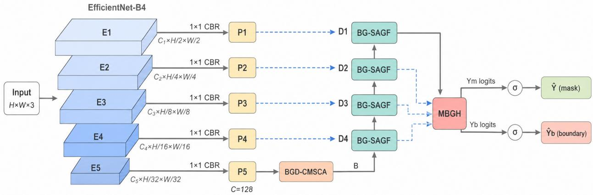
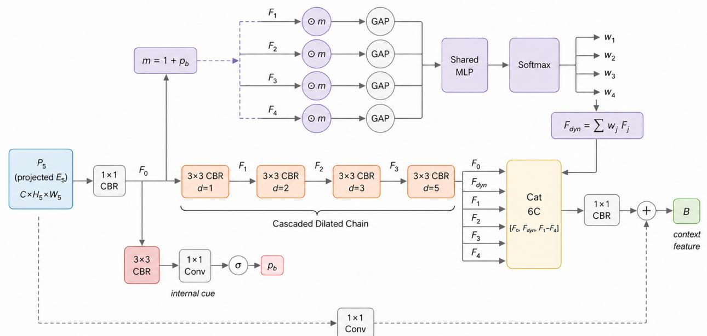
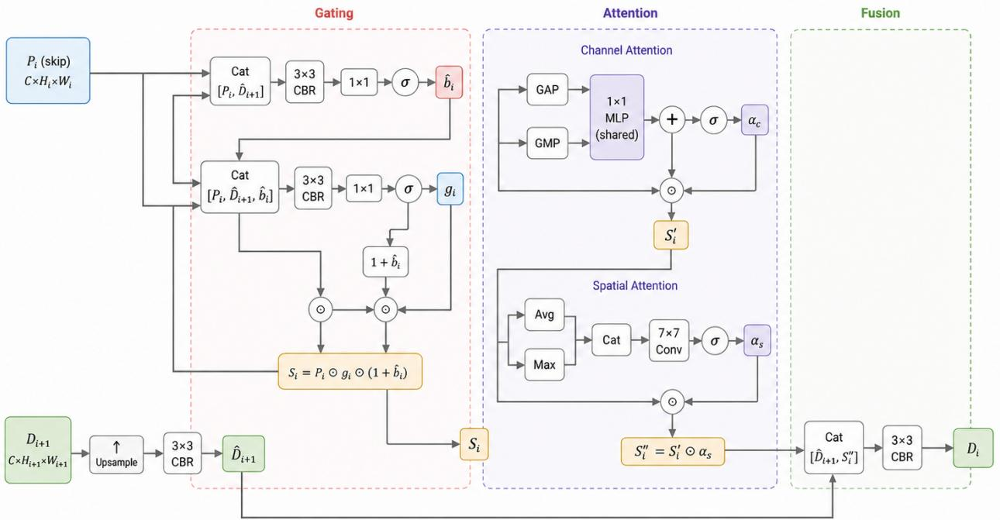
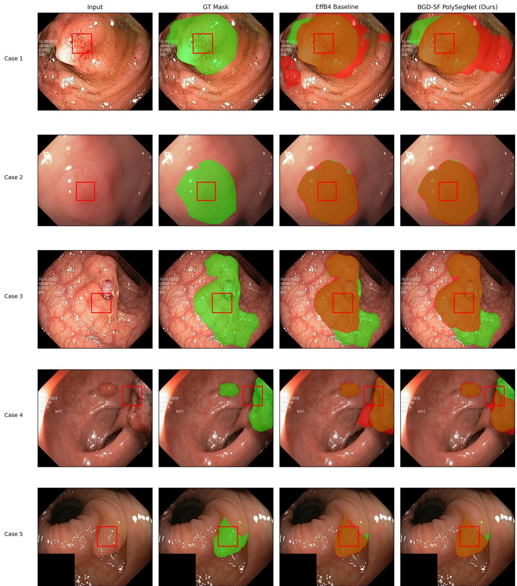
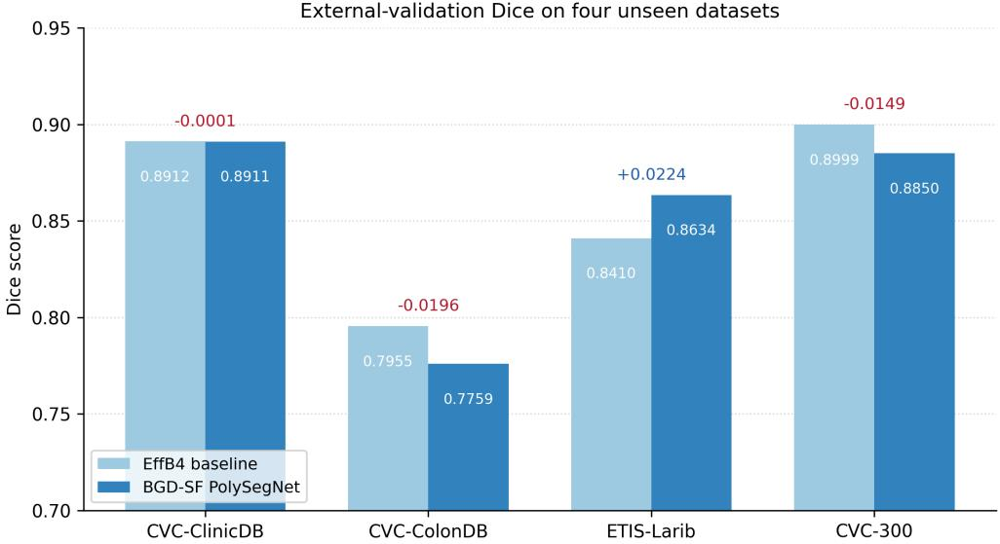
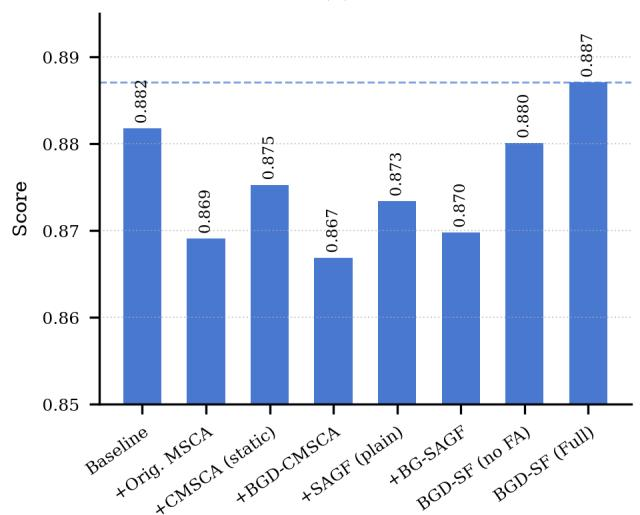
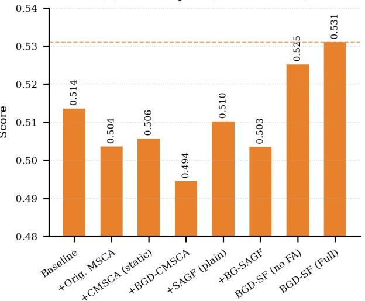
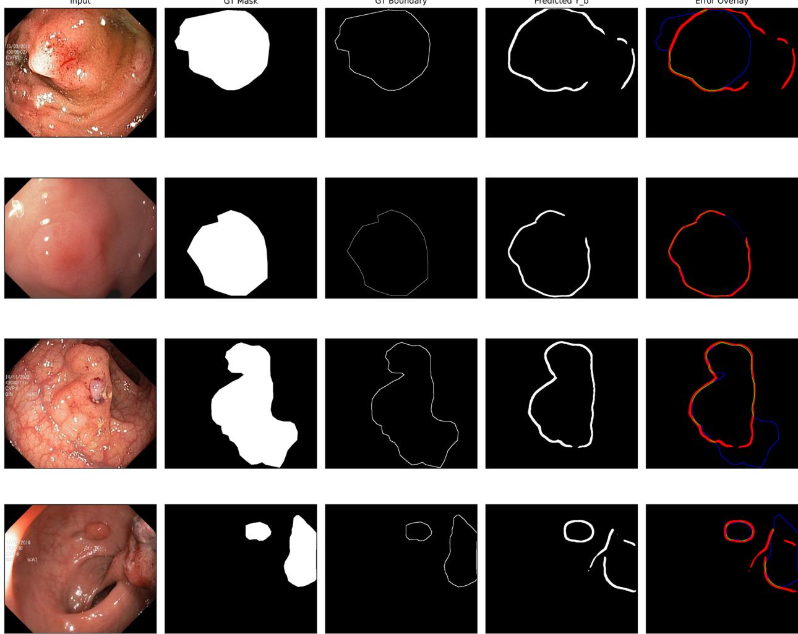
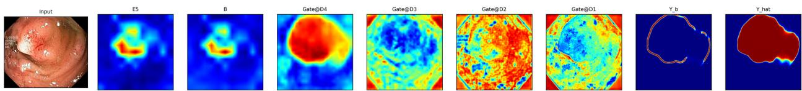
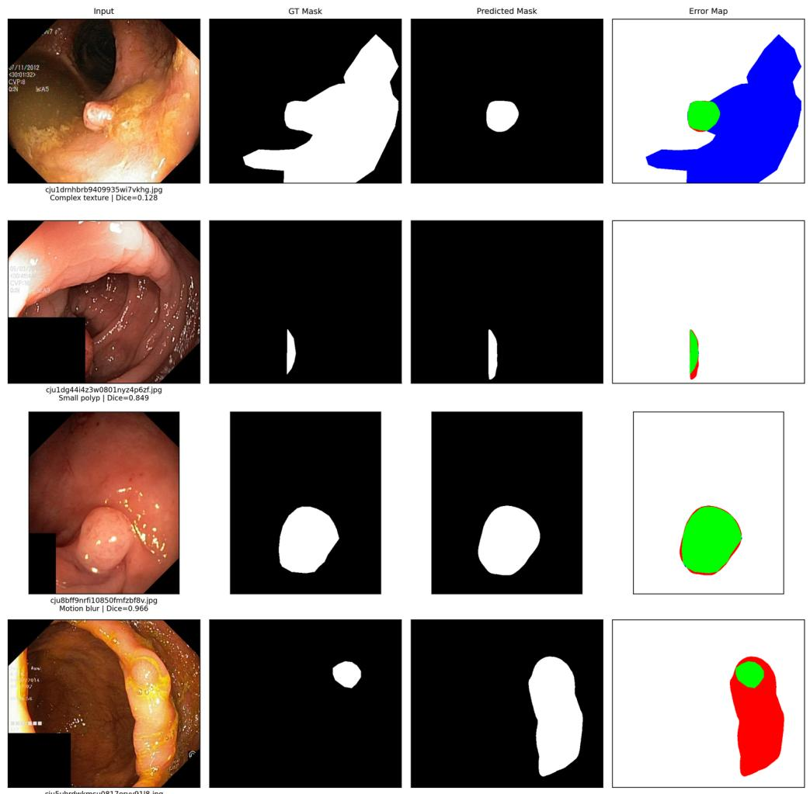

# BGD-SF PolySegNet: boundary-guided dynamic selective fusion network for robust polyp segmentation in colonoscopy images

Nishi Kanta Paul1,4\*, Shamia Maherin2,4, Morsheda Akter3,4, Moinul Hossain4, Md Kishor Morol4

1 NIMISHES Lab, Dhaka, Bangladesh

2 Department of Computer Science and Engineering, Bangladesh University of Business and Technology (BUBT), Dhaka, Bangladesh

3 Department of Computer Science and Engineering, Pusan National University, Busan,   
Republic of Korea   
4 ELITE Research Lab

\* nishikantapaul108@gmail.com

## Abstract

Effective polyp segmentation in colonoscopy images is crucial for early detection of colorectal cancer, which is one of the major causes of cancer-related death globally. While current deep learning models perform well on traditional Dice benchmarks, border segmentation remains a significant difficulty. Most methods employ boundary information just as an additional loss signal during training, therefore preventing the network from explicitly learning border-guided feature selection or mask refining. This paper introduces BGD-SF PolySegNet, a boundary-guided encoder-decoder architecture that automatically controls three phases of the segmentation pipeline: dynamic multi-scale context aggregation, selective skip-feature fusion, and final mask refining. The architecture comprises a pretrained EfficientNet-B4 backbone and three proposed modules: Boundary-Guided Dynamic Cascaded Multi-Scale Context Aggregation (BGD-CMSCA), Boundary-Guided Selective Attention Fusion (BG-SAGF), and a Multi-Level Boundary Guidance Head (MBGH). The model is trained on 3,535 annotated images from Kvasir-SEG, BKAI-IGH NeoPolyp-Small, and PolypGen, and evaluated on four held-out benchmark datasets. On the internal test set, BGD-SF achieves a Dice of 0.887, IoU of 0.839, mask-derived Boundary F1 of 0.531, HD95 of 30.32, and ASSD of 18.10, representing improvements of 15.7%, 27.5%, and 34.6% in Boundary F1, HD95, and ASSD over the strongest CNN baselines (U-Net for BF1; DeepLabV3+ for HD95 and ASSD). External validation on CVC-ClinicDB, CVC-ColonDB, ETIS-Larib, and CVC-300 yielded Dice scores of 0.891, 0.776, 0.863, and 0.885, respectively. The model operates at 35 FPS with 22.51M parameters and 65.46 GFLOPs. Wilcoxon signed-rank tests confirm statistically significant mask-derived Boundary F1 improvements across six of seven ablation variants $( p < 0 . 0 0 1$ , with small-to-moderate effect sizes $( r = 0 . 2 1 5  – 0 . 4 3 4 ) \rangle$ ), demonstrating that integrating boundary guidance as an active architectural component measurably advances polyp boundary delineation.

## Introduction

Colorectal cancer is among the most prevalent and fatal cancers globally, with the majority of cases arising from colorectal polyps that develop over time before becoming malignant [1]. Colonoscopy is the primary screening tool for finding and removing these polyps before they become cancerous. However, polyp diagnosis during a live colonoscopy is difficult and error-prone. Miss rates in clinical practice vary significantly depending on polyp form, size, and examiner expertise. Flat and sessile lesions are disproportionately missed [1]. Automated segmentation systems can be used as real-time decision-support tools, highlighting candidate regions for physician assessment and lowering miss rates while normalizing detection quality across endoscopy sites.

Deep learning methods, notably encoder-decoder architectures based on convolutional backbones, have significantly improved polyp segmentation accuracy in recent years. U-Net designs with hierarchical skip connections, multi-scale feature extraction, and attention processes have become the dominant paradigm [2–6]. Recently, hybrid CNN-Transformer architectures have gained attention by combining local texture sensitivity with global contextual reasoning [3, 7–10]. In addition to architectural advancements, attention-guided and edge-sensitive fusion modules have been suggested to enhance feature discrimination [11–16]. Dice scores range from 0.93 to 0.97 on well-studied benchmarks such as Kvasir-SEG and CVC-ClinicDB [3, 4, 11, 12, 14].

Despite this progress, major limitations remain. The most medically significant of these is border correctness. High Dice scores suggest a large global area overlap, but they do not indicate if a model correctly defines the boundary between polyp tissue and the surrounding mucosa. Low-contrast, flat, and sessile polyps have poorly defined boundaries that seem identical to nearby normal tissue, making precise edge detection extremely challenging. When boundary information is just included as an auxiliary loss term, as is the case in most current topologies, it changes the optimization trajectory but has no impact on how the network selects or filters features during the forward pass. This design approach reduces the level to which boundary sensitivity can spread over the whole encoder-decoder pipeline.

A second limitation concerns the quality of skip connections. Encoder-decoder topologies use skip connections to move high-resolution spatial information from encoder levels to decoders. However, in colonoscopy pictures, these features include not just polyp-relevant spatial data, but also endoscopy-specific noise such as specular highlights, air bubbles, mucosal folds, and fecal residues. Directly including such noisy skip features with decoder representations may produce false positives, lowering spatial accuracy. Standard channel-spatial attention modules, such as CBAM [17], reduce background activations to some extent. However, without an explicit boundary-aware filtering step, artifact suppression is indirect and inconsistent. Third, performance on tiny, flat, and low-contrast polyps remained much lower than performance on big, noticeable well-defined lesions across practically all published models [1–3, 13, 15, 18]. These tough cases are clinically significant because they are the most likely to be missed during live endoscopy and, if left untreated, can progress to malignancy.

Recent research has addressed certain aspects of this issue. PraNet [19] uses reverse attention to iteratively estimate polyp areas from coarse high-level characteristics. CIFFormer [20] included a boundary-guided module with cross-scale interaction fusion, reaching Kvasir-SEG Dice of 0.925 and improving cross-domain generalization with ColonDB Dice of 0.824 and ETIS Dice of 0.793. HPANet achieved a Kvasir-SEG Dice of 0.920 by utilizing a Pyramid ViT backbone, backward multi-scale fusion, and a boundary feature refinement module [21]. VMDU-Net combined Vision Mamba with a Cross-Shape Transformer in a dual-encoder setup to capture both local and long-range context, producing Kvasir-SEG Dice of 0.934 and ClinicDB Dice of 0.951 [3]. PSTNet [16] used multi-scale alignment and frequency-domain feature integration to enhance cross-domain resilience. Despite these contributions, boundary-specific metrics such as Hausdorff distance and Average Symmetric Surface Distance (ASSD) are rarely reported in the literature, making it difficult to determine whether published boundary modules result in genuine improvements in edge quality or if Dice gains are primarily due to improved global overlap.

The primary design premise in this study varies from previous approaches: boundary information is employed as an active guiding signal at three independent architectural phases, rather than being limited to a single loss term or specialized module. Specifically, boundary cues influence (1) the bottleneck context module, where they modulate the weighting of parallel multi-scale dilated convolution branches depending on the estimated boundary complexity of the input; (2) the skip-connection fusion modules at each decoder level, where internally estimated boundary priors suppress artifact-heavy features before channel-spatial attention is applied; and (3) the final mask generation step, where the predicted boundary map refines decoder features before final mask generation. This consistent application of boundary guidance across the network is motivated by the observation that boundary-accurate segmentation requires edge sensitivity throughout the forward pass, not only at the loss stage.

The main contributions of this work are as follows.

1. We provide BGD-CMSCA, a boundary-guided dynamic cascaded multi-scale context aggregation module that utilizes boundary-sensitive signals to adaptively weight dilated convolution branches, resulting in better scale-sensitive feature representation for polyps of various size and shape.

2. We introduce BG-SAGF, a boundary-guided selective attention fusion module that creates internal boundary priors at each decoder level to reduce noisy skip-connection features before applying channel-spatial attention, therefore decreasing artifact-induced false positives during decoder fusion.

3. We propose MBGH, a multi-level boundary guidance head that explicitly predicts boundary maps at decoder levels $D _ { 2 } , D _ { 3 } ,$ , and $D _ { 4 } .$ , and uses the predicted boundary map to refine the final decoder feature $D _ { 1 }$ as $D _ { 1 } ^ { b g } = D _ { 1 } + D _ { 1 } \odot \sigma ( Y _ { b } )$ ), producing sharper and more accurate boundary delineation.

4. We incorporate a frequency-domain style augmentation strategy to improve cross-dataset robustness against variation in illumination, color distribution, and device characteristics across different endoscopy systems.

5. We evaluate the full model on four external benchmark datasets unseen during training, report boundary-specific metrics including Boundary $F _ { 1 }$ , HD95, and ASSD alongside standard Dice and IoU, and provide Wilcoxon signed-rank statistical significance testing and multi-seed stability analysis to support reproducible evaluation.

BGD-SF outperforms the best CNN baseline (U-Net) with a mask-derived Boundary F1 of 0.531 on the combined internal test set, resulting in a 15.7% relative improvement. HD95 reduces from 41.80 to 30.32, and ASSD from 27.69 to 18.10, with reductions of 27.5% and 34.6%, respectively. Boundary improvements are statistically significant compared to six of seven ablation variants $( p < 0 . 0 0 1 )$ , with small-to-moderate effect sizes $( r = 0 . 2 1 5  – 0 . 4 3 4 )$ ). Dice and IoU likewise outperform all baselines, however the margin is more mild, in line with the primary design goal of boundary precision. The model operates at 35 FPS on an NVIDIA GB10 with 22.51M parameters, demonstrating that the boundary-guided design does not cause excessive computational costs.

The remaining sections of this work are organized as follows. The Related work section summarizes relevant research on deep learning-based polyp segmentation. The Materials and methods section explains the proposed BGD-SF PolySegNet architecture and its components in depth. The Experiments section describes the experimental setup, datasets, training configuration, and assessment measures. The Results section presents quantitative findings, ablation studies, external validation, and statistical analysis. The Discussion section examines the findings. The Limitations and future work section discusses limitations and future work. The Conclusion section concludes the paper.

## Related Work

## Polyp Segmentation: From Classical Encoders to Deep Architectures

Early deep learning algorithms for polyp segmentation used typical encoder-decoder frameworks based on fully convolutional networks. U-Net [22] created a foundational template with symmetric skip connections to maintain spatial detail across encoder and decoder stages. U-Net++ [23] introduced dense nested skip pathways to reduce the semantic gap between encoder and decoder feature maps.

The introduction of PraNet [19] was a turning point in polyp-specific design. PraNet used a reverse attention technique to gradually extract boundary areas from high-level semantic predictions, directing the network to focus on what it had not yet predicted rather than enhancing already-confident regions. PolypPVT [24] replaced CNN encoders with a pyramid vision transformer backbone, enabling greater global context modeling while keeping local detail via multi-scale feature aggregation. UACANet [25] introduced uncertainty-augmented context attention, where uncertain regions found at deep decoding stages were sent back as guidance to deeper layers.

More modern architectures have extended this pattern. CIFFormer [20] achieved Dice of 0.925 on Kvasir-SEG by combining a cross-scale interaction fusion module with a boundary-guided module on top of a transformer encoder. HPANet [21] used a pyramid vision transformer backbone with backward multi-scale fusion and a dedicated boundary refinement module to achieve Dice of 0.9204 on Kvasir-SEG. Despite these improvements, generalization to low-contrast and cross-domain polyps remains a challenge [1].

## Boundary-Aware Segmentation

The most difficult part of polyp segmentation is establishing accurate boundaries. Polyp edges frequently blend into the surrounding mucosa, and models that focus solely on region-overlap objectives create smooth masks that lack precise contour detail.

Early techniques added a boundary loss term to the basic cross-entropy and Dice objectives, affecting what the network optimizes but not how intermediate features are computed. More contemporary designs view boundary information as an active structural component. [26] introduced a boundary guidance network that generates an explicit edge map from intermediate encoder features and routes it back into the decoder as a spatial gate. [27] created a boundary refinement network with a dedicated refinement branch, resulting in higher boundary F1-score on CVC-ClinicDB. In [28], a boundary perception module combined

CNN-extracted edge cues with transformer-extracted global context, resulting in more accurate predictions on low-contrast test instances.

A further distinction concerns where in the network boundary information is applied. When boundary maps dynamically adjust skip connections, bottleneck features, or final mask refinement, the network can apply edge predictions throughout each decoding step. BGD-SF PolySegNet belongs to this group, using boundary cues from MBGH to weight the final decoder feature before mask formation, and BG-SAGF to modulate skip-feature selection using internally produced boundary priors.

## Attention Mechanisms in Medical Image Segmentation

The convolutional block attention module (CBAM) [17] combines channel and spatial attention sequentially, becoming a popular addition to encoder-decoder backbones. MNet-SAt [4] developed a spatial-enhanced attention module inside a multi-scale encoder-decoder achieving Dice over 0.96 on Kvasir-SEG and CVC-ClinicDB. The ADSANet design [11] combines adjacent-differential feature fusion with shallow attention to address redundancy in high-level encoder features.

Transformer-based self-attention has extended these concepts to global receptive fields. NA-SegFormer [9] used neighborhood attention striking a balance between expressiveness and computational practicality. VMDU-Net [3] combined a Vision Mamba encoder with a Cross-Shape Transformer, achieving Dice of 0.934 on Kvasir-SEG and 0.951 on CVC-ClinicDB. Mamba-based techniques are becoming a viable alternative to full transformer stacks for tasks requiring both local boundary detail and global context [29, 30].

BGD-SF PolySegNet utilizes BG-SAGF’s channel-spatial fusion with boundary priors, extending attention-based skip refinement with an explicit edge-sensitivity mechanism.

## Multi-Scale Feature Fusion

Polyps vary in size from sub-centimeter flat lesions to large sessile masses, and no single convolutional receptive field can fully represent this variety. Atrous spatial pyramid pooling (ASPP) was the first widely used solution, but its fixed dilation rates apply the same receptive field regardless of polyp size.

PSTNet [16] proposed multi-scale alignment combined with frequency-domain integration to reduce feature mismatch across scales. HSSAM-Net [12] proposed a hyper-scale shifted aggregation mechanism achieving Dice between 0.949 and 0.953 across multiple datasets with only 0.9M parameters and 24.1 FPS.

BGD-SF PolySegNet extends these ideas with BGD-CMSCA, which employs cascaded dilated convolutions and dynamic scale weighting guided by boundary-sensitive signals. Unlike fixed ASPP, the weighting is learned and image-adaptive, emphasizing fine-grained features for small polyps and broader context for larger ones.

## Robustness, Generalization, and Evaluation Beyond Dice

A recurring problem in polyp segmentation is the gap between benchmark performance and real-world generalization. Models trained on Kvasir-SEG and CVC-ClinicDB frequently show significant Dice decline on CVC-ColonDB, ETIS-Larib, or PolypGen [8]. Frequency-domain techniques have shown potential for domain robustness. DFDRNet [31] separates high- and low-frequency components to refine edge detail and improve generalization without explicit domain adaptation.

Dice and IoU alone are increasingly regarded as insufficient for clinical evaluation. The Boundary F1-score directly measures edge quality, HD95 captures worst-case contour deviation, and ASSD provides mean contour error. According to [32], models performing well on Dice may underperform on HD95, particularly for flat polyps. The Wilcoxon signed-rank test is appropriate for paired statistical comparisons of segmentation outputs [33]. We report all boundary-specific metrics alongside Dice and IoU, and use Wilcoxon signed-rank tests with rank-biserial effect sizes to confirm statistical significance.

## Positioning of BGD-SF PolySegNet

BGD-SF PolySegNet is built on four principles: active boundary guidance outperforms passive boundary loss; dynamic multi-scale selection outperforms fixed dilation; attention should eliminate artifacts while preserving boundary features; and cross-domain evaluation with boundary metrics is essential for clinical relevance.

The nearest architectural neighbors are CIFFormer [20] and SCABNet [34]. BGD-SF differs in integrating boundary guidance at three stages simultaneously: dynamic scale balancing (BGD-CMSCA), selective skip filtering (BG-SAGF), and final mask refinement (MBGH). To our knowledge, no other published polyp segmentation model integrates boundary guidance simultaneously at all three stages, nor compares this design against a full ablation on boundary-specific metrics across four external test sets.

## Materials and methods

This section presents BGD-SF PolySegNet for colonoscopic polyp segmentation, covering the overall architecture, each novel module, the training objective, and the frequency-domain augmentation strategy.

## Problem Formulation

Given a colonoscopy image $\mathbf { X } \in \mathbb { R } ^ { H \times W \times 3 }$ , the goal is to produce a pixel-wise segmentation mask $\hat { \mathbf { Y } } \in [ 0 , 1 ] ^ { H \times W }$ and an auxiliary boundary map $\mathbf { \bar { Y } } _ { b } \in [ 0 , \bar { 1 } ] ^ { H \times W }$ . The model is trained end-to-end using a composite loss that jointly supervises region accuracy and boundary fidelity.

## Overall Architecture

The proposed architecture follows an encoder–decoder paradigm with three novel components that integrate boundary information across multiple stages, as illustrated in Fig 1.

Encoder. An EfficientNet-B4 [35] backbone pretrained on ImageNet [36] extracts five hierarchical feature maps:

$$
\{ { \bf E } _ { 1 } , \ldots , { \bf E } _ { 5 } \} = \mathcal { F } _ { \mathrm { e n c } } ( { \bf X } ) ,\tag{1}
$$

where $C _ { i } \in \{ 2 4 , 3 2 , 5 6 , 1 6 0 , 4 4 8 \}$ for stages $i = 1 , \ldots , 5$

Feature projection. Each encoder feature is projected to $C = 1 2 8$ via 1×1 CBR:

$$
\mathbf { P } _ { i } = \phi _ { i } ( \mathbf { E } _ { i } ) , \quad i = 1 , \ldots , 5 .\tag{2}
$$

  
Fig 1. Overall architecture of BGD-SF PolySegNet. EfficientNet-B4 extracts five feature maps projected to C=128 channels. BGD-CMSCA refines the bottleneck, four BG-SAGF blocks fuse skip features via boundary-guided gating, and MBGH produces mask and boundary outputs.

Bottleneck. $\mathbf { P } _ { 5 }$ is refined by BGD-CMSCA:

$$
{ \bf B } = \mathcal { M } _ { \mathrm { B G D - C M S C A } } ( { \bf P } _ { 5 } ) .\tag{3}
$$

Progressive decoder. Four BG-SAGF blocks recover spatial detail:

$$
\mathbf { D } _ { i } = { \mathcal { M } } _ { \mathrm { B G - S A G F } } ( \mathbf { P } _ { i } , \mathbf { D } _ { i + 1 } ) , \quad i = 4 , 3 , 2 , 1 .\tag{4}
$$

Output head. MBGH produces mask and boundary outputs:

$$
( \mathbf { Y } _ { b } , \ \mathbf { Y } _ { m } , \ \{ \mathbf { Y } _ { b } ^ { ( k ) } \} _ { k = 1 } ^ { K } ) = \mathcal { M } _ { \mathrm { M B G H } } ( \mathbf { D } _ { 1 } , \mathbf { D } _ { 2 } , \mathbf { D } _ { 3 } , \mathbf { D } _ { 4 } ) .\tag{5}
$$

Final predictions: $\hat { \mathbf { Y } } = \sigma ( \mathbf { Y } _ { m } )$ and $\hat { \mathbf Y } _ { b } = \sigma ( \mathbf Y _ { b } )$

## BGD-CMSCA

BGD-CMSCA replaces fixed parallel multi-scale aggregation with a cascaded design augmented by boundary-aware dynamic scale selection, as shown in Fig 2.

Cascaded multi-scale extraction.

$$
\mathbf { F } _ { 0 } = \mathrm { C B R } _ { 1 \times 1 } ( \mathbf { P } _ { 5 } ) , \quad \mathbf { F } _ { j } = \mathrm { C B R } _ { 3 \times 3 } ^ { ( r _ { j } ) } ( \mathbf { F } _ { j - 1 } ) , \quad j = 1 , 2 , 3 , 4 ,\tag{6}
$$

with dilation rates $\{ r _ { j } \} = \{ 1 , 2 , 3 , 5 \}$

Boundary-modulated dynamic weighting. An internal boundary cue is generated from $\mathbf { F } _ { 0 } \colon$

$$
\mathbf { p } _ { b } = \sigma \big ( \mathrm { C o n v } _ { 1 \times 1 } \big ( \mathrm { C B R } _ { 3 \times 3 } ( \mathbf { F } _ { 0 } ) \big ) \big ) .\tag{7}
$$

Scale descriptors are computed with boundary modulation m = 1 + pb:

$$
\begin{array} { r } { \mathbf s _ { j } = \mathrm { G A P } ( \mathbf F _ { j } \odot \mathbf m ) , \quad j = 1 , 2 , 3 , 4 . } \end{array}\tag{8}
$$

Dynamic weights are obtained via:

$$
\mathbf { w } = \mathrm { s o f t m a x } \big ( \mathrm { M L P } ( [ \mathbf { s } _ { 1 } ; \mathbf { s } _ { 2 } ; \mathbf { s } _ { 3 } ; \mathbf { s } _ { 4 } ] ) \big ) , \quad \mathbf { F } _ { \mathrm { d y n } } = \sum _ { j = 1 } ^ { 4 } w _ { j } \mathbf { F } _ { j } .\tag{9}
$$

Feature aggregation.

$$
\mathbf { B } = \mathrm { C B R } _ { 1 \times 1 } \big ( [ \mathbf { F } _ { 0 } ; \mathbf { F } _ { \mathrm { d y n } } ; \mathbf { F } _ { 1 } ; \mathbf { F } _ { 2 } ; \mathbf { F } _ { 3 } ; \mathbf { F } _ { 4 } ] \big ) + \mathbf { W } _ { \mathrm { r e s } } \mathbf { P } _ { 5 } .\tag{10}
$$

  
Fig 2. BGD-CMSCA module. Cascaded dilated convolutions (rates 1,2,3,5) progressively expand the receptive field. An internal boundary cue pb modulates scale descriptors via m=1+pb, dynamically weighted by a shared MLP and softmax.

## BG-SAGF

BG-SAGF introduces boundary-guided gating to filter noisy skip features before attention refinement, as shown in Fig 3.

Boundary-guided gating.

$$
\begin{array} { r } { \hat {  { \mathbf { b } } } _ { i } = \sigma \big ( \mathrm { C o n v } _ { 1 \times 1 } \big ( \mathrm { C B R } _ { 3 \times 3 } \big ( [  { \mathbf { P } } _ { i } ;  { \mathbf { D } } _ { i + 1 } ^ { \uparrow } ] \big ) \big ) \big ) , } \end{array}\tag{11}
$$

$$
\begin{array} { r } { \mathbf { g } _ { i } = \sigma \big ( \mathrm { C o n v } _ { 1 \times 1 } ( \mathrm { C B R } _ { 3 \times 3 } ( [ \mathbf { P } _ { i } ; \mathbf { D } _ { i + 1 } ^ { \uparrow } ; \hat { \mathbf { b } } _ { i } ] ) ) \big ) , } \end{array}\tag{12}
$$

$$
{ \bf S } _ { i } = { \bf P } _ { i } \odot { \bf g } _ { i } \odot ( 1 + \hat { { \bf b } } _ { i } ) .\tag{13}
$$

Channel–spatial attention.

$$
\pmb { \alpha } _ { c } = \sigma \big ( \psi \big ( \mathrm { G A P } ( \mathbf { S } _ { i } ) \big ) + \psi \big ( \mathrm { G M P } ( \mathbf { S } _ { i } ) \big ) \big ) ,\tag{14}
$$

$$
\begin{array} { r } { \pmb { \alpha } _ { s } = \sigma \big ( \mathrm { C o n v } _ { 7 \times 7 } ( [ \mathrm { A v g P o o l } _ { c h } ( \mathbf { S } _ { i } ^ { \prime } ) ; \mathrm { M a x P o o l } _ { c h } ( \mathbf { S } _ { i } ^ { \prime } ) ] ) \big ) . } \end{array}\tag{15}
$$

where the channel-refined and fully refined skip features are defined as $\mathbf { S } _ { i } ^ { \prime } = \mathbf { S } _ { i } \odot { \boldsymbol { \alpha } } _ { c }$ and $\mathbf { S } _ { i } ^ { \prime \prime } = \mathbf { S } _ { i } ^ { \prime } \odot { \boldsymbol { \alpha } } _ { s }$ and ψ denotes a shared two-layer 1×1 convolutional MLP with reduction ratio 16.

Fusion.

$$
\mathbf D _ { i } = \mathrm { C B R } _ { 3 \times 3 } \big ( [ \mathbf D _ { i + 1 } ^ { \uparrow } ; \mathbf S _ { i } ^ { \prime \prime } ] \big ) .\tag{16}
$$

## MBGH: Multi-Level Boundary Guidance Head

MBGH explicitly predicts boundary maps and integrates them into feature representations before final mask generation.

Primary boundary prediction.

$$
\mathbf { Y } _ { b } = \operatorname { C o n v } _ { 1 \times 1 } \bigl ( \operatorname { C B R } _ { 3 \times 3 } ( \mathbf { D } _ { 1 } ) \bigr ) .\tag{17}
$$

  
Fig 3. BG-SAGF decoder block. A boundary gate $\hat { \mathbf { b } } _ { i }$ and soft gate $\mathbf { g } _ { i }$ filter skip features via $\mathbf { S } _ { i } = \mathbf { P } _ { i } \odot \mathbf { g } _ { i } \odot \left( 1 + \hat { \mathbf { b } } _ { i } \right)$ . Channel and spatial attention further refine features before fusion.

Boundary-refined mask prediction.

$$
\mathbf { D } _ { 1 } ^ { b g } = \mathbf { D } _ { 1 } + \mathbf { D } _ { 1 } \odot \sigma ( \mathbf { Y } _ { b } ) , \quad \mathbf { Y } _ { m } = \operatorname { C o n v } _ { 1 \times 1 } \bigl ( \mathbf { D } _ { 1 } ^ { b g } \bigr ) .\tag{18}
$$

The additive structure amplifies features near polyp edges where $\sigma ( \mathbf { Y } _ { b } ) \approx 1$ while preserving representations in non-boundary regions.

Auxiliary boundary supervision. Three auxiliary heads attached to $\mathbf { D } _ { 2 } , \mathbf { D } _ { 3 } , \mathbf { D } _ { 4 }$

$$
\mathbf { Y } _ { b } ^ { ( k ) } = h _ { k } \big ( \mathrm { U p s a m p l e } ( \mathbf { D } _ { k + 1 } ) \big ) , \quad k = 1 , 2 , 3 .\tag{19}
$$

These are active during training only and discarded at inference.

Training Objective

$$
\mathcal { L } = \lambda _ { \mathrm { b c e } } \mathcal { L } _ { \mathrm { b c e } } ^ { \mathrm { s e g } } + \lambda _ { \mathrm { d i c e } } \mathcal { L } _ { \mathrm { d i c e } } ^ { \mathrm { s e g } } + \lambda _ { b } \mathcal { L } ^ { b } + \lambda _ { \mathrm { a u x } } \frac { 1 } { K } \sum _ { k = 1 } ^ { K } \mathcal { L } ^ { b , ( k ) } ,\tag{20}
$$

with $\lambda _ { \mathrm { b c e } } = \lambda _ { \mathrm { d i c e } } = 1 . 0 , \lambda _ { b } = 1 . 0 , \lambda _ { \mathrm { a u x } } = 0 . 3$

The segmentation loss combines BCE and soft Dice:

$$
\mathcal { L } _ { \mathrm { d i c e } } ^ { \mathrm { s e g } } = 1 - \frac { 2 \sum _ { p } \hat { y } _ { p } y _ { p } + \epsilon } { \sum _ { p } \hat { y } _ { p } + \sum _ { p } y _ { p } + \epsilon } ,\tag{21}
$$

Table 1. Summary of the seven colonoscopy datasets used in this study.
<table><tr><td>Dataset</td><td>Source</td><td>Images Mod. Role</td><td></td><td></td></tr><tr><td colspan="5">Training sources in Setup 1</td></tr><tr><td>Kvasir-SEG [38]</td><td>Simula Lab, Norway, 2020</td><td>1000</td><td>WLE</td><td>Train</td></tr><tr><td>BKAI-IGH NeoPolyp-Small [39]</td><td>BKAI-IGH, Vietnam, 2021</td><td>1000</td><td>WLE</td><td>Train</td></tr><tr><td>PolypGen (C1–C6) [40]</td><td>Multi-centre, 2023</td><td>1535</td><td>WLE</td><td>Train</td></tr><tr><td colspan="5">External validation and test sets</td></tr><tr><td>CVC-ClinicDB† [41]</td><td>CVC, Spain, 2015</td><td>612</td><td>WLE</td><td>Ext. val. / Train</td></tr><tr><td>CVC-ColonDB [42]</td><td>CVC, Spain, 2015</td><td>380</td><td>WLE</td><td>External</td></tr><tr><td>ETIS-LaribPolypDB [43]</td><td>ETIS-Larib, France, 2014</td><td>196</td><td>WLE</td><td>External</td></tr><tr><td>CVC-300 [44]</td><td>CVC, Spain, 2017</td><td>60</td><td>WLE</td><td>External</td></tr><tr><td colspan="5">Total training images in Setup 1</td></tr><tr><td colspan="5">Total training images in Setup 2</td></tr></table>

†CVC-ClinicDB is used as unseen external validation in Setup 1 and as part of the training data in Setup 2. WLE = white-light endoscopy.

where $\epsilon = 1 0 ^ { - 6 }$ . Boundary ground truth is derived via morphological gradient:

$$
\mathbf { Y } _ { b } ^ { g t } = \operatorname { D i l a t e } ( \mathbf { Y } , \kappa ) - \operatorname { E r o d e } ( \mathbf { Y } , \kappa ) , \quad \kappa = 3 .\tag{22}
$$

## Frequency-Domain Augmentation

To improve cross-dataset robustness, amplitude spectra of training images are perturbed while preserving phase:

$$
\tilde { A } ( u , v ) = A ( u , v ) ( 1 + \alpha \eta ( u , v ) ) ,\tag{23}
$$

where $\alpha \sim \mathcal { U } ( 0 . 0 5 , 0 . 1 5 )$ and $\eta ( u , v ) \sim \mathcal { U } ( - 1 , 1 )$ . Phase preservation maintains polyp spatial structure while simulating device-specific appearance variation [37].

## Experiments

## Datasets and Evaluation Protocols

We conduct experiments on seven publicly available colonoscopy datasets using two complementary protocols: a multi-source training protocol that tests generalisation across diverse imaging conditions, and a standard benchmark protocol that enables direct comparison with prior published methods. Dataset statistics are summarised in Table 1.

Setup 1 — multi-source training protocol. The training corpus aggregates Kvasir-SEG (1 000 images), BKAI-IGH NeoPolyp-Small (1 000 images), and PolypGen C1–C6 positive frames (1 535 images), yielding 3 535 images total. A seeded deterministic split partitions this corpus into training (80%), validation (10%), and internal test (10%) subsets. Generalisation is assessed on four external datasets held out entirely from training: CVC-ClinicDB (612), CVC-ColonDB (380), ETIS-LaribPolypDB (196), and CVC-300 (60).

Setup 2 — standard benchmark protocol. To facilitate direct comparison with PraNet [19] and Polyp-PVT [24], we follow their standard training configuration: Kvasir-SEG (1 000) combined with CVC-ClinicDB (612), totalling 1 612 images. External evaluation is performed on CVC-ColonDB, ETIS-LaribPolypDB, BKAI-IGH, and CVC-300. Our implementation uses the full datasets rather than the commonly used 900 + 550 split; this deviation is minimal and explicitly noted in all comparison tables.

Note on CVC-ClinicDB. CVC-ClinicDB serves as an unseen external validation set in Setup 1, and as part of the training data in Setup 2 to replicate the PraNet/Polyp-PVT benchmark. All result tables are labelled accordingly.

Table 2. Implementation details and hyperparameter settings.
<table><tr><td>Setting</td><td>Value</td></tr><tr><td colspan="2">Architecture</td></tr><tr><td>Encoder</td><td>EfficientNet-B4 (ImageNet pretrained)</td></tr><tr><td>Unified channel dim. C</td><td>128</td></tr><tr><td>Input resolution</td><td>352 × 352 pixels</td></tr><tr><td colspan="2">Optimisation</td></tr><tr><td>Optimiser</td><td>AdamW [47]</td></tr><tr><td>Learning rate</td><td> $1 \times 1 0 ^ { - 4 }$ </td></tr><tr><td>Weight decay</td><td> $1 \times 1 0 ^ { - 5 }$ </td></tr><tr><td>LR schedule</td><td>Cosine annealing (Tmax = training epochs)</td></tr><tr><td>Batch size</td><td>8</td></tr><tr><td>Mixed precision</td><td> $\mathrm { P y }$  Torch AMP (FP16)</td></tr><tr><td colspan="2">Training epochs  $b y$  experiment</td></tr><tr><td>BGD-SF full model (Setup 1 &amp; 2)</td><td>200 epochs</td></tr><tr><td>EffB4 baseline + Ablation variants</td><td>100 epochs</td></tr><tr><td>Easy baseline comparisons</td><td>50 epochs</td></tr><tr><td>Multi-seed validation (seeds 42, 123, 2025)</td><td>100 epochs</td></tr><tr><td colspan="2">Loss weights</td></tr><tr><td> $\lambda _ { \mathrm { b c e } } , \lambda _ { \mathrm { d i c e } } , \lambda _ { b }$ </td><td>1.0</td></tr><tr><td> $\lambda _ { \mathrm { a u x } }$ </td><td>0.3</td></tr><tr><td>Boundary kernel κ</td><td>3 pixels</td></tr><tr><td>FreqAug amplitude perturbation α</td><td>U(0.05, 0.15)</td></tr><tr><td colspan="2">Reproducibility</td></tr><tr><td>Fixed seed</td><td>42</td></tr><tr><td>Checkpoint criterion</td><td>Highest validation Dice</td></tr></table>

## Implementation Details

The network is implemented in PyTorch [45] with automatic mixed-precision (AMP). The EfficientNet-B4 encoder is loaded from the timm library [46] with ImageNet-1K pretrained weights. All hyperparameters are listed in Table 2.

Data augmentation. All spatial augmentations are applied using Albumentations [48]: random horizontal flip $( p { = } 0 . 5 )$ , random $9 0 °$ rotation $( p { = } 0 . 5 )$ , shift-scale-rotate (shift 0.1, scale 0.1, rotation $1 5 ^ { \circ }$ $p { = } 0 . 5 )$ , and random brightness-contrast adjustment $( p { = } 0 . 5 )$ . All images are normalised to ImageNet mean and standard deviation. Frequency-domain augmentation (described below) is applied after spatial augmentations when enabled.

Training procedure. The network parameters are optimised end-to-end using AdamW with an initial learning rate of $1 \times 1 0 ^ { - 4 }$ and weight decay of $1 \times 1 0 ^ { - 5 }$ . A cosine annealing schedule reduces the learning rate to zero over the training duration. The EfficientNet-B4 encoder is fine-tuned jointly with all proposed modules from the first epoch. Boundary ground truth $\mathbf { Y } _ { b } ^ { g t }$ is derived on-the-fly from the segmentation mask via differentiable morphological gradient (Eq. 22), requiring no separate boundary annotations. Model selection is performed solely on validation Dice after each epoch; the best checkpoint is retained for all evaluations. Test and external datasets are never used for checkpoint selection or hyperparameter tuning. Training epoch rationale. The full BGD-SF model is trained for 200 epochs to ensure convergence of the boundary-guided dynamic weighting in BGD-CMSCA, which requires more optimization steps than static alternatives. Ablation variants and the EffB4 baseline are trained for 100 epochs, as preliminary experiments confirmed that simpler architectures converge within this budget. Standard segmentation baselines are trained for 50 epochs following standard practice. All models are evaluated at their best validation Dice checkpoint regardless of epoch count, ensuring fair comparison of peak performance rather than fixed-epoch snapshots.

Table 3. Summary of evaluation metrics. ↑: higher is better; ↓: lower is better.
<table><tr><td>Group</td><td>Metric</td><td>Dir. Description</td><td></td></tr><tr><td rowspan="5">Region</td><td>Dice (DSC)</td><td>↑</td><td>Harmonic mean of precision and recall</td></tr><tr><td>IoU</td><td>↑</td><td>Intersection over union</td></tr><tr><td>Precision</td><td>↑</td><td>Positive predictive value</td></tr><tr><td>Recall</td><td>↑</td><td>True positive rate</td></tr><tr><td>MAE</td><td>↓</td><td>Mean absolute probability error</td></tr><tr><td rowspan="3">Boundary</td><td>BF1</td><td>↑</td><td>Boundary F1-score (mask-derived)</td></tr><tr><td> $\mathrm { H D _ { 9 5 } }$ </td><td>↓</td><td>95th-percentile Hausdorff distance</td></tr><tr><td>ASSD</td><td>↓</td><td>Avg. symmetric surface distance</td></tr></table>

## Evaluation Metrics

Evaluation is reported across two groups: region-level metrics and boundary-level metrics. All metrics are computed at threshold $\tau = 0 . 5$

Region-level metrics.

$$
\mathrm { D S C } = \frac { 2 \mathrm { T P } } { 2 \mathrm { T P } + \mathrm { F P } + \mathrm { F N } } ,
$$

$$
\mathrm { I o U } = \frac { \mathrm { T P } } { \mathrm { T P } + \mathrm { F P } + \mathrm { F N } } ,\tag{24}
$$

$$
P = { \frac { \mathrm { T P } } { \mathrm { T P } + \mathrm { F P } } } ,
$$

$$
R = { \frac { \mathrm { T P } } { \mathrm { T P } + \mathrm { F N } } } ,\tag{25}
$$

$$
\mathrm { M A E } = \frac { 1 } { N } \sum _ { i = 1 } ^ { N } \bigl | \hat { p } _ { i } - y _ { i } \bigr | .\tag{26}
$$

Boundary-level metrics. Ground-truth boundary is derived via morphological gradient with kernel $\kappa = 3$ . For fair comparison across all ablation variants, predicted boundaries are always computed from the final segmentation mask using the same operation, regardless of whether a model has an explicit boundary head.

$$
\mathrm { B F 1 } = { \frac { 2 P _ { b } \cdot R _ { b } } { P _ { b } + R _ { b } } } ,\tag{27}
$$

$$
\mathrm { H D } _ { 9 5 } = \mathrm { P e r c } _ { 9 5 } \Big ( d ( \partial \hat { M } , \partial M ) \cup d ( \partial M , \partial \hat { M } ) \Big ) ,\tag{28}
$$

$$
\mathrm { A S S D } = \frac { 1 } { | \partial \hat { M } | + | \partial M | } \sum _ { x \in \partial \hat { M } \cup \partial M } d ( x , \cdot ) .\tag{29}
$$

Statistical analysis. Per-image distributions are compared using the paired Wilcoxon signed-rank test as the primary significance test, with the paired t-test reported as secondary reference. Results are significant at $\alpha = 0 . 0 5$ . Effect size for the Wilcoxon signed-rank test is reported as the rank-biserial correlation $r ,$ where $| r | < 0 . 3$ is small, $0 . 3 \le | r | < 0 . 5$ is moderate, and $| r | \geq 0 . 5$ is large.

## Results

## Quantitative Comparison with Baseline Models

## Comparison with Standard Segmentation Baselines

Table 4 compares BGD-SF PolySegNet against six standard segmentation architectures on the combined internal test set: U-Net [22], U-Net++ [23], DeepLabV3+ [49], FPN [50], PSPNet [51], and LinkNet [52]. Al baselines use the same EfficientNet-B4 backbone, identical input resolution, optimiser, and augmentation pipeline. Training budgets differ by model family (Table 2); every model is evaluated at its own best-validation-Dice checkpoint. Fig 4 compares BGD-SF against the EffB4 encoder–decoder baseline on five representative polyp cases.

BGD-SF achieves a Dice of 0.8871 and IoU of 0.8386, outperforming all baselines on region metrics. On mask-derived boundary metrics, BGD-SF achieves BF1 of 0.5310 compared to 0.4591 for U-Net, a 15.7% relative improvement. HD95 reduces to 30.32 from 41.80 (DeepLabV3+), a 27.5% reduction, and ASSD drops from 27.69 to 18.10, a 34.6% reduction. These results confirm that standard encoder-decoder architectures, while competitive on region overlap, systematically fail to capture fine polyp boundary structure. Because the standard baselines in Table 4 are trained under a shorter schedule, the controlled architectural comparison is the ablation in Table 8, where BGD-SF and the EffB4 baseline share an identical training budget; there the mask-derived BF1 gain attributable to the proposed modules is +0.017 (+3.4%).

Table 4. Quantitative comparison of BGD-SF PolySegNet with standard segmentation baselines.
<table><tr><td>Method</td><td>Ep.</td><td>Dice</td><td>IoU</td><td>Prec.</td><td>Recall</td><td>MAE↓</td><td>BF1</td><td>HD95↓</td><td>ASSD↓</td><td>Params</td></tr><tr><td>U-Net</td><td>50</td><td>0.8487</td><td>0.7930</td><td>0.8933</td><td>0.8861</td><td>0.0171</td><td>0.4591</td><td>44.28</td><td>31.65</td><td>24.44</td></tr><tr><td>U-Net++</td><td>50</td><td>0.8409</td><td>0.7848</td><td>0.8819</td><td>0.8785</td><td>0.0183</td><td>0.4448</td><td>48.13</td><td>33.05</td><td>26.08</td></tr><tr><td>DeepLabV3+</td><td>50</td><td>0.8543</td><td>0.7976</td><td>0.8860</td><td>0.8904</td><td>0.0165</td><td>0.4486</td><td>41.80</td><td>27.69</td><td>22.44</td></tr><tr><td>FPN</td><td>50</td><td>0.8380</td><td>0.7802</td><td>0.8631</td><td>0.8970</td><td>0.0177</td><td>0.4336</td><td>48.69</td><td>33.07</td><td>23.16</td></tr><tr><td>PSPNet</td><td>50</td><td>0.8193</td><td>0.7506</td><td>0.8463</td><td>0.8811</td><td>0.0218</td><td>0.3654</td><td>57.84</td><td>35.72</td><td>21.44</td></tr><tr><td>LinkNet</td><td>50</td><td>0.8531</td><td>0.7981</td><td>0.8832</td><td>0.8932</td><td>0.0160</td><td>0.4510</td><td>45.86</td><td>30.67</td><td>21.77</td></tr><tr><td>Ours</td><td>200</td><td>0.8871</td><td>0.8386</td><td>0.9143</td><td>0.9073</td><td>0.0143</td><td>0.5310</td><td>30.32</td><td>18.10</td><td>22.51</td></tr></table>

All BF1 values in this table are computed from the predicted segmentation mask using morphological gradient (mask-derived) for fair comparison across all methods. The MBGH boundary head also produces a head-derived BF1 of 0.6166 for BGD-SF, discussed in the Boundary-focused contribution of BGD-SF subsection as a diagnostic metric.

## Comparison with Polyp-Specific Methods

Table 5 reports cross-dataset Dice comparing BGD-SF against PraNet [19] and Polyp-PVT [24] under the standard Kvasir+CVC-ClinicDB protocol. BGD-SF† denotes the same architecture trained on the expanded multi-source pool.

Table 5. Cross-dataset comparison with polyp-specific methods.
<table><tr><td>Method</td><td>Training Data</td><td>CVC-ColonDB</td><td>ETIS</td><td>BKAI</td><td>CVC-300</td></tr><tr><td>PraNet [19]</td><td>Kvasir+CVC</td><td>0.712</td><td>0.628</td><td></td><td></td></tr><tr><td>PolypPVT [24]</td><td>Kvasir+CVC</td><td>0.808</td><td>0.787</td><td></td><td></td></tr><tr><td>BGD-SF (Ours)</td><td>Kvasir+CVC</td><td>0.781</td><td>0.773</td><td>0.873</td><td>0.903</td></tr><tr><td>BGD-SF† (Ours)</td><td>Kvasir+BKAI+PolypGen</td><td>0.776</td><td>0.863</td><td></td><td>0.885</td></tr></table>

Our Kvasir+CVC run uses the full Kvasir-SEG (1 000) and CVC-ClinicDB (612) sets rather than the 900 + 550 split used by PraNet and Polyp-PVT.

Under the standard protocol, BGD-SF achieves CVC-ColonDB Dice of 0.781, placing it between PraNet (0.712) and PolypPVT (0.808). On ETIS-Larib, BGD-SF scores 0.773 versus PolypPVT’s 0.787. BGD-SF†, trained on the expanded multi-source pool, achieves a substantially higher ETIS-Larib Dice of 0.863, a gain of 9 points over the standard-protocol BGD-SF. Recent Transformer-based models such as VMDU-Net and

  
Fig 4. Representative visual comparisons across five polyp cases between BGD-SF PolySegNet and the EffB4 encoder–decoder baseline.

CIFFormer report Dice of 0.93–0.98 on single-domain benchmarks but do not report boundary-specific metrics such as HD95 or ASSD, making direct comparison on boundary dimensions infeasible.

## External Validation Results

Table 6 reports external validation results for BGD-SF and the EffB4 baseline across four unseen datasets using mask-derived boundary metrics. HD95 improves on three of four datasets: CVC-ClinicDB (25.83 → 25.15), ETIS-Larib (34.38 → 26.52, a 22.9% reduction), and CVC-300 (24.30 → 14.63, a 39.8% reduction). On ETIS-Larib — which contains predominantly small, flat, and sessile polyps — BGD-SF simultaneously improves Dice (+0.022), BF1 (+0.0125), and HD95 (−7.86), representing the strongest external evidence for the boundary-guided design. Mask-derived BF1 improves only on ETIS-Larib and regresses slightly on CVC-ClinicDB, CVC-ColonDB, and CVC-300, indicating that the boundary contribution is more consistently captured by distance-based metrics (HD95) than overlap-based metrics (BF1) under domain shift. CVC-ColonDB is the most challenging transfer target, where both Dice and HD95 regress, discussed as a limitation in the Failure cases subsection below.

Table 6. External validation results (mask-derived boundary metrics). Bold indicates best result per dataset and metric.
<table><tr><td>Dataset</td><td>Model</td><td>Dice</td><td>IoU</td><td>BF1</td><td>HD95↓</td></tr><tr><td>CVC-ClinicDB</td><td>EffB4 Baseline BGD-SF (Ours)</td><td>0.8912 0.8911</td><td>0.8250 0.8247</td><td>0.3771 0.3754</td><td>25.83 25.15</td></tr><tr><td>CVC-ColonDB</td><td>EffB4 Baseline BGD-SF (Ours)</td><td>0.7955 0.7759</td><td>0.7191 0.6992</td><td>0.2965 0.2836</td><td>41.64 48.92</td></tr><tr><td>ETIS-Larib</td><td>EffB4 Baseline BGD-SF (Ours)</td><td>0.8410 0.8634</td><td>0.7672 0.7933</td><td>0.4370 0.4495</td><td>34.38 26.52</td></tr><tr><td>CVC-300</td><td>EffB4 Baseline BGD-SF (Ours)</td><td>0.8999 0.8850</td><td>0.8376 0.8254</td><td>0.3907 0.3794</td><td>24.30 14.63</td></tr></table>

Table 7 reports results under the standard SOTA training protocol.

Table 7. External validation under standard SOTA training protocol (Kvasir+CVC-ClinicDB).
<table><tr><td>Dataset</td><td>Dice</td><td>BF1</td><td>HD95↓</td></tr><tr><td>CVC-ColonDB</td><td>0.7814</td><td>0.3193</td><td>51.12</td></tr><tr><td>ETIS-Larib</td><td>0.7727</td><td>0.3289</td><td>43.97</td></tr><tr><td>BKAI-IGH</td><td>0.8733</td><td>0.5658</td><td>20.76</td></tr><tr><td>CVC-300</td><td>0.9025</td><td>0.4013</td><td>10.22</td></tr></table>

Trained on the full Kvasir-SEG (1 000) and CVC-ClinicDB (612) sets rather than the 900 + 550 split used by PraNet and Polyp-PVT.

Fig 5 plots the external-validation Dice of Table 6 for the EffB4 baseline and BGD-SF. The pattern is not uniform: BGD-SF gains +0.0224 Dice on ETIS-Larib, is level on CVC-ClinicDB (−0.0001), and regresses on CVC-300 (−0.0149) and CVC-ColonDB (−0.0196). The boundary-guided design therefore helps most where lesions are small and flat, and the cross-dataset benefit of FreqAug is expressed mainly through the distance-based metrics (HD95) rather than through a uniform Dice gain.

## Ablation Study

The ablation study uses a controlled incremental protocol, starting from an EfficientNet-B4 encoder-decoder baseline and adding each module one at a time. Table 8 reports results for all eight variants. Fig 6 visualizes Dice and BF1 progression across ablation stages.

  
Fig 5. External-validation Dice on the four unseen datasets for the EffB4 baseline and BGD-SF PolySegNet. Bar heights are the Dice column of Table 6.

Table 8. Ablation study results. BF1 is computed from the predicted segmentation mask (mask-derived) for fair comparison across all variants, including those without an explicit boundary head. See Table 4 for head-derived BF1 of the full model.
<table><tr><td>Model Variant</td><td>CMSCA</td><td>BG-SAGF</td><td>MBGH</td><td>FreqAug</td><td>Dice</td><td>IoU</td><td>Prec.</td><td>Recall</td><td>MAE↓</td><td>BF1</td><td>HD95↓</td><td>ASSD↓</td></tr><tr><td>EffB4 Baseline</td><td></td><td></td><td></td><td></td><td>0.8818</td><td>0.8297</td><td>0.9064</td><td>0.9029</td><td>0.0146</td><td>0.5136</td><td>28.27</td><td>15.53</td></tr><tr><td>Original MSCA</td><td></td><td></td><td></td><td></td><td>0.8691</td><td>0.8187</td><td>0.9076</td><td>0.8927</td><td>0.0149</td><td>0.5036</td><td>36.27</td><td>23.84</td></tr><tr><td>CMSCA (static)</td><td>√</td><td></td><td></td><td></td><td>0.8753</td><td>0.8240</td><td>0.9131</td><td>0.8934</td><td>0.0149</td><td>0.5057</td><td>33.87</td><td>21.23</td></tr><tr><td>BGD-CMSCA</td><td>√</td><td></td><td></td><td></td><td>0.8669</td><td>0.8146</td><td>0.8973</td><td>0.8981</td><td>0.0151</td><td>0.4945</td><td>36.01</td><td>23.92</td></tr><tr><td>SAGF (plain)</td><td>√</td><td></td><td></td><td></td><td>0.8734</td><td>0.8224</td><td>0.8986</td><td>0.9103</td><td>0.0152</td><td>0.5102</td><td>36.35</td><td>23.46</td></tr><tr><td>BG-SAGF</td><td>√</td><td>√</td><td></td><td></td><td>0.8698</td><td>0.8171</td><td>0.9063</td><td>0.8949</td><td>0.0153</td><td>0.5035</td><td>38.39</td><td>24.17</td></tr><tr><td>BGD-SF (no FreqAug)</td><td>√</td><td>√</td><td>√</td><td></td><td>0.8801</td><td>0.8305</td><td>0.9051</td><td>0.9063</td><td>0.0152</td><td>0.5252</td><td>30.90</td><td>19.36</td></tr><tr><td>BGD-SF (Full)</td><td>√</td><td>√</td><td>√</td><td>√</td><td>0.8871</td><td>0.8386</td><td>0.9143</td><td>0.9073</td><td>0.0143</td><td>0.5310</td><td>30.32</td><td>18.10</td></tr></table>

(a) Dice  

(b) Boundary F1 (mask-derived)  
  
Fig 6. Dice and BF1 progression across incremental ablation stages. (a) Dice and (b) mask-derived BF1, as in Table 8; each panel has its own y-axis, and dashed lines mark the full model.

Effect of BGD-CMSCA. BGD-CMSCA replaces fixed parallel dilated convolutions with cascaded

Input

dilated convolutions at rates {1, 2, 3, 5} combined with boundary-sensitive dynamic scale weighting. BGD-CMSCA alone (row 4) produces lower Dice (0.8669) than the static CMSCA (0.8753), which is expected: dynamic weighting requires more epochs to learn reliable boundary-sensitive preferences, and its contribution becomes more apparent when combined with downstream modules.

Effect of BG-SAGF. BG-SAGF introduces boundary-guided selective filtering before channel-spatial attention. Adding BG-SAGF on top of BGD-CMSCA (row 6) does not immediately increase Dice relative to plain SAGF (row 5), since MBGH has not yet been added. BG-SAGF is most effective when operating alongside an explicit boundary prediction signal from MBGH, which explains why BGD-SF (no FreqAug) shows a larger BF1 jump (0.5035 → 0.5252) than either module contributes individually.

Effect of MBGH. MBGH is the single most impactful component. Adding MBGH (row 6 → row 7) raises BF1 from 0.5035 to 0.5252 (a 4.3% relative improvement) and reduces HD95 from 38.39 to 30.90 (a 19.5% reduction), the largest single-module boundary gain in the ablation. The predicted boundary map refines the final decoder feature according to Eq. 18.

GT Mask

GT Boundary

Predicted Y\_b

Error Overlay

  
Fig 7. Predicted boundary maps and error overlays across four representative cases.

Effect of FreqAug. Adding FreqAug (row 7 → row 8) improves Dice from 0.8801 to 0.8871, BF1 from 0.5252 to 0.5310, and HD95 from 30.90 to 30.32. The Dice improvement from FreqAug alone does not reach significance on the internal test set (p = 0.108, Wilcoxon), consistent with its primary function as a domain generalization strategy.

BGD-CMSCA addresses scale variability, BG-SAGF reduces artifact-induced false positives, MBGH provides the largest boundary accuracy gain, and FreqAug improves worst-case boundary localisation (p = 0.0016 on HD95) without additional inference cost. Fig 8 visualises intermediate representations at the encoder bottleneck and each decoder gate, showing progressively sharper spatial focus along the polyp boundary as decoder depth decreases.

  
Fig 8. Feature map visualizations at E5, bottleneck B, and gate maps D4–D1. Deeper decoder stages produce progressively more spatially focused representations along the polyp boundary.

## Statistical Significance Analysis

BGD-SF achieves statistically significant mask-derived BF1 improvement over six of seven ablation comparisons (Wilcoxon signed-rank test):

• vs. EffB4 baseline: $p = 8 . 6 \times 1 0 ^ { - 8 } , r = 0 . 3 3 9$

• vs. Original MSCA: $p = 8 . 8 \times 1 0 ^ { - 1 1 } , r = 0 . 4 1 1$

• vs. CMSCA Static: $p = 7 . 0 \times 1 0 ^ { - 1 2 } , r = 0 . 4 3 4$

• vs. BGD-CMSCA: $p = 3 . 2 \times 1 0 ^ { - 1 1 } , r = 0 . 4 1 9$

• vs. SAGF Plain: $p = 7 . 3 \times 1 0 ^ { - 4 } , r = 0 . 2 1 5$

• vs. BG-SAGF: $p = 9 . 3 \times 1 0 ^ { - 9 } , r = 0 . 3 6 4$

• vs. BGD-SF (no FreqAug): p = 0.487, r = 0.044 (not significant)

Effect sizes are small-to-moderate (r = 0.215–0.434), consistent with a mask-derived BF1 gain of +0.017 over the EffB4 baseline. The comparison with BGD-SF (no FreqAug) does not reach significance (p = 0.487), confirming FreqAug’s primary role as a domain generalization strategy rather than an in-distribution accuracy booster. On Dice, some paired t-tests do not reach significance, reflecting modest absolute differences (0.005–0.020) relative to per-image variance.

## Multi-Seed Stability

Training stability is verified through three independent runs using seeds 42, 123, and 2025. BGD-SF achieves mean Dice of 0.879 ± 0.004, IoU of 0.829 ± 0.005, and mask-derived BF1 of 0.527 ± 0.005. Every headline number reported elsewhere in this paper (Dice = 0.887, Table 8) corresponds to the seed-42 run; the three-seed mean is given here to characterise run-to-run variability; the 0.008 gap between them corresponds to roughly two standard deviations of the seed-to-seed spread. The multi-seed summary aggregates the full Hausdorff distance (43.415 ± 2.261 pixels) rather than HD95, so it is not directly comparable with the HD95 values in Tables 4 and 8. The low spread demonstrates that BGD-CMSCA’s boundary-guided dynamic weighting and MBGH’s auxiliary supervision add no initialization sensitivity.

## Model Complexity and Efficiency

BGD-SF contains 22.51M parameters and requires 65.46 GFLOPs for a 352 × 352 input. The 3.9M parameter increase over the EffB4 baseline (18.61M) reflects the addition of BGD-CMSCA, BG-SAGF, and MBGH. BGD-SF achieves 35.02 FPS on an NVIDIA GB10 (DGX Spark) at 28.56 ms/image, exceeding the 25–30 FPS requirement for real-time colonoscopy AI support. Compared to U-Net++ (26.08M) and U-Net (24.44M), BGD-SF achieves substantially better boundary accuracy with fewer parameters. The 15.7% mask-derived BF1 improvement and 27.5% HD95 reduction over the strongest CNN baselines (U-Net and DeepLabV3+ respectively) represent a favorable accuracy-efficiency trade-off.

## Qualitative Results

## Visual Comparison

Fig 4 shows five qualitative cases comparing BGD-SF against the EffB4 baseline. Cases 1 and 3 show complex mucosal textures where the baseline generates false positives, while BGD-SF produces masks that better respect the polyp margin. Case 2 shows a flat low-contrast polyp where BGD-SF achieves better coverage. Cases 4 and 5 demonstrate tighter boundary predictions on multi-polyp and small polyp scenarios respectively.

## Failure Cases

Fig 9 shows four failure cases. Row 1 (complex texture, Dice = 0.128) shows severe undersegmentation — the predicted mask captures only a small central blob while the ground truth covers a large irregular region. Row 4 (complex texture, Dice = 0.213) shows severe oversegmentation. Both cases share extreme background complexity, where mucosal folds and vascular patterns produce high-confidence boundary signals that mislead the MBGH prediction. Rows 2 (small polyp, Dice = 0.849) and 3 (motion blur, Dice = 0.966) represent typical operating conditions where BGD-SF performs reliably. The CVC-ColonDB regression reflects the same mechanism: when the training distribution poorly represents the target domain, MBGH boundary maps become unreliable, motivating future work on domain-adaptive boundary supervision.

cju5uhrdwkmsu0817ervv9118.jpg Complex texture | Dice=0.213

  
Fig 9. Four failure cases showing severe undersegmentation and oversegmentation driven by extreme background complexity.

## Discussion

## Summary of Key Findings

BGD-SF PolySegNet was based on a single design principle: boundary information should drive the architecture at various stages rather than just the loss function. On the combined test set $( n = 3 5 4 )$ , the entire model gets Dice = 0.887, IoU = 0.839, mask-derived Boundary $\mathrm { F 1 } = 0 . 5 3 1 , \mathrm { H D 9 5 } = 3 0 . 3 2 .$ , and ASSD = 18.10. Compared to the best CNN baseline, there is a 15.7% relative improvement in Boundary F1 (vs. U-Net), a 27.5% reduction in HD95 (vs. DeepLabV3+), and a 34.6% reduction in ASSD (vs. DeepLabV3+). The Dice improvement is less significant (+0.033), which is consistent with the primary design goal of boundary accuracy rather than region overlap maximization. Multi-seed analysis (seeds 42, 123, 2025) results in $\mathrm { D i c e } = 0 . 8 7 9 \pm 0 . 0 0 4 , \mathrm { I o U } = 0 . 8 2 9 \pm 0 . 0 0 5$ , and mask-derived Boundary $\mathrm { F 1 } = 0 . 5 2 7 \pm 0 . 0 0 5$ , indicating that performance remains consistent over separate training runs.

## Boundary-Focused Contribution of BGD-SF

The major characteristic of BGD-SF is that boundary signals are included in the forward pass at three architectural stages rather than just loss computation. Prior CNN-based approaches reweighted gradients at edges using boundary-aware loss terms during backpropagation, but the basic feature representations never acquired structural cues indicating boundary location [19, 26, 27]. The complete model achieves mask-derived Boundary $\mathrm { F 1 } = 0 . 5 3 1$ on the ablation test set, compared to 0.514 for the EfficientNet-B4 baseline — a difference of +0.017 (+3.4%) that isolates the contribution of the proposed modules over the same backbone. Wilcoxon signed-rank tests show significant BF1 improvement over six of seven ablation variants $( p < 0 . 0 0 1 )$ with small-to-moderate effect sizes $( r = 0 . 2 1 5  – 0 . 4 3 4 )$ . The comparison with BGD-SF (no FreqAug) does not reach significance $( p = 0 . 4 8 7 )$ , consistent with FreqAug’s role as a generalization strategy.

Read directly from the MBGH boundary head rather than from the morphological gradient of the predicted mask, BGD-SF attains a head-derived Boundary F1 of 0.6166 — substantially above the mask-derived value of 0.531 quoted throughout this paper. The two numbers are not interchangeable: the head-derived score is available only for models that expose an explicit boundary branch, so it cannot be computed for the CNN baselines or for the ablation variants without MBGH. We therefore report the mask-derived value everywhere a comparison is made, and treat the head-derived value purely as a diagnostic confirming that the auxiliary branch learns a sharper contour than the one recoverable from the final mask.

BF1 versus HD95/ASSD dissociation. The full BGD-SF model achieves higher mask-derived Boundary F1 (0.531 vs 0.514) while showing slightly higher HD95 (30.32 vs 28.27) and ASSD (18.10 vs 15.53) compared to the EffB4 baseline. Boundary F1 measures precision and recall of boundary pixels within a fixed tolerance band, rewarding spatially accurate contours across the full boundary length. HD95 and ASSD are distance-based metrics sensitive to worst-case and average spatial displacement. BGD-SF produces sharper contours at the cost of occasionally introducing slightly larger localized displacements at specific boundary segments — a model can improve boundary recall while increasing worst-case distance error at a small number of difficult segments, producing the observed BF1-up/HD95-up pattern.

## Role of MBGH in Boundary Refinement

MBGH has the highest individual edge accuracy gain of the three boundary-guided components. Adding MBGH to BGD-CMSCA + BG-SAGF increases Boundary F1 from 0.5035 to 0.5252, lowers HD95 from 38.39 to 30.90, and decreases ASSD from 24.17 to 19.36. The mechanism is a spatial self-gating operation (Eq. 18), where $\hat { Y _ { b } }$ is the predicted border map. This increases feature activations at the lesion perimeter with respect to boundary confidence, counteracting region-optimized decoders’ inherent preference towards smooth interior predictions at the expense of imprecise borders. For low-contrast polyps, where region evidence dominates global characteristics, this gating mechanism preserves discriminative border information that would otherwise be silenced.

## Region Accuracy versus Boundary Quality

The six CNN baselines have a tight Dice range (0.819 − 0.854) but a broad Boundary F1 range (0.365 − 0.459) and HD95 range (41.80 − 57.84). This conflict highlights how Dice conceals architecturally significant discrepancies in border separation. PSPNet demonstrates this most clearly: Dice = 0.819, but HD95 = 57.84, indicating that the worst-case boundary error displaces the projected contour by approximately 58 pixels. BGD-SF reduces this to 30.32, resulting in a 47.6% reduction while maintaining the highest Dice. To correctly compare polyp segmentation approaches, it is necessary to report both region and border measurements.

## External Generalization under Domain Shift

External validation shows a steady gradient in domain closeness. The model transfers well to CVC-ClinicDB (Dice = 0.891) and ETIS-Larib (Dice = 0.863). ETIS-Larib, in particular, contains predominantly small, flat, and sessile lesions, where the boundary-guided design provides proportionally larger benefits, because small polyps are geometrically dominated by their boundary rather than interior area. CVC-ColonDB (Dice = 0.776) is the most difficult transfer target, with a significant domain change in device properties and polyp morphology. The performance regression on CVC-ColonDB is not unique to the boundary-guided components, but rather represents the general difficulties of cross-device adaptation without explicit domain adaption.

## Effect of Multi-Source Training and FreqAug

BGD-SF is trained using 3,535 annotated pictures from Kvasir-SEG (1,000), BKAI-IGH NeoPolyp-Small (1,000), and PolypGen C1-C6 (1,535). Multi-source training exposes the model to a wide range of imaging situations, resulting in good performance on CVC-ClinicDB and ETIS-Larib. FreqAug boosts Dice from 0.880 to 0.887 on the internal test set, but the change is not statistically significant (p = 0.108, Wilcoxon on Dice; p = 0.487 on mask-derived Boundary F1). The HD95 comparison achieves statistical significance (p = 0.0016), demonstrating that FreqAug enhances worst-case border localization. Its key advantage remains cross-dataset robustness, as perturbing magnitude ranges during training minimizes sensitivity to device-specific color and lighting properties.

## Interpretation of Ablation Findings

The ablation progression is not exactly predictable, as is typical when modules interact non-linearly. Adding the original MSCA to the baseline reduces Dice from 0.882 to 0.869 while increasing HD95 from 28.27 to 36.27, implying that constant dilation patterns introduce conflicting multi-scale signals. BGD-CMSCA’s contribution is not to Dice but to boundary-aware scale selection, which becomes measurable only when combined with MBGH’s explicit boundary supervision. Its isolated Dice (0.867) is lower than static CMSCA (0.875), but the full model incorporating all three modules achieves the highest Dice (0.887) and BF1 (0.531). BG-SAGF does not offer a significant independent increase in region metrics, but it does minimize artifact-driven false positives around polyp boundaries, which is difficult to detect in general Dice but manifests in boundary accuracy. The Wilcoxon test confirms BGD-SF significantly outperforms the SAGF Plain variant $( p = 0 . 0 1 7$ on Dice; $p = 7 . 3 \times 1 0 ^ { - 4 }$ on mask-derived Boundary F1, r = 0.215).

## Clinical Relevance

BGD-SF reduces HD95 by 27.5% and ASSD by 34.6% compared to DeepLabV3+, resulting in improved border localization accuracy. Flat and sessile polyps, which have a greater malignant potential and are more commonly overlooked in practice, require careful margin delineation to determine whether an area extends into the submucosa before removal. The model’s 35.02 FPS inference speed fulfills the realistic requirement for real-time clinical support. With its small parameter count (22.51M) and good performance on ETIS-Larib, BGD-SF PolySegNet provides a design strategy that tackles the segmentation failure types most significant to missed lesion detection in colorectal cancer screening.

## Limitations and Future Work

## Current Limitations

Modest Dice gains. BGD-SF is optimized for contour precision, resulting in modest absolute Dice improvements over the EffB4 baseline on some external datasets. The boundary-guided modules contribute primarily to edge delineation rather than coarse lesion localization, limiting the model’s competitive advantage to scenarios requiring precise margin delineation.

Sensitivity to severe domain shift. BGD-SF exhibits performance regression on CVC-ColonDB due to atypical polyp morphologies and severe domain shift. When boundary predictions are unreliable under domain-specific noise, the spatial self-gating in MBGH can amplify rather than correct segmentation errors. This highlights the need for domain-adaptive boundary supervision.

Limited comparison with Transformer-based models. Many recent high-performing models (Polyp-PVT, CIFFormer, VMDU-Net) report Dice of 0.93–0.98 on single-benchmark protocols but do not report boundary-specific metrics such as HD95 and ASSD. This reporting gap prevents a fully rigorous comparison on the dimensions where BGD-SF demonstrates the clearest advantage.

## Future Work

Larger datasets and stronger backbones. Future work will evaluate BGD-SF on larger multi-center clinical datasets stratified by Paris classification morphology. Integration with hybrid CNN-Transformer or Vision Mamba backbones is also planned to combine the current model’s contour precision with improved global context modeling, which could close the performance gap on datasets with severe domain shift such as CVC-ColonDB.

Boundary refinement and clinical deployment. Future iterations will investigate multi-level boundary feedback designs where coarser-stage boundary predictions adjust feature weighting in finer decoder stages. For clinical deployment, temporal consistency mechanisms for continuous video stream processing and uncertainty estimation for low-confidence predictions are planned, alongside a prospective clinical trial to assess whether benchmark boundary precision gains translate to improved resection margin accuracy.

## Conclusion

This paper presents BGD-SF PolySegNet, a boundary-guided encoder-decoder architecture for colonoscopic polyp segmentation that integrates boundary information as an active architectural signal at three distinct stages: dynamic multi-scale context aggregation (BGD-CMSCA), selective skip-feature fusion (BG-SAGF), and boundary-refined mask generation (MBGH). Unlike prior approaches that use boundary information only as an auxiliary loss term, BGD-SF propagates boundary cues through the forward pass, enabling the network to explicitly learn boundary-sensitive feature selection and mask refinement.

On the held-out internal test split (n = 354) of the combined corpus assembled from Kvasir-SEG, BKAI-IGH NeoPolyp-Small, and PolypGen, BGD-SF achieves Dice = 0.887, mask-derived Boundary F1 = 0.531, HD95 = 30.32, and ASSD = 18.10, representing improvements of 15.7% in Boundary F1 (vs. U-Net), 27.5% in HD95 (vs. DeepLabV3+), and 34.6% in ASSD (vs. DeepLabV3+) over the best CNN baselines. External validation on four unseen datasets (CVC-ClinicDB, CVC-ColonDB, ETIS-Larib, CVC-300) confirms consistent HD95 improvements on three of four datasets, with the strongest gains on ETIS-Larib, which contains predominantly small, flat, and sessile polyps where boundary-guided design is most beneficial. Wilcoxon signed-rank tests confirm that mask-derived Boundary F1 improvements are statistically significant across six of seven ablation variants (p < 0.001, r = 0.215–0.434), and multi-seed evaluation (seeds 42, 123, 2025) confirms stable performance (Dice = 0.879 ± 0.004, mask-derived Boundary F1 = 0.527 ± 0.005). The model operates at 35 FPS with 22.51M parameters, demonstrating practical efficiency for real-time clinical assistance.

The ablation study identifies MBGH as the single most impactful component, contributing a 4.3% relative BF1 improvement and a 19.5% HD95 reduction when added to the BGD-CMSCA and BG-SAGF configuration. Frequency-domain augmentation improves internal-test Dice from 0.8801 to 0.8871 and yields a statistically significant HD95 improvement $( p = 0 . 0 0 1 6 )$ , without additional inference cost. The primary limitation of the current design is sensitivity to severe domain shift, as demonstrated by the performance regression on CVC-ColonDB, motivating future work on domain-adaptive boundary supervision and integration with globally-aware Transformer or Vision Mamba backbones.

These findings demonstrate that transforming boundary guidance from a training-time signal into an active architectural component is an effective and practical approach to improving polyp boundary delineation in colonoscopy images, with direct relevance to reducing missed lesion rates in colorectal cancer screening.

## Acknowledgments

This research received no specific grant from any funding agency in the public, commercial, or not-for-profit sectors.

## Data and code availability

All seven datasets used in this study are publicly available: Kvasir-SEG, BKAI-IGH NeoPolyp-Small, PolypGen, CVC-ClinicDB, CVC-ColonDB, ETIS-LaribPolypDB, and CVC-300. No new data were generated. Code is available at https://github.com/Nishi-Kanta-Paul/PolySegNet.

## Competing interests

The authors declare that they have no known competing financial interests or personal relationships that could have appeared to influence the work reported in this paper.

## Ethics statement

This study used only publicly available, fully de-identified image datasets. No new patient data were collected and no institutional review board approval was required.

## References

1. Gupta M, Mishra A. A Systematic Review of Deep Learning Based Image Segmentation to Detect Polyp. Artificial Intelligence Review. 2024;57:1-53. doi:10.1007/s10462-023-10621-1.

2. Islam A, Bhuiyan S, Mashira M, Ahmed M, Islam S, Shatabda S. Polyp Segmentation in Colonoscopy Images Using DeepLabV3++. Computers in Biology and Medicine. 2024;197:110986. doi:10.48550/arxiv.2407.19327.

3. Li P, Ding J, Lim C. VMDU-Net: A Dual Encoder Multi-Scale Fusion Network for Polyp Segmentation with Vision Mamba and Cross-Shape Transformer Integration. Frontiers in Artificial Intelligence. 2025;8. doi:10.3389/frai.2025.1557508.

4. Raghaw C, Yadav A, Sanjotra J, Dangi S, Kumar N. MNet-SAt: A Multiscale Network with Spatial-Enhanced Attention for Segmentation of Polyps in Colonoscopy. Biomedical Signal Processing and Control. 2024;102:107363. doi:10.1016/j.bspc.2024.107363.

5. Santone A, Cesarelli M, Mercaldo F. A Method for Polyp Segmentation Through U-Net Network. Bioengineering. 2025;12. doi:10.3390/bioengineering12030236.

6. Cai D, Zhan K, Tan Y, Chen X, Luo H, Li G. Cross-Level Context Fusion Network for Polyp Segmentation in Colonoscopy Images. IEEE Access. 2024;12:35366-77. doi:10.1109/access.2024.3370412.

7. Xue H, Luo Y, Min L, Lin L. A Lighter Hybrid Feature Fusion Framework for Polyp Segmentation. Scientific Reports. 2024;14. doi:10.1038/s41598-024-72763-8.

8. Fitzgerald K, Bernal J, Histace A, Matuszewski B. Polyp Segmentation With the FCB-SwinV2 Transformer. IEEE Access. 2024;12:38927-43. doi:10.1109/access.2024.3376228.

9. Liu D, Lu C, Sun H, Gao S. NA-SegFormer: A Multi-Level Transformer Model Based on Neighborhood Attention for Colonoscopic Polyp Segmentation. Scientific Reports. 2024;14. doi:10.1038/s41598-024-74123-y.

10. Guo P, Liu G, Liu H. SemiPolypSeg: Leveraging Cross-Pseudo Supervision and Contrastive Learning for Semi-Supervised Polyp Segmentation. Applied Sciences. 2024. doi:10.3390/app14177852.

11. Hu K, Wang C, Zhu H, Zhao L, Fu C, Yang W, et al. Adjacent-Differential Network with Shallow Attention for Polyp Segmentation in Colonoscopy Images. Scientific Reports. 2025;15. doi:10.1038/s41598-025-15470-2.

12. Feng Q, Ahmed S, Zhang Y, He L, Yaqub M. HSSAM-Net: Hyper-Scale Shifted Aggregation Network for Precise Colorectal Polyp Segmentation in Endoscopic Images. Scientific Reports. 2025;15. doi:10.1038/s41598-025-21954-y.

13. Ji Z, Li X, Liu J, Chen R, Liao Q, Lyu T, et al. LightCF-Net: A Lightweight Long-Range Context Fusion Network for Real-Time Polyp Segmentation. Bioengineering. 2024;11. doi:10.3390/bioengineering11060545.

14. Khan R, Alzaben N, Daradkeh Y, Lee M, Ullah I. Bilateral Collaborative Streams with Multi-Modal Attention Network for Accurate Polyp Segmentation. Scientific Reports. 2025;15. doi:10.1038/s41598-025-15401-1.

15. Tesema F, Manzanares A, Cui T, Zhang Q, Solomon M, He S. LGPS: A Lightweight GAN-Based Approach for Polyp Segmentation in Colonoscopy Images. Biomedical Signal Processing and Control. 2025;118:109777. doi:10.1016/j.bspc.2026.109777.

16. Xu W, Xu R, Wang C, Li X, Xu S, Guo L. PSTNet: Enhanced Polyp Segmentation With Multi-Scale Alignment and Frequency Domain Integration. IEEE Journal of Biomedical and Health Informatics. 2024;28:6042-53. doi:10.1109/jbhi.2024.3421550.

17. Woo S, Park J, Lee JY, Kweon IS. CBAM: Convolutional Block Attention Module. In: Proceedings of the European Conference on Computer Vision (ECCV); 2018. p. 3-19.

18. Liu J, Zhang W, Liu Y, Zhang Q. Polyp Segmentation Based on Implicit Edge-Guided Cross-Layer Fusion Networks. Scientific Reports. 2024;14. doi:10.1038/s41598-024-62331-5.

19. Fan DP, Ji GP, Zhou T, Chen G, Fu H, Shen J, et al. PraNet: Parallel Reverse Attention Network for Polyp Segmentation. In: International Conference on Medical Image Computing and Computer-Assisted Intervention (MICCAI). Springer; 2020. p. 263-73. doi:10.1007/978-3-030-59725-2 26.

20. Jiang L, Hui Y, Fei Y, Ji Y, Zeng T. Improving Polyp Segmentation with Boundary-Assisted Guidance and Cross-Scale Interaction Fusion Transformer Network. Processes. 2024.

21. Gelu-Simeon M, Mamou A, Saint-Georges G, Alexis M, Sautereau M, Mamou Y, et al. Deep Learning Model Applied to Real-Time Delineation of Colorectal Polyps. BMC Medical Informatics and Decision Making. 2025;25. doi:10.1186/s12911-025-03047-y.

22. Ronneberger O, Fischer P, Brox T. U-Net: Convolutional Networks for Biomedical Image Segmentation. In: International Conference on Medical Image Computing and Computer-Assisted Intervention (MICCAI). Springer; 2015. p. 234-41. doi:10.1007/978-3-319-24574-4 28.

23. Zhou Z, Rahman Siddiquee MM, Tajbakhsh N, Liang J. UNet++: A Nested U-Net Architecture for Medical Image Segmentation. In: Deep Learning in Medical Image Analysis and Multimodal Learning for Clinical Decision Support. Springer; 2019. p. 3-11. doi:10.1007/978-3-030-00889-5 1.

24. Dong B, Wang W, Fan DP, Li J, Fu H, Shao L. Polyp-PVT: Polyp Segmentation with Pyramid Vision Transformers. CAAI Artificial Intelligence Research. 2023;2:9150015. doi:10.26599/AIR.2023.9150015.

25. Kim T, Lee H, Kim D. UACANet: Uncertainty Augmented Context Attention for Polyp Segmentation. In: Proceedings of the 29th ACM International Conference on Multimedia. ACM; 2021. p. 2167-75. doi:10.1145/3474085.3475375.

26. Xu R, Xu C, Li Z, Zheng T, Yu W, Yang C. Boundary Guidance Network for Medical Image Segmentation. Scientific Reports. 2024;14(1):17345. doi:10.1038/s41598-024-67554-0.

27. Yue G, Li Y, Jiang W, Zhou W, Zhou T. Boundary Refinement Network for Colorectal Polyp Segmentation in Colonoscopy Images. IEEE Signal Processing Letters. 2024;31:954-8.

28. Liu X, Tian J, Huang S, Shen W. Enhancing Medical Image Segmentation via Complementary CNN-Transformer Fusion and Boundary Perception. Frontiers in Computer Science. 2025;7.

29. Hua C, Xiang C, Li L, Zhou X. ZR2ViM: A Recursive Vision Mamba Model for Boundary-Preserving Medical Image Segmentation. Frontiers in Bioinformatics. 2026;6.

30. Ruan J, Li J, Xiang S. VM-UNet: Vision Mamba UNet for Medical Image Segmentation. ACM Transactions on Multimedia Computing, Communications and Applications. 2024.

31. Tong Y, Chai J, Chen Z, Zhou Z, Hu Y, Li X, et al. Dynamic Frequency-Decoupled Refinement Network for Polyp Segmentation. Bioengineering. 2025;12(3):277. doi:10.3390/bioengineering12030277.

32. Wang Y, Chin KL, Song NS, Guo S, Zhao W. Multi-Scale Aggregation Network for Colonoscopic Polyp Segmentation via Frequency Domain Decoupling. Scientific Reports. 2025;15(1):44745. doi:10.1038/s41598-025-28315-9.

33. Rainio O, Teuho J, Kl´en R. Evaluation Metrics and Statistical Tests for Machine Learning. Scientific Reports. 2024;14.

34. Elkarazle K, Raman V, Chua C, Then P. SCABNet: A Novel Polyp Segmentation Network with Spatial-Gradient Attention and Channel Prioritization. International Journal of Imaging Systems and Technology. 2025;35.

35. Tan M, Le QV. EfficientNet: Rethinking Model Scaling for Convolutional Neural Networks. In: Proceedings of the 36th International Conference on Machine Learning (ICML). vol. 97; 2019. p. 6105-14.

36. Deng J, Dong W, Socher R, Li LJ, Li K, Fei-Fei L. ImageNet: A Large-Scale Hierarchical Image Database. In: 2009 IEEE Conference on Computer Vision and Pattern Recognition (CVPR); 2009. p. 248-55. doi:10.1109/CVPR.2009.5206848.

37. Oppenheim AV, Lim JS. The Importance of Phase in Signals. Proceedings of the IEEE. 1981;69(5):529-41. doi:10.1109/PROC.1981.12022.

38. Jha D, Smedsrud PH, Riegler MA, Halvorsen P, de Lange T, Johansen D, et al. Kvasir-SEG: A Segmented Polyp Dataset. In: MultiMedia Modeling: 26th International Conference, MMM 2020, Daejeon, South Korea, January 5–8, 2020, Proceedings, Part II. Springer; 2020. p. 451-62. doi:10.1007/978-3-030-37734-2 37.

39. Lan PN, An NS, Hang DV, Long DV, Trung TQ, Thuy NT, et al. NeoUNet: Towards Accurate Colon Polyp Segmentation and Neoplasm Detection. In: Advances in Visual Computing: 16th International Symposium, ISVC 2021. Springer; 2021. p. 15-28. doi:10.1007/978-3-030-90436-4 2.

40. Ali S, Jha D, Ghatwary N, Realdon S, Cannizzaro R, Salem OE, et al. A Multi-Centre Polyp Detection and Segmentation Dataset for Generalisability Assessment. Scientific Data. 2023;10:75. doi:10.1038/s41597-023-01981-y.

41. Bernal J, S´anchez FJ, Fern´andez-Esparrach G, Gil D, Rodr´ıguez C, Vilari˜no F. WM-DOVA Maps for Accurate Polyp Highlighting in Colonoscopy: Validation vs. Saliency Maps from Physicians. Computerized Medical Imaging and Graphics. 2015;43:99-111. doi:10.1016/j.compmedimag.2015.02.007.

42. Tajbakhsh N, Gurudu SR, Liang J. Automated Polyp Detection in Colonoscopy Videos Using Shape and Context Information. IEEE Transactions on Medical Imaging. 2015;35(2):630-44. doi:10.1109/TMI.2015.2487997.

43. Silva J, Histace A, Romain O, Dray X, Granado B. Toward Embedded Detection of Polyps in WCE Images for Early Diagnosis of Colorectal Cancer. International Journal of Computer Assisted Radiology and Surgery. 2014;9(2):283-93. doi:10.1007/s11548-013-0926-3.

44. V´azquez D, Bernal J, S´anchez FJ, Fern´andez-Esparrach G, L´opez AM, Romero A, et al. A Benchmark for Endoluminal Scene Segmentation of Colonoscopy Images. Journal of Healthcare Engineering. 2017;2017:4037190. doi:10.1155/2017/4037190.

45. Paszke A, Gross S, Massa F, Lerer A, Bradbury J, Chanan G, et al. PyTorch: An Imperative Style, High-Performance Deep Learning Library. In: Advances in Neural Information Processing Systems 32 (NeurIPS); 2019. p. 8024-35.

46. Wightman R. PyTorch Image Models; 2019. https://github.com/rwightman/pytorch-image-models. doi:10.5281/zenodo.4414861.

47. Loshchilov I, Hutter F. Decoupled Weight Decay Regularization. In: International Conference on Learning Representations; 2019. Available from: https://openreview.net/forum?id=Bkg6RiCqY7.

48. Buslaev A, Iglovikov VI, Khvedchenya E, Parinov A, Druzhinin M, Kalinin AA. Albumentations: Fast and Flexible Image Augmentations. Information. 2020;11(2):125. doi:10.3390/info11020125.

49. Chen LC, Zhu Y, Papandreou G, Schroff F, Adam H. Encoder-Decoder with Atrous Separable Convolution for Semantic Image Segmentation. In: Computer Vision – ECCV 2018. Springer; 2018. p. 801-18. doi:10.1007/978-3-030-01234-2 49.

50. Lin TY, Doll´ar P, Girshick R, He K, Hariharan B, Belongie S. Feature Pyramid Networks for Object Detection. In: Proceedings of the IEEE Conference on Computer Vision and Pattern Recognition (CVPR); 2017. p. 2117-25. doi:10.1109/CVPR.2017.106.

51. Zhao H, Shi J, Qi X, Wang X, Jia J. Pyramid Scene Parsing Network. In: Proceedings of the IEEE Conference on Computer Vision and Pattern Recognition (CVPR); 2017. p. 2881-90. doi:10.1109/CVPR.2017.660.

52. Chaurasia A, Culurciello E. LinkNet: Exploiting Encoder Representations for Efficient Semantic Segmentation. In: 2017 IEEE Visual Communications and Image Processing (VCIP). IEEE; 2017. p. 1-4. doi:10.1109/VCIP.2017.8305148.