# Blueprint2CAD: Benchmarking Foundation Models on Engineering Drawing–to–CAD Render Correspondence

Alexander Valverde1,† Danny Xie-Li2 Zhichao Wang1 Marcos V. Conde3 1 Novineer 2 Instituto Tecnologico de Costa Rica ´ 3 University of Wurzburg ¨ † Corresponding author: alexander.valverde@novineer.com

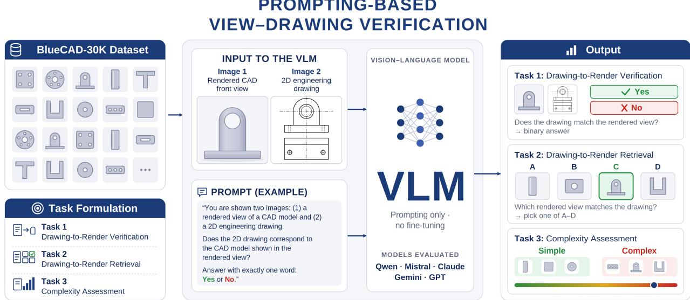  
Figure 1. Overview of Blueprint2CAD. All tasks pair two 2D images, an engineering line drawing and a render of a part.

## Abstract

Engineering drawings specify mechanical parts through orthographic projections. Recognizing which part a drawing depicts underlies part search, design reuse, and digitization, yet no public benchmark measures whether vision models can do it. We introduce Blueprint2CAD, a benchmark for drawing-to-render correspondence: given an orthographic line drawing and a shaded render, usually from another viewpoint, decide whether they show the same part. Its data layer, BlueCAD-30K, applies an open draft ing pipeline to 29,925 Zero-to-CAD models, adding viewaligned renders, clean and dimensioned drawings from six viewpoints, and surface-type metadata. Frozen encoders retrieve the matching part from a 10,000-model gallery with up to 65% Recall@1 when viewpoints are known but 43% when they are not, and the four encoders we test lie within six points of each other: viewpoint, not backbone, is the bottleneck. Six zero-shot vision-language models reach

only 0.52–0.67 verification accuracy, with model-specific Yes/No biases that chain-of-thought shifts but does not remove; a quick LoRA fine-tuning on in-domain pairs improves verification accuracy by a few points but sharpens these biases and leaves the viewpoint failure intact.

## 1. Introduction

Engineering drawings are how mechanical parts are specified, archived, and exchanged. A drawing encodes shape implicitly, through orthographic projections and drafting conventions [22, 31], while the part itself exists as an exact CAD boundary representation (B-rep) [54, 67]. Recognizing which part a drawing depicts is the first step in part-library search, legacy-design reuse, drawing digitization, and model verification, and any automated pipeline from drawings to solids depends on a visual front-end that does this reliably.

The problem is harder than it looks. Mechanical components are textureless, symmetric, and repetitive, and their identity rests on small features such as holes, pockets, fillets, and chamfers. A drawing presents these as sparse line art with hidden lines and annotations layered on top, whereas a render shows a shaded surface, usually from another viewpoint. Deciding whether the two show the same part therefore means holding one projection and relating it to another across a change of view, a correspondence that is natural to carry as visual structure and awkward to spell out in words. Existing CAD datasets [37, 39, 52, 82] support shape retrieval and generative modeling, and SPARE3D [25] poses spatial-reasoning questions over three-view drawings, but none pairs engineering drawings with shaded renders of the same part under controlled cameras, so the encoders behind drawing-to-CAD reconstruction [19, 81], drawing digitization [17, 58], and CAD inspection [1] have never been measured on orthographic line art.

We introduce Blueprint2CAD, a benchmark that makes drawing-to-render correspondence a first-class task. Its scope is deliberately 2D: every task relates a line drawing to an image of the part it describes, and nothing is claimed about recovering 3D geometry. The data layer, BlueCAD-30K, adds no new geometry either. It is the output of an open drafting pipeline applied to 29,925 models of the Zero-to-CAD collection [5]: shaded renders together with clean and dimensioned projections from six canonical viewpoints under a shared camera rig, so that view correspondence holds by construction, plus B-rep-derived surfacetype metadata and model-level training, validation, and test splits. The pipeline runs on any STEP collection, which is how we expect the benchmark to grow.

We evaluate the two paradigms a practitioner would reach for first. Five frozen vision foundation models (DINOv3 [72], SigLIP2 [75], I-JEPA [4], RADIO [66], TIPSv2 [11]) serve as embeddings for search over a 10,000- model gallery: when the camera direction of each projection is known, the four strongest reach 59–65% Recall@1 within six points of each other, while a hand-crafted silhouette descriptor already reaches 49%; without that knowledge the best encoder falls to 43%, still about twice the silhouette’s rate, two dimension lines per view cost at most seven points, and I-JEPA stays near chance under our protocol. Six vision-language models (Claude Sonnet 5 [2], Gemini 3.6 Flash [23], GPT-5.6 Luna [60], Mistral Small 3.2 24B [56], InternVL3.5 14B [80], Qwen3- VL 8B [8]) are queried zero-shot on binary verification and 4-way retrieval: none reaches 0.70 verification accuracy, even with chain-of-thought, each carries its own Yes/No prior that reasoning prompts redirect rather than remove, and correct matches become rare once the render is a top or bottom view. A tiny LoRA adapter trained on in-domain pairs lifts Qwen3-VL 8B by a few points without touching either failure mode. Read together, the two studies place drawing-to-render correspondence among the problems where an intermediate representation in language does not stand in for one that keeps the geometry: supplying the view relation directly, as the oracle alignment does for frozen encoders, is worth more than any change of backbone, while asking a Vision Language Model (VLM) to narrate that relation leaves its viewpoint failure where it was. Our contributions are:

• Blueprint2CAD, a 2D benchmark for matching engineering drawings to part renders, covering gallery-scale retrieval, two direct VLM tasks, and an unguided complexity probe.

• An open drafting pipeline for any STEP collection, and BlueCAD-30K, the line art, shaded images, metadata, and model-level splits it adds to 29,925 Zero-to-CAD models.

• A diagnostic study of the five encoders against a nonlearned silhouette baseline, under view alignment, multiview fusion, and annotation clutter, and a failure-mode analysis of the six VLMs and one fine-tuned variant that isolates model-specific response biases and tests whether reasoning in language recovers the cross-view correspondence the task requires.

## 2. Related Work

Reasoning with visual intermediates. A model can externalize an intermediate as pixels or tokens [9, 29, 49, 73], keep it latent in the encoder’s embedding space [47, 86, 94], or imagine the unseen view with a world model or spatial map [78, 93], because textual chain-of-thought does not improve and can degrade spatial judgments [34, 92], binary verification follows a model-specific Yes prior [12], and VLMs default to the camera’s frame under viewpoint change [55, 97, 98]. None tests whether an intermediate carries an orthographic drawing to a render of the same part; Blueprint2CAD measures that, and its view labels make these methods testable on it.

Engineering drawings Drawings have long been treated as a document-analysis problem: vectorization of scans, symbol and dimension parsing [17, 58], and recently drawing-centric VQA benchmarks for multimodal models [41, 59], with reconstruction from orthographic views [28, 30, 63, 81] as the downstream goal. SPARE3D [25] comes closest, asking view-consistency and camera-pose questions over three-view line drawings, but both sides of each question are line art. Missing is a measurement of the step in between: whether a general-purpose encoder or VLM can read a drawing well enough to recognize the part it depicts.

2D–3D CAD retrieval and foundation models. Imageto-CAD retrieval learns joint embeddings of images and 3D geometry, from RGB-D scans [7] to monocular RGB [21, 24, 42, 43, 53], and sketch-based retrieval addresses the line-drawing-to-shape gap on SHREC [14, 16, 45, 46, 64]; both target household objects with dedicated 3D encoders. Frozen encoders such as CLIP [65], DINO [61, 72], SAM [38], and RADIO [66] are distilled into 3D encoders by ULIP [90, 91], OpenShape [50], and Uni3D [99], but their natural-image pretraining is not tuned to untextured, symmetric mechanical parts; CADCrafter [13] conditions on depth and normals instead, and a growing line fine-tunes multimodal Large Language Models (LLMs) to emit parametric CAD directly [15, 68, 79, 85, 87, 95, 96]. We instead measure purely 2D encoders with a line drawing as the query and a render of an engineering part as the target.

VLMs and native CAD learning. VLM work on CAD covers generation from visual input [20, 33, 40], drawing VQA where correspondence is a small subtask [41, 59], and embedding-space sketch matching [26]; none poses identity verification between an engineering drawing and a shaded render as a primary task on a public dataset. Separately, generative models emit sketch-and-extrude sequences [84, 88, 89], B-rep encoders classify and retrieve parts [32, 44], and reverse engineering recovers models from point clouds [35, 51, 76], sketches [48, 70], or drawings [28, 63, 81], supported by datasets with design histories [36, 69, 82]. We use B-rep machinery only to describe and sample our data; B-rep-native encoders are left to future work.

## 3. Background

CAD systems [67, 74] describe a solid as a B-rep: faces, edges, and vertices carried by parametric surfaces and curves [10, 54], with freeform geometry expressed as NURBS [62] and built as sequences of operations over constrained 2D sketches [71]. The CAD model is the primary definition from which engineering drawings are derived. A drawing follows Monge’s descriptive geometry [57]: a 3D object is represented exactly by its orthographic projections onto perpendicular planes, stored digitally as vector primitives (segments, arcs, circles, splines) interleaved with dimensions, text, and hatching in formats such as DXF [6] or SVG [83]. In practice drawings range from bare orthographic outlines to section and auxiliary views, GD&T, surface-finish callouts, and title blocks [22, 31]; this work addresses the orthographic core shared by all of them (Sec. 7). Because the 3D geometry is encoded implicitly across complementary views, reconstructing a model from its drawing has been an open problem since the earliest work on orthographic reconstruction [30].

## 4. BlueCAD-30K

## 4.1. Dataset

Origin. BlueCAD-30K is built on Zero-to-CAD [5], a 2026 collection of STEP models generated from procedural CAD scripts. We add no geometry: the dataset is the drawings, renders, and metadata our pipeline produces for a filtered subset, with source models referenced by identifier. We chose Zero-to-CAD over scraped repositories [37, 39, 82] because paired drawing generation needs clean, watertight, single-solid geometry; the pipeline runs on any STEP collection and can be re-instantiated on real part libraries (Sec. 7).

Filtering. A B-rep parser removes models with a low geometry score or curved-surface ratio, degenerate aspect ratios, non-watertight geometry, or fewer than k=5 faces, reducing the 1M pool to roughly 300K. A random 10% sample gives 30,237 models; 29,925 pass every stage, and 312 (1.0%) fail in drafting or rendering because of invalid topology the parser misses. In the sample, 65% of faces are planar and 22% cylindrical, 24% of models contain a B-spline face, and 0.02% are exact topological duplicates; geometric diversity is bounded by the single generator (Sec. 7).

Drafting pipeline. Each model is projected in native STEP coordinates from six canonical orthographic viewpoints shared by drawing and render, so view correspondence holds by construction (Fig. 3; axes and edge treatment in the supplementary). Drawings use OpenCascade hidden-line removal, are stored as layered DXF, and are rasterized to 1024 × 1024 px on white; renders have the same resolution and a transparent background. A dimensioned variant adds width and height dimensions to each view. Data (CC BY 4.0) and code (Apache 2.0) are released: per model, six renders, six clean and six dimensioned drawings, and B-rep metadata, plus the VLM pairs, prompts, checkpoints, and raw responses.

Splits. Splits are made by model identifier, so no model appears in two of them: 27,479 models for training, 1,446 for validation (5% of the non-test models, fixed seed), and 1,000 for testing, which form the VLM evaluation set (Sec. 4.2). Training pairs draw negatives only from their own split (supplementary Sec. D). The frozenencoder study uses a 10,000-model gallery sampled from the dataset. All splits, including the gallery, are released.

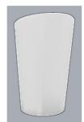

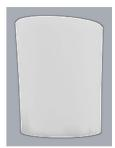

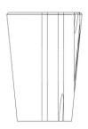

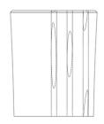

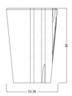

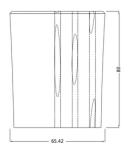

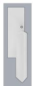

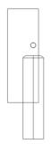

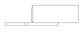

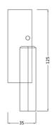

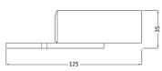

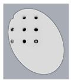  
(a) Render

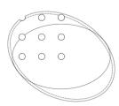  
(b) Drawing

Freeform subset (complex)  
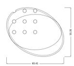  
(c) Drawing with dimension

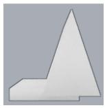  
(a) Render

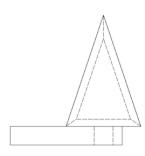  
(b) Drawing

Prismatic subset (simple)  
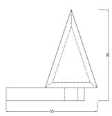  
(c) Drawing with dimension

Figure 2. Examples of CAD models from the two VLM evaluation subsets: shaded render, clean 2D drawing, and dimensioned 2D drawing.  
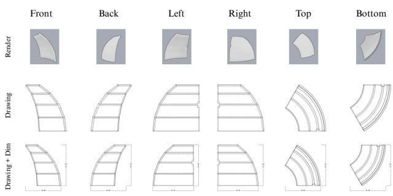  
Figure 3. A CAD example with its six camera directions and paired render, drawing, and dimensioned drawing views.

## 4.2. VLM Evaluation Set

The VLM evaluation set holds the 500 lowest- and 500 highest-scoring models under a selection score s ∈ [0, 100], a weighted sum of seven normalized B-rep signals (freeform-face ratio, face count, non-planar ratio, surfacetype entropy, inner loops, curved-edge ratio, and sphericity; weights in supplementary Table 8, following [3, 32, 44, 77]). The low end consists of prismatic parts with planar and cylindrical faces, the high end offreeform parts dominated by B-spline surfaces. The score only selects the two sets, which do not overlap in score (12.2–18.2 vs. 59.1– 87.3): 99% of prismatic models have no freeform face and 95% of freeform models have a non-planar ratio above 0.6, while face counts overlap (interquartile ranges 19–32 and 26–63), so the classes differ in surface type, not size (supplementary Sec. A). Tables label them simple and complex to match the Task 3 prompt.

## 5. Blueprint2CAD Benchmark

We examine drawing-to-render correspondence from two angles: frozen Vision Foundation Model (VFM)s as crossmodal embeddings for retrieval (Sec. 5.1), and VLMs queried directly on matching tasks (Sec. 5.2). Retrieval runs over a 10,000-model sample of the full dataset, and the VLM tasks over the 1,000-model evaluation set. Every input is a pair of 2D images, a line drawing on one side and a shaded render on the other. Models run frozen or zeroshot, with one exception, a LoRA-adapted Qwen3-VL 8B (Sec. 5.2.1), a small-scale reference that exercises the training split (Sec. 7).

## 5.1. Vision Foundation Models

We ask whether frozen 2D VFMs can link a drawing to the render of the same part, probing four backbones with distinct pretraining objectives: DINOv3 [72], SigLIP2 [75], RADIO [66], and TIPSv2 [11]. Freezing is deliberate: digitization and reconstruction pipelines use these encoders off the shelf, so we measure what pretraining already captures. Since nothing is learned, no training split is needed, and the gallery is a 10,000-model sample of the dataset. Each backbone yields one global descriptor per drawing and render view of every model, twelve in total (Sec. 4.1), meancentered per modality over the gallery and ℓ2-normalized; checkpoints, resolutions, and descriptor choices are in the

supplementary.

Cross-modal retrieval protocol. Each model thus has V=6 unit-normalized drawing descriptors $\hat { d } _ { i }$ and render descriptors ${ \hat { r } } _ { i } ,$ , indexed by viewpoint. A query in one modality must retrieve its counterpart among all 10,000 gallery models; we report bidirectional Recall@k (R@k), mean reciprocal rank (MRR), and median rank (chance: $\begin{array} { r } { \mathbf { R } @ 1 = 0 . 0 1 \% . } \end{array}$ , median rank ≈ 5,000). With unknown viewpoints (view-agnostic), Max takes the highest similarity over all $V \times V$ pairs and Mean compares the renormalized per-model averages. With known viewpoints (view-aligned), only matching projections are compared, $s _ { \mathrm { a l i g n e d } } = \mathrm { a g g } _ { i } \hat { d } _ { i } ^ { \top } \hat { r } _ { i }$ , with agg the mean (Al-mean) or the max (Al-max). Since alignment uses oracle labels, it is a diagnostic of what a representation can do once viewpoint is solved; the view-agnostic setting is the deployable one.

Experiment 1: Frozen Backbones. Tab. 1 separates two factors. The backbone matters little: DINOv3, TIPSv2, SigLIP2, and RADIO, pretrained by self-distillation, image–text contrast, and multi-teacher distillation, finish within six R@1 points of each other under Al-mean. Viewpoint correspondence matters far more, adding 22–30 points over each encoder’s best view-agnostic score, so the deployable setting is limited by viewpoint rather than by representation quality. Outline alone explains much of this: the silhouette baseline reaches three quarters of the encoders aligned R@1 and gains as much from alignment. The encoders lead it by 11–17 points when viewpoints are known but retrieve 1.7–2.1 times as often when they are not, so pretraining mainly adds a view-consistent description of the part rather than a reading of its interior. Averaging over views beats the best single view in both settings, since several weak projections outweigh one that different parts may share. All four encoders retrieve better from drawings to renders than the reverse while the silhouette baseline is symmetric, placing the asymmetry in how the encoders embed line art and shaded renders. DINOv3 has the best aligned R@1 and MRR and is the default below.

Experiment 2: Per-View Analysis. Tab. 2 adds views to DINOv3 one at a time. Gains come from new viewing axes, not from more pictures: back adds under a point to front, and for all four encoders an opposing pair improves on its stronger member by at most 2.5 points (supplementary), since the two projections mirror each other. Plan views carry the most information: top and bottom are the strongest single views for every encoder, roughly twice any side view, and top + left is every encoder’s best pair, plausibly because extruded mechanical parts expose holes and pockets in plan that side views reduce to lines. The late jump at top follows from this ranking, as it outweighs the weaker bottom view it mirrors; the sixth view then changes R@1 by under half a point for every encoder.

Table 1. Experiment 1: frozen-backbone cross-modal retrieval. R@1 (%, D→R) for the four scoring strategies defined in the protocol: Max/Mean are view-agnostic, Al-max/Al-mean assume known viewpoints. MRR, median rank, and reverse direction for Al-mean. Silhouette: non-learned outline baseline, six filled 16×16 view masks plus aspect ratio (the hard-negative descriptor of Sec. D). Bold: best per column. Full metrics in the supplementary.
<table><tr><td rowspan="2">Backbone</td><td colspan="2">R@1, view-agnostic ↑</td><td colspan="2">R@1, view-aligned ↑</td><td colspan="2">Al-mean</td><td rowspan="2">MedR↓</td></tr><tr><td>Max</td><td>Mean</td><td>Al-max</td><td>Al-mean</td><td>R@1 (R→D) ↑</td><td>MRR↑</td></tr><tr><td>Silhouette</td><td>7.85</td><td>20.16</td><td>10.96</td><td>48.54</td><td>48.08</td><td>0.555</td><td>2</td></tr><tr><td>DINOv3</td><td>29.10</td><td>43.11</td><td>34.67</td><td>65.14</td><td>57.57</td><td>0.728</td><td>1</td></tr><tr><td>TIPSv2</td><td>34.39</td><td>34.65</td><td>38.58</td><td>64.65</td><td>58.67</td><td>0.724</td><td>1</td></tr><tr><td>SigLIP2</td><td>29.52</td><td>38.07</td><td>33.54</td><td>64.15</td><td>57.15</td><td>0.714</td><td>1</td></tr><tr><td>RADIO</td><td>27.46</td><td>36.54</td><td>30.98</td><td>59.51</td><td>49.58</td><td>0.675</td><td>1</td></tr></table>

Table 2. Experiment 2: cumulative view fusion (frozen DI-NOv3, Al-mean, D→R). Gains concentrate where a new viewing axis is introduced and on the top view; the opposing back and right views add almost nothing. Single- and two-view results for all en coders in the supplementary.
<table><tr><td>Views</td><td>R@1↑</td><td>R@5↑</td><td>R@10↑</td><td>MRR↑</td><td>MedR↓</td></tr><tr><td>front</td><td>14.88</td><td>25.98</td><td>31.38</td><td>0.206</td><td>62</td></tr><tr><td>+ back</td><td>15.76</td><td>27.08</td><td>33.11</td><td>0.217</td><td>48</td></tr><tr><td>+ bottom</td><td>42.19</td><td>61.12</td><td>68.20</td><td>0.512</td><td>2</td></tr><tr><td>+ left</td><td>52.15</td><td>70.74</td><td>76.93</td><td>0.607</td><td>1</td></tr><tr><td>+ top</td><td>65.59</td><td>81.90</td><td>87.15</td><td>0.731</td><td>1</td></tr><tr><td>+ right (all 6)</td><td>65.14</td><td>81.79</td><td>86.87</td><td>0.728</td><td>1</td></tr></table>

Table 3. Experiment 3: annotation ablation (normal → dim, Almean, D→R). Worse / Better: share of queries whose rank degrades / improves with dimension annotations; the rest keep their rank. Bold: best value before and after annotation. Full metrics in the supplementary.
<table><tr><td>Backbone</td><td>R@1 (%) ↑</td><td>MRR↑</td><td>MedR</td><td>Worse (%)</td><td>Better (%)</td></tr><tr><td>DINOv3</td><td> ${ \bf 6 5 . 1 4 }  5 8 . 1 0$ </td><td> $\mathbf { 0 . 7 2 8 }  0 . 6 6 3$ </td><td>1 →1</td><td>29.1</td><td>13.4</td></tr><tr><td>TIPSv2</td><td> $6 4 . 6 5  6 1 . 6 1$ </td><td> $0 . 7 2 4  \mathbf { 0 . 6 9 } 7$ </td><td>1 → 1</td><td>23.2</td><td>16.0</td></tr><tr><td>SigLIP2</td><td> $6 4 . 1 5  6 1 . 5 1$ </td><td> $0 . 7 1 4  0 . 6 9 2$ </td><td>1 → 1</td><td>23.7</td><td>20.3</td></tr><tr><td>RADIO</td><td> $5 9 . 5 1  5 8 . 8 4$ </td><td> $0 . 6 7 5  0 . 6 7 3$ </td><td>1 → 1</td><td>22.5</td><td>22.9</td></tr></table>

Experiment 3: Drawing Annotations. Real engineering drawings carry dimension annotations (extension lines, arrows, measurement text) with no counterpart in a render. Our dimensioned variant (Tab. 3) adds two callouts per view, far fewer than a production drawing carries, and its cost is small next to the viewpoint problem: at most 7 R@1 points against 22–30 for unknown viewpoints. Annotations reorder close candidates rather than lose the match: more than half of the queries keep their exact rank, the rest move by a median of 4–5 positions, and every gap narrows from R@1 to R@10 (supplementary). Sensitivity differs by backbone. DINOv3, the only one of the four trained without language supervision, loses most and drops from first to last, while RADIO’s change is not significant (sign test $| z | = 0 . 5 )$ . With four encoders this link to language supervision is a correlation, and whether the measurement text or the extension lines drive it remains untested.

## 5.2. Vision-Language Models Benchmark

We evaluate six VLMs, three closed-source (Gemini 3.6 Flash [23], GPT-5.6 Luna [60], Claude Sonnet 5 [2]) and three open-source (Mistral Small 3.2 24B [56], Qwen3- VL 8B [8], InternVL3.5 14B [80]), zero-shot on the 1,000-model evaluation set of Sec. 4.2 with fixed, untuned prompts and exact string matching; model identifiers and decoding and reasoning settings are listed in supplementary Tab. 13, and pairs, views, prompts, and raw responses are released. A seventh entry, Qwen3-VL 8B LoRA-tuned on Task 1 training pairs (supplementary Sec. D), uses the same harness and is listed as Qwen3-VL 8B (FT); bold marks compare zero-shot models only.

Task 1: Drawing–Render Verification. Models judge whether a rendered view and a 2D drawing depict the same part:

## VLM Prompt

You are shown a rendered view of a CAD model and a 2D engineering drawing. The two images may show the part from different viewpoints. Do they depict the same part? Answer with exactly one word: Yes or No.

The drawing is always the front view; the render is a uniformly sampled canonical view of the same part (50%) or of a different one (50%), the latter taken from the whole evaluation set (25%) or from the same surface-type class (25%). In five of six positive cases the render viewpoint differs from the drawing, so silhouette matching fails even on true positives. Dimensioned and undimensioned drawings are evaluated separately. A control tests whether the forcedchoice format suppresses reasoning and, more to the point, whether making the view change explicit in language helps: every model is also run on the undimensioned pairs with a chain-of-thought (CoT) variant that asks it to first think step by step about silhouette, proportions, and distinctive details (holes, slots, steps), and about how the drawing would look from the render’s viewpoint, then answer Yes or No on a new final line; only that line is scored, and unparseable responses are excluded and counted.

Task 2: Drawing-to-Render Retrieval. Given the rightview drawing of a part, models pick the matching part among four randomly ordered right-view renders, one correct and three distractors sampled uniformly from the evaluation set (chance = 0.25). Distractor difficulty is not controlled, so some items are easy; the breakdown by surfacetype class is in the supplementary. This is a small-gallery analogue of Sec. 5.1: can a VLM do explicitly what frozen features do through embedding similarity?

## VLM Prompt

Thefirst image is a 2D engineering drawing ofa CAD model. The following 4 images are rendered CAD models, labeled A, B, C, D. Which rendered model does the drawing represent? Answer with exactly one letter.

Task 3: Unguided Complexity Probe. Given all six orthographic views, models label the part Simple or Complex. The prompt deliberately gives no criterion: the task probes whether a VLM’s native notion of visual complexity tracks the prismatic/freeform distinction of Sec. 4.2, whose defining signal (surface type) is only indirectly visible in projection. It is diagnostic rather than a capability measure.

## VLM Prompt

You are shown six views (front, back, left, right, top, bottom) of a CAD model. Classify the model as Simple or Complex based on its geometry. Answer with exactly one word: Simple or Complex.

## 5.2.1. Empirical Findings.

Verification. Table 4 summarizes all tasks. On Task 1 the six zero-shot models score 0.52–0.67 with or without dimensions, Per-model 95% intervals are about ±0.03 at n=1000, but since every model answers the same items we compare models with paired exact McNemar tests on the items where their answers differ, Holm-corrected within each family of comparisons (supplementary Tab. 14); no pair among the four leading models differs in either condition $\left( p _ { \mathrm { H o l m } } ~ \ge ~ 0 . 2 8 \right)$ . Table 6 shows why: every model discriminates above chance, but a model-specific decision bias dominates its errors. Claude and GPT-5.6 lean toward Yes; Gemini, Mistral-S, and InternVL3.5 toward No; GPT-5.6 Luna is the most balanced $( | \Delta | = 0 . 0 6 6 )$ . Dimensions push five of the six further toward Yes without a gain in accuracy; the only significant change is a loss, Claude’s 4.5 points $( p _ { \mathrm { H o l m } } = 0 . 0 2 0 ;$ ; supplementary Tab. 14).

Errors also depend on viewpoint: positive accuracy peaks on side renders, which rotate about the vertical axis, and except for Gemini is lowest on top and bottom; Claude falls from 0.98 (right) to 0.46 (top) without dimensions (supplementary). Chain-of-thought does not help (Table 7): under a paired McNemar test of each model’s CoT and forced-choice answers on the same items, no model gains significantly (largest gain Claude, +3.8 points, pHolm = 0.17), the best CoT result (0.681, GPT-5.6 Luna) is +0.7 points over its forced-choice answers $( p _ { \mathrm { H o l m } } ~ = ~ 1 . 0 ) $ , and Qwen3-VL loses 4.9 points $( p _ { \mathrm { H o l m } } ~ = ~ 0 . 0 0 7 ;$ ; supplementary Tab. 14). CoT instead shifts each bias (Claude and GPT-5.6 flip toward rejecting, Mistral-S toward accepting), so the textual intermediate relocates the prior rather than supplying the view relation the task needs. The fine-tuned Qwen3-VL ignores the CoT instruction and reproduces its forced-choice predictions.

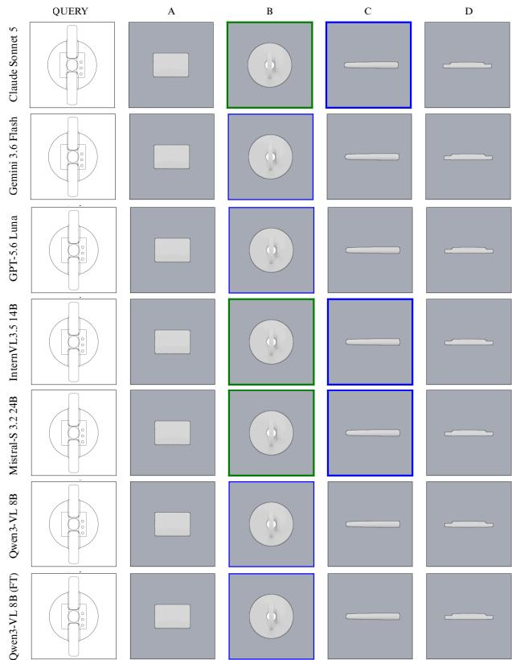  
Figure 4. Examples of 2D drawing retrieval tasks with four candidate CAD renders. Green border: ground-truth render; blue border: model selection. A correct selection makes the two borders coincide.

Retrieval. Gemini leads Task 2 by a wide margin (6.3 points over GPT-5.6 Luna on the items both answered, paired McNemar $p \ < \ 0 . 0 0 1 )$ , GPT-5.6 Luna is the only other model far above chance, and Claude and Qwen3-VL are only modestly above it (supplementary), yet Gemini is mid-pack on Task 1: relative comparison appears easier than an absolute judgment. Open-source models stay near chance here (InternVL3.5 and Mistral-S are indistinguishable from it, Qwen3-VL is 7 points above) while equalling the closed-source leaders on Task 1, so their gap is specific to choosing among candidates.

Table 4. Main VLM results (accuracy, macro-F1). Task 1: verification without and with dimensions (DIM), n=1000 for zeroshot models (one item lacks its render; supplementary Sec. C.1) and 1,000 for FT; per-model 95% Wilson intervals are at most ±0.031, and paired model comparisons are in supplementary Tab. 14. Task 2: four-way retrieval (chance 0.25). Task 3: unguided complexity probe scored against surface-type class (chance 0.50). Bold: best model per column, not including the fine-tuned (FT) row.
<table><tr><td rowspan="2">Model</td><td colspan="2">Task 1</td><td colspan="2">Task 1 + DIM</td><td colspan="2">Task 2</td><td colspan="2">Task 3</td></tr><tr><td>Acc. ↑</td><td>F1 ↑</td><td>Acc. ↑</td><td>F1 ↑</td><td>Acc. ↑</td><td>Fl ↑</td><td>Acc. ↑</td><td>F1 ↑</td></tr><tr><td colspan="9">Closed-source models</td></tr><tr><td>Claude Sonnet 5</td><td>0.635</td><td>0.631</td><td>0.590</td><td>0.560</td><td>0.374</td><td>0.372</td><td>0.520</td><td>0.409</td></tr><tr><td>Gemini 3.6 Flash</td><td>0.654</td><td>0.620</td><td>0.670</td><td>0.646</td><td>0.690</td><td>0.689</td><td>0.562</td><td>0.491</td></tr><tr><td>GPT-5.6 Luna</td><td>0.670</td><td>0.670</td><td>0.654</td><td>0.649</td><td>0.637</td><td>0.636</td><td>0.676</td><td>0.676</td></tr><tr><td colspan="9">Open-source models</td></tr><tr><td>Mistral-S 3.2 24B</td><td>0.534</td><td>0.417</td><td>0.524</td><td>0.450</td><td>0.274</td><td>0.235</td><td>0.521</td><td>0.409</td></tr><tr><td>InternVL3.5 14B</td><td>0.624</td><td>0.604</td><td>0.637</td><td>0.618</td><td>0.266</td><td>0.274</td><td>0.506</td><td>0.399</td></tr><tr><td>Qwen3-VL 8B</td><td>0.670</td><td>0.669</td><td>0.660</td><td>0.655</td><td>0.317</td><td>0.305</td><td>0.512</td><td>0.363</td></tr><tr><td>Qwen3-VL 8B (FT)</td><td>0.685</td><td>0.665</td><td>0.699</td><td>0.688</td><td>0.241</td><td>0.246</td><td>0.553</td><td>0.491</td></tr></table>

Complexity probe. On Task 3 (Table 5), every model except GPT-5.6 Luna answers Simple on 88–98% of a balanced set, so near-chance accuracy comes almost entirely from that one label. Asked without a criterion, these models’ notion of complexity does not follow surface type: a part dominated by B-spline faces can present as a plain silhouette in projection. GPT-5.6 Luna balances the two perclass recalls, so the signal is recoverable from the same input. In addition, the small Qwen3-VL 8B finetune shows interesting results on this task even without being trained at all on it.

Fine-tuning. Rank-16 LoRA adapters on the language model and vision encoder (52.5M parameters, 0.60%; Table 21), trained on 20,000 Task 1 pairs, raise Qwen3-VL 8B from 0.670 to 0.685 without dimensions, which is not significant (paired McNemar $p _ { \mathrm { H o l m } } = 0 . 3 9 )$ , and from 0.660 to 0.699 with them $( p _ { \mathrm { H o l m } } ~ = ~ 0 . 0 3 1 )$ . The gain comes from negatives: the adapted model rejects 0.930 of negative pairs (zero-shot 0.729) but accepts only 0.440 of positives (0.610), so its lean toward No grows from −0.119 to −0.490 (Table 6), while top and bottom renders stay at 0.14 and 0.19 on positives. On Task 2 it drops to chance (0.241, 7.6 points below zero-shot, $p _ { \mathrm { H o l m } } < 0 . 0 0 1 )$ ; on Task 3 its Simple rate falls from 98.4% to 84.9% (accuracy 0.512 to 0.553, $p _ { \mathrm { H o l m } } < 0 . 0 0 1 )$ . At this scale, in-domain data buys a few points by shifting the threshold toward No, as its silhouette-mined negatives (70% of pairs, Sec. D) predict; whether more data or test-matched negatives change this is open.

## 6. Discussion

The two paradigms fail in different ways. Retrieval is a relative task, and frozen encoders handle it once view correspondence is given: objectives as different as selfdistillation, image–text contrast, and multi-teacher distillation converge, and matching six outlines already comes within 11–17 R@1 points of them. Their advantage grows without viewpoints, where they retrieve about twice as often, so what pretraining contributes is a description of the part that stays consistent across views. VLMs face the harder absolute task of verifying a single pair, and their errors are systematic: each applies its own Yes/No prior, reasoning prompts move that prior without correcting it, a basic fine-tune sharpens it, and top and bottom renders defeat every model, so the bottleneck is the relation between views rather than the detail within them. Handing an encoder the view correspondence is worth more than any change of backbone, while asking a VLM to spell it out in words only moves its decision threshold; the task appears to need an intermediate state that keeps the part’s geometry and can be re-projected, which neither paradigm carries and the released view labels make testable.

Table 5. Complexity probe (Task 3): per-class recall, overall accuracy and macro-F1. Labels are B-rep-derived (prismatic = Simple, freeform = Complex); the task probes alignment between an unguided notion of complexity and surface type.
<table><tr><td>Model</td><td>Acc. ↑</td><td>Macro F1 ↑</td><td>Complex Rec. ↑</td><td>Simple Rec. ↑</td></tr><tr><td colspan="5">Closed-source models</td></tr><tr><td>Claude Sonnet 5</td><td>0.520</td><td>0.409</td><td>0.086</td><td>0.954</td></tr><tr><td>Gemini 3.6 Flash</td><td>0.562</td><td>0.491</td><td>0.188</td><td>0.940</td></tr><tr><td>GPT-5.6 Luna</td><td>0.676</td><td>0.676</td><td>0.712</td><td>0.640</td></tr><tr><td colspan="5">Open-source models</td></tr><tr><td>Mistral-S 3.2 24B</td><td>0.521</td><td>0.409</td><td>0.087</td><td>0.954</td></tr><tr><td>InternVL3.5 14B</td><td>0.506</td><td>0.399</td><td>0.084</td><td>0.928</td></tr><tr><td>Qwen3-VL 8B</td><td>0.512</td><td>0.363</td><td>0.028</td><td>0.996</td></tr><tr><td>Qwen3-VL 8B (FT)</td><td>0.553</td><td>0.491</td><td>0.204</td><td>0.902</td></tr></table>

Table 6. Task 1 response bias: accuracy on positive (n=500) and negative (n=499; 500 for FT) pairs, without and with dimensions. ∆ = Pos. − Neg.; ∆ = change in Pos. from adding dimensions. Bold: best zero-shot model per column and smallest |∆|.
<table><tr><td></td><td colspan="3">Undimensioned</td><td colspan="4">Dimensioned</td></tr><tr><td>Model</td><td>Pos. ↑</td><td>Neg. ↑</td><td>∆</td><td>Pos. ↑</td><td>Neg. ↑</td><td>Δ</td><td>∆DIM</td></tr><tr><td colspan="8">Closed-source models</td></tr><tr><td>Claude Sonnet 5</td><td>0.728</td><td>0.541</td><td>+0.187</td><td>0.848</td><td>0.331</td><td>+0.517</td><td>+0.120</td></tr><tr><td>Gemini 3.6 Flash</td><td>0.356</td><td>0.952</td><td>-0.596</td><td>0.412</td><td>0.928</td><td>-0.516</td><td>+0.056</td></tr><tr><td>GPT-5.6 Luna</td><td>0.703</td><td>0.637</td><td>+0.066</td><td>0.772</td><td>0.535</td><td>+0.237</td><td>+0.069</td></tr><tr><td colspan="8">Open-source models</td></tr><tr><td>Mistral-S 3.2 24B</td><td>0.086</td><td>0.982</td><td>-0.896</td><td>0.158</td><td>0.890</td><td>-0.732</td><td>+0.072</td></tr><tr><td>InternVL3.5 14B</td><td>0.400</td><td>0.848</td><td>-0.448</td><td>0.416</td><td>0.858</td><td>-0.442</td><td>+0.016</td></tr><tr><td>Qwen3-VL 8B</td><td>0.610</td><td>0.729</td><td>-0.119</td><td>0.540</td><td>0.780</td><td>-0.240</td><td>-0.070</td></tr><tr><td>Qwen3-VL 8B (FT)</td><td>0.440</td><td>0.930</td><td>-0.490</td><td>0.510</td><td>0.888</td><td>-0.378</td><td>+0.070</td></tr></table>

Table 7. Task 1 under chain-of-thought prompting (undimensioned). Accuracy, macro-F1, positive- and negative-pair accuracy, and ∆ = Pos. − Neg., with the forced-choice ∆ from Table 6 in parentheses. n: items with a parseable final Yes/No. Bold: best zero-shot model per column and smallest |∆|.
<table><tr><td>Model</td><td>Acc. ↑</td><td>F1 ↑</td><td>Pos. ↑</td><td>Neg. ↑</td><td>∆ (forced-choice)</td><td>n</td></tr><tr><td colspan="7">Closed-source models</td></tr><tr><td>Claude Sonnet 5</td><td>0.673</td><td>0.664</td><td>0.515</td><td>0.830</td><td>-0.315 (+0.187)</td><td>996</td></tr><tr><td>Gemini 3.6 Flash</td><td>0.667</td><td>0.639</td><td>0.386</td><td>0.949</td><td>-0.563 (−0.596)</td><td>989</td></tr><tr><td>GPT-5.6 Luna</td><td>0.681</td><td>0.679</td><td>0.604</td><td>0.759</td><td>-0.155 (+0.066)</td><td>959</td></tr><tr><td colspan="7">Open-source models</td></tr><tr><td>Mistral-S 3.2 24B</td><td>0.545</td><td>0.523</td><td>0.758</td><td>0.331</td><td>+0.427 (−0.896)</td><td>1000</td></tr><tr><td>InternVL3.5 14B</td><td>0.617</td><td>0.577</td><td>0.312</td><td>0.922</td><td>−0.610 (−0.448)</td><td>1000</td></tr><tr><td>Qwen3-VL 8B</td><td>0.621</td><td>0.610</td><td>0.452</td><td>0.790</td><td>-0.338 (−0.119)</td><td>1000</td></tr><tr><td>Qwen3-VL 8B (FT)</td><td>0.685</td><td>0.665</td><td>0.440</td><td>0.930</td><td>−0.490 (−0.490)</td><td>1000</td></tr></table>

## 7. Scope and Limitations

Blueprint2CAD compares line drawings with 2D renders and makes no claim about 3D CAD understanding. Its drawings are clean orthographic projections from a single procedural generator, without section views, GD&T, title blocks, or scan artifacts; the released pipeline rebuilds the benchmark from other STEP collections, and real documents are the next test. View-aligned scoring uses oracle viewpoint labels and is a diagnostic beside the deployable view-agnostic setting. Evaluation uses frozen weights or zero-shot prompting plus one fine-tuned variant, and the prismatic/freeform classes follow B-rep surface type rather than expert judgments of complexity. Section views, complex drawing collections, and larger-scale fine-tuning are the natural next steps for this benchmark. We based this analysis completely on [5] dataset, future work could focus on extending this paper to other 3D CAD datasets such as [39, 41, 82] that could have different characteristics.

## 8. Conclusion

Blueprint2CAD makes drawing-to-render correspondence measurable, and BlueCAD-30K supplies the aligned data it needs. Frozen encoders retrieve parts at gallery scale once view correspondence is given, largely independent of pretraining objective, and unknown viewpoints cost far more than dimension lines. VLMs verify pairs through a label prior that chain-of-thought shifts but does not remove, and fail on top and bottom renders even when they discriminate well at a fixed view; LoRA fine-tuning leaves both in place. The bottleneck is neither resolution nor backbone but the relation between views, and whether a geometry-preserving textual intermediate closes it remains open. Section views, larger drawing collections, and larger-scale fine-tuning are natural next steps, and the released pairs and view labels make each testable.

## References

[1] Kamel Alrashedy et al. Generating cad code with visionlanguage models for 3d designs. In International Conference on Learning Representations (ICLR), 2025. 2

[2] Anthropic. Introducing claude sonnet 5. Anthropic, 2026. 2, 6

[3] Mazlum Ferhat Arslan, Alexandros Haridis, Paul L. Rosin, Sibel Tari, Charlotte Brassey, James D. Gardiner, Asli Genctav, and Murat Genctav. SHREC’21: Quantifying shape complexity. Computers & Graphics, 102:144–153, 2022. 4, 1

[4] Mahmoud Assran, Quentin Duval, Ishan Misra, Piotr Bojanowski, Pascal Vincent, Michael Rabbat, Yann LeCun, and Nicolas Ballas. Self-supervised learning from images with a joint-embedding predictive architecture. arXiv preprint arXiv:2301.08243, 2023. 2

[5] Mohammadmehdi Ataei, Farzaneh Askari, Kamal Rahimi Malekshan, and Pradeep Kumar Jayaraman. Zero-to-cad: Agentic synthesis of interpretable cad programs at millionscale without real data, 2026. 2, 3, 8

[6] Autodesk, Inc. DXF reference. Autodesk Developer Documentation, 2011. 3

[7] Armen Avetisyan, Manuel Dahnert, Angela Dai, Manolis Savva, Angel X. Chang, and Matthias Niessner. Scan2cad: Learning cad model alignment in rgb-d scans. In The IEEE Conference on Computer Vision and Pattern Recognition (CVPR), 2019. 3

[8] Shuai Bai, Yuxuan Cai, Ruizhe Chen, Keqin Chen, Xionghui Chen, Zesen Cheng, Lianghao Deng, Wei Ding, Chang Gao, Chunjiang Ge, Wenbin Ge, Zhifang Guo, Qidong Huang, Jie Huang, Fei Huang, Binyuan Hui, Shutong Jiang, Zhaohai Li, Mingsheng Li, Mei Li, Kaixin Li, Zicheng Lin, Junyang Lin, Xuejing Liu, Jiawei Liu, Chenglong Liu, Yang Liu, Dayiheng Liu, Shixuan Liu, Dunjie Lu, Ruilin Luo, Chenxu Lv, Rui Men, Lingchen Meng, Xuancheng Ren, Xingzhang Ren, Sibo Song, Yuchong Sun, Jun Tang, Jianhong Tu, Jianqiang Wan, Peng Wang, Pengfei Wang, Qiuyue Wang, Yuxuan Wang, Tianbao Xie, Yiheng Xu, Haiyang Xu, Jin Xu, Zhibo Yang, Mingkun Yang, Jianxin Yang, An Yang, Bowen Yu, Fei Zhang, Hang Zhang, Xi Zhang, Bo Zheng, Humen Zhong, Jingren Zhou, Fan Zhou, Jing Zhou, Yuanzhi Zhu, and Ke Zhu. Qwen3-vl technical report, 2025. 2, 6

[9] Mahtab Bigverdi, Zelun Luo, Cheng-Yu Hsieh, Ethan Shen, Dongping Chen, Linda G. Shapiro, and Ranjay Krishna. Perception tokens enhance visual reasoning in multimodal language models. In Proceedings ofthe IEEE/CVF Conference on Computer Vision and Pattern Recognition (CVPR), 2025. 2

[10] Ian C. Braid. The synthesis of solids bounded by many faces. Communications of the ACM, 18(4):209–216, 1975. 3

[11] Bingyi Cao, Koert Chen, Kevis-Kokitsi Maninis, Kaifeng Chen, Arjun Karpur, Ye Xia, Sahil Dua, Tanmaya Dabral, Guangxing Han, Bohyung Han, Joshua Ainslie, Alex Bewley, Mithun Jacob, Rene Wagner, Washington Ramos, Krzysztof Choromanski, Mojtaba Seyedhosseini, Howard Zhou, and Andre Araujo. TIPSv2: Advancing Vision-Language Pretraining with Enhanced Patch-Text Alignment.

In Proceedings of the IEEE/CVF Conference on Computer Vision and Pattern Recognition (CVPR), 2026. 2, 4

[12] Tsan Tsai Chan, Varsha Suresh, Anisha Saha, Michael Hahn, and Vera Demberg. System-mediated attention imbalances make vision-language models say yes. In Findings ofthe Association for Computational Linguistics: ACL 2026, pages 38958–38979, 2026. 2

[13] Cheng Chen, Jiacheng Wei, Tianrun Chen, et al. CAD-Crafter: Generating computer-aided design models from unconstrained images. In Proceedings of the IEEE/CVF Conference on Computer Vision and Pattern Recognition (CVPR), 2025. 3

[14] Jiaxin Chen and Yi Fang. Deep cross-modality adaptation via semantics preserving adversarial learning for sketch-based 3D shape retrieval. In Proceedings of the European Conference on Computer Vision (ECCV), 2018. 3

[15] Tianrun Chen, Chunan Yu, Yuanqi Hu, et al. Img2CAD: Conditioned 3D CAD model generation from single im age with structured visual geometry. arXiv preprint arXiv:2410.03417, 2024. 3

[16] Guoxian Dai, Jin Xie, Fan Zhu, and Yi Fang. Deep correlated metric learning for sketch-based 3D shape retrieval. In Pro ceedings of the AAAI Conference on Artificial Intelligence, 2017. 3

[17] Lluis-Pau de las Heras, Oriol Ramos Terrades, Ernest Valveny, and Gemma Sanchez. Symbol detection and text recog-´ nition in architectural and engineering drawings using deep learning. Pattern Recognition Letters, 156:112–118, 2022. 2

[18] Tim Dettmers, Artidoro Pagnoni, Ari Holtzman, and Luke Zettlemoyer. QLoRA: Efficient finetuning of quantized LLMs. In Advances in Neural Information Processing Systems (NeurIPS), 2023. 8

[19] Martin Dimitrov, Robert B Fisher, and Lin Gao. Engineering drawing understanding: A survey and framework for 3d reconstruction. Computer-Aided Design, 161:103524, 2023. 2

[20] Anna C. Doris, Md Ferdous Alam, Amin Heyrani Nobari, and Faez Ahmed. Cad-coder: An open-source visionlanguage model for computer-aided design code generation, 2025. 3

[21] Daoyi Gao, David Rozenberszki, Stefan Leutenegger, and´ Angela Dai. DiffCAD: Weakly-supervised probabilistic CAD model retrieval and alignment from an RGB image. ACM Transactions on Graphics (SIGGRAPH), 43(4), 2024. 3

[22] Frederick E. Giesecke, Alva Mitchell, Henry C. Spencer, Ivan L. Hill, John T. Dygdon, James E. Novak, Shawna Lockhart, Cindy Johnson, and Marla Goodman. Technical Drawing with Engineering Graphics. Pearson, 15th edition, 2016. 1, 3

[23] Google DeepMind. Gemini 3.6 flash. Google DeepMind Model Card, 2026. 2, 6

[24] Can Gumeli, Angela Dai, and Matthias Nießner. ROCA: Ro-¨ bust CAD model retrieval and alignment from a single im age. In Proceedings of the IEEE/CVF Conference on Com puter Vision and Pattern Recognition (CVPR), 2022. 3

[25] Wenyu Han, Siyuan Xiang, Chenhui Liu, Ruoyu Wang, and Chen Feng. SPARE3D: A dataset for SPAtial REasoning on

three-view line drawings. In Proceedings of the IEEE/CVF Conference on Computer Vision and Pattern Recognition (CVPR), 2020. 2

[26] Wentao Hou, Zhenyu Diao, and Jingliang Peng. Sketchbased 3d shape retrieval via cross-modal contrastive learning and difficulty-aware uncertainty regularization. In Pattern Recognition and Computer Vision (PRCV), pages 521–534. Springer, 2024. 3

[27] Edward J. Hu, Yelong Shen, Phillip Wallis, Zeyuan Allen-Zhu, Yuanzhi Li, Shean Wang, Lu Wang, and Weizhu Chen. Lora: Low-rank adaptation of large language models, 2021. 7

[28] Wentao Hu, Jia Zheng, Zixin Zhang, Xiaojun Yuan, Jian Yin, and Zihan Zhou. PlankAssembly: Robust 3D reconstruction from three orthographic views with learnt shape programs. In Proceedings of the IEEE/CVF International Conference on Computer Vision (ICCV), 2023. 2, 3

[29] Yushi Hu, Weijia Shi, Xingyu Fu, Dan Roth, Mari Ostendorf, Luke Zettlemoyer, Noah A. Smith, and Ranjay Krishna. Visual sketchpad: Sketching as a visual chain of thought for multimodal language models. In Advances in Neural Information Processing Systems (NeurIPS), 2024. 2

[30] Masanori Idesawa. A system to generate a solid figure from three view. Bulletin of the JSME, 16(92):216–225, 1973. 2, 3

[31] International Organization for Standardization. ISO 128: Technical product documentation (TPD) — general principles of representation. ISO Standard, 2020. 1, 3

[32] Pradeep Kumar Jayaraman, Aditya Sanghi, Joseph G. Lambourne, Karl D. D. Willis, Thomas Davies, Hooman Shayani, and Nigel Morris. UV-Net: Learning from boundary representations. In Proceedings of the IEEE/CVF Conference on Computer Vision and Pattern Recognition (CVPR), pages 11703–11712, 2021. 3, 4, 1

[33] Aditya Joglekar, Amit Regmi, Kenji Shimada, and Levent Burak Kara. Ortho2cad: 3d cad generation from orthographic drawings using vision language models, 2026. 3

[34] Sai Srinivas Kancheti, Aditya Sanjiv Kanade, Vineeth N. Balasubramanian, and Tanuja Ganu. Chain-of-thought degrades visual spatial reasoning capabilities of multimodal LLMs. In Proceedings of the 64th Annual Meeting of the Association for Computational Linguistics (Volume 2: Short Papers), pages 862–876, 2026. 2

[35] Mohammad Sadil Khan, Elona Dupont, Sk Aziz Ali, Kseniya Cherenkova, Anis Kacem, and Djamila Aouada. CAD-SIGNet: CAD language inference from point clouds using layer-wise sketch instance guided attention. In Proceedings of the IEEE/CVF Conference on Computer Vision and Pattern Recognition (CVPR), 2024. 3

[36] Mohammad Sadil Khan, Sankalp Sinha, Sheikh Talha Uddin, Didier Stricker, Sk Aziz Ali, and Muhammad Zeshan Afzal. Text2CAD: Generating sequential CAD designs from beginner-to-expert level text prompts. In Advances in Neural Information Processing Systems (NeurIPS), 2024. 3

[37] Sangpil Kim, Hyung-gun Chi, Xiao Hu, Qixing Huang, and Karthik Ramani. A large-scale annotated mechanical components benchmark for classification and retrieval tasks with

deep neural networks. In Proceedings ofthe European Con ference on Computer Vision (ECCV), 2020. 2, 3

[38] Alexander Kirillov, Eric Mintun, Nikhila Ravi, et al. Segment anything. In Proceedings of the IEEE/CVF Interna tional Conference on Computer Vision (ICCV), 2023. 3

[39] Sebastian Koch, Albert Matveev, Zhongshi Jiang, Francis Williams, Alexey Artemov, Evgeny Burnaev, Marc Alexa, Denis Zorin, and Daniele Panozzo. ABC: A big CAD model dataset for geometric deep learning. In Proceedings of the IEEE/CVF Conference on Computer Vision and Pattern Recognition (CVPR), pages 9601–9611, 2019. 2, 3, 8

[40] Maksim Kolodiazhnyi, Denis Tarasov, Dmitrii Zhemchuzhnikov, Alexander Nikulin, Ilya Zisman, Anna Vorontsova, Anton Konushin, Vladislav Kurenkov, and Danila Rukhovich. cadrille: Multi-modal CAD reconstruction with online reinforcement learning. arXiv preprint arXiv:2505.22914, 2025. 3

[41] Qian Kou, Xiaofeng Shi, Yulin Li, Xiaosong Qiu, Xinyang Wang, Hua Zhou, and Cao Dongxing. Mechvqa: Bench marking and enhancing multimodal llms on comprehensive mechanical drawing understanding, 2026. 2, 3, 8

[42] Weicheng Kuo, Anelia Angelova, Tsung-Yi Lin, and Angela Dai. Mask2CAD: 3D shape prediction by learning to segment and retrieve. In Proceedings of the European Confer ence on Computer Vision (ECCV), 2020. 3

[43] Weicheng Kuo, Anelia Angelova, Tsung-Yi Lin, and Angela Dai. Patch2CAD: Patchwise embedding learning for in-thewild shape retrieval from a single image. In Proceedings of the IEEE/CVF International Conference on Computer Vision (ICCV), 2021. 3

[44] Joseph G. Lambourne, Karl D. D. Willis, Pradeep Kumar Jayaraman, Aditya Sanghi, Peter Meltzer, and Hooman Shayani. BRepNet: A topological message passing system for solid models. In Proceedings of the IEEE/CVF Confer ence on Computer Vision and Pattern Recognition (CVPR), 2021. 3, 4, 1

[45] Yinjie Lei, Ziqin Zhou, Pingping Zhang, Yulan Guo, Zijun Ma, and Lingqiao Liu. Deep point-to-subspace metric learning for sketch-based 3D shape retrieval. Pattern Recognition, 96, 2019. 3

[46] Bo Li, Yijuan Lu, Afzal Godil, Tobias Schreck, Masaki Aono, Henry Johan, Jose M. Saavedra, and Shoki Tashiro. SHREC’13 track: Large scale sketch-based 3D shape retrieval. In Eurographics Workshop on 3D Object Retrieval (3DOR), 2013. 3

[47] Bangzheng Li, Ximeng Sun, Jiang Liu, Ze Wang, Jialian Wu, Xiaodong Yu, Hao Chen, Emad Barsoum, Muhao Chen, and Zicheng Liu. Latent visual reasoning. In International Conference on Learning Representations (ICLR), 2026. 2

[48] Changjian Li, Hao Pan, Adrien Bousseau, and Niloy J. Mi tra. Free2CAD: Parsing freehand drawings into CAD com mands. ACM Transactions on Graphics (SIGGRAPH), 41 (4), 2022. 3

[49] Chengzu Li, Wenshan Wu, Huanyu Zhang, Yan Xia, Shaoguang Mao, Li Dong, Ivan Vulic, and Furu Wei. Imag-´ ine while reasoning in space: Multimodal visualization-of thought. In Proceedings of the International Conference on Machine Learning (ICML), 2025. 2

[50] Minghua Liu, Ruoxi Shi, Kaiming Kuang, et al. OpenShape: Scaling up 3D shape representation towards open-world understanding. In Advances in Neural Information Processing Systems (NeurIPS), 2023. 3

[51] Yujia Liu, Anton Obukhov, Jan Dirk Wegner, and Konrad Schindler. Point2CAD: Reverse engineering CAD models from 3D point clouds. In Proceedings of the IEEE/CVF Conference on Computer Vision and Pattern Recognition (CVPR), 2024. 3

[52] Bharadwaj Manda, Shubham Dhayarkar, Sai Mitheran, V. K. Viekash, and Ramanathan Muthuganapathy. CADSketchNet – an annotated sketch dataset for 3D CAD model retrieval with deep neural networks. Computers & Graphics, 99:100– 113, 2021. 2

[53] Kevis-Kokitsi Maninis, Stefan Popov, Matthias Nießner, and Vittorio Ferrari. CAD-Estate: Large-scale CAD model annotation in RGB videos. In Proceedings of the IEEE/CVF International Conference on Computer Vision (ICCV), 2023. 3

[54] Martti Mantyl¨ a.¨ An Introduction to Solid Modeling. Computer Science Press, 1988. 1, 3

[55] Mateusz Michalkiewicz, Anekha Sokhal, Tadeusz Michalkiewicz, Piotr Pawlikowski, Mahsa Baktashmotlagh, Varun Jampani, and Guha Balakrishnan. Giq: Benchmarking 3d geometric reasoning of vision foundation models with simulated and real polyhedra, 2026. 2

[56] Mistral AI Team. Mistral small 3.2 (2506): Optimized 24b open-weight language model. https://docs. mistral.ai/models/mistral-small-3-2-25- 06, 2025. Accessed: 2026-08-19. 2, 6

[57] Gaspard Monge. Geom´ etrie Descriptive´ . Baudouin, Paris, 1799. 3

[58] Carlos Francisco Moreno-Garcia, Eyad Elyan, and Chrisina Jayne. Computer vision techniques for automatic detection and recognition of engineering drawing annotations: A review. Neural Computing and Applications, 33(16):9843– 9864, 2021. 2

[59] Ke Niu, Zhuofan Chen, Haiyang Yu, Yuwen Chen, Teng Fu, Mengyang Zhao, Bin Li, and Xiangyang Xue. Creft-cad: Boosting orthographic projection reasoning for cad via reinforcement fine-tuning, 2025. 2, 3

[60] OpenAI. Gpt-5.6: Frontier intelligence that scales with your ambition. OpenAI, 2026. 2, 6

[61] Maxime Oquab, Timothee Darcet, Th´ eo Moutakanni, et al.´ DINOv2: Learning robust visual features without supervision. Transactions on Machine Learning Research, 2024. 3

[62] Les Piegl and Wayne Tiller. The NURBS Book. Springer, 2nd edition, 1997. 3

[63] Feiwei Qin, Ziyan Hou, et al. Drawing2CAD: Sequenceto-sequence learning for CAD generation from vector drawings. In Proceedings of the ACM International Conference on Multimedia (ACM MM), 2025. 2, 3

[64] Jie Qin, Shuaihang Yuan, Jiaxin Chen, et al. SHREC’22 track: Sketch-based 3D shape retrieval in the wild. Computers & Graphics, 107:104–115, 2022. 3

[65] Alec Radford, Jong Wook Kim, Chris Hallacy, et al. Learning transferable visual models from natural language super-

vision. In Proceedings of the International Conference on Machine Learning (ICML), 2021. 3

[66] Mike Ranzinger, Greg Heinrich, Jan Kautz, and Pavlo Molchanov. Am-radio: Agglomerative vision foundation model reduce all domains into one. In Proceedings of the IEEE/CVF Conference on Computer Vision and Pattern Recognition (CVPR), pages 12490–12500, 2024. 2, 3, 4

[67] Aristides A. G. Requicha. Representations for rigid solids: Theory, methods, and systems. ACM Computing Surveys, 12 (4):437–464, 1980. 1, 3

[68] Danila Rukhovich, Elona Dupont, Dimitrios Mallis, Kseniya Cherenkova, Anis Kacem, and Djamila Aouada. CAD-Recode: Reverse engineering CAD code from point clouds. In Proceedings of the IEEE/CVF International Conference on Computer Vision (ICCV), 2025. 3

[69] Ari Seff, Yaniv Ovadia, Wenda Zhou, and Ryan P. Adams. SketchGraphs: A large-scale dataset for modeling relational geometry in computer-aided design. arXiv preprint arXiv:2007.08506, 2020. 3

[70] Ari Seff, Wenda Zhou, Nick Richardson, and Ryan P. Adams. Vitruvion: A generative model of parametric CAD sketches. In Proceedings ofthe International Conference on Learning Representations (ICLR), 2022. 3

[71] Jami J. Shah and Martti Mantyl ¨ a.¨ Parametric and Feature-Based CAD/CAM: Concepts, Techniques, and Applications. Wiley, 1995. 3

[72] Oriane Simeoni, Huy V. Vo, Maximilian Seitzer, Federico´ Baldassarre, Maxime Oquab, Cijo Jose, Vasil Khalidov, Marc Szafraniec, Seungeun Yi, Michael Ramamonjisoa,¨ Francisco Massa, Daniel Haziza, Luca Wehrstedt, Jianyuan Wang, Timothee Darcet, Th ´ eo Moutakanni, Leonel Sentana,´ Claire Roberts, Andrea Vedaldi, Jamie Tolan, John Brandt, Camille Couprie, Julien Mairal, Herve J´ egou, Patrick La-´ batut, and Piotr Bojanowski. Dinov3, 2025. 2, 3, 4

[73] Zhaochen Su, Peng Xia, Hangyu Guo, Zhenhua Liu, Yan Ma, Xiaoye Qu, Jiaqi Liu, Yanshu Li, Kaide Zeng, Zhengyuan Yang, Linjie Li, Yu Cheng, Heng Ji, Junxian He, and Yi R. Fung. Thinking with images for multimodal reasoning: Foundations, methods, and future frontiers. arXiv preprint arXiv:2506.23918, 2025. 2

[74] Ivan E. Sutherland. Sketchpad: A man-machine graphical communication system. In Proceedings of the AFIPS Spring Joint Computer Conference, pages 329–346, 1963. 3

[75] Michael Tschannen, Alexey Gritsenko, Xiao Wang, Muham mad Ferjad Naeem, Ibrahim Alabdulmohsin, Nikhil Parthasarathy, Talfan Evans, Lucas Beyer, Ye Xia, Basil Mustafa, Olivier Henaff, Jeremiah Harmsen, Andreas´ Steiner, and Xiaohua Zhai. Siglip 2: Multilingual visionlanguage encoders with improved semantic understanding, localization, and dense features, 2025. 2, 4

[76] Mikaela Angelina Uy, Yen-Yu Chang, Minhyuk Sung, Purvi Goel, Joseph G. Lambourne, Tolga Birdal, and Leonidas J. Guibas. Point2Cyl: Reverse engineering 3D objects from point clouds to extrusion cylinders. In Proceedings of the IEEE/CVF Conference on Computer Vision and Pattern Recognition (CVPR), 2022. 3

[77] Hakon Wadell. Volume, shape, and roundness of quartz par ticles. The Journal ofGeology, 43(3):250–280, 1935. 4, 1

[78] Qineng Wang, Baiqiao Yin, Pingyue Zhang, Jianshu Zhang, Kangrui Wang, Zihan Wang, Jieyu Zhang, Keshigeyan Chandrasegaran, Han Liu, Ranjay Krishna, Saining Xie, Jiajun Wu, Li Fei-Fei, and Manling Li. MindCube: Spatial mental modeling from limited views. In International Conference on Learning Representations (ICLR), 2026. 2

[79] Siyu Wang, Cailian Chen, Xinyi Le, Qimin Xu, Lei Xu, Yanzhou Zhang, and Jie Chen. CAD-GPT: Synthesising CAD construction sequence with spatial reasoning-enhanced multimodal LLMs. In Proceedings of the AAAI Conference on Artificial Intelligence, 2025. 3

[80] Weiyun Wang, Zhangwei Gao, Lixin Gu, Hengjun Pu, Long Cui, Xingguang Wei, Zhaoyang Liu, Linglin Jing, Shenglong Ye, Jie Shao, Zhaokai Wang, Zhe Chen, Hongjie Zhang, Ganlin Yang, Haomin Wang, Qi Wei, Jinhui Yin, Wenhao Li, Erfei Cui, Guanzhou Chen, Zichen Ding, Changyao Tian, Zhenyu Wu, Jingjing Xie, Zehao Li, Bowen Yang, Yuchen Duan, Xuehui Wang, Zhi Hou, Haoran Hao, Tianyi Zhang, Songze Li, Xiangyu Zhao, Haodong Duan, Nianchen Deng, Bin Fu, Yinan He, Yi Wang, Conghui He, Botian Shi, Junjun He, Yingtong Xiong, Han Lv, Lijun Wu, Wenqi Shao, Kaipeng Zhang, Huipeng Deng, Biqing Qi, Jiaye Ge, Qipeng Guo, Wenwei Zhang, Songyang Zhang, Maosong Cao, Junyao Lin, Kexian Tang, Jianfei Gao, Haian Huang, Yuzhe Gu, Chengqi Lyu, Huanze Tang, Rui Wang, Haijun Lv, Wanli Ouyang, Limin Wang, Min Dou, Xizhou Zhu, Tong Lu, Dahua Lin, Jifeng Dai, Weijie Su, Bowen Zhou, Kai Chen, Yu Qiao, Wenhai Wang, and Gen Luo. Internvl3.5: Advancing open-source multimodal models in versatility, reasoning, and efficiency, 2025. 2, 6

[81] Xilin Wang, Jia Zheng, Yuanchao Hu, Hao Zhu, Qian Yu, and Zihan Zhou. From 2D CAD drawings to 3D parametric models: A vision-language approach. arXiv preprint arXiv:2412.11892, 2024. 2, 3

[82] Karl D. D. Willis, Yewen Pu, Jieliang Luo, Hang Chu, Tao Du, Joseph G. Lambourne, Armando Solar-Lezama, and Wojciech Matusik. Fusion 360 Gallery: A dataset and environment for programmatic CAD construction from human design sequences. ACM Transactions on Graphics (SIG-GRAPH), 40(4), 2021. 2, 3, 8

[83] World Wide Web Consortium. Scalable vector graphics (SVG) 1.1 (second edition). W3C Recommendation, 2011. 3

[84] Rundi Wu, Chang Xiao, and Changxi Zheng. DeepCAD: A deep generative network for computer-aided design models. In Proceedings of the IEEE/CVF International Conference on Computer Vision (ICCV), 2021. 3

[85] Sifan Wu, Amir Hosein Khasahmadi, Mor Katz, Pradeep Kumar Jayaraman, Yewen Pu, Karl Willis, and Bang Liu. Cad-VLM: Bridging language and vision in the generation of parametric CAD sketches. In Proceedings of the European Conference on Computer Vision (ECCV), 2024. 3

[86] Xi Xiao, Tianchen Zhao, Youngeun Kim, Zhuowei Li, Linghan Xu, Jiaye Wu, Zheng Zhang, Xiang Xu, Xuanbai Chen, Farhan Tejani, Jakub Zablocki, Julia Xu, and Yifan Xing. Rethinking latent visual reasoning: Grounding latent reasoning in visual evidence. arXiv preprint arXiv:2609.34563, 2026. 2

[87] Jingwei Xu, Chenyu Wang, Zibo Zhao, Wen Liu, Yi Ma, and Shenghua Gao. CAD-MLLM: Unifying multimodality conditioned CAD generation with MLLM. arXiv preprint arXiv:2411.04954, 2024. 3

[88] Xiang Xu, Karl D. D. Willis, Joseph G. Lambourne, Chin-Yi Cheng, Pradeep Kumar Jayaraman, and Yasutaka Furukawa. SkexGen: Autoregressive generation of CAD construction sequences with disentangled codebooks. In Proceedings of the International Conference on Machine Learning (ICML), 2022. 3

[89] Xiang Xu, Pradeep Kumar Jayaraman, Joseph G. Lambourne, Karl D. D. Willis, and Yasutaka Furukawa. Hierarchical neural coding for controllable CAD model generation. In Proceedings of the International Conference on Machine Learning (ICML), 2023. 3

[90] Le Xue, Mingfei Gao, Chen Xing, Roberto Mart´ın-Mart´ın, Jiajun Wu, Caiming Xiong, Ran Xu, Juan Carlos Niebles, and Silvio Savarese. ULIP: Learning a unified representation of language, images, and point clouds for 3D understanding. In Proceedings of the IEEE/CVF Conference on Computer Vision and Pattern Recognition (CVPR), 2023. 3

[91] Le Xue, Ning Yu, Shu Zhang, et al. ULIP-2: Towards scalable multimodal pre-training for 3D understanding. In Proceedings of the IEEE/CVF Conference on Computer Vision and Pattern Recognition (CVPR), 2024. 3

[92] Jihan Yang, Shusheng Yang, Anjali W. Gupta, Rilyn Han, Li Fei-Fei, and Saining Xie. Thinking in space: How multimodal large language models see, remember, and recall spaces. In Proceedings of the IEEE/CVF Conference on Computer Vision and Pattern Recognition (CVPR), pages 10632–10643, 2025. 2

[93] Yuncong Yang, Jiageng Liu, Zheyuan Zhang, Siyuan Zhou, Reuben Tan, Jianwei Yang, Yilun Du, and Chuang Gan. MindJourney: Test-time scaling with world models for spa tial reasoning. In Advances in Neural Information Processing Systems (NeurIPS), 2025. 2

[94] Zeyuan Yang, Xueyang Yu, Delin Chen, Maohao Shen, and Chuang Gan. Machine mental imagery: Empower multimodal reasoning with latent visual tokens. In Proceedings of the IEEE/CVF Conference on Computer Vision and Pattern Recognition (CVPR), 2026. 2

[95] Yang You, Mikaela Angelina Uy, Jiaqi Han, et al. Img2CAD: Reverse engineering 3D CAD models from images through VLM-assisted conditional factorization. arXiv preprint arXiv:2408.01437, 2024. 3

[96] Zhe Yuan, Jianqi Shi, and Yanhong Huang. OpenECAD: An efficient visual language model for editable 3D-CAD design. Computers & Graphics, 124:104048, 2024. 3

[97] Shaoxiong Zhan, Yanlin Lai, Zheng Liu, Hai Lin, Shen Li, Xiaodong Cai, Zijian Lin, Wen Huang, and Hai-Tao Zheng. 3viewsense: Spatial and mental perspective reasoning from orthographic views in vision-language models, 2026. 2

[98] Yuyou Zhang, Radu Corcodel, Chiori Hori, Anoop Cherian, and Ding Zhao. SpinBench: Perspective and rotation as a lens on spatial reasoning in VLMs. In International Confer ence on Learning Representations (ICLR), 2026. 2

[99] Junsheng Zhou, Jinsheng Wang, Baorui Ma, Yu-Shen Liu, Tiejun Huang, and Xinlong Wang. Uni3D: Exploring uni-

fied 3D representation at scale. In Proceedings of the International Conference on Learning Representations (ICLR), 2024. 3

# Blueprint2CAD: Benchmarking Foundation Models on Engineering Drawing–to–CAD Render Correspondence

Supplementary Material

## A. Dataset Statistics

Geometric statistics of the 1,000-model VLM evaluation set and of the full BlueCAD-30K sample (30,237 models, including the 312 that failed rendering), computed from each STEP B-rep with the OpenCascade extractor behind the selection score (Table 8). Simple and complex denote the prismatic and freeform subsets, as in the main text.

Face-count threshold. The geometric filter removes models with fewer than k=5 faces: below that the unfiltered pool is almost entirely single extrusions of convex polygons, whereas 5–15 faces already covers stepped blocks, flanged plates, and parts with through holes. Over the full sample the smallest model has 7 faces and 4.1% have fewer than 15; in the VLM set the share is 4.4% (0.8% of the simple subset, 8.0% of the complex one, mostly B-splinedominated parts). Every model is a single solid.

Sample composition. Over the full dataset the score spans 11.9–88.6 (median 33.5, interquartile range 26.6– 41.9), so most data sits between the two VLM classes. 76% of models contain no freeform face; 65% of all faces are planar and 22% cylindrical, while B-spline faces make up 4.9% of the sample but 51% of the complex subset.

Class separation. The score ranges 12.2–18.2 for the simple subset and 59.1–87.3 for the complex one (medians 16.8 and 68.5) with no overlap, and the classes are separated on every weighted signal, not only on their sum: 99% of simple models have no freeform face and all have a nonplanar face ratio below 0.2, whereas 95% of complex models exceed 0.6 and 99.6% have a curved-edge ratio above 0.5. Face count does not separate them (interquartile ranges 19–32 and 26–63 overlap), nor do sphericity and aspect ratio, so the distinction is one of surface type and topology rather than of size or silhouette.

Near-duplicates and validity. Grouping models by an exact topological signature (face, edge, and inner-loop counts, the 11-bin surface-type histogram, and boundingbox proportions to four decimals) finds no shared signature in the VLM set and only three pairs (0.02%) in the full sample, so exact duplicates do not affect retrieval.

Edge treatment. Drawings use the HLRBRep HLRToShape edge sets:

Table 8. Selection-score signals, weights (sum to 100), and normalization to [0, 1]. r: raw ratio for the named signal; H: Shannon entropy of the surface-type histogram, normalized by log(11); c: Wadell’s sphericity, $c = \sqrt [ 3 ] { 3 6 \pi V ^ { 2 } } / A$ , clipped to [0, 1]. Weights are fixed manually: the freeform-face ratio as the clearest primitive-vs-organic separator, surface-type entropy after the information-theoretic measures of SHREC’21 [3] with the per-face classification of [32, 44], and compactness as Wadell’s sphericity [77] entered as 1 − c.
<table><tr><td>Signal</td><td>Weight</td><td>Normalization</td></tr><tr><td>Freeform face ratio</td><td>25</td><td>min(1, 2rfreeform)</td></tr><tr><td>Face count (log)</td><td>15</td><td>min(1, log10(faces)/3)</td></tr><tr><td>Non-planar face ratio</td><td>15</td><td>Γcurved face</td></tr><tr><td>Surface-type entropy</td><td>15</td><td>min(1, 1.5 H)</td></tr><tr><td>Inner boundary loops</td><td>12</td><td>min(1, loops/12)</td></tr><tr><td>Curved edge ratio</td><td>10</td><td>Γcurved edge</td></tr><tr><td>Shape compactness</td><td>8</td><td>1- c</td></tr></table>

Table 9. Per-model medians for the VLM subsets (Simple = prismatic, Complex = freeform) and the full sample (n=30,237); interquartile ranges are visible in Fig. 5. Bottom block: fraction of all faces per surface class.
<table><tr><td></td><td>Simple</td><td>Complex</td><td>Full</td></tr><tr><td>Faces</td><td>23</td><td>42</td><td>37</td></tr><tr><td>Edges</td><td>120</td><td>209</td><td>190</td></tr><tr><td>Inner loops</td><td>0</td><td>4</td><td>4</td></tr><tr><td>Freeform face ratio</td><td>0.00</td><td>0.50</td><td>0.00</td></tr><tr><td>Non-planar face ratio</td><td>0.07</td><td>0.81</td><td>0.30</td></tr><tr><td>Curved edge ratio</td><td>0.08</td><td>0.86</td><td>0.28</td></tr><tr><td>Surface-type entropy</td><td>0.11</td><td>0.43</td><td>0.28</td></tr><tr><td>Sphericity c</td><td>0.50</td><td>0.43</td><td>0.41</td></tr><tr><td>Bbox aspect</td><td>5.0</td><td>2.2</td><td>4.2</td></tr><tr><td>Selection score s</td><td>16.8</td><td>68.5</td><td>33.5</td></tr><tr><td>Plane faces</td><td>0.92</td><td>0.19</td><td>0.65</td></tr><tr><td>Cylinder faces</td><td>0.07</td><td>0.19</td><td>0.22</td></tr><tr><td>B-spline faces</td><td>0.00</td><td>0.51</td><td>0.05</td></tr><tr><td>Other faces</td><td>0.01</td><td>0.11</td><td>0.08</td></tr></table>

sharp (V/HCompound) and silhouette (OutLineV/HCompound) edges are drawn solid when visible and dashed when hidden, while tangent, seam, and isoparametric edges are suppressed, matching the TechDraw default.

## B. Frozen-Backbone Results

Checkpoints. DINOv3 ViT-H+/16, SigLIP2 So400m/14 (384 px), RADIO ViT-H/16, and TIPSv2 ViT-g/14 (448 px).

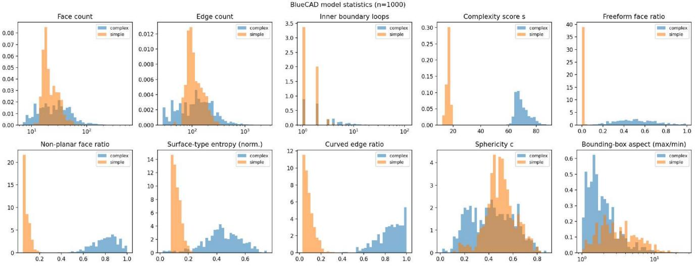  
Figure 5. Distributions of B-rep signals for the VLM evaluation subsets (simple in orange, complex in blue) against the full sample (grey). Face count, edge count, and aspect ratio are on a log axis.

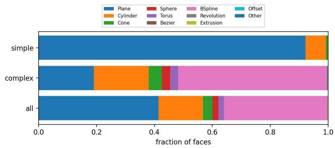  
Figure 6. Fraction of faces per surface type for the simple subset, the complex subset, and the full sample. Simple parts are almost entirely planar and cylindrical; complex parts are dominated by Bspline faces.

Table 10. Canonical camera definitions. Projection directions point from the part toward the viewer (FreeCAD convention); up = direction × x-axis. All vectors are in native STEP coordinates, with no per-model reorientation.
<table><tr><td>View</td><td>Proj. direction</td><td>Image x-axis</td><td>Image up</td></tr><tr><td>Front</td><td>(0,−1,0)</td><td>(1,0,0)</td><td>(0,0,1)</td></tr><tr><td>Right</td><td>(1,0,0)</td><td>(0,1,0)</td><td>(0,0,1)</td></tr><tr><td>Back</td><td>(0,1,0)</td><td>(−1,0,0)</td><td>(0,0,1)</td></tr><tr><td>Left</td><td>(−1,0,0)</td><td>(0, −1,0)</td><td>(0, 0, 1)</td></tr><tr><td>Top</td><td>(0, 0, 1)</td><td>(1,0,0)</td><td>(0,1,0)</td></tr><tr><td>Bottom</td><td>(0,0, −1)</td><td>(1,0,0)</td><td>(0, −1,0)</td></tr></table>

HF models use each checkpoint’s default image processor (resize and center-crop); TIPSv2 images are resized directly to square. Renders are stored as RGBA with a transparent background and converted to RGB before encoding, so every encoder sees them on a black background, whereas drawings are on white. Global descriptors are the CLS token (DINOv3, TIPSv2), the pooled output (SigLIP2), or the summary token (RADIO), computed in fp16 autocast, mean-centered per modality over the gallery, and $\ell _ { 2 } -$ normalized. The Silhouette rows use the model-free descriptor of Sec. D: the foreground mask of each view (drawings: outline closed and filled, so hidden and interior lines are discarded), cropped to its bounding box, resampled to 16×16, concatenated with log aspect ratio and fill fraction, and ℓ -normalized.

## B.1. Full-Gallery Retrieval

Tab. 11 extends Tab. 1 with all recall cutoffs, MRR, and median rank in both retrieval directions for the view-aligned (Al-mean) setting. All four encoders place the correct part first for most queries and within the top ten for 82–87% of them. Each retrieves better from drawings to renders than the reverse at every cutoff, by the widest margin for RA-DIO, whereas the outline baseline is symmetric.

## B.2. Per-View Analysis

Tab. 12 gives single- and two-view results for all four encoders, and the pattern is the same for all of them. An opposing pair (front + back, left + right, top + bottom) improves on its stronger member by at most 2.5 R@1 points, whereas an orthogonal pair adds 11–22 points; top is the strongest single view and bottom the second, and top + left is the best pair. Information is thus spread across axes rather than across views, and the plan view carries the most of it.

## B.3. Annotation Ablation

Every gap between clean and dimensioned drawings narrows from R@1 to R@10 (DINOv3 7.0 to 5.3 points,

Table 11. Complete frozen-backbone retrieval results (extends Tab. 1). View-aligned setting (Al-mean, viewpoints known), both directions, all metrics; Silhouette is the non-learned outline baseline. Gallery: N=10,000-model sample; chance $\begin{array} { r } { \mathbb { R } \ @ 1 = 0 . 0 1 \% , } \end{array}$ chance median rank ≈ 5,000.
<table><tr><td>Backbone</td><td>Direction</td><td>R@1↑</td><td>R@2↑</td><td>R@3↑</td><td>R@5↑</td><td>R@10↑</td><td>MRR↑</td><td>MedR↓</td></tr><tr><td rowspan="2">Silhouette</td><td>D→R</td><td>48.54</td><td>55.41</td><td>59.04</td><td>62.79</td><td>68.34</td><td>0.555</td><td>2</td></tr><tr><td>R→D</td><td>48.08</td><td>55.40</td><td>58.75</td><td>63.14</td><td>68.98</td><td>0.554</td><td>2</td></tr><tr><td rowspan="2">DINOv3</td><td>D→R</td><td>65.14</td><td>73.56</td><td>77.67</td><td>81.79</td><td>86.87</td><td>0.728</td><td>1</td></tr><tr><td>R→D</td><td>57.57</td><td>66.34</td><td>70.32</td><td>75.28</td><td>81.44</td><td>0.659</td><td>1</td></tr><tr><td rowspan="2">TIPSv2</td><td>D→R</td><td>64.65</td><td>73.34</td><td>77.08</td><td>81.63</td><td>86.42</td><td>0.724</td><td>1</td></tr><tr><td>R→D</td><td>58.67</td><td>66.60</td><td>71.11</td><td>75.55</td><td>81.18</td><td>0.665</td><td>1</td></tr><tr><td rowspan="2">SigLIP2</td><td>D→R</td><td>64.15</td><td>71.99</td><td>75.50</td><td>79.71</td><td>84.50</td><td>0.714</td><td>1</td></tr><tr><td>R→D</td><td>57.15</td><td>65.17</td><td>69.29</td><td>73.61</td><td>79.27</td><td>0.649</td><td>1</td></tr><tr><td rowspan="2">RADIO</td><td>D→R</td><td>59.51</td><td>67.86</td><td>72.37</td><td>77.01</td><td>82.36</td><td>0.675</td><td>1</td></tr><tr><td>R→D</td><td>49.58</td><td>57.71</td><td>62.16</td><td>66.65</td><td>73.19</td><td>0.578</td><td>2</td></tr></table>

TIPSv2 3.0 to 1.7, SigLIP2 2.6 to 0.7, RADIO 0.7 to −0.6), so annotations mostly demote the correct part from first place to a nearby rank rather than losing it. The exchange is one-sided only for DINOv3, which loses 1,132 first-place hits and gains 428; RADIO loses 862 and gains 795, a wash. Clean-drawing results for all cutoffs are in Tab. 11.

## C. Vision-Language Model Results

## C.1. Inference Settings

Tab. 13 lists the model identifiers and decoding settings. Closed models were queried through their vendors’ APIs between 15 and 25 August 2026. No temperature, sampling, or reasoning parameter was set in any call, so each closed model ran with its provider’s defaults, and the identifiers are the aliases passed to the API, which the vendor resolves to its snapshot current at that time. The zero-shot open models were served through an OpenAI-compatible local endpoint using the ”vllm” library, and likewise ran with the server’s default sampling, taken from each checkpoint’s generation config. The fine-tuned model ran in-process with Hugging Face Transformers in bf16 with greedy decoding, so its comparison with zero-shot Qwen3-VL also changes the decoding. Every image is stored at 512×512 px and sent to every model at that resolution, in the order given by each prompt. Responses without a parseable answer are excluded from that model’s accuracy, and every paired comparison uses only the items both systems answered. The forced-choice runs contain one empty GPT-5.6 Luna response (Tab. 17), and the CoT runs lose 41 GPT-5.6 Luna responses (empty), 11 Gemini responses (API errors), and 3 Claude responses (empty or cut off at the token limit); Tab. 7 reports the remaining n. The same rule removes 52 GPT-5.6 Luna and 7 Claude empty responses and 6 Gemini API errors from Task 2, and 4 Gemini API errors and 4 unparseable Mistral-S answers from Task 3; every other Task 2 and 3 run answered all 1,000 items. The reasoning setting matters for reading Tab. 7: a model with internal reasoning enabled already reasons before its forced-choice answer, so for it the CoT control changes only whether that reasoning is written out and guided.

## C.2. Paired Significance Tests

All VLMs answer the same items, so accuracy differences are tested on paired outcomes rather than by overlapping per-model intervals. For two systems A and B, let b be the items A answers correctly and B does not, and c the reverse; the exact (binomial) McNemar test asks whether b and c differ, using only the b + c discordant items, and $\Delta \mathrm { A c c } = ( b - c ) / n$ . Each comparison uses the n items both systems answered (Sec. C.1), so ∆Acc can differ from the difference of Tab. 4 entries by 0.001–0.002. p-values are Holm-corrected within each block of Tab. 14; the leadingmodel blocks list the four highest-accuracy zero-shot models of each condition. Over all 15 zero-shot pairs per condition, Mistral-S is below every other model $( p _ { \mathrm { H o l m } } < 0 . 0 0 1 )$ except Claude with dimensions $( p _ { \mathrm { H o l m } } = 0 . 0 8 9 )$ , and with dimensions Claude is below Gemini, GPT-5.6, and Qwen3- VL $( p _ { \mathrm { H o l m } } \le 0 . 0 1 0 ) ;$ ; no other pair differs.

## C.3. Task 1 by Surface-Type Class and Tier

Tab. 15 splits Task 1 by surface-type class and pair tier. Every model, the fine-tuned one included, scores 2–13 points higher on freeform than on prismatic parts. The tiers expose the response biases: Gemini, InternVL3.5, and Mistral-S reject negatives at 0.82–0.99 but accept positives at only 0.09–0.42, while Claude and GPT-5.6 show the reverse, most strongly with dimensions (Claude: 0.85 on positives, 0.33 on negatives). Same-class negatives stay within 0.07 of any-class negatives for all models, including the fine-tuned one despite its silhouette-mined training negatives (Sec. D); since they share only the coarse class, not overall shape, this does not test look-alike parts.

## C.4. Task 1: Render Viewpoint

Tabs. 16 and 17 split Task 1 by render viewpoint. Positivepair accuracy is highest on the side renders and, for every model but Gemini (lowest on back), lowest on top and bottom, where negative-pair accuracy is often higher than elsewhere (Claude: 0.72 on top against 0.48–0.49 on the side views without dimensions), so part of the drop on positives is a shift toward No on these views.

## C.5. Task 2 by Surface-Type Class

Tab. 18 splits Task 2 by surface-type class. Claude, Gemini, GPT-5.6, and Mistral-S do better on freeform parts, InternVL3.5 and Qwen3-VL marginally better on prismatic ones. Against chance (one-sided exact binomial test, Holmcorrected over the six zero-shot models), Gemini, GPT-5.6, Claude, and Qwen3-VL score above $0 . 2 5 ( p _ { \mathrm { H o l m } } < 1 0 ^ { - 5 } )$ and InternVL3.5 and Mistral-S do not $( p _ { \mathrm { H o l m } } ~ \ge ~ 0 . 0 8 8 )$

Table 12. Per-view analysis of the four encoders. Drawing→render, view-aligned mean pooling, gallery N=10,000. Single orthographic views (top block, sorted by R@1) and two-view fusion (bottom block). Best pair per backbone and metric in bold.  
DINOv3
<table><tr><td>View</td><td></td><td>R@1↑</td><td>R@5↑</td><td>R@10↑</td><td>MRR↑</td><td>MedR↓</td></tr><tr><td rowspan="5">Sinle back</td><td>top</td><td>30.98</td><td>44.49</td><td>50.60</td><td>0.377</td><td>10</td></tr><tr><td>bottom</td><td>25.87</td><td>38.72</td><td>44.42</td><td>0.323</td><td>19</td></tr><tr><td>left</td><td>16.53</td><td>28.20</td><td>33.95</td><td>0.225</td><td>50</td></tr><tr><td>right front</td><td>16.41</td><td>27.58</td><td>33.40</td><td>0.223</td><td>55</td></tr><tr><td></td><td>14.88 14.49</td><td>25.98</td><td>31.38</td><td>0.206</td><td>62</td></tr><tr><td rowspan="5">Pairs</td><td>top + left</td><td>53.01</td><td>24.26 72.35</td><td>29.54 78.75</td><td>0.198</td><td>72</td></tr><tr><td>front + top</td><td>51.11</td><td>70.74</td><td></td><td>0.621</td><td>1</td></tr><tr><td></td><td></td><td></td><td>77.20</td><td>0.602</td><td>1</td></tr><tr><td>top + bottom</td><td>32.99</td><td>47.39</td><td>53.52</td><td>0.402</td><td>7</td></tr><tr><td>front + left</td><td>29.05</td><td>44.30</td><td>51.03</td><td>0.365</td><td>9</td></tr><tr><td rowspan="4"></td><td>left + right</td><td>18.24</td><td>30.24</td><td>36.24</td><td>0.244</td><td>38</td></tr><tr><td>front + back</td><td></td><td></td><td></td><td></td><td></td></tr><tr><td></td><td>15.76</td><td>27.08</td><td>33.11</td><td>0.217</td><td>48</td></tr><tr><td></td><td></td><td></td><td></td><td></td><td></td></tr></table>

SigLIP2
<table><tr><td>View</td><td></td><td>R@1↑</td><td>R@5↑</td><td>R@10↑</td><td>MRR↑</td><td>MedR↓</td></tr><tr><td>Sile</td><td>top bottom left right front</td><td>30.82 23.68 15.02 14.85 13.85</td><td>46.06 37.42 26.36 26.62 24.82</td><td>52.32 43.49 32.30 32.44 30.46</td><td>0.383 0.305 0.210 0.209 0.195</td><td>8 20 54 53</td></tr><tr><td>Pairs front + back</td><td>back top + left front + top top + bottom front + left left + right</td><td>12.53 51.16 49.83 33.32 28.22 16.19</td><td>23.49 70.75 69.10 49.40 43.72 28.70</td><td>29.55 77.36 76.10 56.22 50.34</td><td>0.183 0.603 0.589 0.412 0.358</td><td>67 76 1 2 6 10</td></tr></table>

Table 13. VLM inference settings. Identifier: API model alias (closed, queried 15–25 August 2026) or Hugging Face checkpoint (open). Temp.: no run set a temperature, so “default” is the provider’s or the serving engine’s default. Reasoning: “off” if thinking is disabled, “default” if left unset, n/a for models without a reasoning mode. Max tok.: output-token limit passed in the call, the same for forced-choice and CoT prompts; for GPT-5.6 Luna it also counts reasoning tokens.
<table><tr><td>Model</td><td>Identifier</td><td></td><td>Temp. Reasoning Max tok.</td><td></td></tr><tr><td>Claude Sonnet 5</td><td>claude-sonnet-5</td><td>default off</td><td></td><td>2000</td></tr><tr><td>Gemini 3.6 Flash</td><td>gemini-3.6-flash</td><td></td><td>default default</td><td>2000</td></tr><tr><td>GPT-5.6 Luna</td><td>gpt-5.6-luna</td><td></td><td>default default</td><td>2000</td></tr><tr><td>Mistral-S 3.2 24B</td><td>mistralai/Mistral-Small-3.2-24B-Instruct-2506 default n/a</td><td></td><td></td><td>2000 (20 in T3)</td></tr><tr><td>InterVL3.5 14B</td><td>OpenGVLab/InternVL3_5-14B</td><td>default off</td><td></td><td>2000 (100 in T3)</td></tr><tr><td>Qwen3-VL 8B</td><td>Qwen/Qwen3-VL-8B-Instruct</td><td>default n/a</td><td></td><td>2000</td></tr><tr><td></td><td>Qwen3-VL 8B (FT) base + merged LoRA</td><td>greedy n/a</td><td></td><td>2000</td></tr></table>

on the items both answered, Gemini leads GPT-5.6 by 6.3 points (paired McNemar $p \ < \ 0 . 0 0 1 )$ . The fine-tuned Qwen3-VL drops to chance on both classes (overall 0.241, $p = 0 . 5 3$ against 0.25), 7.6 points below its zero-shot base $( p _ { \mathrm { H o l m } } < 0 . 0 0 1$ ; Tab. 14): it treats the drawing as the first labelled candidate, answering E on 12.9% of items and the letter one past the ground truth on 54.1%.

TIPSv2
<table><tr><td>View</td><td></td><td>R@1↑</td><td>R@5↑</td><td>R@10↑</td><td>MRR↑</td><td>MedR↓</td></tr><tr><td rowspan="3">Sile</td><td>top bottom left</td><td>32.58 27.56</td><td>48.31 41.96</td><td>54.39 48.53</td><td>0.402 0.347</td><td>6 12</td></tr><tr><td>right</td><td>15.71 15.66</td><td>27.10 27.07</td><td>32.36 32.14</td><td>0.216 0.215</td><td>58 57</td></tr><tr><td>front back</td><td>13.32 12.79</td><td>24.14 23.12</td><td>30.18</td><td>0.191</td><td>71</td></tr><tr><td rowspan="5">Pairs</td><td>top + left</td><td>54.22</td><td>74.20</td><td>28.70 80.66</td><td>0.183</td><td>80</td></tr><tr><td>front + top</td><td>50.70</td><td>71.53</td><td></td><td>0.634</td><td>1</td></tr><tr><td></td><td></td><td></td><td>78.38</td><td>0.603</td><td>1</td></tr><tr><td>top + bottom</td><td>34.70</td><td>50.16</td><td>56.69</td><td>0.423</td><td>5</td></tr><tr><td>front + left</td><td>27.65</td><td>42.23</td><td>49.05</td><td>0.349</td><td>12</td></tr><tr><td rowspan="4">front + back</td><td>left + right</td><td></td><td></td><td></td><td></td><td></td></tr><tr><td></td><td>16.57</td><td>28.46</td><td>34.52</td><td>0.228</td><td>44</td></tr><tr><td>13.96</td><td>25.14</td><td></td><td>31.24</td><td>0.199</td><td>59</td></tr><tr><td></td><td></td><td></td><td></td><td></td><td></td></tr></table>

RADIO
<table><tr><td></td><td>View</td><td>R@1↑</td><td>R@5↑</td><td>R@10↑</td><td>MRR↑</td><td>MedR↓</td></tr><tr><td rowspan="5">Singe</td><td rowspan="5">top bottom left right front</td><td rowspan="5">29.95 23.34</td><td>44.06</td><td>50.42</td><td>0.370</td><td>10</td></tr><tr><td>36.07</td><td>42.19</td><td>0.297</td><td>25</td></tr><tr><td>13.85 24.63</td><td>30.71</td><td>0.195</td><td>69</td></tr><tr><td>13.44 24.41</td><td>30.26</td><td>0.192</td><td>69</td></tr><tr><td>11.42 22.02</td><td>27.51</td><td>0.170</td><td>84</td></tr><tr><td rowspan="5">back Pairs front + left</td><td rowspan="5">top + left front + top</td><td>10.96 48.23</td><td>21.42 67.78</td><td>26.53 74.91</td><td>0.164</td><td>96</td></tr><tr><td>45.62</td><td>66.28</td><td>73.30</td><td>0.575 0.552</td><td>2 2</td></tr><tr><td>29.96</td><td>44.85</td><td></td><td></td><td></td></tr><tr><td>top + bottom 25.23</td><td>40.70</td><td>51.52 46.57</td><td>0.374</td><td>9</td></tr><tr><td>14.28</td><td></td><td></td><td>0.326</td><td>15</td></tr><tr><td rowspan="4">left + right</td><td></td><td></td><td>25.77</td><td>31.85</td><td>0.203</td><td>54</td></tr><tr><td>front + back</td><td>11.93</td><td>23.02</td><td>28.71</td><td>0.178</td><td></td></tr><tr><td></td><td></td><td></td><td></td><td></td><td>71</td></tr></table>

## C.6. Task 3: Complexity Probe

On a balanced set, every model but GPT-5.6 Luna (46.4%) answers Simple on 87.6–98.4% of items (Claude 93.4%, Gemini 87.6%, Mistral-S 93.4%, InternVL3.5 92.2%, Qwen3-VL 98.4%). Fine-tuning on Task 1 moves Qwen3- VL from 98.4% to 84.9% Simple answers (accuracy 0.512 to 0.553). Fig. 8 shows qualitative samples.

## C.7. Task 1 Failure Analysis

Tab. 19 groups Task 1 items by model consensus. Models disagree on ∼80% of items (86–95% of positives); negatives are almost never failed unanimously (< 1%) and are solved by all models in 14–41% of cases, whereas positives are solved unanimously in only 0.4–3.7%. Figs. 9–11 give examples.

## D. Fine-Tuning Splits and Pair Construction

Data and settings used to adapt Qwen3-VL 8B to Task 1; all steps are deterministic given the released seed (13) and scripts.

Table 14. Paired exact McNemar tests on the items both systems answered. ∆Acc: accuracy of the first system minus the second on those items; b+c: discordant items; pHolm: Holm-corrected within each block.
<table><tr><td>Comparison</td><td>∆Acc</td><td>b+c</td><td>PHolm</td></tr><tr><td colspan="4">Task 1, leading models (undimensioned)</td></tr><tr><td>GPT-5.6 vs. Qwen3-VL</td><td>+0.000</td><td>342</td><td>1.000</td></tr><tr><td>GPT-5.6 vs. Gemini</td><td>+0.017</td><td>431</td><td>1.000</td></tr><tr><td>GPT-5.6 vs. Claude</td><td>+0.036</td><td>344</td><td>0.295</td></tr><tr><td>Qwen3-VL vs. Gemini</td><td>+0.016</td><td>418</td><td>1.000</td></tr><tr><td>Qwen3-VL vs. Claude</td><td>+0.035</td><td>295</td><td>0.285</td></tr><tr><td>Gemini vs. Claude</td><td>+0.019</td><td>497</td><td>1.000</td></tr><tr><td colspan="4">Task 1, leading models (dimensioned)</td></tr><tr><td>Gemini vs. Qwen3-VL</td><td>+0.010</td><td>378</td><td>1.000</td></tr><tr><td>Gemini vs. GPT-5.6</td><td>+0.016</td><td>470</td><td>1.000</td></tr><tr><td>Gemini vs. InternVL3.5</td><td>+0.033</td><td>307</td><td>0.406</td></tr><tr><td>Qwen3-VL vs. GPT-5.6</td><td>+0.006</td><td>400</td><td>1.000</td></tr><tr><td>Qwen3-VL vs. InternVL3.5</td><td>+0.023</td><td>277</td><td>0.931</td></tr><tr><td>GPT-5.6 vs. InternVL3.5</td><td>+0.017</td><td>443</td><td>1.000</td></tr><tr><td colspan="4">Task 1, dimensioned vs. undimensioned</td></tr><tr><td>Claude Sonnet 5</td><td>-0.045</td><td>227</td><td>0.020</td></tr><tr><td>Gemini 3.6 Flash</td><td>+0.016</td><td>148</td><td>1.000</td></tr><tr><td>GPT-5.6 Luna</td><td>-0.016</td><td>254</td><td>1.000</td></tr><tr><td>Mistral-S 3.2 24B</td><td>-0.010</td><td>124</td><td>1.000</td></tr><tr><td>InternVL3.5 14B</td><td>+0.013</td><td>217</td><td>1.000</td></tr><tr><td>Qwen3-VL 8B</td><td>-0.010</td><td>148</td><td>1.000</td></tr><tr><td colspan="4">Task 1, CoT vs. forced choice (undimensioned)</td></tr><tr><td>Claude Sonnet 5</td><td>+0.038</td><td>302</td><td>0.165</td></tr><tr><td>Gemini 3.6 Flash</td><td>+0.014</td><td>134</td><td>1.000</td></tr><tr><td>GPT-5.6 Luna</td><td>+0.007</td><td>277</td><td>1.000</td></tr><tr><td>Mistral-S 3.2 24B</td><td>+0.011</td><td>673</td><td>1.000</td></tr><tr><td>InternVL3.5 14B</td><td>-0.007</td><td>195</td><td>1.000</td></tr><tr><td>Qwen3-VL 8B</td><td>-0.049</td><td>221</td><td>0.007</td></tr><tr><td colspan="4">Qwen3-VL 8B, fine-tuned vs. zero-shot (Task 1)</td></tr><tr><td>Task 1</td><td>+0.016</td><td>300</td><td>0.387</td></tr><tr><td>Task 1 + DIM</td><td>+0.040</td><td>260</td><td>0.031</td></tr><tr><td colspan="4">Qwen3-VL 8B, fine-tuned vs. zero-shot (Tasks 2 and 3)</td></tr><tr><td>Task 2</td><td>-0.076</td><td></td><td> $3 1 4 < 0 . 0 0 1$ </td></tr><tr><td>Task 3</td><td>+0.041</td><td></td><td> $1 4 3 \mathrm { ~  ~ { ~ < ~ } 0 . 0 0 1 }$ </td></tr></table>

## D.1. Splits

The test split is the VLM evaluation set (Sec. 4.2); the remaining models are split by identifier into training and validation (5%), and every pair is built within one split (Tab. 20).

## D.2. Render View Labels

Each render’s view is read from its camera pose by mapping the dominant axis to the projection directions of Tab. 10, and verified on 200 models against the drawings by silhouette IoU. Every render matches its own axis best (mean IoU 0.85–0.92 against 0.31–0.84 for other views).

## D.3. Hard Negatives

Hard negatives come from a model-free silhouette descriptor (six 16×16 view masks plus aspect ratios), so they share

Table 15. Task 1 VLM results by surface-type class and pair tier, without (left) and with (right) dimension annotations. Bold: best zero-shot model per column; the fine-tuned (FT) row is excluded.
<table><tr><td rowspan="2">Model</td><td rowspan="2"></td><td colspan="3">Without DIM</td><td rowspan="2"></td><td colspan="3">With DIM</td><td rowspan="2"></td></tr><tr><td>Acc.</td><td>Fl</td><td>Rec. Prec.</td><td>Acc.</td><td>Fl</td><td>Rec. Prec.</td></tr><tr><td rowspan="9">Comlex</td><td>Claude Sonnet 5</td><td>0.665</td><td>0.665</td><td>0.666</td><td>0.668</td><td>0.611</td><td>0.597</td><td>0.615</td><td>0.637</td></tr><tr><td>Gemini 3.6 Flash</td><td>0.717</td><td>0.699</td><td>0.713</td><td>0.777</td><td>0.735</td><td>0.724</td><td>0.732</td><td>0.773</td></tr><tr><td>GPT-5.6 Luna</td><td>0.711</td><td>0.710</td><td>0.710</td><td>0.711</td><td>0.705</td><td>0.704</td><td>0.707</td><td>0.711</td></tr><tr><td>Mistral-S 3.2 24B</td><td>0.545</td><td>0.428</td><td>0.537</td><td>0.675</td><td>0.563</td><td>0.488</td><td>0.556</td><td>0.628</td></tr><tr><td>InternVL3.5 14B</td><td>0.659</td><td>0.638</td><td>0.655</td><td>0.698</td><td>0.663</td><td>0.639</td><td>0.659</td><td>0.711</td></tr><tr><td>Qwen3-VL 8B</td><td>0.679</td><td>0.668</td><td>0.676</td><td>0.702</td><td>0.689</td><td>0.677</td><td>0.686</td><td>0.715</td></tr><tr><td>Qwen3-VL 8B (FT)</td><td>0.712</td><td>0.694</td><td>0.707</td><td>0.763</td><td>0.716</td><td>0.706</td><td>0.713</td><td>0.742</td></tr><tr><td>Claude Sonnet 5</td><td>0.604</td><td>0.595</td><td>0.601</td><td>0.610</td><td>0.568</td><td>0.516</td><td>0.562</td><td>0.604</td></tr><tr><td>Gemini 3.6 Flash</td><td>0.590</td><td>0.534</td><td>0.597</td><td>0.697</td><td>0.604</td><td>0.561</td><td>0.610</td><td>0.689</td></tr><tr><td rowspan="5">Simpe GPT-5.6 Luna</td><td></td><td>0.630</td><td>0.626</td><td>0.628</td><td>0.633</td><td>0.602</td><td>0.589</td><td>0.599</td><td>0.611</td></tr><tr><td>Mistral-S 3.2 24B</td><td>0.522</td><td>0.406</td><td>0.531</td><td>0.670</td><td>0.484</td><td>0.413</td><td>0.491</td><td>0.482</td></tr><tr><td>InternVL3.5 14B</td><td>0.588</td><td>0.570</td><td>0.592</td><td>0.613</td><td>0.610</td><td>0.597</td><td>0.614</td><td>0.634</td></tr><tr><td>Qwen3-VL 8B</td><td>0.660</td><td>0.658</td><td>0.659</td><td>0.661</td><td>0.630</td><td>0.629</td><td>0.631</td><td>0.633</td></tr><tr><td>Qwen3-VL 8B (FT)</td><td>0.658</td><td>0.635</td><td>0.663</td><td>0.724</td><td>0.682</td><td>0.670</td><td>0.686</td><td>0.723</td></tr><tr><td rowspan="9">Claude Sonnet 5 Gemini 3.6 Flash</td><td rowspan="9"></td><td>Same-cl. n.</td><td>Any-cl. n.</td><td>Pos.</td><td></td><td>| Same-cl. n.</td><td>Any-cl. n.</td><td>Pos.</td><td></td></tr><tr><td>0.562</td><td>0.520</td><td>0.728</td><td></td><td>0.329</td><td>0.332</td><td>0.848</td><td></td></tr><tr><td>0.952</td><td>0.952</td><td>0.356</td><td></td><td>0.924</td><td>0.932</td><td>0.412</td><td></td></tr><tr><td></td><td></td><td></td><td></td><td>0.554</td><td>0.516</td><td>0.772</td><td></td></tr><tr><td>GPT-5.6 Luna Mistral-S 3.2 24B</td><td>0.655 0.976</td><td>0.620 0.988</td><td>0.703 0.086</td><td></td><td>0.876</td><td>0.904</td><td>0.158</td></tr><tr><td>InternVL3.5 14B</td><td>0.815</td><td>0.880</td><td>0.400</td><td>0.863</td><td>0.852</td><td>0.416</td><td></td></tr><tr><td>Qwen3-VL 8B</td><td>0.695</td><td>0.764</td><td>0.610</td><td></td><td>0.767</td><td>0.792</td><td>0.540</td></tr><tr><td>Qwen3-VL 8B (FT)</td><td>0.924</td><td>0.936</td><td>0.440</td><td></td><td></td><td>0.920</td><td>0.510</td></tr><tr><td></td><td></td><td></td><td></td><td></td><td>0.856</td><td></td><td></td></tr></table>

Table 16. Task 1 accuracy by render viewpoint, with DIM, under the forced-choice Task 1 prompt of Sec. 5.2 (weighting by n recovers the positive and negative accuracies of Tab. 6). Bold: best viewpoint per model; the fine-tuned (FT) row is not marked.
<table><tr><td>Model</td><td>front right</td><td>back</td><td>left</td><td>top</td><td>bottom</td></tr><tr><td>Claude Sonnet 5</td><td>Positive pairs (n = 86, 81, 92, 79, 78, 84) 0.92 1.00</td><td>0.89</td><td>1.00 0.54</td><td>0.53 0.42</td><td>0.74 0.36</td></tr><tr><td>Gemini 3.6 Flash GPT-5.6 Luna Mistral-S 3.2 24B InternVL3.5 14B Qwen3-VL 8B</td><td>0.35 0.76 0.16 0.43 0.55</td><td>0.56 0.95 0.21 0.68</td><td>0.27 0.74 0.20 0.42</td><td>0.89 0.28</td><td>0.63 0.68 0.06 0.04</td></tr><tr><td colspan="4"></td></tr><tr><td>Qwen3-VL 8B (FT) Negative pairs (n = 73, 89, 85, 84, 89, 79)</td><td>0.77</td><td>0.60</td><td>0.66 0.89</td><td>0.14 0.17 0.19</td></tr><tr><td>0.49</td><td>0.78</td><td>0.51</td><td>0.81</td><td>0.25 0.22 0.26</td></tr><tr><td>Claude Sonnet 5</td><td></td><td></td><td></td><td></td></tr><tr><td></td><td>0.30 0.29 0.95</td><td>0.31</td><td>0.24</td><td>0.44 0.41</td></tr><tr><td>Gemini 3.6 Flash</td><td>0.93</td><td>0.93</td><td>0.92 0.94</td><td>0.90</td></tr><tr><td>GPT-5.6 Luna 0.52</td><td>0.56</td><td>0.61</td><td>0.40 0.54</td><td>0.57</td></tr><tr><td>Mistral-S 3.2 24B 0.84</td><td>0.88</td><td>0.86</td><td>0.87</td><td>0.92 0.97</td></tr><tr><td>InternVL3.5 14B 0.82</td><td>0.83</td><td>0.84</td><td>0.83 0.91</td><td>0.91</td></tr><tr><td>Qwen3-VL 8B 0.82</td><td>0.72</td><td>0.74</td><td>0.67 0.89</td><td>0.85</td></tr><tr><td>Qwen3-VL 8B (FT) 0.86</td><td>0.94</td><td></td><td></td><td></td></tr><tr><td></td><td></td><td>0.93</td><td>0.88</td><td>0.84 0.86</td></tr></table>

the outline and differ in interior structure such as holes, steps, and hidden lines; a nearest neighbour is far closer than a random model (cosine 0.85 vs. 0.01).

## D.4. Pairs

Each model contributes two clean drawing queries from two of its six views, each with one positive and one negative; 70% of negatives are drawn from the three nearest silhouette neighbours, the rest at random, and the render view is sampled independently of whether the pair is positive or negative (Tab. 20).

Table 17. Task 1 accuracy by render viewpoint, without DIM, under the forced-choice Task 1 prompt of Sec. 5.2 (weighting by n recovers the positive and negative accuracies of Tab. 6). Bold: best viewpoint per model; the fine-tuned (FT) row is not marked.
<table><tr><td>Model</td><td>front right</td><td>back</td><td>left</td><td>top</td><td>bottom</td></tr><tr><td>Positive pairs (n = 86, 81, 92, 79, 78, 84/83†) Claude Sonnet 5 Gemini 3.6 Flash</td><td>0.77 0.98 0.31 0.47</td><td>0.68 0.18</td><td>0.97 0.47</td><td>0.46 0.42</td><td>0.51 0.31</td></tr><tr><td>GPT-5.6 Luna Mistral-S 3.2 24B InternVL3.5 14B Qwen3-VL 8B Qwen3-VL 8B (FT)</td><td>0.74 0.12 0.41 0.66 0.37</td><td>0.88 0.12 0.65 0.89 0.70 0.47</td><td>0.67 0.10 0.39 0.67</td><td>0.85 0.11 0.71 0.91</td><td>0.51 0.06 0.12 0.21</td><td>0.57 0.00 0.13 0.31</td></tr><tr><td>Negative pairs (n = 73, 89, 85, 84, 89, 79) Claude Sonnet 5 Gemini 3.6 Flash GPT-5.6 Luna Mistral-S 3.2 24B InternVL3.5 14B Qwen3-VL 8B Qwen3-VL 8B (FT)</td><td>0.48 0.97 0.58 0.99 0.89 0.70 0.95 0.94</td><td>0.49 0.96 0.70 0.99 0.85 0.82 0.69 0.73 0.92</td><td>0.49 0.96 0.69 0.95 0.98 0.74</td><td>0.77 0.48 0.98 0.57 1.00</td><td>0.14 0.72 0.93 0.64</td><td>0.19 0.57 0.91 0.63</td></tr></table>

†GPT-5.6 Luna: n=83 for bottom positives due to one empty response.

Table 18. Task 2 VLM results by model (four-way drawing-torender retrieval). Bold: best zero-shot model per column; the finetuned (FT) row is excluded
<table><tr><td>Model Claude Sonnet 5</td><td></td><td>Acc.</td><td>F1</td><td>Rec.</td><td>Prec.</td></tr><tr><td>Overall</td><td>Gemini 3.6 Flash GPT-5.6 Luna Mistral-S 3.2 24B InternVL3.5 14B Qwen3-VL 8B</td><td>0.374 0.690 0.637 0.274 0.266 0.317</td><td>0.372 0.689 0.636 0.235 0.274 0.305</td><td>0.379 0.689 0.635 0.267 0.269 0.321</td><td>0.425 0.691 0.643 0.282 0.310</td></tr><tr><td>Copex</td><td>Qwen3-VL 8B (FT) Claude Sonnet 5 Gemini 3.6 Flash GPT-5.6 Luna Mistral-S 3.2 24B InternVL3.5 14B Qwen3-VL 8B Qwen3-VL 8B (FT)</td><td>0.241 0.415 0.817 0.740 0.284 0.264 0.316 0.236</td><td>0.246 0.415 0.817 0.740 0.250 0.276 0.307 0.241</td><td>0.239 0.413 0.816 0.739 0.285 0.264 0.317 0.233</td><td>0.257 0.459 0.817 0.744 0.288 0.309 0.322 0.256</td></tr><tr><td>Smpe</td><td>Claude Sonnet 5 Gemini 3.6 Flash GPT-5.6 Luna Mistral-S 3.2 24B InternVL3.5 14B Qwen3-VL 8B Qwen3-VL 8B (FT)</td><td>0.332 0.564 0.528 0.264 0.268 0.318 0.246</td><td>0.326 0.563 0.521 0.221 0.274 0.303 0.250</td><td>0.343 0.563 0.522 0.250 0.274 0.325 0.244</td><td>0.389 0.566 0.531 0.293 0.320 0.325 0.260</td></tr></table>

Test pairs are the Task 1 items of the main text (1,000 test models, front-view drawing; 500 positives, 250 anyclass and 250 same-class negatives), in clean and dimensioned form, so zero-shot and fine-tuned rows are scored on identical pairs.

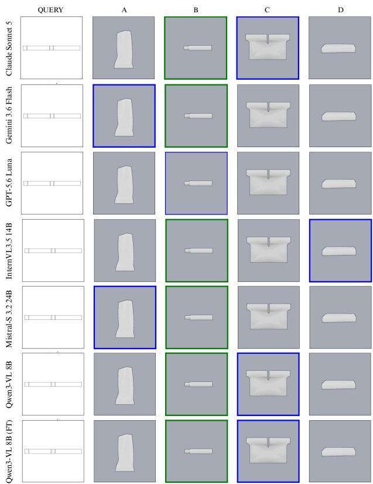  
Figure 7. Examples of 2D drawing retrieval tasks with four candidate CAD renders. Green border: ground truth; blue border: model selection.

Table 19. Task 1 failure analysis by surface-type class, negative type, and prediction outcome.
<table><tr><td>Group</td><td>Tier</td><td>Result</td><td>Count (%)</td></tr><tr><td rowspan="4">Complex</td><td>Any-cl. neg. (n=122)</td><td>All success Mixed</td><td>50 (41.0%) 72 (59.0%)</td></tr><tr><td>Same-cl. neg. (n=133)</td><td>All failed All success Mixed</td><td>1 (0.8%) 53 (39.8%) 79 (59.4%)</td></tr><tr><td>Positive (n=245)</td><td>All failed All success</td><td>25 (10.2%) 9 (3.7%)</td></tr><tr><td>Any-cl. neg. (n=128)</td><td>Mixed All success</td><td>211 (86.1%) 27 (21.1%)</td></tr><tr><td rowspan="3">Simple</td><td></td><td>Mixed All success</td><td>101 (78.9%) 17 (14.5%)</td></tr><tr><td>Same-cl. neg. (n=117)</td><td>Mixed All failed</td><td>100 (85.5%)</td></tr><tr><td>Positive (n=255)</td><td>All success Mixed</td><td>13 (5.1%) 1 (0.4%) 241 (94.5%)</td></tr></table>

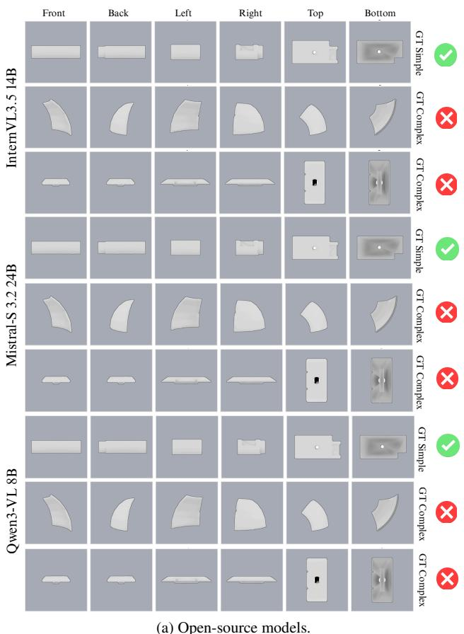

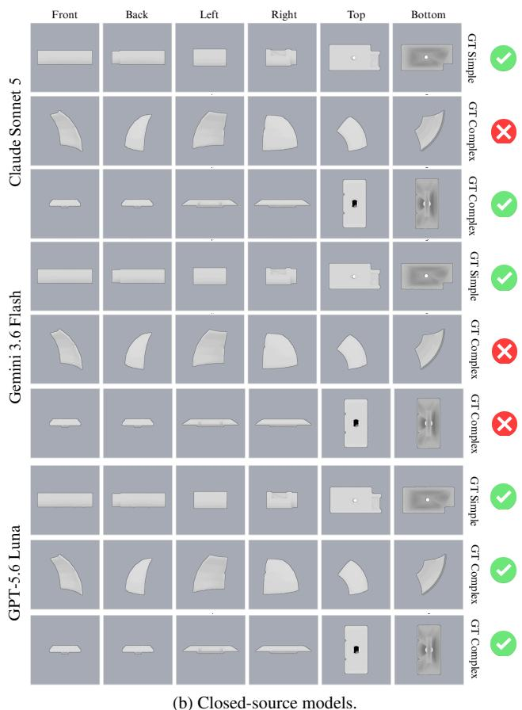  
Figure 8. Task 3 predictions across models (green = correct, red = incorrect).

Table 20. Fine-tuning pairs. Same view: share of positive / negative pairs whose render shows the drawing’s view.
<table><tr><td>Split</td><td>Models</td><td>Pairs</td><td>Pos.</td><td>Hard neg.</td><td>Same view</td></tr><tr><td>Train</td><td>27,479</td><td>109,916</td><td>54,958</td><td>38,483</td><td>0.166 / 0.166</td></tr><tr><td>Validation</td><td>1,446</td><td>5,784</td><td>2,892</td><td>2,058</td><td>0.169 / 0.162</td></tr></table>

## D.5. Training

LoRA [27] adapters cover the language model and the vision encoder, the base model is held in 4-bit during training, and the loss covers only the answer tokens. Tab. 21 gives the training prompt, which places the drawing first and the render second, and the full configuration.

## D.6. Evaluation

All Qwen3-VL 8B (FT) numbers come from the zero-shot harness: the Task 1–3 prompts of Sec. 5.2, the same item sets, exact string matching, greedy decoding (rather than the default sampling of the zero-shot open models, Tab. 13), and the LoRA weights merged into the base model after one epoch (1,250 steps at an effective batch of 16, final training loss 0.19). Tasks 2 and 3 were never seen in training and measure transfer. Under the chain-of-thought prompt the model answered with a single word on every item and reproduced its forced-choice predictions exactly, so Table 7 repeats those numbers.

## D.7. Caveats

Hard negatives are selected by outline alone, so they test whether a model reads interior detail rather than whether it separates parts with different outlines but matching local features; and all splits come from one generator, so gains measure in-distribution adaptation (Sec. 7).

VLM Prompt. You are shown two images of a mechanical part. The first image is a 2D engineering drawing. The second image is a shaded render of a 3D CAD model. The two images may show the partfrom different viewpoints. Do they depict the same part? Answer with exactly one word: Yes or No.

Table 21. Fine-tuning prompt and configuration (Qwen3-VL 8B). The prompt is used for training only; evaluation uses the Task 1 prompt of the main text.
<table><tr><td>Setting</td><td>Value</td></tr><tr><td>LoRA rank / α / dropout</td><td>16 / 32 / 0.05</td></tr><tr><td>Trainable parameters</td><td>52.5M (0.60%)</td></tr><tr><td>LoRA targets (LM)</td><td>q, k, v, o, gate, up, down_proj</td></tr><tr><td>LoRA targets (vision)</td><td>qkv,proj,linear_fc1,linear_fc2</td></tr><tr><td>Optimizer</td><td>AdamW, lr 10−4, cosine schedule, 3% warmup</td></tr><tr><td>Effective batch</td><td>16 (1 pair × 16 accumulation)</td></tr><tr><td>Training pairs</td><td>20,000, 1 epoch</td></tr><tr><td>Validation</td><td>500 pairs every 250 steps, best loss kept</td></tr><tr><td>Base model</td><td>4-bit NF4 (QLoRA [18]); vision tower, LM head bf16</td></tr><tr><td>Images</td><td>512×512 px, 256 tokens each</td></tr><tr><td>Hardware</td><td>1× L4 GPU (24 GB)</td></tr></table>

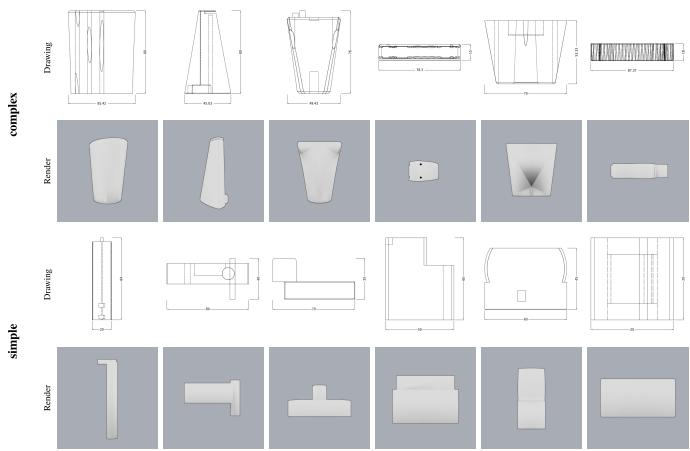  
Figure 9. Task 1 examples where all evaluated VLMs misclassified positive pairs.

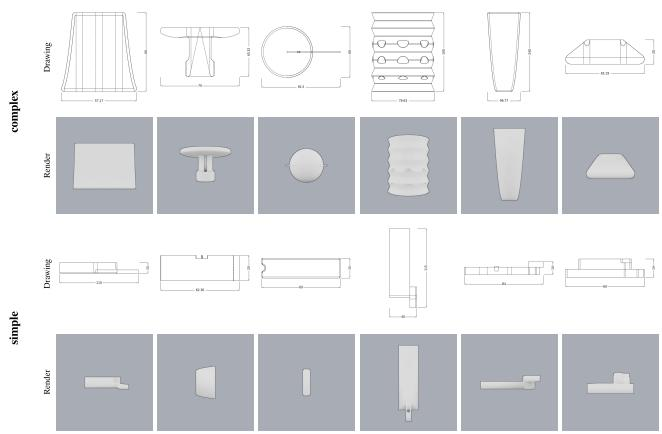  
Figure 10. Task 1 examples where all evaluated VLMs correctly matched pairs.

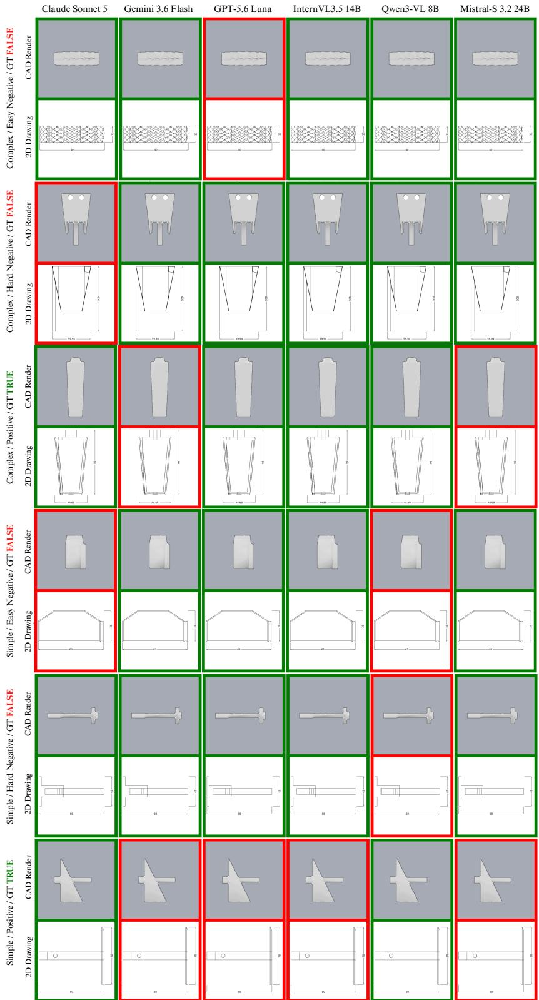  
Figure 11. Task 1 qualitative examples showing mixed model predictions. Rows labelled Hard Negative are same-class negatives (same prismatic/freeform class) and Easy Negative rows are any-class negatives; neither is mined for visual similarity.