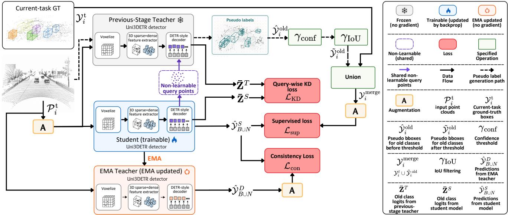
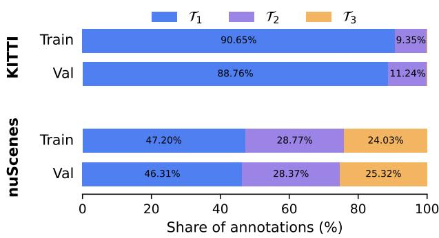
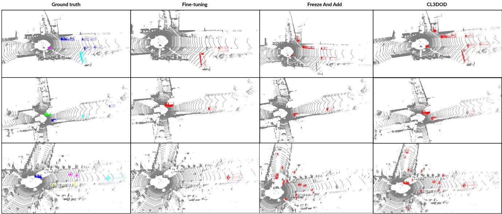
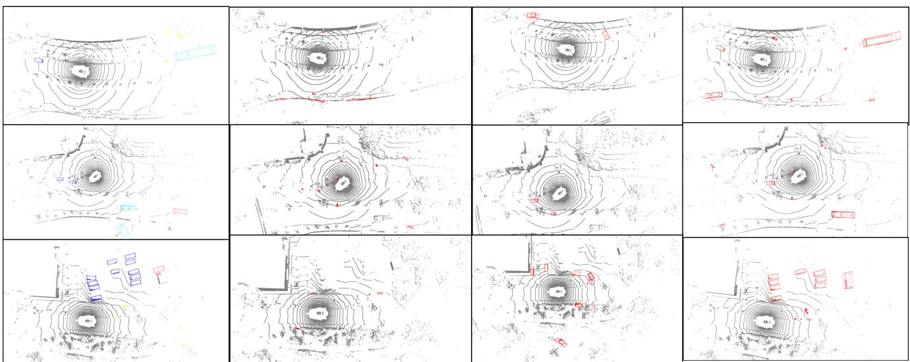
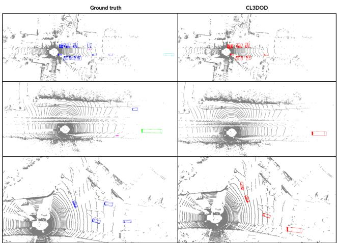

# CL3DOD: Understanding the Stability-Plasticity Dilemma in Outdoor Class-Incremental 3D Object Detection

Muhammad Ahmed Ullah Khan1,2 Khalil Ahmed1,2 Didier Stricker1 Muhammad Zeshan Afzal1 1DFKI 2RPTU Kaiserslautern-Landau

muhammad ahmed ullah.khan@dfki.de khaliljaan0066@gmail.com didier.stricker@dfki.de muhammad zeshan.afzal@dfki.de

## Abstract

Class-incremental learning (CIL)for outdoor 3D object detection remains largely underexplored. Existing outdoor studies are limited to single-benchmark evaluations, with SDCoT++ considering KITTI and CL2OD considering nuScenes under different incremental settings. This makes it difficult to assess whether observed continual-learning behavior generalizes across autonomous-driving benchmarks. To the best of our knowledge, we provide the first unified cross-benchmark analysis ofoutdoor class-incremental 3D object detection across multiple autonomous-driving benchmarks, covering both two-task and multi-stage settings. We investigate: (1) how severely existing 3D detectors forget previously learned classes, (2) how incremental training exposes the stability-plasticity dilemma between knowledge retention and new-class acquisition, and (3) which forms of supervision are most effective for balancing these objectives. We introduce CL3DOD, a classincremental 3D detection framework that restores missing supervision for previous classes using predictions from the previous-stage detector, preserves old-class responses through query-wise knowledge distillation, and employs EMA-based temporal consistency regularization. Experiments on KITTI and nuScenes reveal a consistent stabilityplasticity dilemma across both benchmarks. CL3DOD generally achieves a morefavorable stability-plasticity balance than controlled incremental baselines and improves upon published prior methods in the reported benchmark comparisons. This advantage persists across multiple incremental stages, demonstrating strong retention ofpreviously learned knowledge while maintaining effective new-class acquisition. Our code, evaluation setup, and incremental task splits will be publicly released.

## 1. Introduction

Autonomous vehicles may need to recognize object categories that were absent or insufficiently annotated during initial training. Retraining a 3D detector whenever new classes are introduced can require access to large amounts of previously annotated data, making continual updates costly and impractical. Class-incremental learning (CIL) addresses this problem by enabling sequential acquisition of new categories while preserving previously learned knowledge [13, 20]. This is particularly relevant to LiDAR-based 3D object detection, a core component of autonomousdriving perception [2, 8].

The challenge, however, is not catastrophic forgetting alone. Incremental learning must balance the retention of previous knowledge (stability) with the ability to acquire new knowledge (plasticity). This stability-plasticity dilemma [11] is further complicated in object detection because old and current classes can co-occur in the same scene while only current-class annotations are available, causing unlabeled old objects to be treated as background. Existing class-incremental 3D detection methods address this problem through pseudo-labeling, distillation, parameter isolation, and teacher-student consistency [6, 24, 26, 27]. Their evaluation, however, has largely emphasized knowledge retention and aggregate detection performance, with plasticity less commonly quantified explicitly.

Class-incremental 3D detection in outdoor autonomousdriving scenes remains particularly underexplored. Most existing studies focus on indoor settings [6, 24, 26, 27], while the available outdoor evaluations are limited to individual benchmarks: SDCoT++ [26] reports results on KITTI, whereas CL2OD [22] studies nuScenes under a different incremental formulation. Consequently, it remains unclear whether the same stability-plasticity behavior and continual-learning mechanisms generalize across different outdoor autonomous-driving benchmarks. To the best of our knowledge, no prior work provides a unified crossbenchmark analysis of outdoor class-incremental 3D objec detection across multiple autonomous-driving datasets. We therefore ask three questions: (1) How severe is forgetting in outdoor 3D detection? (2) How does incremental learning affect the stability-plasticity balance? (3) Which supervision signals are effective for preserving old knowledge while learning new classes?

To answer these questions, we evaluate KITTI and nuScenes under a common CIL formulation, covering both two-task and multi-stage incremental settings while retaining the standard detection protocol of each benchmark. We additionally use Average Forgetting and the Intransigence Measure consistently across both datasets to characterize stability and plasticity. We introduce CL3DOD, a classincremental 3D detection framework that restores missing old-class supervision using a frozen previous-stage teacher, applies Query-Wise Knowledge Distillation with aligned detector queries, and uses an EMA teacher for Temporal Consistency Regularization.

Extensive experiments reveal a consistent stabilityplasticity dilemma across both benchmarks. CL3DOD generally achieves a more favorable balance than controlled incremental baselines and improves upon published prior methods in the reported benchmark comparisons. Importantly, its advantage persists through the three-task nuScenes sequence, demonstrating effective retention and new-class acquisition beyond a two-task setting. Our ablations further identify restored old-class supervision as the most consistent retention mechanism, while the effects of distillation and temporal consistency vary across datasets.

Our main contributions are:

• Unified outdoor CIL analysis. To the best of our knowledge, we provide the first unified cross-benchmark analysis of outdoor class-incremental 3D object detection across multiple autonomous-driving benchmarks, covering both two-task and longer incremental sequences.

• Stability-plasticity analysis. We jointly analyze retention and new-class acquisition using task-wise detection performance, Average Forgetting, and Intransigence Measure, with the latter two applied consistently across both benchmarks.

• CL3DOD. We introduce a class-incremental 3D detection framework combining Old-Class Supervision, Query-Wise Knowledge Distillation, and Temporal Consistency Regularization.

• Improved performance. CL3DOD achieves a more favorable stability-plasticity balance than controlled incremental baselines and improves upon relevant prior methods in the reported benchmark comparisons.

## 2. Related Work

Class-incremental learning (CIL) aims to acquire new categories sequentially while retaining previously learned knowledge. Existing approaches primarily rely on regularization [1, 12, 23], knowledge distillation [7, 10, 13], and rehearsal [4, 15] to mitigate catastrophic forgetting [16]. However, retention alone does not fully characterize continual learning: a model must remain stable on previous knowledge while preserving sufficient plasticity to acquire new concepts. Chaudhry et al. [3] formalize this distinction through forgetting and intransigence, while Kim and Han [11] further show that modern CIL methods can favor stability at the expense of plasticity.

CIL has also been extended to object detection, where previously learned objects may appear without annotations during later tasks and consequently be treated as background. Shmelkov et al. [20] introduce knowledge distillation for incremental 2D detection, while subsequent methods explore feature- and output-level distillation [5, 9] and pseudo-label-based supervision [14]. The broader continual object detection literature similarly emphasizes the need to consider both retention and adaptation when evaluating incremental detectors [17].

More recently, CIL has been studied for point-cloudbased 3D object detection. SDCoT [24] introduces a teacher-student framework using pseudo-label recovery, distillation, and consistency, while SDCoT++ [26] improves pseudo-label generation and evaluates the framework across different 3D detectors. DA-CIL [27] considers class-incremental detection under domain shift, and AIC3DOD [6] studies indoor incremental detection with a point-transformer architecture and room-layout constraints. Recent work also investigates longer incremental sequences in indoor 3D detection [19]. In outdoor scenes, SD-CoT++ reports results on KITTI, while CL2OD [22] studies nuScenes under a different incremental formulation. Despite this progress, systematic analysis across multiple outdoor autonomous-driving benchmarks remains limited, particularly with respect to the stability-plasticity behavior across both short and multi-stage incremental settings.

## 3. Methodology

## 3.1. Problem Definition

We consider class-incremental 3D object detection over a sequence of N tasks, $\{ \mathcal { T } _ { 1 } , \mathcal { T } _ { 2 } , \ldots , \mathcal { T } _ { N } \}$ , where each task $\mathcal { T } _ { t }$ introduces a disjoint set of object classes $\mathcal { C } _ { t } .$ , such that $\mathcal { C } _ { i } \cap$ $\mathcal { C } _ { j } ~ = ~ \emptyset ~ \mathrm { f o r } ~ i ~ \neq ~ j$ We denote by $f _ { \theta _ { t } }$ the detector after learning $\mathcal { T } _ { t } .$ . The objective is to learn the current classes $\mathcal { C } _ { t }$ while retaining previously learned classes, such that $f _ { \theta _ { t } }$ is evaluated over the cumulative class set $\textstyle { \mathcal { C } } _ { 1 : t } = \bigcup _ { k = 1 } ^ { t } { \mathcal { C } } _ { k }$

For task $\mathcal { T } _ { t } .$ , the training set is $\mathcal D _ { t } \ = \ \{ ( \mathbf P _ { i } ^ { t } , \mathcal V _ { i } ^ { t } ) \} _ { i = 1 } ^ { M _ { t } }$ where $\mathbf { P } _ { i } ^ { t } \in \mathbb { R } ^ { N _ { i } \times d }$ denotes a LiDAR point cloud. Following prior class-incremental 3D detection settings [6, 24], $\mathcal { V } _ { i } ^ { t }$ contains ground-truth annotations only for classes in $\mathcal { C } _ { t } ;$ previously learned classes may still co-occur in the scene but remain unannotated. We also allow the same underlying scenes to appear across tasks while exposing only taskspecific annotations at each stage. For $t > 1$ , training starts from $f _ { \theta _ { t - 1 } }$ and learns $f _ { \theta _ { t } }$ under this current-task-only supervision.

  
Figure 1. Overview of CL3DOD at incremental task Tt. A frozen previous-stage teacher provides Old-Class Supervision and Query-Wise Knowledge Distillation through shared queries, while an EMA teacher provides Temporal Consistency Regularization.

## 3.2. CL3DOD Framework Overview

Inspired by teacher-student strategies for class-incremental 3D detection [6, 24], we introduce CL3DOD, a classincremental framework for outdoor 3D object detection. We use Uni3DETR [21] as the underlying 3D detector due to its strong outdoor LiDAR-only detection performance and modern DETR-style formulation, making it a representative architecture for studying class-incremental learning in outdoor scenes. The detector is first trained conventionally on $\mathcal { T } _ { 1 } .$ , yielding the initial model $f _ { \theta _ { 1 } }$ . For each subsequent task T, the detector $f _ { \theta _ { t - 1 } }$ from the preceding stage initializes the current student, while a frozen copy serves as the previous-stage teacher carrying knowledge of $\mathcal { C } _ { 1 : t - 1 }$ . An EMA teacher is additionally initialized from the student and updated as an exponential moving average of its parameters. The overall framework is illustrated in Fig. 1.

CL3DOD incorporates three supervision signals during incremental training. Old-Class Supervision recovers targets for previously learned objects that remain unannotated in the current task. Query-Wise Knowledge Distillation transfers old-class classification responses from the previous-stage teacher to aligned student queries. Temporal Consistency Regularization uses the evolving EMA teacher to provide consistency targets across optimization steps. Together, these signals restore missing old-class supervision and regularize learning while the student learns current classes, targeting a favorable stability-plasticity balance. When temporal consistency is enabled, the EMA teacher is used for evaluation, while the trained student $f _ { \theta _ { t } }$ is carried forward to initialize the next incremental stage.

## 3.3. Old-Class Supervision

At task $\mathcal { T } _ { t } ,$ ground-truth annotations are available only for the current classes $\mathcal { C } _ { t } ,$ although objects from previously learned classes $\mathcal { C } _ { 1 : t - 1 }$ may still co-occur in the same pointcloud scenes. Training directly on such incomplete annotations can encourage the detector to treat old-class objects as background. To alleviate this missing-supervision problem, we use the frozen previous-stage teacher to recover supervision for previously learned classes.

Given a current-task point cloud $\mathbf { P } _ { i } ^ { t } .$ , the previous-stage teacher generates 3D detections for all previously learned classes. We denote these predictions by

$$
\hat { \mathcal { Y } } _ { i } ^ { \mathrm { o l d } } = f _ { \theta _ { t - 1 } } ( \mathbf { P } _ { i } ^ { t } )\tag{1}
$$

Since teacher predictions may contain false positives, we retain only detections whose predicted class confidence exceeds a confidence threshold $\gamma _ { \mathrm { c o n f } }$ We further remove teacher predictions that conflict with current-task ground truth: a prediction is discarded if its 3D IoU with any ground-truth box in $\mathcal { V } _ { i } ^ { t }$ exceeds a threshold $\gamma _ { \mathrm { I o U } }$ . The remaining teacher predictions are treated as old-class pseudolabels and are denoted by $\widetilde { \mathcal { V } } _ { i } ^ { \mathrm { o l d } }$

The filtered old-class pseudo-labels are then combined with the available current-task annotations to form the supervision used for incremental training,

$$
\mathcal { V } _ { i } ^ { \mathrm { m e r g e } } = \mathcal { V } _ { i } ^ { t } \cup \tilde { \mathcal { V } } _ { i } ^ { \mathrm { o l d } } .\tag{2}
$$

<table><tr><td>Task</td><td>Method</td><td> $\mathbf { m A P } _ { \mathcal { T } _ { 1 } }$  ↑</td><td> $\mathbf { m A P } _ { \mathcal { T } _ { 2 } }$  ↑</td><td> $\mathbf { m A P } _ { \mathcal { T } _ { 3 } }$  ←</td><td> $\mathbf { m A P _ { A l l } }$  ←</td><td>NDS ↑</td><td> $\mathbf { F } \downarrow$ </td><td>IM↑</td></tr><tr><td> $\mathcal { T } _ { 1 }$ </td><td>Task-1 Training</td><td>46.28</td><td></td><td></td><td>46.28</td><td>55.88</td><td></td><td></td></tr><tr><td rowspan="3"> $\mathcal { T } _ { 2 }$ </td><td>Fine-tuning</td><td>8.18</td><td>58.48</td><td>一</td><td>33.33</td><td>45.42</td><td>38.10</td><td>-8.72</td></tr><tr><td>Freeze-and-Add</td><td>46.09</td><td>22.01</td><td></td><td>34.05</td><td>42.15</td><td>0.19</td><td>-26.95</td></tr><tr><td>CL3DOD</td><td>45.88</td><td>68.79</td><td></td><td>57.33</td><td>64.10</td><td>0.40</td><td>-3.56</td></tr><tr><td></td><td>Joint Training</td><td>50.07</td><td>69.81</td><td></td><td>59.94</td><td>66.47</td><td>一</td><td>一</td></tr><tr><td rowspan="3"> $\mathcal { T } _ { 3 }$ </td><td>Fine-tuning</td><td>0.00</td><td>0.00</td><td>42.44</td><td>16.97</td><td>20.03</td><td>52.38</td><td>-13.11</td></tr><tr><td>Freeze-and-Add</td><td>15.49</td><td>0.00</td><td>1.43</td><td>5.22</td><td>13.04</td><td>26.40</td><td>-38.94</td></tr><tr><td>CL3DOD</td><td>43.88</td><td>66.66</td><td>55.71</td><td>55.45</td><td>63.99</td><td>2.27</td><td>-5.25</td></tr><tr><td></td><td>Joint Training</td><td>50.53</td><td>71.66</td><td>64.34</td><td>62.39</td><td>68.93</td><td>一</td><td>一</td></tr></table>

Table 1. Quantitative results on the nuScenes val. set under the three-task class-incremental setting. Task-wise mAP is reported together with cumulative mAP and NDS. F measures Average Forgetting (↓), while IM measures learning plasticity (↑) following the RICO formulation and uses the final all-task Joint Training model as reference. CL3DOD rows are highlighted for emphasis, while Joint Training is reported separately as the full-supervision upper-bound reference. “–” denotes not applicable.

<table><tr><td rowspan="2">Task Method</td><td rowspan="2"></td><td colspan="3"> $\mathbf { m } \mathbf { A } \mathbf { P } _ { \mathcal { T } _ { 1 } } \uparrow$ </td><td colspan="3"> $\mathbf { m } \mathbf { A } \mathbf { P } _ { \mathcal { T } _ { 2 } } \uparrow$ </td><td colspan="3"> $\mathbf { m A P _ { A l l } } \uparrow$ </td><td rowspan="2"> $\mathbf { F } \downarrow$ </td><td rowspan="2">IM↑</td></tr><tr><td>Easy</td><td>Mod.</td><td>Hard</td><td>Easy</td><td>Mod.</td><td>Hard</td><td>Easy</td><td>Mod.</td><td>Hard</td></tr><tr><td> $\mathcal { T } _ { 1 }$ </td><td>Task-1 Training</td><td>79.04</td><td>68.03</td><td>63.13</td><td></td><td></td><td></td><td>79.04</td><td>68.03</td><td>63.13</td><td></td><td>一</td></tr><tr><td></td><td>Fine-tuning</td><td>0.06</td><td>0.08</td><td>0.10</td><td>26.68</td><td>19.22</td><td>16.69</td><td>10.70</td><td>7.73</td><td>6.74</td><td>78.98</td><td>1.04</td></tr><tr><td> $\mathcal { T } _ { 2 }$ </td><td>Freeze-and-Add</td><td>80.32</td><td>68.28</td><td>63.60</td><td>11.99</td><td>5.45</td><td>4.19</td><td>52.99</td><td>43.15</td><td>39.84</td><td>-1.28</td><td>-6.31</td></tr><tr><td></td><td>CL3DOD</td><td>66.21</td><td>56.81</td><td>51.62</td><td>28.11</td><td>18.43</td><td>15.47</td><td>50.97</td><td>41.46</td><td>37.16</td><td>12.83</td><td>1.75</td></tr><tr><td></td><td>Joint Training</td><td>76.52</td><td>67.55</td><td>63.20</td><td>27.13</td><td>19.46</td><td>15.90</td><td>56.76</td><td>48.31</td><td>44.28</td><td>一</td><td>一</td></tr></table>

Table 2. Quantitative results on the KITTI val. set under the two-task class-incremental setting using $\mathrm { A P _ { 4 0 } }$ . F and IM are computed using Easy $\mathrm { A P _ { 4 0 } }$

The same geometric data augmentations are subsequently applied to the point cloud and the merged annotations, ensuring that the pseudo-labels remain spatially aligned with the transformed input. The student detector is then trained on $\mathcal { V } _ { i } ^ { \mathrm { m e r g e } }$ using the standard supervised Uni3DETR detection objective. Supervision therefore restores explicit training targets for previously learned objects that would otherwise contribute incorrect background supervision.

## 3.4. Query-Wise Knowledge Distillation

In addition to restoring old-class supervision, we transfer classification responses from the previous-stage teacher to the student through query-wise knowledge distillation. Uni3DETR produces predictions from both learnable queries and non-learnable query points obtained using farthest-point sampling (FPS). Because independently generated FPS-derived queries are not guaranteed to have the same spatial correspondence across teacher and student forward passes, directly matching queries by index can be unreliable. We therefore provide the student $f _ { \theta _ { t } }$ and previousstage teacher $f _ { \theta _ { t - 1 } }$ with the same augmented input and share the same FPS-sampled non-learnable query points, establishing correspondence between their decoder queries.

Let $\mathbf { Z } _ { \theta _ { t } } ^ { ( l ) }$ and $\mathbf { Z } _ { \theta _ { t - 1 } } ^ { ( l ) }$ denote the classification logits produced at decoder layer l by the student and previous-stage teacher, respectively. We average the predictions from all decoder layers except the first:

$$
\bar { \mathbf { Z } } _ { \theta } = \frac { 1 } { L - 1 } \sum _ { l = 2 } ^ { L } \mathbf { Z } _ { \theta } ^ { ( l ) } , \qquad \theta \in \{ \theta _ { t } , \theta _ { t - 1 } \} .\tag{3}
$$

Distillation is restricted to the $C _ { \mathrm { o l d } } = | \mathcal { C } _ { 1 : t - 1 } |$ old-class dimensions of the student output. For query $q ,$ let $\bar { \mathbf { z } } _ { \theta , q } ^ { \mathrm { { o l d } } } \in$ $\mathbb { R } ^ { C _ { \mathrm { o l d } } }$ denote the corresponding query-level logit vector restricted to the old classes. We independently mean-center these logits along the class dimension:

$$
\tilde { \mathbf { z } } _ { \theta , q } = \bar { \mathbf { z } } _ { \theta , q } ^ { \mathrm { o l d } } - \frac { 1 } { C _ { \mathrm { o l d } } } \sum _ { c = 1 } ^ { C _ { \mathrm { o l d } } } \bar { z } _ { \theta , q , c } , \qquad \theta \in \{ \theta _ { t } , \theta _ { t - 1 } \} .\tag{4}
$$

The Query-Wise Knowledge Distillation loss is then computed as the root mean squared error between the

aligned student and previous-stage teacher responses:

$$
\mathcal { L } _ { \mathrm { K D } } = \sqrt { \frac { 1 } { Q C _ { \mathrm { o l d } } } \sum _ { q = 1 } ^ { Q } \left. \tilde { \mathbf { z } } _ { \theta _ { t } , q } - \tilde { \mathbf { z } } _ { \theta _ { t - 1 } , q } \right. _ { 2 } ^ { 2 } } .\tag{5}
$$

This objective encourages the student to preserve the relative old-class response structure of the previous-stage detector at corresponding queries. We restrict distillation to classification responses, following prior findings that classification-level distillation is most effective for classincremental 3D detection [24], and treat it as an auxiliary knowledge-preservation signal alongside explicit Old-Class Supervision.

## 3.5. Temporal Consistency Regularization

Inspired by SESS [25] and its use in class-incremental 3D detection [24], we employ an EMA teacher to regularize the evolving student during incremental training. Unlike the fixed previous-stage teacher $f _ { \theta _ { t - 1 } } .$ , the EMA teacher tracks the current student $f _ { \theta _ { t } }$ across optimization iterations and provides a slowly evolving consistency target. Its parameters are updated as

$$
\theta _ { \mathrm { E M A } } ^ { ( k ) } = \alpha \theta _ { \mathrm { E M A } } ^ { ( k - 1 ) } + ( 1 - \alpha ) \theta _ { t } ^ { ( k ) } ,\tag{6}
$$

where $\theta _ { t } ^ { ( k ) }$ denotes the student parameters at iteration k and α controls the EMA update rate. Here, temporal consistency refers to the evolution of the model across optimization iterations rather than consecutive LiDAR frames.

We compare the decoded predictions of $f _ { \theta _ { t } }$ and the EMA teacher in a common coordinate frame. The EMA-teacher predictions are transformed according to the geometric augmentations applied to the student input before evaluating consistency. Following SESS, we regularize object centers, class distributions, and 3D box sizes using symmetric Chamfer distance, KL divergence, and $L _ { 1 }$ loss, respectively. The overall consistency objective is

$$
{ \mathcal { L } } _ { \mathrm { c o n s } } = \lambda _ { \mathrm { c t r } } { \mathcal { L } } _ { \mathrm { c t r } } + \lambda _ { \mathrm { c l s } } { \mathcal { L } } _ { \mathrm { c l s } } + \lambda _ { \mathrm { s i z e } } { \mathcal { L } } _ { \mathrm { s i z e } } ,\tag{7}
$$

where $\mathcal { L } _ { \mathrm { c t r } } , \mathcal { L } _ { \mathrm { c l s } } ,$ , and $\mathcal { L } _ { \mathrm { s i z e } }$ denote center, classification, and size consistency, respectively. Thus, while the previousstage teacher provides a fixed reference for previously learned knowledge, the EMA teacher provides a slowly varying regularization target during incremental learning.

## 3.6. Incremental Training Objective

For the initial task $\mathcal { T } _ { 1 }$ , the detector $f _ { \theta _ { 1 } }$ is trained conventionally using the standard Uni3DETR supervised detection objective on the available ground-truth annotations.

For each subsequent task $\mathcal { T } _ { t } , t > 1$ , the student $f _ { \theta _ { t } }$ is initialized from $f _ { \theta _ { t - 1 } }$ . Using the merged annotations Ymerge from Sec. 3.3, the complete incremental objective is

$$
\begin{array} { r } { \mathcal { L } _ { \mathrm { i n c } } = \lambda _ { \mathrm { s u p } } \mathcal { L } _ { \mathrm { s u p } } \left( \mathcal { V } ^ { \mathrm { m e r g e } } \right) + \lambda _ { \mathrm { K D } } \mathcal { L } _ { \mathrm { K D } } + \lambda _ { \mathrm { c o n s } } \mathcal { L } _ { \mathrm { c o n s } } , } \end{array}\tag{8}
$$

where $\lambda _ { \mathrm { s u p } } , \lambda _ { \mathrm { K D } }$ , and $\lambda _ { \mathrm { { c o n s } } }$ weight supervised detection, Query-Wise Knowledge Distillation, and Temporal Consistency Regularization, respectively.

Gradients update only the student parameters $\theta _ { t } ;$ the previous-stage teacher $f _ { \theta _ { t - 1 } }$ remains frozen, while the EMA teacher is updated according to Eq. 6. When Temporal Consistency Regularization is enabled, the EMA teacher is used for evaluation, whereas the trained student $f _ { \theta _ { t } }$ is carried forward to initialize the next incremental stage.

## 4. Experiments

## 4.1. Experimental Setup

Datasets and incremental protocols. We evaluate CL3DOD on two outdoor autonomous-driving benchmarks, KITTI [8] and nuScenes [2]. KITTI contains relatively few sufficiently populated categories and is therefore evaluated using a two-task class-incremental split. The split consists of $\tau _ { 1 } { : }$ Car, Pedestrian, and Cyclist; and $\textstyle { \mathcal { T } } _ { 2 } ;$ Van and Truck. The first task corresponds to the standard categories commonly used for KITTI 3D detection evaluation, while the second introduces drivingrelevant but less frequent categories, thereby retaining the naturally long-tailed class distribution of the dataset. This partition is also consistent with the KITTI setting used by SDCoT and SDCoT++, enabling comparison with existing class-incremental 3D detection results.

nuScenes provides a richer taxonomy of ten official detection classes, allowing us to evaluate a more challenging three-task class-incremental setting. The split consists of $\mathscr { T } _ { 1 } \colon$ Car, Trailer, and Construction Vehicle; $\textstyle { \mathcal { T } } _ { 2 } \colon$ Bus, Truck, and Pedestrian; and $\tau _ { 3 } { \mathrm { : } }$ Motorcycle, Bicycle, Traffic Cone, and Barrier. This partition preserves the heterogeneous and long-tailed nature of nuScenes: $\mathcal { T } _ { 1 }$ combines a dominant vehicle category with rarer vehicle classes, $\mathcal { T } _ { 2 }$ contains dynamic traffic participants, and $\mathcal { T } _ { 3 }$ introduces smaller and static road objects. The same class grouping is used by CL2OD, facilitating a contextual comparison, although its incremental data protocol differs from ours. In our protocol, scenes may overlap across tasks while only annotations for the current classes are exposed, limiting task-dependent scene-distribution shift as a confounding factor when analyzing stability-plasticity behavior. Further class-wise and task-split statistics are provided in Sec. ??.

Evaluation metrics. KITTI. Following the official KITTI protocol [8], we report $\mathsf { A P } _ { 4 0 }$ at the Easy, Moderate, and Hard difficulty levels using 3D IoU thresholds of $0 . 7$ for Car, Van, and Truck, and 0.5 for Pedestrian and $\mathrm { C y - }$ clist. At each incremental stage, we report the mean $\mathbf { A P }$ over each task-specific class set, denoted by m $\mathrm { A P } _ { \mathcal { T } _ { j } }$ , and m $\mathrm { A P _ { A l l } }$ over all classes learned so far.

nuScenes. Following the official nuScenes protocol [2], we report mean Average Precision (mAP) and the nuScenes Detection Score (NDS). We additionally report task-specific m $\mathrm { A P } _ { \mathcal { T } _ { i } }$ and cumulative m $\mathrm { A P _ { A l l } }$

<table><tr><td rowspan="2">Task</td><td rowspan="2">Method</td><td colspan="3"> $\mathcal { T } _ { 1 }$ </td><td colspan="3"> $\mathcal { T } _ { 2 }$ </td><td colspan="4"> $\mathcal { T } _ { 3 }$ </td></tr><tr><td>Car</td><td>Trailer</td><td>Constr.</td><td>Truck</td><td>Bus</td><td>Ped.</td><td>Motor.</td><td>Bicycle</td><td>Cone</td><td>Barrier</td></tr><tr><td> $\mathcal { T } _ { 1 }$ </td><td>Task-1 Training</td><td>81.6</td><td>35.2</td><td>22.0</td><td>一</td><td>一</td><td>一</td><td>一</td><td></td><td>一</td><td></td></tr><tr><td> $\mathcal { T } _ { 2 }$ </td><td>Fine-tuning</td><td>24.5</td><td>0.0</td><td>0.0</td><td>49.9</td><td>64.0</td><td>61.6</td><td>一</td><td></td><td>一</td><td>一</td></tr><tr><td></td><td>Freeze-and-Add</td><td>81.5</td><td>34.7</td><td>22.1</td><td>38.3</td><td>26.9</td><td>0.8</td><td>一</td><td></td><td>一</td><td></td></tr><tr><td></td><td>CL3DOD</td><td>80.7</td><td>34.7</td><td>22.5</td><td>56.0</td><td>68.2</td><td>82.2</td><td>一</td><td></td><td>一</td><td></td></tr><tr><td></td><td>Joint Training</td><td>85.2</td><td>41.8</td><td>23.2</td><td>57.9</td><td>69.2</td><td>82.3</td><td>1</td><td></td><td>一</td><td>一</td></tr><tr><td> $\mathcal { T } _ { 3 }$ </td><td>Fine-tuning</td><td>0.0</td><td>0.0</td><td>0.0</td><td>0.0</td><td>0.0</td><td>0.0</td><td>41.6</td><td>18.7</td><td>53.5</td><td>55.9</td></tr><tr><td></td><td>Freeze-and-Add</td><td>34.9</td><td>11.6</td><td>0.0</td><td>0.0</td><td>0.0</td><td>0.0</td><td>4.3</td><td>0.0</td><td>0.2</td><td>1.1</td></tr><tr><td></td><td>CL3DOD</td><td>78.9</td><td>31.6</td><td>21.1</td><td>53.3</td><td>67.5</td><td>79.2</td><td>56.6</td><td>36.3</td><td>64.1</td><td>65.8</td></tr><tr><td></td><td>Joint Training</td><td>86.3</td><td>42.0</td><td>23.3</td><td>59.2</td><td>70.5</td><td>85.7</td><td>69.1</td><td>51.5</td><td>68.6</td><td>69.4</td></tr></table>

Table 3. Class-wise AP (%) on the nuScenes val. set across the three-task incremental sequence. CL3DOD rows are highlighted fo emphasis, while Joint Training is shown separately as the upper-bound reference. $^ { 6 6 } - ^ { 5 9 }$ denotes not applicable.

<table><tr><td>Task</td><td>Method</td><td>Car</td><td>Ped.</td><td> $\mathbf { C y c } .$ </td><td>Van</td><td>Truck</td></tr><tr><td> $\mathcal { T } _ { 1 }$ </td><td>Task-1 Training</td><td>82.62</td><td>66.48</td><td>88.03</td><td>一</td><td></td></tr><tr><td> $\mathcal { T } _ { 2 }$ </td><td>Fine-tuning Freeze-and-Add</td><td>0.17 87.06</td><td>0.00 66.12</td><td>0.00 87.77</td><td>50.37 23.98</td><td>2.98 0.00</td></tr><tr><td></td><td>CL3DOD</td><td>68.45</td><td>53.57</td><td>76.61</td><td>53.69</td><td>2.54</td></tr><tr><td></td><td></td><td></td><td></td><td></td><td></td><td></td></tr><tr><td></td><td>Joint Training</td><td>80.96</td><td>63.58</td><td>85.03</td><td>54.00</td><td>0.26</td></tr></table>

Table 4. Class-wise Easy $\mathrm { A P _ { 4 0 } }$ (%) on the KITTI val. set after incremental learning. The CL3DOD row is highlighted for emphasis, while Joint Training is shown separately as the upper-bound reference. $^ { 6 6 } - ^ { 9 9 }$ denotes not applicable.

To quantify stability, we report Average Forgetting after $\mathcal { T } _ { t }$ as

$$
F _ { t } = \frac { 1 } { t - 1 } \sum _ { j = 1 } ^ { t - 1 } \left( \mathrm { m A P } _ { \mathcal T _ { j } } ^ { ( j ) } - \mathrm { m A P } _ { \mathcal T _ { j } } ^ { ( t ) } \right) ,\tag{9}
$$

where m $\mathrm { A P } _ { T _ { j } } ^ { ( j ) }$ denotes performance on $\tau _ { j }$ immediately after learning it, and m $\mathrm { A P } _ { T _ { i } } ^ { ( t ) }$ denotes its performance after training through $\mathcal { T } _ { t }$ . Lower $F _ { t }$ indicates better retention; negative values indicate that performance on a previous task has improved relative to when it was first learned.

To quantify plasticity, we report the Intransigence Measure (IM) following the intransigence formulation of Chaudhry et al. [3] as adapted to incremental object detection by RICO [18]:

$$
\mathrm { I M } _ { k } = \frac { 1 } { k } \sum _ { j = 1 } ^ { k } \left( \mathrm { m A P } _ { \mathcal { T } _ { j } } ^ { ( j ) } - \mathrm { m A P } _ { \mathcal { T } _ { j } } ^ { * } \right) ,\tag{10}
$$

where m $\mathrm { A P } _ { \mathcal { T } _ { j } } ^ { * }$ denotes performance on $\tau _ { j }$ of the fully supervised model jointly trained on all tasks within the corresponding experimental setup. Higher IM indicates greater plasticity; zero corresponds to matching the corresponding joint-training reference on average, while positive values indicate higher task-acquisition performance. For our experiments, IM is computed using our Uni3DETR Joint Training baseline. When reporting published incremental methods, we compute IM using the Joint Training baseline reported with the corresponding method. For KITTI, both $F$ and IM are computed using Easy $\mathrm { A P _ { 4 0 } ; }$ for nuScenes, they are computed using the official mAP metric.

Baselines. All incremental methods share the same initial model, denoted as Task-1 Training in our tables, obtained by conventionally training $f _ { \theta _ { 1 } }$ on $\mathcal { D } _ { 1 }$ . We compare CL3DOD with the following controlled baselines, all using the same Uni3DETR detector:

• Fine-tuning: initializes $f _ { \theta _ { t } }$ from $f _ { \theta _ { t - 1 } }$ , retains the previously learned classification head, and adds a new head for $\mathcal { C } _ { t }$ . The previous head is frozen, while the shared detector parameters and new head are fine-tuned on $\mathcal { D } _ { t }$

• Freeze-and-Add: initializes from $f _ { \theta _ { t - 1 } }$ and freezes all previously learned detector parameters. A new classification head for $\mathcal { C } _ { t }$ is appended and trained on $\mathcal { D } _ { t }$

• Joint Training: trains the detector using ground-truth annotations for all classes in $\mathcal { C } _ { 1 : t }$ and serves as the nonincremental upper-bound reference.

For multi-stage experiments, each incremental method follows its own training trajectory, with the model obtained after $\mathcal { T } _ { t - 1 }$ initializing the same method at $\mathcal { T } _ { t }$

Implementation details. We use Uni3DETR [21] as the detector and follow its original training configurations for

<table><tr><td rowspan="2">Method</td><td>After T1</td><td colspan="4">After T2</td></tr><tr><td> $\mathcal { T } _ { 1 }$ </td><td> $\mathcal { T } _ { 1 }$ </td><td> $\mathcal { T } _ { 2 }$ </td><td>All</td><td>F↓ IM ↑</td></tr><tr><td>SDCoT [24]</td><td>81.49</td><td></td><td>61.2722.50</td><td>45.77</td><td>20.22 -4.65</td></tr><tr><td>SDCoT++ [26]</td><td>81.49</td><td></td><td></td><td>62.5622.5246.5518.93</td><td>-4.64</td></tr><tr><td>CL3DOD</td><td>79.04</td><td></td><td></td><td>66.21 28.11 50.97 12.83</td><td>1.75</td></tr></table>

Table 5. Comparison with prior class-incremental 3D detection methods on the KITTI val split using the same two-task class partition. Results are reported using Easy mAP. SDCoT and SDCoT++ results are taken from SDCoT++ [26].

<table><tr><td>Task Method</td><td></td><td> $\mathbf { m A P } _ { \mathrm { C u r } }$ </td><td> $\mathbf { m A P _ { A l l } }$ </td><td>NDS F↓</td></tr><tr><td> $\mathcal { T } _ { 1 }$ </td><td>CL2OD</td><td>40.90</td><td>40.90</td><td>52.10 一</td></tr><tr><td></td><td>CL3DOD</td><td>46.28</td><td>46.28</td><td>55.88</td></tr><tr><td> $\mathcal { T } _ { 2 }$ </td><td>CL2OD</td><td>53.00</td><td>41.80</td><td>53.60 10.20</td></tr><tr><td></td><td>CL3DOD</td><td>68.79</td><td>57.33</td><td>64.10 0.40</td></tr><tr><td> $\tau _ { 3 }$ </td><td>CL2OD</td><td>30.00</td><td>34.30</td><td>49.80 9.70†</td></tr><tr><td></td><td>CL3DOD</td><td>55.71</td><td>55.45</td><td>63.99 2.27</td></tr></table>

Table 6. Contextual comparison with published CL2OD [22] on the nuScenes val set. m $\operatorname { A P } _ { \operatorname { C u r } }$ . and $\mathrm { m A P _ { A l l } }$ denote current-task and cumulative performance, respectively. †Computed from published class-wise AP values.

KITTI and nuScenes. Models are trained for 70 epochs on KITTI and 20 epochs on nuScenes, with batch sizes of 8 and 16, respectively. For the Fine-tuning baseline only, we reduce the learning rate from 9e−5 to 9e−6 on KITTI and from 1e−5 to 1e−6 on nuScenes to improve training stability; all other settings remain unchanged.

For Old-Class Supervision, the pseudo-label confidence threshold $\gamma _ { \mathrm { c o n f } }$ is set to 0.55 on KITTI and 0.40 on nuScenes, while the overlap-conflict threshold $\gamma _ { \mathrm { I o U } }$ is set to 0.7. The maximum loss weights are set to ${ \lambda } _ { \mathrm { s u p } } ~ = ~ 5 ,$ $\lambda _ { \mathrm { c o n s } } = 5 ,$ , and $\lambda _ { \mathrm { K D } } ~ = ~ 1$ . Following SDCoT [24], the consistency and distillation weights are ramped up to their maximum values during the first 18 epochs on KITTI and 10 epochs on nuScenes using the sigmoid-shaped schedule $\exp [ - 5 ( 1 - t ) ^ { 2 } ]$ , where $t \in [ 0 , 1 ]$ denotes the normalized ramp-up progress. Following SESS [25], the EMA decay factor is set to $\alpha = 0 . 9 9$

For models using Temporal Consistency, evaluation is performed using the EMA teacher, while the student checkpoint is propagated to initialize the subsequent incremental task. All experiments are conducted on four NVIDIA A100 80 GB GPUs. Training CL3DOD takes approximately two days on KITTI and four days on nuScenes. Additional training configuration details are provided in the Supp. ??.

## 4.2. Quantitative Results

nuScenes. Table 1 reveals a clear stability-plasticity dilemma. After $\mathcal { T } _ { 2 } ,$ , Fine-tuning incurs 38.10 Average Forgetting, whereas Freeze-and-Add largely preserves $\mathcal { T } _ { 1 }$ but reaches only 22.01 mAP on $\mathcal { T } _ { 2 }$ with an IM of −26.95. CL3DOD achieves a substantially better balance, retaining 99.1% of its original $\mathcal { T } _ { 1 }$ performance while reaching 68.79 mAP on ${ \mathcal { T } } _ { 2 } ,$ within 1.5% of Joint Training. This reduces forgetting to 0.40 and yields an IM of −3.56.

The advantage persists over the three-task sequence. After ${ \mathcal { T } } _ { 3 } ,$ , CL3DOD retains 94.8% and 96.9% of its original $\mathcal { T } _ { 1 }$ and $\mathcal { T } _ { 2 }$ performance, respectively, while reaching 55.71 mAP on the newly introduced classes. Its Average Forgetting is reduced by 95.7% relative to Fine-tuning and 91.4% relative to Freeze-and-Add, while its IM remains substantially closer to the full-supervision reference.

The class-wise results in Table 3 further support this behavior. At $\mathcal { T } _ { 2 } .$ , CL3DOD is within 3.3% of Joint Training on each newly introduced class, while largely preserving the $\mathcal { T } _ { 1 }$ categories. After ${ \mathcal { T } } _ { 3 } ,$ it retains non-zero performance across all six previously learned classes and achieves 31.3% higher current-task mAP than Fine-tuning, whereas Fine-tuning reduces all previous classes to 0 AP.

KITTI. Table 2 shows a similar stability-plasticity dilemma. Fine-tuning almost completely forgets ${ \mathcal { T } } _ { 1 } \left( F = \right.$ 78.98), while Freeze-and-Add strongly preserves previous classes but reaches only 11.99 Easy mAP on $\mathcal { T } _ { 2 }$ with an IM of −6.31. CL3DOD retains 83.8% of its original $\mathcal { T } _ { 1 }$ performance while reaching 28.11 mAP on ${ \mathcal { T } } _ { 2 } ,$ closely matching Joint Training. Compared with Fine-tuning, it reduces Average Forgetting by 83.8% and achieves a positive IM of 1.75.

Freeze-and-Add attains only 3.8% higher cumulative Easy mAP than CL3DOD (52.99 versus 50.97), but CL3DOD improves current-task mAP by 134.4%. The class-wise results in Table 4 make this trade-off explicit: CL3DOD improves Van AP by 123.9% over Freeze-and-Add while also learning Truck, which Freeze-and-Add fails to detect, and retains meaningful performance across all three previous classes. Thus, maximizing retention alone does not necessarily provide the most effective stabilityplasticity balance.

## 4.3. Comparison with Prior Work

KITTI. Table $^ { 5 }$ compares CL3DOD with the published results of SDCoT [24] and SDCoT++ [26] under the same two-task KITTI class partition. CL3DOD improves the final overall mAP by 11.4% (45.77 → 50.97) over SDCoT and by 9.5% (46.55 → 50.97) over SDCoT++. At the same time, Average Forgetting is reduced from 20.22 and 18.93 to 12.83, corresponding to relative reductions of 36.6% and 32.2%, respectively. CL3DOD also achieves a positive IM of 1.75, compared with −4.65 for SDCoT and −4.64 for SDCoT++, indicating stronger task-acquisition capability. Overall, these results indicate a more favorable stabilityplasticity balance. Since the methods employ different detectors and training configurations, the comparison should be interpreted at the benchmark level rather than as a controlled backbone-matched evaluation.

nuScenes. Table 6 provides a contextual comparison with CL2OD [22]. After $\mathcal { T } _ { 2 } .$ , CL3DOD improves overall mAP by 37.2% (41.80 → 57.33) and increases NDS from 53.60 to 64.10, while reducing Average Forgetting from 10.20 to 0.40. The advantage persists over the longer incremental sequence: after ${ \mathcal { T } } _ { 3 } ,$ , overall mAP increases from 34.30 to 55.45, a relative improvement of 61.7%, while forgetting decreases by 76.6% (9.70 → 2.27). CL3DOD also reaches 63.99 NDS compared with 49.80 for CL2OD. These results support the ability of CL3DOD to retain previously learned knowledge while continuing to acquire new categories over multiple incremental stages. We do not report IM for CL2OD because the task-wise all-task Joint Training reference required for its computation is not provided. Moreover, CL2OD follows a different incremental data formulation and its exact task-wise scene splits are unavailable; the comparison should therefore be interpreted as contextual rather than controlled.

## 4.4. Ablation Studies

Contribution of supervision signals. Table 7 analyzes the three supervision signals after $\mathcal { T } _ { 2 } .$ Old-Class Supervision provides the most consistent benefit across both datasets. On nuScenes, it alone achieves the best overall result (57.60 mAP) and nearly restores the original $\mathcal { T } _ { 1 }$ performance (46.24 vs. 46.28 after Task-1 Training), leaving little additional headroom for retention.

The effects of KD and temporal consistency differ across datasets. On KITTI, KD primarily improves plasticity, increasing m $\mathrm { A P } _ { \mathcal { T } _ { 2 } }$ from 24.58 to 30.47, whereas consistency primarily improves stability, raising m $\mathrm { A P } _ { \mathcal { T } _ { 1 } }$ from 62.94 to 67.36. Their combination yields the highest overall mAP (50.97). On nuScenes, neither auxiliary regularizer improves upon Old-Class Supervision alone: KD slightly reduces both task-wise scores, while consistency preserves current-task performance but lowers previous-task retention. One possible reason is that, although KD is restricted to old-class logits, it is applied densely across all decoder queries; queries associated with background or currentclass objects may therefore also receive constraints from the previous-stage teacher. This may limit the benefit of KD when old-class supervision already provides strong retention.

Overall, Old-Class Supervision constitutes the primary and most consistent retention mechanism, while KD and temporal consistency influence the stability-plasticity tradeoff in a dataset-dependent manner. We retain the complete objective as CL3DOD throughout the main experiments to evaluate a single, unified formulation across both benchmarks rather than selecting dataset-specific component combinations. This choice also allows the framework to combine the different supervision signals where they are beneficial, while avoiding claims that each auxiliary component must improve every dataset or task individually.

<table><tr><td>Dataset</td><td>Sup. KD</td><td></td><td>Cons.</td><td> $\mathbf { m A P } _ { T _ { 1 } }$ </td><td> $\mathbf { m A P } _ { \mathcal { T } _ { 2 } }$ </td><td> $\mathbf { m A P _ { A l l } }$ </td></tr><tr><td rowspan="5">nuScenes</td><td> $\checkmark$ </td><td></td><td></td><td>46.24</td><td>68.96</td><td>57.60</td></tr><tr><td> $\checkmark$ </td><td> $\checkmark$ </td><td></td><td>46.12</td><td>68.57</td><td>57.35</td></tr><tr><td> $\checkmark$ </td><td></td><td> $\checkmark$ </td><td>45.33</td><td>68.93</td><td>57.13</td></tr><tr><td> $\checkmark$ </td><td> $\checkmark$ </td><td> $\checkmark$ </td><td>45.88</td><td>68.79</td><td>57.33</td></tr><tr><td> $\checkmark$ </td><td></td><td></td><td>62.94</td><td>24.58</td><td>47.60</td></tr><tr><td rowspan="4">KITTI</td><td></td><td> $\checkmark$ </td><td></td><td>61.40</td><td></td><td></td></tr><tr><td> $\checkmark$ </td><td></td><td> $\checkmark$ </td><td>67.36</td><td>30.47</td><td>49.03</td></tr><tr><td> $\checkmark$ </td><td></td><td></td><td></td><td>25.35</td><td>50.55</td></tr><tr><td> $\checkmark$ </td><td> $\checkmark$ </td><td> $\checkmark$ </td><td>66.21</td><td>28.11</td><td>50.97</td></tr></table>

Table 7. Component ablation of CL3DOD after task T . KITTI results use Easy $\mathrm { { A P } _ { 4 0 } } .$ . Sup., KD, and Cons. denote Old-Class Supervision, Query-Wise Knowledge Distillation, and Temporal Consistency Regularization, respectively. Best results within each dataset are shown in bold.

The ablations for pseudo-label confidence threshold are discussed in Supp. ??.

## 5. Conclusion

In this work, we provide, to the best of our knowledge, the first unified cross-benchmark analysis of outdoor class-incremental 3D object detection across multiple autonomous-driving benchmarks. Experiments on KITTI and nuScenes reveal a clear stability-plasticity dilemma, highlighting the need to evaluate both knowledge retention and new-class acquisition.

We introduce CL3DOD, combining Old-Class Supervision, Query-Wise Knowledge Distillation, and Temporal Consistency Regularization. CL3DOD generally achieves a more favorable stability-plasticity balance than controlled incremental baselines and improves upon relevant prior methods in the reported comparisons, including across the multi-stage nuScenes setting. Our ablations identify Old-Class Supervision as the most consistent retention mechanism, while the effects of distillation and temporal consistency vary across datasets. Future work can explore longer incremental sequences and more selective knowledge-transfer and replay strategies.

## References

[1] Rahaf Aljundi, Francesca Babiloni, Mohamed Elhoseiny, Marcus Rohrbach, and Tinne Tuytelaars. Memory aware

synapses: Learning what (not) to forget. In Proceedings of the European Conference on Computer Vision, pages 139– 154, 2018. 2

[2] Holger Caesar, Varun Bankiti, Alex H. Lang, Sourabh Vora, Venice Erin Liong, Qiang Xu, Anush Krishnan, Yu Pan, Giancarlo Baldan, and Oscar Beijbom. nuscenes: A multimodal dataset for autonomous driving. In CVPR, 2020. 1, 5

[3] Arslan Chaudhry, Puneet K Dokania, Thalaiyasingam Ajanthan, and Philip HS Torr. Riemannian walk for incremental learning: Understanding forgetting and intransigence. In European conference on computer vision, pages 556–572. Springer, 2018. 2, 6

[4] Arslan Chaudhry, Marc’Aurelio Ranzato, Marcus Rohrbach, and Mohamed Elhoseiny. Efficient lifelong learning with agem. arXiv preprint arXiv:1812.00420, 2018. 2

[5] Li Chen, Chunyan Yu, and Lvcai Chen. A new knowledge distillation for incremental object detection. In International Joint Conference on Neural Networks, pages 1–7, 2019. 2

[6] Zhongyao Cheng, Fang Wu, Peisheng Qian, Ziyuan Zhao, and Xulei Yang. Aic3dod: Advancing indoor classincremental 3d object detection with point transformer architecture and room layout constraints. In 2025 IEEE/CVF Winter Conference on Applications ofComputer Vision (WACV), pages 7512–7521. IEEE, 2025. 1, 2, 3

[7] Arthur Douillard, Matthieu Cord, Charles Ollion, Thomas Robert, and Eduardo Valle. Podnet: Pooled outputs distillation for small-tasks incremental learning. In ECCV, 2020. 2

[8] Andreas Geiger, Philip Lenz, and Raquel Urtasun. Are we ready for autonomous driving? the kitti vision benchmark suite. In CVPR, 2012. 1, 5

[9] Yu Hao, Yanwei Fu, Yu-Gang Jiang, and Qi Tian. An end-toend architecture for class-incremental object detection with knowledge distillation. In IEEE International Conference on Multimedia and Expo, pages 1–6, 2019. 2

[10] Saihui Hou, Xinyu Pan, Chen Change Loy, Zilei Wang, and Dahua Lin. Learning a unified classifier incrementally via rebalancing. In CVPR, pages 831–839, 2019. 2

[11] Dongwan Kim and Bohyung Han. On the stability-plasticity dilemma of class-incremental learning. In 2023 IEEE/CVF Conference on Computer Vision and Pattern Recognition (CVPR), pages 20196–20204. IEEE, 2023. 1, 2

[12] James Kirkpatrick, Razvan Pascanu, Neil Rabinowitz, Joel Veness, Guillaume Desjardins, Andrei A. Rusu, Kieran Milan, John Quan, Tiago Ramalho, Agnieszka Grabska-Barwinska, Demis Hassabis, Claudia Clopath, Dharshan Kumaran, and Raia Hadsell. Overcoming catastrophic forgetting in neural networks. Proceedings of the National Academy ofSciences, 114(13):3521–3526, 2017. 2

[13] Zhizhong Li and Derek Hoiem. Learning without forgetting. In ECCV, pages 614–629, 2016. 1, 2

[14] Liyang Liu, Zhanghui Kuang, Yimin Chen, Jing-Hao Xue, Wenming Yang, and Wayne Zhang. Incdet: In defense of elastic weight consolidation for incremental object detection. IEEE Transactions on Neural Networks and Learning Systems, 32(6):2306–2319, 2021. 2

[15] David Lopez-Paz and Marc’Aurelio Ranzato. Gradient episodic memory for continual learning. Advances in neu ral information processing systems, 30, 2017. 2

[16] Michael McCloskey and Neal J Cohen. Catastrophic interference in connectionist networks: The sequential learning problem. In Psychology of learning and motivation, pages 109–165. Elsevier, 1989. 2

[17] Angelo G Menezes, Gustavo De Moura, Cezanne Alves, and´ Andre CPLF De Carvalho. Continual object detection: a´ review of definitions, strategies, and challenges. Neural networks, 161:476–493, 2023. 2

[18] Matthias Neuwirth-Trapp, Maarten Bieshaar, Danda Pani Paudel, and Luc Van Gool. Rico: two realistic benchmarks and an in-depth analysis for incremental learning in object detection. In Proceedings of the IEEE/CVF International Conference on Computer Vision, pages 5212–5223, 2025. 6

[19] Peisheng Qian, Jie Xu, Xulei Yang, and Na Zhao. Break ing the model forgetting cycle in long-incremental 3d object detection. arXiv preprint arXiv:2607.14560, 2026. 2

[20] Konstantin Shmelkov, Cordelia Schmid, and Karteek Alahari. Incremental learning of object detectors without catastrophic forgetting. In 2017 IEEE international conference on computer vision (ICCV), pages 3420–3429. IEEE, 2017. 1, 2

[21] Hai Wang et al. Uni3detr: Unified 3d detection transformer. In NeurIPS, 2023. 3, 6, 10

[22] Xihao Wang and Xiangzhong Liu. Cl2od: Class-incremental continual learning for outdoor 3d object detection in autonomous driving. In 2025 International Joint Conference on Neural Networks (IJCNN), pages 1–8. IEEE, 2025. 1, 2, 7, 8

[23] Friedemann Zenke, Ben Poole, and Surya Ganguli. Continual learning through synaptic intelligence. In Proceedings of the 34th International Conference on Machine Learning, pages 3987–3995, 2017. 2

[24] Na Zhao and Gim Hee Lee. Static-dynamic co-teaching for class-incremental 3d object detection. In Proceedings of the AAAI Conference on Artificial Intelligence, pages 3436– 3445, 2022. 1, 2, 3, 5, 7

[25] Na Zhao, Tat-Seng Chua, and Gim Hee Lee. Sess: Self ensembling semi-supervised 3d object detection. In 2020 IEEE/CVF Conference on Computer Vision and Pattern Recognition (CVPR), pages 11076–11084. IEEE, 2020. 5, 7

[26] Na Zhao, Peisheng Qian, Fang Wu, Xun Xu, Xulei Yang, and Gim Hee Lee. Sdcot++: Improved static-dynamic coteaching for class-incremental 3d object detection. IEEE Transactions on Image Processing, 34:4188–4202, 2024. 1, 2, 7

[27] Ziyuan Zhao, Mingxi Xu, Peisheng Qian, Ramanpreet Singh Pahwa, and Richard Chang. Da-cil: Towards domain adaptive class-incremental 3d object detection. In British Ma chine Vision Conference (BMVC), 2022. 1, 2

[28] Benjin Zhu, Zhengkai Jiang, Xiangxin Zhou, Zeming Li, and Gang Yu. Class-balanced grouping and sampling for point cloud 3d object detection. arXiv preprint arXiv:1908.09492, 2019. 11

# CL3DOD: Understanding the Stability-Plasticity Dilemma in Outdoor Class-Incremental 3D Object Detection

Supplementary Material

Sec. 6 and Sec. 7 of this standalone supplementary document correspond to Supplementary Secs. 6.3 and 6.4 referenced in the main paper, respectively.

## 6. Additional Dataset and Protocol Statistics

We provide detailed class-wise and task-wise statistics for the KITTI and nuScenes incremental splits used in our experiments. Table 8 summarizes the task-level annotation distribution across both benchmarks, while Fig. 2 visualizes the corresponding train/validation task proportions. Table 9 provides the detailed class-wise statistics for KITTI and nuScenes.

KITTI. The KITTI split contains 3,712 training samples and 3,769 validation samples, with 19,083 and 19,781 annotated objects, respectively. The dataset is strongly imbalanced toward $\tau _ { 1 } \mathbf { : }$ its three classes account for 90.65% of the training annotations and 88.76% of the validation annotations, whereas the two $\mathcal { T } _ { 2 }$ classes account for only 9.35% and 11.24%, respectively. Thus, the training split contains approximately 9.7 times more $\mathcal { T } _ { 1 }$ than $\mathcal { T } _ { 2 }$ instances. As further shown in Table 9, Car alone constitutes 75.23% of all training annotations, while Truck is the least frequent category at only 2.56%. This imbalance provides additional context for the incremental results: Truck remains challenging for all evaluated methods, including Joint Training, suggesting that its limited representation in the dataset may contribute to the difficulty of learning this class.

nuScenes. The nuScenes split contains 28,130 training samples and 6,019 validation samples, comprising 944,881 and 187,528 annotated objects, respectively. In contrast to KITTI, its task-level distribution is considerably more balanced. The three task groups account for 47.20%, 28.77%, and 24.03% of the training annotations and 46.31%, 28.37%, and 25.32% of the validation annotations, respectively.

Nevertheless, substantial class imbalance remains within the tasks. Car dominates the training set with 43.74% of all annotations, whereas Bicycle and Motorcycle account for only 1.00% and 1.07%, respectively. Similar proportions are observed in the validation split. Thus, although the three task groups are considerably more balanced than on KITTI, the nuScenes protocol retains the strong within-task class imbalance of the original benchmark, providing a challenging long-tailed setting for incremental learning.

Figure 2. Task-level annotation distribution of the KITTI and nuScenes incremental splits for training and validation. KITTI is strongly dominated by $\mathcal { T } _ { 1 }$ , whereas the nuScenes tasks exhibit a substantially more balanced distribution.
<table><tr><td>Dataset</td><td>Task</td><td>Train %</td><td>Val. %</td></tr><tr><td rowspan="2">KITTI</td><td> $\mathcal { T } _ { 1 }$ </td><td>90.65</td><td>88.76</td></tr><tr><td> $\mathcal { T } _ { 2 }$ </td><td>9.35</td><td>11.24</td></tr><tr><td rowspan="3">nuScenes</td><td> $\mathcal { T } _ { 1 }$ </td><td>47.20</td><td>46.31</td></tr><tr><td> $\mathcal { T } _ { 2 }$ </td><td>28.77</td><td>28.37</td></tr><tr><td> $\mathcal { T } _ { 3 }$ </td><td>24.03</td><td>25.32</td></tr></table>

Table 8. Task-level annotation distribution of the KITTI and nuScenes incremental benchmark partitions.

## 7. Additional Training and Implementation Details

Uni3DETR implementation. We build CL3DOD on the outdoor Uni3DETR [21] configurations. Uni3DETR employs a hybrid sparse-dense 3D feature extractor followed by a DETR-style decoder operating on learnable and nonlearnable queries. For class-incremental training, we extend the classification output to the cumulative class set and maintain a frozen previous-stage teacher and an EMA teacher. We additionally expose the FPS-derived nonlearnable query points and reuse the same queries for the student and previous-stage teacher, enabling the queryaligned distillation described in the main paper. The underlying feature extractor and Transformer decoder otherwise remain unchanged.

We retain the benchmark-specific Uni3DETR architectures. On KITTI, the detector operates over the point-cloud range $[ 0 , - 4 0 , - 3 , 7 0 . 4 , 4 0 , 1 ]$ m, uses 300 queries and a nine-layer Transformer decoder, and samples each point cloud to 18,000 points. On nuScenes, ten LiDAR sweeps are aggregated over the range [−54, −54, −5, 54, 54, 3] m, and the detector uses 900 queries and three decoder layers. Both configurations use 256-dimensional decoder features, eight attention heads, and a two-layer feed-forward network with hidden dimension 512.

(a) KITTI
<table><tr><td rowspan="2">Task Class</td><td colspan="2">Train</td><td colspan="2">Validation</td></tr><tr><td>Count</td><td>%</td><td>Count</td><td>%</td></tr><tr><td rowspan="4">T1</td><td>Car</td><td>14,357</td><td>75.23</td><td>14,385</td><td>72.72</td></tr><tr><td>Pedestrian</td><td>2,207</td><td>11.57</td><td>2,280</td><td>11.53</td></tr><tr><td>Cyclist</td><td>734</td><td>3.85</td><td>893</td><td>4.51</td></tr><tr><td>Task total</td><td>17,298</td><td>90.65</td><td>17,558</td><td>88.76</td></tr><tr><td rowspan="3">T2</td><td>Van</td><td>1,297</td><td>6.80</td><td>1,617</td><td>8.17</td></tr><tr><td>Truck</td><td>488</td><td>2.56</td><td>606</td><td>3.06</td></tr><tr><td>Task total</td><td>1,785</td><td>9.35</td><td>2,223</td><td>11.24</td></tr><tr><td></td><td>All</td><td>19,083</td><td>100.00</td><td>19,781</td><td>100.00</td></tr></table>

(b) nuScenes
<table><tr><td rowspan="2">Task Class</td><td rowspan="2"></td><td colspan="2">Train</td><td colspan="2">Validation</td></tr><tr><td>Count</td><td>%</td><td>Count</td><td>%</td></tr><tr><td rowspan="4">T1</td><td>Car</td><td>413,318</td><td>43.74</td><td>80,004</td><td>42.66</td></tr><tr><td>Trailer</td><td>20,701</td><td>2.19</td><td>4,159</td><td>2.22</td></tr><tr><td>Construction Vehicle</td><td>11,993</td><td>1.27</td><td>2,678</td><td>1.43</td></tr><tr><td>Task total</td><td>446,012</td><td>47.20</td><td>86,841</td><td>46.31</td></tr><tr><td rowspan="4">T2</td><td>Bus</td><td>13,163</td><td>1.39</td><td>3,158</td><td>1.68</td></tr><tr><td>Truck</td><td>72,815</td><td>7.71</td><td>15,704</td><td>8.37</td></tr><tr><td>Pedestrian</td><td>185,847</td><td>19.67</td><td>34,347</td><td>18.32</td></tr><tr><td>Task total</td><td>271,825</td><td>28.77</td><td>53,209</td><td>28.37</td></tr><tr><td rowspan="5">T3</td><td>Motorcycle</td><td>10,109</td><td>1.07</td><td>2,508</td><td>1.34</td></tr><tr><td>Bicycle</td><td>9,478</td><td>1.00</td><td>2,381</td><td>1.27</td></tr><tr><td>Traffic Cone</td><td>82,362</td><td>8.72</td><td>15,597</td><td>8.32</td></tr><tr><td>Barrier</td><td>125,095</td><td>13.24</td><td>26,992</td><td>14.39</td></tr><tr><td>Task total</td><td>227,044</td><td>24.03</td><td>47,478</td><td>25.32</td></tr><tr><td></td><td>All</td><td>944,881</td><td>100.00</td><td>187,528</td><td>100.00</td></tr></table>

Table 9. Class-wise annotation statistics for the incremental splits used in our experiments: (a) KITTI and (b) nuScenes. Percentages denote the fraction of all annotated instances within the corresponding train or validation split.

Data augmentation and optimization. We retain the ground-truth database-sampling augmentation used by Uni3DETR, using the corresponding benchmark-specific sampling counts for the classes eligible at each task. During incremental training on both benchmarks, database sampling is restricted to the classes introduced in the current task; ground-truth database objects from previously learned classes are never sampled. Thus, database augmentation does not provide replay of old-class ground-truth annotations.

On KITTI, we additionally apply object perturbation, horizontal flipping, global rotation and scaling, and random point sampling. Database sampling and object perturbation are disabled during the final two epochs. The training set is wrapped using a 2× repeated-dataset sampler.

On nuScenes, we use Class-Balanced Grouping and Sampling (CBGS) [28], following Uni3DETR. Database sampling, global rotation and scaling, and horizontal and vertical BEV flipping are applied, with database sampling disabled during the final four epochs.

Both benchmarks use AdamW with weight decay 0.01 and gradient clipping at norm 10. KITTI uses a step learning-rate schedule with decay at epoch 20, whereas nuScenes follows the cyclic learning-rate schedule of the original Uni3DETR configuration.

The reported CL3DOD training times correspond to runs conducted on four NVIDIA A100 80 GB GPUs. Incremental training experiments were run on A100 80 GB GPUs, while the non-incremental Task-1 and Joint Training models were trained on four NVIDIA RTX A6000 GPUs.

EMA teacher implementation. To clarify the exact EMA implementation used in all reported experiments, the coefficient in Eq. (6) of the main paper is iterationdependent rather than fixed:

$$
\alpha _ { k } = \operatorname* { m i n } \left( 1 - { \frac { 1 } { k + 1 } } , 0 . 9 9 9 \right) .\tag{11}
$$

Thus, the EMA coefficient increases during the initial iterations and is capped at 0.999, allowing the teacher to track the student more closely early in training before becoming progressively smoother.

## 8. Additional Quantitative Results

The main paper reports class-wise KITTI results at the Easy difficulty level. Table 10 additionally provides the complete class-wise $\mathsf { A P } _ { 4 0 }$ results at the Easy, Moderate, and Hard difficulty levels.

<table><tr><td rowspan="2"></td><td rowspan="2">Task Method</td><td colspan="3">Car</td><td rowspan="2"></td><td rowspan="2">Pedestrian Moderate</td><td rowspan="2">Hard</td><td rowspan="2">Easy</td><td rowspan="2">Cyclist Moderate</td><td rowspan="2"></td><td colspan="3">Van</td><td rowspan="2"></td><td rowspan="2">Truck</td><td rowspan="2">Moderate Hard</td></tr><tr><td>Easy</td><td>Moderate Hard</td><td>Easy</td><td>Hard Easy</td><td>Moderate Hard</td><td>Easy</td></tr><tr><td> $\mathcal { T } _ { 1 }$ </td><td>Task-1 Training</td><td>82.62</td><td>74.95</td><td>70.83</td><td>66.48</td><td>58.95</td><td>52.64</td><td>|88.03</td><td>70.19</td><td>65.90 |</td><td></td><td></td><td></td><td></td><td></td><td></td></tr><tr><td> $\tau _ { 2 }$ </td><td>Fine-tuning</td><td>0.17</td><td>0.23</td><td>0.31</td><td>0.00</td><td>0.00</td><td>0.00</td><td>0.00</td><td>0.00</td><td>0.00</td><td>50.37</td><td>37.76</td><td>32.57</td><td>2.98</td><td>0.68</td><td>0.82</td></tr><tr><td></td><td>Freeze-and-Add</td><td>87.06</td><td>76.76</td><td>72.28</td><td>66.12</td><td>58.75</td><td>52.53</td><td>87.77</td><td>69.33</td><td>65.99</td><td>23.98</td><td>10.90</td><td>8.39</td><td>0.00</td><td>0.00</td><td>0.00</td></tr><tr><td></td><td>CL3DOD</td><td>68.45</td><td>60.87</td><td>55.19</td><td>53.57</td><td>47.00</td><td>41.39</td><td>76.61</td><td>62.56</td><td>58.28</td><td>53.69</td><td>36.62</td><td>30.72</td><td>2.54</td><td>0.25</td><td>0.22</td></tr><tr><td></td><td>Joint Training</td><td>80.96</td><td>73.97</td><td>70.04</td><td>63.58</td><td>57.29</td><td>52.02</td><td>85.03</td><td>71.38</td><td>67.53</td><td>|54.00</td><td>38.49</td><td>31.38</td><td>0.26</td><td>0.43</td><td>0.42</td></tr></table>

Table 10. Class-wise 3D $\mathrm { A P _ { 4 0 } }$ (%) on the KITTI validation set at the Easy, Moderate, and Hard difficulty levels. CL3DOD is highlighted for emphasis, while Joint Training is shown separately as the full-supervision upper-bound reference. $^ { 6 6 } - ^ { 9 9 }$ denotes not applicable.

<table><tr><td>Yconf</td><td> $\mathbf { m A P } _ { \mathcal { T } _ { 1 } }$  ↑</td><td> $\mathbf { m A P } _ { \mathcal { T } _ { 2 } }$  ←</td><td> $\mathbf { m A P _ { A l l } } \ \mathrm { ~ \uparrow ~ }$ </td></tr><tr><td>0.45</td><td>65.57</td><td>26.36</td><td>49.89</td></tr><tr><td>0.55</td><td>66.21</td><td>28.11</td><td>50.97</td></tr><tr><td>0.65</td><td>70.53</td><td>19.84</td><td>50.25</td></tr></table>

Table 11. Ablation of the pseudo-label confidence threshold $\gamma _ { \mathrm { c o n f } }$ on the KITTI validation set. Results are reported using AP40 at the Easy difficulty level.

The same stability-plasticity behavior observed at the Easy level persists across increasing difficulty. Fine-tuning nearly completely forgets the three $\mathcal { T } _ { 1 }$ classes, whereas Freeze-and-Add preserves their performance but exhibits limited acquisition of the $\mathcal { T } _ { 2 }$ classes. CL3DOD instead maintains meaningful performance on Car, Pedestrian, and Cyclist while substantially improving Van detection over Freeze-and-Add. In particular, CL3DOD achieves 53.69/36.62/30.72 AP on Van across Easy/Moderate/Hard, compared with 23.98/10.90/8.39 for Freeze-and-Add, and remains close to the Joint Training reference. Truck remains challenging across all methods, consistent with its limited representation in the KITTI training set.

## 9. Additional Ablation Studies

Pseudo-label confidence threshold. Since Old-Class Supervision provides the primary retention signal, we study its sensitivity to the pseudo-label confidence threshold $\gamma _ { \mathrm { c o n f } }$ on KITTI. As shown in Table 11, a lower threshold retains more teacher predictions but may introduce unreliable pseudo-labels, whereas a higher threshold favors more confident supervision at the cost of reduced coverage. Increasing $\gamma _ { \mathrm { c o n f } }$ from 0.55 to 0.65 improves previous-task retention (66.21 → 70.53 mAP) but substantially reduces current-task performance (28.11 → 19.84 mAP). Conversely, lowering it to 0.45 reduces both task-wise performance and overall mAP. We therefore use $\gamma _ { \mathrm { c o n f } } ~ = ~ 0 . 5 5$ which provides the strongest stability-plasticity balance and the highest overall mAP.

## 10. Qualitative Results

Figure 3 qualitatively compares Fine-tuning, Freeze-and-Add, and CL3DOD on representative KITTI validation scenes after incremental learning on $\mathcal { T } _ { 2 }$ . The examples illustrate the stability-plasticity behavior observed in the quantitative results. Fine-tuning detects objects from the newly introduced classes but misses many previously learned $\mathcal { T } _ { 1 }$ objects, demonstrating severe catastrophic forgetting. In contrast, Freeze-and-Add preserves more previously learned objects, but its limited plasticity results in missed detections from the newly introduced classes.

CL3DOD provides a more balanced behavior across the same scenes, retaining detections of previously learned categories while also recovering objects from $\mathcal { T } _ { 2 } .$ . This is particularly evident in scenes containing both previous- and current-task classes, where CL3DOD produces a more complete set of detections than either incremental baseline. Many of its predicted 3D boxes also align closely with the corresponding ground-truth objects in position and orientation. These qualitative results therefore support the stability-plasticity analysis in the main paper: Fine-tuning favors plasticity, Freeze-and-Add favors stability, while CL3DOD achieves a more favorable balance between the two.

Figure 4 qualitatively compares Fine-tuning, Freezeand-Add, and CL3DOD on representative nuScenes validation scenes after completing the three-task incremental sequence at $\mathcal { T } _ { 3 }$ . Fine-tuning produces only a sparse set of detections and misses many objects from previously learned tasks, consistent with the severe forgetting observed quantitatively. Freeze-and-Add preserves some previously learned objects but recovers fewer objects overall, reflecting its limited ability to adapt to the classes introduced in later tasks.

In contrast, CL3DOD produces a substantially more complete set of detections across the illustrated scenes, recovering objects associated with both previously learned and newly introduced categories. This behavior is particularly evident in scenes containing several co-occurring classes, where CL3DOD retains detections from earlier tasks while continuing to acquire objects introduced at $\mathcal { T } _ { 3 }$ The qualitative results therefore reinforce the three-stage quantitative analysis in the main paper, showing that the stability-plasticity advantage of CL3DOD persists beyond a two-task incremental setting.

  
Figure 3. Qualitative comparison on representative KITTI validation scenes after incremental learning on T . From left to right: Ground truth, Fine-tuning, Freeze-and-Add, and CL3DOD. Ground-truth boxes are color-coded by class: Car (blue), Pedestrian (yellow), Cyclist (magenta), Van (cyan), and Truck (green), while predicted boxes are shown in red. Fine-tuning exhibits severe forgetting of previously learned classes, whereas Freeze-and-Add preserves previous-task detections but shows limited acquisition of the newly introduced classes CL3DOD achieves a more balanced retention and acquisition behavior.

## 10.1. Failure Cases

Figure 5 presents representative failure cases of CL3DOD after incremental learning on Task 2. Although CL3DOD substantially mitigates catastrophic forgetting, it does not completely preserve all previously learned objects. In some scenes, the model correctly detects several objects while missing others that are present in the ground-truth annotations. These failures are particularly visible for distant or sparsely represented objects, where limited LiDAR observations make localization and classification more challenging. We also observe cases in which only a subset of the annotated objects is recovered, indicating that retention of previous knowledge remains imperfect after the incremental update.

These examples highlight a remaining limitation of CL3DOD: preserving old-class knowledge at the model level does not guarantee successful detection of every oldclass instance under challenging scene conditions. Improving instance-level retention, particularly for sparse and difficult objects, therefore remains an important direction for future class-incremental 3D detection.

  
Figure 4. Qualitative comparison on representative nuScenes validation scenes after incremental learning on T . From left to right: ground truth, Fine-tuning, Freeze-and-Add, and CL3DOD. Ground-truth boxes are color-coded by class: Car (blue), Truck (pink), Bus (orange), Trailer (magenta), Construction Vehicle (cyan), Pedestrian (yellow), Motorcycle (red), Bicycle (purple), Traffic Cone (light blue), and Barrier (gray), while predicted boxes are shown in red. Fine-tuning exhibits severe forgetting of previously learned classes, whereas Freeze-and-Add retains some previous-task detections but shows limited adaptation across the incremental sequence. CL3DOD produces a more complete set of detections, illustrating a more favorable balance between retention and acquisition after the three-task sequence.

  
Figure 5. Representative failure cases of CL3DOD on the KITTI validation set after incremental learning on Task 2. Ground-truth boxes (left) are color-coded by class: Car (blue), Pedestrian (yellow), Cyclist (magenta), Van (cyan), and Truck (green), while CL3DOD predictions (right) are shown in red. Although several objects are correctly detected, some annotated instances remain missed, illustrating remaining limitations under challenging scene conditions.