# Discovering Semantic Granularity in Images through Clustering of Pretrained Visual Representations

Ying Dai

Iwate Prefectural University

dai@iwate-pu.ac.jp

## Abstract

Semantic granularity, which refers to the levels at which visual representations organize image content into meaningful entities, is fundamental to image understanding. However, whether pretrained visual representations inherently encode semantic structures at multiple granularities remains poorly understood. This paper presents a representation-driven approach for discovering semantically meaningful image regions at different granularities through clustering of pretrained visual representations without semantic supervision. Specifically, we concatenate selected feature maps extracted from a pretrained visual model and apply a singular value decomposition (SVD)-based projection to derive pixel-wise principal representation maps (PRMs). The resulting PRMs capture implicit semantic structures embedded in pretrained visual representations, making them accessible to subsequent semantic clustering. We then introduce the semantic continuity rate (SCR), based on the silhouette principle, to quantify the coherence of pixel-wise representations within and between clusters at different candidate granularities. Furthermore, we analyze the signal-to-noise ratio (SNR) of SCR profiles to assess representation suitability for discovering semantic regions at multiple granularities. Our results indicate that PRMs exhibiting higher SNR values over an initial range of cluster numbers tend to yield more semantically meaningful regions across multiple granularities. We evaluate the proposed approach on the COCO-2017 and VOC-2012 validation datasets using Hungarian-matched intersection over union (HIoU). The results demonstrate competitive segmentation performance among the compared methods, supporting the feasibility of discovering useful semantic granularities through clustering PRMs without semantic supervision.

## 1. Introduction

Visual understanding requires organizing an image into meaningful entities at different levels of abstraction. A scene may be interpreted as a collection of objects and stuffs, while an object may further be decomposed into parts or finer semantic components. This multi-level organization, referred to here as semantic granularities, is fundamental to visual perception because the appropriate level of interpretation depends on the visual context and the task. Although deep visual models are trained for recognition or representation learning, their intermediate features often preserve richer spatial and semantic information than is required by their training objectives. This raises a fundamental question: do pretrained visual representations inherently encode multiple levels of semantically coherent organization, and can these levels be discovered without semantic supervision?

Unsupervised image segmentation has advanced through graph-based clustering and pretrained visual representations. Jiao et al. [1] integrated high-level features with superpixels and graph clustering, but their approach may be limited by superpixel quality and handcrafted cues. Current studies investigate semantic information emerging in pretrained representations. Zadaianchuk et al. [2] exploited selfsupervised object-centric representations. DiffCut [3] combined diffusion features with recursive normalized cuts for zero-shot semantic segmentation, and DeepCut++ [4] integrated feature fusion and diffusion-based graph refinement. DiffSeg [5] proposed to utilize the self-attention layers in stable diffusion models for unsupervised segmentation because the pre-trained stable diffusion model has learned inherent concepts of objects within its attention layers. MaskCut [6] proposed a simple approach of Cut-and-Learn for training unsupervised object detection and segmentation models. They leverage the property of self-supervised models to discover objects without supervision. Although these methods demonstrate the potential of pretrained representations, their primary objective is generally to obtain a segmentation of a particular image, rather than to investigate whether a pretrained representation itself contains multiple intrinsic levels of semantic organization.

More recent methods have advanced unsupervised semantic segmentation by learning dense features specifically for clustering. PiCIE [7], for example, incorporated invariance and equivariance constraints to learn pixel-level representations that support semantic clustering in complex, multiobject scenes. STEGO [8] instead distilled semantic correspondences from self-supervised features into a segmentation model, demonstrating that pretrained representations can contain dense semantic information even without human annotations. These methods have shown that pretrained visual features can support surprisingly strong semantic segmentation. Nevertheless, they generally optimize the representation or segmentation model toward a desired segmentation objective. Consequently, the granularity of the resulting grouping is largely treated as a property of the task or model, rather than as a phenomenon to be discovered from the representation itself.

The issue of granularity becomes particularly important in hierarchical segmentation. Ke et al. [9] recognized that unsupervised semantic segmentation is inherently ambiguous because meaningful groupings can occur at different levels of granularity. Their Hierarchical Segment Grouping therefore learns representations that support consistent grouping across multiple levels. Similarly, recent hierarchy-agnostic approaches seek to construct semantic region hierarchies from latent representations without imposing a predefined semantic hierarchy [10]. These studies establish that visual representations can support hierarchical organization and that multiple grouping levels are meaningful. However, they primarily formulate the problem as learning or constructing a hierarchical segmentation system. The more basic question of whether multiple semantic granularities are already latent in a pretrained visual representation, and how such granularities can be identified directly from its intrinsic organization, remains less explored.

Self-supervised visual representation learning provides further evidence that deep features can encode semantic structure beyond their explicit training objectives. DINO showed that self-supervised vision Transformer features can exhibit information about object and semantic segmentation, despite being learned without semantic labels [11]. TokenCut exploited these self-supervised transformer features for unsupervised object discovery through graph-based normalized cuts [12]. Such results suggest that pretrained representations may organize image content according to meaningful visual entities. However, these approaches typically focus on discovering a salient object or a predefined type of segmentation, rather than systematically examining how the representation behaves as the desired number of regions changes. Thus, they provide limited insight into whether a single representation can naturally support multiple semantic granularities ranging from coarse objects to finer structures.

Recently, Kim et al. [13] leveraged causal inference and concept-wise self-supervised learning to discover semantic regions at multiple granularities, but depend on heuristic concept merging. Yu et al. [14] extend SAM 2 [15] with self-supervised granularity control, yet rely on a pretrained foundation model rather than independently discovering semantic granularity from pretrained visual representations.

Dai [16] found that pixel-wise latent feature representations derived from EfficientNet-B0 [17], a convolutional neural network (CNN), could yield high-quality ingredient segmentation in food images without semantic supervision. This finding motivates a different perspective: we consider it a basis for capturing the implicit semantic organization embedded in pretrained visual representations. If a representation genuinely encodes semantic structures at multiple levels, varying the number of clusters should reveal different partitions that remain internally coherent and externally distinguishable across multiple granularities. Conversely, a representation dominated by low-level appearance similarities may produce visually homogeneous regions that do not correspond to meaningful semantic entities.

In this paper, we propose a representation-driven approach to discovering semantically meaningful image regions at different granularities through clustering of pretrained visual representations without semantic supervision. Specifically, we concatenate appropriately selected feature maps from a pretrained visual model and apply a singular value decomposition (SVD)-based projection to derive pixel-wise principal representation maps (PRMs). The resulting PRMs capture implicit semantic structures embedded in pretrained visual representations, making these structures accessible to subsequent semantic clustering. By varying the number of clusters, the resulting partitions can reveal semantic regions at multiple granularities.

To assess the suitability of visual representations for this purpose, we introduce the semantic continuity ratio (SCR), based on the silhouette principle, to quantify the coherence of pixel-wise representations within and between clusters at different candidate granularities. We further investigate whether SCR profiles across different numbers of clusters can provide a criterion for identifying representations that support meaningful segmentation at multiple granularities. Specially, we analyze the signal-to-noise ratio (SNR), defined as the ratio of the mean to the sample standard deviation of SCR values over an initial range of cluster numbers. Our experimental results indicate that representations exhibiting higher SNR values tend to yield more semantically meaningful regions across multiple granularities. We evaluate the proposed approach on the COCO-2017 and VOC-2012 validation datasets using Hungarian-matched intersection over union (HIoU).

The main contributions of this paper are summarized as follows:

1. We propose PRMs, constructed by concatenating hierarchical feature maps from pretrained visual models and applying an SVD-based projection. The resulting PRMs capture implicit semantic structures embedded in pretrained visual representations, making these structures accessible to subsequent semantic clustering.

2. We introduce the SCR and an SCR-profile-based SNR analysis to assess the suitability of visual representations for discovering semantically meaningful image regions at multiple granularities without semantic supervision.

3. We evaluate the proposed approach on the COCO-2017 and VOC-2012 benchmarks using HIoU. The results demonstrate the competitive segmentation performance among the compared methods, supporting the feasibility of discovering useful semantic granularities through clustering PRMs without semantic supervision.

## 2. Methodology

## 2.1. Framework Overview

The proposed framework discovers semantic granularities directly from pretrained visual representations without semantic supervision. It consists of four stages: (1) construction of pixel-wise Principal Representation Maps (PRMs) from pretrained visual representations, (2) clustering of PRMs at different cluster numbers, (3) evaluation of semantic coherence of clustered regions by introducing Semantic Continuity Rate (SCR) profiles and their signal-to-noise ratios (SNRs), and (4) external evaluation of the resulting segmentations using ground-truth (GT) semantic masks.

The central idea is that a representation capable of encoding meaningful semantic structures should produce identifiable regions at multiple clustering granularities. Accordingly, rather than evaluating a representation at a single cluster number, we investigate its clustering behavior across an initial range of cluster numbers and examine whether its SCR profile indicates favorable clustering behavior.

Figure 1 illustrates the construction of PRMs from an input image and the subsequent segmentation results through hierachical clustering.

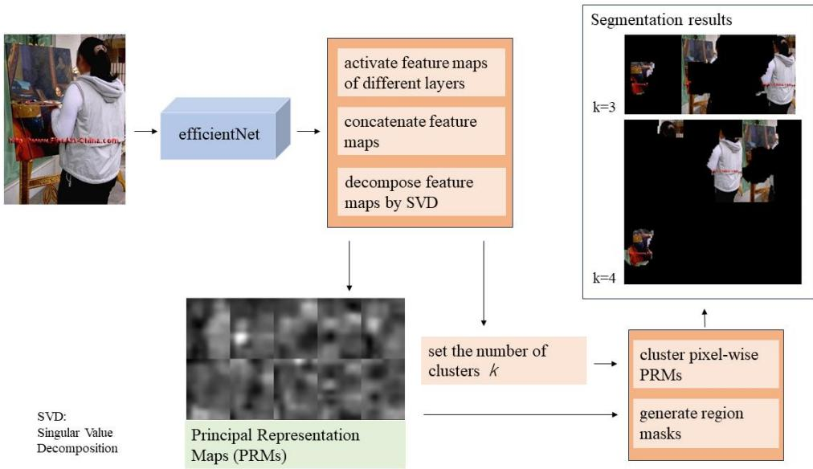  
Figure 1 Overview of PRM generation and clustering

## 2.2. Construction of Principal Representation Maps

Inspired by the method proposed in [16], we introduce how to construct principal presentation maps (PRMs) using the pretrained representations. Let $F ^ { ( l ) }$ denote the feature maps extracted from the lth layer of a pretrained visual model for a given image. Since deeper layers generally encode more abstract semantic information, we concatenate feature maps from appropriately selected deep layers to construct a pixel-wise representation that integrates complementary semantic information.

First, the selected feature maps are spatially aligned to a common resolution of � ∗ �. where H and W denote its spatial height and width, respectively. The aligned feature maps are then concatenated along the channel dimension to produce a unified feature tensor:

$$
F _ { c a t } = c o n c a t ( F ^ { ( l _ { 1 } ) } , F ^ { ( l _ { 2 } ) } , \dots , F ^ { ( l _ { m } ) } )\tag{1}
$$

where ������(∙) denote the concatenation operation, $F ^ { ( l _ { m } ) }$ denotes the feature maps of $l _ { m }$ -th network layers and m denotes the index of the selected layer.

Let C denote the total number of channels across the selected layers. The resulting feature tensor has dimensions $H * W * C$

To obtain coherent semantic information, SVD is applied to $F _ { c a t }$ to construct Principal Representation Maps (PRMs). First, $F _ { c a t }$ is reshaped into a matrix of $H W * C$ . Then, Z-score standardization of this matrix is performed so that each dimension has zero mean and unit variance; the resulting standardized matrix is denoted as Z. SVD is then applied to Z:

$$
\boldsymbol { Z } = \boldsymbol { \mathrm { U } } \boldsymbol { \Sigma } \boldsymbol { V } ^ { T }\tag{2}
$$

where U is an orthogonal matrix whose columns are the left singular vectors; V is an orthogonal matrix whose columns are the right singular vectors; and Σ is a diagonal matrix containing the singular values. By retaining the first n singular values and their corresponding singular vectors, the projection scores of Z are computed as

$$
Z _ { S V D } = \mathrm { U } _ { n } \Sigma _ { n }\tag{3}
$$

where $Z _ { S V D }$ denotes a matrix of projection scores of $F _ { c a t }$ in the new coordinate system, expressed along the principal directions. Furthermore, $Z _ { S V D }$ is reshaped into a spatial tensor with the dimensions � ∗ � ∗ �. Then, the first $n _ { p }$ maps of the tensor are extracted to construct the principal representation maps (PRMs). Each pixel is represented by a $n _ { p }$ -dimensional feature vector that integrates semantic information from the selected feature maps.

Figure 2 shows the PRMs with 10 maps derived from EfficientNet-B0, along with the first 10 channelwise feature maps with the highest mean values extracted from the selected layers for a given image.

  
(a) Original image

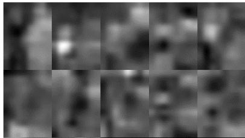  
(b) PRMs

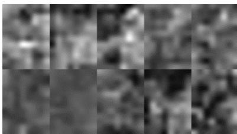  
(c) Feature maps with highest means  
Figure 2 PRMs and maximal feature maps

As shown in Figure 2, the first three PRMs exhibit clear and meaningful spatial organization. The first PRM highlights the person region, the second emphasizes the red-colored region and the paint tray, and the third focuses on the head region. In contrast, the original channel-wise feature maps do not exhibit similarly meaningful spatial organization. These observations indicate that the PRMs capture the implicit semantic structures embedded in the pretrained representations, making them accessible to subsequent semantic clustering.

## 2.3. Clustering at Multiple Granularities

Given a PRMs, each pixel is treated as a feature vector, and hierarchical clustering is performed to partition the image into spatially distributed regions according to feature similarity. Let k denote the number of clusters. Considering each map of PRMs reveals one semantically spatial structure, the dimensions of the representation for each pixel is set as same as the number of clusters. For each candidate value of k, clustering produces a label map. By varying k, the framework generates a collection of segmentation maps representing different levels of granularity. Generally, smaller values of k produce coarser partitions, whereas larger values permit finer partitions. However, increasing the cluster number does not necessarily improve semantic meaningfulness: a finer partition may separate meaningful entities, but it may also divide semantically coherent regions into unnecessary fragments.

Therefore, the objective is not simply to optimize the number of clusters or select a single segmentation with the highest clustering score. Instead, we investigate whether the representation produces semantically coherent partitions over a range of candidate cluster numbers.

## 2.4. Semantic Continuity Rate

To characterize clustering behavior across different granularities, we introduce the Semantic Continuity Rate (SCR), motivated by the silhouette principle. Silhouette score (SS) measures how similar an individual Point is to its own cluster (cohesion) compared to other clusters (separation). The score ranges from -1 to 1, where a higher score indicates the better-defined cluster. Accordingly, SCR is defined by the following expression (4).

$$
\begin{array} { r } { \mathrm { S C } R = \frac { t h e n u m b e r o f p o i n t s w i t h S S > T } { t h e n u m b e r o f a l l p o i n t s } } \end{array}\tag{4}
$$

It means the rate of points which have the SS larger than a threshold T to all points. In this paper, the value of T is set to 0.7. A higher SCR indicates better clustering quality for points. The SCR is used to characterize the coherence of PRM-based clustering at each candidate cluster number. Its purpose is to assess whether the resulting regions exhibit favorable within-region coherence and between-region separation.

For a representation tensor, evaluating SCR across a sequence of cluster numbers yields an SCR profile:

$$
S C R P = \{ S C R ( k ) \mid k \in K \}\tag{5}
$$

where SCR(k) denotes the SCR value for the representation at cluster number k, and K denotes the initial range of candidate cluster numbers.

Analyzing the complete profile, rather than an isolated SCR value, makes it possible to investigate whether PRMs maintains favorable clustering characteristics across multiple granularities. Importantly, SCR evaluates the clustering structure in the learned feature space; it does not require ground-truth semantic labels to identify candidate granularities.

We therefore investigate the signal-to-noise ratio (SNR), defined as the ratio of the mean SCR to its sample standard deviation over an initial range of cluster numbers. This analysis characterizes the relationship between the magnitude of the SCR response and its variability across candidate granularities. A higher SNR is interpreted as indicating a more favorable balance between SCR magnitude and variation.

Rather than relying on a single SNR value, we examine the proportion of high-SNR values across the initial range of cluster numbers. This enables us to compare representations according to the consistency of their clustering behavior and investigate whether representations exhibiting more favorable SNR profiles are more likely to yield meaningful regions at multiple granularities.

The resulting analysis provides a representation-level criterion for identifying promising candidates for semantic granularity discovery without requiring semantic supervision. However, this criterion should be regarded as a necessary but not sufficient condition for discovering semantic granularities, as visually similar regions may also yield high SNR values.

For the image shown in Figure 2, Figure 3 shows its SNR profiles as a function of the initial range of cluster number for PRMs derived from EfficientNet-B0. The legend entry Layer A indicates that the PRMs are derived from the feature maps of layer 286. Layers A+B indicates that the PRMs are constructed by concatenating the feature maps of layers 286 and 269. Similarly, Layers A+B+C indicates that the PRMs are constructed by concatenating the feature maps of layers 286, 269, and 251. The blue curve represents the SNR profile for Layer A, and the other curves correspond to the respective layer configurations indicated in the legend.

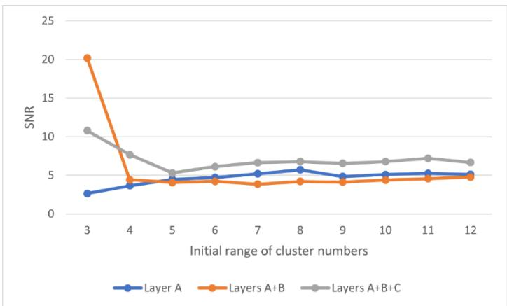  
Figure 3 SNR profiles

As shown in Figure 3, Layer A exhibits low SNR values. Layers A+B achieve a high SNR over the initial range up to K=3, but the SNR decreases sharply as the range expands. In contrast, Layers $\mathrm { A + B + C }$ maintain comparatively high SNR values over the initial ranges up to K=3 and K=4. Although the SNR values decrease sharply as the range expands further, they remain comparatively high and stable thereafter. These results suggest that Layers A+B+C are more suitable for producing meaningful partitions across multiple levels of granularity, whereas Layer A appears less effective at capturing meaningful regions.

In order to support these observations, we show their first 5 PRMs in Figure 4.

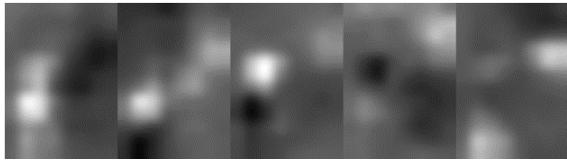

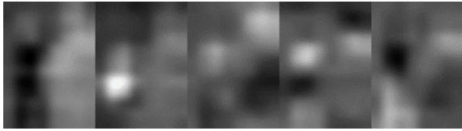  
(b) Layers A+B

(a) Layer A  
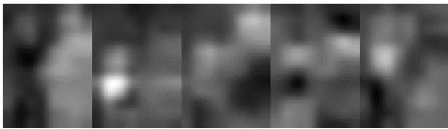  
(c) Layers A+B+C  
Figure 4 PRMs of different layers

As shown in Figure 4, for Layers $\mathrm { A ^ { + } B ^ { + } C }$ , each of the five maps highlights a meaningful semanticlike spatial organization, whereas for Layers A+B, only the first two maps clearly highlight meaningful regions. In contrast, for Layer A, none of the maps clearly highlights the person region. These observations demonstrate a clear correspondence between the SNR profiles and the semantic-like spatial organization exhibited by the PRMs. Specifically, PRM sets containing a greater number of maps that exhibit meaningful semantic-like spatial organization tend to be associated with more favorable SNR profiles.

Moreover, we show the corresponding segmentation results in Figure 5. Upper line are the results when k=3, and lower line are the results when k=6.

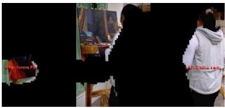  
(a) Layer A

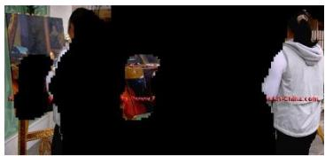  
(b) Layers A+B

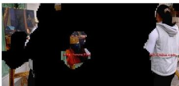  
(c) Layers A+B+C

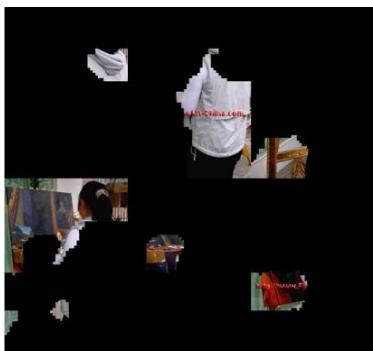  
(d) Layer A

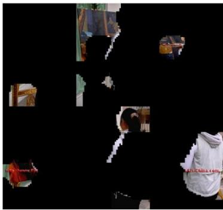  
(e) Layers A+B

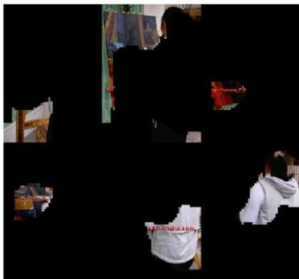  
(f) Layers A+B+C  
Figure 5 Segmentation results of PRMs

As shown in Figure 5, when k=3, the person is separated from the background in all three cases, whereas the paint tray is not separated in the case of Layer A. When k=6, the person is not perfectly segmented in any of the three cases. These observations suggest a correspondence between the SNR profiles and the quality of the resulting semantic partitions. Higher SNR values appear to be an important indicator to capture meaningful regions and produce high-quality semantic partitions.

Overall, these results demonstrate that SCR profiles can serve as a useful criterion for identifying promising representations without requiring semantic supervision. PRMs associated with more favorable SNR profiles tend to exhibit more semantic-like spatial organizations and produce higherquality partitions across multiple granularity levels.

## 3. Experimental validation and analysis

In this section, we conduct experiments to evaluate the effectiveness of PRMs and validate the usefulness of SCR-profile-based representation selection.

Specifically, we address three questions: (1) how do PRMs derived from different pretrained models and feature-layer configurations differ in their semantic structures? (2) Are more favorable SNR profiles of SCR profiles associated with better segmentation quality? (3) Can SCR-profile analysis help identify promising representations for semantic granularity discovery without semantic supervision?

## 3.1. Experimental setup

We investigate representations derived from four pretrained visual models: EfficientNet-B0 [17], GoogleNet [18], ResNet-50 [19], and SAM 2 [15]. For models that provide multiple feature maps from different network layers, we evaluate selected layer configurations. For EfficientNet-B0, the feature maps of layers 286, 269, and 251 are selected for concatenation; for GoogleNet, the feature maps of layers 138, 135, and 131 are selected; for ResNrt-50, the feature maps of layers 173, 169 and 166 are selected.

For each applicable configuration, the extracted feature maps are spatially aligned and concatenated to form a combined representation. Each map has a spatial resolution of [64, 64 × width/height], where width and height denote the width and height of the input image, respectively. SVD is then applied to obtain PRMs that capture the principal directions of variation in the combined feature representation. For SAM 2, the specific features used to construct PRMs are determined by its feature extraction procedure.

For each representation, we compute the SCR values over an initial range of cluster numbers using hierarchical clustering. The corresponding SNR is defined as the ratio of the mean SCR to its sample standard deviation over that range. This measure serves as a criterion for identifying promising candidate representations.

We then cluster the resulting representations on the COCO-2017 and VOC-2012 validation datasets using both an adaptively determined cluster number and the number of ground-truth (GT) masks. The adaptive value is determined by the first slowdown point in the singular value spectrum. This position value is used as the number of clusters. The resulting partitions are evaluated against the GT semantic masks using Hungarian-matched intersection over union (HIoU).

We conduct experiments using MATLAB 2026b on a Dell Alienware laptop equipped with a 12GB RTX 4090 Laptop GPU and a 64GB RAM.

## 3.2. Comparison of PRMs across pretrained models

As an example, we first visualize the PRMs of the image shown in Figure 2, derived from EfficientNet-B0, GoogleNet, ResNet-50, and SAM 2, respectively. The purpose is to examine whether different pretrained architectures produce representations with similarly meaningful semantic-like spatial organization. Figure 6 shows their first 10 PRMs, respectively.

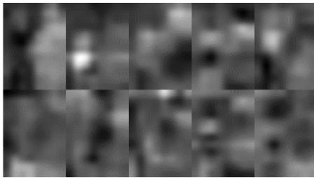  
(a) EfficientNet-B0

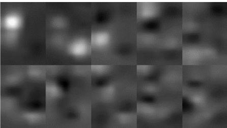  
(b) GoogleNet

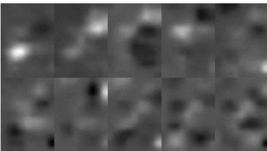  
(c) ResNet-50

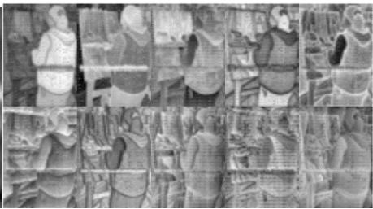  
(d) SAM 2  
Figure 6 PRMs derived from four pretrained models

As shown in Figure 6, the first five PRMs derived from EfficientNet-B0 highlight multiple potentially meaningful semantic structures, including a person, a paint tray, and a head. The first PRM derived from GoogLeNet appears to emphasize a single meaningful region corresponding to the paint tray, whereas the first two PRMs derived from ResNet-50 appear to highlight two distinct regions: a redcolored region and a head region, respectively. In contrast, the PRMs derived from SAM 2 primarily emphasize local details and entity boundaries, suggesting a limited ability to reveal meaningful regions across multiple semantic granularities. These qualitative observations suggest that the PRMs derived from EfficientNet-B0 exhibit richer semantic-like spatial organizations, potentially making them more suitable for discovering semantically meaningful regions at multiple granularities through clustering.

Figure 7 shows the clustering results obtained using these PRMs, with the number of clusters set to three.

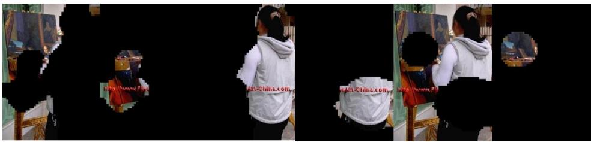  
(b) GoogleNet

(a) EfficientNet-B0  
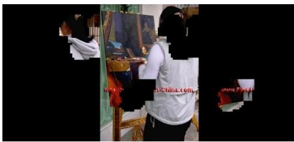  
(c) ResNet-50

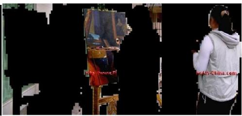  
(d) SAM 2  
Figure 7 clustering results using the above PRMs

As shown in Figure 7, the clustering results are consistent with the observations above, suggesting that PRMs derived from EfficientNet-B0 are better suited to discovering semantically meaningful regions when the number of clusters is set to three, although SAM 2 produces smoother object boundaries.

## 3.3. Validation of SCR-Profile-Based Representation Selection

Next, we examine whether SCR profiles can help identify promising representations across the evaluated models and layer configurations. As an example, for the image shown in Figure 2, Figure 8 shows the SNR profiles of its PRMs derived from EfficientNet-B0, GoogleNet, ResNet-50, and SAM 2, respectively.

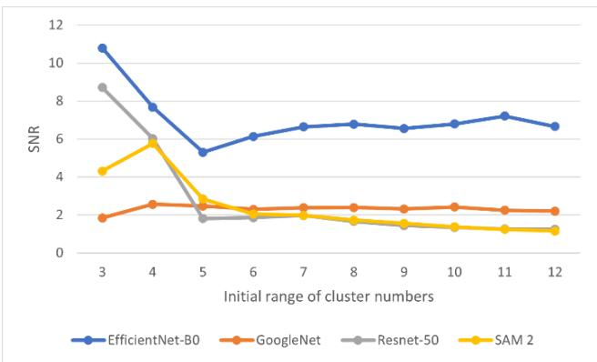  
Figure 8 SNR profiles of PRMs from different configurations

As shown in Figure 8, the SNR profiles of the PRMs derived from EfficientNet-B0 consistently exhibit higher SNR values across the evaluated initial ranges of cluster numbers than those of the other pretrained models, supporting the observations in Figures 6 and 7. Combined with the results presented in Figures 3, 4, and 5, these observations demonstrate that SNR profiles derived from SCR values can help identify pretrained models and layer configurations suitable for discovering semantically meaningful regions at different granularities through clustering PRMs, without semantic supervision.

To further investigate the effectiveness of PRMs in clustering semantically meaningful regions, we conduct an ablation study comparing PRMs with the original channel-wise feature maps without SVD. As an example, using the image shown in Figure 2, Figure 9 presents the SNR profiles obtained under these two conditions. The channel-wise feature maps are extracted from Layers A+B+C of EfficientNet-B0. Figure 10 shows the corresponding segmentation results.

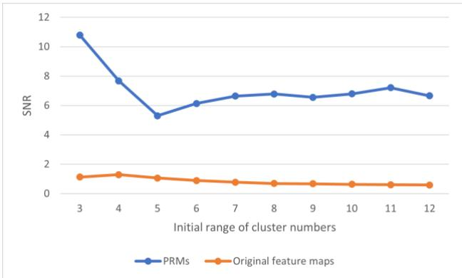  
Figure 9 SNR profiles

  
(a) By PRMs

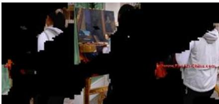  
(b) By original feature maps  
Figure 10 Segmentation results

As shown in Figure 9, the PRMs obtained through SVD consistently yield much higher SNR values than the original feature maps. This improvement is also reflected in Figure 10, where the PRMs produce more semantically meaningful regions than the original feature maps. These results demonstrate the contribution of SVD to improving the suitability of pretrained representations for discovering semantic granularity through clustering.

It should be noted that we conducted additional experiments on multiple randomly selected images from both general image collections and benchmark datasets. These experiments revealed similar observations consistently.

## 3.4 Performance evaluation on benchmark datasets

To evaluate the generalizability of the proposed method, we employ Hungarian-matched intersection over union (HIoU) to assess the segmentation performance of clustered regions across multiple semantic granularities. HIoU evaluates class-agnostic segmentation by optimally matching predicted and ground-truth masks using the Hungarian algorithm. It builds an IoU matrix, finds one-to-one assignments maximizing total overlap, and computes mean IoU over matched pairs, ensuring fair, label-free comparison. the HIoU expression is usually written as:

$$
\begin{array} { r } { { \cal H } I o U = \frac { 1 } { | \sigma ^ { * } | } \sum _ { ( i , j ) \in \sigma ^ { * } } \frac { | P _ { i } \cap { \cal G } _ { j } | } { | P _ { i } \cup { \cal G } _ { j } | } } \end{array}\tag{6}
$$

Where, $P _ { i }$ denotes predicted mask i, $G _ { j }$ denotes ground-truth mask j, $\sigma ^ { * }$ denotes optimal one-toone assignment from the Hungarian algorithm maximizing total IoU, and $| \sigma ^ { * } |$ equals to the number of pairs such that $P _ { i }$ is matched to $G _ { j }$

Figure 11 presents the mean HIoU (mHIoU) results on the VOC-2012 validation dataset using different EfficientNet-B0 layer configurations under adaptive and GT-based cluster number settings. The results show that integrating multiple hierarchical feature layers consistently improves segmentation performance under both settings, with Layers $\mathrm { A + B { + } C }$ achieving the highest mHIoU. This observation is consistent with the findings presented in Figure 3, further supporting the usefulness of SCR-profile analysis as a representation-level criterion for selecting suitable feature combinations.

Notably, the adaptive setting yields mHIoU values only about 2% lower than those of the GT-based setting across all configurations. This relatively small performance gap suggests that the proposed adaptive strategy can identify suitable cluster numbers without prior knowledge of the number of GT masks while maintaining competitive segmentation quality. These observations provide further evidence of the generalizability of the proposed method for discovering semantically meaningful regions at multiple granularities.

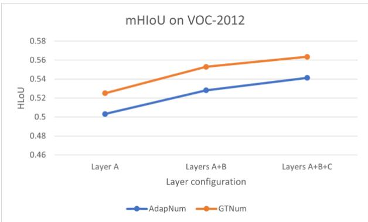  
Figure 11 HIoU on VOC-2012

Moreover, Figure 12 presents the Results of Segmentation, PRMs, and SNR profile for an image selected from the COCO-2017 validation set at different cluster numbers, using PRMs derived from Layers A+B+C of EfficientNet-B0 and embeddings extracted from SAM 2, respectively.

  
(a) Image

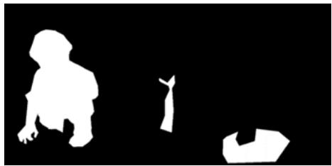  
(b) GT masks

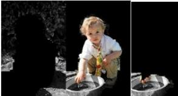

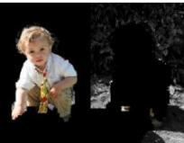

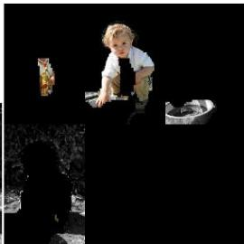  
(c) Segments using EfficientNet-B0

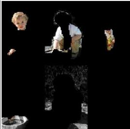

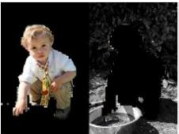

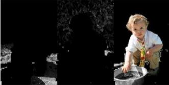

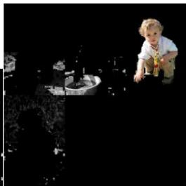  
(d) Segments using SAM 2

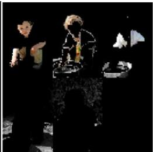

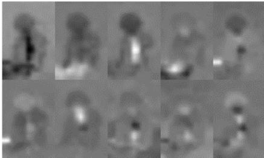  
(e) PRMs of EfficientNetB0

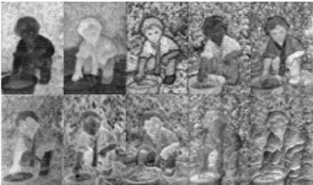  
(f) PRMs of SAM 2

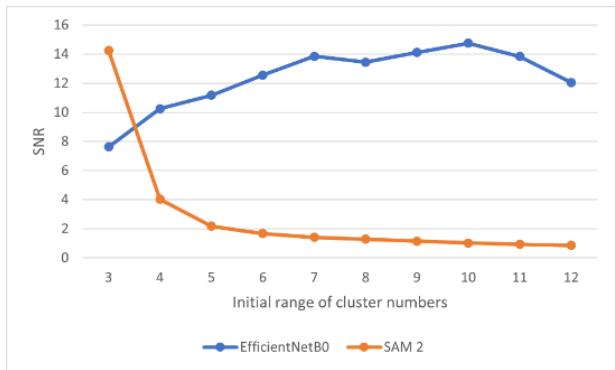  
(g) SNR profiles of PRMs  
Figure 12 Results of Segmentation, PRMs, and SNR

As shown in Figure 12, EfficientNet-B0 produces semantically meaningful segments, demonstrating its potential for discovering semantic granularities. When k=2, the child and the basin are separated from the background; when k=3, the child and the basin are segmented into distinct regions; when k=4, the necktie is further separated from the child; and when k=5, the head is further separated from the remaining body region of the child. In contrast, SAM 2 does not produce similarly meaningful partitions across multiple granularities. The PRMs shown in Figures 12(e) and 12(f), together with their corresponding SNR profiles in Figure 12(g), further help explain these differences. These observations are consistent with the findings presented in Figure 8, further supporting the effectiveness of SCR-profile analysis in identifying representations suitable for discovering semantic granularities.

Furthermore, we compare the segmentation performance of the proposed approach with that of stateof-the-art (SOTA) methods. The comparisons are conducted on the VOC-2012 and COCO-2017 validation datasets. Table 1 summarizes the mHIoU results reported by previous studies and obtained by our approach. “ANum” refers to the adaptively determined number of clusters, whereas “GTnum” indicates that the number of clusters is set to the number of ground-truth (GT) masks.

Table 1 Comparison to SOTA results of mHIoU (%)
<table><tr><td rowspan=1 colspan=1>Method</td><td rowspan=1 colspan=1>VOC-2012</td><td rowspan=1 colspan=1>COCO-2017</td></tr><tr><td rowspan=1 colspan=1>Jiao [1]</td><td rowspan=1 colspan=1>59.8</td><td rowspan=1 colspan=1></td></tr><tr><td rowspan=1 colspan=1>DiffCut [3]</td><td rowspan=1 colspan=1>65.2</td><td rowspan=1 colspan=1>34.1</td></tr><tr><td rowspan=1 colspan=1>DiffSeg [5]</td><td rowspan=1 colspan=1>48.2</td><td rowspan=1 colspan=1>31.7</td></tr><tr><td rowspan=1 colspan=1>MaskCut [6]</td><td rowspan=1 colspan=1>53.8</td><td rowspan=1 colspan=1>30.1</td></tr><tr><td rowspan=1 colspan=1>Kim [13]</td><td rowspan=1 colspan=1>53.3</td><td rowspan=1 colspan=1>21.2</td></tr><tr><td rowspan=1 colspan=1>Simeoni [20]</td><td rowspan=1 colspan=1>42.9</td><td rowspan=1 colspan=1></td></tr><tr><td rowspan=1 colspan=1>Dai (ours, ANum)</td><td rowspan=1 colspan=1>54.1</td><td rowspan=1 colspan=1>32.5</td></tr><tr><td rowspan=1 colspan=1>Dai (ours, GTnum)</td><td rowspan=1 colspan=1>56.3</td><td rowspan=1 colspan=1>34.9</td></tr></table>

The results demonstrate that the proposed approach achieves competitive performance on both VOC-2012 and COCO-2017. On VOC-2012, the GTnum configuration obtains 56.3% mHoIoU, outperforming several existing methods, including Kim, DiffSeg, and MaskCut, although it does not surpass Jiao or DiffCut. On COCO-2017, GTnum achieves 34.9% mHIoU, the highest score among the compared methods, exceeding DiffCut (34.1%). The ANum configuration also achieves competitive results, outperforming DiffSeg and MaskCut on both datasets. These results support the feasibility of discovering semantic granularities through clustering of pretrained visual representations without semantic supervision.

## 4. Conclusion

This paper presented a representation-driven approach for discovering semantic granularities in images through clustering of pretrained visual representations without semantic supervision. We proposed principal representation maps (PRMs), constructed by concatenating selected feature maps from pretrained visual models and applying an SVD-based projection. The experimental results showed that this projection capture the implicit semantic-like spatial structures embedded in pretrained representations, making them accessible to subsequent semantic clustering.

We also introduced the semantic continuity rate (SCR) and an SCR-profile-based signal-to-noise ratio (SNR) analysis to assess the suitability of pretrained representations for discovering semantic granularities. The results indicated that PRMs with more favorable SNR profiles tend to exhibit more semantic-like regions and produce higher-quality partitions across multiple granularity levels. Among the evaluated pretrained models, EfficientNet-B0 yielded particularly favorable representations, highlighting the importance of selecting appropriate feature representations.

Furthermore, evaluations on the VOC-2012 and COCO-2017 validation datasets demonstrated competitive segmentation performance. The results obtained using the adaptive cluster-number configuration further demonstrated the feasibility of discovering meaningful image regions without relying on ground-truth mask counts.

Overall, these findings suggest that pretrained visual representations contain implicit semantic-like spatial organization that can be exposed through SVD-based projection. PRMs derived from suitable pretrained visual representations can be exploited to discover meaningful semantic granularities through clustering without semantic supervision. Future work will investigate how to recognize the resulting regions at multiple granularity levels to facilitate image scene understanding.

## References

1. Xue Jiao, Yonggang Chen, Rui Dong, “An unsupervised image segmentation method combining graph clustering and high-level feature representation”, Neurocomputing, Volume 409, pp. 83-

92, 2020.

2. Andrii Zadaianchuk, et al. “UNSUPERVISED SEMANTIC SEGMENTATION WITH SELF-SUPERVISED OBJECT-CENTRIC REPRESENTATIONS”, Proc. of ICLR 2023, 2023

3. Paul Couairon, et al. “DiffCut: Catalyzing Zero-Shot Semantic Segmentation with Diffusion Features and Recursive Normalized Cut”, Proc. of NeurIPS 2024, 2024

4. Nazila Pourhaji Aghayengejeh, M.A. Balafar, Jafar Tanha, Aryaz Baradarani, “DeepCut++: Graph-based unsupervised segmentation with feature fusion and diffusion learning”, Knowledge-Based Systems, Volume 334, Article: 114975, 2026.

5. Junjiao Tian, Lavisha Aggarwal, Andrea Colaco, Zsolt Kira, and Mar Gonzalez-Franco. “Diffuse, attend, and segment: Unsupervised zero-shot segmentation using stable diffusion”. CVPR, 2024

6. Xudong Wang, Rohit Girdhar, Stella X Yu, and Ishan Misra. “Cut and learn for unsupervised object detection and instance segmentation”. In Proceedings of the IEEE/CVF conference on computer vision and pattern recognition, pages 3124–3134, 2023.

7. J. H. Cho et al., “PiCIE: Unsupervised Semantic Segmentation Using Invariance and Equivariance in Clustering”, CVPR 2021, 2021.

8. M. Hamilton et al., “Unsupervised Semantic Segmentation by Distilling Feature Correspondences”, ICLR 2022, Conference Paper 2272, 2022.

9. T.-W. Ke et al., “Unsupervised Hierarchical Semantic Segmentation with Multiview Cosegmentation and Clustering Transformers”, CVPR, 2022, 2022.

10. S. Rossetti and F. Pirri, “Hierarchy-Agnostic Unsupervised Segmentation: Parsing Semantic Image Structure”, NeurIPS 2024, poster, 2024

11. Mathilde Caron, et al., “Emerging Properties in Self-Supervised Vision Transformers”, 2021 IEEE/CVF International Conference on Computer Vision (ICCV), 2021

12. Y. Wang et al., “Self-Supervised Transformers for Unsupervised Object Discovery Using Normalized Cut”, CVPR 2022, 2022.

13. Junho Kim, Byung-Kwan Lee, Yong Man Ro, “Causal unsupervised semantic segmentation”, Pattern Recognition, Article 112173, Volume 171, Part B, 2026.

14. Junwei Yu, et al. “UnSAMv2: Self-Supervised Learning Enables Segment Anything at Any Granularity”, arXiv:2511.13714, 2026

15. Ravi, N., et al., “SAM 2: Segment Anything in Images and Videos,” Proc. International Conference on Learning Representations (ICLR) 2025, 2025.

16. Y. Dai, "Exploring Latent Feature Representations of Image Pixels via Convolutional Neural Network to Enhance Food Segmentation," in IEEE Access, vol. 13, pp. 167649-167659, 2025, doi: 10.1109/ACCESS.2025.3612465.

17. M. Tan and Q. Le, “EfficientNet: Rethinking Model Scaling for Convolutional Neural Networks,” ICML, 2019.

18. zegedy, C., Liu, W., Jia, Y., et al. “Going Deeper with Convolutions.” Proceedings of the IEEE Conference on Computer Vision and Pattern Recognition (CVPR), 2015.

19. He, K., Zhang, X., Ren, S., and Sun, J. “Deep Residual Learning for Image Recognition.” Proceedings of the IEEE Conference on Computer Vision and Pattern Recognition (CVPR), 2016.

20. Oriane Simeoni, et al. “Unsupervised Object Localization: Observing the Background to Discover Objects”, 2023 IEEE/CVF Conference on Computer Vision and Pattern Recognition (CVPR), 2023