# Disen-Forcing: Disentangling Semantic Anchoring from Motion for Autoregressive Video Diffusion

Zhengyang Yu¹ Akio Hayakawa2 Masato Ishi2 Qingtao Yu1   
Xuesong Liī,3 Takashi Shibuya2 Yuki Mitsufuji2,4 Jing Zhang1

1Australian National University 2Sony AI

{zhengyang.yu,terry.yu,xuesong.li,jing.zhang}@anu.edu.au {akio.hayakawa,masato.a.ishii,takashi.tak.shibuya,yuhki.mitsufuji}@sony.com Project page: https://disen-forcing.github.io/

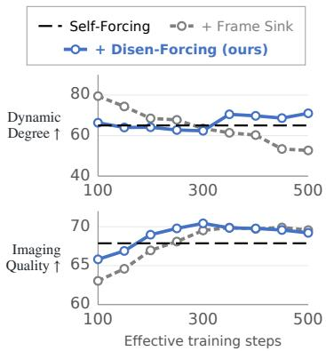  
(a) Training dynamics

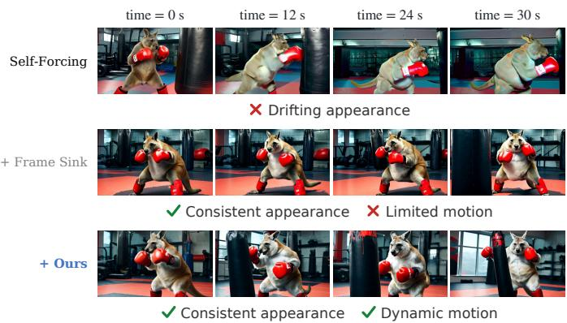  
(b) Long-horizon qualitative comparison  
Figure 1: Training dynamics and long-horizon comparison. (a) Dynamic Degree over the first 5s and Imaging Quality over 30s across 5s-horizon training iterations. (b) Qualitative comparison of 30s generations. Self-Forcing exhibits appearance drift, while Frame Sink preserves appearance but limits motion dynamics. Disen-Forcing maintains both consistent appearance and dynamic motion.

## Abstract

Autoregressive video diffusion models (AR-VDMs) enable real-time, long-horizon video generation but degrade rapidly once the inference horizon outruns the training horizon, due to compounding exposure bias. To stabilize long rollouts, recent methods heuristically adopt frame sink—keeping initial frames as a persistent model context, inspired by attention sinks in LLMs. We revisit this design and find that the mechanism by which initial frames stabilize long-range consistency in AR-VDMs is not an LLM-style attention sink; instead, long-range consistency is anchored through a sparse subset of attention heads, while the majority of heads predominantly capture local temporal dynamics. This observation reveals an overconditioning pathology in existing frame-sink strategies: by universally exposing every head to the pinned initial-frame context, the model becomes prone to collapsing motion toward the low-dynamic modes of the teacher during model distillation. We propose Disen-Forcing, a distillation-time plug-in for AR-VDMs that disentangles and reinforces this head specialization through disentangled context routing and motion-disentangling regularization. On long-horizon video generation benchmarks, Disen-Forcing simultaneously improves long-range consistency and motion dynamics of base AR-VDMs—a trade-off that sink-based methods fail to balance.

## 1 Introduction

Recent advances in video diffusion models (VDMs) have enabled photorealistic and temporally coherent video synthesis [6, 7, 17, 24]. However, most VDMs employ bidirectional temporal attention, generating all frames in parallel without respecting temporal order, which limits their use in real-time or interactive applications. Autoregressive video diffusion models (AR-VDMs) [4, 19, 52] have emerged as a promising alternative, applying per-frame diffusion denoising in causal order. This hybrid paradigm retains diffusion's high-fidelity sample quality while enabling streaming generation, a key capability for real-time interactive world models [1, 27, 30, 33].

A fundamental challenge in AR-VDMs is exposure bias [37, 53] (Section 3.1): as each newly generated frame is fed back as future conditioning, small generation errors accumulate over rollout steps, progressively degrading visual quality and semantic consistency. This issue is exacerbated by a training-inference mismatch in horizon and context quality: training typically exposes the model to limited-length rollouts and relatively clean context, whereas inference often requires much longer extrapolation under increasingly error-corrupted self-generated history. Self-Forcing [19] mitigates exposure bias by training on self-generated rollouts, but drift still emerges when the inference horizon exceeds the training horizon. To solve this, the de facto stabilization heuristic is frame sink [29, 47, 49] (Section 3.1), which pins the initial frames in the KV cache throughout model rollout, inspired by attention sinks in streaming LLMs [45]—a design that implicitly treats initial frames as a universal attention attractor, i.e., a shared global reference for all heads. While it improves long-range semantic consistency, it often suppresses temporal dynamics, yielding conservative motion (Section 3.3).

In this work, by analyzing the temporal attention patterns of AR-VDMs (Section 3.2), we find that initial frames do not act as a universal attention attractor as in LLM-style attention sinks; instead, they anchor semantic consistency through a sparse, stable subset of anchor heads. This reveals an over-conditioning in the existing frame sink strategy, which universally exposes every head to the initial-frame context. Under the mode-seeking distillation objective [51], this universalization causes the student to collapse motion toward the low-variance, near-static modes of the teacher (Section 3.3).

Building on these observations, we propose Disen-Forcing, a distillation-time plug-in for AR-VDMs that disentangles and reinforces the head specialization through two complementary components: disentangled context routing (Section 4.1) replaces the universal sink during DMD with per-head-type contexts: only anchor heads retain access to the initial frames, while the rest are restricted to the local sliding window, eliminating the over-conditioning; motion-disentangling regularization (Section 4.2) imposes an invariance constraint preventing anchor heads from leaking global semantics into motion, directly suppressing the remaining semantic-to-motion leakage after routing. Our contributions are:

• Diagnosis: revealing that initial frames in AR-VDMs do not act as universal attention sinks; instead, semantic anchoring is concentrated in a sparse, stable subset of anchor heads, exposing universal frame-sink conditioning as a cause of motion collapse under DMD.

• Method: proposing Disen-Forcing, a distillation-time plug-in that reinforces this head specialization via disentangled context routing and motion-disentangling regularization.

• Results: demonstrating on long-horizon video benchmarks that Disen-Forcing improves both motion dynamics and long-range consistency over base AR-VDMs, resolving a tradeoff that existing sink-based methods cannot balance.

## 2 Related Work

AR-VDMs. Video diffusion models (VDMs) [6, 7, 11, 14, 16, 24, 40, 41, 43, 48, 54] generate high-fidelity content with coherent temporal dynamics. Autoregression (AR), established in language modeling [3] and token-based video generation [18], also enables incremental video synthesis. Rolling-denoising methods [22, 23, 29, 34, 39, 46] progressively denoise and advance a temporal window, whereas FramePack [53] compresses historical context for next-frame-section prediction Diffusion Forcing [4] trains with independent per-frame noise levels; History Guidance [38] extends this formulation to non-causal transformers. SkyReels-V2 [5] and MAGI-1 [36] use ordered frameor chunk-wise noise schedules for long-video generation. Within this diffusion-AR hybrid paradigm, CausVid [52] attains few-step causal inference through Distribution Matching Distillation (DMD) [50, 51], while Self-Forcing [19] retains the DMD objective and narrows the train-test gap by feeding the model's own rollout as context during training. Causal-Forcing [56] further improves initialization by distilling ODE trajectories from an autoregressive teacher. Despite training on self-generated context, temporal drift still emerges when inference exceeds the training horizon.

Attention Sinks in LLMs. The attention sink phenomenon [45] in AR LLMs—disproportionate attention to the first few input tokens regardless of semantic content—emerges with large-scale next-token prediction training [13]. These tokens act as no-op attention score absorbers [2]; pinning them as persistent context stabilizes streaming inference over arbitrarily long sequences [45].

Sink-based AR-VDMs. Inspired by LLM attention sinks, the frame sink heuristic [8, 9, 25, 26, 29, 47, 49] has been widely adopted in AR-VDMs to alleviate long-horizon drift by pinning initial frames as persistent context. We show that, in AR-VDMs, sink-like attention to initial frames is not ubiquitous across heads but concentrated in a sparse subset of heads (Section 3.2); universally exposing every head to the pinned context drives motion collapse under mode-seeking distillation (Section 3.3).

## 3 Rethinking the Frame Sink Strategy in AR-VDMs

In this section, we begin by revisiting AR-VDMs, their exposure bias, and the frame sink heuristic (Section 3.1). Then we show that initial frames are not a universal attention sink but a clean reference exploited by a sparse subset of attention heads for global consistency (Section 3.2). Finally, we identify motion collapse as the consequence of universalizing this role across all heads (Section 3.3).

## 3.1 Preliminaries: AR-VDMs and Anti-Drift with Frame Sink

Exposure Bias in AR-VDMs. An AR-VDM is a hybrid model that combines the strengths of AR models in temporal modeling and diffusion models in continuous distribution modeling. Specifically it uses the AR chain-rule decomposition to factorize the joint distribution of a video sequence $\mathbf { x } ^ { 1 : N } = ( \mathbf { x } ^ { 1 } , \mathbf { x } ^ { 2 } , \ldots , \mathbf { x } ^ { N } )$ into a product of conditionals¹: $\begin{array} { r } { p ( \mathbf { x } ^ { 1 : N } ) = \prod _ { i = 1 } ^ { N } p ( \mathbf { x } ^ { i } \mid \mathbf { x } ^ { < i } ) } \end{array}$ . Each conditional $p ( \mathbf { x } ^ { i } \mid \mathbf { x } ^ { < i } )$ is modeled by a diffusion process that denoises a Gaussian noise into a video frame conditioned on previously generated frames. These conditionals can be learned with denoising [4] or flow-matching [28] objectives. In Teacher Forcing, the conditional at noise level $t _ { j }$ is formed as $p ( \mathbf { x } _ { t _ { i } } ^ { i } \mid \mathbf { x } _ { 0 } ^ { < i } )$ , with clean ground-truth history frames. In Diffusion Forcing [4], the conditional is instead $p ( \mathbf { x } _ { t _ { j } } ^ { i } \mid \mathbf { x } _ { t _ { > 0 } } ^ { < i } )$ , where history frames are corrupted with independent noise levels. Both formulations introduce a train-test gap termed exposure bias [37]: the context exposed to the model is ground-truth during training but self-generated at inference

Causal Distillation. As an alternative to the above methods, CausVid [52] shifts toward causal distillation. This is typically achieved through Distribution Matching Distillation [51] (DMD). Rather than training with a per-frame denoising objective on ground-truth videos, a causal student model $G _ { \theta }$ , initialized by regression on the bidirectional teacher's ODE trajectories [19, 52], is distilled to directly build a noise→data mapping, using the holistic fidelity of its generated videos under the teacher's distribution as its learning signal. Concretely, DMD minimizes the reverse KL divergence between the student distribution $^ { q _ { \theta , t } }$ and the teacher distribution $p _ { t }$ at diffusion timestep t [44, 51], with gradient

$$
\nabla _ { \boldsymbol { \theta } } \mathcal { L } _ { \mathrm { D M D } } = \mathbb { E } _ { t } \left[ \nabla _ { \boldsymbol { \theta } } \operatorname { K L } ( q _ { \boldsymbol { \theta } , t } \parallel p _ { t } ) \right] .\tag{1}
$$

Training with the distribution-matching loss enables few-step sampling without paired teacher trajectories. Self-Forcing [19] further mitigates the train-test gap by conditioning the model on self-rollout frames during distillation. Self-Forcing implements history conditioning through causal self-attention with a KV cache [19, 52]. Since the context $\mathbf { x } ^ { < i }$ grows unboundedly with AR steps, Self-Forcing adopts sliding window attention (Fig. 5 (a)), which is also referred to as rolling KV cache, approximating $p ( \mathbf { x } ^ { i } \mid \mathbf { x } ^ { < i } )$ by $q _ { \theta } ( \mathbf { x } ^ { i } \mid \mathbf { x } ^ { i - w : i - 1 } )$ , retaining only the w most recent frames. Although self-rollout training alleviates exposure bias, severe error compounding still occurs once inference extrapolates beyond the training horizon.

Anti-Drift with Frame Sink. Recent works [29, 47] empirically identify that retaining initial frames as a “frame sink" [47] in the sliding window attention, i.e., $q _ { \theta } \mathbf { \bar { ( x } } ^ { i } \ | \ \mathbf { x } ^ { 1 } , \mathbf { \bar { x } } ^ { i - w : i - 1 } )$ —a strategy analogous to the attention sinks in LLMs [45], is effective at maintaining long-range semantic consistency during frame-length extrapolation. While this heuristic mitigates appearance drift from error accumulation, the role of initial frames in preventing drift remains unclear. In LLMs, the attention sink refers to a phenomenon where most heads assign disproportionate attention mass to the first few tokens, which act as “no-ops" absorbing probability mass in the absence of relevant context (Section 2). A natural question arises: do initial frame tokens serve the same role in AR-VDMs?

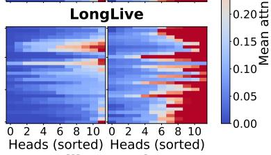

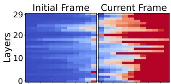

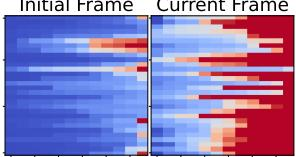

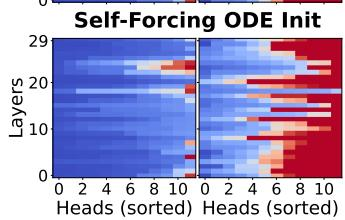

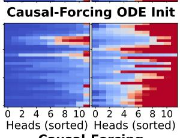

(a) Per-head attention across AR-VDMs  
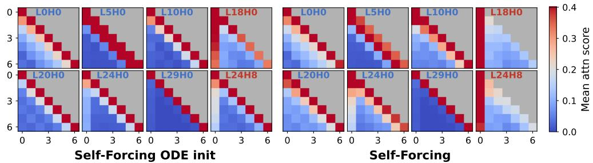  
(b) Representative Self-Forcing heads over rollout steps

Figure 2: Temporal attention patterns across models and heads. (a) Per-head attention to the initial and current frames across AR-VDMs, averaged over 50 MovieGenBench [32] prompts and denoising timesteps. Most heads attend predominantly to the current frame, while a sparse subset concentrates attention on the initial frame. (b) Attention distributions of representative Self-Forcing heads across seven rollout steps, at ODE initialization (left) and after DMD (right). Working Heads exhibit local temporal patterns, whereas Anchor Heads attend persistently to the initial frame.

## 3.2 Uncovering the Anti-Drift Role of Initial Frames

Initial Frames Are Not a Universal Attention Sink. To uncover the mechanism of initial frames in anti-drift, we examine per-head attention scores across layers and AR steps. We observe that the attention landscape in AR-VDMs is fundamentally different from that in LLMs. Specifically, we measure the average attention allocated to the initial frames versus the current frame for every head, averaged over 50 MovieGenBench [32] prompts and all diffusion timesteps. As shown in Fig. 2a, the vast majority of heads attend predominantly to the current frame—not the initial frames. In other words, the current frame, rather than the initial ones, plays a role similar to the universal attention sink in LLMs. We conjecture that the difference between the LLM and AR-VDM sink patterns stems from two factors. Data: in language, adjacent tokens are discrete and typically less redundant than adjacent video frames, which often share substantial visual content. Objective: In LLMs, the prediction target is a future token outside the input; under causal masking, initial tokens are uniquely visible to every query and naturally absorb the resulting attention mass as sinks [45]. AR-VDMs, in contrast, denoise the current frame from its own noisy latent at each AR step: the denoising target is located at the current-frame position itself. Together with the strong spatio-temporal redundancy of video tokens, this encourages attention to concentrate on the current frame.

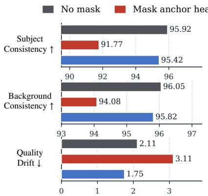

Mask random heads (same count)  
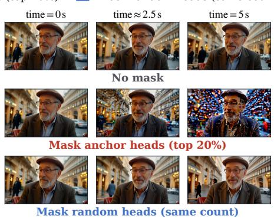  
Figure 3: Critical Role of Anchor Heads in Semantic Consistency. Masking the top 20% Anchor Heads leads to a sharp drop in subject/background consistency and a clear rise in imaging-quality drift (left), together with visible appearance drift even within the 5-second training horizon (right). Masking the same number of Working Heads at random yields metrics on par with the unmasked baseline and no observable drift.

Initial Frames Sustain Consistency through Sparse Heads. To discover what truly enables initial frames in anti-drift, we visualize per-head attention distributions throughout the AR rollout (Fig. 2b; representative head-wise attention grids in Fig. A2). While most heads exhibit a local temporal pattern, a sparse subset, concentrated in specific layers (e.g., layers 18 and 22–24 of the 30-layer Wan2.1 [40] backbone), exhibits persistent attention spikes toward the initial frame. Based on this observation, we categorize attention heads into two types: Working Heads—The vast majority of heads, which attend predominantly to the local sliding window context; and Anchor Heads—A sparse minority of heads that attend strongly to the initial frame across AR steps.

A universal attention sink would absorb the majority of the attention mass across heads; the observed sparsity of Anchor Heads suggests a different mechanism. From the attention pattern, we hypothesize that these sparse Anchor Heads exploit the initial frames as a clean reference with minimal cumulative error, stabilizing long-range consistency. We test this via a head-masking experiment (Fig. 3): during inference within the 5-second Self-Forcing training horizon, we mask the top-20% anchor heads (by average initial-frame attention score). This causes visible appearance drift even within the training horizon. In contrast, masking the same number of randomly selected Working Heads produces no observable drift (more samples in Fig. A6). Together, the two head types reveal a division of labor: Anchor Heads sustain global semantic consistency by preserving reference to the initial frames, while Working Heads focus on local temporal dynamics, as reflected in their local attention pattern.

(a) Attention Score by Prompt  
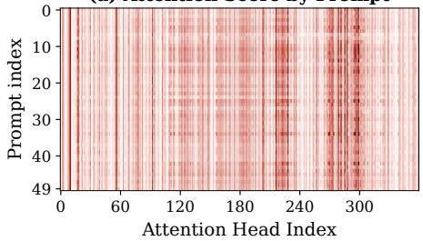

(b) Attention Score by Timestep  
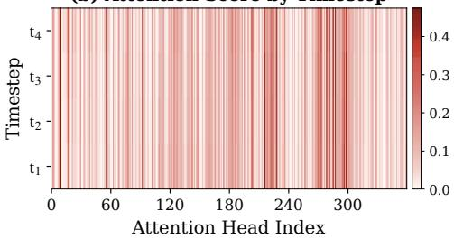  
Figure 4: Anchor-head positions are input invariant. (a) Each row plots a single prompt's per-head initial-frame attention score. The same vertical stripes are coherent across all 50 rows, meaning the same subset of heads attends strongly to the initial frame regardless of prompt. (b) Each row plots the per-head cross-prompt mean attention score at one of the four diffusion timesteps. The four rows display the same vertical stripes, indicating timestep-invariance as well.

Stability of the Head Partition. We find the partition pattern to be stable across inputs and training stages. Fig. 4 shows that a largely overlapping subset of heads consistently exhibits elevated initialframe attention across diverse prompts and diffusion timesteps. The partition is also already present in the ODE-initialization model and the anchor-head locations remain stable after distillation (e.g., comparing Self-Forcing and its ODE-initialization in Fig. 2). Notably, a similar partition emerges in the bidirectional teacher backbone (Section D), suggesting the structure is rooted in pretraining rather than the AR distillation pipeline. Together, these observations indicate that the anchor/working partition is a structural property of the pretrained model rather than an artifact of any particular distillation stage.

## 3.3 Motion Collapse from Universal Frame Sink

The above analysis shows that initial frames stabilize global consistency sparsely through the Anchor Heads. In current sink-based AR-VDMs, however, the initial frames are exposed to every head via the shared KV context $[ \mathbf { K } _ { \mathrm { i n i t } } ; \mathbf { K } _ { \mathrm { w i n } } ; \mathbf { K } _ { \mathrm { c u r } } ] , [ \mathbf { V } _ { \mathrm { i n i t } } ; \mathbf { V } _ { \mathrm { w i n } } ; \mathbf { V } _ { \mathrm { c u r } } ]$ , including the majority of Working Heads that focus on local dynamics. Combined with the mode-seeking DMD objective [50, 51] this universal conditioning offers the student an easy shortcut toward high-fidelity static modes. The initial frames provide a clean reference with minimal exposure bias, unlike the sliding window, which accumulates self-rollout error. Static or near-static outputs that closely track this reference, therefore, tend to score higher on consistency than more dynamic outputs (Fig. 6 and Table 1). Such static modes also remain probable under the teacher distribution, since pretraining video datasets usually contain a substantial fraction of static scenes. With universal access to $\mathbf { K } _ { \mathrm { i n i t } }$ and $\mathbf { V } _ { \mathrm { i n i t } }$ , every head—including the Working Heads normally responsible for local dynamics—can exploit this shortcut, leading the student to over-condition on the initial frames at the cost of motion.

## 4 The Disen-Forcing Method

Building on the above analysis, frame sink rests on a universal attention sink premise that does not hold in AR-VDMs and overlooks the observed head specialization. We therefore propose Disen-Forcing, a distillation-time plug-in for AR-VDMs that respects this specialization during distillation. Given an ODE-initialization model (Section 3.1), we first perform a one-time identification of anchor heads, then distill with two complementary components: disentangled context routing (Section 4.1) that gives each head type its functional context, and motion-disentangling regularization (Section 4.2) that prevents anchor heads from inducing motion collapse.

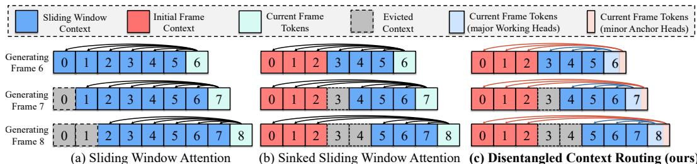  
Figure 5: Disentangled context routing. (a) Sliding window attention loses early frames as the cache rolls forward. (b) Sinked sliding window retains initial frames but routes the same context to all heads. (c) During DMD, our approach routes initial-frame context exclusively to the sparse Anchor Heads while the majority Working Heads attend only to the local sliding window, preserving the natural head specialization.

## 4.1 Disentangled Context Routing

The motion collapse issue reveals an over-conditioning of the frame sink heuristic on initial-frame context. Inspired by the observation of specialized head types in Section 3.2, we propose to assign each head type a dedicated context that matches its functional role, shielding Working Heads from the static initial-frame reference and thereby eliminating the over-reliance at its source.

Identifying Anchor Heads. Fig. 4 shows that the anchor/working partition is a stable, inputindependent property of the pretrained backbone. We therefore identify the set of anchor heads A by computing the average initial-frame attention score $s _ { l , h } = \mathbb { E } _ { \mathrm { p r o m p t } , t , i } \big [ A _ { l , h } ^ { i , 1 } \big ]$ of the h-th head at layer-l, averaged over prompts, diffusion steps t, and AR steps i and thresholding at the p-th percentile $\tau _ { p }$ across all heads: $\mathcal { A } _ { l } = \left\{ h : s _ { l , h } > \tau _ { p } \right\}$ and $\mathcal { A } = \left\{ ( l , h ) : h \in \mathcal { A } _ { l } \right\}$ . The set A is computed once using each base model's ODE-initialization checkpoint [19, 56] before training and kept fixed throughout distillation, which is supported by the consistent attention pattern observed across ODE-initialization and post-distillation baselines in Fig. 2.

Context Routing. With the anchor head set A identified, we route KV context per head type. Let l index layers and $\mathbf { \bar { \boldsymbol { h } } } \in \{ 1 , \dots , H \}$ index the attention heads within each layer. We route KV context per head as:

$$
\mathbf { K } _ { \mathrm { c t x } } ^ { l , h } = \left\{ \left[ \mathbf { K } _ { \mathrm { i n i t } } ^ { l , h } ; \mathbf { K } _ { \mathrm { c u r } } ^ { l , h } \right] \right. \mathrm { i f } \ h \in \mathcal { A } _ { l } ,\tag{2}
$$

and analogously for $\mathbf { V } _ { \mathrm { c t x } } ^ { l , h }$ . Working Heads attend only to the local sliding window and the current frame—the temporally local context they need to construct motion. Anchor Heads attend only to the initial frame and the current frame, retaining their clean global reference without unnecessary local context that may carry cumulative error. Importantly, both head types retain the same context budget—substituting $\mathbf { K } _ { \mathrm { i n i t } }$ for ${ \bf K } _ { \mathrm { w i n } }$ rather than expanding or truncating the context window.

## 4.2 Motion-Disentangling Regularization

Although context routing ensures that Working Heads attend exclusively to temporally local context, freeing their motion representations from initial-frame interference, Anchor Heads—though sparse retain a path to initial frames and can still leak global semantics into motion construction. Routing alone cannot fully close this leakage: it constrains only which context each head reads, not which aspect of the generated video each head shapes. We therefore impose an invariance constraint directly on the distillation process: the local motion construction must remain invariant under intervention on Anchor Heads' access to initial frames.

Motion Proxy. Enforcing this invariance requires a measurable proxy for motion, which we extract from the model's internal representations. Analysis of video diffusion transformers shows that cross-frame query-key similarity captures temporal correspondence in selected layers and denoising timesteps, supporting zero-shot point tracking [31]. Query-key matching has also been used for temporal cache compression [35]. We therefore adopt the cross-frame self-attention map $\mathbf { A } ^ { i , j } =$ $\mathrm { S o f t m a x } ( { \bf Q } ^ { i } ( { \bf K } ^ { j } ) ^ { \top } / \sqrt { d } )$ as our motion proxy. Concretely, $\mathbf { A } _ { l } ^ { i , i - 1 }$ at layer l is, for each spatial token of frame i, a soft correspondence over the positions of frame i—1, approximating the local motion field at that layer. The proxy is differentiable and computed from the queries and keys in the forward pass.

Let $\mathbf { A } _ { I } ^ { i , i - 1 }$ denote the motion proxy from the standard forward pass with disentangled routing (Eq. (2)). We run a counterfactual pass with the same model and input, replacing Anchor Heads routed context with $[ \mathbf { K } _ { \mathrm { w i n } } ; \mathbf { K } _ { \mathrm { c u r } } ]$ (and analogously for V), and denote its proxy by $\hat { \mathbf { A } } _ { l } ^ { i , i - 1 }$ . We penalize the discrepancy between the two proxies using KL divergence over layers S that contain no Anchor Heads:

$$
\mathcal { L } _ { \mathrm { r e g } } = \frac { 1 } { | \cal { S } | } \sum _ { l \in \cal { S } } \frac { 1 } { N } \sum _ { i = 1 } ^ { N } \mathrm { K L } \big ( \mathrm { s g } ( \hat { \mathbf { A } } _ { l } ^ { i , i - 1 } ) \| \mathbf { A } _ { l } ^ { i , i - 1 } \big ) .\tag{3}
$$

Here $\operatorname { s g } ( \cdot )$ denotes stop-gradient. Minimizing $\mathcal { L } _ { \mathrm { r e g } }$ encourages the motion proxy in non-anchor layers to be invariant to whether anchor heads have access to the initial frames, thereby disentangling semantic anchoring from motion construction. The full training objective is $\mathcal { L } = \mathcal { L } _ { \mathrm { D M D } } + \lambda _ { \mathrm { r e g } } \mathrm { \bar { \mathcal { L } } _ { \mathrm { r e g } } } .$

## 5 Experiments

Implementation details. We implement Disen-Forcing as a distillation-time plug-in on Self-Forcing [19] and Causal-Forcing [56]. Both base models are four-step causal AR-VDMs based on Wan2.1-T2V-1.3B, with a 5-second training horizon and an 832×480 resolution. We finetune each base model from its own ODE-initialization checkpoint with a KV cache size of 9 latent frames—3 initial, 3 sliding-window, and 3 current frames. Each AR rollout step denoises a chunk of 3 latent frames, and the 5-second training horizon corresponds to 7 such rollout steps. Distillation runs on VidProM [42]. We use a batch size of 64, except for Self-Forcing + Disen-Forcing and the ablations, which use 32. The anchor head set A is identified using all 1003 MovieGenBench [32] prompts by thresholding at the 80th percentile. Its stability across prompts and sample sizes is evaluated in Figs. 4 and A4. We apply motion-disentangling regularization to layer 26 $( S ^ { ' } = \{ 2 6 \}$ in Eq. (3)) with weight $\lambda _ { \mathrm { r e g } } = 0 . 0 0 2$ . Layer selection is evaluated in Section E.1. See Section A for more details.

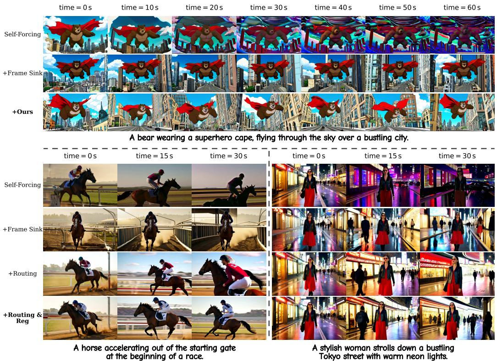  
Figure 6: Qualitative comparison and ablation. Self-Forcing suffers from temporal drift once the inference rollout exceeds the training horizon; Frame Sink avoids temporal drift but yields lowdynamic, conservative motion. Ours (Disen-Forcing) is both drift-free and temporally dynamic. The bottom block isolates the contributions of our two components: context routing and ${ \mathcal { L } } _ { \mathrm { r e g } } .$

Evaluation. We evaluate on 200 MovieGenBench [32] prompts using the indices published by Rolling-Forcing [29]. We generate 30-second and 1-minute videos at 16 fps, covering the long-video horizons also studied in prior work [49]. We use VBench-Long [20, 21] across six dimensions: subject consistency, background consistency, motion smoothness, dynamic degree, aesthetic quality, and imaging quality. We report all six dimensions on a 0–100 scale and their mean (Total). Following Zhang et al. [53], temporal drift is measured as the mean absolute imaging quality gap between the first and last segments $( \Delta _ { \mathrm { D r i f t } } ^ { \mathrm { Q } } )$

## 5.1 Comparison with Existing Models

Baselines. Our primary baselines are the Frame Sink variants of Self-Forcing and Causal-Forcing, each distilled from the same ODE checkpoint as its Disen-Forcing counterpart under matched compute (identical KV cache size and iterations). This isolates the contribution of Disen-Forcing beyond the frame sink alone. We further compare against three sliding-window AR-VDMs (CausVid [52], Self-Forcing [19], Causal-Forcing [56]), three sink-based methods (LongLive [47], Rolling-Forcing [29], Deep-Forcing [49]), and the diffusion-forcing model SkyReels-V2 [5]. In our evaluation, all baselines use 4 denoising steps except Rolling-Forcing (5) and SkyReels-V2 (30, undistilled).

Results. Table 1 reveals two failure modes of existing models. The base models lose early-frame context as the cache rolls forward and accumulate severe drift, while their Frame Sink variants recover consistency but suppress motion. Disen-Forcing improves both motion dynamics and long-range consistency over both base models. On Self-Forcing, it increases Dynamic Degree from Frame Sink's 35.66/35.83 to 73.12/73.95 at the 30-second/1-minute horizons, while reducing $\Delta _ { \mathrm { D r i f t } } ^ { \mathrm { Q } }$ from the base model's 7.23/12.73 to 4.03/4.04. On Causal-Forcing, it similarly increases Dynamic Degree from Frame Sink's 17.75/16.06 to 69.72/69.64 and reduces $\Delta _ { \mathrm { D r i f t } } ^ { \mathrm { Q } }$ from the base model's 9.38/12.96 to 4.83/5.10. We find that the base models' low Dynamic Degree at long horizons is largely caused by accumulated drift, which explains why Self-Forcing scores slightly below its Frame Sink variant at 1 minute. At the 5s training horizon, without frame-length extrapolation, Frame Sink reduces Dynamic Degree from 65.00 to 37.00 for only marginal consistency gains, whereas Disen-Forcing raises it to 74.00 (Section B.1), confirming that universal sink exposure harms motion under DMD. As the rule-based consistency and drift metrics favor near-static videos, we also use a VLM-based human-preference judge, which prefers Disen-Forcing over Frame Sink across all five dimensions on both base models, including visual quality and temporal consistency (Section B.2).

Table 1: Quantitative comparison on long video generation. Disen-Forcing is a distillation-time plug-in applied to Self-Forcing and Causal-Forcing. $\Delta _ { \mathrm { D r i f t } } ^ { \mathrm { Q } } \left( \downarrow \right)$ measures the imaging quality gap between the first and last segments. Best Total per horizon in bold.
<table><tr><td rowspan="2">Model</td><td colspan="7">VBench-Long Scores ↑</td><td rowspan="2"> $\Delta _ { \mathrm { D r i f t } } ^ { \mathrm { Q } } \down$ </td></tr><tr><td>Total</td><td>Subject</td><td>Background</td><td>Smooth</td><td>Dynamic</td><td>Aesthetic</td><td>Imaging</td></tr><tr><td colspan="8">30-second generation (～500 frames)</td></tr><tr><td colspan="8"></td></tr><tr><td>Diffusion Forcing SkyReels-V2 [5]</td><td>76.64</td><td>96.89</td><td>96.98</td><td>99.14</td><td>45.50</td><td>60.04</td><td>61.31</td><td>5.65</td></tr><tr><td></td><td></td><td></td><td></td><td></td><td></td><td></td><td></td><td></td></tr><tr><td>Distilled Causal</td><td></td><td></td><td>96.72</td><td>98.15</td><td>52.59</td><td>59.33</td><td>66.01</td><td>6.73</td></tr><tr><td>CausVid [52]</td><td>78.44</td><td>97.83</td><td></td><td>98.67</td><td>33.53</td><td>60.88</td><td>70.01</td><td></td></tr><tr><td>Rolling-Forcing [29]</td><td>76.16</td><td>97.50</td><td>96.37</td><td>98.77</td><td>42.50</td><td>61.68</td><td></td><td>3.70</td></tr><tr><td>LongLive [47]</td><td>77.51</td><td>97.40</td><td>96.37</td><td>97.96</td><td>58.09</td><td>58.93</td><td>68.34</td><td>3.74</td></tr><tr><td>Deep-Forcing [49]</td><td>78.58</td><td>95.40</td><td>94.81</td><td>98.33</td><td></td><td>59.09</td><td>66.26</td><td>5.80</td></tr><tr><td>Self-Forcing [19]</td><td>76.37</td><td>96.49</td><td>95.97</td><td>98.94</td><td>40.44</td><td></td><td>67.87</td><td>7.23</td></tr><tr><td>+ Frame Sink</td><td>76.93</td><td>97.91</td><td>96.73</td><td></td><td>35.66</td><td>62.37</td><td>69.94</td><td>3.40</td></tr><tr><td>+Disen-Forcing</td><td>82.38</td><td>96.52</td><td>95.50</td><td>98.13</td><td>73.12</td><td>60.95</td><td>70.05</td><td>4.03</td></tr><tr><td>Causal-Forcing [56]</td><td>79.65</td><td>95.53</td><td>95.13</td><td>97.30</td><td>68.28</td><td>55.92</td><td>65.75</td><td>9.38</td></tr><tr><td>+ Frame Sink +Disen-Forcing</td><td>74.12 81.57</td><td>98.07 95.93</td><td>96.91 95.34</td><td>98.91 98.00</td><td>17.75 69.72</td><td>61.64 60.66</td><td>71.45 69.77</td><td>3.25 4.83</td></tr><tr><td colspan="8"></td></tr><tr><td colspan="8">1-minute generation (～1000 frames)</td></tr><tr><td>Distilled Causal</td><td></td><td></td><td></td><td></td><td></td><td></td><td></td><td></td></tr><tr><td>CausVid Rolling-Forcing</td><td>78.01 75.88</td><td>98.01</td><td>96.91 96.26</td><td>98.24 98.69</td><td>50.33 32.38</td><td>59.13</td><td>65.48</td><td>7.51</td></tr><tr><td>LongLive</td><td>77.67</td><td>97.39 97.01</td><td>96.15</td><td>98.73</td><td>43.97</td><td>60.17 61.69</td><td>70.38</td><td>4.18</td></tr><tr><td>Deep-Forcing</td><td>79.35</td><td>96.30</td><td>95.47</td><td>98.18</td><td>58.90</td><td>59.46</td><td>68.46 67.77</td><td>3.70</td></tr><tr><td>Self-Forcing</td><td>74.75</td><td>96.82</td><td>96.34</td><td>98.38</td><td>34.70</td><td>56.55</td><td></td><td>5.04</td></tr><tr><td>+ Frame Sink</td><td>76.88</td><td>97.79</td><td>96.58</td><td>98.91</td><td>35.83</td><td>61.81</td><td>65.68 70.34</td><td>12.73</td></tr><tr><td>+Disen-Forcing</td><td>82.34</td><td>96.39</td><td>95.65</td><td>98.06</td><td>73.95</td><td>59.97</td><td></td><td>3.10</td></tr><tr><td></td><td>77.71</td><td></td><td></td><td></td><td>64.91</td><td></td><td>70.01</td><td>4.04</td></tr><tr><td>Causal-Forcing</td><td>73.68</td><td>95.35 98.01</td><td>95.25 96.81</td><td>96.97 98.90</td><td>16.06</td><td>51.22 60.79</td><td>62.57 71.51</td><td>12.96</td></tr><tr><td>+ Frame Sink</td><td></td><td></td><td></td><td></td><td>69.64</td><td></td><td></td><td>3.66</td></tr><tr><td>+Disen-Forcing</td><td>81.26</td><td>95.76</td><td>95.26</td><td>98.00</td><td></td><td>59.92</td><td>68.96</td><td>5.10</td></tr></table>

## 5.2 Ablation Studies

We conduct ablations to assess the contribution of our two core components—context routing and motion-disentangling regularization—starting from the Self-Forcing+Frame Sink baseline, as summarized in Table 2 and visualized qualitatively in Fig. 6. We then examine the anchor-head threshold $\tau _ { p }$ and compare the identified anchor-head set A with layer-matched and globally random sets to assess the importance of head selection. Finally, we study the regularization-layer selection S by comparing individual candidate layers with their joint regularization, and vary the regularization weight $\lambda _ { \mathrm { r e g } }$ to examine its effect on temporal dynamics and consistency. Full per-dimension results and additional ablations are reported in Appendix E.

Context Routing. Adding context routing alone to the baseline lifts dynamic degree from 34.69 to 52.56, indicating that exposing only anchor heads to the initial frames—rather than every head as in frame sink—already mitigates the over-conditioning shortcut and recovers a substantial portion of motion. $\Delta _ { \mathrm { D r i f t } } ^ { \mathrm { Q } }$ simultaneously decreases from 4.40 to 4.08, indicating that routing recovers motion without sacrificing long-range consistency.

Impact of $\tau _ { p } .$ Lower $\tau _ { p } \ ( p { = } 7 0$ , more anchors) over-restricts motion (48.22 dynamic degree), while higher $\tau _ { p } ( p { = } 9 0$ , fewer anchors) increases $\Delta _ { \mathrm { D r i f t } } ^ { \mathrm { Q } }$ (4.77). We adopt p=80 to balance the two. Visual inspection of the head-wise attention grids in Fig. A2 confirms that p=80 gives an accurate anchor/working partition.

Anchor-head set A selection. Replacing the identified anchor heads with equally sized random sets, keeping regularization fixed at layer 26, reduces Dynamic Degree from 73.12 to 51.16 for layer-matched sampling and 34.69 for global sampling. Layer-matched random routing also increases $\Delta _ { \mathrm { D r i f t } } ^ { \mathrm { Q } }$ from 4.03 to 4.51, supporting the importance of head identity beyond layer placement. Global random routing yields a lower $\Delta _ { \mathrm { D r i f t } } ^ { \mathrm { Q } }$ (3.25), but also a lower Dynamic Degree.

Impact of ${ \mathcal { L } } _ { \mathrm { r e g } } .$ Adding $\mathcal { L } _ { \mathrm { r e g } }$ further lifts dynamic degree from 52.56 to 77.19, confirming that routing alone does not fully prevent the leakage of initial-frame content into motion construction. $\mathcal { L } _ { \mathrm { r e g } }$ explicitly encourages invariance of motion construction under anchor-head intervention, suppressing this leakage and strengthening the separation between motion and global semantic anchoring.

Motion-proxy layer. We select layers 20, 26, 27, and 28 as candidate regularization layers because they contain no identified anchor heads. We probe these layers by warping a reference frame along attention-derived correspondences and measuring reconstruction error relative to an identity warp (Fig. A12; Appendix E.1). Layer 26 has the lowest reconstruction error. Regular-

Table 2: Ablation study on main components. We progressively add disentangled routing and motion-disentangling regularization to the Self-Forcing + Frame Sink baseline. We also ablate the anchor-head threshold $\tau _ { p } ,$ regularization weight $\lambda _ { \mathrm { { r e g } } } ,$ regularization layer $s ,$ and anchor-head set A selection strategies. The component and threshold groups use four-layer regularization; other groups use layer 26 unless the regularization layer is varied. Rows are comparable within each group.
<table><tr><td></td><td colspan="4">VBench-Long Scores ↑</td><td> $\Delta _ { \mathrm { D r i f t } } ^ { \mathrm { Q } } \downarrow$ </td></tr><tr><td>Setting</td><td></td><td></td><td>Subject Smooth Dynamic Imaging</td><td></td><td></td></tr><tr><td colspan="6">Context routing and regularization</td></tr><tr><td>Self-Forcing + Frame Sink 97.25</td><td></td><td>98.33</td><td>34.69</td><td>70.76</td><td>4.40</td></tr><tr><td>+ Routing</td><td>96.93</td><td>98.48</td><td>52.56</td><td>69.82</td><td>4.08</td></tr><tr><td>+ Routing &amp;  $\mathcal { L } _ { \mathrm { r e g } }$ </td><td>95.96</td><td>97.36</td><td>77.19</td><td>68.97</td><td>4.39</td></tr><tr><td colspan="6">Impact of τp</td></tr><tr><td> $p { = } 7 0$ </td><td>97.70</td><td>98.59</td><td>48.22</td><td>70.90</td><td>3.93</td></tr><tr><td>p=80</td><td>95.96</td><td>97.36</td><td>77.19</td><td>68.97</td><td>4.39</td></tr><tr><td>p=90</td><td>95.64</td><td>97.28</td><td>83.47</td><td>68.57</td><td>4.77</td></tr><tr><td colspan="6">Anchor-head set A selection</td></tr><tr><td>Identified</td><td>96.52</td><td>98.13</td><td>73.12</td><td>70.05</td><td>4.03</td></tr><tr><td>Layer-matched random</td><td>97.45</td><td>98.47</td><td>51.16</td><td>70.08</td><td>4.51</td></tr><tr><td>Globally random</td><td>98.15</td><td>98.88</td><td>34.69</td><td>70.67</td><td>3.25</td></tr><tr><td colspan="6">Regularization layer S selection</td></tr><tr><td>Layer 20</td><td>96.20</td><td>97.85</td><td>75.66</td><td>69.59</td><td>5.01</td></tr><tr><td>Layer 26</td><td>96.52</td><td>98.13</td><td>73.12</td><td>70.05</td><td>4.03</td></tr><tr><td>Layer 27</td><td>96.68</td><td>97.85</td><td>65.56</td><td>69.69</td><td>4.26</td></tr><tr><td>Layer 28</td><td>96.48</td><td>97.95</td><td>64.81</td><td>69.06</td><td>4.18</td></tr><tr><td>Layers 20, 26, 27, 28</td><td>95.78</td><td>97.43</td><td>78.38</td><td>68.92</td><td>4.83</td></tr><tr><td colspan="6">Impact of λreg</td></tr><tr><td> $\lambda _ { \mathrm { r e g } } = 0 . 0 0 1$ </td><td>97.07</td><td>98.31</td><td>58.47</td><td>70.21</td><td>4.72</td></tr><tr><td> $\lambda _ { \mathrm { r e g } } = 0 . 0 0 2$ </td><td>96.52</td><td>98.13</td><td>73.12</td><td>70.05</td><td>4.03</td></tr><tr><td> $\lambda _ { \mathrm { r e g } } = 0 . 0 0 5$ </td><td>96.24</td><td>97.92</td><td>75.97</td><td>68.90</td><td>4.47</td></tr></table>

izing layer 26 also yields the lowest $\Delta _ { \mathrm { D r i f t } } ^ { \mathrm { Q } }$ (4.03), supporting this layer choice. The four-layer variant attains a higher Dynamic Degree (78.38 versus 73.12), at the cost of a higher $\Delta _ { \mathrm { D r i f t } } ^ { \mathrm { Q } }$

Impact of $\lambda _ { \mathrm { r e g } } .$ Increasing $\lambda _ { \mathrm { r e g } }$ from 0.001 to 0.002 raises Dynamic Degree from 58.47 to 73.12 and reduces $\Delta _ { \mathrm { D r i f t } } ^ { \mathrm { Q } }$ from 4.72 to 4.03. Further increasing $\lambda _ { \mathrm { r e g } }$ to 0.005 yields a smaller gain in Dynamic Degree (75.97), while increasing $\Delta _ { \mathrm { D r i f t } } ^ { \mathrm { Q } }$ to 4.47. We use $\lambda _ { \mathrm { r e g } } { = } 0 . 0 0 2$ to balance the two.

## 6 Conclusion

In this work, we revisit the anti-drift role of initial frames in AR-VDMs and find that the implicit assumption underlying existing methods—that initial frames serve as a universal attention sink—does not hold. Instead, anti-drift is carried by a sparse, stable subset of anchor heads, separate from majority working heads that attend locally. Building upon this observation, we propose Disen-Forcing, a distillation-time plug-in with two components: disentangled context routing restricts initial-frame access to anchor heads, and motion-disentangling regularization enforces motion construction to remain invariant under initial-frame conditioning. Extensive experiments show that Disen-Forcing improves both motion dynamics and long-range consistency over the base AR-VDMs.

## Acknowledgments and Disclosure of Funding

We sincerely thank Zhaoyuan Yang for helpful methodological discussions and April Li for constructive feedback on the presentation of this paper. We also sincerely thank Dongseok Shim and Michael Yeung for their valuable feedback on our earlier work in this direction. Zhengyang Yu is supported by the ANU Postgraduate Research Scholarship and the ANU HDR Fee Remission Merit Scholarship.

## References

[1] Philip J. Ball, Jakob Bauer, Frank Belletti, Bethanie Brownfield, Ariel Ephrat, Shlomi Fruchter, Agrim Gupta, Kristian Holsheimer, Aleksander Holynski, Jiri Hron, Christos Kaplanis, Marjorie Limont, Matt McGill, Yanko Oliveira, Jack Parker-Holder, Frank Perbet, Guy Scully, Jeremy Shar, Stephen Spencer, Omer Tov, Ruben Villegas, Emma Wang, Jessica Yung, Cip Baetu, Jordi Berbel, David Bridson, Jake Bruce, Gavin Buttimore, Sarah Chakera, Bilva Chandra, Paul Collins, Alex Cullum, Bogdan Damoc, Vibha Dasagi, Maxime Gazeau, Charles Gbadamosi, Woohyun Han, Ed Hirst, Ashyana Kachra, Lucie Kerley, Kristian Kjems, Eva Knoepfel, Vika Koriakin, Jessica Lo, Cong Lu, Zeb Mehring, Alex Moufarek, Henna Nandwani, Valeria Oliveira, Fabio Pardo, Jane Park, Andrew Pierson, Ben Poole, Helen Ran, Tim Salimans, Manuel Sanchez, Igor Saprykin, Amy Shen, Sailesh Sidhwani, Duncan Smith, Joe Stanton, Hamish Tomlinson, Dimple Vijaykumar, Luyu Wang, Piers Wingfield, Nat Wong, Keyang Xu, Christopher Yew, Nick Young, Vadim Zubov, Douglas Eck, Dumitru Erhan, Koray Kavukcuoglu, Demis Hassabis, Zoubin Gharamani, Raia Hadsell, Aäron van den Oord, Inbar Mosseri, Adrian Bolton, Satinder Singh and Tim Rocktäschel. Genie 3: A new frontier for world models. https://deepmind. google/blog/ genie-3-a-new-frontier-for-world-models/,2025.

[2] Federico Barbero, Alvaro Arroyo, Xiangming Gu, Christos Perivolaropoulos, Petar Veličković, Razvan Pascanu, and Michael M. Bronstein. Why do LLMs attend to the first token? In Conference on Language Modeling, 2025.

[3] Tom Brown, Benjamin Mann, Nick Ryder, Melanie Subbiah, Jared D Kaplan, Prafulla Dhariwal, Arvind Neelakantan, Pranav Shyam, Girish Sastry, Amanda Askell, Sandhini Agarwal, Ariel Herbert-Voss, Gretchen Krueger, Tom Henighan, Rewon Child, Aditya Ramesh, Daniel Ziegler, Jeffrey Wu, Clemens Winter, Chris Hesse, Mark Chen, Eric Sigler, Mateusz Litwin, Scott Gray, Benjamin Chess, Jack Clark Christopher Berner, Sam McCandlish, Alec Radford, Ilya Sutskever, and Dario Amodei. Language models are few-shot learners. In Advances in Neural Information Processing Systems, 2020.

[4] Boyuan Chen, Diego Martí Monsó, Yilun Du, Max Simchowitz, Russ Tedrake, and Vincent Sitzmann. Diffusion forcing: Next-token prediction meets full-sequence diffusion. In Advances in Neural Information Processing Systems, 2024.

[5] Guibin Chen, Dixuan Lin, Jiangping Yang, Chunze Lin, Junchen Zhu, Mingyuan Fan, Hao Zhang, Sheng Chen, Zheng Chen, Chengcheng Ma, Weiming Xiong, Wei Wang, Nuo Pang, Kang Kang, Zhiheng Xu, Yuzhe Jin, Yupeng Liang, Yubing Song, Peng Zhao, Boyuan Xu, Di Qiu, Debang Li, Zhengcong Fei, Yang Li, and Yahui Zhou. SkyReels-V2: Infinite-length film generative model. arXiv:2504.13074, 2025.

[6] Haoxin Chen, Menghan Xia, Yingqing He, Yong Zhang, Xiaodong Cun, Shaoshu Yang, Jinbo Xing Yaofang Liu, Qifeng Chen, Xintao Wang, Chao Weng, and Ying Shan. VideoCrafter1: Open diffusion models for high-quality video generation. arXiv:2310.19512, 2023.

[7] Haoxin Chen, Yong Zhang, Xiaodong Cun, Menghan Xia, Xintao Wang, Chao Weng, and Ying Shan. VideoCrafter2: Overcoming data limitations for high-quality video diffusion models. In IEEE/CVF Conference on Computer Vision and Pattern Recognition, 2024.

[8] Junyi Chen, Zhoujie Fu, and Xianglong He. Infinite-Forcing: Towards infinite-long video generation. https://github.com/SOTAMak1r/Infinite-Forcing,2025.

[9] Justin Cui, Jie Wu, Ming Li, Tao Yang, Xiaojie Li, Rui Wang, Andrew Bai, Yuanhao Ban, and Cho-Jui Hsieh. LoL: Longer than longer, scaling video generation to hour. In IEEE/CVF Conference on Computer Vision and Pattern Recognition, 2026.

[10] Tri Dao, Dan Fu, Stefano Ermon, Atri Rudra, and Christopher Ré. FlashAttention: Fast and memoryefficient exact attention with IO-awareness. In Advances in Neural Information Processing Systems, 2022.

[11] Genmo Team. Mochi 1. https://github.com/genmoai/models, 2024

[12] Ian J. Goodfellow, Jean Pouget-Abadie, Mehdi Mirza, Bing Xu, David Warde-Farley, Sherjil Ozair, Aaron C. Courville, and Yoshua Bengio. Generative adversarial nets. In Advances in Neural Information Processing Systems, 2014.

[13] Xiangming Gu, Tianyu Pang, Chao Du, Qian Liu, Fengzhuo Zhang, Cunxiao Du, Ye Wang, and Min Lin. When attention sink emerges in language models: An empirical view. In International Conference on Learning Representations, 2025.

[14] Yuwei Guo, Ceyuan Yang, Anyi Rao, Zhengyang Liang, Yaohui Wang, Yu Qiao, Maneesh Agrawala, Dahua Lin, and Bo Dai. AnimateDiff: Animate your personalized text-to-image diffusion models without specific tuning. In International Conference on Learning Representations, 2024.

[15] Xuan He, Dongfu Jiang, Ge Zhang, Max Ku, Achint Soni, Sherman Siu, Haonan Chen, Abhranil Chandra Ziyan Jiang, Aaran Arulraj, Kai Wang, Quy Duc Do, Yuansheng Ni, Bohan Lyu, Yaswanth Narsupalli, Rongqi Fan, Zhiheng Lyu, Bill Yuchen Lin, and Wenhu Chen. VideoScore: Building automatic metrics to simulate fine-grained human feedback for video generation. In Proceedings of the 2024 Conference on Empirical Methods in Natural Language Processing, 2024.

[16] Yingqing He, Tianyu Yang, Yong Zhang, Ying Shan, and Qifeng Chen. Latent video diffusion models for high-fidelity long video generation. arXiv:2211.13221, 2023.

[17] Jonathan Ho, Tim Salimans, Alexey Gritsenko, William Chan, Mohammad Norouzi, and David Fleet. Video diffusion models. In Advances in Neural Information Processing Systems, 2022.

[18] Wenyi Hong, Ming Ding, Wendi Zheng, Xinghan Liu, and Jie Tang. CogVideo: Large-scale pretraining for text-to-video generation via transformers. In International Conference on Learning Representations, 2023.

[19] Xun Huang, Zhengqi Li, Guande He, Mingyuan Zhou, and Eli Shechtman. Self forcing: Bridging the train-test gap in autoregressive video diffusion. In Advances in Neural Information Processing Systems, 2025.

[20] Ziqi Huang, Yinan He, Jiashuo Yu, Fan Zhang, Chenyang Si, Yuming Jiang, Yuanhan Zhang, Tianxing Wu, Qingyang Jin, Nattapol Chanpaisit, Yaohui Wang, Xinyuan Chen, Limin Wang, Dahua Lin, Yu Qiao, and Ziwei Liu. VBench: Comprehensive benchmark suite for video generative models. In IEEE/CVF Conference on Computer Vision and Pattern Recognition, 2024.

[21] Ziqi Huang, Fan Zhang, Xiaojie Xu, Yinan He, Jiashuo Yu, Ziyue Dong, Qianli Ma, Nattapol Chanpaisit, Chenyang Si, Yuming Jiang, Yaohui Wang, Xinyuan Chen, Ying-Cong Chen, Limin Wang, Dahua Lin, Yu Qiao, and Ziwei Liu. VBench++: Comprehensive and versatile benchmark suite for video generative models. IEEE Transactions on Pattern Analysis and Machine Intelligence, 48(3):3268–3285, 2026.

[22] Jihwan Kim, Junoh Kang, Jinyoung Choi, and Bohyung Han. FIFO-Diffusion: Generating infinite videos from text without training. In Advances in Neural Information Processing Systems, 2024.

[23] Akio Kodaira, Tingbo Hou, Ji Hou, Markos Georgopoulos, Felix Juefei-Xu, Masayoshi Tomizuka, and Yue Zhao. StreamDiT: Real-time streaming text-to-video generation. In IEEE/CVF Conference on Computer Vision and Pattern Recognition, 2026.

[24] Weijie Kong, Qi Tian, Zijian Zhang, Rox Min, Zuozhuo Dai, Jin Zhou, Jiangfeng Xiong, Xin Li, Bo Wu, Jianwei Zhang, Kathrina Wu, Qin Lin, Junkun Yuan, Yanxin Long, Aladdin Wang, Andong Wang, Changlin Li, Duojun Huang, Fang Yang, Hao Tan, Hongmei Wang, Jacob Song, Jiawang Bai, Jianbing Wu, Jinbao Xue, Joey Wang, Kai Wang, Mengyang Liu, Pengyu Li, Shuai Li, Weiyan Wang, Wenqing Yu, Xinchi Deng, Yang Li, Yi Chen, Yutao Cui, Yuanbo Peng, Zhentao Yu, Zhiyu He, Zhiyong Xu, Zixiang Zhou, Zunnan Xu, Yangyu Tao, Qinglin Lu, Songtao Liu, Dax Zhou, Hongfa Wang, Yong Yang, Di Wang, Yuhong Liu Jie Jiang, and Caesar Zhong. HunyuanVideo: A systematic framework for large video generative models arXiv:2412.03603, 2025.

[25] Haodong Li, Shaoteng Liu, Zhe Lin, and Manmohan Chandraker. Rolling sink: Bridging limited-horizon training and open-ended testing in autoregressive video diffusion. arXiv:2602.07775, 2026.

[26] Jia Li, Xiaomeng Fu, Xurui Peng, Weifeng Chen, Youwei Zheng, Tianyu Zhao, Jiexi Wang, Fangmin Chen, Xing Wang, and Hayden Kwok-Hay So. Train short, inference long: Training-free horizon extension for autoregressive video generation. arXiv:2602.14027, 2026.

[27] Jiaqi Li, Junshu Tang, Zhiyong Xu, Longhuang Wu, Yuan Zhou, Shuai Shao, Tianbao Yu, Zhiguo Cao, and Qinglin Lu. Hunyuan-GameCraft: High-dynamic interactive game video generation with hybrid history condition. arXiv:2506.17201, 2025.

[28] Yaron Lipman, Ricky T. Q. Chen, Heli Ben-Hamu, Maximilian Nickel, and Matthew Le. Flow matching for generative modeling. In International Conference on Learning Representations, 2023.

[29] Kunhao Liu, Wenbo Hu, Jiale Xu, Ying Shan, and Shijian Lu. Rolling forcing: Autoregressive long video diffusion in real time. In International Conference on Learning Representations, 2026.

[30] Xiaofeng Mao, Zhen Li, Chuanhao Li, Xiaojie Xu, Kaining Ying, and Kaipeng Zhang. Yume1.5: A text-controlled interactive world generation model. In IEEE/CVF Conference on Computer Vision and Pattern Recognition, 2026.

[31] Jisu Nam, Soowon Son, Dahyun Chung, Jiyoung Kim, Siyoon Jin, Junhwa Hur, and Seungryong Kim. Emergent temporal correspondences from video diffusion transformers. In Advances in Neural Information Processing Systems, 2025.

[32] Adam Polyak, Amit Zohar, Andrew Brown, Andros Tjandra, Animesh Sinha, Ann Lee, Apoorv Vyas Bowen Shi, Chih-Yao Ma, Ching-Yao Chuang, David Yan, Dhruv Choudhary, Dingkang Wang, Geet Sethi, Guan Pang, Haoyu Ma, Ishan Misra, Ji Hou, Jialiang Wang, Kiran Jagadeesh, Kunpeng Li, Luxin Zhang, Mannat Singh, Mary Williamson, Matt Le, Matthew Yu, Mitesh Kumar Singh, Peizhao Zhang, Peter Vajda, Quentin Duval, Rohit Girdhar, Roshan Sumbaly, Sai Saketh Rambhatla, Sam Tsai, Samaneh Azadi Samyak Datta, Sanyuan Chen, Sean Bell, Sharadh Ramaswamy, Shelly Sheynin, Siddharth Bhattacharya, Simran Motwani, Tao Xu, Tianhe Li, Tingbo Hou, Wei-Ning Hsu, Xi Yin, Xiaoliang Dai, Yaniv Taigman, Yaqiao Luo, Yen-Cheng Liu, Yi-Chiao Wu, Yue Zhao, Yuval Kirstain, Zecheng He, Zijian He, Albert Pumarola, Ali Thabet, Artsiom Sanakoyeu, Arun Mallya, Baishan Guo, Boris Araya, Breena Kerr, Carleigh Wood, Ce Liu, Cen Peng, Dimitry Vengertsev, Edgar Schonfeld, Elliot Blanchard, Felix Juefei-Xu, Fraylie Nord, Jeff Liang, John Hoffman, Jonas Kohler, Kaolin Fire, Karthik Sivakumar, Lawrence Chen, Licheng Yu, Luya Gao, Markos Georgopoulos, Rashel Moritz, Sara K. Sampson, Shikai Li, Simone Parmeggiani, Steve Fine, Tara Fowler, Vladan Petrovic, and Yuming Du. Movie Gen: A cast of media foundation models. arXiv:2410.13720, 2025.

[33] Robbyant Team, Zelin Gao, Qiuyu Wang, Yanhong Zeng, Jiapeng Zhu, Ka Leong Cheng, Yixuan Li, Hanlin Wang, Yinghao Xu, Shuailei Ma, Yihang Chen, Jie Liu, Yansong Cheng, Yao Yao, Jiayi Zhu, Yihao Meng, Kecheng Zheng, Qingyan Bai, Jingye Chen, Zehong Shen, Yue Yu, Xing Zhu, Yujun Shen, and Hao Ouyang. Advancing open-source world models. arXiv:2601.20540, 2026.

[34] David Ruhe, Jonathan Heek, Tim Salimans, and Emiel Hoogeboom. Rolling diffusion models. In International Conference on Machine Learning, 2024.

[35] Dvir Samuel, Issar Tzachor, Matan Levy, Michael Green, Gal Chechik, and Rami Ben-Ari. FAST-AR: Fast autoregressive video diffusion and world models with temporal cache compression and sparse attention. In International Conference on Machine Learning, 2026.

[36] Sand.ai, Hansi Teng, Hongyu Jia, Lei Sun, Lingzhi Li, Maolin Li, Mingqiu Tang, Shuai Han, Tianning Zhang, W. Q. Zhang, Weifeng Luo, Xiaoyang Kang, Yuchen Sun, Yue Cao, Yunpeng Huang, Yutong Lin, Yuxin Fang, Zewei Tao, Zheng Zhang, Zhongshu Wang, Zixun Liu, Dai Shi, Guoli Su, Hanwen Sun, Hong Pan, Jie Wang, Jiexin Sheng, Min Cui, Min Hu, Ming Yan, Shucheng Yin, Siran Zhang, Tingting Liu, Xianping Yin, Xiaoyu Yang, Xin Song, Xuan Hu, Yankai Zhang, and Yuqiao Li. MAGI-1: Autoregressive video generation at scale. arXiv:2505.13211, 2025.

[37] Florian Schmidt. Generalization in generation: A closer look at exposure bias. In Workshop on Neural Generation and Translation, 2019.

[38] Kiwhan Song, Boyuan Chen, Max Simchowitz, Yilun Du, Russ Tedrake, and Vincent Sitzmann. Historyguided video diffusion. In International Conference on Machine Learning, 2025.

[39] Mingzhen Sun, Weining Wang, Gen Li, Jiawei Liu, Jiahui Sun, Wanquan Feng, Shanshan Lao, Siyu Zhou, Qian He, and Jing Liu. AR-Diffusion: Asynchronous video generation with auto-regressive diffusion. In IEEE/CVF Conference on Computer Vision and Pattern Recognition, 2025.

[40] Team Wan, Ang Wang, Baole Ai, Bin Wen, Chaojie Mao, Chen-Wei Xie, Di Chen, Feiwu Yu, Haiming Zhao, Jianxiao Yang, Jianyuan Zeng, Jiayu Wang, Jingfeng Zhang, Jingren Zhou, Jinkai Wang, Jixuan Chen, Kai Zhu, Kang Zhao, Keyu Yan, Lianghua Huang, Mengyang Feng, Ningyi Zhang, Pandeng Li, Pingyu Wu, Ruihang Chu, Ruili Feng, Shiwei Zhang, Siyang Sun, Tao Fang, Tianxing Wang, Tianyi Gui, Tingyu Weng, Tong Shen, Wei Lin, Wei Wang, Wei Wang, Wenmeng Zhou, Wente Wang, Wenting Shen, Wenyuan Yu, Xianzhong Shi, Xiaoming Huang, Xin Xu, Yan Kou, Yangyu Lv, Yifei Li, Yijing Liu, Yiming Wang, Yingya Zhang, Yitong Huang, Yong Li, You Wu, Yu Liu, Yulin Pan, Yun Zheng, Yuntao Hong, Yupeng Shi, Yutong Feng, Zeyinzi Jiang, Zhen Han, Zhi-Fan Wu, and Ziyu Liu. Wan: Open and advanced large-scale video generative models. arXiv:2503.20314, 2025.

[41] Jiuniu Wang, Hangjie Yuan, Dayou Chen, Yingya Zhang, Xiang Wang, and Shiwei Zhang. ModelScope text-to-video technical report. arXiv:2308.06571, 2023.

[42] Wenhao Wang and Yi Yang. VidProM: A million-scale real prompt-gallery dataset for text-to-video diffusion models. In Advances in Neural Information Processing Systems, 2024.

[43] Yaohui Wang, Xinyuan Chen, Xin Ma, Shangchen Zhou, Ziqi Huang, Yi Wang, Ceyuan Yang, Yinan He, Jiashuo Yu, Peiqing Yang, Yuwei Guo, Tianxing Wu, Chenyang Si, Yuming Jiang, Cunjian Chen, Chen Change Loy, Bo Dai, Dahua Lin, Yu Qiao, and Ziwei Liu. LaVie: High-quality video generation with cascaded latent diffusion models. International Journal of Computer Vision, 133(5):3059–3078, 2025.

[44] Zhengyi Wang, Cheng Lu, Yikai Wang, Fan Bao, Chongxuan Li, Hang Su, and Jun Zhu. ProlificDreamer: High-fidelity and diverse text-to-3D generation with variational score distillation. In Advances in Neural Information Processing Systems, 2023.

[45] Guangxuan Xiao, Yuandong Tian, Beidi Chen, Song Han, and Mike Lewis. Efficient streaming language models with attention sinks. In International Conference on Learning Representations, 2024.

[46] Desai Xie, Zhan Xu, Yicong Hong, Hao Tan, Difan Liu, Feng Liu, Arie Kaufman, and Yang Zhou. Progressive autoregressive video diffusion models. In IEEE/CVF Conference on Computer Vision and Pattern Recognition Workshops, 2025.

[47] Shuai Yang, Wei Huang, Ruihang Chu, Yicheng Xiao, Yuyang Zhao, Xianbang Wang, Muyang Li, Enze Xie, Ying-Cong Chen, Yao Lu, Song Han, and Yukang Chen. LongLive: Real-time interactive long video generation. In International Conference on Learning Representations, 2026.

[48] Zhuoyi Yang, Jiayan Teng, Wendi Zheng, Ming Ding, Shiyu Huang, Jiazheng Xu, Yuanming Yang, Wenyi Hong, Xiaohan Zhang, Guanyu Feng, Da Yin, Yuxuan Zhang, Weihan Wang, Yean Cheng, Bin Xu, Xiaotao Gu, Yuxiao Dong, and Jie Tang. CogVideoX: Text-to-video diffusion models with an expert transformer. In International Conference on Learning Representations, 2025.

[49] Jung Yi, Wooseok Jang, Paul Hyunbin Cho, Jisu Nam, Heeji Yoon, and Seungryong Kim. Deep forcing: Training-free long video generation with deep sink and participative compression. In International Conference on Machine Learning, 2026.

[50] Tianwei Yin, Michaël Gharbi, Taesung Park, Richard Zhang, Eli Shechtman, Frédo Durand, and William T. Freeman. Improved distribution matching distillation for fast image synthesis. In Advances in Neural Information Processing Systems, 2024.

[51] Tianwei Yin, Michaël Gharbi, Richard Zhang, Eli Shechtman, Frédo Durand, William T. Freeman, and Taesung Park. One-step diffusion with distribution matching distillation. In IEEE/CVF Conference on Computer Vision and Pattern Recognition, 2024.

[52] Tianwei Yin, Qiang Zhang, Richard Zhang, William T. Freeman, Fredo Durand, Eli Shechtman, and Xun Huang. From slow bidirectional to fast autoregressive video diffusion models. In IEEE/CVF Conference on Computer Vision and Pattern Recognition, 2025.

[53] Lvmin Zhang, Shengqu Cai, Muyang Li, Gordon Wetzstein, and Maneesh Agrawala. Frame context packing and drift prevention in next-frame-prediction video diffusion models. In Advances in Neural Information Processing Systems, 2025.

[54] Zangwei Zheng, Xiangyu Peng, Tianji Yang, Chenhui Shen, Shenggui Li, Hongxin Liu, Yukun Zhou, Tianyi Li, and Yang You. Open-Sora: Democratizing efficient video production for all. arXiv:2412.20404, 2024.

[55] Mingyuan Zhou, Huangjie Zheng, Zhendong Wang, Mingzhang Yin, and Hai Huang. Score identity distillation: Exponentially fast distillation of pretrained diffusion models for one-step generation. In International Conference on Machine Learning, 2024.

[56] Hongzhou Zhu, Min Zhao, Guande He, Hang Su, Chongxuan Li, and Jun Zhu. Causal forcing: Autoregressive diffusion distillation done right for high-quality real-time interactive video generation. In International Conference on Machine Learning, 2026.

## A Implementation Details

## A.1 Training Configurations

Training setup. We use AdamW with $( \beta _ { 1 } , \beta _ { 2 } ) = ( 0 . 0 , 0 . 9 9 9 )$ for both the generator and the critic, with learning rates $2 \times 1 0 ^ { - 6 }$ and $4 \times 1 0 ^ { - 7 }$ respectively. The critic and generator are updated in a 5:1 ratio (5 critic updates per generator update). We apply an exponential moving average (EMA) on the generator weights with decay 0.99, starting at effective step 200. Models are sharded across 8 NVIDIA H100 GPUs using FSDP with hybrid-full sharding and size-based wrapping. We enable gradient checkpointing during training. A full training run of 600 effective steps takes approximately 14 hours.

RoPE configuration. We store keys without RoPE in the KV cache and apply RoPE when using the cached keys to compute attention. Initial frames are positioned immediately before the local sliding window in temporal position space, following Infinite-Forcing [8] and Rolling-Forcing [29].

## A.2 More Details on Motion-Disentangling Regularization

Regularization computation. Fig. A1 summarizes the computation. The motion-disentangling regularization compares cross-frame attention maps from two passes: the standard forward (with disentangled routing) and the counterfactual pass (with Anchor Heads' KV replaced). We use forward KL divergence $\mathrm { K L } ( \operatorname { s g } ( { \hat { \mathbf { A } } } ) \parallel \mathbf { A } )$ , with the counterfactual proxy $\hat { \bf A }$ as the stop-gradient target for the standard proxy A. For each query frame i, the cross-frame attention map is computed against the immediately preceding frame i—1 (adjacent matching); its effect is evaluated in Table A4. Without adjacent matching, all query frames instead match the oldest frame in the sliding window.

VAE re-encoding for the counterfactual pass. Wan-VAE [40] uses causal temporal convolutions with feature caching: the initial chunk has no preceding feature context, unlike later chunks. This creates a distribution difference between initial- and later-chunk latents. Since Anchor Heads are trained to attend to these initial-chunk tokens, directly using sliding-window tokens as the anchor-side keys/values in the counterfactual pass places Anchor Heads out-of-distribution. To eliminate this token distribution gap, before each counterfactual pass, we VAE-decode the sliding-window context to pixels and re-encode it back to latents without conditioning on prior context, mirroring the encoding pathway of the initial chunk. Table A4 evaluates the effect of this re-encoding.

Attention-map computation. The model forward retains FlashAttention [10]. We compute the motion proxy separately from the queries and keys using an explicit Softmax $( \mathbf { Q } _ { l } ^ { i } ( \mathbf { K } _ { l } ^ { i - 1 } ) ^ { \top } / \sqrt { d } )$ between adjacent generated frames, only at the regularized layers.

Regularized layers. Layers 2, 3, 20, 26, 27, and 28 contain no identified anchor heads for Self-Forcing. We exclude layers 2 and 3 because regularization at these shallow layers provides only a limited constraint, leaving layers 20, 26, 27, and 28 as the candidates in our layer ablation. The default configuration regularizes layer 26, whereas the component and threshold ablations in Table 2 regularize all four candidate layers with $\lambda _ { \mathrm { r e g } } = 0 . 0 1$ . The layer probe is reported in Section E.1.

Training cost. Regularization is computed only at the gradient-carrying denoising step of a generator update. Table A1 reports the training overhead, including the counterfactual pass, VAE re-encoding, and motion-proxy computation.

## A.3 Anchor Head Identification

We identify the anchor-head set A separately for Self-Forcing and Causal-Forcing on their respective ODE-initialization checkpoints, using the same identification procedure. We use all 1003 prompts from MovieGenBench [32]; for each prompt, the per-head average initial-frame attention score $s _ { l , h }$ is averaged across all AR rollout steps and all 4 diffusion timesteps. The resulting $\{ s _ { l , h } \}$ is thresholded at the 80th percentile to obtain A, which is held fixed throughout distillation.

Fig. A2 shows the representative per-(layer, head) attention map for both base models. For visualization, each cell shows the chunk-by-chunk cross-frame attention pattern of one head averaged over 50 MovieGenBench prompts and all diffusion timesteps; red borders mark heads selected as Anchor Heads by thresholding the average initial-frame attention score $s _ { l , h }$ at the 80th percentile (Section 4.1).

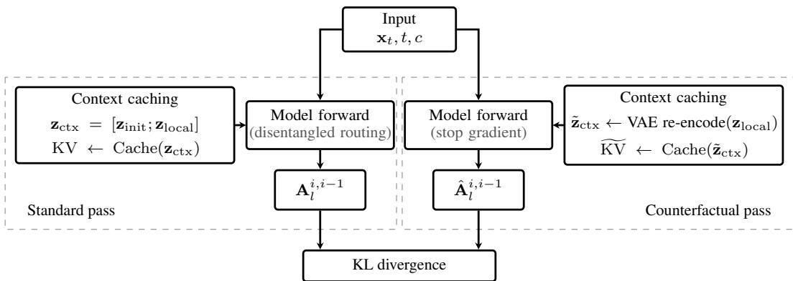  
Figure A1: Computation flow of the motion-disentangling regularization. The standard and counterfactual passes share the same input and model parameters but use different context caches. Adjacent-frame attention maps from the two passes are aligned by KL divergence, with the counterfactual map serving as a stop-gradient target.

The visualization grounds three design choices in our identification protocol: (i) Percentilethresholding selection. The vast majority of cells exhibit the canonical local-diagonal pattern of Working Heads, with only a small subset showing concentrated initial-frame attention. Our top-20% percentile threshold aligns with this sparse pattern. (ii) Layer-localization. Anchor heads concentrate most strongly in specific layers (most notably layers 18 and 22–24), making the partition structurally identifiable from a small calibration sample. (iii) Cross-model consistency. The anchor cluster appears in nearly the same layers for Self-Forcing and Causal-Forcing despite different ODEinitialization checkpoints, suggesting the partition is a structural property of the pretrained Wan2.1 backbone rather than an artifact of either AR training pipeline. Applying the same identification procedure to the distilled Self-Forcing and Causal-Forcing models yields anchor sets with an IoU of 0.78.

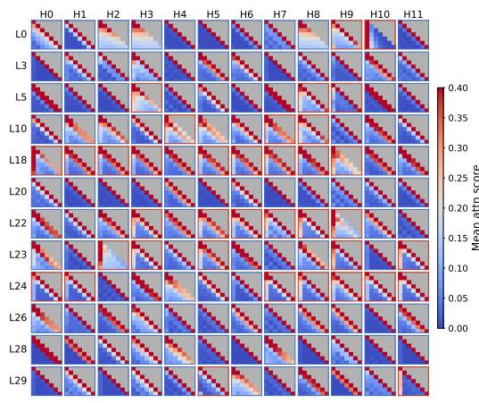  
(a) Self-Forcing

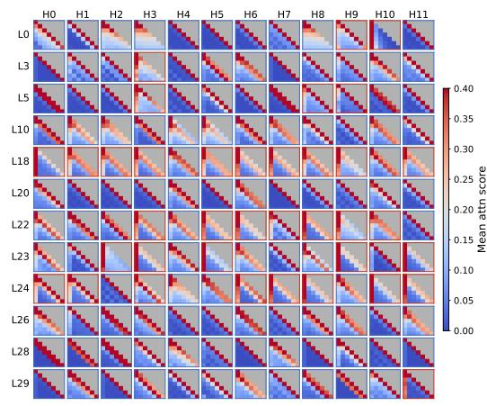  
(b) Causal-Forcing  
Figure A2: Representative per-(layer, head) attention map grid. Each cell shows the chunk-bychunk cross-frame attention pattern of one (layer, head) pair throughout a 7-step AR rollout, averaged over 50 MovieGenBench prompts and all diffusion timesteps. Red-bordered cells are Anchor Heads (top-20% by initial-frame attention score, $p = 8 0 )$ ; blue-bordered cells are Working Heads. The eight heads visualized in Fig. 2b are sampled from this grid; the representative visualization confirms that the anchor/working partition is sparse, layer-localized (notably layers 18 and 22–24), and consistent across both base models. Zoom in for details.

Per-head attention on additional baselines. Fig. A3 extends Fig. 2b with the same per-head visualization for the second sliding-window base model Causal-Forcing and two existing sink-based methods, LongLive and Rolling-Forcing. All three exhibit the same anchor/working head partition observed on Self-Forcing, despite the sink-based methods using a 14-chunk rollout (vs. 7 in the sliding-window models). This supports our claim that the partition is structural and persists across distillation paradigms.

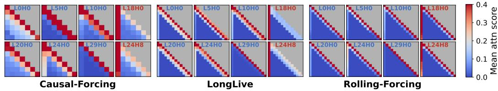  
Figure A3: Per-head attention distribution for additional baselines. Same head selection and rendering as Fig. 2b, applied to Causal-Forcing (sliding-window) and the two sink-based methods LongLive and Rolling-Forcing. The same anchor/working partition appears in all three distillation pipelines.

Sensitivity to prompt count. To test the sensitivity of anchor-head identification to the size of the identification prompt set, we re-apply $p _ { 8 0 }$ thresholding on random subsets of size $K \in$ {10, 25, 50, 100, 250, 500} drawn from a 1000-prompt MovieGenBench [32] pool and measure IoU against the set identified using all 1000 prompts in this pool (averaged across 5 random draws per K). The recovered Anchor Heads set is highly stable: mean IoU $\ge \bar { 0 . 9 7 }$ across all K, reaching exact agreement from $K { = } 5 0 0$ , with a constant set size $| { \mathcal { A } } | { = } 7 2$ at every K (Fig. A4). The identified set remains stable even with 10 prompts in this experiment.

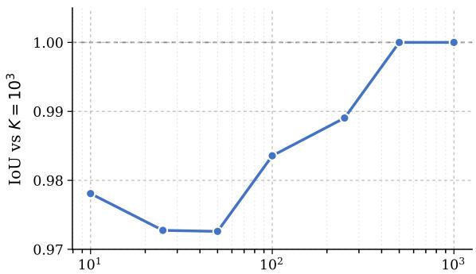

<table><tr><td>K IoU with</td><td> $K { = } 1 0 ^ { 3 }$   $\lvert A _ { K } \rvert$ </td></tr><tr><td>10 0.978</td><td>72</td></tr><tr><td>25 0.973</td><td>72</td></tr><tr><td>50 0.973</td><td>72</td></tr><tr><td>100 0.984</td><td>72</td></tr><tr><td>250 0.989</td><td>72</td></tr><tr><td>500 1.000</td><td>72</td></tr><tr><td>1000 1.000 (ref)</td><td>72</td></tr></table>

Number of identification prompts (K)  
Figure A4: IoU of the $p _ { 8 0 } \cdot$ -thresholded Anchor Heads set $\boldsymbol { \mathcal { A } } _ { K }$ identified from K random prompts versus the reference $\mathcal { A } _ { 1 0 ^ { 3 } }$ . Set size $| \mathcal { A } _ { K } | = 7 2$ at every K, out of 360 total attention heads.

## A.4 Inference Setup

At inference time, we use 4-step denoising with timesteps [1000, 750, 500, 250] and timestep shift 5.0, and use the EMA generator weights for all evaluations. For long-horizon generation, the AR rollout extends autoregressively over the desired horizon (7 chunks for the 5-second training horizon; 42 and 84 chunks for 30-second and 1-minute evaluation, respectively), using the rolling KV cache of the base model.

## A.5 Training Overhead

We measure the mean forward-and-backward time separately for critic and generator passes. Table A1 also reports the amortized time under the 1:5 generator-to-critic update schedule.

Table A1: Training overhead. Critic and generator columns report mean forward-and-backward time per pass. The amortized time is $( 5 t _ { \mathrm { c r i t i c } } + t _ { \mathrm { g e n } } ) / 5$ under the 1:5 generator-to-critic update schedule.
<table><tr><td>Method</td><td>Critic (s)</td><td>Generator (s)</td><td>Gen:critic</td><td>Amortized (s)</td></tr><tr><td>+ Frame Sink</td><td>7.0</td><td>16.1</td><td>1:5</td><td>10.2</td></tr><tr><td>+Ours</td><td>7.0</td><td>18.8</td><td>1:5</td><td>10.8 (+5%)</td></tr></table>

The additional generator-side cost is amortized over five critic updates per generator update; the measured critic-pass time is unchanged. The additional 2.7s per generator update comprises approximately 1.6s for VAE re-encoding, 0.9s for the counterfactual forward, and 0.2s for motion-proxy computation and regularization backward.

## B Additional Quantitative Results

## B.1 Generation at the Training Horizon

Table A2 compares Self-Forcing and its two variants at the 5s training horizon, without temporal extrapolation. Frame Sink reduces Dynamic Degree from 65.00 to 37.00. Disen-Forcing increases it to 74.00 while preserving comparable scores on the other five dimensions.

Table A2: Six-dimensional VBench results at the 5s training horizon. All scores are percentages; higher is better.
<table><tr><td>Method</td><td>Subject</td><td>Background</td><td>Smoothness</td><td>Dynamic</td><td>Aesthetic</td><td>Imaging</td></tr><tr><td>Self-Forcing</td><td>93.81</td><td>94.59</td><td>98.29</td><td>65.00</td><td>63.33</td><td>69.53</td></tr><tr><td>+ Frame Sink</td><td>96.17</td><td>95.72</td><td>98.94</td><td>37.00</td><td>64.19</td><td>69.90</td></tr><tr><td>+ Disen-Forcing</td><td>94.17</td><td>94.79</td><td>98.23</td><td>74.00</td><td>63.87</td><td>70.27</td></tr></table>

## B.2 VideoScore Evaluation

We complement VBench-Long with VideoScore [15], a video evaluator trained on human quality ratings. For each base model, we compare the original model, its Frame Sink variant, and its Disen-Forcing variant on 30s generations for the 200 evaluation prompts. Fig. A5 reports preference rates across five dimensions. Disen-Forcing has a higher preference rate than Frame Sink in every dimension on both base models. For Causal-Forcing, the base model has the highest dynamic-degree preference rate, while Disen-Forcing leads in the other four dimensions.

## C Additional Qualitative Results

## C.1 Anchor Head Masking Experiment

Masking protocol. To probe the functional role of Anchor Heads during inference, we run the trained Self-Forcing checkpoint with three masking conditions: (1) no mask (the unmodified rollout), (2) random mask (zero out the keys/values of a randomly selected 20% of heads in each layer, excluding identified anchor heads), and (3) anchor mask (zero out the keys/values of the heads identified as anchors in A (Section 4.1)). To isolate the role of anchor heads in the long-range anti-drift mechanism rather than in within-chunk denoising, masking is applied only to the earliestresident KV frame in the sliding window, and only for AR rollout steps beyond the first chunk. All other settings, including the prompt and random seed, are identical across conditions.

As shown in Fig. A6, randomly masking working heads produces videos with similar visual quality to the no-mask baseline, while anchor masking induces visible appearance drift—color shifts, identity inconsistency, and scene degradation—even within the 5-second training horizon. This pattern complements the quantitative VBench-Long results in Fig. 3 and confirms that the anti-drift role is specifically carried by the sparse anchor-head subset rather than by attention heads in general.

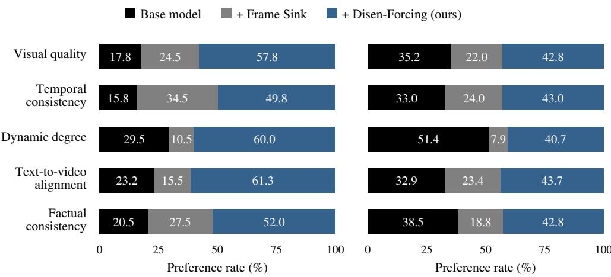  
(a) Self-Forcing  
(b) Causal-Forcing

Figure A5: VideoScore preference rates on 30s generations. Percentages compare the three methods within each base model and evaluation dimension.  
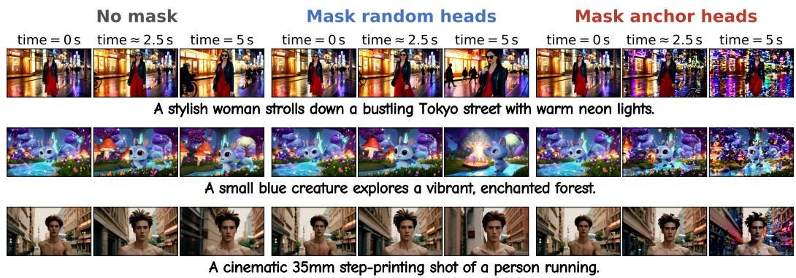  
Figure A6: Qualitative anchor-head masking comparison across prompts. Each row shows one prompt rendered under three masking conditions: no mask (baseline, left block), mask random heads (control, middle block, blue), and mask anchor heads (treatment, right block, red). Each block displays three frames spanning the 5-second clip. A brief prompt description is shown below each row. Random masking preserves visual fidelity; anchor masking produces visible identity, color, and scene drift, confirming that long-range anti-drift is carried specifically by the anchor-head subset.

## C.2 More Qualitative Long-Video Generation Results

We provide additional 30s and 1min qualitative comparisons across the baselines from main paper. Figs. A7 and A8 cover the 1-minute setting, and Figs. A9 and A10 cover the 30-second setting. Across prompts, sliding-window methods drift visibly past the training horizon, sink-based methods preserve appearance but suppress motion, and +Disen-Forcing maintains both consistency and motion dynamics.

## D Discussion: When Does Head-Type Separation Emerge?

We investigate when the anchor/working head-type partition arises by measuring the same temporal attention distribution in pretrained bidirectional Wan backbones, prior to any causal AR adaptation or distillation.

The partition is a structural property of the pretrained backbone. As shown in Fig. A11, the bidirectional Wan2.1-1.3B, Wan2.1-14B, and Wan2.2-TI2V-5B base models [40] all exhibit the same characteristic pattern: the vast majority of heads attend predominantly to the current frame, while a sparse, stable subset shows concentrated attention to the initial frame. This is consistent with the pattern observed in the distilled AR-VDM variants of Fig. 2a. The anchor/working partition is therefore not induced by causal AR training or DMD distillation — it is inherited from the pretrained backbone and further reinforced during distillation.

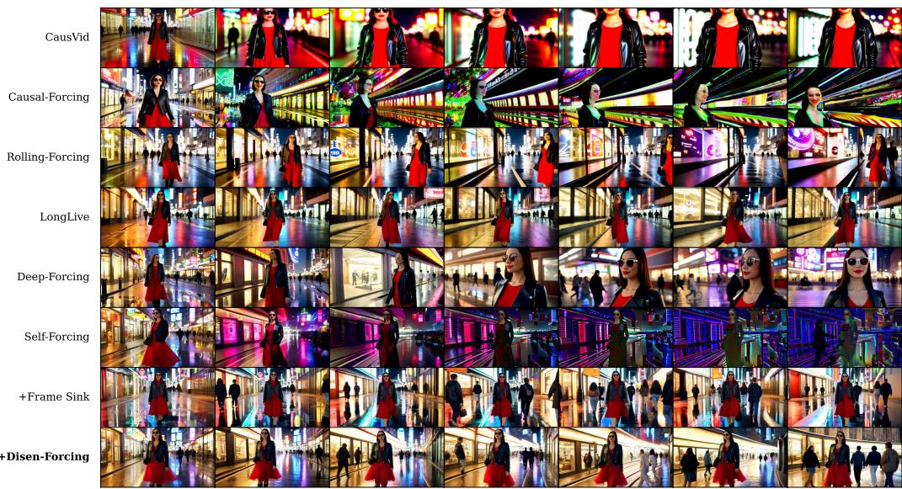  
A stylish woman walks down a Tokyo street with warm glowing neon lights.

Figure A7: 1-minute qualitative comparison.  
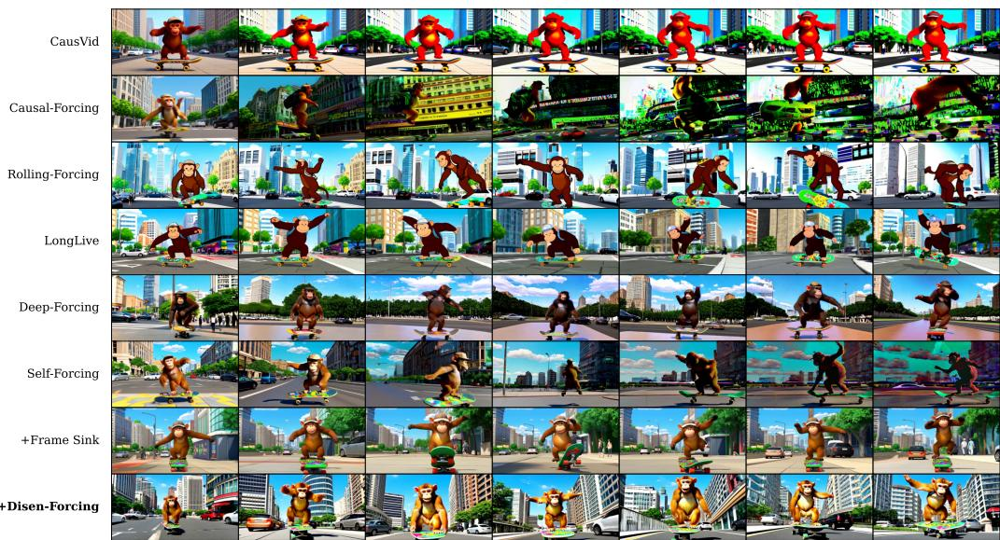  
A chimp on the sidewalk doing a backflip on a skateboard.  
Figure A8: 1-minute qualitative comparison.

The pattern scales to larger models. The same structural separation is observed in the 14B parameter variant of Wan2.1 (Fig. A11, middle): a sparse subset of heads shows elevated initial-frame attention at both the earliest layers (0–2) and the deepest layers (28, 32, 36–38), while the majority attend predominantly to the current frame. The pattern further transfers to Wan2.2-TI2V-5B (Fig. A11,

A gibbon swinging through the dense rainforest canopy in slow motion.

time = 0 s  
time = 15 s  
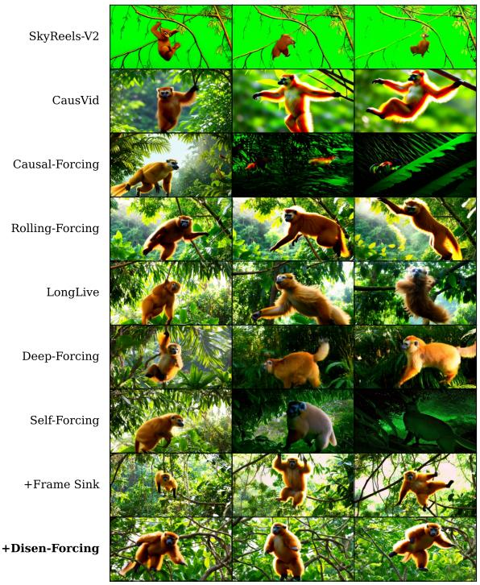

time = 0 s  
time = 30 s  
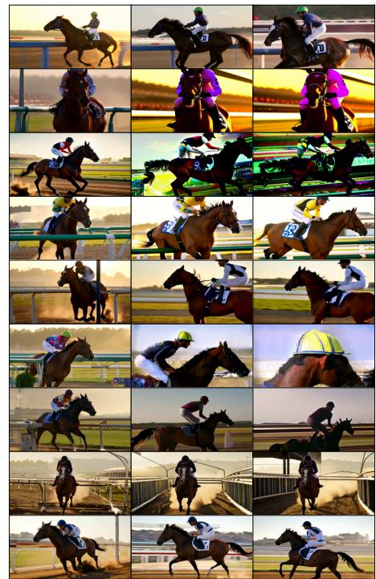  
A horse accelerating out of the starting gate at the beginning of a race.

Figure A9: 30-second qualitative comparison.

right) despite substantial architectural changes (per-token time modulation, unified cross-attention 4×16×16 high-compression VAE). This suggests that the head-type partition is a robust property across both model scales and Wan generations, and that Disen-Forcing's disentangled routing and regularization can in principle be applied to more powerful AR-VDMs in future work.

The partition extends beyond Wan. We additionally analyze HunyuanVideo-13B [24] and CogVideoX-5B [48]. Table A3 summarizes two signatures of the partition: the fraction of heads attending more to the current frame than to the initial frames, and the ratio of mean initial-frame attention mass between anchor and working heads. We identify anchor heads using the same initialframe attention criterion. Both models exhibit a majority of locally attending heads and stronger initial-frame attention in the anchor subset (2.4–3.6×), consistent with the Wan backbones.

Table A3: Head partition across pretrained backbones. Local-head fraction is the percentage of heads with greater attention to the current frame than to the initial frames. Attention ratio is the mean initial-frame attention mass of anchor heads divided by that of working heads.
<table><tr><td>Backbone</td><td>Local-head fraction (%)</td><td>Attention ratio</td></tr><tr><td>Wan2.1-1.3B</td><td>76.7</td><td>4.2×</td></tr><tr><td>Wan2.1-14B</td><td>69.2</td><td>3.8×</td></tr><tr><td>Wan2.2-TI2V-5B</td><td>73.6</td><td>7.4×</td></tr><tr><td>HunyuanVideo-13B</td><td>83.3</td><td>3.6×</td></tr><tr><td>CogVideoX-5B</td><td>77.3</td><td>2.4×</td></tr></table>

AR distillation strengthens anchor-head attention to initial frames. Comparing the ODEinitialization and post-DMD panels in Fig. 2a reveals a consistent trend: DMD distillation increases the attention score of anchor heads to the initial frames. For Self-Forcing, the mean anchor-head initial-frame attention rises from 0.121 (ODE init) to 0.150 after DMD (+24%). For Causal-Forcing, which starts from a stronger ODE initialization, the anchor attention is already higher (0.185) and the gain from distillation is correspondingly smaller (0.194, +5%). This suggests that AR training progressively sharpens the initial-frame anchoring role of the sparse anchor-head subset to support better streaming generation.

time = 0 s  
time = 15 s  
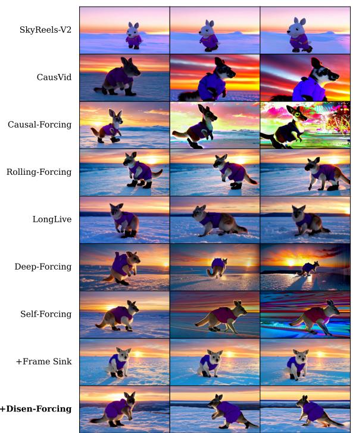  
time = 30 s  
An adorable kangaroo wearing purple overalls strolls in Antarctica at sunset.

time = 0 s  
time = 15 s  
time = 30 s  
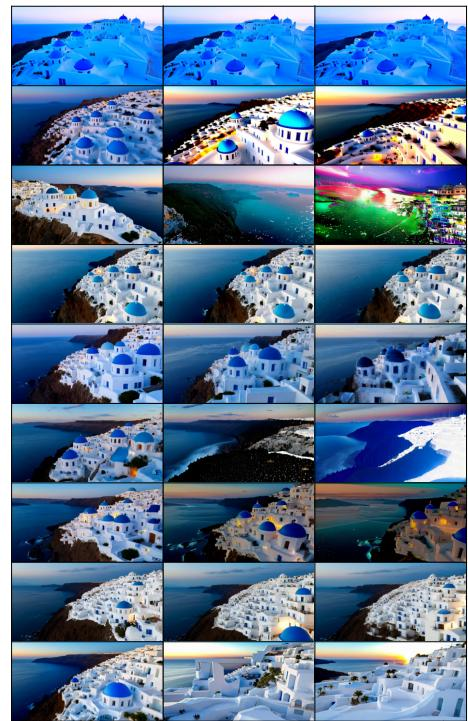  
Aerial view of Santorini during the blue hour with white Cycladic buildings.

Figure A10: 30-second qualitative comparison.  
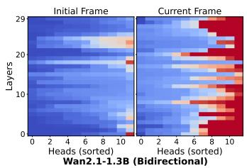

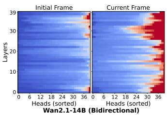

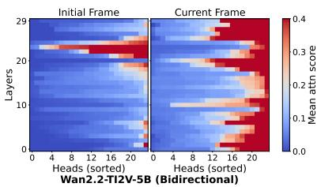  
Figure A11: Per-head temporal attention patterns in bidirectional Wan base models. Attention scores averaged over 50 prompts and diffusion timesteps for the pretrained bidirectional Wan2.1-1.3B (left, 30 layers, 12 heads), Wan2.1-14B (middle, 40 layers, 40 heads), and Wan2.2-TI2V-5B (right, 30 layers, 24 heads), before any causal AR training or distillation. All three models exhibit the same structural pattern observed in the AR-VDM variants of Fig. 2a: most heads attend predominantly to the current frame, while a sparse subset at specific layers shows concentrated attention to the initial frame.

## E Ablation Studies

Removing adjacent matching increases Dynamic Degree, while all five other dimensions decrease;   
removing VAE re-encoding increases $\Delta _ { \mathrm { D r i f t } } ^ { \mathrm { Q } }$ from 4.03 to 4.85.

Table A4: Full ablation results. All six VBench-Long dimensions, their mean (Total), and quality drift for the variants in Table 2, the regularization start step, regularizer implementation, and sink length.
<table><tr><td rowspan="2">Setting</td><td colspan="7">VBench-Long Scores ↑</td><td rowspan="2"> $\Delta _ { \mathrm { D r i f t } } ^ { \mathrm { Q } } \downarrow$ </td></tr><tr><td></td><td></td><td>Total Subject Background Smooth Dynamic Aesthetic Imaging</td><td></td><td></td><td></td><td></td></tr><tr><td colspan="9">Context routing and regularization</td></tr><tr><td>Self-Forcing + Frame Sink</td><td>76.20</td><td>97.25</td><td>95.81</td><td>98.33</td><td>34.69</td><td>60.34</td><td>70.76</td><td>4.40</td></tr><tr><td>+ Routing</td><td>79.17</td><td>96.93</td><td>95.97</td><td>98.48</td><td>52.56</td><td>61.24</td><td>69.82</td><td>4.08</td></tr><tr><td>+ Routing &amp;  $\mathcal { L } _ { \mathrm { r e g } }$ </td><td>82.45</td><td>95.96</td><td>95.17</td><td>97.36</td><td>77.19</td><td>60.06</td><td>68.97</td><td>4.39</td></tr><tr><td colspan="9">Impact of τp</td></tr><tr><td>p=70</td><td>78.99</td><td>97.70</td><td>96.32</td><td>98.59</td><td>48.22</td><td>62.22</td><td>70.90</td><td>3.93</td></tr><tr><td>p=80</td><td>82.45</td><td>95.96</td><td>95.17</td><td>97.36</td><td>77.19</td><td>60.06</td><td>68.97</td><td>4.39</td></tr><tr><td>p=90</td><td>83.45</td><td>95.64</td><td>94.91</td><td>97.28</td><td>83.47</td><td>60.86</td><td>68.57</td><td>4.77</td></tr><tr><td colspan="9">Anchor-head set A selection</td></tr><tr><td>Identified anchor heads</td><td>82.38</td><td>96.52</td><td>95.50</td><td>98.13</td><td>73.12</td><td>60.95</td><td>70.05</td><td>4.03</td></tr><tr><td>Layer-matched random heads</td><td>79.20</td><td>97.45</td><td>96.09</td><td>98.47</td><td>51.16</td><td>61.94</td><td>70.08</td><td>4.51</td></tr><tr><td>Globally random heads</td><td>76.96</td><td>98.15</td><td>97.04</td><td>98.88</td><td>34.69</td><td>62.35</td><td>70.67</td><td>3.25</td></tr><tr><td colspan="9">Regularization layer S selection</td></tr><tr><td>Layer 20</td><td>82.35</td><td>96.20</td><td>95.22</td><td>97.85</td><td>75.66</td><td>59.57</td><td>69.59</td><td>5.01</td></tr><tr><td>Layer 26</td><td>82.38</td><td>96.52</td><td>95.50</td><td>98.13</td><td>73.12</td><td>60.95</td><td>70.05</td><td>4.03</td></tr><tr><td>Layer 27</td><td>81.18</td><td>96.68</td><td>95.76</td><td>97.85</td><td>65.56</td><td>61.55</td><td>69.69</td><td>4.26</td></tr><tr><td>Layer 28</td><td>80.88</td><td>96.48</td><td>95.56</td><td>97.95</td><td>64.81</td><td>61.40</td><td>69.06</td><td>4.18</td></tr><tr><td>Layers 20, 26, 27, 28</td><td>82.72</td><td>95.78</td><td>95.10</td><td>97.43</td><td>78.38</td><td>60.68</td><td>68.92</td><td>4.83</td></tr><tr><td colspan="9">Impact of λreg</td></tr><tr><td>λreg = 0.001</td><td>80.22</td><td>97.07</td><td>95.94</td><td>98.31</td><td>58.47</td><td>61.33</td><td>70.21</td><td>4.72</td></tr><tr><td>λreg = 0.002</td><td>82.38</td><td>96.52</td><td>95.50</td><td>98.13</td><td>73.12</td><td>60.95</td><td>70.05</td><td>4.03</td></tr><tr><td>λreg = 0.005</td><td>82.53</td><td>96.24</td><td>95.46</td><td>97.92</td><td>75.97</td><td>60.69</td><td>68.90</td><td>4.47</td></tr><tr><td colspan="9">Regularization start step (λreg=0.005)</td></tr><tr><td>0 50</td><td>83.48</td><td>95.41</td><td>94.82 95.55</td><td>97.22</td><td>85.25</td><td>59.43</td><td>68.78 69.67</td><td>4.93 4.51</td></tr><tr><td>100</td><td>80.39</td><td>96.58 96.24</td><td>95.46</td><td>98.04 97.92</td><td>61.91 75.97</td><td>60.60 60.69</td><td>68.90</td><td>4.47</td></tr><tr><td>150</td><td>82.53</td><td>96.29</td><td>95.33</td><td>97.93</td><td></td><td>60.60</td><td>68.83</td><td>4.86</td></tr><tr><td>200</td><td>81.94</td><td></td><td></td><td></td><td>72.66</td><td></td><td></td><td></td></tr><tr><td></td><td>80.52</td><td>96.89</td><td>95.83</td><td>98.36</td><td>61.06</td><td>61.34</td><td>69.64</td><td>4.32</td></tr><tr><td colspan="9">Regularizer implementation</td></tr><tr><td>Full configuration</td><td>82.38</td><td>96.52</td><td>95.50</td><td>98.13</td><td>73.12</td><td>60.95</td><td>70.05</td><td>4.03</td></tr><tr><td>w/o adjacent matching</td><td>83.33</td><td>96.14</td><td>95.27</td><td>97.64</td><td>81.16</td><td>60.64</td><td>69.11</td><td>4.19</td></tr><tr><td>w/o VÅE re-encoding</td><td>82.35</td><td>96.09</td><td>95.21</td><td>97.89</td><td>75.53</td><td>60.02</td><td>69.37</td><td>4.85</td></tr><tr><td colspan="9">Sink length</td></tr><tr><td>1</td><td>82.74</td><td>95.09</td><td>94.54</td><td>97.34</td><td>82.25</td><td>58.82</td><td>68.40</td><td>5.09</td></tr><tr><td>3 6</td><td>82.38</td><td>96.52</td><td>95.50</td><td>98.13</td><td>73.12</td><td>60.95</td><td>70.05</td><td>4.03</td></tr><tr><td></td><td>80.75</td><td>96.80</td><td>95.81</td><td>98.12</td><td>63.81</td><td>60.82</td><td>69.13</td><td>4.59</td></tr></table>

## E.1 Selecting the motion-proxy layer

Our motion-disentangling regularization (Section 4.2) uses cross-frame attention maps from Working Heads-only layers. We consider layers 20, 26, 27, and 28, which contain no identified anchor heads. We evaluate each candidate layer with a label-free reconstruction criterion: we chain its cross-frame attention argmax across frames, warp the reference frame along the resulting correspondence, and measure $L _ { 1 }$ error against the decoded next frame. Normalizing by a no-motion (identity-warp) baseline yields a relative score: below 1 means the correspondence reconstructs inter-frame motion better than copying the frame. Scores are averaged over 7 motion prompts × 2 seeds.

Among the four candidate layers, layer 26 attains the lowest reconstruction error (Fig. A12, left). We use layer 26 for motion-disentangling regularization. Qualitative point tracks obtained by chaining cross-frame attention argmax through the rollout illustrate subject motion and camera-induced background motion (Fig. A12, right). The quantitative regularization-layer ablation is reported in Table 2.

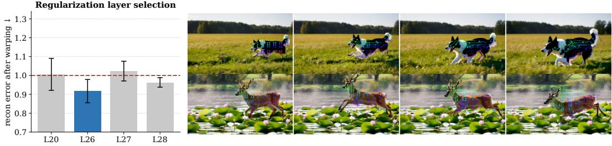  
Figure A12: Reconstruction-based motion-proxy layer analysis. Left: reconstruction error for candidate layers 20, 26, 27, and 28 from warping the reference frame along cross-frame attention chains, normalized to a no-motion baseline (mean±std over motion prompts×seeds); layer 26 has the lowest error. Right: example attention-based point tracks on a running dog (top) and a leaping deer (bottom).

## F Discussions

Limitations and Future Work Disen-Forcing operates as a distillation-time plug-in and inherits the pretraining biases of the base model; it does not address artifacts originating from the bidirectional teacher itself. Its performance is further limited by the ODE initialization. The motion-disentangling regularization also requires a counterfactual forward pass during training, introducing a small per-step cost on the generator side (Table A1). Several directions remain open. First, extending Disen-Forcing to the Wan2.1-14B and Wan2.2-TI2V-5B backbones, where the same anchor/working partition emerges (Fig. A11), and examining whether the routing principle generalizes to image-conditioned long-horizon generation. Second, while our instantiation builds on DMD distillation, extending the framework to other distillation objectives such as SiD-style losses [55] or GAN-based objectives [12] is a natural next step. Finally, it would be worthwhile to investigate whether disentangling semantic anchoring from motion can also benefit the ODE initialization stage itself.

Broader Impacts Disen-Forcing improves the visual quality and long-range consistency of longhorizon video generation, which has applications in education, accessibility, and creative tools, but shares standard dual-use considerations of generative video models (e.g., misuse for synthetic media). The method is a fine-tuning plug-in on existing public AR-VDMs and does not in itself introduce new generative capability beyond those baselines.