# EO-Jev: Decision Model for Earth Observation

Mohamed Atef Abouelhadid1,†, Diaa Addeen Abuhani1,2,†, Muhammad Akhtar Munir1, Fahad Shahbaz Khan1,4, Salman Khan1,3,∗

1Mohamed Bin Zayed University of Artificial Intelligence, 2Massachusetts Institute of Technology,

3Australian National University, 4Linköping University Sweden

∗Corresponding author, †Equal Contribution

Earth observation (EO) workflows require selecting among known outcomes, estimating confidence, and processing large volumes of imagery. Generative vision-language models can address these tasks, but autoregressive decoding is computationally costly and their confidence estimates are unreliable. Decision models ofer an alternative, returning probabilities over candidate answers in a single forward pass. However, their accuracy, calibration, and transfer across EO tasks remain insuficiently understood. We investigate these properties through a diagnostic study of d3-flash (8.4B parameters) across 30 settings from 23 public EO benchmarks. We find that compositional reasoning transfers well and calibration improves over its Qwen3.5-9B backbone on 24 settings, while counting, change quantification, damage grading, and absent-object recognition remain challenging. To address these limitations, we adapt d3-flash through low-rank fine-tuning on public EO training splits, producing EO-Jev. EO-Jev improves significantly over d3-flash on 26 of 30 settings and matches or exceeds specialist references on 20 of 28. It also achieves an average gain of 8.0 points across 12 held-out settings and lower expected calibration error than specialists on 21 of 28 settings. These improvements come at a modest cost of 1.8 points in general decision performance. Our results demonstrate the potential of adapting general decision models into competitive EO generalists while highlighting persistent challenges in quantitative perception, option-order consistency, and calibration under distribution shift.

Date: Oct 30, 2026 Project Page: mbzuai-oryx.github.io/EO-Jev GitHub: mbzuai-oryx/EO-Jev Correspondence: salman.khan@mbzuai.ac.ae

Mohamed bin Zayed University of Artificial Intelligence

## 1 Introduction

Vision-language models (VLMs) are increasingly used as general-purpose interfaces to EO imagery, answering questions about land use, objects, change and disasters that previously required a dedicated model per task (Kuckreja et al., 2023; Soni et al., 2024; Pang et al., 2024; Irvin et al., 2024; Shabbir et al., 2025). A new class of models pushes this interface in a diferent direction. Decision models, popularized by Jev (TypeSafe AI, 2026) and its open counterparts (AutoTrust, 2026; vLLM Semantic Router Team, 2026), do not generate text. Rather, given a state, a question and a set of options, they return a probability distribution over the options in a single forward pass. For EO applications such as damage triage, monitoring and alerting, this is an attractive capability as an answer that comes with a trustworthy confidence can be thresholded, aggregated and audited, as illustrated in Figure 1, whereas free-form text generated auto-regressively cannot.

Yet no general decision model has been evaluated on remote-sensing data. The public decision-model leaderboards do not contain EO imagery (Decision Index contributors, 2026). The closest prior work is RSJEV (Si et al., 2026), which applies a one-pass decision readout to scene classification using Qwen3.5-0.8B and reports encouraging results on UC Merced, AID, and NWPU-RESISC45. However, it trains and evaluates separately on each benchmark, and its results are not directly comparable with out-of-domain evaluations. Moreover, an independent study shows that letter-readout classifiers can collapse across label vocabularies and confidently misclassify unseen classes (Chen et al., 2026). Therefore, it remains unclear whether a general decision model can perform reliably across EO tasks, how it compares with specialist VLMs, and whether its confidence estimates can be trusted. We address these questions across ten capability groups, with out-of-domain evaluation, EO specialist baselines, and calibration analysis.

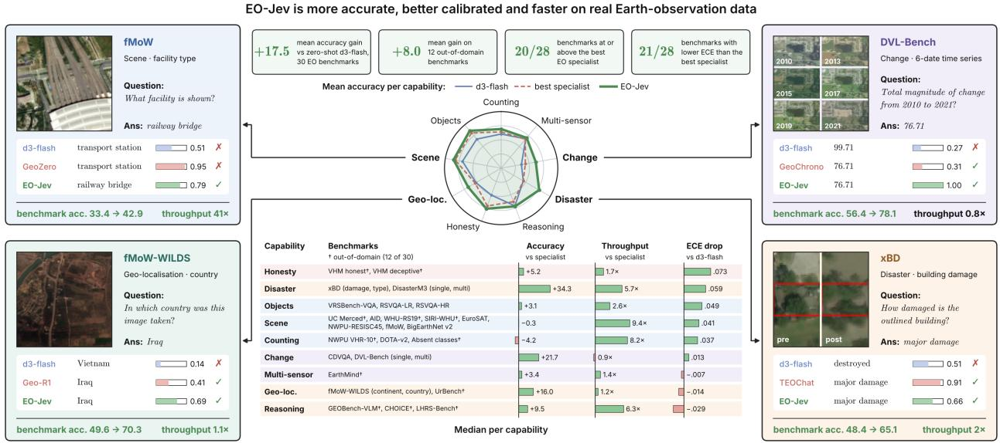  
Figure 1 EO-Jev is more accurate, better calibrated and faster. Centre: mean accuracy per capability (30 benchmarks). Corners: real questions with each model’s answer and confidence; footers give benchmark accuracy (specialist → EO-Jev) and throughput vs. the specialist. Bottom: per-capability medians of accuracy gain and throughput vs. the best specialist, and ECE drop vs. d3-flash; green = better, red = worse.

In this study, we first conduct a diagnostic study of d3-flash (vLLM Semantic Router Team, 2026), an open state-of-the-art 8.4B-parameter decision model derived from Qwen3.5-9B (Qwen Team, 2026). We construct 30 closed-form evaluation settings from 23 public benchmarks, covering scene recognition (Yang and Newsam, 2010; Xia et al., 2017; Cheng et al., 2017; Helber et al., 2019), multi-label land cover (Clasen et al., 2024), visual question answering (Lobry et al., 2020; Li et al., 2024), counting (Xia et al., 2018; Cheng et al., 2014), change and temporal reasoning (Yuan et al., 2022; Xuan et al., 2025), disaster assessment (Gupta et al., 2019; Wang et al., 2025b), geo-localization (Christie et al., 2018; Zhou et al., 2024), complex reasoning (An et al., 2024; Muhtar et al., 2024; Danish et al., 2024), and questions about absent objects (Pang et al., 2024). The evaluation primarily focuses on optical aerial/satellite imagery. To reduce diferences arising from benchmark protocols, we evaluate d3-flash, its Qwen3.5-9B backbone, and selected open-weight EO specialist baselines on identical images, questions, and candidate answers. The backbone uses a comparable answer-code readout, allowing us to examine the efects of decision training under a common evaluation interface.

We then investigate how EO-specific supervision changes the decision model capabilities identified by this analysis. Using low-rank adaptation on public EO training splits, together with general decision-data replay, we obtain EO-Jev. The name denotes an EO adaptation of the Jev-style decision interface i.e., a single model that returns probabilities over task-specific candidate answers without autoregressive decoding. We distinguish evaluation settings whose datasets contribute training data during adaptation from settings whose datasets are held out entirely from that stage. This allows us to assess improvements within the adaptation datasets alongside transfer to other datasets. We also examine calibration, option-order sensitivity, inference cost, and retention of general decision capabilities to avoid catastrophic forgetting.

The study addresses four main questions. (RQ1) Which EO capabilities transfer from a general-purpose decision model without EO-specific adaptation, and how does its performance compare with EO specialists? (RQ2) How does EO supervision afect performance, and do its benefits extend to datasets held out from adaptation? (RQ3) How do calibration and inference cost compare with the backbone and specialist baselines? (RQ4) Which limitations persist after decision model adaptation to EO tasks?

Our results show that d3-flash performs well on several compositional EO reasoning benchmarks and achieves lower expected calibration error than its backbone on 80% of the cases (24 out of 30 settings). Its principal weaknesses are counting, change quantification, damage grading, and recognizing absent objects. EO adaptation improves performance significantly on 26 settings (86.7% cases), with mean gains of +23.8 percentage points on settings from datasets used during adaptation and +8.0 points on settings from held-out datasets. EO-Jev achieves scores at or above the evaluated specialist reference on 20 of 28 settings and lower expected calibration error on 21 of 28. These improvements are accompanied by a 1.8 point decrease on the general Decision Index, regressions on two reasoning benchmarks, and increased calibration error on some settings. Our overall results characterize the benefits and limitations of EO adaptation while identifying quantitative perception, option-order consistency, and calibration under distribution shift as priorities for further study.

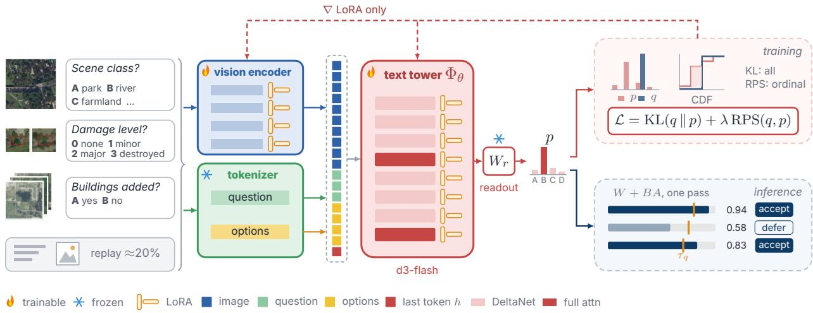  
Figure 2 EO-Jev Architecture and Training. EO images (single images, pre/post pairs or time series) are paired with typed questions with predefined answers. General decision data is replayed in 20% of each batch. The vision encoder and text tower $\Phi _ { \theta }$ process the images and questions, respectively. A frozen readout $W _ { r }$ converts the final hidden state h into option probabilities p. Training: LoRA adapters in the vision encoder and text tower are optimized using KL divergence against target distributions q, with an additional ranked probability score (RPS) on ordinal questions. Inference: merged adapters (W + BA) enable single-pass predictions at d3-flash cost. Answers are accepted when confidence exceeds a per-question threshold $\tau _ { q }$ and otherwise deferred to an analyst. Examples and probabilities are illustrative.

## 2 Evaluation Setup

Models. d3-flash (vLLM Semantic Router Team, 2026) is the 8B member of vLLM Semantic Router’s Decision 3.0 family. It has 8.39B parameters including a 7.94B text tower, a 0.46B vision tower and a 1.04M-parameter readout. It is built on Qwen3.5-9B, a 32-layer hybrid of Gated DeltaNet and full-attention layers. Instead of a language-modelling head, it applies a 255 × 4096 linear readout to the last prompt token, producing a distribution over up to 255 answer codes. A comparison of its weights with Qwen3.5-9B shows that the vision tower is frozen, the text tower fully fine-tuned, and the full-attention layers made bidirectional over the prompt. As a same-backbone control, we run Qwen3.5-9B through the same runtime with an identical prompt, image processing and answer codes, using its own language-head rows as the readout. Tokenizer, chat template and image processor are byte-identical, so diferences between the two isolate decision training. For each benchmark, we select the open-weight EO specialist with the highest reported performance on the corresponding dataset (Table 2). Each selected specialist is evaluated on identical images, question wording and lettered options. We score both its option probabilities and generated answers, reporting the better result.

EO-Jev. Figure 2 summarizes how we adapt d3-flash to Earth observation. Training data (left): EO-Jev is trained on EO decision questions built only from public training splits, covering six families: scene and land-use labels, visual question answering, object counting, multi-temporal change, building damage and disaster type, and geo-localization. Every training image is checked against every evaluation image by perceptual hash, and fMoW training and evaluation images are additionally separated in time and space. To preserve general decision skills, about a fifth of every batch replays general decision data (text-only decision questions and natural-image multiple-choice questions) with d3-flash’s own probabilities as targets. Model (middle): EO-Jev adds low-rank adapters (LoRA) to the vision blocks (at a lower learning rate), the vision merger and the text tower of d3-flash, and keeps its 255-code readout. The loss matches the target distribution with a KL term, plus a ranked probability score for ordinal questions. Training runs for 20,000 steps, after which the adapters are merged into the BF16 weights, so EO-Jev has the same architecture and inference cost as d3-flash. Decisions (right): at inference, each typed question returns a probability distribution over its options in a single forward pass, and a per-question threshold decides whether to accept the answer or defer it to an analyst or a specialist model. Section 8 lists the training sources.

Benchmarks and domains. The 30 evaluation settings fall into ten capability groups (Table 1). Multiplechoice benchmarks are used natively. Yes/no questions become binary decisions, and ordinal targets such as damage levels become ordered-level questions. Multi-select items are scored by exact-set match. We exclude SAR inputs throughout. Each setting is labelled in-domain if EO-Jev was trained on other images from the same dataset, and out-of-domain if no image from that dataset was used. In total, 18 settings are in-domain and 12 out-of-domain. Every training image was compared with every evaluation image by perceptual hash, so no evaluation image appears in training. For fMoW-WILDS, training and evaluation images are additionally separated in time and space.

Metrics. We report accuracy, with three exceptions: exact-set match for multi-select settings, strict CircularEval accuracy for LHRS-Bench (correct under all four option orders), and correct abstention for VHM deceptive questions. Calibration is measured by expected calibration error (ECE) with 15 equal-width bins on the top answer’s probability. Diferences between EO-Jev and d3-flash are tested with a paired 95% bootstrap over images. As a retention check, we also report the general (non-EO) Decision Index (Decision Index contributors, 2026).

## 3 How Far Does a General Decision Model Reach on EO?

RQ1

Which EO capabilities transfer from a general-purpose decision model without EO-specific adaptation, and how does its performance compare with EO specialists?

TL;DR. Without any EO training, d3-flash barely matches or beats the best open EO specialist (7 of 28 settings). These settings test broad reasoning over varied imagery. Specialists lead wherever they were trained on the benchmark, and both d3-flash and its backbone are weak on quantitative perception and abstention.

Compositional reasoning transfers. The clearest strength of the zero-shot model is broad multiple-choice reasoning over EO imagery. (i) On LHRS-Bench under strict CircularEval it reaches 77.5, against 60.0 for the best specialist. On CHOICE, whose imagery was collected after most current models were trained, it reaches 83.5 against 76.9. (ii) It also leads on UrBench geo-localisation (60.3 vs. 55.6), on DisasterM3 (46.2 vs. 38.0 single-choice; 23.3 vs. 6.9 multi-select), on EarthMind optical (67.5 vs. 66.6) and on VHM honest questions (71.3 vs. 67.8). (iii) It is roughly tied with GeoZero on GEOBench-VLM (51.9 vs. 52.3) and with GeoChrono on CDVQA (43.9 vs. 45.7). Most of these benchmarks lie outside the specialists’ training data, so they measure transfer rather than fit.

Recognition and visual question answering. d3-flash trails specialists trained on the corresponding benchmarks, particularly in scene classification and visual question answering. On AID and NWPU-RESISC45, RSThinker achieves 98.5 and 97.0, respectively, compared with 78.1 and 73.3 for d3-flash. On RSVQA, GeoZero and EarthDial outperform d3-flash by 18.6 and 16.8 percentage points. Performance is also weak on low-resolution images and classification tasks with many classes, reaching only 57.3 on $6 4 ^ { 2 } .$ -pixel EuroSAT tiles and 26.0 on 62-class fMoW facility classification.

Table 1 Earth-observation results. All models answer identical questions (SAR inputs excluded). The metric is accuracy, except exact-set match on multi-select rows, strict accuracy on LHRS-Bench and correct abstention on VHM deceptive questions. Best EO specialist: the strongest open-weight EO model in our common question format. Domain: whether EO-Jev was trained on other images from the benchmark’s training split. Colours are scaled within each row. ∗: the paired 95% bootstrap interval (over images) of EO-Jev − d3-flash excludes zero. The specialist gap is a plain diference. Decision Index: general (non-EO) retention check.
<table><tr><td>Capability Group</td><td>Benchmark</td><td>Domain</td><td>排 d3-flash zero-shot</td><td>非 Qwen3.5-9B same backbone</td><td>圖畫 Best EO specialist (ref.)</td><td>食 EO-Jev (ours) EO-adapted</td><td>EO-Jev vs. d3-flash</td><td>EO-Jev vs. specialist</td></tr><tr><td rowspan="9">日 Scene &amp; Land Cover</td><td>UC Merced</td><td>out-of-dom.</td><td>82.9</td><td>75.5</td><td>94.2 RSThinker</td><td>93.9</td><td>+11.0*</td><td>-0.3</td></tr><tr><td>AID</td><td>Cin-domain</td><td>78.1</td><td>73.0</td><td>98.5 RSThinke</td><td>97.8</td><td>+19.7*</td><td>-0.7</td></tr><tr><td>WHU-RS19</td><td>Cout-of-dom.</td><td>92.1</td><td>88.2</td><td>99.7 RSThinker</td><td>98.3</td><td>+6.2*</td><td>-1.4</td></tr><tr><td>SIRI-WHU</td><td>Cout-of-dom.</td><td>69.1</td><td>63.3</td><td>77.0 GeoZerc</td><td>76.8</td><td>+7.7*</td><td>-0.2</td></tr><tr><td>EuroSAT (RGB)</td><td>Cin-domain</td><td>57.3</td><td>56.3</td><td>77.7 GeoZero</td><td>96.1</td><td>+38.8*</td><td>+18.4</td></tr><tr><td>NWPU-RESISC45</td><td>Cin-domain</td><td>73.3</td><td>69.8</td><td>97.0 RSThink</td><td>95.2</td><td>+21.9*</td><td>-1.8</td></tr><tr><td>fMoW facility type</td><td>Cin-domain</td><td>26.0</td><td>26.0</td><td>33.4 GeoZero</td><td>42.9</td><td>+16.9*</td><td>+9.5</td></tr><tr><td>BigEart hNet v2</td><td>Cin-domain</td><td>75.7</td><td>75.5</td><td></td><td>82.0</td><td>+6.3*</td><td></td></tr><tr><td>VRSBench-VQA</td><td>Cin-domain</td><td>71.8</td><td>70.1</td><td>79.3 RSThinker</td><td>82.4</td><td>+10.6*</td><td>+3.1</td></tr><tr><td rowspan="3">O Objects &amp; Attributes</td><td>RSVQA-LR</td><td>Cin-domain</td><td>60.1</td><td>59.1</td><td>76.9 EarthDial</td><td>86.0</td><td>+25.9*</td><td>+9.1</td></tr><tr><td>RSVQA-HR (test 2)</td><td>Cin-domain</td><td>69.3</td><td>68.8</td><td>87.9 GeoZero</td><td>90.5</td><td>+21.1*</td><td>+2.6</td></tr><tr><td>NWPU VHR-10</td><td>Cout-of-dom.</td><td>64.2</td><td>63.4</td><td>79.8</td><td>72.0</td><td>+7.8*</td><td>-7.8</td></tr><tr><td rowspan="3">∴ Counting</td><td>DOTA-v2 (val)</td><td>Cin-domain</td><td>33.8</td><td>35.7</td><td>48.3 RSThinker</td><td>47.7</td><td>+13.9*</td><td>-0.6</td></tr><tr><td>Absent classes</td><td>Cout-of-dom.</td><td>83.0</td><td>83.0</td><td></td><td>87.7</td><td>+4.7</td><td></td></tr><tr><td>CDVQA (test 2)</td><td>in-domain</td><td>43.9</td><td>48.6</td><td>45.7 GeoChrono</td><td>69.2</td><td>+25.3*</td><td>+23.5</td></tr><tr><td rowspan="2">⑤ Change &amp; Temporal</td><td>DVL-Bench single-choice</td><td>Cin-domain</td><td>51.8</td><td>49.0</td><td>56.4 GeoChrono</td><td>78.1</td><td>+26.3*</td><td>+21.7</td></tr><tr><td>DVL-Bench multi-select</td><td>Cin-domain</td><td>13.1</td><td>5.1</td><td>27.7 GeoChrono</td><td>39.0</td><td>+25.8*</td><td>+11.3</td></tr><tr><td>Multi-Sensor</td><td>Eart hMind (optical)</td><td>Cout-of-dom.</td><td>67.5</td><td>65.2</td><td>66.6 EarthMind</td><td>70.0</td><td>+2.5*</td><td>+3.4</td></tr><tr><td rowspan="4">À Disaster &amp; Damage</td><td>xBD building damage</td><td>Cin-domain</td><td>41.1</td><td>37.8</td><td>48.4 TEOChat</td><td>65.1</td><td>+24.0*</td><td>+16.7</td></tr><tr><td>xBD disaster type</td><td>Cin-domain</td><td>70.0</td><td>67.5</td><td>87.8 xView2 LoRA</td><td>95.1</td><td>+25.1*</td><td>+7.3</td></tr><tr><td>DisasterM3 single-choice</td><td>in-domain</td><td>46.2</td><td>38.5</td><td>38.0 TerraScope</td><td>91.1</td><td>+45.0*</td><td>+53.1</td></tr><tr><td>DisasterM3 multi-select</td><td>(in-domain</td><td>23.3</td><td>23.9</td><td>6.9 TerraScope</td><td>58.8</td><td>+35.5*</td><td>+51.9</td></tr><tr><td rowspan="3">● Complex Reasoning</td><td>GEOBench-VLM</td><td>Cout-of-dom.</td><td>51.9</td><td>50.4</td><td>52.3 GeoZero</td><td>61.8</td><td>+9.8*</td><td>+9.5</td></tr><tr><td>CHOICE</td><td>out-of-dom.</td><td>83.5</td><td>81.7</td><td>76.9 GeoZero</td><td>82.0</td><td>-1.5*</td><td>+5.1</td></tr><tr><td>LHRS-Bench (strict)</td><td>Cout-of-dom.</td><td>77.5</td><td>70.0</td><td>60.0 ScoreRS</td><td>72.3</td><td>–5.2*</td><td>+12.3</td></tr><tr><td rowspan="4">9 Geo-Localisation</td><td>fMoW-WILDS continent</td><td>in-domain</td><td>49.4</td><td>49.5</td><td>53.9 Geo-R1</td><td>69.9</td><td>+20.5*</td><td>+16.0</td></tr><tr><td>fMoW-WILDS count ry</td><td>Cin-domain</td><td>44.4</td><td>30.4</td><td>49.6 Geo-R1</td><td>70.3</td><td>+26.0*</td><td>+20.7</td></tr><tr><td>UrBench geo-localisation</td><td>out-of-dom.</td><td>60.3</td><td>49.3</td><td>55.6 Geo-R1</td><td>61.5</td><td>+1.2</td><td>+5.9</td></tr><tr><td>VHM honest questions</td><td>out-of-dom.</td><td>71.3</td><td>70.3</td><td>7 88</td><td>78.9</td><td>+7.7*</td><td>+11.1</td></tr><tr><td>V Honesty &amp; Hallucination</td><td>VHM deceptive (abstain)</td><td>Cout-of-dom.</td><td>30.4</td><td>33.9</td><td>74.7 VHM-7B</td><td>74.0</td><td>+43.6*</td><td>-0.7</td></tr><tr><td>目 General (non-EO)</td><td>Decision Index</td><td>retention</td><td>93.7</td><td></td><td></td><td>91.9</td><td>-1.8*</td><td></td></tr><tr><td>Lowest</td><td></td><td></td><td>Highest</td><td></td><td>not reported</td><td></td><td>* 95% CI of EO-Jev − d3-flash exclude</td><td></td></tr></table>

Counting, change quantification, damage assessment, and abstention. These tasks expose several of d3-flash’s main limitations. Counting accuracy is 33.8 on DOTA-v2 and 64.2 on NWPU VHR-10. For change detection, the model can identify whether a change has occurred, but struggles to quantify the type of change: on CDVQA, it answers “buildings” for 401 of 468 questions asking which class changed most, regardless of the image. On xBD, damage classification accuracy is 41.1, compared with a chance level of 25.0. On DVL-Bench, exact-set accuracy for multi-temporal multi-select questions is just 13.1. Finally, on VHM questions designed to test whether the model recognizes absent objects, it abstains correctly only 30.4% of the time, below the 33.9% achieved by its Qwen3.5-9B backbone.

What decision training contributes. Compared with its Qwen3.5-9B backbone evaluated using an equivalent answer-code readout, d3-flash achieves higher accuracy in 23 of 30 settings, although the gains are generally modest. This suggests that most of its EO perception capabilities are inherited from the backbone. The largest improvements occur in geo-localization, with gains of 14.0 percentage points on fMoW-WILDS country classification and 11.0 on UrBench, and in option-order robustness, with a 7.5-point gain in strict LHRS-Bench accuracy. In earlier zero-shot experiments, decision training also reduced the proportion of GEOBench-VLM answers that changed when the options were reordered, from 40.9% to 13.5%. The clearest benefit is improved confidence calibration where d3-flash achieves lower ECE than its backbone in 24 of 30 settings. (Section 5).

Main takeaway. A general decision model already brings two things EO specialists lack. First, compositional reasoning that transfers to new benchmarks, and second, calibrated probabilities. It lacks the quantitative, EO-specific perception that specialists acquire from in-domain training.

## 4 What Does EO Supervision Add?

RQ2

How does EO supervision afect performance, and do its benefits extend to datasets held out from adaptation?

TL;DR. EO supervision improves EO-Jev significantly on 26 of 30 settings: by +23.8 points on average in-domain and +8.0 out-of-domain. Under equal supervision, the single model matches or beats the specialists on 20 of 28 settings. The costs are small regressions on two option-order-sensitive reasoning benchmarks and 1.8 points of general decision skill.

In-domain supervision gives large, reliable gains. All 18 in-domain settings improve significantly, by +23.8 points on average (median +24.6). Examples include DisasterM3 single-choice (46.2 → 91.1), EuroSAT (57.3 → 96.1), DisasterM3 multi-select (23.3 → 58.8), DVL-Bench, CDVQA, RSVQA-LR and fMoW-WILDS country (each +25 to +26), xBD damage grading (41.1 → 65.1) and xBD disaster type (70.0 → 95.1). The fMoW gains show that this is not memorization: training images predate 2013, evaluation images date from 2016 onwards, and training images near any evaluation site are removed, yet country accuracy rises from 44.4 to 70.3.

The gains transfer beyond the training datasets. Of the 12 out-of-domain settings, 8 improve significantly, by +8.0 points on average across all 12. Transfer is strongest when an unseen benchmark shares a task with the training data. (i) Scene datasets never used in training improve by 6 to 11 points: UC Merced +11.0, SIRI-WHU +7.7, WHU-RS19 +6.2. (ii) GEOBench-VLM improves by +9.8 and NWPU VHR-10 counting by +7.8. (iii) The largest out-of-domain gain is in abstention: correct abstention on VHM deceptive questions rises from 30.4 to 74.0 even though no VHM data was used, because training on questions about absent objects in other datasets generalizes.

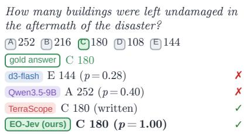

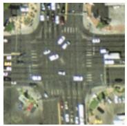

Which scene category best describes this   
remote sensing image?   
A chaparral B river C harbor   
D sparse residential E intersection   
F tennis court G baseball diamond H beach   
I overpass J mobile home park   
K storage tanks L airplane M forest   
N dense residential O runway P freeway   
Q medium residential R agricultural   
S golf course T parking lot U buildings   
gold answer E intersection   
d3-flash E intersection (p = 0.97)   
Qwen3.5-9B E intersection (p = 1.00)   
RSThinker E intersection (written) ✓   
EO-Jev (ours) E intersection (p = 1.00) ✓   
Are there more parkings than roads?   
A yes B no   
gold answer B no   
d3-flash A yes (p = 0.61) ✗   
Qwen3.5-9B B no (p = 0.52) ✓   
GeoZero B no (p = 0.87)   
EO-Jev (ours) B no (p = 0.96) ✓

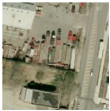

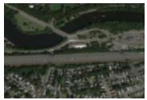

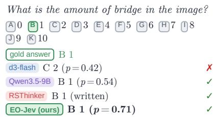

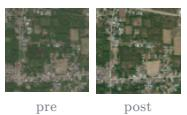

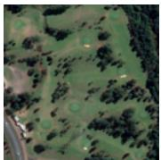

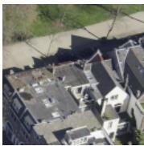  
Figure 3 Qualitative examples across capability groups. Each panel shows the input image(s), the question and its options (gold option highlighted in green), and the top answer of each model with its probability, or “written” for specialists whose best mode is a generated answer. Badges: I = in-domain, O = out-of-domain for EO-Jev. In (b)–(g), d3-flash sometimes answers incorrectly with high confidence, defined as assigning a probability of at least 0.8 to the selected answer (e.g., predicting the Americas for an Oceanian site in (f)), the color cannot be determined in (g)), while EO-Jev selects the correct option; in (d) and (f) the best specialist is wrong as well. This includes two out-of-domain settings, NWPU VHR-10 counting (c) and VHM deceptive questions (g), where no training image came from the benchmark’s dataset. Panel (a) is an out-of-domain scene that every model answers correctly, EO-Jev with p = 1.00. All images, questions and probabilities are taken unchanged from the evaluation runs.

On which continent was this satellite image   
taken?   
A the Americas B Africa C Asia D Europe   
E Oceania   
gold answer E Oceania   
d3-flash A the Americas (p = 0.53) ✗   
Qwen3.5-9B A the Americas (p = 0.63) ✗   
Geo-R1 A the Americas (p = 0.37) ✗   
EO-Jev (ours) E Oceania (p = 0.99) ✓

O fixed by adaptation

Under equal supervision, one model matches the specialists. EO-Jev matches or exceeds the best specialist on 20 of 28 settings, and on 14 of the 17 in-domain settings that have one. In most of these comparisons the specialist was also trained on the benchmark’s own split, so the comparison is between equally supervised models. Where specialists remain ahead, the margin is under 2 points except on NWPU VHR-10 counting (−7.8): UC Merced −0.3, AID −0.7, WHU-RS19 −1.4, SIRI-WHU −0.2, NWPU-RESISC45 −1.8, DOTA-v2 −0.6 and VHM deceptive −0.7. The largest leads are on tasks where specialists generalize poorly: DisasterM3 (+53.1 and +51.9 over TerraScope), CDVQA (+23.5) and DVL-Bench (+21.7) over GeoChrono, fMoW-WILDS country (+20.7) over Geo-R1, EuroSAT (+18.4) and xBD damage (+16.7).

What adaptation costs. Four out-of-domain settings do not show a statistically significant improvement.. CHOICE (−1.5) and LHRS-Bench strict (−5.2) decrease significantly, though both remain well above every specialist. UrBench (+1.2) and absent-class questions (+4.7) change insignificantly. All four test broad reasoning or robustness rather than one perceptual skill. LHRS-Bench strict accuracy requires a correct answer under every option order, so its decrease points to a slight erosion of the option-order consistency that decision training provides. On the general Decision Index, EO-Jev scores 91.9 against 93.7 for d3-flash, a drop of 1.8 points.

Main takeaway. EO supervision converts a general decision model into one that rivals specialists across tasks, and its gains reach well beyond the datasets it was trained on. The specialists’ edge was supervision rather than architecture: once the general model receives comparable supervision, the edge largely disappears. Figure 3 shows one example per capability group, including two out-of-domain cases (counting on NWPU VHR-10 and abstention on VHM deceptive questions) that EO-Jev answers correctly while d3-flash does not.

## 5 Can the Model’s Confidence Be Trusted, and at What Cost?

RQ3

How do calibration and inference cost compare with the backbone and specialist baselines?

TL;DR. EO-Jev has lower ECE than d3-flash on 20 of 30 settings, including significant reductions on 17 than its backbone on 27 of 30 and than the best specialist on 21 of 28. Where calibration worsens, the cause is systematic over-confidence. Answering in one forward pass, EO-Jev is a median 6.4× faster than the best specialist.

Calibration improves where accuracy improves most. ECE is measured over the same questions for every model; multi-select options count as binary questions. As Figure 4 shows, EO-Jev has significantly lower ECE than d3-flash on 17 of 30 EO settings, higher on 5, and no significant change on 8. The largest improvements are on settings where d3-flash was both inaccurate and over-confident. ECE on VHM deceptive questions falls from 0.254 to 0.062, xBD damage grading from 0.168 to 0.050, and WHU-RS19 from 0.105 to 0.009. On in-domain scene and VQA settings, EO-Jev’s ECE is typically 0.01–0.03.

Specialists’ probabilities are often uninformative. We evaluate specialists using their option-probability outputs because their generated answers do not provide confidence estimates. EO-Jev achieves lower ECE than the best specialist in 21 of 28 settings and lower ECE than Qwen3.5-9B in 27 of 30. Specialist calibration is competitive on scene classification, where RSThinker achieves ECE values between 0.004 and 0.052. However, calibration is much worse on counting and multi-select tasks. RSThinker reaches an ECE of 0.712 on NWPU VHR-10 and 0.356 on DOTA-v2, while TerraScope reaches 0.529 on DisasterM3 multi-select. In these settings, specialist confidence is a poor indicator of whether an answer is correct.

Calibration errors are systematically overconfident. Whenever EO-Jev is significantly less calibrated than d3-flash on an EO setting, its mean confidence exceeds its accuracy. This gap reaches 12–14 percentage points on SIRI-WHU, GEOBench-VLM, and fMoW-WILDS continent. It is also 7.3 points on VHM honest questions and 6.2 points on BigEarthNet. The latter two results are associated with a tendency to answer “yes” to questions about object presence. Since these errors reflect systematic overconfidence rather than random variation, per-task temperature scaling fitted on a development set may correct much of the miscalibration.

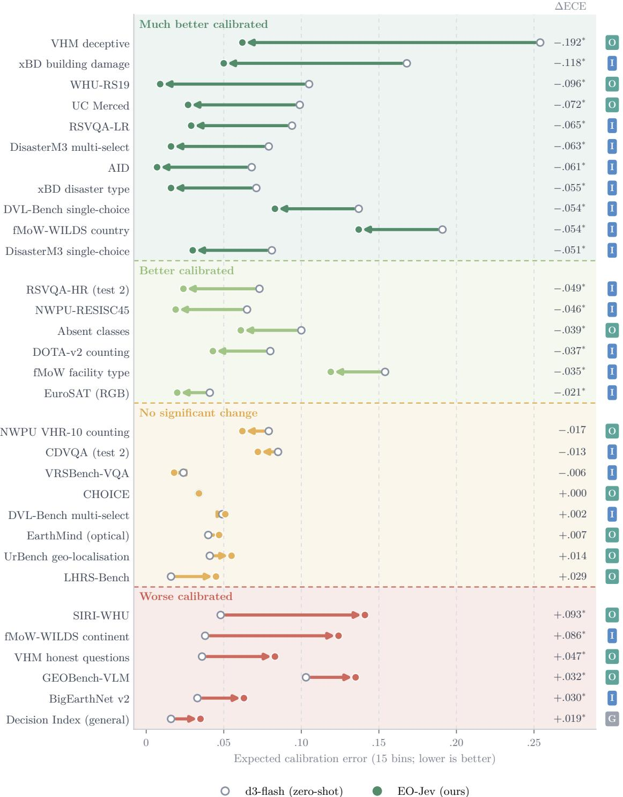  
Figure 4 Calibration change from d3-flash to EO-Jev. Each arrow runs from d3-flash’s ECE (open circle) to EO-Jev’s (filled circle); lower is better. Rows are grouped by ∆ECE = EO-Jev − d3-flash: much better calibrated (∆ECE $\leq - 0 . 0 5 )$ , better calibrated, no significant change, and worse calibrated. ∗: the paired 95% bootstrap interval (over images) excludes zero. Badges: I = in-domain, O = out-of-domain, G = general (non-EO) retention check. All EO rows in the bottom tier are over-confident; the Decision Index is slightly under-confident.

We leave this evaluation for future work.

One forward pass is much cheaper than answer generation. With one question per call, EO-Jev is a median 3.2× faster than the best specialist (range 0.8–109×); the specialist is faster on 7 of 28 rows and ties on one. With batching the median rises to 6.4× (range 0.8–41×), and the specialist is faster on only 3 rows (See Figure 5. The large gains come almost entirely from generative specialists that must decode an answer. Against prompted VLMs of similar size (RSVQA, DVL-Bench, fMoW-WILDS, CHOICE), EO-Jev costs about the same, since both run one forward pass. The speed advantage is therefore structural: it comes from reading out a decision instead of generating one, not from a smaller model.

Main takeaway. Decision models provide a practical combination of calibrated confidence and low inference cost for automated EO pipelines. They produce answers in a single forward pass, while specialists that generate written answers are several times slower. Specialists evaluated through option probabilities can match this speed, but their confidence is often poorly calibrated, particularly on counting and multi-select tasks.

## 6 What Remains Hard?

RQ4

Which limitations persist after decision model adaptation to EO tasks?

TL;DR. The remaining gaps are counting on unseen imagery, robustness to option order, geometric and cross-view reasoning, and calibration far from the training data. Zero-shot diagnostics show that recognition failures were mostly a readout problem, which adaptation fixed, while quantitative failures reflect missing perception.

Counting on unseen imagery. Counting is the only capability where a specialist still leads clearly. On out-of-domain NWPU VHR-10, EO-Jev improves from 64.2 to 72.0 but trails RSThinker by 7.8 points. On in-domain DOTA-v2 it reaches 47.7, within 0.6 points of RSThinker, but absolute accuracy remains low for every model. Zero-shot, extra resolution helped counting slightly: tiling ultra-high-resolution scenes improved counting by 5.0 points. Counting therefore appears limited by perception at the 1.6 MP input budget as well as by supervision.

Robustness to option order. d3-flash’s decision training made it far more stable under option reordering than its backbone. Adaptation slightly erodes this: CHOICE drops by 1.5 points and LHRS-Bench strict accuracy by 5.2. Training with option-permutation augmentation, and keeping option-order tests as regression checks, is the obvious remedy.

Geometric and cross-view reasoning. UrBench does not change significantly with adaptation (60.3 → 61.5). Zero-shot, its orientation-estimation questions were near chance (30.5 against a 24% random baseline). Our training data contains no cross-view supervision. Zero-shot diagnostics also show orientation sensitivity on single images: about a fifth of correct scene and GEOBench-VLM answers change under some rotation, even though nadir imagery has no canonical up direction.

Calibration away from the training distribution. The settings where EO-Jev becomes over-confident (SIRI-WHU, GEOBench-VLM, fMoW-WILDS continent, VHM honest questions) are mostly out-of-domain, or involve label sets with many similar classes. Adaptation sharpens the output distributions everywhere, but accuracy improves less out of domain.

Readout versus representation. Zero-shot probes explain why recognition responds so well to adaptation. A linear probe on d3-flash’s decision state, the hidden state its readout scores, reaches 96.4, 94.3 and 87.5 on AID, EuroSAT and NWPU-RESISC45, where its zero-shot answers reach 78.1, 56.8 and 73.5. The information needed to recognise the scene was already present but not mapped to the right label. Adaptation recovers almost exactly this gap: EO-Jev reaches 97.8, 96.1 and 95.2 on the evaluation sets of the same datasets. Counting and change quantification were weak in both the zero-shot model and its backbone, and they improve less. This suggests that these skills need new perceptual supervision, not only a better readout.

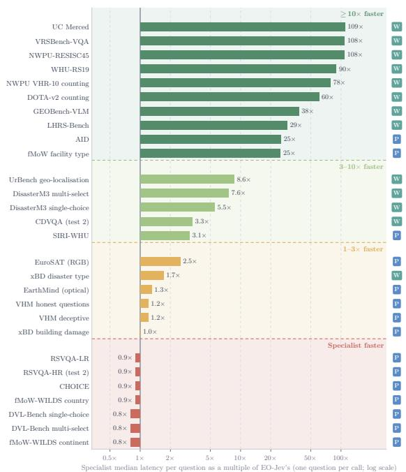  
(a) One question per call

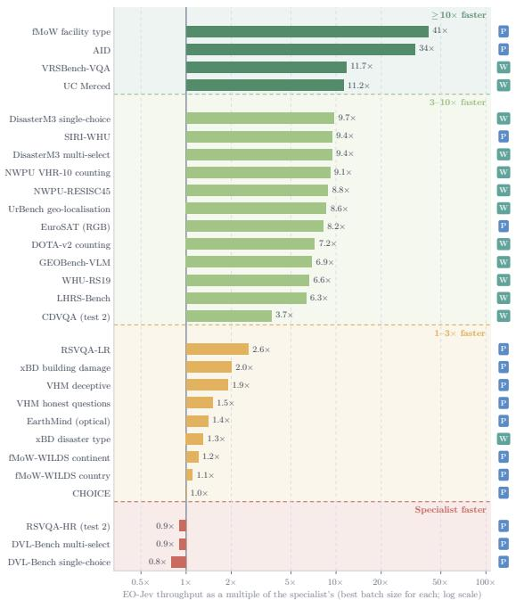  
(b) Best batch size for each model  
Figure 5 Inference cost against the specialists. (a) Specialist median latency per question as a multiple of EO-Jev’s, one question per call. (b) EO-Jev throughput as a multiple of the specialist’s, each at its best batch size. Bars are grouped by speed-up; red rows are those where the specialist is faster. Badges give the specialist’s best-accuracy mode (P: prompted, W: wrapped/generative). All models run on the same exclusive node (4×A100, BF16), on the same 160-question seeded sample per row, with image decoding inside the timed region. Medians: 3.2× in (a) and 6.4× in (b).

## 7 Where Does a Decision Model Stand on EO?

Figure 6 summarizes where EO-Jev stands relative to the strongest available open EO specialist on each setting. Fifteen settings exceed specialist level by more than 10%. They are dominated by tasks where specialists generalize poorly or were trained for a diferent question format: disaster assessment, change and temporal reasoning, geo-localization and fine-grained recognition. Five more are at specialist level. The remaining eight are approaching it, all within 2% except NWPU VHR-10 counting (90%). They comprise five scene datasets, two counting settings, and deceptive-question abstention, where VHM-7B was trained for exactly that task. No setting shows a substantial gap.

These results suggest a practical division of labor. A single calibrated decision model can serve as the default interface for EO decisions: one forward pass per question, confidence that supports thresholding and deferral, and accuracy at or above specialist level on most tasks. Specialist models remain valuable where a task needs perception the decision model has not learned, such as counting on unfamiliar imagery, and where their generated explanations matter more than calibrated confidence. Because a decision model’s errors come with confidence, a pipeline can route its uncertain cases to specialists or analysts rather than replace either.

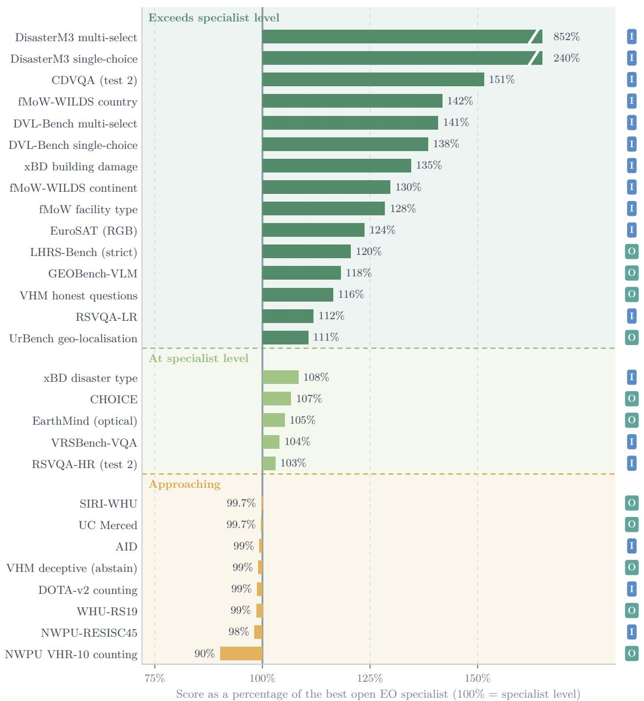  
Figure 6 EO capability relative to specialist level. For each setting with a specialist reference, EO-Jev’s score as a percentage of the best open EO specialist’s. Settings are grouped into tiers: exceeds specialist level (above 110%), at specialist level (100–110%) and approaching (85–100%). No setting falls below 85%. Bars beyond 165% are clipped. Badges: I = in-domain, O = out-of-domain.

## 8 Additional Evaluation Details

Benchmarks. Scene classification: UC Merced (Yang and Newsam, 2010), AID (Xia et al., 2017), WHU-RS19 (Dai and Yang, 2011), SIRI-WHU (Zhao et al., 2016), EuroSAT (RGB) (Helber et al., 2019), NWPU-RESISC45 (Cheng et al., 2017) and fMoW facility type (Christie et al., 2018). Multi-label land cover: BigEarthNet v2 (Clasen et al., 2024). Object presence and attributes: VRSBench (Li et al., 2024), RSVQA-LR and RSVQA-HR (Lobry et al., 2020). Counting: NWPU VHR-10 (Cheng et al., 2014) and DOTA-v2 validation (Xia et al., 2018), plus absent-class questions on NWPU VHR-10 images. Change and multi temporal: CDVQA (Yuan et al., 2022) and DVL-Bench (Xuan et al., 2025). Multi-sensor: EarthMind-Bench, optical part only (Shu et al., 2025). Disaster and damage: xBD (Gupta et al., 2019) and DisasterM3 (Wang et al., 2025b). Complex reasoning: GEOBench-VLM (Danish et al., 2024), CHOICE (An et al., 2024) and LHRS-Bench (Muhtar et al., 2024). Geo-localization: fMoW-WILDS (Christie et al., 2018; Koh et al., 2021) and UrBench (Zhou et al., 2024). Honesty: VHM-HnstD (Pang et al., 2024).

Table 2 Specialist reference models. The strongest open-weight EO specialist per setting in our common question format.
<table><tr><td>Capability</td><td>Settings</td><td>Specialist</td></tr><tr><td>Scene classification</td><td>UC Merced, AID, WHU-RS19, NWPU-RESISC45 SIRI-WHU, EuroSAT, fMoW facility type</td><td>RSThinker (Liu et al., 2025) GeoZero (Wang et al., 2025a)</td></tr><tr><td>Objects &amp; attributes</td><td>VRSBench RSVQA-LR</td><td>RSThinker (Liu et al., 2025) EarthDial (Soni et al., 2024)</td></tr><tr><td>Counting</td><td>RSVQA-HR NWPU VHR-10, DOTA-v2</td><td>GeoZero (Wang et al., 2025a) RSThinker (Liu et al., 2025)</td></tr><tr><td>Change &amp; temporal</td><td>CDVQA, DVL-Bench</td><td>GeoChrono (Li et al., 2026)</td></tr><tr><td>Multi-sensor</td><td>EarthMind (optical)</td><td>EarthMind (Shu et al., 2025)</td></tr><tr><td>Disaster &amp; damage</td><td>xBD building damage</td><td>TEOChat (Irvin et al., 2024)</td></tr><tr><td></td><td>xBD disaster type DisasterM3</td><td>xView2 LoRA (WayBob, 2025)</td></tr><tr><td>Complex reasoning</td><td>GEOBench-VLM, CHOICE</td><td>TerraScope (Shu et al., 2026)</td></tr><tr><td></td><td>LHRS-Bench</td><td>GeoZero (Wang et al., 2025a)</td></tr><tr><td>Geo-localisation</td><td></td><td>ScoreRS (Muhtar et al., 2025)</td></tr><tr><td></td><td>fMoW-WILDS, UrBench</td><td>Geo-R1 (Zhang et al., 2025)</td></tr><tr><td>Honesty</td><td>VHM-HnstD</td><td>VHM-7B (Pang et al., 2024)</td></tr><tr><td></td><td></td><td></td></tr></table>

Output processing. d3-flash, Qwen3.5-9B and EO-Jev return a probability for every option; the prediction is the most probable option. Every specialist sees the same question text, built from our converted rows; only its chat template difers. In option-probability mode, a specialist’s answer is pre-filled up to where it writes the option, and each option’s probability is read from the next-token distribution. In generation mode, the specialist decodes greedily in its own reasoning format and the answer is mapped to an option. Before trusting a specialist’s scores, we reproduced one of its published numbers where our protocol matches the original.

Training data for EO-Jev. Training examples are drawn exclusively from public training splits, with all evaluation images removed to prevent data leakage. For scene classification and land-use mapping, we use AID images outside the evaluation list, the EuroSAT and BigEarthNet v2 training splits, and fMoW-WILDS training images acquired before 2013 and located away from evaluation sites. Object and building counting examples come from DOTA-v2 training tiles, excluding the validation split, and building counts derived from xBD pre-disaster footprints. Damage assessment and disaster-type classification examples are drawn from the xBD train and tier3 splits. For general EO reasoning, we use the training splits of NWPU-RESISC45, RSVQA, VRSBench, CDVQA, DisasterM3, and DVL-Bench. Finally, general decision-making is supported by text-only decision questions and natural-image multiple-choice questions, using d3-flash’s own probabilities as training targets.

Timing protocol. We time every system on one exclusive node (4×A100-80GB, pinned CPU cores, no co-scheduled jobs), in BF16, after a warm-up pass. Each row uses the same seeded sample of 160 questions. The clock covers image loading and decoding, preprocessing, the forward pass and, for generative specialists, answer decoding and parsing; we synchronize CUDA before reading it. We report two regimes; median latency with one question per call, and peak throughput with each model at its own best batch size. EO-Jev and d3-flash are timed separately, and their median latencies are identical (ratio 1.00) given that the merged LoRA adds no cost at inference.

## 9 Conclusion

We studied decision models for earth observation through a diagnostic evaluation across 30 settings from 23 public benchmarks, followed by EO-specific adaptation. The evaluation shows that d3-flash transfers well to several compositional reasoning tasks and generally improves calibration over its backbone, but remains limited in counting, change quantification, damage grading, and recognizing absent objects. Our proposed adaptation approach yields EO-Jev, which improves significantly on 26 settings and achieves scores at or above the evaluated specialist reference on 20 of 28. Its average gain of 8.0 percentage points across 12 settings held out from adaptation demonstrates that the benefits extend beyond the training datasets. EO-Jev also achieves lower expected calibration error than specialist references on 21 of 28 settings while retaining single-pass prediction without autoregressive decoding.

These gains come with trade-ofs. Adaptation reduces general decision performance by a small margin of 1.8 points, lowers accuracy on two reasoning benchmarks, and increases calibration error on some settings. Counting on unfamiliar imagery and geometric reasoning also remain dificult. The findings support decision models as an eficient, shared interface for diverse EO tasks, while showing that accuracy, calibration, and robustness must be assessed separately. Further progress requires stronger quantitative and geometric perception, consistency under option reordering, and evaluation of confidence-based deferral under distribution shift. Beyond standalone prediction, integrating calibrated decision models into agentic EO pipelines ofers a promising direction for building systems that can reason across tasks while identifying when their predictions require further verification.

## References

Xiao An, Jiaxing Sun, Zihan Gui, and Wei He. CHOICE: Benchmarking the remote sensing capabilities of large vision-language models. arXiv preprint arXiv:2411.18145, 2024. NeurIPS 2025 Datasets and Benchmarks Track.

AutoTrust. JEV-9B. https://huggingface.co/autotrust/JEV-9B, 2026.

Man Chen, Antai Chen, Shuai Xu, Chengjie Gu, Huaping Zhou, Kelei Sun, Tao Wu, and Yongjie Huang. RSAJEV: Training-free abstaining prototype memory for eliminating silent hallucination in JEV-based remote sensing classification. arXiv preprint arXiv:2610.15742, 2026.

Gong Cheng, Junwei Han, Peicheng Zhou, and Lei Guo. Multi-class geospatial object detection and geographic image classification based on collection of part detectors. ISPRS Journal of Photogrammetry and Remote Sensing, 98: 119–132, 2014.

Gong Cheng, Junwei Han, and Xiaoqiang Lu. Remote sensing image scene classification: Benchmark and state of the art. Proceedings of the IEEE, 105(10):1865–1883, 2017.

Gordon Christie, Neil Fendley, James Wilson, and Ryan Mukherjee. Functional map of the world. In Proceedings of the IEEE Conference on Computer Vision and Pattern Recognition (CVPR), 2018.

Kai Norman Clasen, Leonard Hackel, Tom Burgert, Gencer Sumbul, Begüm Demir, and Volker Markl. reBEN: Refined BigEarthNet dataset for remote sensing image analysis. arXiv preprint arXiv:2407.03653, 2024.

Dengxin Dai and Wen Yang. Satellite image classification via two-layer sparse coding with biased image representation. IEEE Geoscience and Remote Sensing Letters, 8(1):173–176, 2011.

Muhammad Sohail Danish, Muhammad Akhtar Munir, Syed Roshaan Ali Shah, Kartik Kuckreja, Fahad Shahbaz Khan, Paolo Fraccaro, Alexandre Lacoste, and Salman Khan. GEOBench-VLM: Benchmarking vision-language models for geospatial tasks. arXiv preprint arXiv:2411.19325, 2024.

Decision Index contributors. Jev Decision Index: an open leaderboard for decision models. https://github.com/ apolinario/decision-index, 2026.

Ritwik Gupta, Bryce Goodman, Nirav Patel, Ricky Hosfelt, Sandra Sajeev, Eric Heim, Jigar Doshi, Keane Lucas, Howie Choset, and Matthew Gaston. Creating xBD: A dataset for assessing building damage from satellite imagery. In Proceedings of the IEEE/CVF Conference on Computer Vision and Pattern Recognition Workshops, 2019.

Patrick Helber, Benjamin Bischke, Andreas Dengel, and Damian Borth. EuroSAT: A novel dataset and deep learning benchmark for land use and land cover classification. IEEE Journal of Selected Topics in Applied Earth Observations and Remote Sensing, 12(7):2217–2226, 2019.

Jeremy Andrew Irvin, Emily Ruoyu Liu, Joyce Chuyi Chen, Ines Dormoy, Jinyoung Kim, Samar Khanna, Zhuo Zheng, and Stefano Ermon. TEOChat: A large vision-language assistant for temporal earth observation data. arXiv preprint arXiv:2410.06234, 2024. ICLR 2025.

Pang Wei Koh, Shiori Sagawa, Henrik Marklund, Sang Michael Xie, Marvin Zhang, Akshay Balsubramani, Weihua Hu, Michihiro Yasunaga, Richard Lanas Phillips, Irena Gao, et al. WILDS: A benchmark of in-the-wild distribution shifts. In International Conference on Machine Learning (ICML), 2021.

Kartik Kuckreja, Muhammad Sohail Danish, Muzammal Naseer, Abhijit Das, Salman Khan, and Fahad Shahbaz Khan. GeoChat: Grounded large vision-language model for remote sensing. arXiv preprint arXiv:2311.15826, 2023. CVPR 2024.

Xiang Li, Jian Ding, and Mohamed Elhoseiny. VRSBench: A versatile vision-language benchmark dataset for remote sensing image understanding. arXiv preprint arXiv:2406.12384, 2024. NeurIPS 2024 Datasets and Benchmarks Track.

Yujie Li, Jiancheng Pan, Zhiwei Wei, Jiuniu Wang, Mugen Peng, and Wenjia Xu. GeoChrono: Benchmarking and rethinking long-term temporal understanding in remote sensing. arXiv preprint arXiv:2607.15768, 2026.

Jiaqi Liu, Lang Sun, Ronghao Fu, and Bo Yang. Towards faithful reasoning in remote sensing: A perceptuallygrounded geospatial chain-of-thought for vision-language models. arXiv preprint arXiv:2509.22221, 2025. Introduces RSThinker; ICLR 2026.

Sylvain Lobry, Diego Marcos, Jesse Murray, and Devis Tuia. RSVQA: Visual question answering for remote sensing data. IEEE Transactions on Geoscience and Remote Sensing, 58(12):8555–8566, 2020.

Dilxat Muhtar, Zhenshi Li, Feng Gu, Xueliang Zhang, and Pengfeng Xiao. LHRS-Bot: Empowering remote sensing with VGI-enhanced large multimodal language model. arXiv preprint arXiv:2402.02544, 2024. Introduces LHRS-Bench; ECCV 2024.

Dilxat Muhtar, Enzhuo Zhang, Zhenshi Li, Feng Gu, Yanglangxing He, Pengfeng Xiao, and Xueliang Zhang. Qualitydriven curation of remote sensing vision-language data via learned scoring models. arXiv preprint arXiv:2503.00743, 2025. Introduces ScoreRS.

Chao Pang, Xingxing Weng, Jiang Wu, Jiayu Li, Yi Liu, Jiaxing Sun, Weijia Li, Shuai Wang, Litong Feng, Gui-Song Xia, and Conghui He. VHM: Versatile and honest vision language model for remote sensing image analysis. arXiv preprint arXiv:2403.20213, 2024.

Qwen Team. Qwen3.5-9B. https://huggingface.co/Qwen/Qwen3.5-9B, 2026.

Akashah Shabbir, Mohammed Zumri, Mohammed Bennamoun, Fahad S Khan, and Salman Khan. Geopixel: Pixel grounding large multimodal model in remote sensing. arXiv preprint arXiv:2501.13925, 2025.

Yan Shu, Bin Ren, Zhitong Xiong, Danda Pani Paudel, Luc Van Gool, Begüm Demir, Nicu Sebe, and Paolo Rota. EarthMind: Leveraging cross-sensor data for advanced earth observation interpretation with a unified multimodal LLM. arXiv preprint arXiv:2506.01667, 2025.

Yan Shu, Bin Ren, Zhitong Xiong, Xiao Xiang Zhu, Begüm Demir, Nicu Sebe, and Paolo Rota. TerraScope: Pixelgrounded visual reasoning for earth observation. In Proceedings of the IEEE/CVF Conference on Computer Vision and Pattern Recognition (CVPR), 2026. arXiv:2603.19039.

Dongchen Si, Di Wang, Mingzhen Xu, Jing Zhang, Bo Du, and Liangpei Zhang. RSJEV: Discriminative remote sensing scene classification with multimodal large language models. arXiv preprint arXiv:2610.08539, 2026.

Sagar Soni, Akshay Dudhane, Hiyam Debary, Mustansar Fiaz, Muhammad Akhtar Munir, Muhammad Sohail Danish, Paolo Fraccaro, Campbell D. Watson, Levente J. Klein, Fahad Shahbaz Khan, and Salman Khan. EarthDial: Turning multi-sensory earth observations to interactive dialogues. arXiv preprint arXiv:2412.15190, 2024. CVPR 2025.

TypeSafe AI. Introducing system one models and Jev. https://typesafe.ai/blog/ introducing-system-one-models-and-jev, September 2026.

vLLM Semantic Router Team. d3-flash: Decision 3.0 model card. https://huggingface.co/vllm-sr/d3-flash, 2026. Version v3.1.0, revision 521525efa.

Di Wang, Shunyu Liu, Wentao Jiang, Fengxiang Wang, Yi Liu, Xiaolei Qin, Zhiming Luo, Chaoyang Zhou, Haonan Guo, Jing Zhang, Bo Du, Dacheng Tao, and Liangpei Zhang. GeoZero: Incentivizing reasoning from scratch on geospatial scenes. arXiv preprint arXiv:2511.22645, 2025a.

Junjue Wang, Weihao Xuan, Heli Qi, Zhihao Liu, Kunyi Liu, Yuhan Wu, Hongruixuan Chen, Jian Song, Junshi Xia, Zhuo Zheng, and Naoto Yokoya. DisasterM3: A remote sensing vision-language dataset for disaster damage assessment and response. arXiv preprint arXiv:2505.21089, 2025b.

WayBob. Qwen3vl-8b qlora 4-bit xview2 disaster recognition, 2025. URL https://huggingface.co/WayBob/ Qwen3VL-8B-QLora-4bit-xView2-Disaster-Recognition.

Gui-Song Xia, Jingwen Hu, Fan Hu, Baoguang Shi, Xiang Bai, Yanfei Zhong, Liangpei Zhang, and Xiaoqiang Lu. AID: A benchmark data set for performance evaluation of aerial scene classification. IEEE Transactions on Geoscience and Remote Sensing, 55(7):3965–3981, 2017.

Gui-Song Xia, Xiang Bai, Jian Ding, Zhen Zhu, Serge Belongie, Jiebo Luo, Mihai Datcu, Marcello Pelillo, and Liangpei Zhang. DOTA: A large-scale dataset for object detection in aerial images. In Proceedings of the IEEE Conference on Computer Vision and Pattern Recognition (CVPR), pages 3974–3983, 2018.

Weihao Xuan, Junjue Wang, Heli Qi, Zihang Chen, Zhuo Zheng, Yanfei Zhong, Junshi Xia, and Naoto Yokoya. DynamicVL: Benchmarking multimodal large language models for dynamic city understanding. arXiv preprint arXiv:2505.21076, 2025. Introduces DVL-Bench.

Yi Yang and Shawn Newsam. Bag-of-visual-words and spatial extensions for land-use classification. In Proceedings of the 18th SIGSPATIAL International Conference on Advances in Geographic Information Systems, pages 270–279, 2010.

Zhenghang Yuan, Lichao Mou, Zhitong Xiong, and Xiao Xiang Zhu. Change detection meets visual question answering. IEEE Transactions on Geoscience and Remote Sensing, 60, 2022.

Zilun Zhang, Zian Guan, Tiancheng Zhao, Haozhan Shen, Tianyu Li, Yuxiang Cai, Zhonggen Su, Zhaojun Liu, Jianwei Yin, and Xiang Li. Geo-R1: Improving few-shot geospatial referring expression understanding with reinforcement fine-tuning. arXiv preprint arXiv:2509.21976, 2025.

Bei Zhao, Yanfei Zhong, Gui-Song Xia, and Liangpei Zhang. Dirichlet-derived multiple topic scene classification model for high spatial resolution remote sensing imagery. IEEE Transactions on Geoscience and Remote Sensing, 54(4): 2108–2123, 2016.

Baichuan Zhou, Haote Yang, Dairong Chen, Junyan Ye, Tianyi Bai, Jinhua Yu, Songyang Zhang, Dahua Lin, Conghui He, and Weijia Li. UrBench: A comprehensive benchmark for evaluating large multimodal models in multi-view urban scenarios. arXiv preprint arXiv:2408.17267, 2024. AAAI 2025.