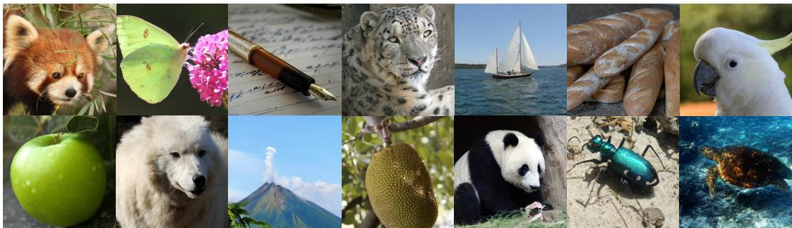
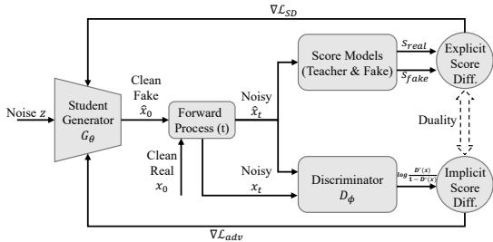
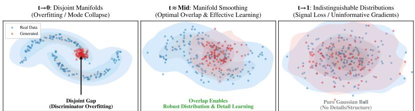
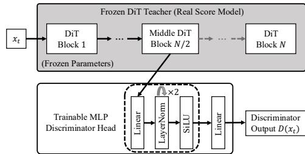
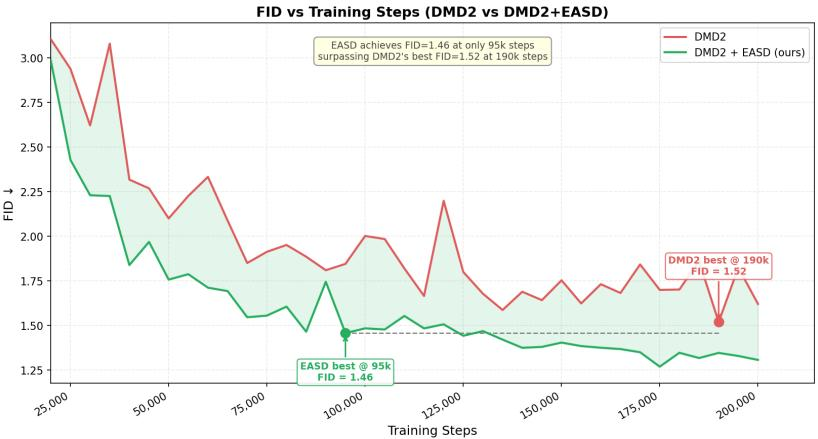
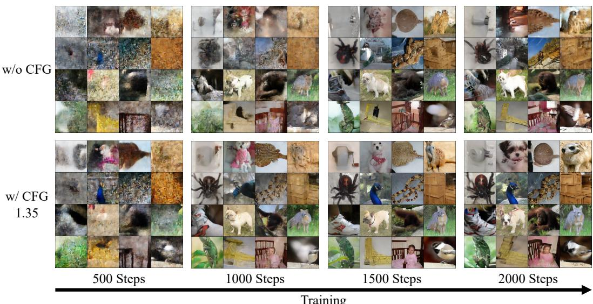
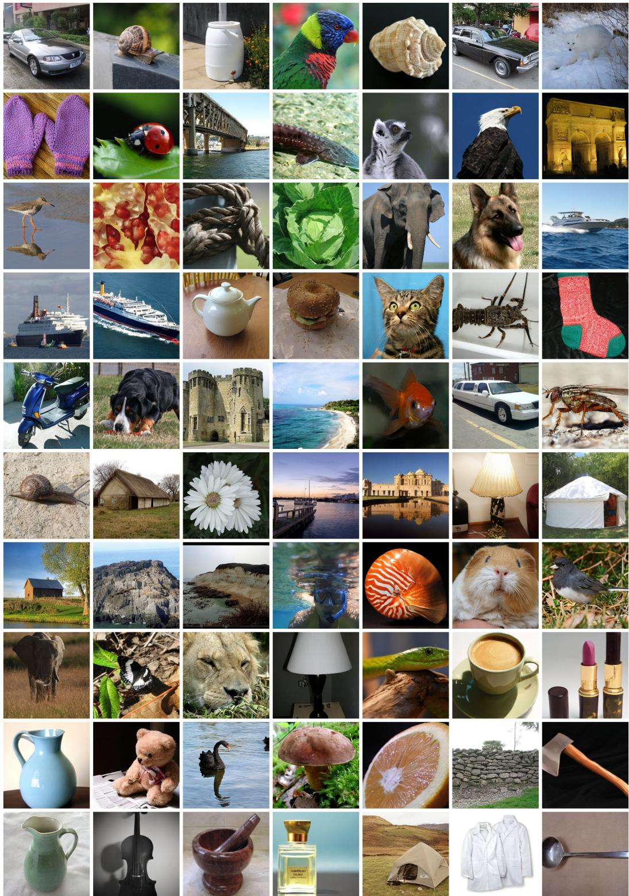
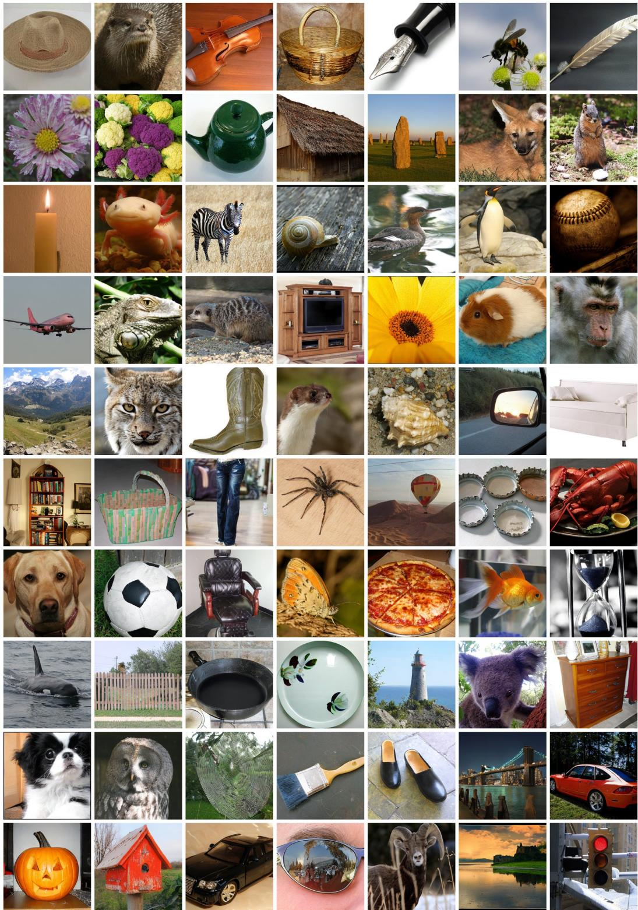

# Efficient Hybrid Distillation: Synergizing Score and Adversarial Objectives for One-Step Diffusion

Fei Peng1,2 Junqiang Wu3 Haoxian Tan3 Jun Zhou1 Jie Hu3 Xiaoming Wei3 Jie Guo2† Xiu Li1† 1Tsinghua University 2Peng Cheng Laboratory 3Meituan Inc.

  
Figure 1: Qualitative Results on ImageNet 256×256. Samples generated by our EASD-XL/2 with one inference step. More results are provided in Appendix Section I.

## Abstract

Numerous distillation methods have been developed to accelerate diffusion models. Recent research indicates that hybrid strategies—blending different paradigms—yield superior results compared to single-method approaches. However, current works predominantly rely on a simple combination of objectives, leaving the question of how to effectively synergize them largely underexplored. In this paper, we specifically investigate the synergy between Score Distillation and Adversarial Distillation. We reveal that their operating zones are distinct and complementary: Score Distillation is effective in high-noise regimes for capturing the global distribution yet lacks fine-grained supervision in low-noise regions. Conversely, Adversarial Distillation is effective in low-noise regions but is prone to instability and suffers from discriminator failure when applied to high-noise intervals. Leveraging this insight, we propose Efficient Adversarial Score Distillation (EASD), a framework that synergizes these objectives via a regime-adaptive sampling strategy, directing each objective to focus on its effective interval. We further apply this paradigm to DiT-based Flow Matching models. Empirically, our method achieves a promising one-step FID of 1.39 on ImageNet 256×256 using the SiT-XL/2+REPA model. This work provides a concrete guideline for maximizing the potential of hybrid distillation. Our code and model are available at https://github.com/pf0607/EASD.

## 1 Introduction

Diffusion models [16, 53] have revolutionized generative AI, enabling the synthesis of high-fidelity images [7, 22, 43, 41, 60, 4, 65, 76] and videos [67, 56, 13, 2] with unprecedented quality. However, their reliance on iterative sampling processes—typically requiring tens to hundreds of sequential function evaluations—imposes significant latency and computational burdens, hindering real-time applications. Consequently, accelerating diffusion models has become a paramount research focus.

To address this efficiency bottleneck, various distillation paradigms have emerged. Consistency Models [54, 35, 20, 31] learn to map noise directly to data by enforcing self-consistency. Adversarial Distillation methods [62, 46] leverage GAN [12] objectives with pre-trained teacher discriminators to ensure perceptual fidelity in few-step generation. Score Distillation approaches [69, 79] minimize distribution divergence via score matching gradients, preserving diversity and geometric structure.

Recent studies indicate that hybrid strategies combining these distinct paradigms can unlock superior performance. For instance, DMD2 [68] and SiDA [78] integrate Adversarial Distillation with Score Distillation. Other works like FreeFlow [55] and rCM [75] also explore combining Consistency Model with Score Distillation. Despite the empirical success of these combinations, the theoretical understanding of why and how they complement each other remains under-explored. Specifically, existing works often lack a granular analysis of the temporal effectiveness of each objective, leading to suboptimal combinations that may suffer from training instability or mode collapse.

In this paper, we present Efficient Adversarial Score Distillation (EASD), a framework designed to maximize the synergy between adversarial and score objectives. We structure our contributions as follows: 1) We provide a theoretical unification and empirical decoupling of Score Distillation and Adversarial Distillation. While we establish that both methods share the same underlying optimization goal—indirect distribution matching—which explains why they can be combined, our analysis further reveals their opposing yet complementary effective and ineffective timestep regimes: Score Distillation operates efficiently at high-noise timesteps but degrades at low-noise timesteps, while Adversarial Distillation exhibits the opposite behavior, which explains why their combination yields improved performance. 2) We propose Regime-Adaptive Sampling, which encourages each distillation objective to operate within its complementary effective timestep region, improving the overall efficiency of hybrid distillation. Building on this, we further extend the hybrid Adversarial and Score Distillation strategy to modern scalable architectures, formulating the Score Distillation objective within the Flow Matching framework and designing a streamlined Frozen-Teacher Discriminator tailored for Diffusion Transformers (DiT). By integrating these components, we establish a simple and effective baseline for combining these distillation methods on state-ofthe-art generative backbones. 3) We introduce comprehensive mechanisms to stabilize training and mitigate mode collapse. We propose techniques such as Fake Score EMA and Iterative Warmup to ensure robust convergence. Furthermore, we analyze the “compounding effect” of Classifier-Free Guidance in distillation and introduce a Latent Mode Seeking loss. This allows us to navigate the trade-off between fidelity and diversity.

Empirically, EASD achieves a state-of-the-art FID of 1.39 on ImageNet 256 × 256 using the SiT-XL/2+REPA [70] backbone with only 60 training epochs, surpassing recent baselines and providing a concrete guideline for maximizing the potential of hybrid distillation..

## 2 Related Work

Training-Free Acceleration. Early efforts focused on improving the discretization of the reverse ODE/SDE without retraining. Besides DDIM [51], high-order ODE solvers such as PNDM [27], DPM-Solver++ [32, 33], and DEIS [72] have pushed the limit of training-free sampling to around 10–20 steps. However, quality degrades significantly at extreme compression (1–4 steps).

Consistency and Flow Trajectory Mapping. Consistency Models [54] enforce self-consistency along the probability trajectory to enable few-step generation. This paradigm has been extended to latent spaces via LCM [35] and refined by trajectory-based variants such as CTM [20], tCM [52], sCM [31], and PCM [57]. Parallel to this, Flow Matching approaches, including Rectified Flow [29], InstaFlow [30], and PeRFlow [66], aim to straighten generative ODE trajectories (Reflow) to minimize discretization error. While effective, these methods often require complex training objectives (e.g., self-differentiation) or specialized solver-based distillation.

Adversarial Distillation. To achieve few-step generation with high perceptual fidelity, Adversarial Distillation [25, 47] integrates GAN [12] objectives into diffusion training. Methods such as UFOGen [62] and LADD [46] utilize the pre-trained diffusion backbone as a discriminator. By discriminating on renoised latents or features, these methods force the student to match the teacher’s perceptual distribution. While effective at generating sharp textures, adversarial approaches are inherently prone to training instability and mode collapse, often sacrificing diversity for visual quality.

Score Distillation. Score Distillation [36, 50, 37] aims to minimize the divergence between student and teacher distributions without explicit adversarial gaming. Rooted in Score Distillation Sampling (SDS) [42] and Variational Score Distillation (VSD) [58], methods like DMD [69] and SiD [79] employ the score difference between the teacher and a dynamically trained student as a gradient to update the generator. Recent work like SMD [18] further explores mixture distributions for better alignment. These approaches effectively preserve the geometric structure of the data manifold and mitigate mode collapse but may lack the absolute sharpness of GAN-based methods in low-noise regions.

Hybrid Strategies. Recognizing the complementary strengths of different paradigms, recent research has shifted towards hybrid distillation frameworks. For instance, DMD2 [68], SiDA [78], f-distill [64] and others [59, 34] integrate the score distillation with adversarial distillation. Similarly, rCM [75], FreeFlow [55] and TurboDiffusion [71]. Despite the empirical success of these combinations, the theoretical understanding of their synergy—specifically how different loss components and sampling strategies interact to balance fidelity and diversity—remains under-explored.

## 3 Preliminaries

## 3.1 Diffusion Models

Diffusion models generate data by reversing a forward process that maps data $x _ { 0 } \sim p _ { \mathrm { d a t a } }$ to noise $x _ { 1 } \sim \mathcal { N } ( 0 , I )$ . While standard diffusion models often operate on discrete timesteps, Flow Matching is defined over a continuous time horizon $t \in [ 0 , 1 ]$ . The forward transition $q ( x _ { t } | x _ { 0 } )$ is defined as:

$$
x _ { t } = \alpha _ { t } x _ { 0 } + \sigma _ { t } \epsilon , \quad \epsilon \sim \mathcal { N } ( 0 , I ) .\tag{1}
$$

This formulation unifies various schedules, including VP-SDE [53] and Rectified Flow [29] (where $\alpha _ { t } = 1 - t , \sigma _ { t } = t )$ . To learn the data distribution, a time-dependent network $F _ { \phi } ( x _ { t } , t )$ is trained to regress a target signal $y _ { t }$ from the noisy state $x _ { t } .$ . The universal training objective is:

$$
\mathcal { L } _ { \mathrm { d i f f } } ( \phi ) = \mathbb { E } _ { t , x _ { 0 } , \epsilon } \left[ \| F _ { \phi } ( x _ { t } , t ) - y _ { t } \| ^ { 2 } \right] .\tag{2}
$$

The target $y _ { t }$ varies by parameterization: $y _ { t } = \epsilon$ corresponds to the noise prediction objective used in DDPM [16] and Score-based SDEs [53]; $y _ { t } = v _ { t } = \epsilon - x _ { 0 }$ corresponds to Flow Matching (specifically Rectified Flow [29]); and $y _ { t } = x _ { 0 }$ corresponds to EDM [19].

## 3.2 Adversarial Distillation

Adversarial distillation [47, 46] distills generator $G _ { \theta }$ against a discriminator $D _ { \psi } . ~ D _ { \psi }$ distinguishes between real samples $x _ { 0 }$ and generated samples based on their noisy latents perturbed via Equation (1):

$$
\begin{array} { r } { \hat { x } _ { t } = \alpha _ { t } G _ { \theta } ( z ) + \sigma _ { t } \epsilon , \quad z \sim \mathcal { N } ( 0 , I ) . } \end{array}\tag{3}
$$

Discriminator Update: $D _ { \psi }$ minimizes the classification error over the joint distribution:

$$
\mathcal { L } _ { D } ( \psi ) = \mathbb { E } _ { x _ { 0 } , t , \epsilon } \left[ - \log D _ { \psi } ( x _ { t } ) \right] + \mathbb { E } _ { z , t , \epsilon } \left[ - \log ( 1 - D _ { \psi } ( \hat { x } _ { t } ) ) \right] .\tag{4}
$$

Generator Update: The student minimizes the adversarial loss to fool the discriminator:

$$
\mathcal { L } _ { G } ^ { \mathrm { a d v } } ( \theta ) = \mathbb { E } _ { z , t , \epsilon } [ - \log D _ { \psi } ( \hat { x } _ { t } ) ] .\tag{5}
$$

## 3.3 Score Distillation

Score distillation aligns the student distribution $p _ { \theta }$ (induced by the few-step generator $G _ { \theta } )$ with the teacher distribution $p _ { \mathrm { r e a l } }$ by minimizing the Reverse KL divergence. The gradient corresponds to the difference between their score functions:

$$
\nabla _ { x } D _ { \mathrm { K L } } ( p _ { \theta } \| p _ { \mathrm { r e a l } } ) = \nabla _ { x } \log p _ { \theta } ( x ) - \nabla _ { x } \log p _ { \mathrm { r e a l } } ( x ) .\tag{6}
$$

Direct computation of these scores is intractable. [53] demonstrated that optimizing the denoising objective (Equation (2)) is equivalent to score matching, implying that the model implicitly learns the score function (specifically, ∇ log $p _ { t } ( x _ { t } ) \approx - \epsilon / \sigma _ { t } )$ . Leveraging this relationship, we approximate the Real Score $\nabla _ { x } \log p _ { \mathrm { r e a l } }$ using the pre-trained teacher diffusion model (denoted as $s _ { \mathrm { r e a l } } )$ . Simultaneously, to estimate the Student Score $\nabla _ { x } \log p _ { \theta }$ , we train a separate diffusion network $F _ { \phi }$ on generated samples using Equation (2) (denoted as $s _ { \mathrm { f a k e } } )$ . The generator parameter update is derived via a variational decomposition [58]:

  
Table 1: Ablation of Sampling Strategies. Comparison of different sampling ranges for Score Distillation (SD) and Adversarial Distillation (AD). U denotes Uniform sampling. Each distillation is conducted independently without combination.  
Figure 2: Unified View of Distillation Objectives. Score Distillation explicitly regresses $( s _ { \mathrm { r e a l } } - s _ { \mathrm { f a k e } } )$ via a “Composite Discriminator”; Adversarial Distillation implicitly estimates it via discriminator logit gradients. Both optimize the same underlying objective via different proxies.

(a) SD  
(b) AD
<table><tr><td>Sampling Range</td><td>FID↓</td><td>Sampling Range</td><td>FID↓</td></tr><tr><td>U(0.0, 1.0)</td><td>2.29</td><td>U(0.0, 1.0)</td><td>2.43</td></tr><tr><td>u(0.1, 1.0)</td><td>2.22</td><td>u(0.1, 1.0)</td><td>2.96</td></tr><tr><td>U(0.2, 1.0)</td><td>2.18</td><td>U(0.2, 1.0)</td><td>4.65</td></tr><tr><td>u(0.3, 1.0)</td><td>2.45</td><td>U(0.3, 1.0)</td><td>9.98</td></tr><tr><td>U(0.4, 1.0)</td><td>3.18</td><td>u(0.0, 0.9)</td><td>2.39</td></tr><tr><td>u(0.0, 0.9)</td><td>2.32</td><td>u(0.0, 0.8)</td><td>2.31</td></tr><tr><td>U(0.0, 0.8)</td><td>2.60</td><td>U(0.0, 0.7)</td><td>Fail</td></tr></table>

$$
\nabla _ { \boldsymbol { \theta } } \mathcal { L } _ { \mathrm { S D } } \approx \underset { z , t , \epsilon } { \mathbb { E } } \left[ w _ { t } ( s _ { \mathrm { f a k e } } ( \hat { \boldsymbol { x } } _ { t } , t ) - \boldsymbol { s } _ { \mathrm { r e a l } } ( \hat { \boldsymbol { x } } _ { t } , t ) ) \nabla _ { \boldsymbol { \theta } } G _ { \boldsymbol { \theta } } ( z ) \right] .\tag{7}
$$

$s _ { \mathrm { f a k e } }$ and $s _ { \mathrm { r e a l } }$ are derived from the outputs of $F _ { \phi }$ and the teacher model. $\hat { x } _ { t }$ is same in Equation (3).

## 4 Unified and Decoupled Perspective on Score and Adversarial Distillation

## 4.1 The Duality of Indirect Distribution Matching

Despite their distinct formulations, we argue that Score Distillation and Adversarial Distillation are fundamentally connected. We elucidate this duality by interpreting the interaction between the networks as specific forms of adversarial games, revealing that both methods aim to minimize distribution divergence by estimating the score difference.

Adversarial Interpretation of Score Distillation. In Score Distillation, the training objective is to minimize the difference between the student’s score and the teacher’s. Since the student’s distribution $p _ { \theta }$ is implicit, we cannot directly compute its score. We propose that the combination of the frozen teacher score $s _ { \mathrm { r e a l } }$ and the learnable student score $s _ { \mathrm { f a k e } }$ functions as $\mathbf { a \ ^ { 6 } C }$ omposite Discriminator".

• Discriminator Step (Criticizing): The $s _ { \mathrm { f a k e } }$ network is trained via Score Matching to estimate ∇ log pθ. Its goal is to accurately model the student’s current distribution to “expose” the discrepancy $( s _ { \mathrm { r e a l } } - s _ { \mathrm { f a k e } } )$ relative to the teacher.

• Generator Step (Fooling): The student generator $G _ { \theta }$ updates its parameters to minimize the norm of this difference. This is equivalent to “fooling” the composite discriminator into believing that the student’s score field is indistinguishable from the teacher’s.

Score-Matching Interpretation of Adversarial Distillation. Conversely, the explicit discriminator $D _ { \psi }$ in Adversarial Distillation can be viewed as an implicit estimator of the score difference. While the original GAN objective globally minimizes the Jensen-Shannon divergence, standard implementations typically employ the Non-Saturating Loss (− log $D ( G ( z ) ) ,$ ) to avoid gradient vanishing [12]. Crucially, theoretical analysis suggests that the local update direction provided by this loss also approximates the gradient of the Reverse KL divergence [1]. Assuming an optimal discriminator $\begin{array} { r } { \hat { D ^ { * } } ( x ) = \frac { p _ { \mathrm { d a t a } } } { p _ { \mathrm { d a t a } } + p _ { \theta } } } \end{array}$ , the gradient passed to the generator is proportional to the gradient of the logit (Appendix Section E):

$$
\nabla _ { x } \mathcal { L } _ { G } ^ { \mathrm { a d v } } ( \theta ) \approx \nabla _ { x } \log \frac { D ^ { * } ( x ) } { 1 - D ^ { * } ( x ) } = \nabla _ { x } \log p _ { \mathrm { d a t a } } ( x ) - \nabla _ { x } \log p _ { \theta } ( x ) .\tag{8}
$$

Strikingly, the right-hand side of Equation (8) is equivalent to the score difference term $( s _ { \mathrm { r e a l } } - s _ { \mathrm { f a k e } } )$ used in Score Distillation. This reveals a fundamental theoretical duality: Score Distillation explicitly

  
Figure 3: Visual Analysis of Adversarial Distillation Regimes. (Left) Low Noise $( t  0 ) \colon$ Due to disjoint manifolds, the discriminator overfits, forcing the generator to collapse to few modes (red clump) (Mode Collapse). (Center) Effective Regime $( t \approx \mathbf { M i d } )$ : Noise injection functions as Manifold Smoothing, creating optimal overlap for gradient flow while preserving fine-grained details and roubust distribution. (Right) High Noise $( t  1 ) \colon$ The distributions merge into an indistinguishable Gaussian ball, causing the discriminator to lose all guidance (Signal Loss).

minimizes the score difference via regression, whereas Adversarial Distillation implicitly eliminates this discrepancy through density ratio estimation. Both methods thus share the same underlying optimization goal, which explains why they can be combined without conflict.

## 4.2 Decoupling Effective Regimes

Having established that Score Distillation and Adversarial Distillation share the same underlying optimization goal, a natural question arises: why does their combination yield improved performance over either method $a l o n e ?$ To answer this, we decouple and independently analyze the behavior of each method across different timestep regimes. We conduct ablation studies using a restricted sampling strategy $\mathcal { U } ( t _ { \operatorname* { m i n } } , t _ { \operatorname* { m a x } } )$ , where the timestep t—used to perturb the student’s generated image xˆ via the forward process—is sampled uniformly from $[ t _ { \mathrm { m i n } } , t _ { \mathrm { m a x } } ]$ . Based on Table 1 and Figure 3, we analyze the mechanism and limitations of each objective.

## Limitations of Score Distillation.

• Low Noise Regime $( t  0 ) \colon$ Vanishing Signal vs. Necessity. As $t  0 .$ , the input $\hat { x } _ { t }$ approaches the clean data manifold. Since both the teacher and the student’s fake score model are typically well-trained denoisers, their predicted denoising directions align closely as the task simplifies to removing infinitesimal noise. Consequently, the gradient magnitude $\lVert \nabla \dot { \mathcal { L } } _ { \mathrm { S D } } \rVert$ naturally diminishes , becoming susceptible to numerical instability. Table 1a reflects this trade-off: excluding the lowest noise interval (U(0.2, 1.0)) yields better FID of 2.18, outperforming the full range (FID 2.29), which suggests the extreme low-noise region $( t < 0 . 2 )$ introduces more instability than utility. However, further truncating the range $( \mathcal { U } ( 0 . 3 , 1 . 0 ) )$ degrades performance to FID 2.45. This indicates that the low-noise regime is indeed necessary for fine-grained detail refinement, yet standard Score Distillation lacks effective supervision mechanisms to leverage it efficiently due to the vanishing signal.

• High Noise Regime (t → 1): Diminishing Returns of Mean-Seeking. At high noise levels, the score function provides global guidance but essentially points towards the center of mass of the data distribution (mean-seeking). While sufficient high-noise coverage is critical for structural formation (as $\mathcal { U } ( 0 . 0 , 0 . 8 )$ drastically worsens FID to 2.60), the supervision from the extreme high-noise regime appears to offer diminishing returns. Specifically, Table 1a shows that removing the highest noise interval $( \mathcal { U } ( 0 . 0 , 0 . 9 ) )$ ) results in only a marginal performance drop (FID 2.32 vs. 2.29 for $\mathcal { U } ( 0 . 0 , 1 . 0 ) )$ . This suggests that while mean-seeking behavior initiates the layout, its contribution saturates as $t \to 1$ , offering limited help for the specific characteristics of the generated sample.

## Limitations of Adversarial Distillation.

• High Noise Regime (t → 1): Signal Loss. When $\hat { x } _ { t }$ approaches pure noise, the perturbed real and generated distributions become statistically indistinguishable. Visually, Figure 3 (Right) shows both distributions merging into an identical Gaussian ball. In this regime, the discriminator fails to discriminate structure effectively, leading to uninformative gradients. This failure is quantified in Table 1b: restricting training to high-noise regimes $( \mathbf { e . g . , } \mathcal { U } ( 0 . 3 , 1 . 0 ) )$ results in a catastrophic performance drop to FID 9.98, confirming that Adversarial Distillation is ineffective at high t.

• Low Noise Regime (t → 0): Overfitting and Mode Collapse. $\mathbf { A s } \ t  0 ,$ , the perturbed data manifold remains extremely complex and disjoint from the generated distribution. As illustrated in

Figure 3 (Left), this disjoint gap allows the discriminator to overfit to trivial artifacts or memorize specific real samples. Consequently, the generator collapses onto a few specific modes to satisfy the discriminator, resulting in severe Mode Collapse.

• The “Sweet Spot": Robust Distribution Learning & Detail Refinement. Between the extremes of signal loss and overfitting, the moderately low noise regime emerges as the optimal operating zone. In this interval $( \mathbf { e . g . , } \mathcal { U } ( 0 . 0 , 0 . 8 ) )$ , noise injection acts as a Manifold Smoothing mechanism. Figure 3 (Center) demonstrates this effect: the expanded supports create necessary overlap to prevent overfitting. Crucially, unlike the high-noise regime, the noise magnitude here remains sufficiently low to preserve fine-grained details. This allows the discriminator to enforce a robust boundary that facilitates both effective distribution alignment and high-frequency texture refinement, achieving better FID of 2.31.

Complementary Synergy. Our analysis reveals a clear temporal dichotomy between the two objectives: their effective and ineffective timestep regimes are precisely opposing and complementary, which explains why their combination yields improved distillation performance over either method alone. However, existing hybrid approaches directly combine the two objectives without considering the timestep sampling strategy, leading to inefficient resource allocation where each method wastes considerable capacity operating in its own ineffective regime. This motivates a more principled strategy that biases each distillation objective toward its complementary effective regime, maximizing synergy and improving the overall efficiency of hybrid distillation.

## 5 Efficient Adversarial Score Distillation

We propose EASD, a framework optimizing the synergy of adversarial and score objectives. It features a regime-adaptive sampling strategy for Flow Matching and DiT architectures, alongside stabilization and regularization techniques to ensure robust, diversity-preserving distillation.

## 5.1 Regime-Adaptive Sampling Strategy

Building on the complementary temporal dichotomy identified in Section 4.2, we establish a general guideline for hybrid distillation: encouraging each distillation objective to operate more within its complementary effective regime improves the overall efficiency ofhybrid distillation. This principle can be instantiated in various ways—hard truncation of the sampling interval or soft biasing via skewed distributions both yield consistent improvements, as validated in Section 6.4.

In this work, we adopt a soft biasing approach using Logit-Normal distributions as a practical and transferable instantiation of this guideline. We sample the timestep t by applying the sigmoid function to a normally distributed variable:

$$
t = \sigma ( y ) , \quad y \sim \mathcal { N } ( \mu , s ^ { 2 } ) .\tag{9}
$$

The hyperparameters $\mu$ and s control the bias (center) and spread of the distribution, respectively. Guided by the regime analysis in Section 4.2, we configure Score Distillation with $( \mu _ { \mathrm { s d } } = 0 . 8 , s _ { \mathrm { s d } } =$ 1.6) to bias sampling toward the high-noise regime, and Adversarial Distillation with $( \mu _ { \mathrm { a d v } } ~ =$ $- 0 . 8 , s _ { \mathrm { a d v } } = 1 . 6 )$ to bias sampling toward the low-noise regime. The wide spread $( s = 1 . 6 )$ ensures that neither objective is strictly excluded from the full timestep range, preserving the regularization benefits of residual cross-regime coverage. This configuration demonstrates strong transferability across datasets and architectures, as shown in Sections B.1, B.3 and 6.4.

## 5.2 Adapting Score and Adversarial Distillation to Flow Matching and DiT

Score Distillation for Flow Matching. We adapt the score distillation objective to the Flow Matching framework. In the original DMD implementation [69], the score functions are derived from an EDM [19] network $F _ { \phi } ( \cdot )$ that predicts the clean data $x _ { 0 }$ . Based on the score matching formulation [53], the score function can be computed from the model’s prediction $F _ { \phi } ( x _ { t } , t )$ as:

$$
s ( x _ { t } , t ) = - \left[ x _ { t } - \alpha _ { t } F _ { \phi } ( x _ { t } , t ) \right] / \sigma _ { t } ^ { 2 } .\tag{10}
$$

To simplify optimization, DMD sets the weighting function $w _ { t } = \sigma _ { t } ^ { 2 } / \alpha _ { t }$ to counteract the coefficients. Substituting Equation (10) into the general gradient Equation (7), the coefficients cancel out, reducing

Table 2: Component Analysis. Comparison of discriminator architectures and stabilization & regularization techniques. “Fake Score” denotes attaching the discriminator head to the fake score network, and “Block $N ^ { \ast }$ denotes attaching it to the N-th DiT block of the real score network.

(a) Discriminator Design  
(b) Stabilization & Reg.  
Figure 4: Discriminator for DiT. To ensure training stability and efficiency, we attach lightweight, trainable MLP heads to the mid dle blocks of the frozen DiT teacher.
<table><tr><td>Design Choice</td><td>FID ↓</td></tr><tr><td>Frozen Teacher (Ours)</td><td>1.47</td></tr><tr><td>Fake Score</td><td>1.85</td></tr><tr><td>Frozen Teacher Block 7</td><td>1.55</td></tr><tr><td>Frozen Teacher Block 21</td><td>1.70</td></tr><tr><td>2D Projection</td><td>1.55</td></tr></table>

<table><tr><td>Configuration</td><td>FID ↓</td></tr><tr><td>Baseline</td><td>1.60</td></tr><tr><td>+ Fake Score EMA</td><td>1.56</td></tr><tr><td>+ Warmup 5K</td><td>1.57</td></tr><tr><td>+ LMS Loss</td><td>1.58</td></tr><tr><td>w/o Student EMA</td><td>1.90</td></tr></table>

the objective to a direct regression in the $x _ { 0 }$ -space. The gradient of the loss is expressed as:

$$
\nabla _ { \theta } \mathcal { L } _ { \mathrm { D M D } } = \mathbb { E } _ { z , t } \left[ \frac { \sigma _ { t } ^ { 2 } } { \alpha _ { t } } ( s _ { \mathrm { f a k e } } - s _ { \mathrm { r e a l } } ) \nabla _ { \theta } G _ { \theta } ( z ) \right] = \mathbb { E } _ { z , t } \left[ ( F _ { \phi } - F _ { \mathrm { t e a c h e r } } ) \nabla _ { \theta } G _ { \theta } ( z ) \right] .\tag{11}
$$

In the Flow Matching framework (Rectified Flow), the model predicts the velocity field $v _ { t }$ . Under the linear schedule $x _ { t } = ( 1 - t ) x _ { 0 } + t x _ { 1 }$ , we have:

$$
x _ { 0 } = x _ { t } - t \cdot v _ { t } .\tag{12}
$$

By substituting Equation (12) into Equation (11), we can express the gradient in terms of velocity:

$$
F _ { \phi } - F _ { \mathrm { t e a c h e r } } = ( x _ { t } - t v _ { \mathrm { f a k e } } ) - ( x _ { t } - t v _ { \mathrm { r e a l } } ) = - t \cdot ( v _ { \mathrm { f a k e } } - v _ { \mathrm { r e a l } } ) .\tag{13}
$$

Here, the coefficient t emerges as a scaling factor, indicating that distilling in the x -space is equivalent to distilling in the v-space weighted by t. Since the native output of Flow Matching models is v, we opt to perform distillation directly in the velocity space. We discard the implicit weighting factor t to stabilize training, leading to our simplified flow matching score distillation loss:

$$
\nabla _ { \theta } \mathcal { L } _ { \mathrm { F S D } } = \underset { z , t , \epsilon } { \mathbb { E } } \left[ ( v _ { \mathrm { f a k e } } ( \hat { x } _ { t } , t ) - v _ { \mathrm { r e a l } } ( \hat { x } _ { t } , t ) ) \nabla _ { \theta } G _ { \theta } ( z ) \right] .\tag{14}
$$

More discussions on the choice of prediction targets are provided in Appendix Section F.

Frozen-Teacher Discriminator for DiT. For the adversarial objective, designing an efficient discriminator for Diffusion Transformers (DiT) presents challenges compared to standard U-Net architectures. While prior methods [47] often rely on heavy external Vision Foundation Models operating in pixel space, or reuse the non-stationary encoder of the updating student [68, 78], we propose a simple yet effective design tailored for DiT. We construct the discriminator by attaching lightweight, trainable MLP heads directly to the middle DiT blocks of the frozen teacher network (Figure 4). This approach offers two key advantages: 1) Stability: the frozen teacher provides stationary feature representations, stabilizing the adversarial game; 2) Efficiency: it incurs negligible computational overhead, as the teacher is already resident in memory for calculating the Score Distillation loss.

## 5.3 Stabilizing the Distillation

To ensure the adversarial game (Section 4.1) between the generator and the score estimator remains balanced, we introduce two techniques to stabilize the training of the fake score network $F _ { \phi }$

EMA for the Fake Score Network. While Exponential Moving Average (EMA) is typically applied to generators, we find it also useful for the fake score network $F _ { \phi } .$ . Training $F _ { \phi }$ involves a trade-off: it must adapt quickly to the shifting student distribution (timeliness) while maintaining robust coverage. A rapidly updating $F _ { \phi }$ may overfit to the most recent batch, providing noisy gradients. To mitigate this, we maintain an EMA copy of $F _ { \phi }$ with small decay rate $\beta$ and use these smoothed weights ϕEMA to compute the distillation target. This temporal averaging prevents the generator from chasing transient fluctuations in the score estimate, efficiently stabilizing convergence.

Warmup. Unlike standard discriminators that learn from scratch, the fake score network $F _ { \phi }$ is initialized from the pre-trained teacher. Consequently, it initially outputs scores nearly identical to $s _ { \mathrm { r e a l } }$ , resulting in zero gradients. The generator must first produce samples to “pollute” the distribution before $F _ { \phi }$ can learn to detect discrepancies. To bridge this initial lag, we employ an Iterative Warmup strategy: freezing the generator while training only $F _ { \phi }$ for a few iterations. Furthermore, this can be applied periodically throughout training to ensure the “composite discriminator” remains synchronized with the evolving student distribution.

## 5.4 Strategic Trade-off: CFG vs. Latent Mode Seeking

Classifier-Free Guidance [15] (CFG) is standard in diffusion inference; we argue that its usage in score distillation may be detrimental. Consequently, we omit CFG in our default training setup and instead introduce a dedicated regularization term to promote diversity.

The Compounding Trap of CFG. Although CFG accelerates initial convergence by sharpening images, we identify a critical failure mode: the compounding effect (detailed in Appendix Section D). Since the student inherently learns the teacher’s guidance, applying CFG again during distillation creates a recursive loop (“double guidance”). In high-diversity tasks (e.g., T2I), this focusing effect may be acceptable for semantic alignment. However, in constrained domains like ImageNet, it aggressively drives the generator to a single mode. Empirically, we observe that CFG inevitably leads to severe diversity loss and FID degradation upon prolonged training.

Latent Mode Seeking (LMS) for Diversity. To counteract this collapse and restore intra-class variation, we introduce the LMS loss, inspired by [39]. Unlike the original pixel-space formulation, we adapt it to operate directly on the generator’s latent outputs:

$$
\mathcal { L } _ { \mathrm { L M S } } = { \| z _ { 1 } - z _ { 2 } \| } / { \| G _ { \theta } ( z _ { 1 } ) - G _ { \theta } ( z _ { 2 } ) \| } .\tag{15}
$$

By maximizing the ratio of latent distance to input noise distance, LMS exerts a repulsive force that actively pushes generated samples apart, preventing them from clustering into a single mode. Guideline: We advocate a context-aware strategy. For alignment-heavy tasks (e.g., T2I in Table 8), CFG remains beneficial. For diversity-bottlenecked tasks (e.g., ImageNet in Table 3), we recommend disabling CFG and employing LMS to ensure comprehensive distribution coverage.

## 6 Experiments

## 6.1 Experimental Setup

Models and Datasets. We evaluate the proposed Efficient Adversarial Score Distillation (EASD) framework on two distinct architectures: the U-Net-based EDM [19] and the DiT-based Rectified Flow model SiT-XL/2+REPA [38, 70]. Experiments are conducted on the class-conditional ImageNet dataset [6] (1.28M images, 1000 classes). We report Fréchet Inception Distance (FID) [14] computed with 50K samples as the metric for image quality.

Implementation Details. For both architectures, we employ our Regime-Adaptive Sampling strategy: Logit-Normal(0.8, 1.6) for Score and Logit-Normal(−0.8, 1.6) for Adversarial Distillation. For ImageNet-64×64, we strictly adhere to the DMD2 [68] configuration, modifying only the sampling strategy and the discriminator attachment. Notably, despite the EDM backbone operating on a discrete and non-uniform timestep schedule which theoretically warrants specific calibration, we simply apply our sampling strategy directly over the pre-defined grid without any re-weighting or hyperparameter tuning. For ImageNet-256×256, we distill the SiT-XL/2+REPA model using the same strategy, adapted for the native velocity space. More details are provided in Appendix Section C.

## 6.2 Comparison with State-of-the-Art

ImageNet-256×256 Results. As presented in Table 3, EASD exhibits exceptional training efficiency on high-resolution generation. With only 20 epochs, we achieve a competitive FID of 1.49, already outperforming prolonged training runs of other methods. Extending training to 60 epochs yields a new state-of-the-art FID of 1.39 (using Iterative Warmup) or 1.41 (using Fake Score EMA), surpassing recent fast flow baselines. The consistent gains across varying resolutions (64, 256), diverse backbone architectures (U-Net, DiT), and distinct generative paradigms (Score-based Diffusion, Flow Matching) strongly validate the universality and robustness of the EASD framework.

ImageNet-64×64 Results. As summarized in Table 4, EASD demonstrates superior efficiency and generation quality compared to existing baselines. Under the standard training schedule, EASD surpasses the strong hybrid baseline DMD2 [68] with significantly fewer resources: achieving an FID of 1.46 in just 100K steps versus DMD2’s 1.51 in 200K steps—a 2× convergence speedup. Furthermore, in the “longer training" regime (fine-tuning from score-only checkpoints), our method pushes the performance envelope further. We achieve a remarkable FID of 1.15 at 140K steps vs. DMD2’s 1.28. Furthermore, we provide in Figure 5 the FID convergence curves of EASD and DMD2.

Table 3: Class-Conditional ImageNet 256 × 256. Comparison with state-of-the-art fast flow models.
<table><tr><td>Method</td><td>Epochs</td><td>#Params</td><td>NFE↓</td><td>FID↓</td></tr><tr><td colspan="4">Teacher Diffusion / Flow Models</td></tr><tr><td>SiT-XL/2+REPA [70]</td><td>800 675M</td><td>250 × 2</td><td>1.42</td></tr><tr><td colspan="4">Fast Flow from scratch</td></tr><tr><td>Shortcut-XL/2 [8]</td><td>250 675M</td><td>1 128</td><td>10.60 3.80</td></tr><tr><td>IMM-XL/2 [77]</td><td>3840 675M</td><td>1 × 2 8× 2</td><td>7.77 1.99</td></tr><tr><td>STEI [28]</td><td>1420 675M</td><td>1 8</td><td>7.12 1.96</td></tr><tr><td>MeanFlow-XL/2 [10]</td><td>240 676M 1000</td><td>1 2</td><td>3.43 2.20</td></tr><tr><td>iMF-XL/2 [11]</td><td>800 610M</td><td>1 2</td><td>1.72 1.54</td></tr><tr><td colspan="4">Fast Flow by distillation</td></tr><tr><td colspan="4">Teacher: SiT-XL/2+REPA (FID = 1.42)</td></tr><tr><td>FACM [40] 一</td><td>675M</td><td>2</td><td>1.52</td></tr><tr><td>π-Flow [5]</td><td>448 675M</td><td>1 2</td><td>2.85 1.97</td></tr><tr><td>DMF-XL/2+ [23]</td><td>80 675M</td><td>1 4</td><td>2.16 1.51</td></tr><tr><td>20 FreeFlow-XL/2 [55] 300</td><td>678M</td><td>1</td><td>1.84 1.45</td></tr><tr><td>EASD-XL/2 (Ours) w/ Fake Score EMA (decay scale=0.9)</td><td>20 60 675M</td><td>1</td><td>1.49 1.41</td></tr><tr><td>w/ Iterative Warmup (5k/20K) 60</td><td></td><td></td><td>1.39</td></tr></table>

Table 4: Class-Conditional ImageNet 64 × 64. Following the protocol in DMD2 [68], “longer training” denotes finetuning from a checkpoint pretrained exclusively with score distillation.

<table><tr><td>Method</td><td>FID ↓</td><td>NFE↓</td></tr><tr><td>Multi-step diffusion models</td><td></td><td></td></tr><tr><td>EDM (Teacher) [19]</td><td>2.35</td><td>79</td></tr><tr><td>RIN [17]</td><td>1.23</td><td>1000</td></tr><tr><td>DisCo-Diff [63]</td><td>1.22</td><td>623</td></tr><tr><td>GANs</td><td></td><td></td></tr><tr><td>BigGAN-deep [3]</td><td>4.06</td><td>1</td></tr><tr><td>StyleGAN-XL [45]</td><td>1.52</td><td>1</td></tr><tr><td>Diffusion distillation</td><td></td><td></td></tr><tr><td>DSNO [74]</td><td>7.83</td><td>1</td></tr><tr><td>iCT-deep [52]</td><td>3.25</td><td>1</td></tr><tr><td>Moment Matching [44]</td><td>3.00</td><td>1</td></tr><tr><td>DMD [69]</td><td>2.62</td><td>1</td></tr><tr><td>ECM [9]</td><td>2.49</td><td>1</td></tr><tr><td>TCM [24]</td><td>2.20</td><td>1</td></tr><tr><td>EMD [61]</td><td>2.20</td><td>1</td></tr><tr><td>CTM [20]</td><td>1.92</td><td>1</td></tr><tr><td>SiD [79]</td><td>1.52</td><td>1</td></tr><tr><td>GDD-I [73]</td><td>1.16</td><td>1</td></tr><tr><td>f-distill-JS [64]</td><td>1.21</td><td>1</td></tr><tr><td>f-distill-Forward KL</td><td>1.16</td><td>1</td></tr><tr><td>Hybrid Strategy Baselines</td><td></td><td></td></tr><tr><td>DMD2 (200K steps) [68]</td><td>1.51</td><td>1</td></tr><tr><td>longer training (140K steps)</td><td>1.28</td><td>1</td></tr><tr><td>Ours</td><td></td><td></td></tr><tr><td>DMD2 + EASD (100K steps)</td><td>1.46</td><td>1</td></tr><tr><td>DMD2 + EASD (200K steps)</td><td>1.26</td><td>1</td></tr><tr><td>longer training (50K steps)</td><td>1.27</td><td>1</td></tr><tr><td>longer training (140K steps)</td><td>1.15</td><td>1</td></tr><tr><td>longer training (200K steps)</td><td>1.13</td><td>1</td></tr></table>

These results confirm that our EASD strategy not only accelerates convergence but also raises the performance ceiling of hybrid distillation by effectively allocating supervision signals.

More experiments on LAION [48] and CIFAR-10 [21] are provided in Appendix Section B.1.

## 6.3 Qualitative Results

As shown in Figures 1, 7 and 8, We present samples generated by our EASD-XL/2 model trained on Class-Conditional ImageNet 256 × 256. All images are synthesized in one inference step.

## 6.4 Ablation Studies

We conduct comprehensive ablation studies on ImageNet-256 using the SiT-XL/2+REPA backbone.

Decoupling Effective Regimes. We empirically verify the complementary roles of the two objectives by training them individually with Logit-Normal sampling biased towards different temporal regimes. As shown in Table Table 5 (Left), Score Distillation achieves its optimal FID of 2.14 when biased towards the high-noise regime (LN(0.8, 1.6)). Biasing it towards low noise (LN(−0.8, 1.6)) drastically degrades performance to 2.99, confirming that score gradients are more effective for global structural formation (high t). Conversely, Table Table 5 (Right) shows that Adversarial Distillation performs best in the low-noise regime (LN(−0.8, 1.6), FID 2.31). Biasing it towards high noise (LN(0.8, 1.6)) degrades FID to 2.80 due to signal loss. This confirms adversarial gradients are more effective for texture (low t).

Optimal Synergy Strategy. Table 6 validates our guideline: encouraging each distillation objective to operate more within its complementary effective regime consistently improves hybrid distillation performance. The baseline using standard Uniform sampling for both objectives yields a suboptimal FID of 1.60. Simply applying Hard Truncation to bias Score Distillation toward high-noise timesteps and Adversarial Distillation toward low-noise timesteps already improves FID to 1.51, confirming that the principle holds regardless of the specific instantiation. Replacing either objective’s sampling with a Logit-Normal distribution further improves performance (FID 1.50 and

Table 5: Decoupling Regimes. FID comparison of individual objectives under different sampling biases. $\mathcal { L N } ( \mu , s )$ denotes Logit-Normal sampling.
<table><tr><td colspan="2">(a) Score Distillation</td><td colspan="2">(b) Adversarial Distillation</td></tr><tr><td>Sampling Bias</td><td>FID↓</td><td>Sampling Bias</td><td>FID↓</td></tr><tr><td> $\mathcal { L N } ( - 0 . 8 , 1 . 6 )$ </td><td>2.99</td><td> $\mathcal { L N } ( 0 . 8 , 1 . 6 )$ </td><td>2.80</td></tr><tr><td> $\mathcal { L N } ( 0 . 0 , 1 . 6 )$ </td><td>2.28</td><td> $\mathcal { L N } ( 0 . 0 , 1 . 6 )$ </td><td>2.54</td></tr><tr><td> $\mathcal { L N } ( 0 . 8 , 1 . 6 )$ </td><td>2.14</td><td> $\mathcal { L N } ( - 0 . 8 , 1 . 6 )$ </td><td>2.31</td></tr><tr><td> $\mathcal { L N } ( 0 . 8 , 1 . 2 )$ </td><td>2.16</td><td> $\mathcal { L N } ( - 0 . 8 , 1 . 2 )$ </td><td>Fail</td></tr><tr><td> $\mathcal { L N } ( 0 . 8 , 2 . 0 )$ </td><td>2.31</td><td> $\mathcal { L N } ( - 0 . 8 , 2 . 0 )$ </td><td>2.37</td></tr></table>

Table 6: Synergy Analysis. Performance comparison of different sampling strategy combinations. We evaluate the baseline Uniform sampling (U), Hard Truncation, and Logit-Normal (LN) strategy.
<table><tr><td></td><td>Score Sampling Adversarial Sampling FID ↓</td><td></td></tr><tr><td> $\mathcal { U } ( 0 . 0 , 1 . 0 )$ </td><td> $\mathcal { U } ( 0 . 0 , 1 . 0 )$ </td><td>1.60</td></tr><tr><td> $\mathcal { U } ( 0 . 2 , 1 . 0 )$ </td><td> $\mathcal { U } ( 0 . 0 , 0 . 8 )$ </td><td>1.51</td></tr><tr><td> $\mathcal { L N } ( 0 . 8 , 1 . \dot { 6 } )$ </td><td> $\mathcal { U } ( 0 . 0 , 0 . 8 )$ </td><td>1.50</td></tr><tr><td> $\mathcal { U } ( 0 . 2 , 1 . 0 ) ^ { \prime }$ </td><td> $\mathcal { L N } ( - 0 . 8 , 1 . 6 )$ </td><td>1.49</td></tr><tr><td> $\mathcal { L N } ( 0 . 8 , 1 . \dot { 6 } )$ </td><td> $\mathcal { L N } ( - 0 . 8 , 1 . 6 )$ </td><td>1.47</td></tr></table>

Table 7: Strict Ablation with DMD2 on ImageNet-64 × 64 (5:1 update ratio, batch size 280; all runs update Gen. + Fake Score in score distillation). ∗Fake-score is jointly updated in discriminator optimization. †Frozen-teacher discriminator without updating fake-score.
<table><tr><td>Method</td><td>Adversarial Updates</td><td>Time</td><td>FID@100K↓</td><td>FID@200K↓</td></tr><tr><td>DMD2 [68]</td><td> $\mathrm { G e n . } + \mathrm { D i s c . } + \mathrm { F a k e . } \mathrm { S c o r e ^ { * } }$ </td><td>28h</td><td>1.72</td><td>1.52</td></tr><tr><td>+ Regime-Adaptive Sampling</td><td> $\mathrm { G e n . } + \mathrm { D i s c . } + \mathrm { F a k e . } \mathrm { S c o r e ^ { * } }$ </td><td>28h</td><td>1.50</td><td>1.35</td></tr><tr><td>EASD (Full)</td><td> $\mathrm { G e n . + D i s c . ^ { \dagger } }$ </td><td>23h</td><td>1.46</td><td>1.26</td></tr></table>

1.49), and combining both yields the best result of 1.47 with our proposed Regime-Adaptive Sampling Strategy. This demonstrates that soft biasing via Logit-Normal distributions, which maintains full temporal support while concentrating supervision on effective regimes, offers superior synergy over hard truncation. More combination strategies and transferability experiments are provided in Appendix Section B.3.

Discriminator Architecture Design. To validate our discriminator design, we conduct experiments using the optimal sampling strategy (trained for 40 epochs). As shown in Table Table 2 (Left), attaching the discriminator heads to the Frozen Teacher significantly outperforms attaching them to the updating Fake Score network (FID 1.47 vs. 1.85), confirming that non-stationary student features destabilize adversarial training. We also investigate the optimal attachment depth within the 28-block DiT backbone. Connecting the discriminator head to the middle block (Block 14, default setting) outperforms connecting to shallow (Block 7, FID 1.55) or deep (Block 21, FID 1.70) blocks. This suggests that middle block offer better trade-off between semantic and low-level feature representation. Additionally, projecting DiT tokens to 2D grids for standard CNN discriminators yields a suboptimal FID of 1.55, demonstrating the efficiency of our design. More attempts are in Appendix Section G.

Stabilization and Quality Refinement. To strictly isolate the impact of our stabilization techniques, we employ the same configuration as the first row of Table 6: a baseline using full-range Uniform sampling for both distillation objectives. We observe that this naive setup is inefficient and unstable, with performance saturating early at an FID of 1.60 after just 20 epochs. Introducing Fake Score EMA breaks this bottleneck, stabilizing the adversarial dynamics and improving FID to 1.56. Alternatively, employing Warmup (first 5K steps) achieves a comparable effect (FID 1.57), confirming that damping initial oscillations is useful. Additionally, incorporating the Latent Mode Seeking (LMS) loss improves the baseline to 1.58, demonstrating its ability to restore diversity. Finally, we note that removing the Student Model EMA causes catastrophic degradation (FID 1.90), underscoring that parameter averaging is a fundamental prerequisite for distilling DiT-based models.

Strict Comparison under the Same Hybrid Paradigm (DMD2). Both DMD2 [68] and EASD adopt the same hybrid distillation paradigm combining score and adversarial objectives. To strictly isolate the gain of regime-adaptive synergy over a naive combination, we conduct a controlled ablation directly on the official DMD2 codebase (ImageNet-64 × 64) by modifying only the timestep sampling strategy while keeping all other settings (learning rate, 5:1 update schedule, batch size 280, and architecture) identical. As shown in Table 7, simply reallocating timestep regimes via our Regime-Adaptive Sampling within the identical hybrid framework improves FID from 1.72 to 1.50 at 100K steps and from 1.52 to 1.35 at 200K steps under the exact same training time (28h), matching DMD2’s 200K-step performance in just 100K steps. Equipping the model with our Frozen-Teacher Discriminator in full EASD further avoids updating the fake-score backbone during adversarial steps, reducing training time to 23h while pushing FID to 1.46 (100K) and 1.26 (200K).

## Acknowledgements

This work was supported by the STI 2030-Major Projects under Grant 2021ZD0201404 and Shenzhen Key Laboratory of New Generation Interactive Media Technology Innovation(ZDSYS20210623092001004).

## References

[1] Martin Arjovsky and Léon Bottou. Towards principled methods for training generative adversarial networks. arXiv preprint arXiv:1701.04862, 2017.

[2] Omer Bar-Tal, Hila Chefer, Omer Tov, Charles Herrmann, Roni Paiss, Shiran Zada, Ariel Ephrat, Junhwa Hur, Guanghui Liu, Amit Raj, et al. Lumiere: A space-time diffusion model for video generation. In SIGGRAPH Asia 2024 Conference Papers, pages 1–11, 2024.

[3] Andrew Brock, Jeff Donahue, and Karen Simonyan. Large scale gan training for high fidelity natural image synthesis. arXiv preprint arXiv:1809.11096, 2018.

[4] Huanqia Cai, Sihan Cao, Ruoyi Du, Peng Gao, Steven Hoi, Zhaohui Hou, Shijie Huang, Dengyang Jiang, Xin Jin, Liangchen Li, et al. Z-image: An efficient image generation foundation model with single-stream diffusion transformer. arXiv preprint arXiv:2511.22699, 2025.

[5] Hansheng Chen, Kai Zhang, Hao Tan, Leonidas Guibas, Gordon Wetzstein, and Sai Bi. pi-flow: Policy-based few-step generation via imitation distillation. arXiv preprint arXiv:2510.14974, 2025.

[6] Jia Deng, Wei Dong, Richard Socher, Li-Jia Li, Kai Li, and Li Fei-Fei. Imagenet: A largescale hierarchical image database. In 2009 IEEE conference on computer vision and pattern recognition, pages 248–255. Ieee, 2009.

[7] Patrick Esser, Sumith Kulal, Andreas Blattmann, Rahim Entezari, Jonas Müller, Harry Saini, Yam Levi, Dominik Lorenz, Axel Sauer, Frederic Boesel, et al. Scaling rectified flow transformers for high-resolution image synthesis. In Forty-first international conference on machine learning, 2024.

[8] Kevin Frans, Danijar Hafner, Sergey Levine, and Pieter Abbeel. One step diffusion via shortcut models. arXiv preprint arXiv:2410.12557, 2024.

[9] Zhengyang Geng, Ashwini Pokle, William Luo, Justin Lin, and J Zico Kolter. Consistency models made easy. arXiv preprint arXiv:2406.14548, 2024.

[10] Zhengyang Geng, Mingyang Deng, Xingjian Bai, J Zico Kolter, and Kaiming He. Mean flows for one-step generative modeling. arXiv preprint arXiv:2505.13447, 2025.

[11] Zhengyang Geng, Yiyang Lu, Zongze Wu, Eli Shechtman, J Zico Kolter, and Kaiming He. Improved mean flows: On the challenges of fastforward generative models. arXiv preprint arXiv:2512.02012, 2025.

[12] Ian J Goodfellow, Jean Pouget-Abadie, Mehdi Mirza, Bing Xu, David Warde-Farley, Sherjil Ozair, Aaron Courville, and Yoshua Bengio. Generative adversarial nets. Advances in neural information processing systems, 27, 2014.

[13] Agrim Gupta, Lijun Yu, Kihyuk Sohn, Xiuye Gu, Meera Hahn, Fei-Fei Li, Irfan Essa, Lu Jiang, and José Lezama. Photorealistic video generation with diffusion models. In European Conference on Computer Vision, pages 393–411. Springer, 2024.

[14] Martin Heusel, Hubert Ramsauer, Thomas Unterthiner, Bernhard Nessler, and Sepp Hochreiter. Gans trained by a two time-scale update rule converge to a local nash equilibrium. Advances in neural information processing systems, 30, 2017.

[15] Jonathan Ho and Tim Salimans. Classifier-free diffusion guidance. arXiv preprint arXiv:2207.12598, 2022.

[16] Jonathan Ho, Ajay Jain, and Pieter Abbeel. Denoising diffusion probabilistic models. Advances in neural information processing systems, 33:6840–6851, 2020.

[17] Allan Jabri, David Fleet, and Ting Chen. Scalable adaptive computation for iterative generation. arXiv preprint arXiv:2212.11972, 2022.

[18] Tejas Jayashankar, J Jon Ryu, and Gregory Wornell. Score-of-mixture training: Training one-step generative models made simple via score estimation of mixture distributions. arXiv preprint arXiv:2502.09609, 2025.

[19] Tero Karras, Miika Aittala, Timo Aila, and Samuli Laine. Elucidating the design space of diffusion-based generative models. Advances in neural information processing systems, 35: 26565–26577, 2022.

[20] Dongjun Kim, Chieh-Hsin Lai, Wei-Hsiang Liao, Naoki Murata, Yuhta Takida, Toshimitsu Uesaka, Yutong He, Yuki Mitsufuji, and Stefano Ermon. Consistency trajectory models: Learning probability flow ode trajectory of diffusion. arXiv preprint arXiv:2310.02279, 2023.

[21] Alex Krizhevsky, Geoffrey Hinton, et al. Learning multiple layers of features from tiny images. 2009.

[22] Black Forest Labs, Stephen Batifol, Andreas Blattmann, Frederic Boesel, Saksham Consul, Cyril Diagne, Tim Dockhorn, Jack English, Zion English, Patrick Esser, Sumith Kulal, Kyle Lacey, Yam Levi, Cheng Li, Dominik Lorenz, Jonas Müller, Dustin Podell, Robin Rombach, Harry Saini, Axel Sauer, and Luke Smith. Flux.1 kontext: Flow matching for in-context image generation and editing in latent space, 2025. URL https://arxiv.org/abs/2506.15742.

[23] Kyungmin Lee, Sihyun Yu, and Jinwoo Shin. Decoupled meanflow: Turning flow models into flow maps for accelerated sampling. arXiv preprint arXiv:2510.24474, 2025.

[24] Sangyun Lee, Yilun Xu, Tomas Geffner, Giulia Fanti, Karsten Kreis, Arash Vahdat, and Weili Nie. Truncated consistency models. arXiv preprint arXiv:2410.14895, 2024.

[25] Shanchuan Lin, Anran Wang, and Xiao Yang. Sdxl-lightning: Progressive adversarial diffusion distillation. arXiv preprint arXiv:2402.13929, 2024.

[26] Tsung-Yi Lin, Michael Maire, Serge Belongie, James Hays, Pietro Perona, Deva Ramanan, Piotr Dollár, and C Lawrence Zitnick. Microsoft coco: Common objects in context. In European conference on computer vision, pages 740–755. Springer, 2014.

[27] Luping Liu, Yi Ren, Zhijie Lin, and Zhou Zhao. Pseudo numerical methods for diffusion models on manifolds. arXiv preprint arXiv:2202.09778, 2022.

[28] Wenze Liu and Xiangyu Yue. Learning to integrate diffusion odes by averaging the derivatives. arXiv preprint arXiv:2505.14502, 2025.

[29] Xingchao Liu, Chengyue Gong, and Qiang Liu. Flow straight and fast: Learning to generate and transfer data with rectified flow. arXiv preprint arXiv:2209.03003, 2022.

[30] Xingchao Liu, Xiwen Zhang, Jianzhu Ma, Jian Peng, and Qiang Liu. Instaflow: One step is enough for high-quality diffusion-based text-to-image generation. arXiv preprint arXiv:2309.06380, 2023.

[31] Cheng Lu and Yang Song. Simplifying, stabilizing and scaling continuous-time consistency models. arXiv preprint arXiv:2410.11081, 2024.

[32] Cheng Lu, Yuhao Zhou, Fan Bao, Jianfei Chen, Chongxuan Li, and Jun Zhu. Dpm-solver: A fast ode solver for diffusion probabilistic model sampling in around 10 steps. Advances in neural information processing systems, 35:5775–5787, 2022.

[33] Cheng Lu, Yuhao Zhou, Fan Bao, Jianfei Chen, Chongxuan Li, and Jun Zhu. Dpm-solver++: Fast solver for guided sampling of diffusion probabilistic models. Machine Intelligence Research, pages 1–22, 2025.

[34] Yanzuo Lu, Yuxi Ren, Xin Xia, Shanchuan Lin, Xing Wang, Xuefeng Xiao, Andy J Ma, Xiaohua Xie, and Jian-Huang Lai. Adversarial distribution matching for diffusion distillation towards efficient image and video synthesis. In Proceedings ofthe IEEE/CVF International Conference on Computer Vision, pages 16818–16829, 2025.

[35] Simian Luo, Yiqin Tan, Longbo Huang, Jian Li, and Hang Zhao. Latent consistency models: Synthesizing high-resolution images with few-step inference. arXiv preprint arXiv:2310.04378, 2023.

[36] Weijian Luo, Tianyang Hu, Shifeng Zhang, Jiacheng Sun, Zhenguo Li, and Zhihua Zhang. Diffinstruct: A universal approach for transferring knowledge from pre-trained diffusion models. Advances in Neural Information Processing Systems, 36:76525–76546, 2023.

[37] Weijian Luo, Zemin Huang, Zhengyang Geng, J Zico Kolter, and Guo-jun Qi. One-step diffusion distillation through score implicit matching. Advances in Neural Information Processing Systems, 37:115377–115408, 2024.

[38] Nanye Ma, Mark Goldstein, Michael S Albergo, Nicholas M Boffi, Eric Vanden-Eijnden, and Saining Xie. Sit: Exploring flow and diffusion-based generative models with scalable interpolant transformers. In European Conference on Computer Vision, pages 23–40. Springer, 2024.

[39] Qi Mao, Hsin-Ying Lee, Hung-Yu Tseng, Siwei Ma, and Ming-Hsuan Yang. Mode seeking generative adversarial networks for diverse image synthesis. In Proceedings ofthe IEEE/CVF conference on computer vision and pattern recognition, pages 1429–1437, 2019.

[40] Yansong Peng, Kai Zhu, Yu Liu, Pingyu Wu, Hebei Li, Xiaoyan Sun, and Feng Wu. Facm: Flow-anchored consistency models. arXiv preprint arXiv:2507.03738, 2025.

[41] Dustin Podell, Zion English, Kyle Lacey, Andreas Blattmann, Tim Dockhorn, Jonas Müller, Joe Penna, and Robin Rombach. Sdxl: Improving latent diffusion models for high-resolution image synthesis. arXiv preprint arXiv:2307.01952, 2023.

[42] Ben Poole, Ajay Jain, Jonathan T Barron, and Ben Mildenhall. Dreamfusion: Text-to-3d using 2d diffusion. arXiv preprint arXiv:2209.14988, 2022.

[43] Robin Rombach, Andreas Blattmann, Dominik Lorenz, Patrick Esser, and Björn Ommer. Highresolution image synthesis with latent diffusion models. In Proceedings of the IEEE/CVF conference on computer vision and pattern recognition, pages 10684–10695, 2022.

[44] Tim Salimans, Thomas Mensink, Jonathan Heek, and Emiel Hoogeboom. Multistep distillation of diffusion models via moment matching. Advances in Neural Information Processing Systems, 37:36046–36070, 2024.

[45] Axel Sauer, Katja Schwarz, and Andreas Geiger. Stylegan-xl: Scaling stylegan to large diverse datasets. In ACM SIGGRAPH 2022 conference proceedings, pages 1–10, 2022.

[46] Axel Sauer, Frederic Boesel, Tim Dockhorn, Andreas Blattmann, Patrick Esser, and Robin Rombach. Fast high-resolution image synthesis with latent adversarial diffusion distillation. In SIGGRAPH Asia 2024 Conference Papers, pages 1–11, 2024.

[47] Axel Sauer, Dominik Lorenz, Andreas Blattmann, and Robin Rombach. Adversarial diffusion distillation. In European Conference on Computer Vision, pages 87–103. Springer, 2024.

[48] Christoph Schuhmann, Richard Vencu, Romain Beaumont, Robert Kaczmarczyk, Clayton Mullis, Aarush Katta, Theo Coombes, Jenia Jitsev, and Aran Komatsuzaki. Laion-400m: Open dataset of clip-filtered 400 million image-text pairs. arXiv preprint arXiv:2111.02114, 2021.

[49] Jay Shah, Ganesh Bikshandi, Ying Zhang, Vijay Thakkar, Pradeep Ramani, and Tri Dao. Flashattention-3: Fast and accurate attention with asynchrony and low-precision. Advances in Neural Information Processing Systems, 37:68658–68685, 2024.

[50] Huiyang Shao, Xin Xia, Yuxi Ren, Xing Wang, and Xuefeng Xiao. Varflow: Proper scoring-rule diffusion distillation via energy matching. In The Thirty-ninth Annual Conference on Neural Information Processing Systems.

[51] Jiaming Song, Chenlin Meng, and Stefano Ermon. Denoising diffusion implicit models. arXiv preprint arXiv:2010.02502, 2020.

[52] Yang Song and Prafulla Dhariwal. Improved techniques for training consistency models. arXiv preprint arXiv:2310.14189, 2023.

[53] Yang Song, Jascha Sohl-Dickstein, Diederik P Kingma, Abhishek Kumar, Stefano Ermon, and Ben Poole. Score-based generative modeling through stochastic differential equations. arXiv preprint arXiv:2011.13456, 2020.

[54] Yang Song, Prafulla Dhariwal, Mark Chen, and Ilya Sutskever. Consistency models. 2023.

[55] Shangyuan Tong, Nanye Ma, Saining Xie, and Tommi Jaakkola. Flow map distillation without data. arXiv preprint arXiv:2511.19428, 2025.

[56] Team Wan, Ang Wang, Baole Ai, Bin Wen, Chaojie Mao, Chen-Wei Xie, Di Chen, Feiwu Yu, Haiming Zhao, Jianxiao Yang, et al. Wan: Open and advanced large-scale video generative models. arXiv preprint arXiv:2503.20314, 2025.

[57] Fu-Yun Wang, Zhaoyang Huang, Alexander Bergman, Dazhong Shen, Peng Gao, Michael Lingelbach, Keqiang Sun, Weikang Bian, Guanglu Song, Yu Liu, et al. Phased consistency models. Advances in neural information processing systems, 37:83951–84009, 2024.

[58] Zhengyi Wang, Cheng Lu, Yikai Wang, Fan Bao, Chongxuan Li, Hang Su, and Jun Zhu. Prolificdreamer: High-fidelity and diverse text-to-3d generation with variational score distillation. Advances in neural information processing systems, 36:8406–8441, 2023.

[59] Min Wei, Jingkai Zhou, Junyao Sun, and Xuesong Zhang. Adversarial score distillation: When score distillation meets gan. In Proceedings ofthe IEEE/CVF Conference on Computer Vision and Pattern Recognition, pages 8131–8141, 2024.

[60] Chenfei Wu, Jiahao Li, Jingren Zhou, Junyang Lin, Kaiyuan Gao, Kun Yan, Sheng-ming Yin, Shuai Bai, Xiao Xu, Yilei Chen, et al. Qwen-image technical report. arXiv preprint arXiv:2508.02324, 2025.

[61] Sirui Xie, Zhisheng Xiao, Diederik Kingma, Tingbo Hou, Ying Nian Wu, Kevin P Murphy, Tim Salimans, Ben Poole, and Ruiqi Gao. Em distillation for one-step diffusion models. Advances in Neural Information Processing Systems, 37:45073–45104, 2024.

[62] Yanwu Xu, Yang Zhao, Zhisheng Xiao, and Tingbo Hou. Ufogen: You forward once large scale text-to-image generation via diffusion gans. In Proceedings ofthe IEEE/CVF Conference on Computer Vision and Pattern Recognition, pages 8196–8206, 2024.

[63] Yilun Xu, Gabriele Corso, Tommi Jaakkola, Arash Vahdat, and Karsten Kreis. Disco-diff: Enhancing continuous diffusion models with discrete latents. arXiv preprint arXiv:2407.03300, 2024.

[64] Yilun Xu, Weili Nie, and Arash Vahdat. One-step diffusion models with f-divergence distribution matching. arXiv preprint arXiv:2502.15681, 2025.

[65] Zunnan Xu, Zhentao Yu, Zixiang Zhou, Jun Zhou, Xiaoyu Jin, Fa-Ting Hong, Xiaozhong Ji, Junwei Zhu, Chengfei Cai, Shiyu Tang, et al. Hunyuanportrait: Implicit condition control for enhanced portrait animation. In 2025 IEEE/CVF Conference on Computer Vision and Pattern Recognition (CVPR), pages 15909–15919. IEEE, 2025.

[66] Hanshu Yan, Xingchao Liu, Jiachun Pan, Jun Hao Liew, Qiang Liu, and Jiashi Feng. Perflow: Piecewise rectified flow as universal plug-and-play accelerator. Advances in Neural Information Processing Systems, 37:78630–78652, 2024.

[67] Zhuoyi Yang, Jiayan Teng, Wendi Zheng, Ming Ding, Shiyu Huang, Jiazheng Xu, Yuanming Yang, Wenyi Hong, Xiaohan Zhang, Guanyu Feng, et al. Cogvideox: Text-to-video diffusion models with an expert transformer. arXiv preprint arXiv:2408.06072, 2024.

[68] Tianwei Yin, Michaël Gharbi, Taesung Park, Richard Zhang, Eli Shechtman, Fredo Durand, and Bill Freeman. Improved distribution matching distillation for fast image synthesis. Advances in neural information processing systems, 37:47455–47487, 2024.

[69] Tianwei Yin, Michaël Gharbi, Richard Zhang, Eli Shechtman, Fredo Durand, William T Freeman, and Taesung Park. One-step diffusion with distribution matching distillation. In Proceedings ofthe IEEE/CVF conference on computer vision and pattern recognition, pages 6613–6623, 2024.

[70] Sihyun Yu, Sangkyung Kwak, Huiwon Jang, Jongheon Jeong, Jonathan Huang, Jinwoo Shin, and Saining Xie. Representation alignment for generation: Training diffusion transformers is easier than you think. arXiv preprint arXiv:2410.06940, 2024.

[71] Jintao Zhang, Kaiwen Zheng, Kai Jiang, Haoxu Wang, Ion Stoica, Joseph E Gonzalez, Jianfei Chen, and Jun Zhu. Turbodiffusion: Accelerating video diffusion models by 100-200 times. arXiv preprint arXiv:2512.16093, 2025.

[72] Qinsheng Zhang and Yongxin Chen. Fast sampling of diffusion models with exponential integrator. arXiv preprint arXiv:2204.13902, 2022.

[73] Bowen Zheng and Tianming Yang. Diffusion models are innate one-step generators. arXiv preprint arXiv:2405.20750, 2024.

[74] Hongkai Zheng, Weili Nie, Arash Vahdat, Kamyar Azizzadenesheli, and Anima Anandkumar. Fast sampling of diffusion models via operator learning. In International conference on machine learning, pages 42390–42402. PMLR, 2023.

[75] Kaiwen Zheng, Yuji Wang, Qianli Ma, Huayu Chen, Jintao Zhang, Yogesh Balaji, Jianfei Chen, Ming-Yu Liu, Jun Zhu, and Qinsheng Zhang. Large scale diffusion distillation via score-regularized continuous-time consistency. arXiv preprint arXiv:2510.08431, 2025.

[76] Jun Zhou, Jiahao Li, Zunnan Xu, Hanhui Li, Yiji Cheng, Fa-Ting Hong, Qin Lin, Qinglin Lu, and Xiaodan Liang. Fireedit: Fine-grained instruction-based image editing via regionaware vision language model. In 2025 IEEE/CVF Conference on Computer Vision and Pattern Recognition (CVPR), pages 13093–13103. IEEE, 2025.

[77] Linqi Zhou, Stefano Ermon, and Jiaming Song. Inductive moment matching. arXiv preprint arXiv:2503.07565, 2025.

[78] Mingyuan Zhou, Huangjie Zheng, Yi Gu, Zhendong Wang, and Hai Huang. Adversarial score identity distillation: Rapidly surpassing the teacher in one step. arXiv preprint arXiv:2410.14919, 2024.

[79] Mingyuan Zhou, Huangjie Zheng, Zhendong Wang, Mingzhang Yin, and Hai Huang. Score identity distillation: Exponentially fast distillation of pretrained diffusion models for one-step generation. In Forty-first International Conference on Machine Learning, 2024.

## A Limitations

In this work, we analyze the duality between adversarial distillation and score distillation, along with their respective independent shortcomings. We investigate the prerequisites for combining the two and the potential mechanisms through which their integration can synergistically enhance diffusion distillation. We characterize the complementarity of score distillation and adversarial distillation across different timestep regimes, identify the inefficiency inherent in the current naive hybrid paradigm, and propose Regime-Adaptive Sampling to further improve the combinatorial efficiency of hybrid distillation, achieving faster training convergence and better final performance.

Nevertheless, the following limitations remain in this work. First, the proposed method is primarily oriented toward hybrid distillation frameworks. While it also provides certain benefits for singleobjective distillation, the inherent and unavoidable deficiencies of single-objective distillation suggest that introducing additional supervisory signals is still advisable in such settings. Second, although the proposed guidance methodology effectively improves distillation in our experiments, and we demonstrate that any optimization strategy aligned with the core principle—encouraging different distillation objectives to operate within each other’s complementary effective timestep regions—can improve hybrid distillation performance, the specific sampling distributions involve hyperparameter configurations that may require further tuning when directly transferred to other datasets or frameworks to achieve optimal results. Nonetheless, our proposed configurations exhibit strong transferability across settings. Third, our assessment of distillation effectiveness relies primarily on the widely adopted FID metric. For single-step distillation in particular, models with identical FID scores may still exhibit inferior perceptual quality compared to multi-step models from a human visual perspective, and future work should incorporate human preference evaluation metrics to provide a more comprehensive assessment.

## B More Quantitative Experiments

## B.1 More Transferability Experiments

We apply EASD to the text-to-image model SDXL [41] using the same experimental setup as DMD2 [68], adjusting only the sampling strategy. As mentioned in Section 5.4, for the t2i task, we choose to retain CFG=8 for distillation. The model is trained on the LAION [48] dataset, and we report results at 18K training steps, fully inheriting the hyperparameter settings from the ImageNet experiments (without any additional tuning of the logitnorm parameters). As shown in the Table 8, in the 1-step generation evaluation on COCO-10K [26], EASD surpasses the hybrid distillation method DMD2 (25K steps) and ADD [59] with fewer training steps.

We train a UNet-based flow matching model from scratch on CIFAR-10 [21] for 2000 epochs using linear timestep sampling. The FID evaluated with 100-step Euler inference is 3.27. We conduct an ablation study on score distillation and adversarial distillation sampling strategies on this model, training each configuration for 100 epochs. The single-step evaluation results shown in Table 9.

Table 8: Comparison of 1-step generation on COCO-10K with SDXL-based methods.
<table><tr><td>Method (1-step SDXL)</td><td>COCO-10K FID ↓</td><td>CLIP Score ↑</td></tr><tr><td>SDXL-Turbo (ADD)</td><td>23.92</td><td>0.337</td></tr><tr><td>DMD2</td><td>19.01</td><td>0.336</td></tr><tr><td>EASD (Ours)</td><td>18.81</td><td>0.341</td></tr></table>

The results demonstrate that the hyperparameters established in our main experiments exhibit good transferability. Furthermore, configurations in the vicinity of our chosen parameters yield comparable performance, which is consistent with the core motivation of this work: encouraging the two distillation objectives to operate more within each other’s effective timestep regions—score distillation favoring high-noise timesteps and adversarial distillation favoring low-noise timesteps, which are precisely the ineffective regions for the respective counterpart—can improve the overall efficiency of hybrid distillation. Achieving optimal performance requires more fine-grained tuning and a broader search over candidate configurations.

Table 9: Ablation study of sampling strategy combinations for score distillation and adversarial distillation on CIFAR-10.
<table><tr><td>Score Distillation</td><td>Adversarial Distillation</td><td>FID↓</td></tr><tr><td>U(0.0, 1.0)</td><td>U(0.0, 1.0)</td><td>6.98</td></tr><tr><td>LN(0.8, 1.6)</td><td>U(0.0, 1.0)</td><td>5.58</td></tr><tr><td>U(0.0, 1.0)</td><td>LN(−0.8,1.6)</td><td>6.06</td></tr><tr><td>LN(1.0, 1.6)</td><td>LN(−1.0, 1.6)</td><td>5.11</td></tr><tr><td>LN(0.8, 1.6)</td><td>LN(−0.8, 1.6)</td><td>5.02</td></tr><tr><td>LN(0.4, 1.6)</td><td>LN(−0.4, 1.6)</td><td>5.61</td></tr><tr><td>LN(0.0, 1.6)</td><td>LN(0.0, 1.6)</td><td>6.97</td></tr><tr><td>LN(0.8, 1.0)</td><td>LN(−0.8, 1.0)</td><td>7.57</td></tr><tr><td>LN(0.8, 2.0)</td><td>LN(−0.8, 2.0)</td><td>5.09</td></tr></table>

## B.2 More Efficiency Experiments

In Table 10, we compare against state-of-the-art distillation methods [23, 5] by distilling the identical base model (SiT-XL/2+ [70]) on the same GPU, reporting key metrics under each method’s official configuration. All experiments are trained for 20 epochs on the same amount of data. We provide a detailed comparison table of key experimental metrics:

Table 10: Efficiency comparison of distillation methods on SiT-XL/2+REPA [70].
<table><tr><td>Method</td><td>Memory (BS=256)</td><td>Best-Practice Config &amp; Memory</td><td>20-Epoch Time</td><td>FID (20ep) ↓</td><td>Best-Practice Time</td><td>Best FID ↓</td></tr><tr><td>PiFlow [5]</td><td>17.8 GB</td><td>BS=4096, 35.8 GB</td><td>6h 10min</td><td>5.13</td><td>138h</td><td>2.85</td></tr><tr><td>DMF [23]</td><td>56.4 GB</td><td>BS=256, 56.4 GB</td><td>11h 30min</td><td>2.79</td><td>46h</td><td>2.16</td></tr><tr><td>EASD (Ours)</td><td>48.7 GB</td><td>BS=256, 48.7 GB</td><td>8h 30min</td><td>1.47</td><td>26h</td><td>1.39</td></tr></table>

PiFlow [5] accelerates training by appending additional layers to the network, resulting in lower GPU memory usage at the same batch size. However, its official documentation explicitly states that a large batch size of 4096 is required for effective training, and its convergence is relatively slow, requiring 138 hours to reach the best reported result.

DMF [23] distills the model using a consistency model formulation (also adopted by FACM [40] and FreeFlow [55]), requiring computationally expensive Jacobian-vector product (JVP) calculations to update the model. This leads to high memory consumption and slow training throughput. Despite leveraging the advanced FlashAttention-3 [49] in the official codebase, significant overhead remains.

Our EASD achieves substantially faster convergence, shorter total training time, and moderate memory consumption.

Furthermore, we provide in Figure 5 the FID convergence curves of EASD and DMD2 on EDM [19], corresponding to the comparison reported in Table 4, demonstrating that our method achieves significant acceleration in convergence efficiency.

## B.3 More Ablation Studies on Sampling Strategies

We additionally evaluate three combinations involving truncated log-normal (LN) distributions:

Table 11: Ablation study on truncated sampling strategies for score distillation and adversarial distillation.
<table><tr><td>Score Distillation</td><td>Adversarial Distillation</td><td>FID↓</td></tr><tr><td> $\mathcal { L N } ( 0 . 8 , 1 . 6 )$  , truncated to (0, 0.2)</td><td> $\mathcal { L N } ( - 0 . 8 , 1 . 6 )$  , truncated to (0.8, 1.0)</td><td>1.47</td></tr><tr><td> $\mathcal { L N } ( 0 . 8 , 1 . 6 )$  , truncated to (0, 0.2)</td><td> $\mathcal { L N } ( - 0 . 8 , 1 . 6 )$  , untruncated</td><td>1.50</td></tr><tr><td> $\mathcal { L N } ( 0 . 8 , 1 . 6 )$  , untruncated</td><td>LN(–0.8, 1.6), truncated to (0.8, 1.0)</td><td>1.49</td></tr></table>

The results show that, compared to the baseline (FID 1.46), additional truncation does not yield further improvement. This suggests that, while it is crucial for each distillation objective to operate within

  
Figure 5: FID convergence curves.

its effective timestep region, the “ineffective” region still provides a certain degree of regularization.   
Completely truncating this region eliminates such benefits.

## C Detailed Implementation

## C.1 ImageNet-64×64 (EDM Backbone)

Configuration and Optimization. We adopt the U-Net-based EDM [19] architecture, strictly following the DMD2 [68] setup for fair comparison. All networks (Generator, Fake Score, Discriminator) are trained using AdamW with a fixed learning rate of $2 \times 1 0 ^ { - 6 } , \beta _ { 1 } = 0 . 9 , \beta _ { 2 } = 0 . 9 9 9$ , weight decay of $1 0 ^ { - 2 }$ , and a batch size of 280. We employ a TTUR strategy [14], updating the critics (Discriminator and Fake Score) 5 times per generator update. A linear warmup of 500 steps is applied. For Adversarial Distillation, loss weights are set to $1 0 ^ { - 2 }$ for the discriminator update and $3 \times \mathrm { 1 0 ^ { - 3 } }$ for the generator update. Consistent with our "Frozen Teacher" design, we attach the CNN-based discriminator to the encoder of the frozen real score network rather than the updating fake score network used in DMD2.

Discrete Timestep Sampling. Despite EDM’s use of a discrete and non-uniform timestep schedule, we verify robustness by directly mapping our continuous Logit-Normal distribution to the EDM grid without re-calibration. Specifically, we sample $y \sim \mathcal { N } ( \mu , \overline { { s } } ^ { 2 } )$ , compute the probability $p = \sigma ( y )$ and map it to the discrete index via $t _ { \mathrm { i d x } } = \lfloor N _ { \mathrm { m i n } } + p \cdot \left( N _ { \mathrm { m a x } } - N _ { \mathrm { m i n } } \right) \rfloor$ . This demonstrates that our Regime-Adaptive Sampling is effective even without tailoring to specific noise density schedules.

Longer Training Setup. Following DMD2, we fine-tune a checkpoint pre-trained for 400K steps (using only Score Distillation and Regression) by removing the regression loss and adding the adversarial objective. The learning rate is reduced to $5 \times 1 0 ^ { - 7 }$ . While the original DMD2 typically converges around 140K steps, our method shows stable improvements up to 200K steps. Notably, advanced stabilization techniques (EMA, LMS) were not employed here, isolating the gain to our sampling strategy.

## C.2 ImageNet-256×256 (SiT Backbone)

Configuration and Optimization. We utilize the SiT-XL/2 [38] model initialized with REPA [70] weights, trained for 60 epochs (approx. 300K steps) with a batch size of 256. We use distinct learning rates: $3 \times 1 0 ^ { - 3 }$ for the generator and $1 \times 1 0 ^ { - 4 }$ for the critics (Fake Score and Discriminator), maintaining the 5:1 TTUR ratio. All networks (Generator, Fake Score, Discriminator) are trained using AdamW with $\beta _ { 1 } = 0 . 9 , \beta _ { 2 } = 0 . 9 9 9$ , and weight decay of $1 0 ^ { - 2 }$ . Adversarial loss weights match the EDM setup $( 1 0 ^ { - 2 }$ for discriminator, $3 \times 1 0 ^ { - 3 }$ for generator).

Sampling and Stabilization. We apply Regime-Adaptive Sampling with $\mathcal { L N } ( 0 . 8 , 1 . 6 )$ for Score Distillation and $\mathcal { L N } ( - 0 . 8 , 1 . 6 )$ for Adversarial Distillation. For stabilization, we employ either Iterative Warmup (freezing the generator to update the Fake Score network for 5K steps every

20K cycles) or Fake Score EMA (decay 0.9). Empirically, we find that these techniques serve overlapping roles in damping oscillations and yield suboptimal results when combined. Consequently, we treat them as mutually exclusive alternatives (i.e., enabling one disables the other). The generator consistently use a standard EMA decay of 0.999. LMS loss weight is $3 \times 1 0 ^ { - 3 }$

## D The Compounding Mechanism of CFG in Score Distillation

In this section, we analyze the mechanism of Classifier-Free Guidance (CFG) in Score Distillation and explain why it leads to inevitable mode collapse.

## D.1 Standard Distillation Setup

In a standard Score Distillation setting with $\mathrm { C F G }$ , the objective aligns the student’s output with the teacher’s guided prediction. Let the teacher’s guided velocity be:

$$
v _ { \mathrm { t e a c h e r } } ^ { \mathrm { c f g } } ( x _ { t } ) = v _ { \mathrm { u n c o n d } } ( x _ { t } ) + w \cdot ( v _ { \mathrm { c o n d } } ( x _ { t } ) - v _ { \mathrm { u n c o n d } } ( x _ { t } ) ) .\tag{16}
$$

The student generator $G _ { \theta }$ , which does not use CFG during inference, is trained to minimize the difference between its output $v _ { \mathrm { s t u d e n t } } ( x _ { t } )$ and $v _ { \mathrm { t e a c h e r } } ^ { \mathrm { c f g } } ( x _ { t } )$ . If training is effective, the student implicitly internalizes the guidance scale $w ,$ , producing samples $x _ { \mathrm { s t u d e n t } }$ that exhibit the characteristics of a guided distribution (e.g., higher contrast, centered modes).

## D.2 The Recursive Feedback Loop

The critical issue arises from the input to the teacher model during training. Unlike standard sampling where the model iterates on its own trajectory, in distillation, the teacher computes the score target based on the student’s generated sample ${ \hat { x } } _ { 0 }$ (perturbed to $\hat { x } _ { t } )$

Consider a converged state where the student has already learned to produce samples equivalent to the teacher with guidance scale w. When this “guided" sample $x _ { \mathrm { s t u d e n t } }$ is fed back into the teacher: 1. The teacher perceives $x _ { \mathrm { s t u d e n t } }$ as a sample from a distribution that has already been sharpened by w. 2. The teacher then applies its CFG formula again on this input to compute the new target.

Mathematically, if we approximate the effect of CFG as scaling the score (or velocity) vector towards the mode, applying CFG again on a sample that is already shifted towards the mode results in a multiplicative compounding of the guidance strength:

$$
{ \mathrm { E f f e c t i v e ~ S c a l e } } \approx w _ { \mathrm { l e a r n e d } } \times w _ { \mathrm { t e a c h e r } } .\tag{17}
$$

This creates a recursive feedback loop:

1. Student learns guidance $w .$

2. Teacher sees sample with w, applies w again → target effectively has $w ^ { 2 }$

3. Student updates to match $w ^ { 2 }$

4. Teacher sees sample with $w ^ { 2 }$ , applies w again → target effectively has $w ^ { 3 } .$

This runaway process continuously pushes the student’s distribution into narrower and narrower probability peaks. Consequently, the generator quickly collapses to producing only the single most likely sample (the mode) for each class, resulting in severe mode collapse and oversaturated artifacts. While auxiliary losses (e.g., regression or adversarial) can mitigate this by pulling the distribution back, they do so by contradicting the score gradient, effectively sacrificing the precision of the supervision signal.

## D.3 Equilibrium at Excessive Guidance

The recursive compounding described above does not imply an infinite explosion. In practice, the distillation process eventually reaches a stationary point, but at a distorted equilibrium. A the student generator updates, the Fake Score network (which estimates the student’s score) also adapts to this increasingly sharpened distribution. The recursive stacking halts when the student successfully mimics the teacher’s compounded output—that is, when the fake score $s _ { \mathrm { f a k e } }$ aligns with the teacher’s guided score $s _ { \mathrm { t e a c h e r } } ^ { \mathrm { c f g } }$ on the student’s current samples. At this equilibrium, the gradient

  
Figure 6: Visual comparison of training dynamics with and without CFG. Rows correspond to samples generated by models trained without CFG (Top) and with CFG $w = 1 . 3 5$ (Bottom) across different training steps (500 to 2000). The model utilizing CFG demonstrates rapid initial convergence, producing recognizable objects with sharp features. However, this acceleration leads to premature convergence, where the model collapses into a limited set of high-contrast modes. In contrast, the model without CFG evolves more gradually but preserves greater diversity, avoiding the oversaturated artifacts associated with recursive guidance.

Table 12: Quantitative Impact of CFG. Comparison of metrics for models trained with and without CFG. The use of CFG leads to higher Precision and Inception Score (IS) but significantly lower Recall and worse FID, indicating severe mode collapse.
<table><tr><td>Method</td><td>IS↑</td><td>FID↓</td><td>sFID↓</td><td>Precision ↑</td><td>Recall ↑</td></tr><tr><td>w/o CFG</td><td>233.32</td><td>2.30</td><td>4.67</td><td>0.787</td><td>0.624</td></tr><tr><td> $\mathrm { w / C F G } \ ( w = 1 . 3 5 )$ </td><td>341.98</td><td>3.92</td><td>5.05</td><td>0.875</td><td>0.508</td></tr></table>

of the distillation loss approaches zero:

$$
\nabla \mathcal { L } \propto ( s _ { \mathrm { t e a c h e r } } ^ { \mathrm { c f g } } ( \hat { x } ) - s _ { \mathrm { f a k e } } ( \hat { x } ) )  0 .\tag{18}
$$

While the superposition of CFG stops increasing, the damage is done. The system stabilizes at an effective guidance scale $w _ { \mathrm { e f f } }$ that is larger than the intended hyperparameter w (i.e., weff ≫ w). Consequently, the converged student produces samples that exhibit the characteristics of excessive guidance—oversaturated colors and reduced diversity (mode collapse)—not because the math exploded to infinity, but because the model converged to an over-guided target.

## D.4 Empirical Validation

To empirically validate the theoretical analysis of recursive guidance, we conduct an ablation study comparing distillation with and without Classifier-Free Guidance (CFG). We apply a moderate guidance scale of $w = 1 . 3 5$ during the distillation of the SiT-XL/2+REPA model on ImageNet-256.

Qualitative Analysis (Visual Convergence). As visualized inFigure 6, the model trained with CFG (w = 1.35) exhibits extremely rapid convergence. Even at early stages (e.g., 500 steps), it generates images with distinct class features and sharp contrasts. In contrast, the model without CFG produces blurrier, less distinct outputs in the early phase. However, this initial "sharpness" comes at a cost. The CFG-trained model quickly locks into specific high-likelihood patterns, creating images that appear "hyper-real" or oversaturated, a hallmark of the recursive feedback loop described in Section D.

Quantitative Analysis (Mode Collapse). Table 12 presents the quantitative metrics. The results reveal a stark trade-off:

• High Precision, Low Recall: The CFG model achieves significantly higher Inception Score (342.0 vs. 233.3) and Precision (0.88 vs. 0.79), indicating that the generated samples are individually high-quality and belong to the target class. However, the Recall is drastically lower (0.51 vs. 0.62), proving that the model covers a much smaller portion of the data distribution (i.e., Mode Collapse).

• FID Degradation: Despite the higher visual sharpness, the FID of the CFG model is worse (3.92) than the baseline (2.30). This confirms that the loss in diversity (Recall) outweighs the gain in individual sample quality.

These empirical findings strongly support our decision to omit CFG in the default training setup, prioritizing distribution coverage (Recall) over initial visual sharpness.

## E Detailed Derivation of Adversarial Distillation as Score Matching

In this section, we provide a rigorous derivation of the relationship between the Adversarial Distillation objective and Score Matching, as discussed in Section 4.1. We further analyze the approximation error introduced by the scalar weighting term in the Non-Saturating GAN loss.

## E.1 Gradient of the Non-Saturating GAN Loss

Consider the generator’s objective in a standard Non-Saturating GAN (NS-GAN) framework, which aims to minimize the negative log-likelihood of the discriminator identifying generated samples as real:

$$
\mathcal { L } _ { G } ^ { \mathrm { a d v } } ( \theta ) = - \log D _ { \psi } ( x ) ,\tag{19}
$$

where $x = G _ { \theta } ( z )$ represents a generated sample. The discriminator $D _ { \psi } ( x )$ is typically parameterized as a sigmoid function acting on a logit $f _ { \psi } ( x )$ :

$$
D _ { \psi } ( x ) = \sigma ( f _ { \psi } ( x ) ) = \frac { 1 } { 1 + e ^ { - f _ { \psi } ( x ) } } .\tag{20}
$$

To analyze the update direction provided to the generator, we compute the gradient of ${ \mathcal { L } } _ { \mathrm { G A N } }$ with respect to the sample x. Applying the chain rule:

$$
\nabla _ { \boldsymbol { x } } \mathcal { L } _ { G } ^ { \mathrm { a d v } } ( \theta ) = \nabla _ { \boldsymbol { x } } \left( - \log D _ { \psi } ( \boldsymbol { x } ) \right) = - \frac { 1 } { D _ { \psi } ( \boldsymbol { x } ) } \nabla _ { \boldsymbol { x } } D _ { \psi } ( \boldsymbol { x } ) .\tag{21}
$$

Using the derivative property of the sigmoid function, $\sigma ^ { \prime } ( u ) = \sigma ( u ) ( 1 - \sigma ( u ) )$ , we have:

$$
\begin{array} { l } { \displaystyle \nabla _ { x } \mathcal { L } _ { G } ^ { \mathrm { a d v } } ( \theta ) = - \frac 1 { D _ { \psi } ( x ) } \cdot [ D _ { \psi } ( x ) ( 1 - D _ { \psi } ( x ) ) \nabla _ { x } f _ { \psi } ( x ) ] } \\ { \displaystyle = - ( 1 - D _ { \psi } ( x ) ) \nabla _ { x } f _ { \psi } ( x ) . } \end{array}\tag{22}
$$

## E.2 Connection to Score Difference

We now relate the logit gradient $\nabla _ { x } f _ { \psi } ( x )$ to the score functions. To do this, we first establish the algebraic form of the logit and then substitute the optimal discriminator solution.

Step 1: The Logit as Log-Odds. By definition, the discriminator output $D ( x )$ is the sigmoid activation of the logit $f ( x )$ (Equation (20)).

Solving this equation for $f ( x )$ allows us to express the logit in terms of the probability $D ( x )$ . Taking the natural logarithm yields the log-odds form:

$$
f ( x ) = - \log \left( \frac { 1 - D ( x ) } { D ( x ) } \right) = \log \left( \frac { D ( x ) } { 1 - D ( x ) } \right) .\tag{23}
$$

Step 2: Substitution of the Optimal Discriminator. For fixed data and model distributions, the optimal discriminator $D ^ { * } ( x )$ is given by $\begin{array} { r } { D ^ { * } ( x ) = \frac { p _ { \mathrm { d a t a } } ( x ) } { p _ { \mathrm { d a t a } } ( x ) + p _ { \theta } ( x ) } \left[ 1 2 \right] } \end{array}$ . Substituting this into the ratio term in Equation (23), the expression simplifies directly to the likelihood ratio:

$$
{ \frac { D ^ { * } ( x ) } { 1 - D ^ { * } ( x ) } } = { \frac { p _ { \mathrm { d a t a } } ( x ) } { p _ { \theta } ( x ) } } .\tag{24}
$$

Consequently, the optimal logit is simply the difference of the log-densities:

$$
f ^ { * } ( x ) = \log \left( { \frac { p _ { \mathrm { d a t a } } ( x ) } { p _ { \theta } ( x ) } } \right) = \log p _ { \mathrm { d a t a } } ( x ) - \log p _ { \theta } ( x ) .\tag{25}
$$

Step 3: Recovering the Score Difference. Finally, taking the gradient with respect to the input sample x, we obtain the relationship between the logit gradient and the score functions:

$$
\nabla _ { x } f ^ { * } ( x ) = \nabla _ { x } \log p _ { \mathrm { d a t a } } ( x ) - \nabla _ { x } \log p _ { \theta } ( x ) .\tag{26}
$$

This derivation proves that the logit gradient of an optimal GAN discriminator explicitly estimates the difference between the data score and the model score. Combining this with the result from Equation (22), the total update direction for the generator is:

$$
\nabla _ { x } \mathcal { L } _ { G } ^ { \mathrm { a d v } } ( \theta ) = - ( 1 - D ^ { * } ( x ) ) \left( \nabla _ { x } \log p _ { \mathrm { d a t a } } ( x ) - \nabla _ { x } \log p _ { \theta } ( x ) \right) .\tag{27}
$$

## E.3 Analysis of the Approximation

Equation (27) reveals that the GAN gradient is a vector field aligned with the score difference, scaled by a position-dependent weight $w ( \bar { x } ) = 1 - D ^ { * } ( x )$

Directional Consistency. Crucially, the scalar weight $w ( x ) \in ( 0 , 1 )$ is strictly positive. Therefore, the update direction $- \dot { \nabla } _ { x } \mathcal { L } _ { G } ^ { \mathrm { a d v } } ( x )$ is always positively aligned with the score difference vector $\nabla _ { x } \log p _ { \mathrm { d a t a } } ( x ) - \nabla _ { x } \log p _ { \theta } ( \stackrel { \sim } { x } )$ . This confirms the claim in the main text that the adversarial objective fundamentally drives samples towards the high-density regions of the data distribution, functionally similar to Score Distillation Sampling (SDS).

Role of the Weight Term. The weight term can be expanded as:

$$
1 - D ^ { * } ( x ) = \frac { p _ { \theta } ( x ) } { p _ { \mathrm { d a t a } } ( x ) + p _ { \theta } ( x ) } .\tag{28}
$$

This scaling factor provides an adaptive mechanism:

• When samples are clearly unrealistic $( p _ { \theta } \ll p _ { \mathrm { d a t a } } ) , D ^ { * } \to 1$ and the gradient vanishes, preventing unstable updates from outliers.

• When samples are in ambiguous regions or overlapping with data modes, the weight remains significant, ensuring continued alignment.

In the context of our proposed method, this adaptive scaling complements the standard Score Distillation, particularly in the low-noise regime where fine-grained discrimination is necessary. By approximating $\nabla _ { x } \mathcal { L } _ { G } ^ { \mathrm { a d v } } \approx \nabla _ { x } f ^ { * } ( x )$ in our qualitative analysis, we focus on the geometric direction of the update, which remains invariant to this scalar modulation.

## F Ablation on Distillation Targets

In the original DMD framework [69], the distillation objective is formulated in the clean data $( x _ { 0 } )$ space. To stabilize optimization across different noise levels, DMD employs a specific dynamic weighting function $w _ { t } \colon$

$$
w _ { t } = \frac { \sigma _ { t } ^ { 2 } } { \alpha _ { t } } \frac { C S } { \lVert \mu _ { \mathrm { b a s e } } ( x _ { t } , t ) - x \rVert _ { 1 } } ,\tag{29}
$$

where $C$ is the number of channels, S is the number of spatial locations, $\mu _ { \mathrm { b a s e } } ( x _ { t } , t )$ represents the model’s prediction of $x _ { 0 }$ , and x is the generated image. The term $\sigma _ { t } ^ { 2 } / \alpha _ { t }$ transforms the score matching objective into an x -regression loss, while the L1-norm term serves to normalize the gradient magnitude relative to the prediction error.

We investigate whether adapting this weighting strategy to our Flow Matching framework yields benefits over direct velocity regression. We train two variants of the $\mathrm { S i T - X L } / 2 \mathrm { + R E P A }$ model on ImageNet-256 for 40 epochs: 1. DMD-style: Converting the velocity output $v _ { t }$ to $x _ { 0 }$ and applying the weighting $w _ { t }$ to the loss. 2. FSD (Ours): Directly minimizing the difference in the native velocity space $\left( { v _ { \mathrm { f a k e } } } - { v _ { \mathrm { r e a l } } } \right)$

Results show that the DMD-style adaptation achieved an FID of 1.52, whereas our direct velocity regression achieved a superior FID of 1.43. This confirms that for Rectified Flow models, supervising the native velocity field is more effective than transforming the problem into the x -space, even with adaptive weighting.

## G Attempts at Other Discriminator Architectures

In developing the discriminator for DiT-based distillation, we explored several alternative architectures beyond our proposed MLP-on-Frozen-Teacher design. We report these attempts here for completeness; none improved performance over our baseline.

1. Spectral Normalization. We attempted to replace the standard Linear layers and LayerNorm in our discriminator head with Spectral Normalization (SN), a standard technique in GANs. We applied SN to both the projection layers and the final classification head. This configuration led to slower convergence and inferior final FID compared to the standard LayerNorm formulation.

2. Pre-trained Block Initialization. We experimented with initializing the discriminator head using a copy of a pre-trained DiT block (e.g., Block 14) from the teacher model, rather than a randomly initialized MLP. Fine-tuning this heavier transformer block proved unstable compared to training a lightweight MLP head from scratch.

3. 2D Convolutional Heads. We investigated projecting the DiT’s latent tokens back into 2D spatial grids (H × W) and processing them with a stack of strided 2D Convolutions and GroupNorm layers (mimicking standard CNN discriminators). Despite the spatial inductive bias, this design yielded suboptimal results compared to the token-wise MLP approach.

4. Discrimination on Velocity Output. We also attempted to apply the discriminator directly to the model’s final output (the predicted velocity field v ) instead of intermediate features. This approach failed to provide effective guidance, likely due to the difficulty of distinguishing real/fake patterns in the high-dimensional velocity space across different noise levels.

## H Broader impacts

This paper presents work aimed at advancing the efficiency of generative models. By enabling high-quality one-step generation, our approach significantly reduces the computational cost and energy consumption associated with diffusion models. While accelerating content synthesis inherits the general ethical considerations of generative AI (e.g., potential misuse for deepfakes), our work does not introduce specific new societal consequences that require separate highlighting beyond those already known in the field.

## I Additional Qualitative Results

We present additional samples generated by our EASD model trained on Class-Conditional ImageNet 256 × 256. All images are synthesized in a single inference step (NFE=1). As shown in Figures 7 and 8, our method successfully generates high-fidelity images with correct semantics and diverse structures across a wide spectrum of classes, ranging from fine-grained textures (e.g., fur, feathers) to complex global geometries (e.g., architecture, landscapes).

  
Figure 7: Additional One-Step Samples on ImageNet 256 × 256. Selected samples generated by EASD. The results demonstrate that our method achieves photorealistic quality and covers diverse modes across various categories.

  
Figure 8: Additional One-Step Samples on ImageNet 256 × 256. Selected samples generated by EASD. The results demonstrate that our method achieves photorealistic quality and covers diverse modes across various categories.

## NeurIPS Paper Checklist

## 1. Claims

Question: Do the main claims made in the abstract and introduction accurately reflect the paper’s contributions and scope?

Answer: [Yes]

Justification: The abstract and introduction accurately reflect the paper’s contributions and scope.

Guidelines:

• The answer [N/A] means that the abstract and introduction do not include the claims made in the paper.

• The abstract and/or introduction should clearly state the claims made, including the contributions made in the paper and important assumptions and limitations. A [No] or [N/A] answer to this question will not be perceived well by the reviewers.

• The claims made should match theoretical and experimental results, and reflect how much the results can be expected to generalize to other settings.

• It is fine to include aspirational goals as motivation as long as it is clear that these goals are not attained by the paper.

## 2. Limitations

Question: Does the paper discuss the limitations of the work performed by the authors?

Answer: [Yes]

Justification: The paper discuss the limitations of the work in Section A.

Guidelines:

• The answer [N/A] means that the paper has no limitation while the answer [No] means that the paper has limitations, but those are not discussed in the paper.

• The authors are encouraged to create a separate “Limitations” section in their paper.

• The paper should point out any strong assumptions and how robust the results are to violations of these assumptions (e.g., independence assumptions, noiseless settings, model well-specification, asymptotic approximations only holding locally). The authors should reflect on how these assumptions might be violated in practice and what the implications would be.

• The authors should reflect on the scope of the claims made, e.g., if the approach was only tested on a few datasets or with a few runs. In general, empirical results often depend on implicit assumptions, which should be articulated.

• The authors should reflect on the factors that influence the performance of the approach. For example, a facial recognition algorithm may perform poorly when image resolution is low or images are taken in low lighting. Or a speech-to-text system might not be used reliably to provide closed captions for online lectures because it fails to handle technical jargon.

• The authors should discuss the computational efficiency of the proposed algorithms and how they scale with dataset size.

• If applicable, the authors should discuss possible limitations of their approach to address problems of privacy and fairness.

• While the authors might fear that complete honesty about limitations might be used by reviewers as grounds for rejection, a worse outcome might be that reviewers discover limitations that aren’t acknowledged in the paper. The authors should use their best judgment and recognize that individual actions in favor of transparency play an important role in developing norms that preserve the integrity of the community. Reviewers will be specifically instructed to not penalize honesty concerning limitations.

## 3. Theory assumptions and proofs

Question: For each theoretical result, does the paper provide the full set of assumptions and a complete (and correct) proof?

Answer: [Yes]

Justification: Detailed derivations are provided for theoretical results: Equation (8) (Section E), Equation (7), and Section 5.4(Section D).

Guidelines:

• The answer [N/A] means that the paper does not include theoretical results.

• All the theorems, formulas, and proofs in the paper should be numbered and crossreferenced.

• All assumptions should be clearly stated or referenced in the statement of any theorems.

• The proofs can either appear in the main paper or the supplemental material, but if they appear in the supplemental material, the authors are encouraged to provide a short proof sketch to provide intuition.

• Inversely, any informal proof provided in the core of the paper should be complemented by formal proofs provided in appendix or supplemental material.

• Theorems and Lemmas that the proof relies upon should be properly referenced.

## 4. Experimental result reproducibility

Question: Does the paper fully disclose all the information needed to reproduce the main experimental results of the paper to the extent that it affects the main claims and/or conclusions of the paper (regardless of whether the code and data are provided or not)?

Answer: [Yes]

Justification: All details can be found in Section 6.1 and Section C.

Guidelines:

• The answer [N/A] means that the paper does not include experiments.

• If the paper includes experiments, a [No] answer to this question will not be perceived well by the reviewers: Making the paper reproducible is important, regardless of whether the code and data are provided or not.

• If the contribution is a dataset and/or model, the authors should describe the steps taken to make their results reproducible or verifiable.

• Depending on the contribution, reproducibility can be accomplished in various ways. For example, if the contribution is a novel architecture, describing the architecture fully might suffice, or if the contribution is a specific model and empirical evaluation, it may be necessary to either make it possible for others to replicate the model with the same dataset, or provide access to the model. In general. releasing code and data is often one good way to accomplish this, but reproducibility can also be provided via detailed instructions for how to replicate the results, access to a hosted model (e.g., in the case of a large language model), releasing of a model checkpoint, or other means that are appropriate to the research performed.

• While NeurIPS does not require releasing code, the conference does require all submissions to provide some reasonable avenue for reproducibility, which may depend on the nature of the contribution. For example

(a) If the contribution is primarily a new algorithm, the paper should make it clear how to reproduce that algorithm.

(b) If the contribution is primarily a new model architecture, the paper should describe the architecture clearly and fully.

(c) If the contribution is a new model (e.g., a large language model), then there should either be a way to access this model for reproducing the results or a way to reproduce the model (e.g., with an open-source dataset or instructions for how to construct the dataset).

(d) We recognize that reproducibility may be tricky in some cases, in which case authors are welcome to describe the particular way they provide for reproducibility. In the case of closed-source models, it may be that access to the model is limited in some way (e.g., to registered users), but it should be possible for other researchers to have some path to reproducing or verifying the results.

## 5. Open access to data and code

Question: Does the paper provide open access to the data and code, with sufficient instructions to faithfully reproduce the main experimental results, as described in supplemental material?

## Answer: [Yes]

Justification: All details can be found in Section 6.1 and Section C. Our code will also be released as open-source.

## Guidelines:

• The answer [N/A] means that paper does not include experiments requiring code.

• Please see the NeurIPS code and data submission guidelines (https://neurips.cc/ public/guides/CodeSubmissionPolicy) for more details.

• While we encourage the release of code and data, we understand that this might not be possible, so [No] is an acceptable answer. Papers cannot be rejected simply for not including code, unless this is central to the contribution (e.g., for a new open-source benchmark).

• The instructions should contain the exact command and environment needed to run to reproduce the results. See the NeurIPS code and data submission guidelines (https: //neurips.cc/public/guides/CodeSubmissionPolicy) for more details.

• The authors should provide instructions on data access and preparation, including how to access the raw data, preprocessed data, intermediate data, and generated data, etc.

• The authors should provide scripts to reproduce all experimental results for the new proposed method and baselines. If only a subset of experiments are reproducible, they should state which ones are omitted from the script and why.

• At submission time, to preserve anonymity, the authors should release anonymized versions (if applicable).

• Providing as much information as possible in supplemental material (appended to the paper) is recommended, but including URLs to data and code is permitted.

## 6. Experimental setting/details

Question: Does the paper specify all the training and test details (e.g., data splits, hyperparameters, how they were chosen, type of optimizer) necessary to understand the results?

Answer: [Yes]

Justification: The paper specify the training and test details necessary to understand the results.

Guidelines:

• The answer [N/A] means that the paper does not include experiments.

• The experimental setting should be presented in the core of the paper to a level of detail that is necessary to appreciate the results and make sense of them.

• The full details can be provided either with the code, in appendix, or as supplemental material.

## 7. Experiment statistical significance

Question: Does the paper report error bars suitably and correctly defined or other appropriate information about the statistical significance of the experiments?

Answer: [No]

Justification: Following the standard protocols in prior studies, we evaluate our model on a sufficiently large test set of 50k images. Given the observed stability of the results across such a large-scale evaluation, error bars are not provided.

Guidelines:

• The answer [N/A] means that the paper does not include experiments.

• The authors should answer [Yes] if the results are accompanied by error bars, confidence intervals, or statistical significance tests, at least for the experiments that support the main claims of the paper.

• The factors of variability that the error bars are capturing should be clearly stated (for example, train/test split, initialization, random drawing of some parameter, or overall run with given experimental conditions).

• The method for calculating the error bars should be explained (closed form formula, call to a library function, bootstrap, etc.)

• The assumptions made should be given (e.g., Normally distributed errors).

• It should be clear whether the error bar is the standard deviation or the standard error of the mean.

• It is OK to report 1-sigma error bars, but one should state it. The authors should preferably report a 2-sigma error bar than state that they have a 96% CI, if the hypothesis of Normality of errors is not verified.

• For asymmetric distributions, the authors should be careful not to show in tables or figures symmetric error bars that would yield results that are out of range (e.g., negative error rates).

• If error bars are reported in tables or plots, the authors should explain in the text how they were calculated and reference the corresponding figures or tables in the text.

## 8. Experiments compute resources

Question: For each experiment, does the paper provide sufficient information on the computer resources (type of compute workers, memory, time of execution) needed to reproduce the experiments?

Answer: [Yes]

Justification: The experiments compute resources are provided in Appendix Section B.2.

Guidelines:

• The answer [N/A] means that the paper does not include experiments.

• The paper should indicate the type of compute workers CPU or GPU, internal cluster, or cloud provider, including relevant memory and storage.

• The paper should provide the amount of compute required for each of the individual experimental runs as well as estimate the total compute.

• The paper should disclose whether the full research project required more compute than the experiments reported in the paper (e.g., preliminary or failed experiments that didn’t make it into the paper).

## 9. Code of ethics

Question: Does the research conducted in the paper conform, in every respect, with the NeurIPS Code of Ethics https://neurips.cc/public/EthicsGuidelines?

Answer: [Yes]

Justification: Yes.

Guidelines:

• The answer [N/A] means that the authors have not reviewed the NeurIPS Code of Ethics.

• If the authors answer [No], they should explain the special circumstances that require a deviation from the Code of Ethics.

• The authors should make sure to preserve anonymity (e.g., if there is a special consideration due to laws or regulations in their jurisdiction).

## 10. Broader impacts

Question: Does the paper discuss both potential positive societal impacts and negative societal impacts of the work performed?

Answer: [N/A]

Justification: As stated in Section H, our research aims to contribute to the general develop ment of deep learning. No significant broader social or ethical implications are expected.

Guidelines:

• The answer [N/A] means that there is no societal impact of the work performed.

• If the authors answer [N/A] or [No], they should explain why their work has no societal impact or why the paper does not address societal impact.

• Examples of negative societal impacts include potential malicious or unintended uses (e.g., disinformation, generating fake profiles, surveillance), fairness considerations (e.g., deployment of technologies that could make decisions that unfairly impact specific groups), privacy considerations, and security considerations.

• The conference expects that many papers will be foundational research and not tied to particular applications, let alone deployments. However, if there is a direct path to any negative applications, the authors should point it out. For example, it is legitimate to point out that an improvement in the quality of generative models could be used to generate Deepfakes for disinformation. On the other hand, it is not needed to point out that a generic algorithm for optimizing neural networks could enable people to train models that generate Deepfakes faster.

• The authors should consider possible harms that could arise when the technology is being used as intended and functioning correctly, harms that could arise when the technology is being used as intended but gives incorrect results, and harms following from (intentional or unintentional) misuse of the technology.

• If there are negative societal impacts, the authors could also discuss possible mitigation strategies (e.g., gated release of models, providing defenses in addition to attacks, mechanisms for monitoring misuse, mechanisms to monitor how a system learns from feedback over time, improving the efficiency and accessibility of ML).

## 11. Safeguards

Question: Does the paper describe safeguards that have been put in place for responsible release of data or models that have a high risk for misuse (e.g., pre-trained language models, image generators, or scraped datasets)?

Answer: [N/A]

Justification: The paper poses no such risks.

Guidelines:

• The answer [N/A] means that the paper poses no such risks.

• Released models that have a high risk for misuse or dual-use should be released with necessary safeguards to allow for controlled use of the model, for example by requiring that users adhere to usage guidelines or restrictions to access the model or implementing safety filters.

• Datasets that have been scraped from the Internet could pose safety risks. The authors should describe how they avoided releasing unsafe images.

• We recognize that providing effective safeguards is challenging, and many papers do not require this, but we encourage authors to take this into account and make a best faith effort.

## 12. Licenses for existing assets

Question: Are the creators or original owners of assets (e.g., code, data, models), used in the paper, properly credited and are the license and terms of use explicitly mentioned and properly respected?

Answer: [Yes]

Justification: Yes.

Guidelines:

• The answer [N/A] means that the paper does not use existing assets.

• The authors should cite the original paper that produced the code package or dataset.

• The authors should state which version of the asset is used and, if possible, include a URL.

• The name of the license (e.g., CC-BY 4.0) should be included for each asset.

• For scraped data from a particular source (e.g., website), the copyright and terms of service of that source should be provided.

• If assets are released, the license, copyright information, and terms of use in the package should be provided. For popular datasets, paperswithcode.com/datasets has curated licenses for some datasets. Their licensing guide can help determine the license of a dataset.

• For existing datasets that are re-packaged, both the original license and the license of the derived asset (if it has changed) should be provided.

• If this information is not available online, the authors are encouraged to reach out to the asset’s creators.

## 13. New assets

Question: Are new assets introduced in the paper well documented and is the documentation provided alongside the assets?

Answer: [N/A]

Justification: Although the source code is not included in the initial submission, we have strictly followed all requirements and guidelines. We are committed to making the code publicly available upon acceptance/publication.

Guidelines:

• The answer [N/A] means that the paper does not release new assets.

• Researchers should communicate the details of the dataset/code/model as part of their submissions via structured templates. This includes details about training, license, limitations, etc.

• The paper should discuss whether and how consent was obtained from people whose asset is used.

• At submission time, remember to anonymize your assets (if applicable). You can either create an anonymized URL or include an anonymized zip file.

## 14. Crowdsourcing and research with human subjects

Question: For crowdsourcing experiments and research with human subjects, does the paper include the full text of instructions given to participants and screenshots, if applicable, as well as details about compensation (if any)?

Answer: [N/A]

Justification: The paper does not involve crowdsourcing nor research with human subjects. Guidelines:

• The answer [N/A] means that the paper does not involve crowdsourcing nor research with human subjects.

• Including this information in the supplemental material is fine, but if the main contribution of the paper involves human subjects, then as much detail as possible should be included in the main paper.

• According to the NeurIPS Code of Ethics, workers involved in data collection, curation, or other labor should be paid at least the minimum wage in the country of the data collector.

## 15. Institutional review board (IRB) approvals or equivalent for research with human subjects

Question: Does the paper describe potential risks incurred by study participants, whether such risks were disclosed to the subjects, and whether Institutional Review Board (IRB) approvals (or an equivalent approval/review based on the requirements of your country or institution) were obtained?

Answer: [N/A]

Justification: The paper does not involve crowdsourcing nor research with human subjects. Guidelines:

• The answer [N/A] means that the paper does not involve crowdsourcing nor research with human subjects.

• Depending on the country in which research is conducted, IRB approval (or equivalent) may be required for any human subjects research. If you obtained IRB approval, you should clearly state this in the paper.

• We recognize that the procedures for this may vary significantly between institutions and locations, and we expect authors to adhere to the NeurIPS Code of Ethics and the guidelines for their institution.

• For initial submissions, do not include any information that would break anonymity (if applicable), such as the institution conducting the review.

## 16. Declaration of LLM usage

Question: Does the paper describe the usage of LLMs if it is an important, original, or non-standard component of the core methods in this research? Note that if the LLM is used only for writing, editing, or formatting purposes and does not impact the core methodology, scientific rigor, or originality of the research, declaration is not required.

Answer: [N/A]

Justification: The core method development in this research does not involve LLMs as any important, original, or non-standard components.

Guidelines:

• The answer [N/A] means that the core method development in this research does not involve LLMs as any important, original, or non-standard components.

• Please refer to our LLM policy in the NeurIPS handbook for what should or should not be described.