# EgoActionBench: Benchmarking Dense Action Captioning for Egocentric Human Videos

Yujiao Shen1, Jiahe Song2, Haitian Li1, Jingkang Yang1, Ziwei Liu1

1S-Lab, Nanyang Technological University, 2Shanghai Jiao Tong University

Learning from human data ofers a scalable path toward embodied intelligence, yet it requires models to accurately understand fine-grained human actions from egocentric observations. However, exist ing benchmarks remain limited in action atomicity, temporal precision, and hand–action association. We introduce EgoActionBench, a benchmark that represents continuous human manipulation as temporally localized atomic actions associated with the left hand, right hand, or both hands. EgoAc tionBench contains 1,407 episodes with 41,132 human-refined action annotations. To evaluate such dense predictions, we propose an evaluation protocol that retrieves temporally eligible candidates, selects a prediction by content agreement, and scores semantic fidelity and temporal overlap along side action precision and recall, jointly capturing what happens, when it happens, and which hand performs it. We benchmark 20 baseline models and systems on EgoActionBench and further adapt two backbones, Qwen3-VL-4B and LLaVA-OneVision-2-8B, through supervised fine-tuning followed by reinforcement learning on automatically annotated training episodes. EgoAction improves EgoAc tionScore by 15.9 and 23.2 points on the two backbones, and both adapted models outperform all open-source baselines. Our experiments reveal substantial limitations of current models in action atomicity, temporal precision, and hand–action association, highlighting the gap between general video understanding and the action understanding required for embodied intelligence.

Project Page: https://egoaction-bench.github.io Code: https://github.com/player0718/EgoActionBench Dataset: https://huggingface.co/datasets/play0718/EgoActionBench Date: November 3, 2026

## 1 Introduction

Learning from human data ofers a scalable path toward embodied intelligence (Nair et al., 2023; Kareer et al., 2025; Punamiya et al., 2026; Cao et al., 2026; Wang et al., 2026b; Zheng et al., 2026; Li et al., 2026c; Deng and Zhou, 2026; Wang et al., 2026c; Gao et al., 2026). Egocentric video is particularly useful in this context, as it records human interactions with objects from the actor’s viewpoint and provides rich observations of everyday manipulation (Damen et al., 2022; Grauman et al., 2022, 2024; Perrett et al., 2025; Hoque et al., 2026; Yang et al., 2025b; Li et al., 2026b; Paul et al., 2026; Feng et al., 2026). However, extracting useful action supervision from such videos requires more than recognizing the overall activity. Models must recover the individual actions within continuous manipulation, determine when each action occurs, and identify which hand performs it.

Existing video understanding benchmarks capture only parts of this problem. Action recognition typically maps predefined video segments to action categories (Kay et al., 2017; Goyal et al., 2017; Damen et al., 2022), while video captioning often describes an entire clip or a relatively coarse event (Xu et al., 2016; Krishna et al., 2017; Zhou et al., 2018a; Ohkawa et al., 2025). Temporal action localization requires models to recover action boundaries, but is commonly formulated over predefined action vocabularies or events at a coarser granularity (Caba Heilbron et al., 2015; Zhang et al., 2022a; Wang et al., 2023). Recent egocentric benchmarks have moved closer to understanding everyday human activities and hand–object interactions (Darkhalil et al., 2022; Grauman et al., 2024; Perrett et al., 2025; Tateno et al., 2026; Leng et al., 2026). However, these formulations do not jointly address three requirements for recovering fine-grained human

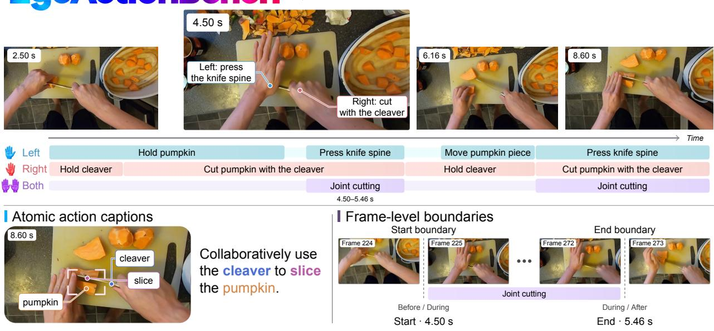  
Figure 1 Overview of EgoAction. Continuous egocentric video is represented as temporally localized atomic actions on left-hand, right-hand, and both-hands tracks (top). The bottom-left example highlights the action verb, manipulated object, and tool. Adjacent frames illustrate the start and end boundaries of a joint action (bottom right).

## manipulation: action atomicity, temporal precision, and hand-action association.

Action atomicity requires decomposing continuous manipulation into individual actions rather than summarizing a sequence with a single activity label. For example, an interval described as “stirring” may include picking up a spoon, stirring with it, and putting it down. Each action captures a distinct interaction with the object. A fine-grained description should preserve these actions and specify the objects involved, distin guishing, for example, stirring with a spoon from stirring with chopsticks.

Temporal precision requires identifying the start and end of each action, including actions that last less than a second. For example, a person washing dishes may briefly move the faucet handle to turn on the water. Missing this short action leaves a gap in the recovered sequence, even if the surrounding activity is correctly recognized as “washing dishes.” Recovering such actions requires suficiently fine temporal resolution to distinguish them from adjacent actions and localize their boundaries.

Hand-action association requires assigning each action to the left hand, right hand, or both hands while preserving their temporal relationships. The two hands can perform diferent actions over diferent intervals: the left hand may hold a bowl throughout, while the right hand picks up a spoon, stirs, and puts it down. Describing the interval as “holding a bowl and stirring” obscures which hand performs each action and how the actions overlap. A fine-grained representation should retain the sustained left-hand action alongside the sequence of shorter right-hand actions.

To study this capability, we introduce EgoActionBench, a benchmark for fine-grained egocentric action understanding. EgoActionBench represents continuous human manipulation as temporally localized atomic actions associated with the left hand, right hand, or both hands. It contains 1,407 episodes with 41,132 human-refined action annotations. Rather than providing models with predefined temporal segments to classify or describe, the benchmark requires them to recover the action structure directly from continuous egocentric video. Its annotations capture short-lived actions and independent hand behaviors with fine temporal granularity, enabling systematic evaluation beyond coarse activity descriptions.

Evaluating such predictions also requires careful treatment of temporal segmentation. Predicted and refer ence actions can difer in both their temporal boundaries and semantic content. A single prediction may span multiple reference actions, while several predictions may fragment one reference action. Existing evalu ation protocols based on merging or strict one-to-one matching for semantic scoring can therefore confound segmentation diferences with semantic errors (Fujita et al., 2020; Yao et al., 2026). We propose a progressive evaluation protocol that first retrieves temporally eligible predictions, selects one by content agreement, and then scores its temporal extent and hand association. This ordering evaluates semantic fidelity over temporally corresponding actions while retaining the ability to diagnose localization errors. A separate one-to-one matching over positive-content candidate pairs measures action precision and recall, so that output density also contributes to the overall score.

We benchmark 20 baseline models and systems on EgoActionBench, spanning proprietary models, opensource general-purpose VLMs, video captioning models, and egocentric video understanding models, and analyze their ability to recover fine-grained actions from continuous egocentric video. Our experiments reveal substantial limitations in current models, including missed short actions, inaccurate temporal boundaries, merged action sequences, and incorrect associations between actions and hands. We further adapt two backbones, Qwen3-VL-4B and LLaVA-OneVision-2-8B, through supervised fine-tuning followed by reinforcement learning on automatically annotated training episodes, studying whether supervision at the target granularity can improve action understanding without modifying the underlying model architectures. Both adapted mod els outperform all evaluated open-source baselines. These results establish baselines for EgoActionBench and highlight the gap between general video understanding and the detailed action understanding needed to learn efectively from human data.

## Our main contributions are:

• We introduce EgoActionBench, a benchmark containing 1,407 egocentric episodes and 41,132 human refined action annotations, representing continuous human manipulation as temporally localized atomic actions associated with the left hand, right hand, or both hands.

• We propose a progressive evaluation protocol that first retrieves temporally eligible predictions and then uses content agreement to select a shared correspondence for semantic fidelity, temporal overlap, and hand assignment. Separate action matching measures precision and recall, enabling fine-grained evaluation when predicted and reference actions difer in temporal segmentation.

• We benchmark 20 baseline models and systems and adapt Qwen3-VL-4B and LLaVA-OneVision-2- 8B through supervised fine-tuning followed by reinforcement learning using automatically annotated training data, revealing persistent challenges in recovering fine-grained action structure from continuous egocentric video.

## 2 Related Work

## 2.1 Egocentric Video Understanding

Egocentric action understanding has progressed from transferable video–language representations, to interaction-aware modeling, and finally to language-grounded descriptions of ongoing activity. This progression is relevant to embodied systems, where first-person observations connect perception to the hand and object being manipulated. Large-scale resources and narration-based pretraining established the foundation for egocentric learning (Damen et al., 2022; Grauman et al., 2022, 2024; Lin et al., 2022; Zhao et al., 2023; Pramanick et al., 2023). Subsequent work made hand–object relations, bimanual structure, motion, and spatial cues more explicit through supervision and interaction-aware models (Darkhalil et al., 2022; Zhang et al., 2022b; Kwon et al., 2021; Liu et al., 2024; Pei et al., 2025a; Xu et al., 2025). Video-language models and cross-view methods use language for long-video description, question answering, and knowledge transfer (Ren et al., 2024; Ye et al., 2025; Bai et al., 2025a; Zhang et al., 2026; Li et al., 2026a).

## 2.2 Video Captioning Benchmarks

Video captioning benchmarks mainly difer in the granularity of the described event, the output required from the model, and the evidence used for evaluation. Early third-person benchmarks established dense captioning for general events and procedural steps (Krishna et al., 2017; Zhou et al., 2018a,b). Egocentric extensions vary between single-activity captioning, hierarchical narration, and localized procedural description (Nakamura et al., 2021; Islam et al., 2024; Ohkawa et al., 2025; Shi et al., 2025). For embodied manipulation, WGO-Bench adds instruction-conditioned timestamped subtask annotation, but does not require an explicit actinghand track (Macrodata Labs, 2026a,b). Flora (Leng et al., 2026) combines temporal segmentation and contextual captioning to annotate intended actions in human and robot videos. Its DenseCaptionBench evaluates temporal localization and caption quality, including manipulator coordination. HanDyVQA is complementary: it evaluates hand–object reasoning through question-conditioned QA rather than open-ended caption generation and autonomous temporal discovery (Tateno et al., 2026).

Table 1 Comparison with related datasets and benchmarks. Actions may group several operations under one label; atomic actions are delimited by meaningful changes in the operation, manipulated object, contact relation, or dominant motion. Temporal localization and caption generation denote evaluated tasks. Hand-specific captions identify acting hands; independent hand timelines assign separate action intervals to each hand. Structured scoring evaluates semantic fields or facts. Checks denote documented protocol features. Rows use Ego4D narrations and Ego-Exo4D atomic descriptions. Percentages denote human egocentric episodes.
<table><tr><td>Dataset / Benchmark</td><td>Scene</td><td>Target unit</td><td>Ego.</td><td>Temp. loc.</td><td>Caption Hand-specific gen.</td><td>captions</td><td>Independent hand timelines caption scoring</td><td>Structured</td></tr><tr><td>ActivityNet Captions (Krishna et al., 2017)</td><td>Real-world</td><td>Events</td><td></td><td></td><td></td><td>X</td><td>x</td><td>X</td></tr><tr><td>EPIC-KITCHENS-100 (Damen et al., 2022)</td><td>Kitchen</td><td>Actions</td><td></td><td></td><td>X</td><td>X</td><td>x</td><td>x</td></tr><tr><td>Ego4D (Grauman et al., 2022)</td><td>Real-world</td><td>Narrated events Atomic</td><td></td><td></td><td></td><td>X</td><td>X</td><td>X</td></tr><tr><td>Ego-Exo4D (Grauman et al., 2024)</td><td>Real-world</td><td>descriptions</td><td></td><td></td><td></td><td></td><td>X</td><td>X</td></tr><tr><td>EgoYC2 (Ohkawa et al., 2025)</td><td>Kitchen</td><td>Procedural steps</td><td></td><td></td><td></td><td>X</td><td>X</td><td>X</td></tr><tr><td>HD-EPIC (Perrett et al., 2025)</td><td>Kitchen</td><td>Actions</td><td></td><td></td><td></td><td></td><td>X</td><td></td></tr><tr><td>VidCapBench (Chen et al., 2025)</td><td>Real-world</td><td>Clips</td><td>X</td><td></td><td></td><td></td><td>x</td><td></td></tr><tr><td>HanDyVQA (Tateno et al., 2026)</td><td>Real-world</td><td>HOI questions Manipulation</td><td></td><td></td><td></td><td></td><td>X</td><td></td></tr><tr><td>WGO-Bench (Macrodata Labs, 2026a)</td><td>Manipulation</td><td>events</td><td>25%</td><td></td><td></td><td>X</td><td>X</td><td></td></tr><tr><td>OmniDCBench (Yao et al., 2026)</td><td>Real-world</td><td>Scenes</td><td>X</td><td></td><td></td><td>X</td><td>X</td><td></td></tr><tr><td>CAPEval (Liu et al., 2026)</td><td>Diverse</td><td>Images Fine-grained</td><td>X</td><td></td><td></td><td>X</td><td>x</td><td></td></tr><tr><td>EgoVerse-I (Punamiya et al., 2026)</td><td>Manipulation</td><td>segments</td><td></td><td></td><td></td><td></td><td>x</td><td>X</td></tr><tr><td>DenseCaptionBench (Leng et al., 2026)</td><td>Manipulation Actions</td><td></td><td>33.3%</td><td></td><td></td><td></td><td>X</td><td></td></tr><tr><td>EgoActionBench (ours)</td><td>Real-world</td><td>Atomic actions</td><td>V</td><td></td><td></td><td></td><td></td><td></td></tr></table>

On the other hand, evaluation protocols range from caption similarity and temporal localization to factuality checks and question-answer accuracy (Liu and Wan, 2023; Chen et al., 2025; Yao et al., 2026). EgoAction-Bench takes a full egocentric clip without action queries or reference boundaries. It requires atomic action sequences on explicit Left, Right, and Both tracks, with temporal alignment evaluated against frame-level reference boundaries and hand assignment scored separately.

## 3 EgoActionBench

EgoActionBench evaluates dense hand-action captioning in egocentric videos. We first define the task and its output format, then describe data collection and annotation, and finally present a GT-anchored evaluation protocol that separately measures semantic content, temporal localization, and hand assignment.

## 3.1 Task Definition

We introduce the task of dense per-hand action captioning for egocentric video understanding. Given a complete egocentric video clip, a model must temporally localize and describe the camera wearer’s visible atomic hand actions, with an explicit hand assignment for each action.

Action vs. Atomic Action. We distinguish actions from atomic actions by their semantic granularity. An action represents a goal-directed manipulation event that may involve multiple operational phases. In contrast, an atomic action represents the smallest temporally continuous and semantically coherent unit of observable manipulation, bounded by meaningful changes in the operation, target object, contact relation, or dominant motion. For example, picking up a cup constitutes an action, whereas reaching for the cup, grasping it, and lifting it are distinct atomic actions. Thus, actions are organized around functional goals, whereas atomic actions are grounded in observable interaction dynamics.

Table 2 Dataset Statistics of EgoActionBench. Video clips, total video duration, and human-refined action annotations by source. Left, Right, and Both report annotation counts for the corresponding hand tracks.
<table><tr><td>Source</td><td>Clips</td><td>Hours</td><td>Actions</td><td>Left</td><td>Right</td><td>Both</td></tr><tr><td>Ego4D</td><td>451</td><td>3.130</td><td>16,774</td><td>6,825</td><td>8,349</td><td>1,600</td></tr><tr><td>EgoLife</td><td>485</td><td>2.676</td><td>13,306</td><td>5,895</td><td>6,109</td><td>1,302</td></tr><tr><td>EPIC-KITCHENS-100</td><td>471</td><td>2.176</td><td>11,052</td><td>4,599</td><td>5,300</td><td>1,153</td></tr><tr><td>Total</td><td>1,407</td><td>7.982</td><td>41,132</td><td>17,319</td><td>19,758</td><td>4,055</td></tr></table>

Each prediction is represented as

$$
\begin{array} { r } { p _ { i } = ( \hat { s } _ { i } , \hat { e } _ { i } , \hat { h } _ { i } , w _ { i } ) , } \end{array}\tag{1}
$$

where $[ \hat { s } _ { i } , \hat { e } _ { i } )$ is the predicted temporal interval, $\hat { h } _ { i } \in \{ L , R , B \}$ denotes the Left, Right, or Both track, and $w _ { i }$ is a free-text action caption. No action queries or reference boundaries are provided.

Each caption describes one atomic action. The Left and Right tracks describe actions of the corresponding anatomical hands. The Both track captures coordinated manipulation of a shared object, rather than simultaneous independent actions. Both captions describe the collaboration, while any annotated single-hand roles remain separate records on Left and Right.

## 3.2 Data Collection

Data sources and selection. Episodes are curated from Ego4D (Grauman et al., 2022), EgoLife (Yang et al., 2025b), and EPIC-KITCHENS-100 (Damen et al., 2022). We combine these sources to cover hand-object interactions across kitchen, household, and occupational settings. Each episode captures a coherent task or subtask performed by the camera wearer and is screened for suitability for dense hand-object annotation. Suficient surrounding context is retained to distinguish the target operations from neighboring activities. Episodes with severe occlusion, unverifiable actions, or unrelated task transitions are discarded. Sourcevideo identifiers and original temporal ranges are retained to trace each episode and support separation from the adaptation data. Additional dataset details and annotated examples are provided in sections C and G.

Dataset statistics. The collection contains 1,407 episodes with 41,132 action captions across the Left, Right, and Both tracks (table 2). It spans 7.982 hours, with a mean episode duration of 20.42 seconds and a median action duration of 0.60 seconds. Non-action entries, including invisibility, idle intervals, and the absence of bimanual collaboration, are excluded from the action counts.

## 3.3 Data Annotation Pipeline

We annotate the selected episodes through a five-stage human-in-the-loop pipeline (figure 3). To help the captioning model associate each action with the correct hand, we extract left and right hand masks using CaRe-Ego (Su et al., 2026). The masks are temporally smoothed and rendered as distinct overlays on the video. A VLM then generates sliding-window captions for the Left, Right, and Both tracks, merging consecutive fragments of the same continuous action into draft annotations. Human annotators correct action descriptions, hand assignments, and temporal boundaries against the original video. Agentic quality control subsequently inspects local visual evidence to propose further revisions, guided by hand-object contact, hand motion phases, and object-state changes. Finally, human reviewers verify the annotations; episodes requiring further correction return for annotation and QC. Only human-verified annotations enter the benchmark. Detailed annotation and quality-control procedures are as follows.

Stage 1: Hand-aware preprocessing. We extract left and right hand masks using CaRe-Ego (Su et al., 2026). Temporal smoothing filters brief or inconsistent detections using the continuity of hand regions across neighboring frames. The filtered masks are rendered as distinct overlays that highlight each hand while preserving the surrounding objects and scene. This hand-highlighted video provides explicit visual cues for the subsequent per-hand captioning.

(a) Activity taxonomy(a) Activity taxonomy

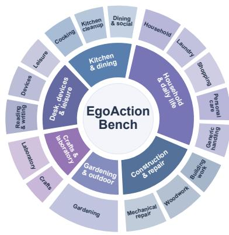  
(b) Source composition

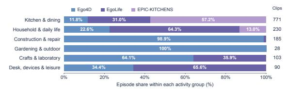  
(c) Scene distribution  
(d) Action duration  
(e) Caption vocabulary

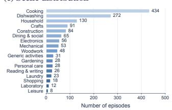

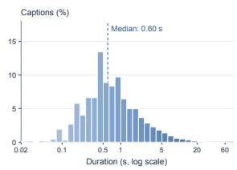

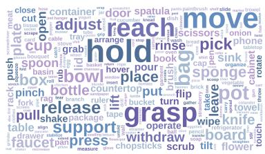  
(f) Top-30 primary verbs(f) Top-30 primary verbs

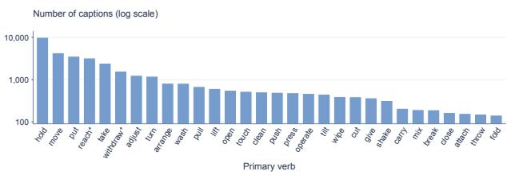  
Figure 2 Dataset Composition and Action Statistics. (a) Activity taxonomy with six groups and 17 scenes. (b) Source composition within each activity group. (c) Episode counts by scene. (d) Action-duration distribution on a logarithmic time axis, with a median of 0.60 s. (e) Caption vocabulary. (f) The 30 most frequent primary verbs, with counts on a logarithmic scale. Statistics cover 1,407 episodes and 41,132 action captions; sector angles do not encode counts.

Stage 2: Sliding-window captioning. A VLM processes the hand-highlighted video in sliding windows and produces one-second caption proposals for the Left, Right, and Both tracks. It uses frames from the current window and recent captions as context. To join actions that span multiple windows, we identify candidate merges within each track using temporal adjacency and text similarity. Candidate merges are then checked against the video to confirm that the fragments describe the same uninterrupted action. Segments separated by task-relevant changes in the operation, manipulated object, or contact relation are kept distinct. The resulting variable-length segments serve as drafts for human annotation.

Stage 3: Human annotation. Annotators inspect the original video and revise the drafts according to the task definition in section 3.1. They correct action descriptions and hand assignments, add omitted actions, split compound events, and remove details not supported by the video. Adjacent fragments are merged when they describe the same uninterrupted action. The three tracks are reviewed separately, since one hand may sustain an action while the other performs several shorter operations. Annotators inspect frames from the original video around action transitions to refine start and end times.

Stage 4: Agentic quality control. Reviewing dense annotations requires checking many action segments and closely inspecting brief transitions. We use a team of agents to review these annotations, with each agent checking assigned intervals for errors in action descriptions, hand assignments, and temporal boundaries. Agents inspect timestamped frames from the original video. Around ambiguous boundaries, they examine consecutive native frames one by one to determine when an action starts or ends. Three visual cues guide this review:

• Hand-object contact: changes in contact or control.

• Hand-motion phase: changes between operations, even while maintaining a stable grasp.

• Object-state change: visible responses such as displacement, deformation, or content transfer.

Caption revisions correct the described operation, participating objects, or hand roles. Boundary adjustments align action starts and ends with the first visible evidence of the corresponding transition. Each proposed revision includes supporting frame references and a brief explanation of the change, allowing human reviewers to verify it against the original video in Stage 5. Unresolved cases are flagged for further human review.

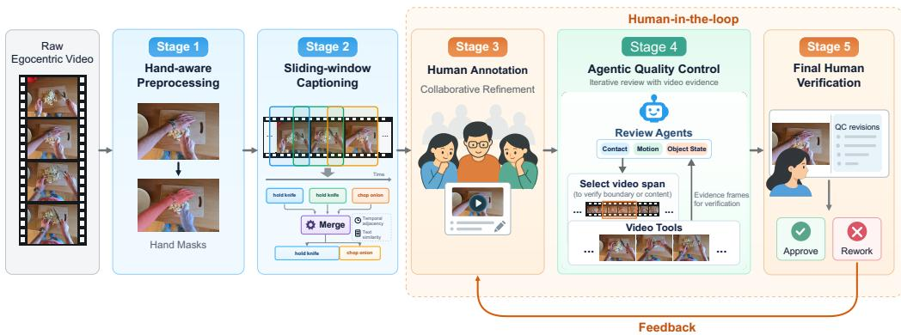  
Figure 3 Human-in-the-Loop Construction of EgoActionBench. Hand-aware preprocessing and sliding-window captioning generate draft per-hand annotations. Human annotation, agentic quality control, and final human verification refine these drafts against the original video. Episodes needing correction return for human annotation and QC.

Stage 5: Final human verification. Human reviewers check the annotations against the original video, using the proposed revisions, supporting frames, and explanations from Stage 4. They resolve remaining ambiguities and either approve the annotations or return the episode to Stage 3 for correction and another round of agentic QC. Only approved annotations enter the benchmark.

## 3.4 Evaluation Suite

We evaluate what action is described, when it occurs, and which hand performs it through Semantic and Temporal scores. Our evaluation is explicitly ground-truth-based: each ground-truth action selects at most one prediction, which supplies its Semantic score and temporal IoU. As illustrated in figure 4, we first retrieve temporally eligible predictions from compatible hand tracks, then select the candidate with the highest positive semantic agreement. A language-model judge assesses semantic agreement across four fields: Verb, Objects, Tools, and Motion. The selected prediction’s semantic assessment and hand-label agreement are combined into Semantic, while its interval determines temporal IoU, with its caption and interval retained in full. Semantic and temporal IoU are averaged over ground-truth actions with completed evaluations on a 0–100 scale. Temporal averages the resulting m-tIoU and the micro-averaged F1 score based on one-toone action matching. This combination captures interval overlap quality, action segmentation completeness, and prediction redundancy. The arithmetic mean of Semantic and Temporal defines EgoActionScore. Full matching rules, scoring definitions, and metric interpretation are provided as follows.

Evaluation inputs. Each ground-truth action and prediction are represented as

$$
g = ( I _ { g } , h _ { g } , c _ { g } , F _ { g } ) , \qquad p = ( I _ { p } , \hat { h } _ { p } , \hat { c } _ { p } ) ,\tag{2}
$$

where I is the temporal interval, $h \in \{ L , R , B \}$ is the acting hand, and c is the natural-language caption. The structured description $F _ { g }$ is provided only on the ground-truth side for semantic evaluation. Models submit an interval, a hand track, and a caption; they are not required to predict structured fields.

Stage 1: Candidate retrieval. For each ground-truth action g, candidates are drawn from predictions in the same video. The admissible hand tracks are

$$
\mathcal { H } ( h _ { g } ) = \left\{ \begin{array} { l l } { \{ L , R \} , } & { h _ { g } \in \{ L , R \} , } \\ { \{ B \} , } & { h _ { g } = B . } \end{array} \right.\tag{3}
$$

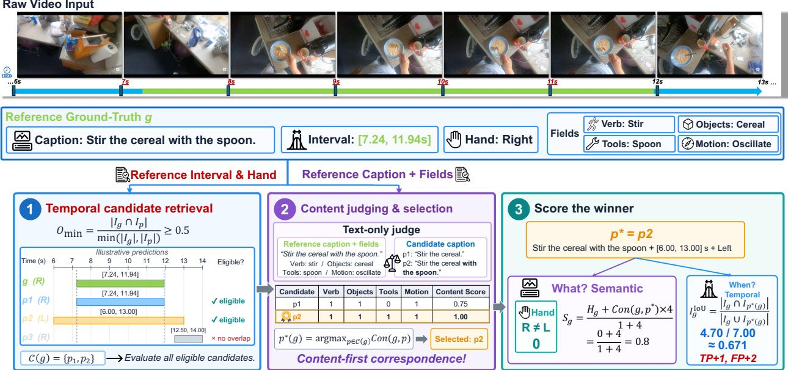  
Figure 4 EgoAction evaluation pipeline. For each ground-truth action, temporal overlap and hand-track compatibility determine the eligible candidates. Positive field-level semantic agreement selects one prediction, whose original caption, interval, and hand label are used to compute Semantic and temporal IoU. These scores are averaged separately over ground-truth actions with completed evaluations.

A single-hand action can retrieve predictions from either single-hand track, keeping otherwise correct predictions eligible despite left–right attribution errors. Bimanual and single-hand actions are kept separate because the Both track represents joint two-hand actions.

Temporal eligibility is determined by overlap normalized by the shorter interval:

$$
O _ { \operatorname* { m i n } } ( g , p ) = { \frac { | I _ { g } \cap I _ { p } | } { \operatorname* { m i n } ( | I _ { g } | , | I _ { p } | ) } } .\tag{4}
$$

Let $\mathcal { P }$ denote the predictions in the current video. The eligible candidate set $\mathcal { C } ( g )$ is

$$
\mathcal { C } ( g ) = \left\{ p \in \mathcal { P } \Big | \hat { h } _ { p } \in \mathcal { H } ( h _ { g } ) , O _ { \operatorname* { m i n } } ( g , p ) \geq \tau _ { \mathrm { s e m } } \right\} .\tag{5}
$$

The default setting uses $\tau _ { \mathrm { s e m } } = 0 . 5$ and evaluates every eligible candidate; threshold sensitivity is considered in section 5.4. This criterion admits both a long prediction containing a short ground-truth interval and a short prediction contained within a long ground-truth interval. This retrieval criterion keeps predictions with imperfect temporal boundaries eligible for semantic evaluation. Temporal IoU separately measures interval alignment, assigning lower scores to predictions that extend beyond or cover only part of the ground-truth interval.

Stage 2: Content judging. We assess action content through the operation, participating objects, tools, and motion. Hand assignment is evaluated by directly comparing the submitted track with the ground-truth hand label and is incorporated into Semantic in Stage 3. The structured reference $F _ { g } = ( v _ { g } , O _ { g } , U _ { g } , \mu _ { g } )$ contains four fields: Verb, the core operation; Objects, the participating entities and their action-dependent roles; Tools, the intermediaries used to perform the operation; and Motion, the coarse physical movement underlying the operation. Objects and Tools are distinguished by their role: a knife is a tool when used for cutting, but an object when it is picked up. Motion labels are reach, translate, lift, lower, rotate, press, oscillate, or static.

For every $p \in \mathcal { C } ( g )$ , a language-model judge receives the ground-truth caption $c _ { g } ,$ structured fields $F _ { g } .$ , and full predicted caption $\hat { c } _ { p }$ , with no access to video frames. Required content is assessed using direct quotes

from the prediction. Equivalent wording receives credit, while missing or contradictory content does not.   
Supporting evidence must describe the same action and cannot combine distinct actions within a caption.

Verb and Motion receive binary scores. Objects and Tools are evaluated item by item and averaged within each field. Only fields marked as required in the ground truth contribute; skipped and inapplicable fields are excluded. Required content omitted from a prediction receives zero credit and remains in the denominator.

Let $K _ { g }$ denote the scored fields and $r _ { k } ( g , p ) \in [ 0 , 1 ]$ their individual scores. These four fields capture the semantic content of an action. We average their applicable scores to obtain the content score $C o n ( g , p )$ used for prediction selection:

$$
C o n ( g , p ) = \frac { 1 } { | K _ { g } | } \sum _ { k \in K _ { g } } r _ { k } ( g , p ) .\tag{6}
$$

A field therefore receives no additional weight for containing more items. For every eligible pair, the judge must resolve each required field and its action binding.

Selecting one prediction per ground-truth action. For each candidate set containing a prediction with a positive content score, we select the prediction with the highest content score:

$$
p ^ { * } ( g ) = \underset { p \in \mathcal { C } ( g ) , C o n ( g , p ) > 0 } { \arg \operatorname* { m a x } } C o n ( g , p ) .\tag{7}
$$

Among candidates with equal content scores, we prioritize agreement with the ground-truth hand, followed by higher temporal IoU. Since hand identity is part of the action’s semantics, this order favors semantic fidelity before temporal alignment. Each ground-truth action selects at most one prediction, but the same prediction may be selected for multiple ground-truth actions. We retain the selected caption and interval without combining evidence across predictions or cropping temporal boundaries.

Stage 3: Component scoring. Using the selected prediction, we compute hand-label agreement, Semantic, and temporal IoU:

$$
H _ { g } = { \bf 1 } [ h _ { g } = \hat { h } _ { p ^ { * } ( g ) } ] , \qquad S _ { g } = \frac { H _ { g } + \sum _ { k \in K _ { g } } r _ { k } ( g , p ^ { * } ( g ) ) } { 1 + | K _ { g } | } ,\tag{8}
$$

$$
I _ { g } ^ { \mathrm { I o U } } = \frac { \lvert I _ { g } \cap I _ { p ^ { * } ( g ) } \rvert } { \lvert I _ { g } \cup I _ { p ^ { * } ( g ) } \rvert } .\tag{9}
$$

Temporal IoU uses the same selected prediction and its original interval. Actions without a candidate with a positive content score receive zero for all three quantities and remain in the averaging denominator.

Action matching. Temporal IoU measures interval overlap, but does not by itself enforce a one-to-one correspondence or explicitly penalize every unmatched prediction. We therefore complement tIoU with an action-level F1 score to evaluate event coverage and segmentation granularity (Figure 5). For each video v, we find a maximum-cardinality one-to-one matching $M _ { v }$ over all eligible pairs $( g , p )$ with $C o n ( g , p ) > 0$ . Each matched pair contributes one true positive. We pool counts across videos to compute the micro-averaged F1 score:

$$
T P = \sum _ { v } | M _ { v } | , \qquad F P = N _ { P } - T P , \qquad F N = N _ { G } - T P ,\tag{10}
$$

$$
\mathrm { F 1 } = 1 0 0 \times \frac { 2 T P } { N _ { P } + N _ { G } } .\tag{11}
$$

Here, $N _ { G }$ is the number of evaluated ground-truth actions, and $N _ { P }$ counts all identifiable submitted predic tions in the input videos, including unmatched predictions and records with invalid intervals. One-to-one action matching penalizes over-segmentation through false positives and under-segmentation through false negatives.

Let $\mathcal { G }$ denote all ground-truth actions and $\mathcal { G } _ { \mathrm { e v a l } } \subseteq \mathcal { G }$ the actions with all candidate judgments completed for a given model. Actions without a candidate with a positive content score receive zero scores and are included in $\mathcal { G } _ { \mathrm { e v a l } }$ . All components use this same evaluated ground-truth set, with $N _ { G } = | \mathcal { G } _ { \mathrm { e v a l } } |$ . Each evaluated action receives equal weight, with scores on a 0–100 scale:

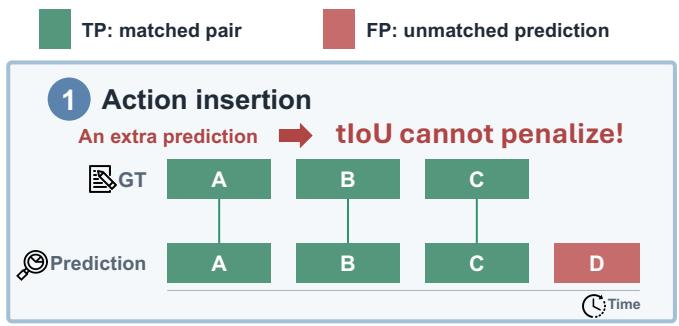

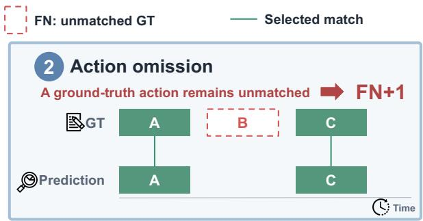

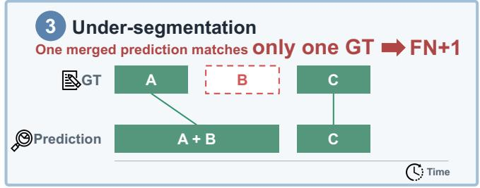

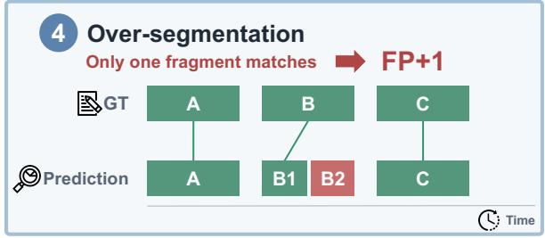  
Figure 5 Why F1 score matters. We complement tIoU, which measures interval overlap, with one-to-one F1 to explicitly penalize errors in event coverage and segmentation granularity. The four schematic examples illustrate (1) action insertion, (2) action omission, (3) under-segmentation, and (4) over-segmentation.

$$
( \mathrm { S e m a n t i c , m - t I o U } , \mathrm { H a n d } ) = \frac { 1 0 0 } { N _ { G } } \sum _ { g \in \mathcal { G } _ { \mathrm { e v a l } } } ( S _ { g } , I _ { g } ^ { \mathrm { I o U } } , H _ { g } ) .\tag{12}
$$

Temporal averages m-tIoU and F1, and the arithmetic mean of Semantic and Temporal defines the aggregate score:

$$
\mathrm { { T e m p o r a l } = \frac { m \mathrm { { - } t I o U + F 1 } } { 2 } , }\tag{13}
$$

$$
\mathrm { E g o A c t i o n S c o r e = \frac { S e m a n t i c + T e m p o r a l } { 2 } . }\tag{14}
$$

We additionally report Hand and the four content-field scores, with each content field averaged over groundtruth actions requiring that field.

Metric interpretation. EgoActionScore combines semantic fidelity, temporal overlap, and action precision and recall. A prediction may support multiple ground-truth actions in semantic scoring but can match at most one action when computing F1. Additional unmatched predictions reduce F1. Hand scores should also be interpreted in light of candidate filtering. Since a Both ground-truth action admits only Both predictions, its Hand score reflects whether a candidate with a positive content score is available, rather than unrestricted three-way hand classification.

## 4 Learning to Caption Egocentric Actions

We study whether supervision at the granularity defined in section 3 improves fine-grained egocentric action understanding. Given a video, the model must recover individual actions, their temporal boundaries, and the hands that perform them. EgoAction learns this mapping through supervised fine-tuning followed by reinforcement learning.

Training data. The training set contains 5,354 egocentric video episodes drawn from Ego4D (Grauman et al., 2022), EPIC-KITCHENS (Damen et al., 2022), and EgoLife (Yang et al., 2025b), including 5,146 training examples and 208 validation examples. Each example pairs a video with timestamped captions organized into Left, Right, and Both tracks. The targets jointly supervise action descriptions, temporal intervals, and hand assignments. Unlike the human-refined annotations used to evaluate EgoActionBench, these training labels are generated and refined automatically. Source identifiers are retained to separate the adaptation data from the benchmark evaluation set.

Supervised adaptation. We perform supervised fine-tuning on two pretrained backbones: Qwen3-VL-4B Instruct (Bai et al., 2025a) and LLaVA-OneVision-2-8B (An et al., 2026). Qwen3-VL serves as a representative general-purpose model for image and video understanding. LLaVA-OneVision-2 provides a complementary backbone through its native-resolution OneVision-Encoder, unified spatiotemporal modeling, and emphasis on temporal and spatial grounding. This pairing allows us to examine whether dense action supervision benefits diferent pretrained models, including one already oriented toward fine-grained video perception. Given a video and a task instruction, each model is trained to generate timestamped action captions across the Left, Right, and Both tracks. Action descriptions, temporal intervals, and hand assignments are jointly supervised through next-token prediction, with the loss applied only to the target response. The original architectures are retained, with the visual encoders frozen and the language models and multimodal connectors updated.

Reinforcement learning. To optimize semantic fidelity, temporal alignment, and action coverage at the sequence level, we further refine the supervised models using group relative policy optimization (GRPO; Shao et al., 2024). For each training video $v ,$ the model generates G alternative sets of timestamped action captions, denoted by $\{ y _ { i } \} _ { i = 1 } ^ { G }$ . GRPO uses each output’s reward relative to the group mean to guide policy updates, favoring higher-reward predictions. A KL penalty against the SFT policy regularizes these updates.

Each candidate output is scored against the training reference using the following reward:

$$
R ( v , y _ { i } ) = 0 . 5 S ( v , y _ { i } ) + 0 . 2 5 I ( v , y _ { i } ) + 0 . 2 5 F ( v , y _ { i } ) ,\tag{15}
$$

where $S$ measures semantic fidelity, including hand assignment, I measures temporal overlap, and $F$ is F1 from one-to-one action matching, accounting for missed and redundant predictions.

## 5 Experiments

## 5.1 Experimental Setup

We evaluate 20 baseline models and systems on EgoActionBench, spanning four categories: proprietary models, open-source general-purpose VLMs, video captioning models, and egocentric video understanding models. This comparison examines how general multimodal capability and task specialization translate to dense action captioning. The EgoAction models introduced in Section 4 are evaluated alongside their Qwen3-VL-4B and LLaVA-OneVision-2-8B backbones. Models receive video inputs through their respective input interfaces and are prompted to follow the task specification in Section 3.1. Evaluation follows the suite in Section 3.4. The open-weight Qwen3-32B (Yang et al., 2025a) serves as the semantic judge, supporting reproducible eval uation with a fixed model checkpoint. Reported metrics include EgoActionScore, its Temporal and Semantic components, and detailed scores for Hand, Verb, Objects, Tools, and Motion.

Human baseline. To establish a human baseline, 3 annotators independently annotate evaluation episodes following the task definition in Section 3.1. They identify action boundaries, assign hand tracks, and write action captions from the original videos, without access to the reference annotations or model predictions. Their annotations are evaluated against the fixed benchmark references using the same matching procedure, semantic judge, and scoring rules as the models. Table 3 reports their scores as Human Expert.

## 5.2 Main Benchmark Results

Dense action captioning remains challenging for current VLMs. Table 3 reveals a substantial gap between current models and human performance: even GPT-6 Astra (OpenAI, 2026b), the strongest model evaluated, achieves an EgoActionScore of 59.6 compared with 90.4 for human experts. Performance does not increase monotonically with model size, and models specialized for video captioning or egocentric understanding do not consistently outperform general-purpose VLMs. These results highlight the dificulty of jointly recovering action content, temporal boundaries, and hand assignments.

Table 3 Dense action captioning on EgoActionBench. All scores range from 0 to 100; higher is better. Temporal Overall is the mean of m-tIoU and micro-averaged F1. Semantic Overall averages the applicable Hand, Verb, Objects, Tools, and Motion scores within each ground-truth action, then averages over ground-truth actions. EgoActionScore is the mean of Temporal Overall and Semantic Overall. Parentheses identify the EgoAction backbone. Flora uses a 9B temporal segmenter followed by a 27B captioner. Best scores in each column are bolded separately for proprietary and open-source models.
<table><tr><td rowspan="2">Model / system</td><td rowspan="2">EgoAction Score</td><td colspan="3">Temporal</td><td colspan="6">Semantic</td></tr><tr><td>m-tIoU</td><td>F1</td><td>Overall</td><td>Hand</td><td>Verb</td><td>Objects</td><td>Tools</td><td>Motion</td><td>Overall</td></tr><tr><td colspan="10">Human Baseline</td></tr><tr><td>Human Expert</td><td>90.4</td><td>88.4</td><td>93.1</td><td>90.8</td><td>95.5</td><td>94.5</td><td>95.1</td><td>94.8</td><td>74.5</td><td>90.1</td></tr><tr><td>Proprietary models</td><td></td><td></td><td></td><td></td><td></td><td></td><td></td><td></td><td></td><td></td></tr><tr><td>GPT-5.6 Sol (OpenAI, 2026a)</td><td>49.8</td><td>31.0</td><td>57.6</td><td>44.3</td><td>67.1</td><td>50.8</td><td>60.5</td><td>77.4</td><td>41.5</td><td>55.2</td></tr><tr><td>GPT-6 Astra (OpenAI, 2026b)</td><td>59.6</td><td>40.6</td><td>68.6</td><td>54.6</td><td>75.8</td><td>63.3</td><td>69.9</td><td>80.8</td><td>48.9</td><td>64.6</td></tr><tr><td>Gemini 3.1 Pro Preview (Google DeepMind, 2026)</td><td>34.8</td><td>18.1</td><td>41.8</td><td>29.9</td><td>49.4</td><td>34.5</td><td>43.6</td><td>64.5</td><td>30.7</td><td>39.8</td></tr><tr><td colspan="10">Open-source VLMs</td></tr><tr><td>Qwen2.5-VL-72B-Instruct (Bai et al., 2025b)</td><td>24.7</td><td>8.2</td><td>26.1</td><td>17.2</td><td>43.4</td><td>26.8</td><td>32.8</td><td>49.3</td><td>25.4</td><td>32.2</td></tr><tr><td>Qwen3-VL-32B-Instruct (Bai et al., 2025a)</td><td>29.2</td><td>11.8</td><td>32.0</td><td>21.9</td><td>48.5</td><td>30.8</td><td>37.2</td><td>58.2</td><td>29.2</td><td>36.6</td></tr><tr><td>Qwen3-VL-8B-Instruct (Bai et al., 2025a)</td><td>25.2</td><td>10.3</td><td>28.1</td><td>19.2</td><td>43.7</td><td>25.5</td><td>32.2</td><td>51.5</td><td>23.0</td><td>31.2</td></tr><tr><td>InternVL3.5-8B (Wang et al., 2025)</td><td>20.4</td><td>8.8</td><td>25.4</td><td>17.1</td><td>32.4</td><td>19.4</td><td>25.5</td><td>44.6</td><td>16.9</td><td>23.7</td></tr><tr><td>MiniCPM-V-4.5-8B (OpenBMB, 2025)</td><td>19.4</td><td>6.7</td><td>20.3</td><td>13.5</td><td>33.9</td><td>21.9</td><td>25.2</td><td>34.5</td><td>20.3</td><td>25.3</td></tr><tr><td>VideoLLaMA3-7B (Zhang et al., 2025)</td><td>14.2</td><td>4.4</td><td>11.1</td><td>7.8</td><td>24.1</td><td>17.4</td><td>24.8</td><td>38.6</td><td>16.3</td><td>20.7</td></tr><tr><td>Qwen3-VL-4B-Instruct (Bai et al., 2025a)</td><td>25.9</td><td>9.9</td><td>28.2</td><td>19.1</td><td>46.3</td><td>25.2</td><td>35.0</td><td>47.8</td><td>24.0</td><td>32.8</td></tr><tr><td>Molmo2-8B (Clark et al., 2026)</td><td>18.8</td><td>8.0</td><td>21.2</td><td>14.6</td><td>30.4</td><td>19.1</td><td>24.6</td><td>41.3</td><td>17.3</td><td>23.0</td></tr><tr><td>LLaVA-OV2-8B (An et al., 2026)</td><td>24.7</td><td>9.8</td><td>26.7</td><td>18.2</td><td>42.0</td><td>25.8</td><td>32.6</td><td>48.1</td><td>23.9</td><td>31.2</td></tr><tr><td colspan="10">Open-source video captioning models</td></tr><tr><td>video-SALMONN-2+-3B (Tang et al., 2025)</td><td>10.8</td><td>3.5</td><td>14.2</td><td>8.8</td><td>19.9</td><td>8.5</td><td>13.7</td><td>28.4</td><td>9.0</td><td>12.8</td></tr><tr><td>CapRL-Video-4B (Yang et al., 2026)</td><td>32.4</td><td>16.9</td><td>40.1</td><td>28.5</td><td>49.3</td><td>28.7</td><td>39.0</td><td>60.6</td><td>27.5</td><td>36.3</td></tr><tr><td>OmniCaptioner-IF-3B (Wang et al., 2026a)</td><td>20.0</td><td>6.6</td><td>25.7</td><td>16.1</td><td>36.0</td><td>18.0</td><td>21.9</td><td>28.8</td><td>19.5</td><td>23.8</td></tr><tr><td>OmniCaptioner-IF-7B (Wang et al., 2026a)</td><td>23.0</td><td>10.1</td><td>25.0</td><td>17.6</td><td>38.5</td><td>24.3</td><td>26.3</td><td>40.8</td><td>24.6</td><td>28.5</td></tr><tr><td colspan="10">Open-source egocentric video understanding models</td></tr><tr><td>EgoThinker-7B (Pei et al., 2025b)</td><td>20.8</td><td>13.7</td><td>24.1</td><td>18.9</td><td>33.7</td><td>19.0</td><td>19.1</td><td>13.1</td><td>19.5</td><td>22.8</td></tr><tr><td>EgoGPT-7B (Yang et al., 2025b)</td><td>15.4</td><td>4.5</td><td>16.0</td><td>10.3</td><td>24.1</td><td>18.9</td><td>18.4</td><td>22.5</td><td>20.3</td><td>20.4</td></tr><tr><td>RynnBrain-4B (Dang et al., 2026)</td><td>13.9</td><td>10.4</td><td>13.3</td><td>11.8</td><td>21.2</td><td>12.9</td><td>15.4</td><td>15.7</td><td>14.4</td><td>15.9</td></tr><tr><td>Flora (Leng et àl., 2026)</td><td>37.8</td><td>18.6</td><td>46.9</td><td>32.8</td><td>51.2</td><td>41.4</td><td>37.3</td><td>59.0</td><td>41.3</td><td>42.9</td></tr><tr><td colspan="10">EgoAction (Ours)</td></tr><tr><td>EgoAction (LLaVA-OV2-8B)</td><td>47.9</td><td>32.3</td><td>57.0</td><td>44.6</td><td>67.0</td><td>46.2</td><td>51.7</td><td>63.0</td><td>39.6</td><td>51.2</td></tr><tr><td>EgoAction (Qwen3-VL-4B)</td><td>41.8</td><td>26.6</td><td>45.9</td><td>36.3</td><td>63.4</td><td>41.5</td><td>47.6</td><td>58.2</td><td>36.8</td><td>47.4</td></tr></table>

Task-specific adaptation improves dense action captioning across backbones. EgoAction improves EgoActionScore by 15.9 points on Qwen3-VL-4B (Bai et al., 2025a) and 23.2 points on LLaVA-OV2-8B (An et al., 2026), with both variants outperforming all evaluated open-source baselines (Table 3). Improvements span temporal localization, hand assignment, and all four semantic fields, with larger gains in the Temporal component. The OV2 variant also approaches GPT-5.6 Sol (OpenAI, 2026a) in Temporal and Hand scores, while a larger gap remains in Semantic. This pattern suggests that task-specific training is particularly efective at improving when actions occur and which hand performs them.

Precise temporal localization remains a central bottleneck. GPT-6 Astra reaches an m-tIoU of 40.6, compared with 88.4 for human experts (Table 3). Both EgoAction variants also remain well below human performance on Motion, suggesting that accurately describing movements such as lifting, rotating, and pressing remains challenging. Short actions are particularly sensitive to boundary errors, since the same absolute timing ofset accounts for a larger fraction of their duration. Examining performance across action durations helps identify where temporal accuracy deteriorates and whether adaptation improves the recovery of brief actions.

## 5.3 Performance by Action Duration

We examine how action duration afects model performance, with particular attention to actions shorter than one second. We compare each backbone with its EgoAction variant to assess whether adaptation improves the description and temporal localization of short actions. Table 4 reports Content, Semantic, m-tIoU, and Hand across duration groups.

Table 4 Performance by ground-truth action duration. Per-action components are on a 0–100 scale. Shaded columns highlight actions shorter than one second. Duration bins (s) are < 0.5, [0.5, 1), [1, 2), [2, 5), and 5.
<table><tr><td rowspan="2">Model</td><td colspan="3">Content</td><td colspan="3">Semantic</td><td colspan="3">m-tIoU</td><td colspan="4">Hand</td></tr><tr><td>&lt; 0.5 0.5-1</td><td>1-2</td><td>2-5 ≥ 5</td><td>&lt; 0.5 0.5-1</td><td>1-2</td><td>2-5 ≥5</td><td>&lt; 0.5 0.5-1</td><td>1-2</td><td>2-5</td><td>≥ 5</td><td>&lt; 0.5 0.5-1</td><td>1-2</td><td>2-5 ≥</td></tr><tr><td>Qwen3-VL-4B</td><td>25.3</td><td>26.630.4 34.9</td><td>42.2</td><td>29.5 31.3</td><td>34.9</td><td>39.6 46.6</td><td>3.6</td><td>7.9</td><td>13.4 21.3 39.1</td><td></td><td>42.3 45.4</td><td>48.5 54.2</td><td>60.8</td></tr><tr><td>+ EgoAction</td><td>35.0 41.8</td><td></td><td>48.0 53.5 59.4</td><td>39.8 47.1</td><td>53.5</td><td>59.2 65.1</td><td>18.4</td><td>26.1</td><td>30.3 40.4 56.1</td><td></td><td>54.4</td><td>63.2 70.5 77.4</td><td>83.4</td></tr><tr><td>LLaVA-OV2-8B</td><td>23.3 25.9</td><td></td><td>30.8 36.6 43.9</td><td>26.5 29.4</td><td>34.6</td><td>40.6 48.4</td><td>3.2</td><td>7.6</td><td>13.6 21.840.5</td><td></td><td>36.1</td><td>40.2 46.3 53.3</td><td>63.4</td></tr><tr><td>+ EgoAction</td><td>39.3</td><td>45.8</td><td>52.056.1 61.5</td><td>44.1 51.1</td><td></td><td>57.4 61.4 66.5</td><td>20.3</td><td>33.5</td><td>40.3 48.9</td><td>59.3</td><td>58.8</td><td>67.2 73.9</td><td>78.2 83.0</td></tr><tr><td>Qwen3-VL-32B</td><td>28.1</td><td>30.5</td><td>36.7 41.8 50.0</td><td>31.8 34.6</td><td>40.5</td><td>45.954.5</td><td>4.3</td><td>9.6</td><td>15.9 25.0 45.3</td><td></td><td>42.9</td><td>47.0</td><td>52.4 58.7 69.2</td></tr><tr><td>GPT-6 Astra</td><td>51.9</td><td>61.5</td><td>69.6 72.4 76.8</td><td>55.9</td><td>65.2 73.0</td><td>75.7 79.5</td><td>23.3</td><td>42.7</td><td>55.7 62.7 68.1</td><td></td><td>67.7</td><td>76.4</td><td>83.6 86.088.5</td></tr></table>

Briefactions remain dificult to localize precisely. Table 4 shows that performance declines as actions become shorter across all six models, afecting content recovery, semantics, temporal overlap, and hand assignment. Temporal localization is particularly weak: both base models score below 4 in m-tIoU for actions shorter than 0.5 seconds. Task-specific adaptation improves all four components on both backbones, yet a substantial gap in temporal overlap persists between brief and longer actions. These results identify precise boundary recovery for brief actions as a central challenge in dense egocentric action understanding.

## 5.4 Ablation Studies

Table 5 Supervised fine-tuning with and without GRPO. Performance on EgoActionBench for the Qwen3-VL-4B and LLaVA-OV2-8B backbones. We report EgoActionScore and its Temporal and Semantic components. Bold values indicate the higher score within each backbone. All scores range from 0 to 100.
<table><tr><td>Backbone</td><td>Training</td><td>EgoActionScore</td><td>Temporal</td><td>Semantic</td></tr><tr><td rowspan="2">Qwen3-VL-4B</td><td>SFT</td><td>40.6</td><td>35.0</td><td>46.2</td></tr><tr><td> $\mathrm { S F T } + \mathrm { G R P O }$ </td><td>41.8</td><td>36.3</td><td>47.4</td></tr><tr><td rowspan="2">LLaVA-OV2-8B</td><td>SFT</td><td>46.9</td><td>43.5</td><td>50.2</td></tr><tr><td>SFT + GRPO</td><td>47.9</td><td>44.6</td><td>51.2</td></tr></table>

GRPO improves performance beyond supervised fine-tuning. To assess the contribution of reinforcement learning, we compare the SFT models with their GRPO-refined counterparts in Table 5. Adding GRPO increases EgoActionScore from 40.6 to 41.8 on Qwen3-VL-4B and from 46.9 to 47.9 on LLaVA-OV2-8B, with improvements in both Temporal and Semantic scores. The improvements in both components suggest that our task-specific reward design strengthens action localization and description beyond supervised fine-tuning.

Model rankings remain stable across overlap thresholds. To assess sensitivity to candidate filtering, we vary $\tau _ { \mathrm { s e m } } \in \{ 0 . 3 , 0 . 5 , 0 . 7 \}$ while keeping predictions and pairwise semantic judgments fixed. Stricter filtering lowers absolute scores but preserves the ranking of all six models (Table 6). Both EgoAction variants retain substantial gains over their backbones, including improvements of 13.6 and 19.8 points at the strictest threshold. The model comparisons and benefits of adaptation therefore remain consistent across the tested thresholds.

More input frames improve EgoAction performance. Sparse video sampling may miss brief actions and changes at their boundaries. We vary the frame rate and frame budget to examine sensitivity to sampling and whether EgoAction maintains its advantage across input settings (Table 6(b) and Figure 6(e–f)). All six models improve when the sampling rate increases from 2 to 5 fps. Further increasing it to 10 fps yields limited additional gains. Under fixed-count sampling, all models improve with a larger frame budget. Both EgoAction variants outperform their backbones under every tested setting.

Table 6 Sensitivity to candidate overlap thresholds and frame sampling. EgoActionScore on EgoActionBench under difer ent evaluation thresholds and video input settings. (a) The candidate overlap threshold $\tau _ { \mathrm { s e m } }$ takes values of 0.3, 0.5, and 0.7, with predictions generated at 2 fps and their semantic judgments held fixed. (b) We compare sampling at 2, 5, and 10 fps with fixed budgets of 16, 32, and 64 frames per clip, using $\tau _ { \mathrm { s e m } } = 0 . 5$ . All scores range from 0 to 100.
<table><tr><td rowspan="3">Model</td><td colspan="3">(a) Varying τsem</td><td colspan="6">(b) Varying video input settings</td></tr><tr><td rowspan="2">0.3</td><td rowspan="2">0.5</td><td rowspan="2">0.7</td><td colspan="3">Fixed-rate sampling</td><td colspan="3">Fixed-count sampling</td></tr><tr><td></td><td>2 fps 5 fps</td><td>10 fps</td><td>16 frames</td><td>32 frames</td><td>64 frames</td></tr><tr><td>Qwen3-VL-4B</td><td>26.4 25.9</td><td></td><td>24.8</td><td>25.9</td><td>27.6</td><td>27.6</td><td>22.2</td><td>25.4</td><td>26.8</td></tr><tr><td>Qwen3-VL-32B</td><td>29.9</td><td>29.2</td><td>27.9</td><td>29.2</td><td>31.6</td><td>31.3</td><td>27.0</td><td>29.1</td><td>30.6</td></tr><tr><td>LLaVA-OV2-8B</td><td>25.3</td><td>24.7</td><td>23.7</td><td>24.7</td><td>26.5</td><td>26.3</td><td>21.9</td><td>23.7</td><td>25.4</td></tr><tr><td>GPT-6 Astra</td><td>60.9</td><td>59.6</td><td>55.6</td><td>59.6</td><td>62.9</td><td>64.3</td><td>51.9</td><td>58.3</td><td>61.5</td></tr><tr><td>EgoAction (Qwen3-VL-4B)</td><td>43.1</td><td>41.8</td><td>38.4</td><td>41.8</td><td>49.8</td><td>50.7</td><td>31.7</td><td>39.0</td><td>46.0</td></tr><tr><td>EgoAction (LLaVA-OV2-8B)</td><td>49.5</td><td>47.9</td><td>43.5</td><td>47.9</td><td>52.8</td><td>53.4</td><td>38.6</td><td>44.6</td><td>50.4</td></tr></table>

(a) EgoActionScore  
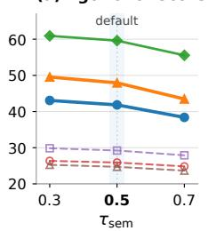

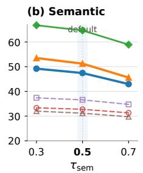

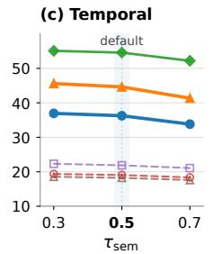

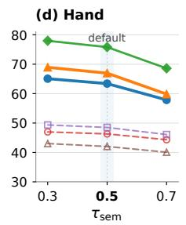  
(f) Fixed-count sampling

(e) Fixed-rate sampling  
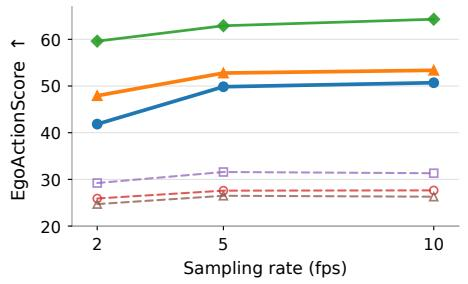

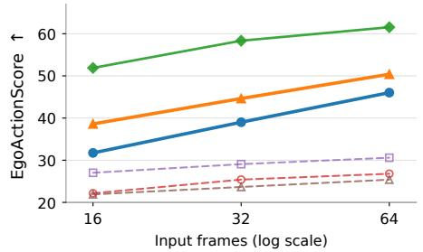  
Figure 6 Metric sensitivity to candidate overlap thresholds and frame sampling. Panels (a) to (d) show EgoActionScore, Semantic, Temporal, and Hand as the candidate overlap threshold varies, using predictions generated at 2 fps. The shaded bands mark the default threshold of $\tau _ { \mathrm { s e m } } = 0 . 5 .$ Panels (e) and (f) show EgoActionScore under fixed-rate and fixed-count sampling, with $\tau _ { \mathrm { s e m } } = 0 . 5$ . Panel (f) uses a logarithmic frame-count axis. All scores range from 0 to 100; vertical axis ranges vary across panels.

## 6 Conclusion

We introduced EgoActionBench, a benchmark for dense action captioning in egocentric video. It combines atomic action annotations with an evaluation protocol for action content, temporal precision, and hand association. Our experiments show that current models remain well below human performance on this task. Supervised fine-tuning followed by GRPO improves both backbones, but accurately locating brief actions and describing their movements remain challenging. We hope EgoActionBench will encourage the development of models that capture the action details needed to learn from human demonstrations.

## References

Xiang An, Yin Xie, Feilong Tang, Yunyao Yan, Huajie Tan, Didi Zhu, Changrui Chen, Xiuwei Zhao, Bin Qin, Kaicheng Yang, Yifei Shen, Yuanhan Zhang, Kaichen Zhang, Wenkang Zhang, Zheng Cheng, Nansen Zhang, Chunsheng Wu, Chunjiang Ge, Zimin Ran, Dehua Song, Chunyuan Li, Shikun Feng, Ming Hu, Zhangquan Chen, Junbo Niu, Bo Li, Ziyong Feng, Ziwei Liu, Zongyuan Ge, and Jiankang Deng. LLaVA-OneVision-2: Towards Next-Generation Perceptual Intelligence. arXiv preprint arXiv:2605.25979, 2026. https://arxiv.org/abs/2605.25979.

Shuai Bai, Yuxuan Cai, Ruizhe Chen, Keqin Chen, Xionghui Chen, Zesen Cheng, Lianghao Deng, Wei Ding, Chang Gao, Chunjiang Ge, Wenbin Ge, Zhifang Guo, Qidong Huang, Jie Huang, Fei Huang, Binyuan Hui, Shutong Jiang, Zhaohai Li, Mingsheng Li, Mei Li, Kaixin Li, Zicheng Lin, Junyang Lin, Xuejing Liu, Jiawei Liu, Chenglong Liu, Yang Liu, Dayiheng Liu, Shixuan Liu, Dunjie Lu, Ruilin Luo, Chenxu Lv, Rui Men, Lingchen Meng, Xuancheng Ren, Xingzhang Ren, Sibo Song, Yuchong Sun, Jun Tang, Jianhong Tu, Jianqiang Wan, Peng Wang, Pengfei Wang, Qiuyue Wang, Yuxuan Wang, Tianbao Xie, Yiheng Xu, Haiyang Xu, Jin Xu, Zhibo Yang, Mingkun Yang, Jianxin Yang, An Yang, Bowen Yu, Fei Zhang, Hang Zhang, Xi Zhang, Bo Zheng, Humen Zhong, Jingren Zhou, Fan Zhou, Jing Zhou, Yuanzhi Zhu, and Ke Zhu. Qwen3-VL technical report. arXiv preprint arXiv:2511.21631, 2025a. https://doi.org/10.48550/arXiv.2511.21631.

Shuai Bai, Keqin Chen, Xuejing Liu, Jialin Wang, Wenbin Ge, Sibo Song, Kai Dang, Peng Wang, Shijie Wang, Jun Tang, Humen Zhong, Yuanzhi Zhu, Mingkun Yang, Zhaohai Li, Jianqiang Wan, Pengfei Wang, Wei Ding, Zheren Fu, Yiheng Xu, Jiabo Ye, Xi Zhang, Tianbao Xie, Zesen Cheng, Hang Zhang, Zhibo Yang, Haiyang Xu, and Junyang Lin. Qwen2.5-VL Technical Report. arXiv preprint arXiv:2502.13923, 2025b. https://arxiv.org/abs/2502.13923.

Fabian Caba Heilbron, Victor Escorcia, Bernard Ghanem, and Juan Carlos Niebles. ActivityNet: A large-scale video benchmark for human activity understanding. In Proceedings of the IEEE Conference on Computer Vision and Pattern Recognition, pages 961–970, 2015. https://openaccess.thecvf.com/content\_cvpr\_2015/html/Heilbron\_Ac tivityNet\_A\_Large-Scale\_2015\_CVPR\_paper.html.

Yukang Cao, Haozhe Xie, Beichen Wen, Runmao Yao, Yinghao Liu, Yue Huang, Zhichao Liao, Yunxiang Wang, Haiheng Liu, Xingshun Tian, Dawei Su, Long Zhuo, Dacheng Tao, Xiaogang Wang, Liang Pan, and Ziwei Liu. ACE-Data-0: Human-centric ambient capture as embodied data engine, 2026. https://arxiv.org/abs/2607.28625.

Xinlong Chen, Yuanxing Zhang, Chongling Rao, Yushuo Guan, Jiaheng Liu, Fuzheng Zhang, Chengru Song, Qiang Liu, Di Zhang, and Tieniu Tan. VidCapBench: A comprehensive benchmark of video captioning for controllable text-to-video generation. In Findings of the Association for Computational Linguistics: ACL 2025, pages 8543–8563. Association for Computational Linguistics, 2025. https://doi.org/10.18653/v1/2025.findings-acl.449.

Christopher Clark, Jieyu Zhang, Zixian Ma, Jae Sung Park, Mohammadreza Salehi, Rohun Tripathi, Sangho Lee, Zhongzheng Ren, Chris Dongjoo Kim, Yinuo Yang, Vincent Shao, Yue Yang, Weikai Huang, Ziqi Gao, Taira Anderson, Jianrui Zhang, Jitesh Jain, George Stoica, Winson Han, Ali Farhadi, and Ranjay Krishna. Molmo2: Open Weights and Data for Vision-Language Models with Video Understanding and Grounding. arXiv preprint arXiv:2601.10611, 2026. https://arxiv.org/abs/2601.10611.

Dima Damen, Hazel Doughty, Giovanni Maria Farinella, Antonino Furnari, Evangelos Kazakos, Jian Ma, Davide Moltisanti, Jonathan Munro, Toby Perrett, Will Price, and Michael Wray. Rescaling egocentric vision: Collection, pipeline and challenges for EPIC-KITCHENS-100. International Journal of Computer Vision, 130(1):33–55, 2022. https://doi.org/10.1007/s11263-021-01531-2.

Ronghao Dang, Jiayan Guo, Bohan Hou, Sicong Leng, Kehan Li, Xin Li, Jiangpin Liu, Yunxuan Mao, Zhikai Wang, Yuqian Yuan, Minghao Zhu, Xiao Lin, Yang Bai, Qian Jiang, Yaxi Zhao, Minghua Zeng, Junlong Gao, Yuming Jiang, Jun Cen, Siteng Huang, Liuyi Wang, Wenqiao Zhang, Chengju Liu, Jianfei Yang, Shijian Lu, and Deli Zhao. RynnBrain: Open embodied foundation models. arXiv preprint arXiv:2602.14979, 2026. https://arxiv.org/abs/2602.14979.

Ahmad Darkhalil, Dandan Shan, Bin Zhu, Jian Ma, Amlan Kar, Richard Higgins, Sanja Fidler, David Fouhey, and Dima Damen. EPIC-KITCHENS VISOR benchmark: VIdeo segmentations and object relations. In Advances in Neural Information Processing Systems, volume 35, pages 13745–13758, 2022. https://proceedings.neurips.cc/pap er\_files/paper/2022/hash/590a7ebe0da1f262c80d0188f5c4c222-Abstract-Datasets\_and\_Benchmarks.html.

Yufan Deng and Daquan Zhou. HumanNet: Scaling Human-centric Video Learning to One Million Hours, 2026. https://arxiv.org/abs/2605.06747.

Chengming Feng, Hesam Araghi, Liming Zheng, Julien Dupeyroux, Xucong Zhang, Jan van Gemert, and Nergis Tömen. Cooking beyond Frames: A Stereo Event Camera Dataset in the Kitchen. In European Conference on Computer Vision, 2026. https://arxiv.org/abs/2608.04865.

Soichiro Fujita, Tsutomu Hirao, Hidetaka Kamigaito, Manabu Okumura, and Masaaki Nagata. SODA: Story

oriented dense video captioning evaluation framework. In European Conference on Computer Vision, 2020. https://www.ecva.net/papers/eccv\_2020/papers\_ECCV/html/6406\_ECCV\_2020\_paper.php.

Shenyuan Gao, William Liang, Kaiyuan Zheng, Ayaan Malik, Seonghyeon Ye, Sihyun Yu, Wei-Cheng Tseng, Yuzhu Dong, Kaichun Mo, Chen-Hsuan Lin, Qianli Ma, Seungjun Nah, Loic Magne, Jiannan Xiang, Yuqi Xie, Ruijie Zheng, Dantong Niu, You Liang Tan, K. R. Zentner, George Kurian, Suneel Indupuru, Pooya Jannaty, Jinwei Gu, Jun Zhang, Jitendra Malik, Pieter Abbeel, Ming-Yu Liu, Yuke Zhu, Joel Jang, and Linxi “Jim” Fan. DreamDojo: A Generalist Robot World Model from Large-Scale Human Videos, 2026. https://arxiv.org/abs/2602.06949.

Google DeepMind. Gemini 3.1 Pro model card. Oficial model card, 2026. https://deepmind.google/models/model-cards/gemini-3-1-pro/. Accessed 2026-09-22.

Raghav Goyal, Samira Ebrahimi Kahou, Vincent Michalski, Joanna Materzyńska, Susanne Westphal, Heuna Kim, Valentin Haenel, Ingo Fruend, Peter Yianilos, Moritz Mueller-Freitag, Florian Hoppe, Christian Thurau, Ingo Bax, and Roland Memisevic. The “Something Something” video database for learning and evaluating visual common sense. In Proceedings of the IEEE International Conference on Computer Vision, 2017. https://arxiv.org/abs/1706.04261.

Kristen Grauman, Andrew Westbury, Eugene Byrne, Zachary Chavis, Antonino Furnari, Rohit Girdhar, Jackson Hamburger, Hao Jiang, Miao Liu, Xingyu Liu, Miguel Martin, Tushar Nagarajan, Ilija Radosavovic, Santhosh Kumar Ramakrishnan, Fiona Ryan, Jayant Sharma, Michael Wray, Mengmeng Xu, Eric Zhongcong Xu, Chen Zhao, Siddhant Bansal, Dhruv Batra, Vincent Cartillier, Sean Crane, Tien Do, Morrie Doulaty, Akshay Erapalli, Christoph Feichtenhofer, Adriano Fragomeni, Qichen Fu, Abrham Gebreselasie, Cristina González, James Hillis, Xuhua Huang, Yifei Huang, Wenqi Jia, Weslie Khoo, Jáchym Kolář, Satwik Kottur, Anurag Kumar, Federico Landini, Chao Li, Yanghao Li, Zhenqiang Li, Karttikeya Mangalam, Raghava Modhugu, Jonathan Munro, Tullie Murrell, Takumi Nishiyasu, Will Price, Paola Ruiz, Merey Ramazanova, Leda Sari, Kiran Somasundaram, Audrey Southerland, Yusuke Sugano, Ruijie Tao, Minh Vo, Yuchen Wang, Xindi Wu, Takuma Yagi, Ziwei Zhao, Yunyi Zhu, Pablo Arbeláez, David Crandall, Dima Damen, Giovanni Maria Farinella, Christian Fuegen, Bernard Ghanem, Vamsi Krishna Ithapu, C. V. Jawahar, Hanbyul Joo, Kris Kitani, Haizhou Li, Richard Newcombe, Aude Oliva, Hyun Soo Park, James M. Rehg, Yoichi Sato, Jianbo Shi, Mike Zheng Shou, Antonio Torralba, Lorenzo Torresani, Mingfei Yan, and Jitendra Malik. Ego4D: Around the world in 3,000 hours of egocentric video. In Proceedings of the IEEE/CVF Conference on Computer Vision and Pattern Recognition, pages 18995–19012, 2022. https://openaccess.thecvf.com/content/CVPR2022/html/Grauman\_Ego4D\_Around\_t he\_World\_in\_3000\_Hours\_of\_Egocentric\_Video\_CVPR\_2022\_paper.html.

Kristen Grauman, Andrew Westbury, Lorenzo Torresani, Kris Kitani, Jitendra Malik, et al. Ego-Exo4D: Understanding skilled human activity from first- and third-person perspectives. In Proceedings of the IEEE/CVF Conference on Computer Vision and Pattern Recognition, pages 19383–19400, 2024. https://openaccess.thecvf.com/content/CVPR2024/html/Grauman\_Ego-Exo4D\_Understanding\_Skilled\_Hum an\_Activity\_from\_First-\_and\_Third-Person\_Perspectives\_CVPR\_2024\_paper.html.

Ryan Hoque, Peide Huang, David J. Yoon, Mouli Sivapurapu, and Jian Zhang. EgoDex: Learning dexterous manipulation from large-scale egocentric video. In The Fourteenth International Conference on Learning Representations, 2026. https://openreview.net/forum?id=FFxkFMU89E.

Md Mohaiminul Islam, Ngan Ho, Xitong Yang, Tushar Nagarajan, Lorenzo Torresani, and Gedas Bertasius. Video ReCap: Recursive captioning of hour-long videos. In Proceedings of the IEEE/CVF Conference on Computer Vision and Pattern Recognition (CVPR), 2024. https://arxiv.org/abs/2402.13250.

Simar Kareer, Dhruv Patel, Ryan Punamiya, Pranay Mathur, Shuo Cheng, Chen Wang, Judy Hofman, and Danfei Xu. EgoMimic: Scaling imitation learning via egocentric video. In 2025 IEEE International Conference on Robotics and Automation, pages 13226–13233, 2025. https://doi.org/10.1109/ICRA55743.2025.11127989.

Will Kay, Joao Carreira, Karen Simonyan, Brian Zhang, Chloe Hillier, Sudheendra Vijayanarasimhan, Fabio Viola, Tim Green, Trevor Back, Paul Natsev, Mustafa Suleyman, and Andrew Zisserman. The Kinetics human action video dataset, 2017. https://arxiv.org/abs/1705.06950.

Ranjay Krishna, Kenji Hata, Frederic Ren, Li Fei-Fei, and Juan Carlos Niebles. Dense-captioning events in videos. In Proceedings of the IEEE International Conference on Computer Vision, pages 706–715, 2017. https://doi.org/10.1109/ICCV.2017.83.

Taein Kwon, Bugra Tekin, Jan Stühmer, Federica Bogo, and Marc Pollefeys. H2O: Two hands manipulating objects for first person interaction recognition. In Proceedings of the IEEE/CVF International Conference on Computer Vision, pages 10138–10148, 2021. https://openaccess.thecvf.com/content/ICCV2021/html/Kwon\_H2O\_Two\_H ands\_Manipulating\_Objects\_for\_First\_Person\_Interaction\_Recognition\_ICCV\_2021\_paper.html.

Sicong Leng, Yunze Man, Zhiqi Li, Jing Wang, Yuhe Zhang, Ryan Punamiya, Siddharth Patki, Kaiyuan Zheng, Zi ang Cao, Zhiding Yu, Sifei Liu, Danfei Xu, Ben Levin, Jan Kautz, Yuke Zhu, Johan Bjorck, and Linxi ”Jim” Fan. Flora: An open model suite for scaling robotics data engines. arXiv preprint arXiv:2610.31779, 2026.

Yanjun Li, Yuqian Fu, Tianwen Qian, Qi’Ao Xu, Silong Dai, Danda Pani Paudel, Luc Van Gool, and Xiaoling Wang. EgoCross: Benchmarking multimodal large language models for cross-domain egocentric video question answering. Proceedings of the AAAI Conference on Artificial Intelligence, 40(8):6592–6600, 2026a. https://doi.org/10.1609/aaai.v40i8.37589.

Yihang Li, Xuelong Wei, Jingzhou Luo, Yingjing Xiao, Yibo Bai, Guangyuan Zhou, Teng Zou, Chenguang Gui, Jiajun Wen, He Zhang, Kangliang Chen, Xing Pan, Shuaiyan Liu, Daming Wang, Tao An, Jiayi Li, Shibo Jin, Wanwan Zhang, Tianyu Wang, Boren Wei, Zhixuan Huang, Fangsheng Liu, Ruodai Li, Hui Zhang, Anson Li, Yicheng Gong, Peng Cao, Jiaming Liang, and Liang Lin. EgoLive: A Large-Scale Egocentric Dataset from Real-World Human Tasks, 2026b. https://arxiv.org/abs/2604.23570.

Zishuo Li, Bowen Yang, Changtao Miao, Kai Zhu, Hao Chen, Qingze Guan, Zhengxing Wu, Wanke Zhan, Yang Sun, Zhiyi Huang, Zitong Shan, Zhenchao Jin, Jiadong Hong, Taowen Wang, Yushi Feng, You Liu, Yibo Wang, Yifan Yang, Zhaowen Zhou, Man Luo, Hao Cheng, Bo Zhang, Jianshu Li, Jiansheng Cai, Guocai Yao, Jize Zhang, Chenhao Lin, Renjing Xu, Lequan Yu, Chao Shen, Chunhua Shen, and Zhe Li. Open-AoE: An Open Egocentric Manipulation Dataset and Toolchain for Embodied Learning, 2026c. https://arxiv.org/abs/2607.14183.

Kevin Qinghong Lin, Alex Jinpeng Wang, Mattia Soldan, Michael Wray, Rui Yan, Eric Zhongcong Xu, Difei Gao, Rongcheng Tu, Wenzhe Zhao, Weijie Kong, Chengfei Cai, Hongfa Wang, Dima Damen, Bernard Ghanem, Wei Liu, and Mike Zheng Shou. Egocentric video-language pretraining. In Advances in Neural Information Processing Systems, volume 35, 2022. https://openreview.net/forum?id=nE8\_DvxAqAB.

Hui Liu and Xiaojun Wan. Models see hallucinations: Evaluating the factuality in video captioning. In Proceedings of the 2023 Conference on Empirical Methods in Natural Language Processing, pages 11807–11823, 2023. https://doi.org/10.18653/v1/2023.emnlp-main.723.

Yun Liu, Haolin Yang, Xu Si, Ling Liu, Zipeng Li, Yuxiang Zhang, Yebin Liu, and Li Yi. TACO: Benchmarking generalizable bimanual tool-action-object understanding. In Proceedings of the IEEE/CVF Conference on Computer Vision and Pattern Recognition, pages 21740–21751, 2024. https://openaccess.thecvf.com/content/CVPR2024/html/Liu\_TACO\_Benchmarking\_Generalizable\_Bimanual \_Tool-ACtion-Object\_Understanding\_CVPR\_2024\_paper.html.

Zhipeng Liu, Haochen Wang, and Zhaoxiang Zhang. CAPEval: A Decoupled Caption Evaluation across Understanding and Generation. arXiv preprint arXiv:2608.02589, 2026. https://arxiv.org/abs/2608.02589.

Zichen Liu, Changyu Chen, Wenjun Li, Penghui Qi, Tianyu Pang, Chao Du, Wee Sun Lee, and Min Lin. Understanding R1-Zero-Like Training: A Critical Perspective. arXiv preprint arXiv:2503.20783, 2025. https://arxiv.org/abs/2503.20783.

Macrodata Labs. WGO-Bench: What’s going on benchmark. Hugging Face dataset card, 2026a. https://huggingface.co/datasets/macrodata/WGO-Bench. Accessed 2026-09-05.

Macrodata Labs. Segmenting robot video into actionable subtasks. Macrodata Labs project report and Refiner pipeline, 2026b. https://macrodata.co/blog/annotating-robot-video-subtasks. Accessed 2026-09-05.

Suraj Nair, Aravind Rajeswaran, Vikash Kumar, Chelsea Finn, and Abhinav Gupta. R3M: A universal visual representation for robot manipulation. In Proceedings of The 6th Conference on Robot Learning, volume 205 of Proceedings of Machine Learning Research, pages 892–909. PMLR, 2023. https://proceedings.mlr.press/v205/nair23a.html.

Katsuyuki Nakamura, Hiroki Ohashi, and Mitsuhiro Okada. Sensor-augmented egocentric-video captioning with dynamic modal attention. In Proceedings of the 29th ACM International Conference on Multimedia, 2021. https://doi.org/10.1145/3474085.3475557.

Takehiko Ohkawa, Takuma Yagi, Taichi Nishimura, Ryosuke Furuta, Atsushi Hashimoto, Yoshitaka Ushiku, and Yoichi Sato. Exo2EgoDVC: Dense video captioning of egocentric procedural activities using web instructional videos. In Proceedings of the IEEE/CVF Winter Conference on Applications of Computer Vision, pages 8324–8335, 2025. https://doi.org/10.1109/WACV61041.2025.00807.

OpenAI. GPT-5.6 system card. OpenAI Deployment Safety Hub, 2026a. https://deploymentsafety.openai.com/gpt-5-6. Accessed 2026-09-22.

OpenAI. GPT-6 Astra system card. OpenAI Deployment Safety Hub, 2026b. https://deploymentsafety.openai.com/gpt-6-astra. Accessed 2026-09-22.

OpenBMB. MiniCPM-V 4.5. Oficial model documentation, 2025. https://github.com/OpenBMB/MiniCPM-V/blob/main/docs/minicpm\_v4dot5\_en.md.

Gunjan Paul, Senthil Palanisamy, Satpal Singh Rathore, Pratyush Kumar Patnaik, Shubhanshu Khatana, and Abhishek Anand. Ego-OSCAR: Egocentric Open source Stereo CAptuRe System, 2026. https://arxiv.org/abs/2608.08285.

Baoqi Pei, Yifei Huang, Jilan Xu, Guo Chen, Yuping He, Lijin Yang, Yali Wang, Weidi Xie, Yu Qiao, Fei Wu, and

Limin Wang. Modeling fine-grained hand-object dynamics for egocentric video representation learning. In The Thirteenth International Conference on Learning Representations, 2025a. https://arxiv.org/abs/2503.00986.

Baoqi Pei, Yifei Huang, Jilan Xu, Yuping He, Guo Chen, Fei Wu, Yu Qiao, and Jiangmiao Pang. EgoThinker: Unveiling egocentric reasoning with spatio-temporal CoT. In Advances in Neural Information Processing Systems, 2025b. https://arxiv.org/abs/2510.23569.

Toby Perrett, Ahmad Darkhalil, Saptarshi Sinha, Omar Emara, Sam Pollard, Kranti Kumar Parida, Kaiting Liu, Prajwal Gatti, Siddhant Bansal, Kevin Flanagan, Jacob Chalk, Zhifan Zhu, Rhodri Guerrier, Fahd Abdelazim, Bin Zhu, Davide Moltisanti, Michael Wray, Hazel Doughty, and Dima Damen. HD-EPIC: A highly-detailed egocentric video dataset. In Proceedings of the IEEE/CVF Conference on Computer Vision and Pattern Recognition, pages 23901–23913, 2025. https://doi.org/10.1109/CVPR52734.2025.02226.

Shraman Pramanick, Yale Song, Sayan Nag, Kevin Qinghong Lin, Hardik Shah, Mike Zheng Shou, Rama Chellappa, and Pengchuan Zhang. EgoVLPv2: Egocentric video-language pre-training with fusion in the backbone. In Proceedings of the IEEE/CVF International Conference on Computer Vision, pages 5285–5297, 2023. https://arxiv.org/abs/2307.05463.

Ryan Punamiya, Simar Kareer, Zeyi Liu, Josh Citron, Ri-Zhao Qiu, Xiongyi Cai, Alexey Gavryushin, Jiaqi Chen, Davide Liconti, Lawrence Y. Zhu, Patcharapong Aphiwetsa, Baoyu Li, Aniketh Cheluva, Pranav Kuppili, Yangcen Liu, Dhruv Patel, Aidan Gao, Hye-Young Chung, Ryan Co, Renee Zbizika, Jef Liu, Xiaomeng Xu, Haoyu Xiong, Geng Chen, Sebastiano Oliani, Wenkai Xuan, Chenyu Yang, Xi Wang, James Fort, Richard Newcombe, Josh Gao, Jason Chong, Garrett Matsuda, Aseem Doriwala, Marc Pollefeys, Robert Katzschmann, Xiaolong Wang, Shuran Song, Judy Hofman, and Danfei Xu. EgoVerse: An Egocentric Human Dataset for Robot Learning from Around the World. arXiv preprint arXiv:2604.07607, 2026. https://arxiv.org/abs/2604.07607.

Shuhuai Ren, Linli Yao, Shicheng Li, Xu Sun, and Lu Hou. TimeChat: A time-sensitive multimodal large language model for long video understanding. In Proceedings of the IEEE/CVF Conference on Computer Vision and Pattern Recognition, 2024. https://arxiv.org/abs/2312.02051.

Zhihong Shao, Peiyi Wang, Qihao Zhu, Runxin Xu, Junxiao Song, Xiao Bi, Haowei Zhang, Mingchuan Zhang, Y. K. Li, Y. Wu, and Daya Guo. DeepSeekMath: Pushing the Limits of Mathematical Reasoning in Open Language Models. arXiv preprint arXiv:2402.03300, 2024. https://arxiv.org/abs/2402.03300.

Zhaofeng Shi, Heqian Qiu, Lanxiao Wang, Qingbo Wu, Fanman Meng, and Hongliang Li. Unsupervised ego- and exo-centric dense procedural activity captioning via gaze consensus adaptation. In Proceedings of the 33rd ACM International Conference on Multimedia, 2025. https://arxiv.org/abs/2504.04840.

Yuejiao Su, Yi Wang, and Lap-Pui Chau. CaRe-Ego: Contact-aware relationship modeling for egocentric interactive hand-object segmentation. Expert Systems with Applications, 296:129148, 2026. https://doi.org/10.1016/j.eswa.2025.129148.

Changli Tang, Yixuan Li, Yudong Yang, Jimin Zhuang, Guangzhi Sun, Wei Li, Zejun Ma, and Chao Zhang. video-SALMONN 2: Caption-enhanced audio-visual large language models. arXiv preprint arXiv:2506.15220, 2025. https://arxiv.org/abs/2506.15220.

Masatoshi Tateno, Gido Kato, Hirokatsu Kataoka, Yoichi Sato, and Takuma Yagi. HanDyVQA: A video QA benchmark for fine-grained hand-object interaction dynamics. In Proceedings of the IEEE/CVF Conference on Computer Vision and Pattern Recognition, pages 3455–3465, 2026. https://openaccess.thecvf.com/content/CVPR2026/html/Tateno\_HanDyVQA\_A\_Video\_QA\_Benchmark\_for \_Fine-Grained\_Hand-Object\_Interaction\_Dynamics\_CVPR\_2026\_paper.html.

Huiyu Wang, Mitesh Kumar Singh, and Lorenzo Torresani. Ego-Only: Egocentric action detection without exocentric transferring. In Proceedings of the IEEE/CVF International Conference on Computer Vision, pages 5250–5261, 2023. https://openaccess.thecvf.com/content/ICCV2023/html/Wang\_Ego-Only\_Egocentric\_Actio n\_Detection\_without\_Exocentric\_Transferring\_ICCV\_2023\_paper.html.

Jiahao Wang, An Ping, Yanghai Wang, Yuanxing Zhang, Shihao Li, Hanyan Bian, Yichi Ren, Yize Zhang, Han Wang, Haowen Chen, Junze Li, Jiaqi Wang, Yiyang Hu, Zhuze Xu, Zijie Zhang, and Jiaheng Liu. OmniCap-IF: Benchmarking and improving instruction following abilities for omni-video captioning. arXiv preprint arXiv:2606.08572, 2026a. https://arxiv.org/abs/2606.08572.

Weiyun Wang, Zhangwei Gao, Lixin Gu, Hengjun Pu, Long Cui, Xingguang Wei, Zhaoyang Liu, Linglin Jing, Shenglong Ye, Jie Shao, Zhaokai Wang, Zhe Chen, Hongjie Zhang, Ganlin Yang, Haomin Wang, Qi Wei, Jinhui Yin, Wenhao Li, Erfei Cui, Guanzhou Chen, Zichen Ding, Changyao Tian, Zhenyu Wu, Jingjing Xie, Zehao Li, Bowen Yang, Yuchen Duan, Xuehui Wang, Zhi Hou, Haoran Hao, Tianyi Zhang, Songze Li, Xiangyu Zhao, Haodong Duan, Nianchen Deng, Bin Fu, Yinan He, Yi Wang, Conghui He, Botian Shi, Junjun He, Yingtong Xiong, Han Lv, Lijun Wu, Wenqi Shao, Kaipeng Zhang, Huipeng Deng, Biqing Qi, Jiaye Ge, Qipeng Guo, Wenwei Zhang, Songyang Zhang, Maosong Cao, Junyao Lin, Kexian Tang, Jianfei Gao, Haian Huang, Yuzhe Gu, Chengqi Lyu, Huanze Tang, Rui Wang, Haijun Lv, Wanli Ouyang, Limin Wang, Min Dou, Xizhou Zhu, Tong Lu, Dahua Lin, Jifeng Dai, Weijie Su, Bowen Zhou, Kai Chen, Yu Qiao, Wenhai Wang, and Gen Luo. InternVL3.5:

Advancing Open-Source Multimodal Models in Versatility, Reasoning, and Eficiency. arXiv preprint arXiv:2508.18265, 2025. https://arxiv.org/abs/2508.18265.

Ye Wang, Pei Lin, Xiong-Hui Chen, Haoqi Yuan, Zhixuan Liang, Yiyang Huang, Anzhe Chen, Zixing Lei, Jie Zhang, Tao Zhang, Haoyang Li, Tong Zhang, Chenxi Xiao, Ziyuan Jiao, and Qin Jin. Ego2Robot: Scalable robot data synthesis from egocentric human data, 2026b. https://arxiv.org/abs/2608.02580.

Zhi Wang, Botao He, Kelin Yu, Seungjae Lee, Ruohan Gao, Furong Huang, and Yiannis Aloimonos. HumanEgo: Zero-Shot Robot Learning from Minutes of Human Egocentric Videos, 2026c. https://arxiv.org/abs/2605.24934.

Boshen Xu, Yuting Mei, Xinbi Liu, Sipeng Zheng, and Qin Jin. EgoDTM: Towards 3d-aware egocentric video-language pretraining. In Advances in Neural Information Processing Systems, volume 38, 2025. https://doi.org/10.52202/085713-4088.

Jun Xu, Tao Mei, Ting Yao, and Yong Rui. MSR-VTT: A large video description dataset for bridging video and language. In Proceedings of the IEEE Conference on Computer Vision and Pattern Recognition, pages 5288–5296, 2016. https://doi.org/10.1109/CVPR.2016.571.

An Yang, Anfeng Li, Baosong Yang, Beichen Zhang, Binyuan Hui, et al. Qwen3 technical report. arXiv preprint arXiv:2505.09388, 2025a. https://doi.org/10.48550/arXiv.2505.09388.

Jingkang Yang, Shuai Liu, Hongming Guo, Yuhao Dong, Xiamengwei Zhang, Sicheng Zhang, Pengyun Wang, Zitang Zhou, Binzhu Xie, Ziyue Wang, Bei Ouyang, Zhengyu Lin, Marco Cominelli, Zhongang Cai, Bo Li, Yuanhan Zhang, Peiyuan Zhang, Fangzhou Hong, Joerg Widmer, Francesco Gringoli, Lei Yang, and Ziwei Liu. EgoLife: Towards egocentric life assistant. In Proceedings of the IEEE/CVF Conference on Computer Vision and Pattern Recognition, pages 28885–28900, 2025b. https://openaccess.thecvf.com/content/CVPR2025/html/Yang\_EgoLife \_Towards\_Egocentric\_Life\_Assistant\_CVPR\_2025\_paper.html.

Penghui Yang, Long Xing, Xiaoyi Dong, Yuhang Zang, Yuhang Cao, Yibin Wang, Yujie Zhou, Jiazi Bu, Jianze Liang, Qidong Huang, Jiaqi Wang, Feng Wu, and Dahua Lin. CapRL++: Unified reinforcement learning with verifiable rewards for dense image and video captioning. arXiv preprint arXiv:2606.09393, 2026. https://arxiv.org/abs/2606.09393.

Linli Yao, Yuancheng Wei, Yaojie Zhang, Lei Li, Xinlong Chen, Feifan Song, Ziyue Wang, Kun Ouyang, Yuanxin Liu, Lingpeng Kong, Qi Liu, Pengfei Wan, Kun Gai, Yuanxing Zhang, and Xu Sun. TimeChat-Captioner: Scripting multi-scene videos with time-aware and structural audio-visual captions. In Proceedings of the Forty-Third International Conference on Machine Learning, 2026. https://arxiv.org/abs/2602.08711.

Hanrong Ye, Haotian Zhang, Erik Daxberger, Lin Chen, Zongyu Lin, Yanghao Li, Bowen Zhang, Haoxuan You, Dan Xu, Zhe Gan, Jiasen Lu, and Yinfei Yang. MM-Ego: Towards building egocentric multimodal LLMs for video QA. In The Thirteenth International Conference on Learning Representations, 2025. https://arxiv.org/abs/2410.07177.

Boqiang Zhang, Kehan Li, Zesen Cheng, Zhiqiang Hu, Yuqian Yuan, Guanzheng Chen, Sicong Leng, Yuming Jiang, Hang Zhang, Xin Li, Peng Jin, Wenqi Zhang, Fan Wang, Lidong Bing, and Deli Zhao. VideoLLaMA 3: Frontier Multimodal Foundation Models for Image and Video Understanding. arXiv preprint arXiv:2501.13106, 2025. https://arxiv.org/abs/2501.13106.

Chen-Lin Zhang, Jianxin Wu, and Yin Li. ActionFormer: Localizing moments of actions with transformers. In European Conference on Computer Vision, 2022a. https://www.ecva.net/papers/eccv\_2022/papers\_ECCV/html/7278\_ECCV\_2022\_paper.php

Haoyu Zhang, Qiaohui Chu, Meng Liu, Haoxiang Shi, Yaowei Wang, and Liqiang Nie. Exo2ego: Exocentric knowledge guided MLLM for egocentric video understanding. In Proceedings of the AAAI Conference on Artificial Intelligence, volume 40, pages 12502–12510, 2026. https://doi.org/10.1609/aaai.v40i15.38244.

Lingzhi Zhang, Shenghao Zhou, Simon Stent, and Jianbo Shi. Fine-grained egocentric hand-object segmentation: Dataset, model, and applications. In European Conference on Computer Vision, pages 127–145, 2022b. https://www.ecva.net/papers/eccv\_2022/papers\_ECCV/papers/136890125.pdf.

Yue Zhao, Ishan Misra, Philipp Krähenbühl, and Rohit Girdhar. Learning video representations from large language models. In Proceedings of the IEEE/CVF Conference on Computer Vision and Pattern Recognition, 2023. https://arxiv.org/abs/2212.04501.

Ruijie Zheng, Dantong Niu, Yuqi Xie, Jing Wang, Mengda Xu, Yunfan Jiang, Fernando Castañeda, Fengyuan Hu, You Liang Tan, Letian Fu, Trevor Darrell, Furong Huang, Yuke Zhu, Danfei Xu, and Linxi Fan. EgoScale: Scaling dexterous manipulation with diverse egocentric human data, 2026. https://arxiv.org/abs/2602.16710.

Luowei Zhou, Chenliang Xu, and Jason J. Corso. Towards automatic learning of procedures from web instructional videos. Proceedings of the AAAI Conference on Artificial Intelligence, 32(1), 2018a. https://doi.org/10.1609/aaai.v32i1.12342.

Luowei Zhou, Yingbo Zhou, Jason J. Corso, Richard Socher, and Caiming Xiong. End-to-end dense video captioning with masked transformer. In Proceedings of the IEEE Conference on Computer Vision and Pattern Recognition (CVPR), pages 8739–8748, 2018b. https://arxiv.org/abs/1804.00819.

## A Additional Experimental Details

Adaptation data. The 5,354 automatically annotated episodes comprise 5,146 training examples and 208 validation examples. Source-video identifiers separate this corpus from EgoActionBench. The benchmark annotations undergo human verification; the adaptation labels are generated and refined automatically.

Supervised adaptation. We fine-tune the language models and multimodal connectors with frozen visual encoders, using a learning rate of $1 0 ^ { - 5 }$ , a cosine schedule, and an efective batch size of 32.

Reinforcement learning. Both backbones are initialized from their SFT models. We update the language model parameters while keeping the visual encoders and multimodal connectors frozen. The initial SFT policies serve as fixed references for KL regularization. Training uses the Dr. GRPO loss (Liu et al., 2025). Each candidate’s reward is centered by its video-group mean and scaled by the reward standard deviation across the generation batch. A fixed Qwen3-32B judge assesses predicted captions against the training captions and their extracted semantic fields. The reward components S, I, and F are computed per candidate output on a [0, 1] scale. All training runs use random seed 42, and each GRPO rollout batch is used for a single policy update. Table 7 summarizes the key hyperparameters for SFT and GRPO.

Table 7 Key optimization and sampling hyperparameters for SFT and GRPO. Values apply to both backbones. Batch size counts supervised examples for SFT and generated responses for GRPO. Each GRPO batch contains six videos with G = 4 responses per video. A dash indicates that the parameter is not applicable.
<table><tr><td>Hyperparameter</td><td>SFT</td><td>GRPO</td></tr><tr><td>Optimizer</td><td>AdamW</td><td>AdamW</td></tr><tr><td>Learning rate</td><td> $1 \times 1 0 ^ { - 5 }$ </td><td> $5 \times 1 0 ^ { - 7 }$ </td></tr><tr><td>Learning rate scheduler</td><td>Cosine</td><td>Cosine</td></tr><tr><td>Learning rate warmup</td><td>5% of training updates</td><td>10 updates</td></tr><tr><td>Training batch size</td><td>32</td><td>24</td></tr><tr><td>Gradient norm clipping</td><td>1.0</td><td>1.0</td></tr><tr><td>KL coefficient β</td><td></td><td>0.04</td></tr><tr><td>Group size G</td><td></td><td>4</td></tr><tr><td>Sampling temperature</td><td></td><td>0.8</td></tr><tr><td>Top-p</td><td></td><td>0.95</td></tr></table>

Semantic evaluation. Qwen3-32B is the text-only semantic judge, with temperature zero. It receives the reference caption, its structured semantic fields, and the predicted caption. Every temporally eligible candidate is evaluated. The default candidate-overlap threshold is $\tau _ { \mathrm { s e m } } = 0 . 5 ;$ selection follows section 3.4. When content score, hand-label agreement, and temporal IoU are all equal, we resolve ties by earlier start time, followed by earlier end time. Any remaining ties are resolved deterministically. Semantic fidelity and matched temporal overlap are averaged over ground-truth actions, including zero scores for actions without positive-content candidates. F1 uses dataset-level counts from one-to-one matching and retains all submit ted predictions in its denominator. Temporal averages matched overlap and F1; EgoActionScore averages Temporal and Semantic.

Qwen evaluation settings. We evaluate EgoAction (Qwen3-VL-4B) with video sampled at 2 fps and the inference prompt in Figure 10. Both Qwen3-VL-4B variants use temperature zero, random seed 42, and reasoning disabled.

## B Robustness to the Semantic Judge

## B.1 Agreement with Human Reviewers

Two human reviewers independently evaluated a 400-pair calibration set containing 1,378 required field items. Across 1,377 jointly decidable items, Qwen3-32B agrees with Reviewer 1 and Reviewer 2 on 88.89% and 89.03% of binary credit decisions, with Cohen’s κ of 0.742 and 0.746. Exact label agreement over all 1,378 items is 65.24% and 67.85%; most remaining disagreements distinguish missing information from contradictions, both of which receive zero credit.

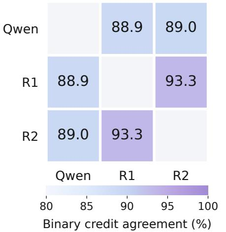

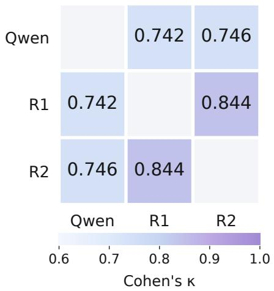  
Figure 7 Agreement with human reviewers on the 400-pair calibration set. Percentage agreement (left) and Cohen’s κ (right) on 1,377 semantic judgments, based on whether each requirement is satisfied. Qwen denotes Qwen3-32B; R1 and R2 denote the two reviewers.

## B.2 Stability of Model Comparisons

We rescore fixed predictions from six model configurations on 99 clips and the same 2,506 ground-truth actions under both judges. The comparison includes the SFT versions of both EgoAction variants. Ground truth and candidate sets are held fixed, while the selected prediction and one-to-one action matching are recomputed for each judge.

Model comparisons remain stable across semantic judges. Qwen3-32B and GPT-5.6 Sol produce identical model rankings for EgoActionScore and Semantic, with Spearman’s $\rho = 1 . 0$ for both. Both judges also preserve the gains from supervised adaptation on the two backbones, supporting the stability of these comparisons under the tested judge change.

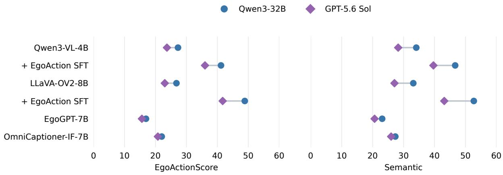  
Figure 8 Model scores under two semanticjudges. Blue circles and purple diamonds show Qwen3-32B and GPT-5.6 Sol judgments of fixed predictions on the same 99 clips and 2,506 ground-truth actions. Both panels share the same axis scale.

## C Additional Dataset Details

## C.1 Video preparation and temporal coordinates

The benchmark videos retain source-dependent frame rates and resolutions, as summarized in table 8. For EgoLife, we use the $9 6 0 \times 9 6 0$ central clean-view crop of the $1 2 8 0 \times 1 2 8 0$ source view. This crop removes the outer region containing participant and timestamp overlays. Human annotation uses the clean video, while hand-highlighted videos support the generation of annotation drafts.

Table 8 Video specifications by source. Frame rates and resolutions of the benchmark episodes.
<table><tr><td>Source</td><td>Episodes</td><td>Frame rate</td><td>Video resolution</td></tr><tr><td>Ego4D</td><td>451</td><td>30 fps</td><td> $4 8 0 \times 3 6 0 , 6 4 0 \times 3 6 0 , 9 6 0 \times 5 4 0 , 9 6 0 \times 7 2 0 , \mathrm { o r } 9 6 0 \times 1 2 8 0$ </td></tr><tr><td>EgoLife</td><td>485</td><td>20 fps</td><td> $9 6 0 \times 9 6 0$ </td></tr><tr><td>EPIC-KITCHENS-100</td><td>471</td><td>50 fps</td><td> $1 9 2 0 \times 1 0 8 0$ </td></tr></table>

We express action boundaries in seconds relative to the first decoded frame of each episode. For a constantframe-rate video at f frames per second, frame i corresponds to $t _ { i } = i / f$ , using zero-based indexing. An action covering frames i through j − 1 occupies the half-open interva $[ i / f , j / f )$ , with duration $( j - i ) / f$ A one-frame boundary shift therefore corresponds to approximately 33.3 ms for Ego4D, 50 ms for EgoLife, and 20 ms for EPIC-KITCHENS-100. Annotators inspect native decoded frames around action transitions to refine the start and end boundaries.

## C.2 Activity coverage and statistics

The episodes are organized into 17 scenes across six activity groups. Kitchen and dining includes cooking, kitchen cleanup, and dining activities. Household and daily life covers household tasks, laundry, shopping, personal care, and generic object handling. Construction and repair includes building work, woodwork, and mechanical repair. The remaining groups cover gardening and outdoor activities, crafts and laboratory work, and desk, device, and leisure activities.

We assign initial scene labels from episode task summaries using keyword rules and refine ambiguous assignments through review. Each episode receives a scene label, which determines its activity group. This categorization is used to summarize the activity coverage of the selected data (table 9).

Table 9 Activity coverage of EgoActionBench. Episode and action-caption counts across the six activity groups.
<table><tr><td>Activity group</td><td>Episodes</td><td>Action captions</td></tr><tr><td>Kitchen and dining</td><td>771</td><td>20,205</td></tr><tr><td>Household and daily life</td><td>230</td><td>6,783</td></tr><tr><td>Construction and repair</td><td>185</td><td>6,832</td></tr><tr><td>Gardening and outdoor</td><td>28</td><td>894</td></tr><tr><td>Crafts and laboratory</td><td>103</td><td>3,812</td></tr><tr><td>Desk, devices, and leisure</td><td>90</td><td>2,606</td></tr><tr><td>Total</td><td>1,407</td><td>41,132</td></tr></table>

Kitchen and dining accounts for the largest share of the dataset. Household activities and construction and repair provide substantial additional coverage, while the remaining groups extend the benchmark to outdoor work, crafts, laboratory procedures, and interactions with books and devices.

Action statistics are computed across the Left, Right, and Both tracks. Each annotated interval contributes one caption. A collaborative action and its annotated single-hand roles therefore contribute separate records. Non-action entries, including idle intervals, hand invisibility, and the absence of bimanual collaboration, are excluded from action counts. Total video duration counts each episode once, while the action-duration distribution includes individual intervals from all three tracks.

## D Human Annotation Protocol

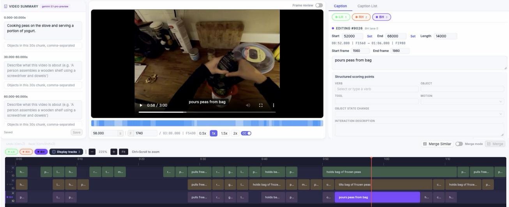  
Figure 9 Annotation interface. The interface displays the source video and summary alongside a caption editor and aligned Left (LH), Right (RH), and Both (BH) timelines. The selected segment describes pouring peas from a bag; its caption, timestamps, and frame indices appear in the editor.

## D.1 Annotators and Responsibilities

An external team of ten annotators constructed the benchmark annotations in English. Each video was assigned to two team members: one revised the model-generated drafts against the source video, and the other checked the revisions for errors and omissions. Three additional human reviewers performed final quality control. A separate group of three annotators conducted the human-baseline evaluation.

## D.2 Training and Annotation Guidelines

Training materials included written guidelines, a pilot annotation batch, and case-specific feedback. They covered interface operation, action granularity, hand assignment, bimanual collaboration, and temporal boundaries. Pilot feedback clarified recurring errors and ambiguous cases. Annotators followed the task definition, describing individual action phases and distinguishing each hand’s role from bimanual collaboration.

## D.3 Quality Control and Final Verification

After annotation and second-person review, agentic quality control proposed revisions supported by frame references and explanations. Human reviewers checked these proposals against the source videos, resolved ambiguities, and approved the annotations or returned them for correction and further QC.

## D.4 Annotation Interface

The annotation software provides video playback, a caption editor, and aligned Left, Right, and Both timelines (figure 9). Selecting a segment opens its description and boundaries for editing. Annotators can inspect individual frames, revise captions, and adjust timestamps or frame indices while comparing individual hand roles with bimanual actions.

## E Prompt Templates

## E.1 Inference Prompt

The inference prompt takes a complete video clip as input and requests timestamped action captions for the Left, Right, and Both tracks (Figure 10).

Task:   
Watch the egocentric video and segment the camera wearer's visible hand actions over the   
full clip.   
Video duration: {duration\_sec} seconds.   
SEGMENTATION RULES   
- Each caption describes ONE continuous atomic action with the same main action, target   
object, contact relation, and dominant motion.   
- Start a NEW segment when the main action, target object, contact relation, or dominant   
motion changes.   
- Include sustained holding and stabilizing. Keep a continuous unchanged action in one   
segment, rather than repeating it once per frame.   
- Describe visible actions, not intentions or overall tasks.   
HAND TRACKS   
- Label hands anatomically (the wearer's left/right), not image left/right.   
- Inspect the left hand and the right hand separately, and include each hand's visible   
actions. Their intervals may overlap and need not align.   
- both\_hands: use ONLY while both hands directly contact the SAME physical object   
simultaneously. Working on different objects does not qualify. Keep the corresponding   
individual actions in left\_hand and right\_hand; the both\_hands caption describes each   
hand's contribution.   
CAPTION STYLE   
Use a concise English action phrase naming the object and any visible tool or   
distinguishing motion. The track key already identifies the hand. Intervals without   
visible actions are omitted. Use [] for an inactive track; do not create captions for   
inactivity, invisibility, or absent coordination.   
TIMING   
- start and end are numeric seconds from the clip start:   
0 <= start < end <= {duration\_sec}.   
- The final instant of the video is exactly {duration\_sec} seconds. For an action   
continuing to the clip end, copy that exact value into its end field.   
- Do not round an endpoint past {duration\_sec}; omit zero-length intervals.   
- Sort each list by start time.   
OUTPUT   
Return ONLY valid JSON, no Markdown or commentary. Include exactly three arrays:   
"left\_hand", "right\_hand", and "both\_hands", even when one is empty. Each action has   
exactly "start", "end", and "caption" fields.   
Complete example for a different video, showing independent hand tracks:   
{   
"left\_hand": [   
{"start": 0.0, "end": 5.5, "caption": "hold the bowl steady"}   
],   
"right\_hand": [   
{"start": 1.0, "end": 4.0, "caption": "stir the mixture with a spoon"},   
{"start": 4.0, "end": 5.5, "caption": "lift the spoon out of the bowl"}   
],   
"both\_hands": []   
}   
The example's hands touch different objects, so its both\_hands array is empty. Use the   
actual actions and times in the current video. Return all three track arrays, with   
actions for every hand that visibly acts. Return JSON only.   
For an action that continues to the final instant, its boundary is written exactly as   
"end": {duration\_sec} inside that action object. The top-level object contains only the   
three hand-track arrays.  
Figure 10 Inference prompt for dense per-hand action captioning. The placeholder {duration\_sec} is replaced with the duration of each clip.

## E.2 Prompts for Dataset Construction

The sliding-window template generates local caption proposals (Figure 11). The merging instructions consolidate adjacent proposals describing the same continuous action before temporal boundary refinement (Figure 12).

You are annotating three hand-action tracks for an approximately one-second output   
window in a first-person video. Use the provided window boundaries; do not choose   
timestamps.   
Video summary (context only):   
{summary}   
Recent captions:   
{history}   
Use recent captions only to understand continuity. The current window's frames are   
authoritative. Do not repeat a previous action unless it remains visible in the current   
window.   
Current output window: {window\_start}s to {window\_end}s.   
Describe only the visible facts in this window:   
1. left\_hand / right\_hand   
Describe one visible action and its object for each hand. Do not prefix the caption   
with "left hand" or "right hand"; the track identifies the acting hand.   
Name the specific object being contacted or held, for example, "cut the asparagus   
stem with a knife" or "support the cutting board."   
Use concrete atomic actions such as reach, contact, grasp, lift, move, cut, wipe,   
pour, stir, place, and release. Avoid vague descriptions such as "handle" or "operate."   
Do not combine multiple action phases into one caption.   
If the hand is not visible, write "not visible". If it is visible but performs no   
task action, such as hovering or resting, write "idle".   
2. both\_hands   
Describe a shared action only when both hands directly contact the same physical   
object simultaneously. Working on different objects does not qualify. Otherwise, write   
"no two-hand collaboration". If neither hand is visible, write "not visible". Do not   
repeat the individual actions already described in the single-hand tracks.   
3. Action continuity   
Determine whether the previous action continues by checking:   
- Contact: making or breaking contact, tightening a grasp, or changing objects.   
- Motion phase: changes in direction, speed, or motion pattern.   
- Object state: displacement, deformation, or content transfer.   
A change in any of these cues indicates a new action. For example, holding a mouse   
and releasing it are separate actions. Reuse the previous description only when all   
three cues remain unchanged.   
Use only evidence visible in the current window. Do not describe intentions, guesses, or   
off-screen events. Write captions in English.   
Return only JSON:   
{   
"left\_hand": "<caption>",   
"right\_hand": "<caption>",   
"both\_hands": "<caption>"   
}  
Figure 11 Template for sliding-window caption generation. The inputs include a video summary, recent captions, and the current output window. The model returns captions for the Left, Right, and Both tracks.

You are reviewing consecutive caption segments from a first-person video. Each segment   
has an identifier, a hand track, a temporal interval, and a caption. The corresponding   
video frames or local clips are provided.   
Identify adjacent segments that describe the same continuous action and can be merged.   
Input segments:   
{segments}   
Review each hand track independently. Merge only temporally adjacent segments from the   
same track.   
Use visual evidence to determine whether an action continues   
across a segment boundary. Examine:   
1. Hand-object contact:   
Does the hand make or break contact, change its grasp, release an object, or switch   
objects?   
2. Hand-motion phase:   
Does the operation, motion direction, speed, or movement pattern change?   
3. Object state:   
Does the object undergo a change in position, shape, or contents that indicates a new   
action phase?   
Merge segments only when these cues support the continuation of the same action.   
Preserve boundaries at meaningful changes in the operation, manipulated object, or   
contact relationship.   
Keep distinct phases such as reaching, contacting, grasping, lifting, moving, placing,   
and releasing separate. A stable hold or support action may span multiple segments when   
the object, contact relationship, and action phase remain unchanged.   
Do not decide merges from caption similarity alone. If the visual evidence is   
insufficient, leave the segments separate.   
Return only groups of segment identifiers to merge. List identifiers in temporal order   
within each group. Omit segments that should remain separate.   
Output format:   
{   
"groups": [   
["<segment\_id\_1>", "<segment\_id\_2>"],   
["<segment\_id\_3>", "<segment\_id\_4>", "<segment\_id\_5>"]   
]   
}   
Return {"groups": []} if no merge is supported.

Figure 12 Instructions for temporal merging. Adjacent segments are reviewed within each hand track using visual evidence of hand-object contact, hand-motion phases, and object-state changes.

## F Supplementary Analysis of Evaluation Metrics

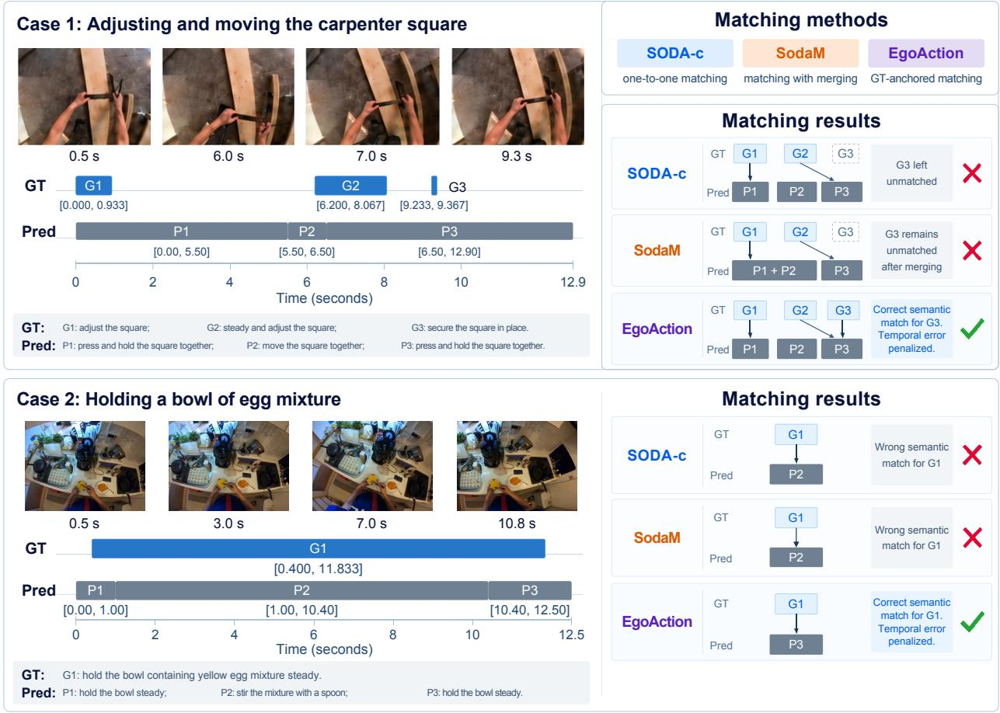  
Figure 13 Qualitative Comparison of Evaluation Metrics. We compare SODA-c (Fujita et al., 2020), SodaM (Yao et al., 2026), and our evaluation protocol. The examples illustrate how our protocol preserves action-level content matches while evaluating temporal overlap on the original predictions.

Preserving semantic matches while penalizing segmentation errors. Figure 13 shows how action-centered matching preserves semantic credit for correctly described actions. In the carpenter-square case, SODA-c’s one-to-one matching leaves G3 unmatched after assigning P3 to G2. SodaM allows multiple predictions to be merged for one GT, but still cannot reuse P3 for G3. Our protocol evaluates each GT action independently, preserving semantic credit for the content P3 correctly describes in both references. Temporal IoU penalizes its inaccurate boundaries, while a separate one-to-one F1 score penalizes under-segmentation. For the bowlholding action, P2 has greater temporal overlap with G1 but describes stirring. This overlap outweighs its lower METEOR similarity in SODA-c, while SodaM determines matches from temporal overlap alone. By prioritizing action content, our protocol selects P3, which correctly describes holding the bowl. Its limited overlap with G1 remains penalized by temporal IoU.

## G Dataset Examples

Figures 14–16 illustrate the temporal granularity and hand assignments of annotations across the three data sources. In the Ego4D example, the left hand maintains its grip on the steering wheel while the right hand handles a writing board. Separate intervals distinguish reaching, grasping, and lifting from the longer holding action. The EgoLife example shows a transition from one-handed to two-handed manipulation of a vase. In the EPIC-KITCHENS-100 example, joint shaking of a cake mold is followed by separate actions involving a mixing bowl and a pot. Each example shows selected frames and complete annotations on the Left, Right, and Both tracks. All timestamps are measured in seconds from the start of the clip.

Handling a writing board  
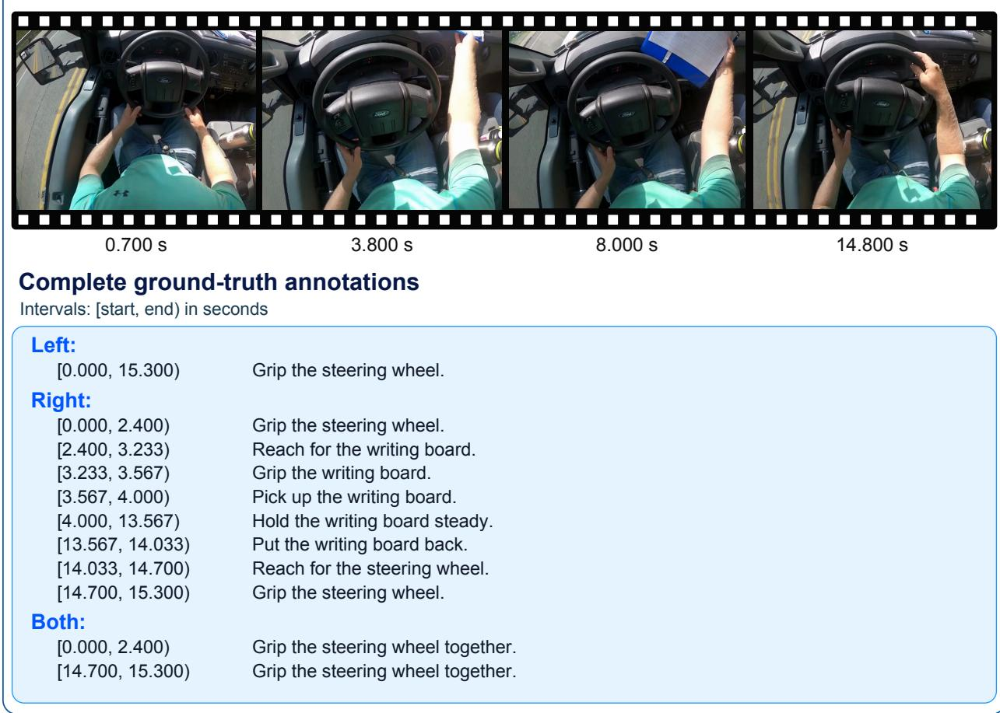  
Figure 14 Ego4D example. Selected frames and complete ground-truth annotations for handling a writing board.

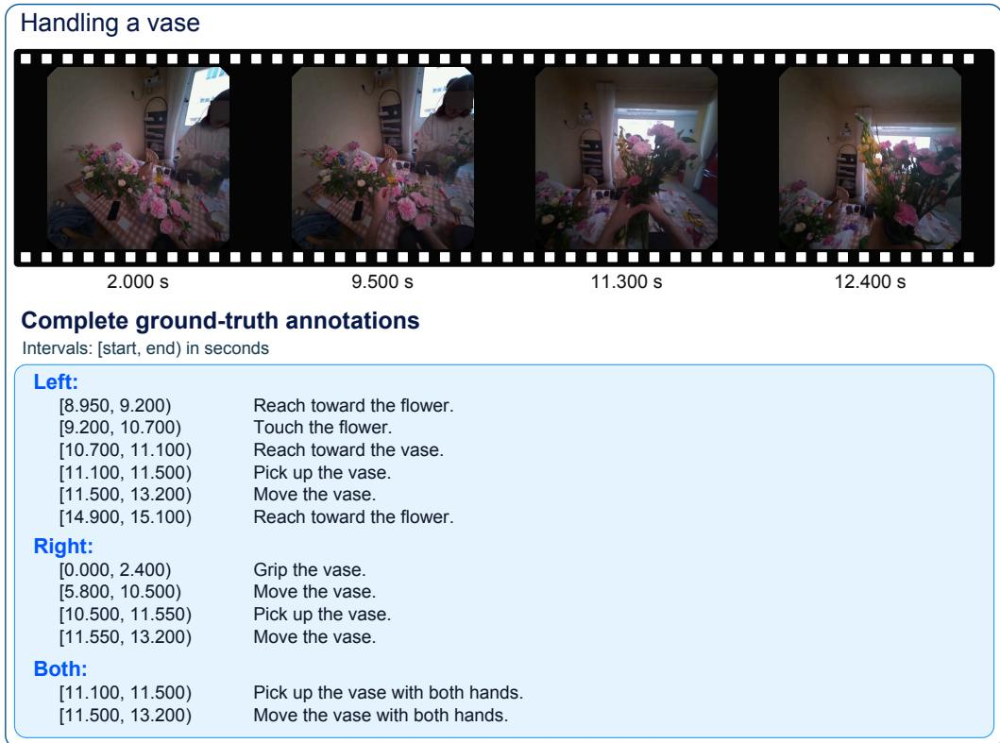

Figure 15 EgoLife example. Selected frames and complete ground-truth annotations for handling a vase.  
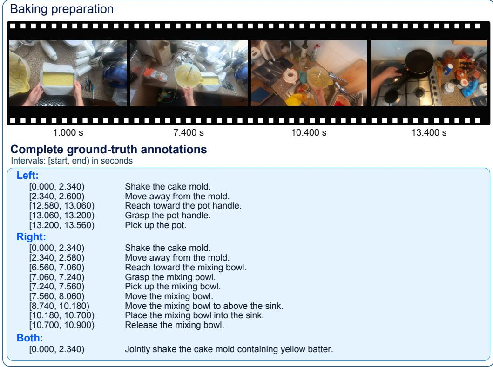  
Figure 16 EPIC-KITCHENS-100 example. Selected frames and complete ground-truth annotations for baking preparation.

## H Results by Data Source

Tables 10, 11, and 12 report results separately for the Ego4D, EgoLife, and EPIC-KITCHENS-100 subsets. We use the same models, metrics, and aggregation rules as Table 3, with all scores computed within each source. Bold indicates the best model result in each column for that source; the human reference is excluded from this comparison.

We compare results by data source to examine whether the main findings hold across subsets. GPT-6 Astra achieves the highest model scores on all reported metrics. The LLaVA-OV2 variant achieves the highest EgoActionScore among open-source baselines on all three sources. Both EgoAction variants also achieve higher Temporal and Semantic scores than their respective backbones. However, GPT-6 Astra remains well below human performance in m-tIoU across all three sources. Precise temporal localization therefore remains a common challenge.

Table 10 Dense action captioning on the Ego4D subset of EgoActionBench. All scores range from 0 to 100; higher is better.   
Temporal Overall is the mean of m-tIoU and micro-averaged F1. Semantic Overall averages the applicable Hand, Verb, Objects, Tools, and Motion scores within each ground-truth action, then averages over ground-truth actions.   
EgoActionScore is the mean of Temporal Overall and Semantic Overall. Parentheses identify the EgoAction backbone.   
Best model scores are bold.

<table><tr><td rowspan="2">Model</td><td rowspan="2">EgoAction Score</td><td colspan="3">Temporal</td><td colspan="6">Semantic</td></tr><tr><td>m-tIoU</td><td>F1</td><td>Overall</td><td>Hand</td><td>Verb</td><td>Objects</td><td>Tools</td><td>Motion</td><td>Overall</td></tr><tr><td colspan="10">Human Baseline</td></tr><tr><td>Human Expert</td><td>92.8</td><td>92.0</td><td>96.2</td><td>94.1</td><td>96.8</td><td>95.3</td><td>96.3</td><td>98.4</td><td>76.8</td><td>91.5</td></tr><tr><td colspan="9">Proprietary models</td><td></td></tr><tr><td>GPT-5.6 Sol (OpenAI, 2026a)</td><td>47.7</td><td>28.1</td><td>54.7</td><td>41.4</td><td>66.0</td><td>49.1</td><td>59.3</td><td>80.3</td><td>40.4</td><td>54.0</td></tr><tr><td>GPT-6 Astra (OpenAI, 2026b)</td><td>57.4</td><td>37.5</td><td>65.8</td><td>51.7</td><td>74.4</td><td>60.8</td><td>68.6</td><td>84.2</td><td>47.5</td><td>63.1</td></tr><tr><td>Gemini 3.1 Pro Preview (Google DeepMind, 2026)</td><td>33.4</td><td>16.2</td><td>38.5</td><td>27.3</td><td>50.3</td><td>33.7</td><td>43.7</td><td>67.7</td><td>29.3</td><td>39.5</td></tr><tr><td colspan="9">Open-source VLMs</td><td></td></tr><tr><td>Qwen2.5-VL-72B-Instruct (Bai et al., 2025b)</td><td>24.3</td><td>7.6</td><td>23.8</td><td>15.7</td><td>44.1</td><td>26.9</td><td>34.7</td><td>51.1</td><td>24.9</td><td>32.8</td></tr><tr><td>Qwen3-VL-32B-Instruct (Bai et al., 2025a)</td><td>28.1</td><td>10.2</td><td>28.5</td><td>19.4</td><td>49.7</td><td>30.4</td><td>38.3</td><td>62.5</td><td>27.9</td><td>36.9</td></tr><tr><td>Qwen3-VL-8B-Instruct (Bai et al., 2025a)</td><td>23.6</td><td>8.7</td><td>24.5</td><td>16.6</td><td>42.9</td><td>24.4</td><td>32.2</td><td>52.6</td><td>22.1</td><td>30.6</td></tr><tr><td>InternVL3.5-8B (Wang et al., 2025)</td><td>19.9</td><td>8.0</td><td>24.5</td><td>16.3</td><td>33.2</td><td>18.3</td><td>25.8</td><td>46.0</td><td>15.8</td><td>23.5</td></tr><tr><td>MiniCPM-V-4.5-8B (OpenBMB, 2025)</td><td>19.4</td><td>6.8</td><td>20.1</td><td>13.4</td><td>35.3</td><td>21.1</td><td>26.4</td><td>36.6</td><td>18.8</td><td>25.5</td></tr><tr><td>VideoLLaMA3-7B (Zhang et al., 2025)</td><td>13.1</td><td>3.5</td><td>9.4</td><td>6.5</td><td>24.0</td><td>16.2</td><td>23.4</td><td>38.1</td><td>14.9</td><td>19.7</td></tr><tr><td>Qwen3-VL-4B-Instruct (Bai et al., 2025a)</td><td>24.7</td><td>8.4</td><td>25.2</td><td>16.8</td><td>46.4</td><td>24.4</td><td>35.6</td><td>50.2</td><td>22.8</td><td>32.5</td></tr><tr><td>Molmo2-8B (Clark et al., 2026)</td><td>17.4</td><td>6.9</td><td>19.2</td><td>13.1</td><td>29.0</td><td>18.2</td><td>22.4</td><td>37.2</td><td>16.9</td><td>21.8</td></tr><tr><td>LLaVA-OV2-8B (An et al., 2026)</td><td>23.9</td><td>8.7</td><td>23.8</td><td>16.2</td><td>44.0</td><td>24.8</td><td>34.2</td><td>48.9</td><td>22.8</td><td>31.6</td></tr><tr><td colspan="9">Open-source video captioning models</td><td></td></tr><tr><td>video-SALMONN-2+-3B (Tang et al., 2025)</td><td>10.4</td><td>2.9</td><td>12.2</td><td>7.6</td><td>20.2</td><td>8.9</td><td>14.3</td><td>29.2</td><td>9.4</td><td>13.3</td></tr><tr><td>CapRL-Video-4B (Yang et al., 2026)</td><td>32.0</td><td>15.5</td><td>39.0</td><td>27.2</td><td>51.0</td><td>28.6</td><td>39.6</td><td>65.0</td><td>27.0</td><td>36.8</td></tr><tr><td>OmniCaptioner-IF-3B (Wang et al., 2026a)</td><td>19.9</td><td>6.2</td><td>23.9</td><td>15.1</td><td>37.6</td><td>18.1</td><td>24.7</td><td>28.3</td><td>18.8</td><td>24.8</td></tr><tr><td>OmniCaptioner-IF-7B (Wang et al., 2026a)</td><td>22.8</td><td>9.1</td><td>25.5</td><td>17.3</td><td>39.2</td><td>23.2</td><td>28.5</td><td>43.2</td><td>21.5</td><td>28.3</td></tr><tr><td colspan="9">Open-source egocentric video understanding models</td><td></td></tr><tr><td>EgoThinker-7B (Pei et al., 2025b)</td><td>22.6</td><td>14.8</td><td>25.9</td><td>20.3</td><td>36.7</td><td>20.0</td><td>22.9</td><td>14.5</td><td>19.9</td><td>24.9</td></tr><tr><td>EgoGPT-7B (Yang et al., 2025b)</td><td>14.5</td><td>3.7</td><td>13.4</td><td>8.6</td><td>24.2</td><td>18.8</td><td>18.1</td><td>22.0</td><td>20.6</td><td>20.5</td></tr><tr><td>RynnBrain-4B (Dang et al., 2026)</td><td>15.1</td><td>10.6</td><td>15.2</td><td>12.9</td><td>22.9</td><td>13.9</td><td>16.9</td><td>17.8</td><td>15.8</td><td>17.3</td></tr><tr><td>Flora (Leng et al., 2026)</td><td>34.9</td><td>16.9</td><td>43.2</td><td>30.0</td><td>48.4</td><td>38.4</td><td>34.2</td><td>57.9</td><td>37.9</td><td>39.9</td></tr><tr><td colspan="9">EgoAction (Ours)</td><td></td></tr><tr><td>EgoAction (LLaVA-OV2-8B)</td><td>47.5</td><td>30.1</td><td>57.5</td><td>43.8</td><td>66.7</td><td>45.5</td><td>52.2</td><td>64.7</td><td>39.7</td><td>51.2</td></tr><tr><td>EgoAction (Qwen3-VL-4B)</td><td>42.0</td><td>25.4</td><td>48.0</td><td>36.7</td><td>63.3</td><td>41.0</td><td>48.5</td><td>62.4</td><td>36.0</td><td>47.4</td></tr></table>

Table 11 Dense action captioning on the EgoLife subset of EgoActionBench. All scores range from 0 to 100; higher is better. Temporal Overall is the mean of m-tIoU and micro-averaged F1. Semantic Overall averages the applicable Hand, Verb, Objects, Tools, and Motion scores within each ground-truth action, then averages over ground-truth actions. EgoActionScore is the mean of Temporal Overall and Semantic Overall. Parentheses identify the EgoAction backbone. Best model scores are bold.
<table><tr><td rowspan="2">Model</td><td rowspan="2">EgoAction Score</td><td colspan="3">Temporal</td><td colspan="6">Semantic</td></tr><tr><td>m-tIoU</td><td>F1</td><td>Overall</td><td>Hand</td><td>Verb</td><td>Objects</td><td>Tools</td><td>Motion</td><td>Overall</td></tr><tr><td colspan="10">Human Baseline</td></tr><tr><td>Human Expert</td><td>93.8</td><td>94.4</td><td>97.3</td><td>95.9</td><td>97.3</td><td>96.5</td><td>96.7</td><td>97.1</td><td>76.1</td><td>91.8</td></tr><tr><td colspan="10">Proprietary models</td></tr><tr><td>GPT-5.6 Sol (OpenAI, 2026a)</td><td>47.4</td><td>29.3</td><td>55.1</td><td>42.2</td><td>63.6</td><td>48.4</td><td>58.1</td><td>72.5</td><td>40.0</td><td>52.6</td></tr><tr><td>GPT-6 Astra (OpenAI, 2026b)</td><td>59.0</td><td>40.3</td><td>68.6</td><td>54.5</td><td>74.3</td><td>63.0</td><td>67.8</td><td>77.6</td><td>49.1</td><td>63.6</td></tr><tr><td>Gemini 3.1 Pro Preview (Google DeepMind, 2026)</td><td>33.0</td><td>16.8</td><td>40.1</td><td>28.5</td><td>45.1</td><td>33.5</td><td>40.7</td><td>58.3</td><td>30.5</td><td>37.5</td></tr><tr><td colspan="10">Open-source VLMs</td></tr><tr><td>Qwen2.5-VL-72B-Instruct (Bai et al., 2025b)</td><td>24.1</td><td>8.0</td><td>26.7</td><td>17.3</td><td>41.5</td><td>26.6</td><td>29.5</td><td>41.6</td><td>26.2</td><td>30.9</td></tr><tr><td>Qwen3-VL-32B-Instruct (Bai et al., 2025a)</td><td>27.2</td><td>11.0</td><td>31.5</td><td>21.2</td><td>44.4</td><td>28.4</td><td>32.6</td><td>42.0</td><td>27.5</td><td>33.2</td></tr><tr><td>Qwen3-VL-8B-Instruct (Bai et al., 2025a)</td><td>24.6</td><td>10.0</td><td>27.5</td><td>18.7</td><td>42.7</td><td>25.5</td><td>30.1</td><td>43.0</td><td>23.7</td><td>30.5</td></tr><tr><td>InternVL3.5-8B (Wang et al., 2025)</td><td>19.0</td><td>8.1</td><td>23.4</td><td>15.8</td><td>29.6</td><td>19.5</td><td>21.7</td><td>29.0</td><td>18.2</td><td>22.2</td></tr><tr><td>MiniCPM-V-4.5-8B (OpenBMB, 2025)</td><td>18.8</td><td>5.9</td><td>19.3</td><td>12.6</td><td>32.0</td><td>22.7</td><td>24.0</td><td>28.7</td><td>21.3</td><td>24.9</td></tr><tr><td>VideoLLaMA3-7B (Zhang et al., 2025)</td><td>14.8</td><td>4.1</td><td>11.0</td><td>7.5</td><td>24.5</td><td>19.7</td><td>24.3</td><td>33.8</td><td>20.1</td><td>22.1</td></tr><tr><td>Qwen3-VL-4B-Instruct (Bai et al., 2025a)</td><td>24.5</td><td>9.3</td><td>27.1</td><td>18.2</td><td>42.7</td><td>25.1</td><td>30.8</td><td>26.6</td><td>25.1</td><td>30.9</td></tr><tr><td>Molmo2-8B (Clark et al., 2026)</td><td>17.1</td><td>6.9</td><td>19.4</td><td>13.1</td><td>27.4</td><td>17.7</td><td>21.8</td><td>31.6</td><td>17.1</td><td>21.0</td></tr><tr><td>LLaVA-OV2-8B (An et al., 2026)</td><td>22.7</td><td>8.5</td><td>24.5</td><td>16.5</td><td>37.8</td><td>25.2</td><td>29.7</td><td>44.3</td><td>23.1</td><td>28.9</td></tr><tr><td colspan="10">Open-source video captioning models</td></tr><tr><td>video-SALMONN-2+-3B (Tang et al., 2025)</td><td>10.1</td><td>3.3</td><td>13.9</td><td>8.6</td><td>18.0</td><td>7.8</td><td>12.3</td><td>28.7</td><td>8.1</td><td>11.5</td></tr><tr><td>CapRL-Video-4B (Yang et al., 2026)</td><td>30.6</td><td>16.1</td><td>38.7</td><td>27.4</td><td>44.9</td><td>27.4</td><td>34.4</td><td>42.5</td><td>28.7</td><td>33.9</td></tr><tr><td>OmniCaptioner-IF-3B (Wang et al., 2026a)</td><td>20.2</td><td>6.4</td><td>26.3</td><td>16.3</td><td>36.2</td><td>19.1</td><td>20.1</td><td>18.2</td><td>21.4</td><td>24.1</td></tr><tr><td>OmniCaptioner-IF-7B (Wang et al., 2026a)</td><td>23.5</td><td>10.5</td><td>25.0</td><td>17.7</td><td>38.7</td><td>25.8</td><td>24.8</td><td>33.6</td><td>28.1</td><td>29.3</td></tr><tr><td colspan="10">Open-source egocentric video understanding models</td></tr><tr><td>EgoThinker-7B (Pei et al., 2025b)</td><td>18.9</td><td>12.0</td><td>21.9</td><td>16.9</td><td>30.8</td><td>19.1</td><td>14.2</td><td>6.5</td><td>20.0</td><td>20.9</td></tr><tr><td>EgoGPT-7B (Yang et al., 2025b)</td><td>15.9</td><td>4.6</td><td>16.1</td><td>10.3</td><td>24.8</td><td>20.4</td><td>19.2</td><td>18.4</td><td>21.3</td><td>21.4</td></tr><tr><td>RynnBrain-4B (Dang et al., 2026)</td><td>13.3</td><td>10.3</td><td>11.8</td><td>11.0</td><td>21.1</td><td>12.8</td><td>14.5</td><td>9.9</td><td>14.2</td><td>15.6</td></tr><tr><td>Flora (Leng et al., 2026)</td><td>36.1</td><td>16.1</td><td>43.7</td><td>29.9</td><td>49.5</td><td>41.3</td><td>37.2</td><td>59.9</td><td>41.0</td><td>42.2</td></tr><tr><td colspan="10">EgoAction (Ours)</td></tr><tr><td>EgoAction (LLaVA-OV2-8B)</td><td>46.3</td><td>31.6</td><td>55.2</td><td>43.4</td><td>64.4</td><td>45.1</td><td>48.7</td><td>53.9</td><td>38.8</td><td>49.3</td></tr><tr><td>EgoAction (Qwen3-VL-4B)</td><td>40.2</td><td>25.8</td><td>45.6</td><td>35.7</td><td>60.5</td><td>40.1</td><td>42.9</td><td>43.0</td><td>35.8</td><td>44.8</td></tr></table>

Table 12 Dense action captioning on the EPIC-KITCHENS-100 subset of EgoActionBench. All scores range from 0 to 100; higher is better. Temporal Overall is the mean of m-tIoU and micro-averaged F1. Semantic Overall averages the applicable Hand, Verb, Objects, Tools, and Motion scores within each ground-truth action, then averages over groundtruth actions. EgoActionScore is the mean of Temporal Overall and Semantic Overall. Parentheses identify the EgoAction backbone. Best model scores are bold.
<table><tr><td rowspan="2">Model</td><td rowspan="2">EgoAction Score</td><td colspan="3">Temporal</td><td colspan="6">Semantic</td></tr><tr><td>m-tIoU</td><td>F1</td><td>Overall</td><td>Hand</td><td>Verb</td><td>Objects</td><td>Tools</td><td>Motion</td><td>Overall</td></tr><tr><td colspan="10">Human Baseline</td></tr><tr><td>Human Expert</td><td>83.0</td><td>75.9</td><td>84.2</td><td>80.1</td><td>91.4</td><td>91.1</td><td>91.2</td><td>88.6</td><td>69.3</td><td>85.9</td></tr><tr><td colspan="10">Proprietary models</td></tr><tr><td>GPT-5.6 Sol (OpenAI, 2026a)</td><td>55.6</td><td>37.6</td><td>64.5</td><td>51.0</td><td>73.0</td><td>56.4</td><td>65.3</td><td>76.0</td><td>45.1</td><td>60.1</td></tr><tr><td>GPT-6 Astra (OpenAI, 2026b)</td><td>63.6</td><td>45.5</td><td>72.3</td><td>58.9</td><td>79.7</td><td>67.4</td><td>74.5</td><td>77.9</td><td>50.9</td><td>68.3</td></tr><tr><td>Gemini 3.1 Pro Preview (Google DeepMind, 2026)</td><td>39.1</td><td>22.4</td><td>48.2</td><td>35.3</td><td>53.4</td><td>36.9</td><td>47.1</td><td>63.4</td><td>33.0</td><td>42.8</td></tr><tr><td colspan="10">Open-source VLMs</td></tr><tr><td>Qwen2.5-VL-72B-Instruct (Bai et al., 2025b)</td><td>25.9</td><td>9.5</td><td>28.7</td><td>19.1</td><td>44.9</td><td>26.8</td><td>33.9</td><td>50.9</td><td>25.1</td><td>32.7</td></tr><tr><td>Qwen3-VL-32B-Instruct (Bai et al., 2025a)</td><td>33.2</td><td>15.1</td><td>37.4</td><td>26.3</td><td>51.6</td><td>34.3</td><td>41.2</td><td>60.9</td><td>33.2</td><td>40.2</td></tr><tr><td>Qwen3-VL-8B-Instruct (Bai et al., 2025a)</td><td>28.3</td><td>13.1</td><td>34.1</td><td>23.6</td><td>46.1</td><td>27.2</td><td>34.6</td><td>54.5</td><td>23.4</td><td>33.0</td></tr><tr><td>InternVL3.5-8B (Wang et al., 2025)</td><td>22.9</td><td>10.9</td><td>29.1</td><td>20.0</td><td>34.8</td><td>21.1</td><td>29.6</td><td>50.8</td><td>17.0</td><td>25.9</td></tr><tr><td>MiniCPM-V-4.5-8B (OpenBMB, 2025)</td><td>20.1</td><td>7.5</td><td>21.6</td><td>14.5</td><td>34.1</td><td>22.1</td><td>24.9</td><td>34.5</td><td>21.5</td><td>25.6</td></tr><tr><td>VideoLLaMA3-7B (Zhang et al., 2025)</td><td>15.3</td><td>6.0</td><td>13.9</td><td>9.9</td><td>23.8</td><td>16.6</td><td>27.6</td><td>41.8</td><td>14.0</td><td>20.6</td></tr><tr><td>Qwen3-VL-4B-Instruct (Bai et al., 2025a)</td><td>29.3</td><td>12.9</td><td>33.7</td><td>23.3</td><td>50.6</td><td>26.3</td><td>39.3</td><td>55.5</td><td>24.7</td><td>35.4</td></tr><tr><td>Molmo2-8B (Clark et al., 2026)</td><td>22.9</td><td>10.9</td><td>26.1</td><td>18.5</td><td>36.4</td><td>22.3</td><td>31.4</td><td>51.7</td><td>17.9</td><td>27.2</td></tr><tr><td>LLaVA-OV2-8B (An et al., 2026)</td><td>28.2</td><td>13.0</td><td>33.2</td><td>23.1</td><td>44.2</td><td>28.1</td><td>33.7</td><td>49.0</td><td>26.8</td><td>33.3</td></tr><tr><td colspan="10">Open-source video captioning models</td></tr><tr><td>video-SALMONN-2+-3B (Tang et al., 2025)</td><td>12.4</td><td>4.5</td><td>17.5</td><td>11.0</td><td>22.0</td><td>8.6</td><td>14.6</td><td>27.2</td><td>9.3</td><td>13.7</td></tr><tr><td>CapRL-Video-4B (Yang et al., 2026)</td><td>34.9</td><td>19.8</td><td>43.2</td><td>31.5</td><td>51.9</td><td>30.5</td><td>43.5</td><td>64.1</td><td>26.9</td><td>38.4</td></tr><tr><td>OmniCaptioner-IF-3B (Wang et al., 2026a)</td><td>19.7</td><td>7.3</td><td>27.6</td><td>17.5</td><td>33.6</td><td>16.4</td><td>19.6</td><td>35.0</td><td>18.0</td><td>21.9</td></tr><tr><td>OmniCaptioner-IF-7B (Wang et al., 2026a)</td><td>22.8</td><td>11.3</td><td>24.4</td><td>17.8</td><td>37.2</td><td>24.3</td><td>24.7</td><td>41.2</td><td>25.2</td><td>27.9</td></tr><tr><td colspan="10">Open-source egocentric video understanding models</td></tr><tr><td>EgoThinker-7B (Pei et al., 2025b)</td><td>20.4</td><td>14.2</td><td>24.0</td><td>19.1</td><td>32.7</td><td>17.3</td><td>19.1</td><td>14.6</td><td>18.1</td><td>21.7</td></tr><tr><td>EgoGPT-7B (Yang et al., 2025b)</td><td>16.0</td><td>5.8</td><td>19.7</td><td>12.7</td><td>23.2</td><td>17.3</td><td>17.7</td><td>25.4</td><td>18.6</td><td>19.2</td></tr><tr><td>RynnBrain-4B (Dang et al., 2026)</td><td>12.8</td><td>10.1</td><td>12.8</td><td>11.4</td><td>18.7</td><td>11.5</td><td>14.1</td><td>15.7</td><td>12.4</td><td>14.1</td></tr><tr><td>Flora (Leng et al., 2026)</td><td>44.0</td><td>24.5</td><td>55.3</td><td>39.9</td><td>57.5</td><td>46.2</td><td>42.1</td><td>60.1</td><td>46.7</td><td>48.2</td></tr><tr><td colspan="10">EgoAction (Ours)</td></tr><tr><td>EgoAction (LLaVA-OV2-8B)</td><td>50.5</td><td>36.4</td><td>58.3</td><td>47.4</td><td>70.4</td><td>48.5</td><td>54.6</td><td>65.4</td><td>40.6</td><td>53.6</td></tr><tr><td>EgoAction (Qwen3-VL-4B)</td><td>43.6</td><td>29.4</td><td>43.9</td><td>36.6</td><td>67.1</td><td>43.9</td><td>52.0</td><td>60.2</td><td>39.2</td><td>50.6</td></tr></table>

## AI Use Statement

We used GPT-6 Astra to assist with benchmark annotation. Human reviewers verified the benchmark annotations against the original videos, whereas the labels used for supervised adaptation were generated and refined automatically. Qwen3-32B served as the text-only semantic judge described in our evaluation protocol. AI tools also assisted with code development and language polishing. We take full responsibility for the final paper, dataset annotations, code, and reported results.