# Evaluating Synthetic Skin Lesion Images for Classifier Training: A Safety-Aware Algorithm

Amindu Kumarasinghe∗, Vinh Bui, and Reza Ghanbarzadeh

Faculty of Science and Engineering, Southern Cross University, Gold Coast, QLD, Australia

## Abstract

Skin cancer classifiers need large sets of annotated images, which are scarce, especially for rare lesion types. AI-generated images can fill the gap, but a generator produces images of widely varying quality, so selecting which images to retain is important. That choice usually rests on a single quality score, most often the Fréchet Inception Distance (FID), which has not been tested against what a classifier needs and cannot tell whether the generator memorizes its training photographs. We test that practice with a tournament of 16 quality metrics. Each metric alone selects a training subset from a pool of 275,472 images generated by a difusion model (EDM2), and a classifier trained on each subset scores the metric per class. The tournament shows that no single metric serves every class: FID computed on Inception features gives the best classifier for one lesion type and no measurable advantage over random sampling for another, and the generation setting it prefers is also the one closest to the training images. We turn these per-class measurements into a safety-aware evaluation algorithm that weights each metric by its measured value in each class and removes images too close to a real training image. On the held-out ISIC-2018 test set, the algorithm improves Macro-�2, a recall-weighted measure of classification performance, over the FID baseline for a Swin-B classifier by +0.0136 to +0.0164 across four safety thresholds (Bonferroni-corrected $p < 0 . 0 2 )$ and over random sampling by about +0.03, though not for ResNet-50. Tightening the threshold improves a memorization-safety score with no measurable change in utility, but every curated set remains less safe than random sampling. The results show a modest but statistically significant gain on the primary classifier, and ofer a practical, safety-aware procedure for evaluating and using synthetic data.

Keywords: synthetic medical images, dermoscopy, skin lesion classification, data curation, evaluation metrics, memorization

## 1 Introduction

Skin cancer is among the most common cancers worldwide, and its most lethal form, melanoma, kills thousands of patients every year (World Health Organization, 2025; Siegel et al., 2019). However, early detection substantially improves survival, and deep learning classifiers trained on dermoscopic images can now approach expert-level diagnostic performance (Esteva et al., 2017). That performance depends on large, expertly annotated training sets. These are expensive to assemble, and for the rarest diagnoses they do not exist in quantity (Alzubaidi et al., 2023). Patient privacy regulations such as the General Data Protection Regulation (GDPR) and the Health Insurance Portability and

Accountability Act (HIPAA) add a further constraint, restricting how dermoscopic images can be shared or pooled across institutions even when they do exist (Giouroukou et al., 2025). On the International Skin Imaging Collaboration (ISIC) 2018 dataset used throughout this paper (Codella et al., 2019; Tschandl et al., 2018), the seven diagnostic classes, melanoma (MEL), nevus (NV), basal cell carcinoma (BCC), actinic keratoses and intraepithelial carcinoma (AKIEC), benign keratosis (BKL), dermatofibroma (DF), and vascular lesion (VASC), range from 5,364 training images for the majority class (NV) to 92 for the rarest (DF). This imbalance reflects how rare each diagnosis is in the clinic, so the rarest classes stay small in any realistic collection of clinical images.

Synthetic image generation is the field’s response to that scarcity. Generative Adversarial Networks (Goodfellow et al., 2014) and, more recently, difusion models (Ho et al., 2020; Rombach et al., 2022) can produce class-conditioned dermoscopic images in the hundreds of thousands, at a cost that has nothing to do with how rare the underlying condition is. This removes the original scarcity problem and raises a new one: with a pool that large, how do we tell which images actually help a classifier detect skin cancer, and which hurt it? That is the curation problem this paper addresses.

Fréchet Inception Distance (FID) is one of the most commonly used metrics for evaluating generative models (Heusel et al., 2017; Betzalel et al., 2024). It measures distance in the feature space of an Inception-v3 network trained to classify natural photographs, not dermoscopic images (Kynkäänniemi et al., 2023); computed this way it is called FID-Inception, the label used throughout this paper. The standard practice is nonetheless to select the single generation checkpoint with the best FID-Inception score and sample whatever synthetic images are needed from it alone (Wu et al., 2026). This is a rule of thumb, not a measured choice: nothing in a metric built around natural-image classification guarantees that the checkpoint it prefers on dermoscopic data is also the one that produces a better classifier, and a recent study in a comparable medical imaging setting reports a similar mismatch between FID and downstream performance (Wu et al., 2026). We treat this gap between what a metric measures and what a classifier actually needs as an empirical question rather than an assumption, and we answer it directly, with a procedure we call the metric tournament. We first used a difusion model (EDM2) to generate a 275,472-image synthetic pool spanning ISIC-2018’s seven classes. We then selected 16 candidate metrics, which fall into two families: instance-level metrics, which score one image on its own and range from pixel-level measures like peak signal-to-noise ratio (PSNR) to perceptual and semantic ones like learned perceptual image patch similarity (LPIPS), feature similarity index (FSIM), and contrastive language-image pretraining (CLIP) similarity, and distributional metrics such as FID-Inception, Kernel Inception Distance (KID), and Sliced Wasserstein Distance (SWD), which compare a whole set of generated images against real data and cannot judge a single image in isolation. For each metric in turn, we used it alone to select a training subset from the pool that follows the real class proportions, trained Swin-B, a transformer-based image classifier and our primary architecture, on that subset (with ResNet-50 as a secondary check), and measured its per-class $F _ { 2 }$ score, which weights recall over precision, against an identically trained classifier given an equally sized, randomly sampled subset instead. We call this the utility of a metric: its actual downstream performance.

The tournament’s result is that no single metric serves every class, and the practice of picking a single metric across all classes does not hold up. FID-Inception, for instance, produces the best classifier on one class (VASC) and one no better than random sampling on another (DF); the full per-class breakdown across all 16 metrics is in Section 4.1. Curating with a single metric helps some classes and is associated with lower downstream performance for others, and there is no way to know which without measuring it directly.

This paper’s algorithm is built on that measurement. It converts the tournament’s per-class measurements into per-class sampling weights. Distributional metrics describe a whole set of images, so the algorithm adds a mechanism that lets them shape individual sampling decisions as well. Finally, a generative model can sometimes reproduce a specific training image rather than a genuinely new one, a privacy risk this paper calls memorization; the algorithm gates the resulting pool with a memorization-safety threshold, calibrated against pairs of real photographs of the same lesion (ISIC lesion identifiers), that removes images whose feature-space similarity to a real training image reaches the threshold. This threshold is a tunable lever, and the confirmatory benchmark below tests it at four calibration-grounded values.

We then validate the algorithm the way it would actually be used, as a real-data augmentation method, across one further axis beyond the utility already measured by the tournament: safety, the memorization risk just described. Evaluation is on a strictly held-out real ISIC-2018 test set that never enters curation, model selection, or the metric tournament just described, with the classifier’s initialization and training procedure held fixed across every run. Across the four safety threshold values tested below, it improves macro-averaged $F _ { 2 }$ over the FID-Inception baseline by +0.0136 to +0.0164, with Welch’s �-test and Bonferroni correction, $p < 0 . 0 2$ at every one (Section 4.5). Safety depends on the threshold: tightening it raises the algorithm’s memorization-safety score above FID-Inception’s while Macro- $F _ { 2 }$ stays flat, but every curated set, the algorithm’s included, remains less safe than random sampling. The full breakdown is in Section 4.5.2.

This paper asks two primary and two secondary questions. The primary questions are (1) how well do current metrics work as selection signals for skin-lesion classifiers, and (2) can an algorithm built on these measurements exceed the current standard, FID-based selection, on both utility and safety. The secondary questions are (3) does the feature backbone behind a metric, Inception or DINOv2, matter, and (4) do the gains of the algorithm hold when it curates a larger set.

The contributions of this paper are: (1) an empirical metric tournament that evaluates 16 current metrics as selection signals for skin-lesion classifiers and shows that no single metric serves every class; (2) a safety-aware evaluation algorithm built on the results of the tournament; (3) a confirmatory benchmark on a real, held-out clinical test set, where it outperforms the industrystandard FID-Inception baseline on utility and, at the two tighter thresholds, on safety as well; and (4) a public release of the 275,472-image synthetic pool with per-image scores for 14 metrics and per-configuration scores for the four distributional metrics, together with open-source code. These findings bear on how synthetic images should be selected for rare-lesion classifiers, where a missed diagnosis is costly: the choice of selection metric should be validated per class on held-out real data (Section 6.4).

Following this introduction, Section 2 situates this work against prior synthetic augmentation, generative evaluation, and memorization literature. Section 3 describes the full pipeline: the synthetic pool, the metric tournament, the evaluation algorithm, the safety measure and the benchmark protocol. Section 4 reports the tournament (question 1), the feature backbone of the metrics (question 3), the development evidence for each of the algorithm’s design choices, the confirmatory benchmark with its safety analysis and its dose response (questions 2 and 4), and a repetition of the pipeline with ResNet-50 to test how far the findings generalize. Section 5 describes the released dataset. Sections 6 to 8 discuss what the algorithm does and does not establish, its limitations, and its conclusions.

## 2 Related Work

Synthesis of dermoscopic images with generative adversarial networks (GANs) and difusion models has been studied extensively, but its efect on downstream classifier performance is inconsistent across studies using near-identical setups. Bissoto et al. tested four GAN architectures under multiple sampling strategies and real-to-synthetic ratios and concluded that “reliably transforming synthetic images into reliable performance gains is far from obvious”: augmentation helped on out-of-distribution test sets but not on standard in-distribution dermoscopic classification, and which conditions transfer remained an open question (Bissoto et al., 2021). The same pattern recurs elsewhere. Mikołajczyk et al. found that an unconditional GAN’s synthetic images nearly matched real-only training performance while a conditional GAN’s images degraded it, despite sharing the same underlying architecture family (Mikołajczyk et al., 2022). An earlier synthesis study by Bissoto et al. found that only one of eight tested real-synthetic training compositions improved area under the receiver operating characteristic curve (ROC-AUC) over a real-only baseline, with several compositions performing worse (Bissoto et al., 2018). Ding et al. found that only their own proposed conditional GAN’s synthetic images improved downstream ROC-AUC when added to real data, while three alternative generators’ outputs did not (Ding et al., 2021). Curation, not generation, is also what drives benefit when clinicians are put in the loop directly: Nagi et al. had pediatric dermatologists approve or reject individual synthetic images before augmentation, and found that training on the clinician-approved subset alone beat both a real-only baseline and augmentation with the full, unfiltered synthetic pool, with the largest gain in an under-represented dark-skin-tone subgroup (though the authors flag that specific subgroup result as exploratory, given only seven such patients in the comparison); they state plainly that “visually plausible synthetic images may still contain clinically implausible features... not adequately captured by automatic image-quality metrics” (Nagi et al., 2026). The same inconsistency shows up with difusion models: Wang et al. found difusion-generated skin-disease images were frequently medically inaccurate and degraded downstream diagnostic performance until corrected against expert feedback, after which accuracy improved by 9 to 14 percentage points depending on the data regime (Wang et al., 2025), while Shentu et al. report a more modest +2.32 F1 gain from a diferent difusion-based pipeline (Shentu et al., 2026). The same basic idea, generation followed by augmentation, produces efects ranging from harmful to strongly beneficial depending on what stands between the generator and the training set. Across these studies, the recurring pattern is that generation quality alone does not predict downstream benefit: which images are added, not only how they were made, afects whether augmentation helps or hurts. That is the curation problem this paper addresses.

When studies of synthetic augmentation in dermatology report a quantitative image-quality metric at all, they typically use one, chosen by convention rather than by what it predicts about the downstream task. Alonso et al. report only FID (Rodriguez Alonso et al., 2025); Teodoro et al. track FID alone across training to certify a generator as suficient for their pipeline (Teodoro et al., 2022); Rezk et al. use two instance-level metrics, the blind/referenceless image spatial quality evaluator (BRISQUE) and the structural similarity index (SSIM), each assigned to a separate purpose (realism and disease presentation respectively) rather than combined into one measured score (Rezk et al., 2022). Luschi et al. tested this directly. Using a StyleGAN2 model already selected via FID, KID, precision, and recall in a companion study, they measured per-image LPIPS for 25 synthetic melanoma images and correlated it against the diagnostic accuracy of 17 dermatologists assessing those same images, finding no significant relationship (Spearman’s $\rho = - 0 . 3 6 \ \mathrm { t o } \ - 0 . 2 4$ $p > 0 . 0 5 )$ ; the dermatologists themselves classified real from synthetic images at only 64% accuracy. They conclude that “common quantitative metrics are not able to capture context-specific aspects of realism” (Luschi et al., 2025). A direct architecture comparison makes the same point more starkly: Pritam and Jain compared StyleGAN2-ADA against a denoising difusion probabilistic model (DDPM) across FID, KID, Inception Score (IS), and downstream classification on over 14,000 dermoscopic images, and found that the architecture with the better distributional scores did not simply produce the better downstream classifier, with augmentation gains ranging from 8% to 15% F1 depending on architecture and preprocessing choices that barely moved the generative metrics themselves (Pritam et al., 2025). At the opposite extreme, some evaluations use no quantitative metric at all: Pielage et al. validated their difusion-generated lesions through a dermatologist user study alone, with no FID, KID, or downstream classifier reported (Pielage et al., 2025). Bissoto et al. question the premise directly: FID and the IS rely on ImageNet-trained networks, and are “questionable for applications where classes are very diferent, such as medical applications” (Bissoto et al., 2021). The same disconnect has been reported outside dermoscopy. Ravuri and Vinyals scored class-conditional generative models by the accuracy of a classifier trained only on their images and tested on real data, and found large deficits that FID and similar scores did not reveal (Ravuri and Vinyals, 2019). Skandarani et al. report that GANs that look realistic by FID standards still fail to reproduce the richness of medical datasets for downstream segmentation (Skandarani et al., 2023). Jayasumana et al. attribute part of FID’s unreliability to its normality assumption, its Inception features and its sample complexity, and propose CLIP maximum mean discrepancy (CMMD), which uses CLIP embeddings and the maximum mean discrepancy (MMD) (Jayasumana et al., 2024). Stein et al. find that no existing metric correlates strongly with human judgment of realism, that over-reliance on Inception features is one reason FID misses the realism of difusion models, and that DINOv2 features allow a richer evaluation (Stein et al., 2023). In medical imaging, Woodland et al. find that ImageNet-based feature extractors rank generators more consistently with expert judgment than extractors trained on medical images (Woodland et al., 2024). This paper treats these critiques as a reason to measure, rather than assume, each metric’s downstream value: the 16-metric portfolio in Section 3.3 spans exactly the instance-level and distributional families used piecemeal above, each scored against classifier performance.

Selecting training examples has a long history in machine learning, for example core-set selection (Sener and Savarese, 2018), forgetting events (Toneva et al., 2019) and importance scores computed early in training (Paul et al., 2021). These methods rank real training examples using a model trained on them. In our setting the candidates are synthetic and each score is computed from the image and its features, with the classifier entering only through the tournament that sets the weights. Filtering a synthetic pool has also been tried in dermoscopy. Islam et al. remove synthetic skin-lesion images with less discriminative features than the real training images, judged by cosine similarity (Islam et al., 2024), a filter aimed at class separability. The safety filter of this paper targets the opposite end, images that are too close to a real training image.

Generative models can also memorize and reproduce individual training examples rather than generating novel ones. Carlini et al. extracted over a thousand training images from state-of-the-art difusion models, “ranging from photographs of individual people to trademarked company logos,” and found difusion models “much less private than prior generative models such as GANs” (Carlin et al., 2023). In medical imaging specifically, this has been demonstrated quantitatively: Akbar et al. found difusion models more likely to memorize training images than StyleGAN when synthesizing brain magnetic resonance imaging (MRI) and chest X-ray images, particularly on small datasets (Akbar et al., 2023), and Dar et al. detected memorization in approximately 37% of patient scans across computed tomography (CT), MRI, and X-ray difusion models, concluding that “a synthesized copy can even be traced back to the original patient, leading to patient re-identification” (Dar et al., 2025). Meehan et al. formalized this as data-copying, in which a generative model outputs training samples or small variations of them, and proposed a three-sample test to detect it (Meehan et al., 2020). Stein et al. likewise find that current generative metrics do not properly detect memorization (Stein et al., 2023). No equivalent quantitative study yet exists for dermoscopic or skin-lesion generation specifically; the closest is Bissoto et al.’s own observation, in the context of GAN-based anonymization, that “we need further studies on how much the GAN ‘remembers’ each original training sample” (Bissoto et al., 2021), a flagged concern rather than a measured one. This paper does not assume dermoscopy inherits the exact memorization rates documented in radiology; it treats the absence of a dermatology-specific measurement as a reason for a precautionary, ground-truth-calibrated safety filter (Section 3.5), not as evidence that no filter is needed.

Taken together, these three threads point to the same missing piece. Generation quality alone does not settle downstream benefit and the choice of training images matters, but the existing literature provides limited guidance on image selection. The metrics available for making that choice are used narrowly and are rarely checked against the task they are meant to serve. And the resulting pool’s memorization risk is, in dermatology specifically, unmeasured rather than shown to be absent. The safety-aware evaluation algorithm introduced in Section 3.5 treats each of these as something to measure rather than assume: curation weights are set from metrics whose downstream value has actually been tested (Section 4.1), and the resulting pool is gated by a safety threshold calibrated against real ground truth, precisely because the measurement gap identified above has not been closed elsewhere.

## 3 Methods

Synthetic image quality is usually judged with a single metric, most often FID (Rodriguez Alonso et al., 2025; Teodoro et al., 2022), on the assumption that a metric that scores a generator well also selects images that help a classifier (Wu et al., 2026). The method begins by testing that assumption directly. Each of 16 metrics is used on its own as a curation criterion, a classifier is trained on the images that metric selects, and the metric is judged by how well that classifier performs. The result is a measurement of the downstream utility of each metric. Section 3.5 converts these measurements into curation weights.

This section describes the full pipeline. Sections 3.1 to 3.4 define the real data, the synthetic pool, the metrics and the tournament protocol. Section 3.5 defines the evaluation algorithm, Section 3.6 the safety measure and Section 3.7 the benchmark protocol. The results follow in Section 4.

## 3.1 Real Data Split

We split the 10,015-image ISIC-2018 training archive (Codella et al., 2019; Tschandl et al., 2018) into a class-stratified 80/20 partition: 8,012 images for training and 2,003 for validation. The training partition trains the generator and is the real reference set of every reference-based metric. The validation partition scores the classifiers of the tournament. The oficial ISIC-2018 test set is held out for the benchmark of Section 4.5.

## 3.2 Synthetic Pool

The pool contains 275,472 images generated by class-conditional EDM2 models (Karras et al., 2024) trained on the 8,012-image real training partition. Images were sampled from 16 generation configurations, formed by four training checkpoints (3k, 8k, 15k and 25k kimg) crossed with four classifier-free guidance (CFG) scales (1.0, 1.5, 2.0 and 3.0). The checkpoints sample the generator from early (3k kimg) to late (25k kimg) in training, so that the pool contains images of varying quality. The CFG scales vary the fidelity-diversity trade-of of the pool. A scale of 1.0 is unguided, 1.5 and 2.0 lie within the range of CFG scales (1.2 to 2.0) used for the published EDM2 ImageNet-512 models, and 3.0 is a stronger setting beyond it (Karras et al., 2024). Each configuration contributes 17,217 images: 1,786 for each of the six minority classes and 6,501 for NV (Table 1). The additional NV images ensure that any single configuration can supply a complete curated set with the real class proportions on its own, which the distributional arms below require.

Table 1: Composition of the synthetic pool: images per generation configuration (training checkpoint in kimg by CFG scale) and class.
<table><tr><td>Checkpoint</td><td>CFG</td><td>AKIEC</td><td>BCC</td><td>BKL</td><td>DF</td><td>MEL</td><td>NV</td><td>VASC</td><td>Total</td></tr><tr><td>3k</td><td>1.0</td><td>1,786</td><td>1,786</td><td>1,786</td><td>1,786</td><td>1,786</td><td>6,501</td><td>1,786</td><td>17,217</td></tr><tr><td></td><td>1.5</td><td>1,786</td><td>1,786</td><td>1,786</td><td>1,786</td><td>1,786</td><td>6,501</td><td>1,786</td><td>17,217</td></tr><tr><td></td><td>2.0</td><td>1,786</td><td>1,786</td><td>1,786</td><td>1,786</td><td>1,786</td><td>6,501</td><td>1,786</td><td>17,217</td></tr><tr><td></td><td>3.0</td><td>1,786</td><td>1,786</td><td>1,786</td><td>1,786</td><td>1,786</td><td>6,501</td><td>1,786</td><td>17,217</td></tr><tr><td>8k</td><td>1.0</td><td>1,786</td><td>1,786</td><td>1,786</td><td>1,786</td><td>1,786</td><td>6,501</td><td>1,786</td><td>17,217</td></tr><tr><td></td><td>1.5</td><td>1,786</td><td>1,786</td><td>1,786</td><td>1,786</td><td>1,786</td><td>6,501</td><td>1,786</td><td>17,217</td></tr><tr><td></td><td>2.0</td><td>1,786</td><td>1,786</td><td>1,786</td><td>1,786</td><td>1,786</td><td>6,501</td><td>1,786</td><td>17,217</td></tr><tr><td></td><td>3.0</td><td>1,786</td><td>1,786</td><td>1,786</td><td>1,786</td><td>1,786</td><td>6,501</td><td>1,786</td><td>17,217</td></tr><tr><td>15k</td><td>1.0</td><td>1,786</td><td>1,786</td><td>1,786</td><td>1,786</td><td>1,786</td><td>6,501</td><td>1,786</td><td>17,217</td></tr><tr><td></td><td>1.5</td><td>1,786</td><td>1,786</td><td>1,786</td><td>1,786</td><td>1,786</td><td>6,501</td><td>1,786</td><td>17,217</td></tr><tr><td></td><td>2.0</td><td>1,786</td><td>1,786</td><td>1,786</td><td>1,786</td><td>1,786</td><td>6,501</td><td>1,786</td><td>17,217</td></tr><tr><td></td><td>3.0</td><td>1,786</td><td>1,786</td><td>1,786</td><td>1,786</td><td>1,786</td><td>6,501</td><td>1,786</td><td>17,217</td></tr><tr><td>25k</td><td>1.0</td><td>1,786</td><td>1,786</td><td>1,786</td><td>1,786</td><td>1,786</td><td>6,501</td><td>1,786</td><td>17,217</td></tr><tr><td></td><td>1.5</td><td>1,786</td><td>1,786</td><td>1,786</td><td>1,786</td><td>1,786</td><td>6,501</td><td>1,786</td><td>17,217</td></tr><tr><td></td><td>2.0</td><td>1,786</td><td>1,786</td><td>1,786</td><td>1,786</td><td>1,786</td><td>6,501</td><td>1,786</td><td>17,217</td></tr><tr><td></td><td>3.0</td><td>1,786</td><td>1,786</td><td>1,786</td><td>1,786</td><td>1,786</td><td>6,501</td><td>1,786</td><td>17,217</td></tr><tr><td>All 16</td><td></td><td>28,576</td><td>28,576</td><td>28,576</td><td>28,576</td><td>28,576</td><td>104,016</td><td>28,576</td><td>275,472</td></tr></table>

## 3.3 Metric Portfolio

Metrics. Sixteen metrics were evaluated (Table 2). Twelve score each image individually (instance metrics). Four score a whole set of images against the real training images (distributional metrics). Figure 1 shows how the scores are produced.

Features. All images are first brought to 512 × 512 pixels, and DINOv2 (Oquab et al., 2023) and InceptionV3 features are extracted once and cached. The DINOv2 feature of an image is the 768-dimensional class token (CLS) embedding of DINOv2-base, which summarizes the whole image. DINOv2 is the main feature space and underlies every feature-based metric except the Inception Score and FID-Inception. InceptionV3 is included for comparison, because FID computed on its features is the standard image-quality measure in the generative modeling literature.

Per-image scores. The full-reference metrics (PSNR, SSIM, FSIM and LPIPS) compare an image with a reference. The generator is not paired with any real image, so the reference is the nearest real training image in DINOv2 space, found with an exact nearest-neighbor search in FAISS (Johnson et al., 2017). BRISQUE (Mittal et al., 2012) is a no-reference score of natural-image statistics. Feature-space cosine similarity (FS-CS) is a metric we define in this paper. For an image generated for class � it is the cosine similarity between the image’s DINOv2 feature and the class centroid, the mean DINOv2 feature of the real training images of class �. A high value means that the image lies close to the center of its real class in a feature space that carries semantic content. The CLIP scores (Radford et al., 2021) are the similarities of an image to two text prompts, one describing a clinical photograph and one a computer-generated image, and the log-odds of the two. The IS is decomposed into its per-image Kullback-Leibler (KL) divergence term, which gives one value per image. Realism and Diversity are adapted from the manifold-based precision and recal of Kynkäänniemi et al. (2019) so that they return one continuous score per image. Realism is the distance to the third nearest real image and Diversity the distance to the third nearest other synthetic image, both in DINOv2 space and found with the same exact search.

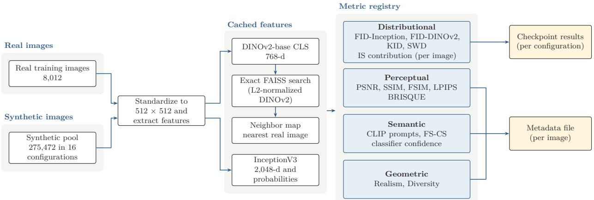  
Figure 1: The metric pipeline. Real and synthetic images are standardized to 512 × 512 pixels, and DINOv2 and InceptionV3 features are extracted once and cached. An exact FAISS search in DINOv2 space writes the nearest real image of every synthetic image to a neighbor map. The registry runs four metric groups over the cached features and the map. The four per-configuration distributional scores are written to the checkpoint results file, and all per-image scores to the metadata file. Details of every metric are in Appendix G.

Distributional metrics. The distributional metrics compare the whole image set of a generation configuration (17,217 images) with the 8,012 real training images, so each configuration receives one score per metric, and lower is better. FID (Heusel et al., 2017) is the Fréchet distance between Gaussians fitted to the two sets of features. It is computed on InceptionV3 features (FID-Inception) and on DINOv2 features (FID-DINOv2). KID (Bińkowski et al., 2018) is the squared MMD between the two sets with a cubic polynomial kernel, and SWD (Bonneel et al., 2015) is the sliced Wasserstein distance, the mean absolute diference between the sorted one-dimensional projections of the two sets onto random directions. KID and SWD are computed on DINOv2 features. Appendix G specifies every metric in detail.

## 3.4 Tournament Protocol

Metric isolation. Every metric curates a dataset of exactly 8,012 synthetic images, matching the size of the real training set. Class proportions follow the real training set (AKIEC 3.27%, BCC 5.13%, BKL 10.97%, DF 1.15%, MEL 11.11%, NV 66.95%, VASC 1.42%; quotas are rounded down and the remainder goes to NV), so class priors are identical across arms. This isolates the metric: if the class balance difered between arms, a diference in classifier performance could come from the balance and not from the metric that selected the images. An instance metric ranks the entire pool within each class and keeps the top images that fill the class quota. This procedure is deterministic. Therefore, a single dataset represents the selection produced by each metric. A distributional metric identifies the single generation configuration with the best score and fills each class quota by uniform random sampling from that configuration alone. The four metrics selected three configurations: FID-Inception chose the 25k checkpoint at guidance 1.0, FID-DINOv2 and KID-DINOv2 both chose 25k at 1.5, and SWD-DINOv2 chose 15k at 1.5 (scores of all 16 configurations in Table A7, Appendix B). FID-DINOv2 and KID-DINOv2 happened to choose the same configuration and share seeds, so their curated datasets and results are identical. KID is a diferent statistic from FID, and the match is a coincidence of which configuration scored best.

Table 2: The 16 metrics in the tournament. “Selects” gives the direction in which a metric ranks images (instance metrics) or configurations (distributional metrics).
<table><tr><td>Family</td><td colspan="2">Metric</td><td>What it scores</td><td>Selects</td></tr><tr><td rowspan="4">Distributional</td><td colspan="2">2017)</td><td>FID-Inception (Heusel et al., Synthetic vs. real, Inception features</td><td>lowest</td></tr><tr><td rowspan="3">FID-DINOv2</td><td rowspan="3"></td><td>Synthetic vs. real, DINOv2 features</td><td>lowest</td></tr><tr><td>KID-DINOv2 (Bińkowski Synthetic vs. real, polynomial-kernel MMD</td><td>lowest</td></tr><tr><td>(Bonneel Synthetic vs. real, sliced Wasserstein</td><td>lowest</td></tr><tr><td rowspan="4">Instance, reference</td><td rowspan="4">full-</td><td colspan="2">PSNR</td><td>Pixel error to nearest real image highest</td></tr><tr><td colspan="2">SSIM (Zhou et al., 2004) FSIM (Zhang et al., 2011)</td><td>Structural similarity to nearest real image highest</td></tr><tr><td colspan="2"></td><td>Phase-congruency similarity to nearest real highest</td></tr><tr><td colspan="2">LPIPS (Zhang et al., 2018) BRISQUE (Mittal et al., Natural-scene statistics deviation</td><td>Perceptual distance to nearest real image lowest</td></tr><tr><td rowspan="4" colspan="2">reference Instance, semantic</td><td colspan="2">2012)</td><td>lowest</td></tr><tr><td colspan="2">FS-CS</td><td>DINOv2 cosine similarity to real class cen- highest</td></tr><tr><td colspan="2">ford et al., 2021)</td><td>CLIP sim. (cancer) (Rad- Similarity to a clinical-photograph prompt highest</td></tr><tr><td colspan="2">CLIP sim. (artifact)</td><td>Similarity to a computer-generated-image lowest</td></tr><tr><td rowspan="4" colspan="2">IS contribution (Salimans</td><td rowspan="4">CLIP log-odds</td><td>prompt Log ratio of the two CLIP similarities</td><td>highest</td></tr><tr><td rowspan="3">Per-image KL term of the IS</td><td>highest</td></tr><tr><td></td></tr><tr><td>Distance to 3rd nearest real image (DINOv2) Distance to 3rd nearest other synthetic image</td></tr><tr><td colspan="2">Instance, geometric Realism Diversity</td><td colspan="2">(DINOv2)</td><td>lowest highest</td></tr></table>

Seeds and baselines. Random sampling within the chosen configuration makes the distributional arms stochastic, so each was curated and trained 30 times (seeds 42 to 71). Each distributional arm draws from its own selected configuration’s pool while the random control draws from the whole pool, so the two are treated as independent samples (Welch’s �-test). The random control also anchors the metric weights of Section 3.5, so it was run with 60 seeds (42 to 101) to estimate that baseline more precisely, and all 60 runs serve as its comparison with each arm. Instance arms were run once, because their selection is deterministic. A real-data-only classifier trained on the 8,012 real images is the reference. In total the tournament comprises 193 trained classifiers (12 instance, 120 distributional, 60 random control, 1 real-only), as Figure 2 shows.

Classifiers. Every arm is evaluated with a Swin-B classifier (Liu et al., 2021) that starts from ImageNet-pretrained weights with the backbone frozen, so only the final classification layer is trained. Freezing the backbone fixes the feature space for every arm. This extends the linear probe of Alain and Bengio (2016), which reads a model’s representations without altering them, to a measurement of the quality of a curated dataset. A diference between two arms is then attributable to the images they contain, whereas fine-tuning also moves the backbone toward each training set (Kumar et al., 2022). The optimizer is AdamW with a learning rate of $1 0 ^ { - 3 }$ and a batch size of 32, for at most 50 epochs with early stopping (patience 10 on validation accuracy), and the inputs are random-resized-cropped to 224 pixels and flipped horizontally. Weight initialization and data-loader seed are fixed at 42 in every run, so the only quantity that difers between repetitions of an arm is which synthetic images were selected. Training uses synthetic images only. Section 4.7 repeats the pipeline with ResNet-50 (He et al., 2016) under identical settings.

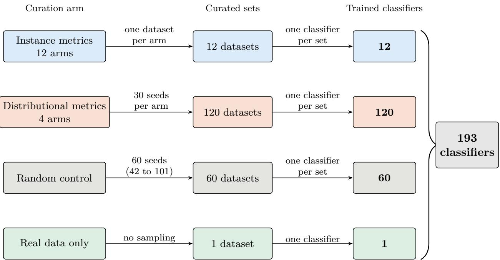  
Figure 2: The 193 Swin-B classifiers of the tournament. The 12 instance arms and the 4 distributional arms come from the synthetic pool. The 30 seeds of each distributional arm and the 60 seeds of the random control give the curated sets, and one classifier is trained on each set.

Evaluation. Each classifier is scored on the real validation split of 2,003 images (Section 3.1). The oficial ISIC-2018 test set is not used anywhere in the tournament. It is used only in the confirmatory benchmark of Section 4.5, which evaluates the algorithm and its baselines. The score is $F _ { \beta } = ( 1 + \beta ^ { 2 } ) P R / ( \beta ^ { 2 } P + R )$ for precision � and recall �, with $\beta = 2$ , so that $F _ { 2 } = 5 P R / ( 4 P + R )$ This weights recall more heavily than precision because a missed lesion costs more than a false alarm. It is computed per class and averaged over the seven classes to give $\mathrm { M a c r o } { - } F _ { 2 }$

The same validation split also selects the early-stopping epoch, so absolute scores are optimistic, but the procedure is identical for every arm and favors none. Absolute performance is evaluated on the held-out test set of Section 4.5. The scores do difer in how much replication stands behind them: a distributional arm is a mean over 30 draws, whereas an instance arm is one deterministic dataset with one score, so its noise cannot be estimated.

## 3.5 The Evaluation Algorithm

The tournament of Section 4.1 shows that the value of a metric depends on the class. The algorithm turns those measurements into a sampling distribution over the synthetic pool. It takes four inputs: a pool with per-image metric scores, a weight for every metric in every class, a budget �, and the real training images. The weights are derived from the tournament, from each metric’s $F _ { 2 }$ on the class (Section 3.5.1). The tournament evaluated 16 metrics, and the algorithm uses 15 of them. FID-DINOv2 is left out because it is the same statistic as FID-Inception computed on a diferent feature backbone, so keeping both would give one signal two weights. FID-Inception stays because it is the original and most widely used FID variant (Heusel et al., 2017) and scored higher in the tournament (Section 4.1), which leaves three distributional signals: FID, KID and SWD. For each class � the algorithm then (i) scores every image by combining the weighted per-image scores with a per-generation-group score for the distributional metrics (Section 3.5.2), (ii) removes images that lie too close to a real training image (Section 3.5.3), and (iii) draws the class quota from a temperature-scaled softmax over the combined score (Section 3.5.4). Only the weights come from the tournament, and the other steps use the pool and the real training images. Every quantity is computed separately for each of the seven classes, and no class is named in the implementation. Figure 3 shows the steps.

## 3.5.1 Per-Class Utility Weights

Let � be the 15-metric portfolio, made up of the 12 instance metrics $M _ { \mathrm { i n s t } }$ and the three distributional metrics � (FID-Inception, KID-DINOv2 and SWD-DINOv2), and let $\mathrm { F 2 } [ c , m ]$ be the mean tournament $F _ { 2 }$ of metric � on class �, recomputed from the saved predictions. Weights are built diferently for the two types of metric. Both start from the same step. Every metric in � receives a utility $u _ { A }$ equal to its distance above the weakest metric on that class, so no metric receives exactly zero:

$$
u _ { A } [ c , m ] = ( \mathrm { F } 2 [ c , m ] - \operatorname* { m i n } _ { m ^ { \prime } \in { \cal M } } { \mathrm { F } 2 [ c , m ^ { \prime } ] } ) + \epsilon ,\tag{1}
$$

with $\epsilon = 1 0 ^ { - 4 }$ . The utilities are normalized into weights $w _ { A } \colon$

$$
w _ { A } [ c , m ] = \frac { u _ { A } [ c , m ] } { \sum _ { m ^ { \prime } \in M } u _ { A } [ c , m ^ { \prime } ] } .\tag{2}
$$

For an instance metric, $w _ { A }$ is the final weight. The 12 instance metrics combine into a continuous perimage score with roughly 275,000 distinct values. Therefore, the contribution of a weak component is reduced relative to the other eleven, and a class can benefit from many of them at moderate weight. A random anchor would remove that breadth by concentrating the weight on the few metrics that beat random sampling, so the instance metrics keep the worst-metric anchor, which only shrinks a weak metric’s weight.

For the three distributional metrics, $w _ { A }$ determines only their combined weight in the class, and a second step then divides that total among them again. The total is taken from the first step because the two utilities are on diferent scales: the clipped utility of Equation 4 is much smaller than the utility of Equation 1, so normalizing the two families together would shrink the combined weight of the distributional metrics. This combined weight is the distributional share of class �:

$$
\sigma _ { c } = \sum _ { d \in D } w _ { A } [ c , d ] .\tag{3}
$$

The second step keeps $\sigma _ { c }$ and divides it in proportion to how far each metric beats the random control. The distributional metrics are anchored to random because they act as a vote over 16 discrete groups in which 17,217 images share a value, so a weak metric carries a third of the pull and moves thousands of images toward a group that is worse for that class. A metric that does not beat random sampling on class � therefore receives zero:

$$
u _ { B } [ c , d ] = \operatorname* { m a x } \big ( 0 , \mathrm { ~ F 2 } [ c , d ] - \mathrm { F 2 } [ c , \mathrm { R a n d o m } ] \big ) .\tag{4}
$$

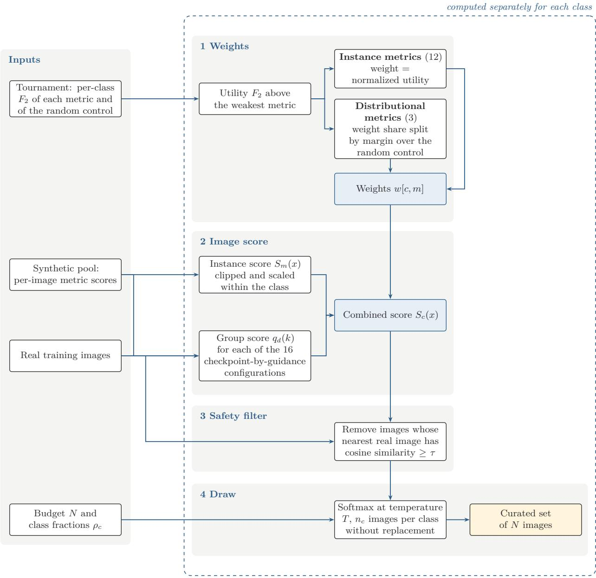  
Figure 3: The evaluation algorithm. Per-class weights derived from the tournament combine the instance scores and the group scores of the pool into one score per image. A safety filter removes images close to the real training images, and a temperature-scaled draw selects the quota of each class.

These utilities are normalized within � and scaled to the share $\sigma _ { c } .$

$$
w _ { B } [ c , d ] = \sigma _ { c } \frac { u _ { B } [ c , d ] } { \sum _ { d ^ { \prime } \in D } u _ { B } [ c , d ^ { \prime } ] } .\tag{5}
$$

The final weight $w [ c , m ]$ is $w _ { A } [ c , m ]$ for an instance metric and $w _ { B } [ c , m ]$ for a distributional metric. The weights of each class sum to one. If no distributional metric beats random on a class, the denominator of Equation 5 is zero and that class keeps its $w _ { A }$ weights. The random baseline in Equation 4 is the 60-seed mean from the tournament. The temperature sweep of Section 4.4.3 used an earlier weighting in which the worst anchor was applied to all 15 metrics.

## 3.5.2 Combined Image Score

Instance score. For an instance metric �, the score $S _ { m } ( x ) \in [ 0 , 1 ]$ of image � is its raw value clipped at the 1st and 99th percentiles of that metric within the class of � and then min-max scaled to [0, 1], inverted when lower is better. Clipping stops one extreme value from compressing the scores of the others, and min-max scaling gives every score the same range, so that instance scores and group scores can be combined with the weights. Percentiles are taken within the class because sampling is a softmax over one class at a time, so only within-class spread determines how sharply the draw discriminates.

Group score. FID, KID and SWD describe a set of images, so they cannot score a single image. The algorithm therefore needs a partition of the pool into groups. It scores each group, and every image takes the score of its group. The partition is a parameter of the algorithm. In this experiment, a group is one of the 16 checkpoint-by-guidance configurations, which contains $^ \mathrm { 1 7 , 2 1 7 }$ images pooled over all seven classes. Grouping by class, which would match the rest of the algorithm, is not possible with these data. A class-wise FID would compare the synthetic images of a class with the real images of that class, and each side needs roughly 2,048 images for a full-rank $2 0 4 8 \times 2 0 4 8$ covariance. However, ISIC-2018 has that many only for NV (5,364 real training images), and the other six classes have between 92 and 890. This same grouping is applied to all three distributional metrics where pooled groups are large enough for all three. For group � and distributional metric $d ,$ let $r _ { d } ( k )$ be the raw FID, KID or SWD of the group’s full image set against the real training set. It is computed once and cached, because it depends only on the pool, the real set and the grouping. The 16 raw values of each metric � are clipped and min-max scaled in the same way, over the 16 groups, and inverted because lower is better, so that the best group receives 1 and the worst 0. This gives the group score $q _ { d } ( k ) \in [ 0 , 1 ]$

Combined score. Every image � of class � from group �(�) $k ( x )$ then receives a combined score, using the final weights � of Section 3.5.1:

$$
S _ { c } ( x ) = \sum _ { m \in M _ { \mathrm { i n s t } } } w [ c , m ] S _ { m } ( x ) + \sum _ { d \in D } w [ c , d ] q _ { d } ( k ( x ) ) .\tag{6}
$$

Every instance score $S _ { m } ( x )$ and group score $q _ { d } ( k )$ lies in [0, 1], and the weights of a class sum to one across all 15 metrics, so $S _ { c } ( x )$ is a weighted average of values in [0, 1] and lies in [0, 1]. The temperature of Section 3.5.4 therefore has the same meaning for every class. A class whose weights lean toward the distributional metrics has its draw pulled toward the best generation groups, and a class that leans toward instance metrics does not. Which classes concentrate on which groups follows from the weights alone.

## 3.5.3 Safety Filter

Filter. Before sampling, the algorithm removes every synthetic image whose DINOv2 cosine similarity to its nearest real training image is at least �, so a higher � removes fewer images. The threshold is the same for every class, and a per-class quota guard prevents the filter from reducing a class below the count its draw needs.

Calibration. Choosing � requires knowing what a given cosine value means, and no labeled copies of training images exist, so � is calibrated on real images. ISIC photographed many lesions more than once, and images of one lesion share a lesion\_id, so two real training images with the same identifier show the same physical lesion. This is a known-positive example of the relation a memorized generation has to its source. We enumerated all pairs of real training images with cosine similarity of at least 0.90. Pairs below 0.90 were not enumerated, because they are very numerous and rarely show the same lesion. This gives 117,751 candidate pairs, of which 776 (0.66%) share a lesion identifier and form the set � of same-lesion pairs. For a threshold �, let $C ( \tau )$ be the set of candidate pairs with cosine similarity at least � . We compute three quantities for each candidate threshold. The first is the precision, the share of the candidate pairs at or above the threshold that are same-lesion pairs:

$$
\mathrm { p r e c i s i o n } ( \tau ) = { \frac { | C ( \tau ) \cap S | } { | C ( \tau ) | } } .\tag{7}
$$

The second is the recall, the share of all same-lesion pairs that reach the threshold:

$$
\operatorname { r e c a l l } ( \tau ) = { \frac { | C ( \tau ) \cap S | } { | S | } } .\tag{8}
$$

A low precision means that many flagged pairs are not copies, and a low recall means that many same-lesion pairs are missed. The third quantity is the number of synthetic pool images that the filter would remove at that threshold. Plotted against the threshold, these three quantities form the calibration curve.

Four thresholds are evaluated throughout the paper, $\tau \in \{ 0 . 9 0 , 0 . 9 3 , 0 . 9 7 , 0 . 9 9 \}$ , each chosen from its own property of the data rather than a single shared rule. The value 0.90 is where every same-lesion pair is flagged (recall 100%, by construction of the enumeration lower bound) and sits close to the real training set’s own nearest-neighbor similarity (mean cosine 0.9047, Section 4.6); precision there is only 0.7%, so below this point the filter can no longer distinguish memorization from ordinary inter-patient resemblance. The value 0.93 is the highest tested value with recall above 50% (55.0%; the next step, 0.94, drops to 41.5%), the midpoint of the detector’s tested sensitivity range. The value 0.97 is the lowest tested value with precision above 95% (96.2% specifically), the conventional high-confidence cutof. The value 0.99 is the point at which the filter removes none of the 275,472 pool images, an unfiltered reference point rather than a calibrated cut. The resulting curve is in Section 4.4.2.

## 3.5.4 Sampling and Budget

The budget � is a required input, and it is divided among the classes by target fractions $\rho _ { c }$ . The quota of class � is $n _ { c } = \lfloor \rho _ { c } N \rfloor$ , with any remainder added to the largest class. All experiments set $\rho _ { c }$ to the class proportions of the real training set. The algorithm draws � images from the scored pool for a specified sampling budget �, and the benchmark of Section 4.5 reports $N = 8 { , } 0 1 2$ , which matches the real training set size so that cohorts are compared at equal volume, and $N = 2 0 { , } 0 0 0$

Each class � draws $n _ { c }$ images without replacement from its set of candidates $C _ { c } ,$ the pool images of class � that remain after the safety filter of Section 3.5.3. Each candidate � is drawn with probability

$$
p ( x ) \ = \ \frac { \exp ( S _ { c } ( x ) / T ) } { \sum _ { x ^ { \prime } \in C _ { c } } \exp ( S _ { c } ( x ^ { \prime } ) / T ) } .\tag{9}
$$

The exponential makes the temperature meaningful: with weights proportional to $S _ { c } ( x )$ itself, $T$ would cancel in the normalization. With it, the relative odds of two images depend only on the gap $\Delta$ between their scores and equal $\exp ( \Delta / T )$ , so $T$ sets how strongly a given gap favors the higher-scoring image. Low $T$ concentrates the draw on the highest-scoring images, and high $T$ approaches uniform sampling. The locked temperature is $T = 0 . 0 5$ (Section 4.4.3).

## 3.6 Feature-Space Memorization Score

Curation that favors images close to the real data could, as a side efect, favor images that reproduce individual training photographs. Difusion models are known to emit near-copies of their training images (Carlini et al., 2023; Akbar et al., 2023; Dar et al., 2025), which is a privacy risk for patient images. This subsection defines the safety measure used throughout the paper. Section 4.6 tests that the measure behaves as intended, and Section 4.5.2 reports how safety and utility change as the safety threshold $\tau$ of Section 3.5.3 is tightened.

Definition. Let $f ( x )$ be the DINOv2 (base) CLS embedding of an image standardized to $5 1 2 \times 5 1 2$ pixels, let � be the 8,012 real training images, and let � be a set of synthetic images. The Feature-Space Memorization Score (FSMS) is

$$
\operatorname { F S M S } ( S , R ) = 1 - { \frac { 1 } { | S | } } \sum _ { x \in S } \operatorname* { m a x } _ { y \in R } \cos { \bigl ( } f ( x ) , f ( y ) { \bigr ) } .\tag{10}
$$

Subtracting the mean similarity from 1 turns it into a distance. A low value means that synthetic images lie close to specific training images, and a high value means they lie far from every training image, so FSMS is a safety score in which higher is safer. It is computed over the synthetic images only. The per-image term $s ( x ) = \mathrm { m a x } _ { y \in R } \cos ( f ( x ) , f ( y ) )$ is also what the safety filter of Section 3.5.3 thresholds. FSMS is a self-defined statistic without a natural scale, so the checks below supply reference points.

## 3.7 Benchmark Protocol

The tournament and the algorithm were developed on a validation split, so their scores are selection results. The confirmatory test is described here and its results are in Section 4.5. Curated synthetic images are added to the real training set, classifiers are trained, and every classifier is scored on the oficial ISIC-2018 Task 3 test set, which no earlier step in this paper used.

## 3.7.1 Experimental Design

Task. Each classifier is trained on the 8,012 real training images together with a curated synthetic set. The classifier, the frozen ImageNet backbone with a trained linear head, and all optimization settings are those of Section 3.4. The validation split of 2,003 real images selects the early-stopping epoch. Models are scored on the 1,512-image test set (AKIEC 43, BCC 93, BKL 217, DF 44, MEL 171, NV 909, VASC 35 images). The test set was never used to build the tournament weights, to select the algorithm configuration, for early stopping, or for any other choice.

Locked model variance. Weight initialization, data-loader seed and CUDA convolution algorithms are fixed in every run (seed 42). Within a cohort, the only quantity that changes between runs is which synthetic images the curation procedure selected, using 30 independent curation seeds. The spread of a cohort therefore measures sensitivity to the selected data. It does not include classifier initialization variance. The fixed seed does not make runs bit-reproducible: PyTorch’s full deterministic mode was not enabled, so some graphics processing unit (GPU) matrix operations can difer between executions of the same configuration (Section 7).

Statistics. Cohorts use diferent curation procedures, so runs are not paired and all comparisons are unpaired: Welch’s �-test, with the Mann-Whitney � test (MWU) as a distribution-free check and Cohen’s � with a pooled standard deviation as efect size. Diferences are reported with 95% confidence intervals (CI). The primary comparisons are the algorithm against the FID-Inception best-metric cohort at � = 8,012, on two outcomes: test Macro-�2 (utility) and FSMS (safety). Each is run once for each of four safety thresholds (Section 3.5.3), and Bonferroni correction is applied across the four tests of each outcome. All other comparisons are secondary and uncorrected. The real-data-only classifier has no sampling step and is trained once, so it has no spread and cannot be tested.

## 3.7.2 Cohorts

Every synthetic cohort adds its images to the same 8,012 real images.

• Real data only is trained once and has no synthetic images.

• Random draws a class-stratified sample uniformly from the full 275,472-image pool.

• Best-metric (FID-Inception) represents the common practice of selecting the generation configuration with the best FID-Inception against the real data and sampling from it. The ranked-best configuration is the 25k-kimg checkpoint at CFG scale 1.0. Samples are classstratified and uniformly random within that configuration.

• Algorithm is the locked configuration of Section 3.5: weights derived from the tournament, group-scored distributional term, � = 0.05, and a safety threshold � . Results are reported at four thresholds, � ∈ {0.90, 0.93, 0.97, 0.99}.

All synthetic cohorts follow the real class proportions. Cohorts of � = 8,012 match the real training set one to one. Each synthetic cohort has 30 runs, so the Swin-B benchmark comprises 241 classifiers: one real-only run and eight synthetic cohorts of 30 (random sampling, the best-metric cohort and the algorithm at four thresholds at � = 8,012, and random sampling and the algorithm at $N = 2 0 { , } 0 0 0 )$

Larger volume. A second volume, � = 20,000, tests the dose response: whether the gains of the algorithm hold when it can curate a larger set. Here 20,000 synthetic images are added to the 8,012 real images, giving 28,012 training images, and the cohorts are Random and the algorithm only. The best-metric cohort has no counterpart at this volume. It draws every image from one generation configuration, which holds 6,501 NV images. That covers the 5,364 NV images that $N = 8 { , } 0 1 2$ requires and falls short of the roughly 13,390 that � = 20,000 requires. The algorithm was run at one threshold, $\tau = 0 . 9 7$ , the lowest tested value with precision above 95%.

Table 3: Diference in Swin-B Macro- $F _ { 2 }$ between each distributional arm (30 seeds) and the random control (60 runs), with the �-value of Welch’s �-test.
<table><tr><td>Arm</td><td> $\Delta$  p</td></tr><tr><td>FID-Inception</td><td>+0.036  $4 . 4 \times 1 0 ^ { - 1 4 }$ </td></tr><tr><td>SWD-DINOv2</td><td>+0.011 0.011</td></tr><tr><td>FID-DINOv2</td><td>+0.010 0.024</td></tr><tr><td>KID-DINOv2</td><td>+0.010 0.024</td></tr></table>

## 4 Results

## 4.1 Tournament Ranking

Figure 4 ranks every arm by Macro-�2. On Swin-B, FID-Inception is the strongest synthetic arm at 0.511, against 0.475 for random sampling and 0.542 for real data only. It beats random sampling by 0.036, the largest gain of any distributional arm. The DINOv2 arms gain about 0.01, a much smaller diference (Table 3). FID-DINOv2 and KID-DINOv2 select the same configuration and are sampled with the same seeds, so their curated sets and results are identical. Among instance metrics, FS-CS is the only arm above random (0.500), and the remaining eleven fall below it. Each instance arm is one deterministic dataset with one score, so it has no seed-to-seed spread of its own, and gaps of 0.01 to 0.02 to random fall inside the spread of random draws (standard deviation 0.021), so no instance comparison is interpretable on its own.

## 4.2 No Single Metric Serves Every Class

Figure 5 breaks the Swin-B scores down by class, recomputed from each run’s saved predictions. The best arm difers from class to class (Figure 6). FSIM leads on AKIEC (0.596), Realism on BCC (0.597), BKL (0.561) and MEL (0.445), FS-CS on DF (0.225), FID-Inception on VASC (0.680), and FID-DINOv2 and KID-DINOv2 on NV (0.936). Five diferent selection rules therefore lead across seven classes.

FID-Inception, the usual choice, reaches 0.680 on VASC and falls to 0.137 on DF. On AKIEC it scores 0.375 where FSIM scores 0.596. Against random sampling (Table 4), FID-Inception is clearly better on VASC and also better on BCC and MEL, and the gain on AKIEC is small. It shows no meaningful diference on BKL or NV (on NV the diference is 0.003). On DF it scores 0.019 below the random mean, a gap that does not reach significance, so the supported statement is that FID-Inception ofers no measurable advantage on DF.

Class size does not account for the pattern. Distributional arms lead on the largest class (NV, 5,364 real training images) and on the second smallest (VASC, 114), while an instance metric leads on DF (92), which is smaller than both. The evidence behind the cells difers in strength. Distributional entries rest on 30 seeds, and instance entries are single deterministic datasets, so they are indicative. The validation split also contains only 23 DF and 28 VASC images, so one image shifts the recall of those classes by about 4 points. The central observation does not depend on any single instance cell. FID-Inception is a 30-seed arm, and its scores range from clearly above random on some classes to indistinguishable from it on others. A single global choice of metric therefore cannot be best for every class. This motivates estimating curation weights per class from these measurements, as described in Section 3.5.

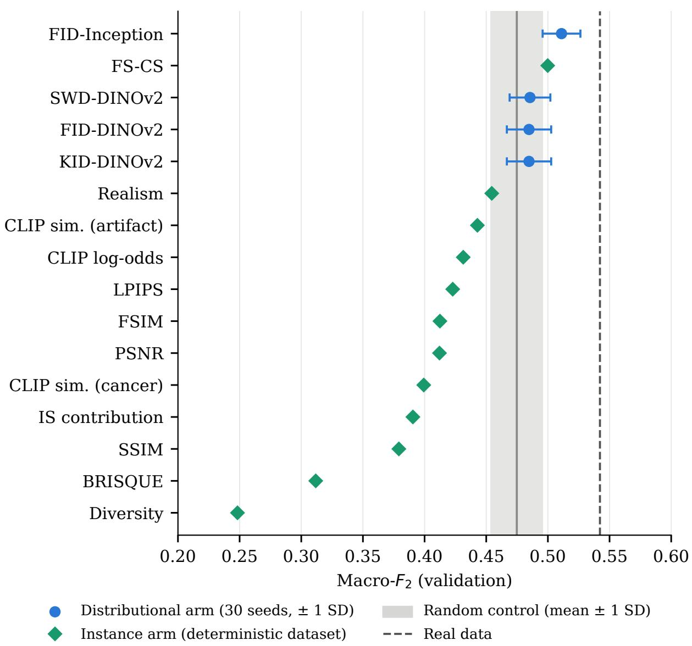  
Figure 4: Macro- $F _ { 2 }$ of every tournament arm on the validation split, sorted by the Swin-B score. Distributional arms and the random control are means over seeds (the bar is one standard deviation), and instance arms are single deterministic datasets. The exact values are in Appendix B.

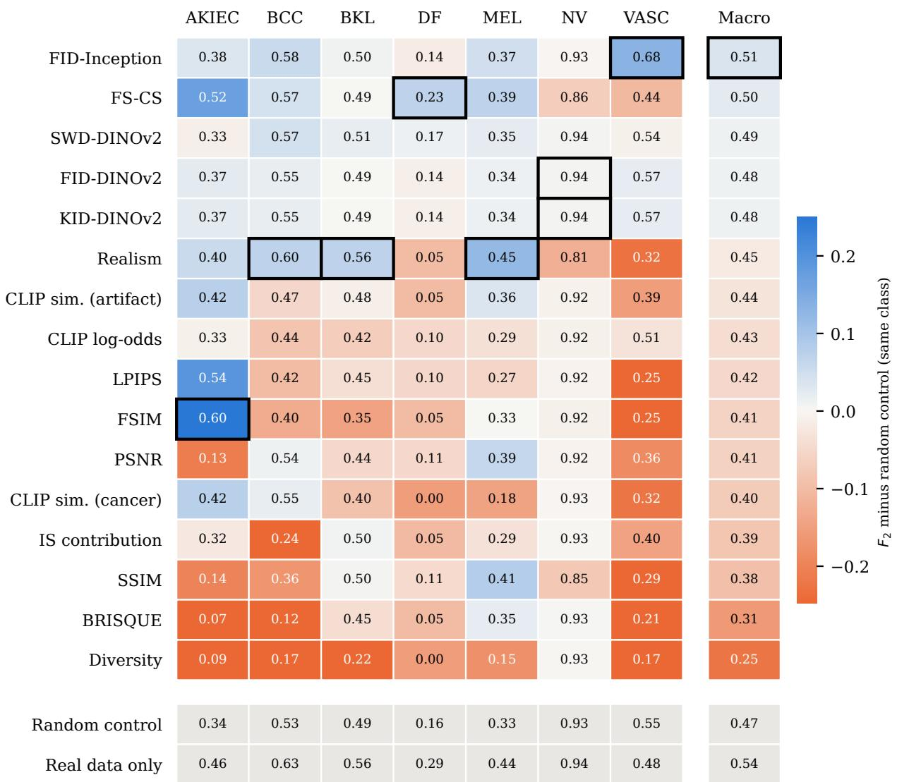  
Figure 5: Per-class $F _ { 2 }$ of every arm on the validation split for Swin-B. Cell color is the diference from the random control in the same class, and the number is the arm’s $F _ { 2 }$ . A black frame marks the best arm in each column. Distributional arms are 30-seed means and instance arms are single deterministic datasets. The exact values are in Appendix B.

Table 4: Swin-B per-class $F _ { 2 }$ of FID-Inception (30 seeds) and of the random control (60 runs), their diference, and the �-value of Welch’s �-test.
<table><tr><td>Class</td><td>FID-Inception</td><td>Random</td><td> $\Delta$ </td><td>p</td></tr><tr><td>AKIEC</td><td>0.375</td><td>0.343</td><td>+0.032</td><td>0.021</td></tr><tr><td>BCC</td><td>0.583</td><td>0.528</td><td>+0.055</td><td> $2 . 1 \times 1 0 ^ { - 6 }$ </td></tr><tr><td>BKL</td><td>0.502</td><td>0.492</td><td>+0.009</td><td>0.319</td></tr><tr><td>DF</td><td>0.137</td><td>0.156</td><td>-0.019</td><td>0.080</td></tr><tr><td>MEL</td><td>0.373</td><td>0.326</td><td>+0.048</td><td> $1 . 7 \times 1 0 ^ { - 6 }$ </td></tr><tr><td>NV</td><td>0.927</td><td>0.930</td><td>-0.003</td><td>0.013</td></tr><tr><td>VASC</td><td>0.680</td><td>0.548</td><td>+0.132</td><td> $4 . 6 \times 1 0 ^ { - 1 5 }$ </td></tr><tr><td>Macro</td><td>0.511</td><td>0.475</td><td>+0.036</td><td> $4 . 4 \times 1 0 ^ { - 1 4 }$ </td></tr></table>

Table 5: FID on the two feature backbones: the configuration each arm selects and its validation Macro- $F _ { 2 }$ on each architecture (mean ± standard deviation over 30 curation seeds). The random control has 60 seeds on Swin-B and 30 on ResNet-50.
<table><tr><td>Arm</td><td>Features</td><td>Selected configuration</td><td>Swin-B</td><td>ResNet-50</td></tr><tr><td>FID-Inception</td><td>InceptionV3</td><td>25k kimg, guidance 1.0</td><td> $0 . 5 1 1 \pm 0 . 0 1 5$ </td><td> $0 . 5 0 0 \pm 0 . 0 1 8$ </td></tr><tr><td>FID-DINOv2</td><td>DINOv2</td><td>25k kimg, guidance 1.5</td><td> $0 . 4 8 5 \pm 0 . 0 1 8$ </td><td> $0 . 4 9 2 \pm 0 . 0 2 7$ </td></tr><tr><td>Random control</td><td></td><td></td><td> $0 . 4 7 5 \pm 0 . 0 2 1$ </td><td> $0 . 4 6 0 \pm 0 . 0 3 2$ </td></tr></table>

## 4.3 Feature Backbone of the Metrics

The tournament computes FID on two feature backbones, InceptionV3 and DINOv2, so that the backbone can be compared with the statistic held fixed. On Swin-B, FID-Inception reaches a Macro- $F _ { 2 }$ of 0.511, against 0.485 for FID-DINOv2 (a diference of 0.026 over the 30 seeds, Welch’s $p < 0 . 0 0 1$ ; Table 5). FID-Inception clearly beats random sampling (0.475), whereas FID-DINOv2 is only about 0.01 above it, a diference with Welch’s $p = 0 . 0 2 4$ . On ResNet-50 FID-Inception is ahead by 0.008 $( p = 0 . 1 8 )$ , and both are above random sampling (0.460), so the two backbones cannot be separated on that architecture. Each arm samples only from the configuration its metric ranks best. FID-Inception and FID-DINOv2 rank diferent configurations best (25k kimg at guidance 1.0 and 1.5), so the comparison of backbones is a comparison of those two configurations. Section 6.2 discusses this.

## 4.4 Evidence for the Design Choices

This subsection reports the evidence for the design choices of Section 3.5: the resulting weights, the calibration of the safety threshold and the temperature sweep. These are validation-split selection results, and the confirmatory test is Section 4.5.

## 4.4.1 Metric Weights

Figure 7 shows the resulting Swin-B weights �[�, �], and Appendix D lists the exact values. The distributional share ranges from 21.6% (AKIEC) to 40.4% (VASC). The VASC weight is concentrated on FID-Inception, which holds 86.7% of that share. DF puts its entire distributional share on SWD-DINOv2 and gives 16.6% to FS-CS, the best single metric for that class in the tournament.

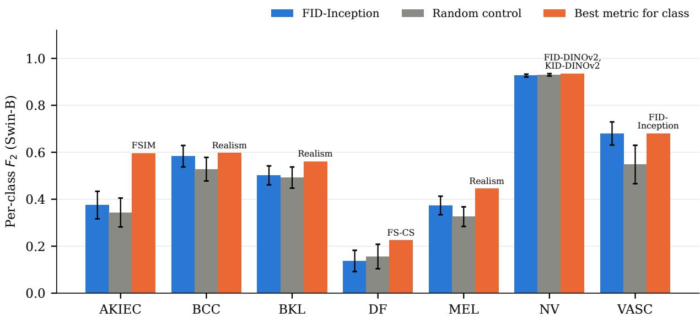  
Figure 6: Per-class $F _ { 2 }$ on the validation split for Swin-B. Error bars are one standard deviation over seeds (30 for FID-Inception, 60 for the random control). The best-metric bar is a single deterministic dataset except on NV, where the winning DINOv2 arm is a 30-seed mean.

SWD-DINOv2 holds the largest cell on DF because it is the only distributional metric above the random control there, so the whole share lands on it. AKIEC spreads weight across 13 metrics, none above 13.3%.

Because Equation 4 is a hard threshold, a distributional metric close to the random control can be included or excluded by the noise in the baseline estimate. A weight of zero therefore means that the metric did not clear a noisy threshold.

## 4.4.2 Safety Threshold Calibration

Figure 8 shows the precision, the recall and the number of pool images removed at each threshold. Precision stays below 36% for $\tau \leq 0 . 9 5$ , rises to 93.9% at 0.965 and 96.2% at 0.97, and reaches 100% at 0.99 (6 of 6 pairs). $\mathrm { A t } ~ \tau = 0 . 9 0$ the filter removes 36,929 pool images (13.4%). At 0.93, where recall is 55.0%, it removes 7,666 (2.8%). At 0.97, where precision is 96.2%, it removes 7. At 0.99, no pool image reaches the threshold, so nothing is removed.

Two limits apply. The positives are re-photographs of one lesion, which difer from difusion reproductions, so the calibration bounds false removals and says nothing about missed reproductions. The recall column also shows that a threshold with high precision identifies only a small share of same-lesion pairs (9.9% at 0.97).

## 4.4.3 Temperature

The temperature was set by a sweep over three values with the worst anchor applied to all 15 metrics (Table 6). The mean rises from $T = 0 . 1$ to $T = 0 . 0 5$ and falls at $T = 0 . 0 2 { \mathrm { . } }$ so the maximum of the tested range lies at $T = 0 . 0 5$ . Neither neighboring diference is significant, so the three values perform similarly, and we use $T = 0 . 0 5$ for its highest mean.

<table><tr><td></td><td>AKIEC</td><td>BCC</td><td>BKL</td><td>DF</td><td>MEL</td><td>NV</td><td>VASC</td><td></td></tr><tr><td>Distributional share</td><td>22%</td><td>28%</td><td>24%</td><td>33%</td><td>23%</td><td>25%</td><td>40%</td><td rowspan="5">35 30</td></tr><tr><td>FID-Inception</td><td>12</td><td>13</td><td>8</td><td></td><td>13</td><td></td><td>35</td></tr><tr><td>KID-DINOv2</td><td>9</td><td>5</td><td>1</td><td></td><td>3</td><td>13</td><td>5</td></tr><tr><td>SWD-DINOv2</td><td></td><td>10</td><td>15</td><td>33</td><td>6</td><td>12</td><td></td></tr><tr><td>CLIP log-odds</td><td>7</td><td>7</td><td>6</td><td>8</td><td>5</td><td>7</td><td>11</td></tr><tr><td>CLIP sim. (cancer)</td><td>9</td><td>9</td><td>5</td><td></td><td>1</td><td>8</td><td>5</td><td rowspan="5">25 (%) 20 WWeght) 15</td></tr><tr><td>CLIP sim. (artifact)</td><td>9</td><td>7</td><td>7</td><td>4</td><td>8</td><td>7</td><td>7</td></tr><tr><td>FS-CS</td><td>11</td><td>9</td><td>8</td><td>17</td><td>9</td><td>3</td><td>9</td></tr><tr><td>LPIPS</td><td>12</td><td>6</td><td>7</td><td>8</td><td>4</td><td>8</td><td>3</td></tr><tr><td>FSIM</td><td>13</td><td>6</td><td>4</td><td>4</td><td>7</td><td>7</td><td>3</td></tr><tr><td>BRISQUE</td><td></td><td></td><td>7</td><td>4</td><td>7</td><td>8</td><td>1</td><td>10</td></tr><tr><td>PSNR</td><td>1</td><td>9</td><td>6</td><td>8</td><td>9</td><td>8</td><td>6</td><td>5</td></tr><tr><td>SSIM</td><td>2</td><td>5</td><td>8</td><td>8</td><td>10</td><td>3</td><td>4</td><td></td></tr><tr><td>Diversity</td><td>1</td><td>1</td><td></td><td></td><td></td><td>8</td><td></td><td>0</td></tr><tr><td>Realism</td><td>8</td><td>10</td><td>10</td><td>4</td><td>11</td><td></td><td>5</td><td></td></tr><tr><td>IS contribution</td><td>6</td><td>3</td><td>8</td><td>4</td><td>5</td><td>8</td><td>7</td><td></td></tr></table>

Figure 7: Locked Swin-B metric weights $w [ c , m ]$ per class, in percent. Each column sums to 100, and the number above it is the distributional share $\sigma _ { c } ,$ the weight going to the three distributional metrics. Blank cells have a weight below 0.5%. Exact values are in Appendix D.

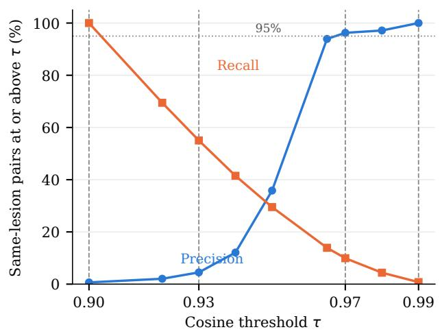

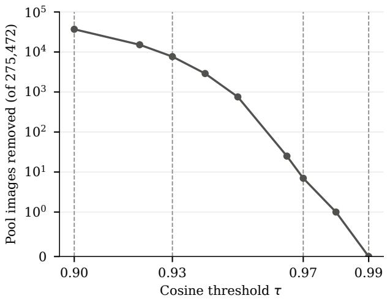  
Figure 8: Calibration of the safety threshold on same-lesion pairs of real training images. Left: precision and recall of the same-lesion label among pairs at or above each cosine threshold. Right: synthetic pool images (of 275,472) at or above each threshold, on a symmetric logarithmic axis. Dashed lines mark the four thresholds used in the paper.

Table 6: Validation $\mathrm { M a c r o } { - } F _ { 2 }$ of the algorithm at three temperatures (Swin-B, worst anchor applied to all 15 metrics, mean $\pm$ standard deviation over 30 curation seeds).
<table><tr><td> $T$   $\mathrm { M a c r o } { - } F _ { 2 }$ </td></tr><tr><td>0.1  $0 . 5 1 7 4 \pm 0 . 0 1 4 8$ </td></tr><tr><td>0.05  $0 . 5 2 1 8 \pm 0 . 0 1 8 7$ </td></tr><tr><td>0.02  $0 . 5 1 5 0 \pm 0 . 0 1 6 1$ </td></tr></table>

Table 7: Swin-B test-set results for real-plus-synthetic training. Entries are mean $\pm$ standard deviation over 30 curation seeds. $\tau$ is the safety threshold. FSMS measures distance from real training images (higher is safer, Section 3.6) and is not defined without synthetic images.
<table><tr><td>Cohort</td><td>Synthetic  $N$ </td><td>Runs</td><td>Macro  $F _ { 2 }$ </td><td>FSMS</td></tr><tr><td>Real data only</td><td></td><td>1</td><td>0.5154</td><td></td></tr><tr><td>Random</td><td>8,012</td><td>30</td><td> $0 . 5 5 5 7 \pm 0 . 0 2 2 2$ </td><td> $0 . 1 6 3 9 \pm 0 . 0 0 0 9$ </td></tr><tr><td>Best-metric (FID-Inception)</td><td>8,012</td><td>30</td><td> $0 . 5 7 0 2 \pm 0 . 0 2 0 2$ </td><td> $0 . 1 1 5 7 \pm 0 . 0 0 0 3$ </td></tr><tr><td> $\mathrm { A l g o r i t h m } , \tau = 0 . 9 0$ </td><td>8,012</td><td>30</td><td> $0 . 5 8 5 8 \pm 0 . 0 1 5 8$ </td><td> $0 . 1 4 4 3 \pm 0 . 0 0 0 4$ </td></tr><tr><td> $\mathrm { A l g o r i t h m } , \tau = 0 . 9 3$ </td><td>8,012</td><td>30</td><td> $0 . 5 8 6 6 \pm 0 . 0 1 8 3$ </td><td> $0 . 1 2 3 2 \pm 0 . 0 0 0 4$ </td></tr><tr><td> $\mathrm { A l g o r i t h m } , \tau = 0 . 9 7$ </td><td>8,012</td><td>30</td><td> $0 . 5 8 3 8 \pm 0 . 0 1 4 0$ </td><td> $0 . 1 1 5 2 \pm 0 . 0 0 0 4$ </td></tr><tr><td> $\mathrm { A l g o r i t h m } , \tau = 0 . 9 9$ </td><td>8,012</td><td>30</td><td> $0 . 5 8 4 2 \pm 0 . 0 1 2 8$ </td><td> $0 . 1 1 5 3 \pm 0 . 0 0 0 3$ </td></tr><tr><td>Random</td><td>20,000</td><td>30</td><td> $0 . 5 5 5 3 \pm 0 . 0 2 2 4$ </td><td> $0 . 1 6 3 8 \pm 0 . 0 0 0 6$ </td></tr><tr><td> $\mathrm { A l g o r i t h m } , \tau = 0 . 9 7$ </td><td>20,000</td><td>30</td><td> $0 . 5 8 5 5 \pm 0 . 0 1 6 2$ </td><td> $0 . 1 1 7 4 \pm 0 . 0 0 0 2$ </td></tr></table>

## 4.5 Clinical Augmentation Benchmark

## 4.5.1 Algorithm Against the Baselines

Table 7 and Figure 9 give the Swin-B results. All synthetic cohorts improve on the single real-only run (Macro- $F _ { 2 }$ 0.5154), and every one of the 30 runs in every synthetic cohort lies above it. Because the real-only run has no replicates, this comparison is descriptive.

Algorithm against FID-Inception. At each of the four thresholds the algorithm exceeds the best-metric cohort (0.5702) by between +0.0136 and +0.0164 Macro- $F _ { 2 }$ . The cohort means are 0.5858 (� = 0.90), 0.5866 (0.93), 0.5838 (0.97) and 0.5842 (0.99). Every comparison is significant with a large efect size and survives Bonferroni correction over the four tests (Table 8 and Figure 10), and the Mann-Whitney tests agree (Appendix E). Table 8 also gives the FSMS comparison, which Section 4.5.2 discusses. The four threshold cohorts are four settings of one algorithm and not independent replications: they share curation seeds, and the filter removes 7 images at 0.97 and none at 0.99, so those two cohorts difer only slightly. The algorithm cohorts are also less variable across seeds than the best-metric cohort (standard deviations 0.013 to 0.018, against 0.020).

Other cohorts. Best-metric sampling improves on random sampling by +0.0145, so single-metric curation helps. The algorithm improves on random sampling by +0.028 to +0.031 at the four thresholds, about twice that gain (Figure 10). Per-class results are in Appendix E.

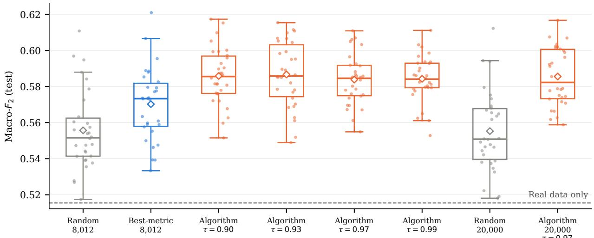  
Figure 9: Macro- $F _ { 2 }$ on the test set for Swin-B, one point per curation seed (30 per cohort). Boxes show the interquartile range and median, and diamonds mark the mean. The four algorithm cohorts at $N = 8 { , } 0 1 2$ are the same algorithm at four safety thresholds $\tau .$ The $N = 2 0 { , } 0 0 0$ algorithm cohort was run at $\tau = 0 . 9 7$ only. The dashed line is the single real-data-only run.

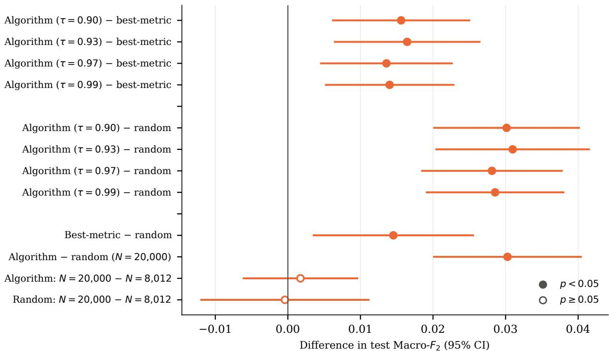  
positive: the first-named cohort scores higher  
Figure 10: Diferences in test $\mathrm { M a c r o } { - } F _ { 2 }$ between cohorts (the first-named cohort minus the second), with 95% confidence intervals from Welch’s �-test. A filled marker means $p < 0 . 0 5$ and a hollow marker means $p \geq 0 . 0 5$ . The algorithm is shown at each of the four safety thresholds.

Table 8: Primary comparisons: Swin-B test $\mathrm { M a c r o } { - } F _ { 2 }$ and FSMS of the algorithm minus the best-metric (FID-Inception) cohort at $N = 8 { \mathrm { , 0 1 2 } }$ , 30 curation seeds each, at each safety threshold �. A positive diference means higher utility for Macro- $F _ { 2 }$ and a safer set for FSMS. The 95% confidence interval and � are from Welch’s �-test, the adjusted $p$ is Bonferroni-corrected over the four tests of each outcome, and � is Cohen’s �.
<table><tr><td>Outcome</td><td>T</td><td> $\Delta$ </td><td>95% CI</td><td>t</td><td>p</td><td>Adj. p</td><td>d</td></tr><tr><td>Macro-  $F _ { 2 }$ </td><td>0.90</td><td>+0.0156</td><td> $\left[ + 0 . 0 0 6 2 , + 0 . 0 2 5 0 \right]$ </td><td>3.33</td><td>0.0016</td><td>0.0062</td><td>0.86</td></tr><tr><td></td><td>0.93</td><td>+0.0164</td><td> $\left[ + 0 . 0 0 6 5 , + 0 . 0 2 6 4 \right]$ </td><td>3.30</td><td>0.0016</td><td>0.0066</td><td>0.85</td></tr><tr><td></td><td>0.97</td><td>+0.0136</td><td> $\left[ + 0 . 0 0 4 6 , + 0 . 0 2 2 6 \right]$ </td><td>3.02</td><td>0.0039</td><td>0.0155</td><td>0.78</td></tr><tr><td></td><td>0.99</td><td>+0.0140</td><td> $\left[ + 0 . 0 0 5 2 , + 0 . 0 2 2 8 \right]$ </td><td>3.21</td><td>0.0024</td><td>0.0095</td><td>0.83</td></tr><tr><td>FSMS</td><td>0.90</td><td>+0.0287</td><td>[+0.0285, +0.0289]</td><td>317.08</td><td> $< 1 0 ^ { - 6 }$ </td><td> $< 1 0 ^ { - 6 }$ </td><td>81.87</td></tr><tr><td></td><td>0.93</td><td>+0.0075</td><td>[+0.0073, +0.0077]</td><td>84.15</td><td> $< 1 0 ^ { - 6 }$ </td><td> $< 1 0 ^ { - 6 }$ </td><td>21.73</td></tr><tr><td></td><td>0.97</td><td>-0.0004</td><td> $[ - 0 . 0 0 0 6 , - 0 . 0 0 0 2 ]$ </td><td>-4.59</td><td> $2 . 8 \times 1 0 ^ { - 5 }$ </td><td> $1 . 1 \times 1 0 ^ { - 4 }$ </td><td>-1.19</td></tr><tr><td></td><td>0.99</td><td>-0.0003</td><td> $[ - 0 . 0 0 0 5 , - 0 . 0 0 0 2 ]$ </td><td>-3.92</td><td> $2 . 4 \times 1 0 ^ { - 4 }$ </td><td> $9 . 6 \times 1 0 ^ { - 4 }$ </td><td>-1.01</td></tr></table>

## 4.5.2 Efect of the Safety Threshold

The safety threshold � removes pool images whose similarity to a training image is at least � before sampling. We ran the algorithm at four values (0.90, 0.93, 0.97 and 0.99), each for Swin-B at $N = 8 { , } 0 1 2$ with 30 curation seeds. Each threshold was chosen from a property of the calibration curve (Section 4.4.2). Table 7 gives the values and Table 8 the tests against the FID cohort for both outcomes. Figure 11 shows the two outcomes against �: Macro- $F _ { 2 }$ stays flat across the four values while FSMS rises as the threshold tightens.

Utility. Macro- $F _ { 2 }$ does not change with � in this range. The four means lie between 0.5838 and 0.5866, within one seed-to-seed standard deviation (0.013 to 0.018), so the data rule out a large utility cost of tightening � .

Safety. FSMS is flat between 0.99 (0.1153) and 0.97 (0.1152) and rises as � tightens further, to 0.1443 at 0.90, as the filter removes more pool images (7 at 0.97, 36,929 or 13.4% at 0.90). It crosses the FID cohort’s value (0.1157) between 0.93 and 0.97. The algorithm is safer than the FID cohort at 0.90 and 0.93 (+0.0287 and +0.0075) and slightly less safe at 0.97 and 0.99 (by 0.0004 and 0.0003), and all four diferences are significant after Bonferroni correction (Table 8). The shortfall is small. In the detection experiment, planting 1% of exact copies lowers FSMS by 0.0013, and the drop is proportional to the planted fraction, so a deficit of 0.0004 has the efect of replacing about 0.3% of the images, roughly 25 of 8,012, with exact copies. It is about one seed-to-seed standard deviation of a cohort. At no tested threshold does the algorithm reach random sampling (0.1639); the closest, � = 0.90, is 0.0195 below it, and at 0.97 it is 0.0486 below. For reference, held-out real images score 0.1147 against the training set (Table 9), so the FID cohort (0.1157) and the algorithm at 0.97 and 0.99 (0.1152, 0.1153) sit close to the level of real images the generator never saw.

Curated sets score below random sampling. For the FID cohort the cause of the lower FSMS is visible: it draws every image from the configuration with the lowest FSMS in the pool (Table 10). For the algorithm we have not isolated the cause. Curation toward images that resemble the real data is consistent with the result, since the images closest to the real data are the ones FSMS penalizes. The filter removes only 7 pool images at 0.97 and none at 0.99, so at those two thresholds the algorithm is close to unfiltered curation. A tighter � raises FSMS with no measured change in Macro- $F _ { 2 }$ , so utility and safety do not trade of over the tested range.

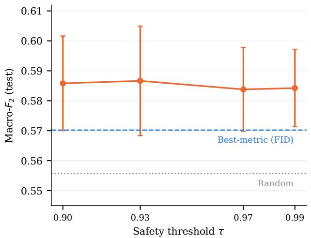

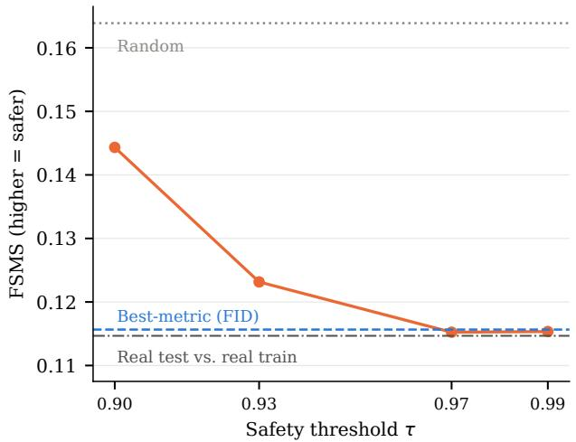  
Figure 11: Test $\mathrm { M a c r o } { - } F _ { 2 }$ (left, mean ± one standard deviation over 30 seeds) and FSMS (right) of the algorithm as the safety threshold � varies. The dashed line is the best-metric (FID) cohort, the dotted line is random sampling, and the dash-dot line in the right panel is the FSMS of held-out real test images against the training set.

## 4.5.3 Dose-Response at $N = 2 0 { , } 0 0 0$

At $N = 2 0 { , } 0 0 0$ (Section 3.7.2) and $\tau = 0 . 9 7$ the algorithm scores 0.5855 against 0.5553 for random sampling, a gain of +0.0303 that is close to the +0.0281 at $N = 8 { , } 0 1 2$ (Figure 10). Neither cohort changes significantly with �: the algorithm gains 0.0017 and random sampling loses 0.0004. The gain over random sampling therefore holds at the larger �, and neither cohort at $N = 2 0 { , } 0 0 0$ benefits significantly from the extra synthetic images. The algorithm at $N = 2 0 { , } 0 0 0$ also exceeds the best-metric cohort at $N = 8 { , } 0 1 2$ by 0.0153, although the two difer in �. Its FSMS at $N = 2 0 { , } 0 0 0$ is 0.1174, compared with 0.1152 at $N = 8 , 0 1 2 \ ( \tau = 0 . 9 7 )$ and 0.1638 for random sampling.

## 4.6 Validation of the Memorization Score

Reference points. Scoring the real training set against itself gives exactly 0 by construction, which verifies the implementation (Table 9). Scoring each real training image against the other training images gives 0.0953 (mean nearest-neighbor cosine 0.9047), and 9.96% of training images have at least one other training image at cosine 0.95 or higher, so this domain is dense and FSMS cannot approach 1. Real images that were never seen in training are the natural reference for “not a copy”: the 1,512 held-out test images score 0.1147 against the training set (3.5% of them have a neighbor at 0.95 or above, none at 0.97 or above).

Pool audit. Table 10 gives FSMS for each of the 16 generation configurations. Later checkpoints and lower CFG scales tend to lie closer to the training set. The configuration that FID-Inception ranks best (25k kimg, guidance 1.0) has the lowest FSMS of all 16 (0.1225), so selecting by FID picks the configuration nearest the training images. Over the whole pool, 754 images (0.27%) have a training neighbor at cosine 0.95 or above and 7 at 0.97 or above, and the maximum is 0.981.

Table 9: Reference values of FSMS. The mean cosine is the mean over images of the cosine similarity to the nearest training image, so FSMS is one minus it. The held-out test images are the 1,512 oficial test images, and the last three columns give the percentage of images with a neighbor at or above the cosine value and the highest cosine found.
<table><tr><td>Set</td><td>FSMS</td><td>Mean cosine</td><td>≥ 0.95 (%)</td><td>≥ 0.97 (%)</td><td>Max</td></tr><tr><td>Training images against themselves</td><td>0</td><td>1.0000</td><td></td><td></td><td></td></tr><tr><td>Training images against the other training images</td><td>0.0953</td><td>0.9047</td><td>9.96</td><td></td><td>1.000</td></tr><tr><td>Held-out test images against the training images</td><td>0.1147</td><td>0.8853</td><td>3.51</td><td>0.00</td><td>0.968</td></tr></table>

Table 10: FSMS of the synthetic pool by generation configuration (higher is safer). The bold entry is the configuration ranked best by FID-Inception.
<table><tr><td>Checkpoint</td><td>CFG 1.0</td><td>CFG 1.5</td><td>CFG 2.0</td><td>CFG 3.0</td></tr><tr><td>3k</td><td>0.2097</td><td>0.2065</td><td>0.2063</td><td>0.2180</td></tr><tr><td>8k</td><td>0.1549</td><td>0.1651</td><td>0.1766</td><td>0.2058</td></tr><tr><td>15k</td><td>0.1291</td><td>0.1357</td><td>0.1544</td><td>0.2070</td></tr><tr><td>25k</td><td>0.1225</td><td>0.1304</td><td>0.1609</td><td>0.2314</td></tr></table>

Does FSMS detect memorization? To test whether FSMS detects memorization, we planted copies of training images in a curated set of 8,012 synthetic images (FSMS 0.1318). A fixed fraction of the set, 1%, 5%, 10% or 25% (80 to 2,003 images), was replaced by real training images. An exact copy has a cosine similarity of 1 with its training image, which is the highest similarity a memorized generation could have. A noisy copy, in which Gaussian noise with a norm of 30% of the embedding norm was added to the DINOv2 embedding, represents a reproduction that is close to a training image but not identical. FSMS was recomputed for each fraction and each kind of copy (Table 11). If FSMS responds to memorization, it should fall as the planted fraction grows, and the per-image similarity �(�) of Section 3.6 should be higher for the planted images than for the clean ones. FSMS falls in proportion to the planted fraction (0.0013 for 1%, 0.0330 for 25%). The per-image similarity �(�) also identifies the planted images: the area under the receiver operating characteristic curve (AUROC), which is the probability that a randomly chosen planted image has a higher �(�) than a randomly chosen clean image, is 1.0 for exact copies and 0.996 for noisy copies. One percent contamination (80 images) is a drop of about 3 to 4 seed-to-seed standard deviations of a cohort (0.0003 to 0.0004), so FSMS resolves contamination of roughly that size. The perturbation is applied in feature space, so this test shows the sensitivity of the statistic and not of the full image-to-feature path.

Does a high similarity reflect copying or class typicality? DINOv2 is a general semantic embedding and not a copy detector, and the real data are two thirds nevi, so a high cosine could mean “a typical lesion” and not “close to one training image”. To check, the DINOv2 similarity of each pool image to its nearest real image was compared with SSIM, PSNR and LPIPS, which were computed against the same nearest real image but never use the DINOv2 embedding (Table 12). Across all 275,472 pool images the DINOv2 similarity correlates with SSIM (Pearson $r = 0 . 4 2 )$ with PSNR $( r = 0 . 4 0 )$ and, since LPIPS is a distance, negatively with LPIPS $( r = - 0 . 5 4 )$ . All three correlations have $p < 1 0 ^ { - 3 0 0 }$ . Across the five similarity brackets of the pool, PSNR rises and LPIPS falls at every step, from 15.2 dB and 0.458 in the least similar half to 22.0 dB and 0.240 in the most similar 0.1%. SSIM rises up to the 99th percentile and levels of above it. High similarity therefore corresponds to visual proximity to a specific real image.

Table 11: FSMS drop and per-image AUROC when real training images are planted into a curated set of 8,012 synthetic images. Contamination is shown as a fraction of the set (number of planted images in parentheses). The noisy copies carry feature-space Gaussian noise whose norm is 30% of the embedding norm.
<table><tr><td rowspan="2">Contamination</td><td colspan="2">Exact copies</td><td colspan="2">Noisy copies</td></tr><tr><td>FSMS drop</td><td>AUROC</td><td>FSMS drop</td><td>AUROC</td></tr><tr><td>1% (80)</td><td>0.0013</td><td>1.000</td><td>0.0009</td><td>0.996</td></tr><tr><td>5% (401)</td><td>0.0066</td><td>1.000</td><td>0.0045</td><td>0.996</td></tr><tr><td>10% (801)</td><td>0.0132</td><td>1.000</td><td>0.0090</td><td>0.996</td></tr><tr><td>25% (2003)</td><td>0.0330</td><td>1.000</td><td>0.0228</td><td>0.996</td></tr></table>

Table 12: Pixel-level agreement with the DINOv2 similarity. The 275,472 pool images are grouped by the cosine similarity to their nearest real training image, and SSIM, PSNR and LPIPS, computed against the same nearest real image, are averaged within each bracket. The last row gives the Pearson correlation over all pool images (all $p < 1 0 ^ { - 3 0 0 } )$ . An arrow marks the direction in which the images are closer, so LPIPS, a distance, falls as the cosine rises.
<table><tr><td>Similarity bracket</td><td>Images</td><td>Mean cosine</td><td>SSIM ↑</td><td>PSNR (dB) ↑</td><td>LPIPS↓</td></tr><tr><td>Least similar 50%</td><td>137,736</td><td>0.768</td><td>0.505</td><td>15.2</td><td>0.458</td></tr><tr><td>50th to 90th percentile</td><td>110,188</td><td>0.870</td><td>0.587</td><td>17.3</td><td>0.381</td></tr><tr><td>90th to 99th percentile</td><td>24,793</td><td>0.921</td><td>0.618</td><td>18.3</td><td>0.325</td></tr><tr><td>99th to 99.9th percentile</td><td>2,479</td><td>0.946</td><td>0.629</td><td>19.6</td><td>0.283</td></tr><tr><td>Most similar 0.1%</td><td>276</td><td>0.960</td><td>0.628</td><td>22.0</td><td>0.240</td></tr><tr><td>Correlation with the cosine (r)</td><td></td><td></td><td>0.42</td><td>0.40</td><td>-0.54</td></tr></table>

## 4.7 Generalization to ResNet-50

To test whether the findings carry over to a diferent architecture, the tournament, the weight derivation, the temperature sweep and the benchmark were repeated with ResNet-50 (He et al., 2016). The classifier settings, the pool, the metrics and the test set are the same, and the algorithm uses its own weights derived from the ResNet-50 tournament. Two parts of the Swin-B pipeline were not repeated: the safety sweep, so the algorithm is run at $\tau = 0 . 9 7$ only (the lowest tested value with precision above 95%), and the development of the algorithm’s design, so the configuration is the one fixed in Section 3.5. The random control uses 30 seeds (42 to 71), which also anchors the weights. The result is mixed. The ranking of metrics largely carries over, the per-class pattern partly does, and the benefit of the algorithm does not. The tables behind this subsection are in Appendix F.

Metric ranking. FID-Inception is again the strongest synthetic arm on ResNet-50 (Macro- $F _ { 2 }$ 0.500, against 0.460 for random sampling and 0.571 for real data only), and all three distinct distributional arms beat random sampling over the 30 seeds (by +0.041, +0.035 and +0.033, all $p < 0 . 0 0 1 )$ . Among instance metrics, Realism (0.485) and CLIP log-odds (0.470) are above random,

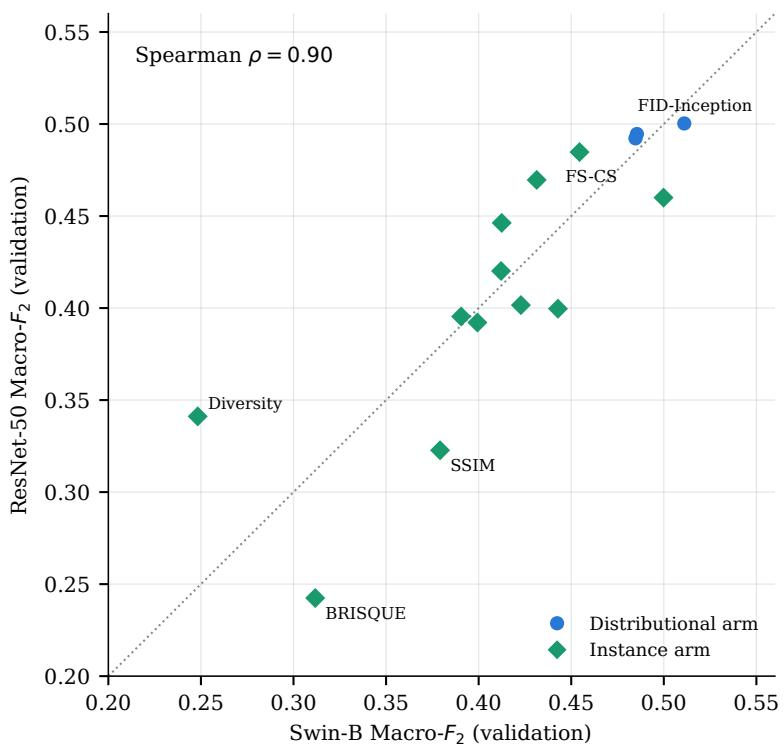  
Figure 12: Validation $\mathrm { M a c r o } { - } F _ { 2 }$ of each tournament arm on Swin-B and on ResNet-50. FID-DINOv2 and KID-DINOv2 select the same configuration and are shown as one arm. The dotted line marks equal scores.

FS-CS matches it, and the remaining nine fall below it. Figure 12 compares the two architectures. The Macro- $F _ { 2 }$ of the 15 distinct arms agrees closely (Spearman $\rho = 0 . 9 0 )$ , so a metric that serves Swin-B well on average generally serves ResNet-50 well.

Per-class pattern. The per-class pattern agrees less well. No metric serves every class on ResNet-50 either: a diferent arm leads each of the seven classes. Only AKIEC has the same leader as on Swin-B (FSIM, 0.599 against 0.596), and the per-class rank correlation of arms between the architectures ranges from 0.37 (BKL) to 0.74 (VASC). DF is again the weakest class for FID-Inception (0.059), but the leader there is CLIP log-odds (0.300), not FS-CS. Instance arms are single deterministic datasets, and NV is a near-tie among several arms (0.9292 for Diversity and CLIP similarity to the artifact prompt), so part of this disagreement is noise. The conclusion that no single metric serves every class holds on both architectures, whereas the particular metric that serves a class does not transfer. The full per-class scores are in Table A6 of Appendix B.

Weights. The weights derived from the ResNet-50 tournament difer from the Swin-B weights. The top metric is the same in three classes (FID-Inception for BCC, MEL and VASC) but its weight is smaller, for example 15% for VASC against 35% on Swin-B. The other classes change leader. DF puts its largest weight on CLIP log-odds (22%) where Swin-B concentrates 33% on SWD-DINOv2, and the distributional share ranges from 21% to 31% instead of 22% to 40%. These diferences follow from the per-class leaders above, and they show why the weights are derived per architecture. The distributional share and the largest weight of every class are in Table A16 of Appendix F.

Temperature. The temperature was swept at seven values with the locked configuration. Macro-$F _ { 2 }$ peaks at $T = 0 . 0 5$ (0.5054) and is lower on both sides (0.4913 at $T = 0 . 1$ and 0.4776 at $T = 0 . 0 2 )$ and both neighboring diferences are significant $( p = 0 . 0 2 5$ and $p = 0 . 0 0 0 4 )$ . The maximum is therefore at the same temperature as on Swin-B, and $T = 0 . 0 5$ is used for both architectures.

Benchmark. The algorithm shows no benefit on ResNet-50. At $N = 8 { , } 0 1 2$ and $\tau = 0 . 9 7$ it scores 0.5520, against 0.5577 for the best-metric cohort and 0.5466 for random sampling, and neither diference is significant in Welch’s �-test $( p = 0 . 3 5$ and $p = 0 . 3 3 )$ . At $N = 2 0 { , } 0 0 0$ the algorithm and random sampling are also indistinguishable $( p = 0 . 6 9 )$ . The best-metric cohort is slightly above random sampling, by 0.0112 $( p = 0 . 0 6 3 )$ . The real-data-only run (0.5578) lies above every synthetic cohort mean, and only 9 to 17 of the 30 runs in a synthetic cohort exceed it, so on this architecture synthetic augmentation shows no clear gain over the real data alone.

What generalizes. Three findings carry over in part. First, the metric ranking is stable across architectures (Spearman $\rho = 0 . 9 0 )$ , with FID-Inception strongest among synthetic arms on both. Second, no single metric serves every class on either architecture. Third, the per-class weights are architecture-specific, so the tournament must be repeated for each classifier. The benefit of the algorithm does not carry over. We did not investigate why, and the per-class disagreement above, together with the missing spread of the instance arms, makes it unclear how far the weights derived on ResNet-50 can be trusted. We therefore claim the algorithm’s benefit for Swin-B only (Section 7).

## 5 Synthetic Dataset and Open-Source Code

The tournament, the algorithm and the benchmark all rest on one table: 275,472 synthetic dermoscopy images, each with a vector of per-image scores. We release this pool and the table. Anyone can then train classifiers on it, build a diferent curation method on the same scores, or repeat the tournament with other metrics without regenerating a single image.

## 5.1 Contents

The release contains the 275,472 class-conditional 512 × 512 images described in Section 3.2, with their composition in Table 1: 16 generation configurations, each holding the same seven-class mix. The grid deliberately includes under-trained and over-trained checkpoints and a wide range of guidance, so the pool spans a broad range of image quality and of distance to the training data (FSMS from 0.12 to 0.23 across configurations, Table 10).

## 5.2 Per-Image Metric Scores

Each image carries the fields in Table 13. Twelve of the scores are the instance metrics of the tournament (Table 2). Two more, classifier confidence and the geometric precision-recall score, were computed for the pool but are not part of the 16-metric tournament, so no downstream utility measurement accompanies them. The four distributional metrics cannot score a single image, so they are released as one row per generation configuration (FID with Inception and $\mathrm { D I N O v 2 }$ features, KID and SWD with DINOv2 features), computed against the real training set. All reference-based scores use the 8,012 real training images, so users who change the real reference set must recompute them. The nearest-real similarity is the per-image term of FSMS (Section 3.6), so users can filter the pool at any similarity threshold.

Table 13: Fields of the released per-image table (one row per image).
<table><tr><td>Field</td><td>Description</td></tr><tr><td>filename, archive</td><td>Path of the image inside its zip archive, for example ckpt_25k_cfg_1.0/class_6/012418.png, and the name of that archive (ckpt_25k_cfg_1.0.zip). The filename is unique across the</td></tr><tr><td>seed</td><td>release Sampling seed of the image, which is also the number in the file name. Seeds repeat across classes and configurations</td></tr><tr><td>source_checkpoint_kimg, cfg_scale target_class_label</td><td>Generation configuration Class the image was conditioned on</td></tr><tr><td>psnr_score, ssim_score, fsim_score,</td><td>Full-reference scores against the nearest real training image in DINOv2</td></tr><tr><td>lpips_score</td><td>space</td></tr><tr><td>brisqe_score</td><td>No-reference natural-scene-statistics score</td></tr><tr><td>fscs_score clip_similarity_cancer,</td><td>DINOv2 cosine similarity to the real class centroid CLIP prompt similarities and their log ratio</td></tr><tr><td>clip_similarity_artifact,</td><td></td></tr><tr><td>clip_log_odds_score</td><td></td></tr><tr><td>is_contribution_score</td><td>Per-image KL term of the IS</td></tr><tr><td>realism_score, diversity_score</td><td>Distance to the 3rd nearest real image, and to nearby synthetic images, in DINOv2 space</td></tr><tr><td>classifier_confidence_score</td><td>Softmax probability that a ResNet-50 trained on the real training set</td></tr><tr><td></td><td>assigns to the conditioned class (not in the tournament) Harmonic mean of the realism (inverted) and diversity scores, each</td></tr><tr><td>geometric_pr_score</td><td>clipped at its 1st and 99th percentiles and mapped to [0, 1] (not in the</td></tr><tr><td>max_sim_to_real</td><td>tournament) Cosine similarity to the nearest real training image (the FSMS term)</td></tr></table>

## 5.3 Intended Uses

The release supports four uses. First, it is a pool for augmentation experiments: the cohorts of Section 4.5 can be rebuilt from the table, and other curation methods can be compared with them on the same pool. Second, it is a testbed for evaluation metrics, since the 16 configurations difer strongly in quality and in distance to the training set. Third, the per-image scores allow the tournament to be repeated with additional metrics. Fourth, the nearest-real similarity allows memorization audits.

Three limits apply. The images are synthetic and are not suitable for clinical diagnosis or training outside research settings. The release makes no privacy guarantee: FSMS shows proximity to training images and is not a proof of non-reproduction (Section 4.6). The release carries no skin-tone annotation, and this paper does not evaluate the fairness of models trained on it.

## 5.4 Dataset Access and Licensing

The dataset consists of the image archive (16 zip files, one per generation configuration, 97.7 GiB in total), the per-image table and the per-configuration table. The archive and the tables are released under the Creative Commons Attribution-NonCommercial-ShareAlike 4.0 International license (CC BY-NC-SA 4.0). The license follows from the two sources the images depend on. The generator was trained on ISIC-2018 training data, which is distributed under CC BY-NC, and was built with the EDM2 code of Karras et al. (2024), which is distributed under CC BY-NC-SA 4.0. CC BY-NC-SA 4.0 meets the attribution, non-commercial and share-alike terms of both. Users must credit this paper and the ISIC-2018 and HAM10000 datasets (Codella et al., 2019; Tschandl et al., 2018), and may not use the release for commercial purposes.

## 5.5 Open-Source Code

The open-source Python package synth-curator (https://pypi.org/project/synth-curator/ and https://github.com/Amixdu/synth-curator) applies the algorithm to a user’s own synthetic pool and classifier. Given a pool, real reference images and the user’s training code, it computes the metric scores, runs the tournament, derives the weights, curates the pool, and can then train the classifier on the curated set. The cohorts of Section 4.5 can be rebuilt with it from the released tables.

## 6 Discussion

## 6.1 Findings

Synthetic images help on Swin-B and not on ResNet-50. On Swin-B every synthetic cohort, including random sampling, scores above the real-data-only classifier (0.5154), by 0.040 for random sampling and by up to 0.071 for the algorithm. This comparison is descriptive, since the real-data-only classifier is a single run. On ResNet-50 the real-data-only classifier (0.5578) is at or above every synthetic cohort mean. The benefit of augmentation is therefore specific to the classifier in this study, as the benefit of curation is.

The value of a metric depends on the class. No metric led on every class in the tournament, and the arms that led across the seven classes were FSIM, Realism, FS-CS, FID-Inception, and FID-DINOv2 together with $\mathrm { K I D - D I N O v 2 }$ . FID-Inception shows the clearest case. Its classifier is the best of all arms on VASC (0.680) and shows no measurable advantage over random sampling on DF. Class size does not explain which arm wins, since distributional metrics lead on both the largest class (NV) and the second smallest (VASC), while an instance metric leads on DF, which is smaller than either. The mechanism underlying this pattern remains unclear, and we report it as an observation. The consequence for practice is that a single global metric cannot be best for every class, so a curation rule that uses one metric accepts a cost on some classes without a way to see it in advance.

FID-Inception is nonetheless the strongest single arm on Macro- $F _ { 2 }$ in the tournament (0.511 against 0.475 for random sampling on Swin-B). Reports that FID can fail to track downstream performance (Wu et al., 2026) therefore do not carry over to utility in this setting. FID performed less favorably on the safety measure, because the configuration it ranks best is the one closest to the training images (Section 4.6). Most instance metrics produced classifiers below random sampling. FS-CS was the only one above it on Swin-B (0.500 against 0.475). Each instance arm is one deterministic dataset with one score, so it has no seed-to-seed spread to test against. Its score is read against the spread of random draws (standard deviation 0.021), and the gap of FS-CS is about one standard deviation.

The algorithm improves on the best-metric baseline. On a held-out real test set, the algorithm exceeds the FID-Inception cohort by +0.0136 to +0.0164 Macro- $F _ { 2 }$ at each of four safety thresholds, and exceeds random sampling by about +0.03. This is about twice the gain that best-metric sampling achieves over random sampling (+0.0145). The gain comes from the combination of per-class weighting and the group-scored term, and the experiments do not isolate which component of the final configuration contributes how much. The safety threshold adds a second control. Tightening it raises FSMS with no measurable change in $\mathrm { M a c r o } { - } F _ { 2 }$ , so a user can choose a setting at which the algorithm exceeds the best-metric baseline on utility and on safety together, as it does at 0.90 and 0.93 here. The best-metric baseline has no corresponding setting, since the safety of its set is fixed by the configuration it selects.

The result is specific to Swin-B in this study. ResNet-50 shows no benefit from the algorithm over either the best-metric cohort or random sampling (Section 4.7). The ranking of metrics by $\mathrm { M a c r o } { - } F _ { 2 }$ agrees closely across the two architectures (Spearman $\rho = 0 . 9 0 )$ , but the metric that leads each class mostly does not, and the weights derived for ResNet-50 difer from those for Swin-B. We did not investigate the cause. One possible reason is that synthetic images added to the real data do not raise the score on ResNet-50 even when drawn at random, so the pool ofers little for curation to improve. We did not test this. The claim that this paper supports is therefore limited to Swin-B with a frozen backbone and a trained linear head, and the weights were derived separately for each classifier, so a new classifier would call for its own weights.

The gain over random sampling is stable when the algorithm curates more. At $N =$ 20,000 the algorithm still beats random sampling by $+ 0 . 0 3 0 3 \ \mathrm { M a c r o } { - F _ { 2 } }$ (Section 4.5.3), against +0.0281 at $N = 8 { , } 0 1 2$ . Neither cohort changes significantly between the two volumes, so the gap to random sampling stays the same and the extra synthetic images add no significant gain. The procedure takes about 7% of the pool at $N = 2 0 { , } 0 0 0$ and about 3% at $N = 8 { , } 0 1 2$ . With two volumes, one architecture and one threshold, the data do not describe the shape of the dose-response curve.

Safety is a threshold choice. Tightening the safety threshold raised FSMS without a measurable change in Macro- $F _ { 2 }$ . At $\tau = 0 . 9 7$ and 0.99 the filter removes 7 and 0 of the 275,472 pool images, and the algorithm sits marginally below the FID cohort on FSMS (by 0.0004 or less). At the tighter thresholds, 0.90 and 0.93, it is safer than the FID cohort.

For FID, the best configuration is also the closest to the training images. The configuration that FID-Inception ranks best (25k kimg, guidance 1.0) has the lowest FSMS of the 16 generation configurations (0.1225), and the FID cohort, which draws every image from it, scores 0.1157 against 0.1639 for random sampling (Section 4.6). FID is also the strongest single metric on utility in the tournament, so on Swin-B the signal that selects the best training data selects the configuration nearest the training images. This is consistent with training that moves a checkpoint toward the real distribution in Inception space also moving it toward specific real images in DINOv2 space. We did not test this.

Curated sets score below random sampling on safety. At no tested threshold does a curated cohort reach the FSMS of random sampling. For the FID cohort the cause is visible, since it draws from the configuration nearest the training images. For the algorithm we have not isolated the cause, although curation toward images that resemble the real data is consistent with it. The utility gains of curation are accompanied by a lower FSMS than random sampling, and a threshold narrows the gap without closing it.

## 6.2 Inception and DINOv2 Feature Spaces

Section 4.3 found a clear advantage of Inception-space FID on Swin-B and no separable diference on ResNet-50.

The selected configuration. The two arms difer in the configuration they choose. FID-Inception picks 25k kimg at guidance 1.0 and FID-DINOv2 picks 25k at 1.5. The comparison between feature spaces is therefore a comparison between these configurations, since the feature space acts on the result only through the configuration it selects. The direction of the guidance preference agrees with the settings published for EDM2 on ImageNet-512, where a guidance of 1.2 to 1.4 minimizes FID and 1.7 to 2.0 minimizes the Fréchet distance on DINOv2 features (FDDINOv2) (Karras et al., 2024): FID on DINOv2 features prefers stronger guidance. Guidance varies the fidelity-diversity trade-of of the pool, and one possible reason for the better utility of the unguided configuration is that it holds more diversity. A second possible reason is that both classifiers are frozen ImageNet-pretrained backbones, so Inception features, which are also trained on ImageNet, may align with what the classifier sees. We tested neither.

Relation to earlier work. Stein et al. recommend DINOv2 features after finding that FID’s Inception features track human judgment of realism poorly (Stein et al., 2023), and Woodland et al. find that ImageNet-based extractors rank medical generators more consistently with expert judgment than extractors trained on medical images (Woodland et al., 2024). The criterion here difers from both, because the metrics are compared by the utility of the classifier trained on the images they select. By that criterion FID on Inception features did better on Swin-B, and the two cannot be separated on ResNet-50.

Safety. The configuration picked by FID-Inception has the lowest FSMS in the pool (0.1225). The configuration picked by FID-DINOv2 has a higher FSMS (0.1304; Table 10), so the feature space also shifts the safety of the selected set.

## 6.3 Practical Guidance

The algorithm needs three things: a pool of synthetic images with per-image scores, a classifier that can be trained many times, and a held-out real set. The procedure is

1. generate a pool that varies in quality and in distance to the training data, for example across training checkpoints and CFG scales, as in Section 5;

2. score the pool with a portfolio of metrics, including distributional metrics computed per group of the pool (here, per generation configuration);

3. run the tournament on the classifier of interest and keep per-image predictions, because per-class $F _ { 2 }$ cannot be recovered from a macro-averaged table;

4. derive per-class weights (Section 3.5.1) and curate to a budget �, which is a user choice (we used the size of the real training set so that cohorts compare at equal volume, and a surplus pool beyond that did not help);

5. choose � from the privacy requirement, using a calibration curve built from labeled nearduplicates if the data provide one, and confirm the result on a held-out real set. Where privacy matters more than the last 0.01 of Macro- $F _ { 2 }$ , tighter thresholds are available at no measured utility cost within the tested range.

## 6.4 Clinical Implications

Synthetic images address the scarcity of real examples for rare diagnoses described in Section 1, and the results show that which synthetic images are added matters for those classes. A single global quality score such as FID did not serve every class, so a team augmenting a rare class should measure the efect per class on held-out real data before adopting a selection rule. On Swin-B, the algorithm raised Macro- $F _ { 2 } ,$ which weights recall over precision and so reflects the cost of a missed lesion, by 0.0136 to 0.0164 over the FID baseline (corrected $p < 0 . 0 2 )$ . The gain is statistically significant but modest in absolute terms, and it was not seen on ResNet-50. The safety threshold ofers a documented way to limit how closely curated images resemble patient training images, which is relevant under regulations such as GDPR and HIPAA, but FSMS measures proximity and is not a privacy guarantee. These results are evidence for how to select synthetic training data in research settings. No clinician assessed the images, and the classifiers are not validated for clinical use.

## 6.5 Reusable Artifacts

Three artifacts are useful without adopting the algorithm. The tournament table (Figures 4 and 5) gives per-class utility for 16 metrics on a fixed pool, which lets a practitioner pick a metric for a class of interest. The released pool and per-image scores (Section 5) allow other curation methods, other metrics and other classifiers to be tested against the same data. The released package synth-curator (Section 5.5) takes any pool, any metric portfolio and any classifier as input, so the tournament can be repeated on other datasets. It ships weights precomputed for ISIC-2018 on Swin-B and ResNet-50 so that the tournament can be skipped.

## 7 Limitations

One dataset, one generator, one training regime. All results use ISIC-2018 and a single generator family (EDM2). The held-out test set comes from the same challenge as the training data and is not an external dataset, so we do not know how the results transfer to other sites, devices or generators. Every classifier is a frozen ImageNet-pretrained backbone with a trained linear head. The frozen backbone is a deliberate choice (Section 3.4) that isolates the efect of the selected images. The cost is external validity: deployed classifiers are usually fine-tuned, which can use synthetic images diferently, so the tournament weights and the benchmark gains may difer.

Evidence on one architecture. The benefit of the algorithm is shown for Swin-B. ResNet-50 shows none (Section 4.7), and we did not investigate why. Metric rankings agree across the two architectures, but the per-class leaders do not, so the per-class weights are specific to the classifier. With two architectures we cannot say whether the Swin-B result or the ResNet-50 result is more typical of other classifiers.

Tournament noise and scope. The tournament is scored on a validation split that also selects the early-stopping epoch, so absolute scores are optimistic, and the validation split has only 23 DF and 28 VASC images. The twelve instance arms are single deterministic datasets with one score each and no seed-to-seed spread, so their per-class values are indicative and a gap of 0.01 to 0.02 to random is inside the spread of random draws. The distributional arms use 30 seeds but select only three distinct generation configurations. All four beat random sampling, which is also what concentrating on any single configuration might produce. A matched control, a randomly chosen single configuration, was never run, so the tournament cannot fully separate a metric choosing a good configuration from one configuration beating the mixture.

Sensitivity of the weights. The weights are derived from these noisy measurements through a hard threshold at the random baseline. A metric near that baseline can be included or excluded by baseline noise alone. The worst-metric anchor is also portfolio-dependent, so weights are not comparable across portfolios, and reproducing them requires the same 15-metric portfolio. We did not test a margin criterion or replicated instance arms.

Exploratory development. The temperature of 0.05 was the best of three values without a significant diference to its neighbors. The mechanism by which the group-scored term helps VASC was not demonstrated, and VASC remains below the FID baseline on the test set. No control with equal or mismatched weights was run, so the contribution of the per-class weights cannot be separated from that of the other components.

Benchmark scope. The test set has 1,512 images, and AKIEC, DF and VASC have only 35 to 44 images each, so per-class scores are noisy and the per-class tests are uncorrected. Classifier initialization is fixed, so cohort spread reflects the selected data and not training variance. The fixed seed also does not make runs bit-reproducible, since PyTorch’s full deterministic mode was not enabled and some GPU matrix operations can difer between executions. In the tournament, two arms with identical curated sets produced identical predictions in all 60 matched pairs, so this variation was not visible there. The real-data-only baseline is a single run and cannot be tested. The algorithm was evaluated at two budgets, $N = 8 { , } 0 1 2$ and $N = 2 0 { , } 0 0 0$ , both at or above the real training set size, and the � = 20,000 cohort and the ResNet-50 runs exist at one safety threshold $( \tau = 0 . 9 7 )$ . Behavior at much smaller or much larger budgets is untested. We did not measure the compute needed to generate a surplus pool and curate it, against generating exactly � images.

What FSMS does and does not show. FSMS is a mean over a set, whereas privacy risk concentrates in the closest images, and we report counts of pool images above fixed similarity values. Appendix E reports the maximum, the 99.9th percentile and the share of images above fixed similarity values for each cohort. Similarity is measured in one embedding space (DINOv2). The calibration of � uses re-photographs of the same lesion as positives. These difer from difusion reproductions, so the calibration bounds false removals and says nothing about missed reproductions. At $\tau = 0 . 9 7$ the filter identifies about 10% of same-lesion pairs and removes 7 of 275,472 pool images. All curated cohorts score below random sampling on FSMS at every tested threshold. FSMS shows proximity to training images and is not a privacy guarantee.

Fairness and clinical use. We do not evaluate whether curation or augmentation changes performance across skin tones. The synthetic pool carries no skin-tone labels, and no clinician assessed the images. The pool and the trained models are research artifacts and are not validated for clinical use.

## 8 Conclusion

We measured what 16 evaluation metrics are worth for curating synthetic dermoscopy images, class by class, by training classifiers on the images each metric selects. No single metric served every class. FID-Inception, the usual choice, produced the best classifier on one class and no measurable advantage over random sampling on another. We turned these per-class measurements into a safety-aware evaluation algorithm with per-class weights and a safety threshold calibrated on labeled near-duplicates of real images.

On a held-out real test set, the algorithm improves Macro- $F _ { 2 }$ over the FID-Inception baseline for Swin-B by +0.0136 to +0.0164 across four safety thresholds, significant after correction at each, and over random sampling by +0.0281 to +0.0309. Tightening the safety threshold raised FSMS without a measurable change in Macro- ${ \boldsymbol { \cdot } } { \boldsymbol { F } } _ { 2 }$ , but every curated cohort remains less safe than random sampling.

On the primary classifier, Swin-B, our proposed algorithm improved upon FID-based selection by a modest but statistically significant margin, ofering a practical, safety-aware procedure for choosing synthetic training images. We release the 275,472-image pool with its per-image scores and the open-source package synth-curator, enabling others to test alternative curation methods and metrics on the same data and to apply this algorithm to other pools and classifiers.

## Data and Code Availability

The 275,472 synthetic images, the per-image metric scores and the per-configuration table are available on Zenodo at https://doi.org/10.5281/zenodo.23851497 under CC BY-NC-SA 4.0. The open-source Python package synth-curator (https://github.com/Amixdu/synth-curator) enables researchers to apply this curation algorithm to their own synthetic datasets and custom classifier architectures. The raw result tables behind every figure and table, the scripts that produce the reported numbers and the code of the pipeline stages used in this study are available at https://github.com/Amixdu/synth-curator-paper.

## Acknowledgements

This work was supported by computational resources and services provided by the Bunya supercomputer of the University of Queensland Research Computing Centre (The University of Queensland Research Computing Centre, 2024) and by the Crux GPU server of Southern Cross University. The authors thank the administrators of both systems for their technical support.

## Use of AI Tools

During the preparation of this work, the authors used Artificial Intelligence tools (Claude by Anthropic and Gemini by Google) to improve the language, readability, debugging and formatting of the manuscript. Additionally, these tools were used to assist in formatting, refactoring, debugging, and documenting the associated open-source code repositories. After using these tools, the authors thoroughly reviewed and edited the content, and take full responsibility for the final publication.

## References

Muhammad Usman Akbar, Wuqi Wang, and Anders Eklund. Beware of Difusion Models for Synthesizing Medical Images – A Comparison with GANs in terms of Memorizing Brain MRI and Chest X-ray Images. arXiv preprint arXiv:2305.07644, 2023.

Guillaume Alain and Yoshua Bengio. Understanding intermediate layers using linear classifier probes. arXiv preprint arXiv:1610.01644, 2016. URL https://arxiv.org/abs/1610.01644.

Laith Alzubaidi, Jinglan Bai, Aiman Al-Sabaawi, José Santamaría, Ahmed Shihab Albahri, Bashar S. N. Al-dabbagh, Mohammed Ali Fadhel, Mohamed Manoufali, Jinglan Zhang, Ali H. Al-Timemy, Ye Duan, Amjed Abdullah, Laith Farhan, Yuantong Lu, Ashish Gupta, Felix Albu, Amin Abbosh, and Yuantong Gu. A survey on deep learning tools dealing with data scarcity: definitions, challenges, solutions, tips, and applications. Journal of Big Data, 10(1):46, 2023. doi: 10.1186/s40537-023-00727-2.

Eyal Betzalel, Coby Penso, and Ethan Fetaya. Evaluation metrics for generative models: An empirical study. Machine Learning and Knowledge Extraction, 6(3):1531–1544, 2024. doi: 10.3390/make6030073.

Alceu Bissoto, Fábio Perez, Eduardo Valle, and Sandra Avila. Skin Lesion Synthesis with Generative Adversarial Networks. In OR 2.0 Context-Aware Operating Theaters, Computer Assisted Robotic Endoscopy, Clinical Image-Based Procedures, and Skin Image Analysis, pages 294–302. Springer International Publishing, 2018. doi: 10.1007/978-3-030-01201-4\_32.

Alceu Bissoto, Eduardo Valle, and Sandra Avila. GAN-Based Data Augmentation and Anonymization for Skin-Lesion Analysis: A Critical Review. In 2021 IEEE/CVF Conference on Computer Vision and Pattern Recognition Workshops (CVPRW), pages 1847–1856. IEEE, 2021. doi: 10.1109/ cvprw53098.2021.00204.

Mikołaj Bińkowski, Danica J. Sutherland, Michael Arbel, and Arthur Gretton. Demystifying mmd gans, January 01, 2018 2018. URL https:// ui.adsabs.harvard.edu/abs/2018arXiv180101401B. Published at ICLR 2018: https://openreview.net/forum?id=r1lUOzWCW.

Nicolas Bonneel, Julien Rabin, Gabriel Peyré, and Hanspeter Pfister. Sliced and radon wasserstein barycenters of measures. Journal of Mathematical Imaging and Vision, 51(1):22–45, 2015. ISSN 1573-7683. doi: 10.1007/s10851-014-0506-3. URL https://doi.org/10.1007/ s10851-014-0506-3.

Nicholas Carlini, Jamie Hayes, Milad Nasr, Matthew Jagielski, Vikash Sehwag, Florian Tramèr, Borja Balle, Daphne Ippolito, and Eric Wallace. Extracting Training Data from Difusion Models. In 32nd USENIX Security Symposium (USENIX Security 23), 2023.

Noel Codella, Veronica Rotemberg, Philipp Tschandl, M. Emre Celebi, Stephen Dusza, David Gutman, Brian Helba, Aadi Kalloo, Konstantinos Liopyris, Michael Marchetti, Harald Kittler, and Allan Halpern. Skin Lesion Analysis Toward Melanoma Detection 2018: A Challenge Hosted by the International Skin Imaging Collaboration (ISIC), 2019. URL https://arxiv.org/abs/ 1902.03368.

Salman U. H. Dar, Marvin Seyfarth, Isabelle Ayx, Theano Papavassiliu, Stefan O. Schoenberg, Robert Malte Siepmann, Fabian Christopher Laqua, Jannik Kahmann, Norbert Frey, Bettina

Baeßler, Sebastian Foersch, Daniel Truhn, Jakob Nikolas Kather, and Sandy Engelhardt. Unconditional Latent Difusion Models Memorize Patient Imaging Data: Implications for Openly Sharing Synthetic Data. Nature Biomedical Engineering, 2025. doi: 10.1038/s41551-025-01468-8.

Saisai Ding, Jian Zheng, Zhaobang Liu, Yanyan Zheng, Yanmei Chen, Xiaomin Xu, Jia Lu, and Jing Xie. High-resolution dermoscopy image synthesis with conditional generative adversarial networks. Biomedical Signal Processing and Control, 64:102224, 2021. doi: 10.1016/j.bspc.2020.102224.

Andre Esteva, Brett Kuprel, Roberto A. Novoa, Justin Ko, Susan M. Swetter, Helen M. Blau, and Sebastian Thrun. Dermatologist-level classification of skin cancer with deep neural networks. Nature, 542(7639):115–118, 2017. doi: 10.1038/nature21056.

Konstantina Giouroukou, Kostas Marias, Manolis Tsiknakis, and Michail E. Klontzas. Rethinking privacy in medical imaging AI: From metadata and pixel-level identification risks to federated learning and synthetic data challenges. Radiology: Artificial Intelligence, 8(1), 2025. doi: 10.1148/ryai.250273.

Ian J. Goodfellow, Jean Pouget-Abadie, Mehdi Mirza, Bing Xu, David Warde-Farley, Sherjil Ozair, Aaron Courville, and Yoshua Bengio. Generative adversarial nets. In Advances in Neural Information Processing Systems, volume 27, 2014.

Kaiming He, Xiangyu Zhang, Shaoqing Ren, and Jian Sun. Deep Residual Learning for Image Recognition. In 2016 IEEE Conference on Computer Vision and Pattern Recognition (CVPR), page 1, June 2016. doi: 10.1109/CVPR.2016.90.

Martin Heusel, Hubert Ramsauer, Thomas Unterthiner, Bernhard Nessler, and Sepp Hochreiter. GANs trained by a two time-scale update rule converge to a local Nash equilibrium. In Advances in Neural Information Processing Systems, volume 30, 2017.

Jonathan Ho, Ajay Jain, and Pieter Abbeel. Denoising difusion probabilistic models. In Advances in Neural Information Processing Systems (NeurIPS), volume 33, 2020.

M. Islam, H. Zunair, and N. Mohammed. Cossif: Cosine similarity-based image filtering to overcome low inter-class variation in synthetic medical image datasets. Computers in Biology and Medicine, 172, 2024. doi: 10.1016/j.compbiomed.2024.108317.

Sadeep Jayasumana, Srikumar Ramalingam, Andreas Veit, Daniel Glasner, Ayan Chakrabarti, and Sanjiv Kumar. Rethinking FID: Towards a better evaluation metric for image generation. In Proceedings of the IEEE/CVF Conference on Computer Vision and Pattern Recognition (CVPR), 2024.

Jef Johnson, Matthijs Douze, and Hervé Jégou. Billion-scale similarity search with GPUs. arXiv preprint arXiv:1702.08734, 2017.

Tero Karras, Miika Aittala, Jaakko Lehtinen, Janne Hellsten, Timo Aila, and Samuli Laine. Analyzing and improving the training dynamics of difusion models. In Proceedings of the IEEE/CVF Conference on Computer Vision and Pattern Recognition (CVPR), 2024. URL https://arxiv.org/abs/2312.02696.

Ananya Kumar, Aditi Raghunathan, Robbie Jones, Tengyu Ma, and Percy Liang. Fine-tuning can distort pretrained features and underperform out-of-distribution. In International Conference on Learning Representations (ICLR), 2022. URL https://arxiv.org/abs/2202.10054.

Tuomas Kynkäänniemi, Tero Karras, Samuli Laine, Jaakko Lehtinen, and Timo Aila. Improved Precision and Recall Metric for Assessing Generative Models. arXiv e-prints, art. arXiv:1904.06991, April 2019. doi: 10.48550/arXiv.1904.06991.

Tuomas Kynkäänniemi, Tero Karras, Miika Aittala, Timo Aila, and Jaakko Lehtinen. The role of ImageNet classes in fréchet inception distance. In International Conference on Learning Representations (ICLR), 2023.

Ze Liu, Yutong Lin, Yue Cao, Han Hu, Yixuan Wei, Zheng Zhang, Stephen Lin, and Baining Guo. Swin transformer: Hierarchical vision transformer using shifted windows. In Proceedings of the IEEE/CVF international conference on computer vision, pages 10012–10022, 2021.

Alessio Luschi, Linda Tognetti, Alessandra Cartocci, Elisa Cinotti, Giovanni Rubegni, Laura Calabrese, et al. Design and development of a systematic validation protocol for synthetic melanoma images for responsible use in medical artificial intelligence. Biocybernetics and Biomedical Engineering, 45:608–616, 2025. doi: 10.1016/j.bbe.2025.09.001.

Casey Meehan, Kamalika Chaudhuri, and Sanjoy Dasgupta. A Non-Parametric Test to Detect Data-Copying in Generative Models. arXiv e-prints, art. arXiv:2004.05675, April 2020. doi: 10.48550/arXiv.2004.05675.

Agnieszka Mikołajczyk, Sylwia Majchrowska, and Sandra Carrasco Limeros. The (de)biasing Efect of GAN-Based Augmentation Methods on Skin Lesion Images. In Medical Image Computing and Computer Assisted Intervention – MICCAI 2022, Lecture Notes in Computer Science, pages 437–447. Springer Nature Switzerland, 2022. doi: 10.1007/978-3-031-16452-1\_42.

A. Mittal, A. K. Moorthy, and A. C. Bovik. No-reference image quality assessment in the spatial domain. IEEE Transactions on Image Processing, 21(12):4695–4708, 2012. ISSN 1941-0042. doi: 10.1109/TIP.2012.2214050.

Nagi, Bellatreccia, Borghesi, Dondi, Pierantoni, Zama, Neri, Lanari, and Calegari. A Clinicianin-the-Loop Framework for Validating and Selecting Synthetic Paediatric Dermatology Images. Information, 17(8):749, 2026. doi: 10.3390/info17080749.

Maxime Oquab, Timothée Darcet, Théo Moutakanni, Huy Vo, Marc Szafraniec, Vasil Khalidov, Pierre Fernandez, Daniel Haziza, Francisco Massa, Alaaeldin El-Nouby, Mahmoud Assran, Nicolas Ballas, Wojciech Galuba, Russell Howes, Po-Yao Huang, Shang-Wen Li, Ishan Misra, Michael Rabbat, Vasu Sharma, Gabriel Synnaeve, Hu Xu, Hervé Jegou, Julien Mairal, Patrick Labatut, Armand Joulin, and Piotr Bojanowski. DINOv2: Learning Robust Visual Features without Supervision. arXiv e-prints, art. arXiv:2304.07193, April 2023. doi: 10.48550/arXiv.2304.07193.

Mansheej Paul, Surya Ganguli, and Gintare Karolina Dziugaite. Deep learning on a data diet: Finding important examples early in training. In Advances in Neural Information Processing Systems (NeurIPS), 2021.

Pielage, Schmidle, Marschall, and Risse. Interactive High-Quality Skin Lesion Generation using Difusion Models for VR-based Dermatological Education. In Proceedings of the 30th International Conference on Intelligent User Interfaces (IUI ’25), pages 878–897, 2025. doi: 10.1145/3708359. 3712101.

Adarsh Pritam, O. Jeba Shiney, and Sanyam Jain. SkinGenBench: Generative Model and Preprocessing Efects for Synthetic Dermoscopic Augmentation in Melanoma Diagnosis. arXiv preprint arXiv:2512.17585, 2025.

Alec Radford, Jong Wook Kim, Chris Hallacy, Aditya Ramesh, Gabriel Goh, Sandhini Agarwal, Girish Sastry, Amanda Askell, Pamela Mishkin, Jack Clark, Gretchen Krueger, and Ilya Sutskever. Learning transferable visual models from natural language supervision. In Proceedings of the 38th International Conference on Machine Learning, volume 139 of Proceedings of Machine Learning Research, pages 8748–8763. PMLR, 2021.

Suman Ravuri and Oriol Vinyals. Classification Accuracy Score for Conditional Generative Models. arXiv e-prints, art. arXiv:1905.10887, May 2019. doi: 10.48550/arXiv.1905.10887.

Eman Rezk, Mohamed Eltorki, and Wael El-Dakhakhni. Improving Skin Color Diversity in Cancer Detection: Deep Learning Approach. JMIR Dermatology, 5(3), 2022. doi: 10.2196/39143.

Alex Rodriguez Alonso, Ana Sanchez Diez, Goikoane Cancho Galán, Rafael Ibarrola Altuna, Gonzalo Irigoyen Miró, Cristina Penas Lago, María Dolores Boyano López, and Rosa Izu Belloso. Enhancing Melanoma Diagnosis in Histopathology with Deep Learning and Synthetic Data Augmentation. Bioengineering, 12(9):1001, 2025. doi: 10.3390/bioengineering12091001.

Robin Rombach, Andreas Blattmann, Dominik Lorenz, Patrick Esser, and Björn Ommer. Highresolution image synthesis with latent difusion models. In Proceedings of the IEEE/CVF Conference on Computer Vision and Pattern Recognition (CVPR), 2022. doi: 10.1109/CVPR52688. 2022.01042.

Tim Salimans, Ian Goodfellow, Wojciech Zaremba, Vicki Cheung, Alec Radford, and Xi Chen. Improved techniques for training gans, June 01, 2016 2016. URL https://ui.adsabs.harvard. edu/abs/2016arXiv160603498S.

Ozan Sener and Silvio Savarese. Active learning for convolutional neural networks: A core-set approach. In International Conference on Learning Representations (ICLR), 2018.

Shentu, Watson, and Al Moubayed. Controllable synthesis of dermoscopic images using difusion models for enhanced computer aided diagnosis and detection. Medical Image Analysis, 2026.

Rebecca L. Siegel, Kimberly D. Miller, and Ahmedin Jemal. Cancer statistics, 2019. CA: A Cancer Journal for Clinicians, 69(1):7–34, 2019. doi: 10.3322/caac.21551.

Youssef Skandarani, Pierre-Marc Jodoin, and Alain Lalande. Gans for medical image synthesis: An empirical study. Journal of Imaging, 9(3), 2023. ISSN 2313-433X. doi: 10.3390/jimaging9030069. URL https://www.mdpi.com/2313-433X/9/3/69.

George Stein, Jesse C. Cresswell, Rasa Hosseinzadeh, Yi Sui, Brendan Leigh Ross, Valentin Villecroze, Zhaoyan Liu, Anthony L. Caterini, J. Eric T. Taylor, and Gabriel Loaiza-Ganem. Exposing flaws of generative model evaluation metrics and their unfair treatment of difusion models. In Advances in Neural Information Processing Systems (NeurIPS), 2023.

Arthur A. M. Teodoro, Douglas H. Silva, Renata L. Rosa, Muhammad Saadi, Lunchakorn Wuttisittikulkij, Rao Asad Mumtaz, and Demóstenes Z. Rodríguez. A Skin Cancer Classification Approach using GAN and RoI-Based Attention Mechanism. Journal of Signal Processing Systems, 95(2-3):211–224, 2022. doi: 10.1007/s11265-022-01757-4.

The University of Queensland Research Computing Centre. Bunya supercomputer. Brisbane, Queensland, Australia, 2024. URL https://dx.doi.org/10.48610/wf6c-qy55.

Mariya Toneva, Alessandro Sordoni, Remi Tachet des Combes, Adam Trischler, Yoshua Bengio, and Geofrey J. Gordon. An empirical study of example forgetting during deep neural network learning. In International Conference on Learning Representations (ICLR), 2019.

Philipp Tschandl, Clif Rosendahl, and Harald Kittler. The HAM10000 dataset, a large collection of multi-source dermatoscopic images of common pigmented skin lesions. Scientific Data, 5:180161, 2018. doi: 10.1038/sdata.2018.161.

Wang, Zhang, Ding, and Hamm. Doctor Approved: Generating Medically Accurate Skin Disease Images through AI-Expert Feedback. In Advances in Neural Information Processing Systems (NeurIPS), 2025. arXiv:2506.12323.

McKell Woodland, Austin Castelo, Mais Al Taie, Jessica Albuquerque Marques Silva, Mohamed Eltaher, Frank Mohn, Alexander Shieh, Suprateek Kundu, Joshua P. Yung, Ankit B. Patel, and Kristy K. Brock. Feature extraction for generative medical imaging evaluation: New evidence against an evolving trend. In Medical Image Computing and Computer Assisted Intervention (MICCAI), Lecture Notes in Computer Science, volume 15012. Springer, 2024.

World Health Organization. Cancer fact sheet. https://www.who.int/news-room/fact-sheets/ detail/cancer, 2025. Accessed: 2026.

Yuli Wu, Fucheng Liu, Rüveyda Yilmaz, Henning Konermann, Peter Walter, and Johannes Stegmaier. A pragmatic note on evaluating generative models with fréchet inception distance for retinal image synthesis. In Medical Imaging with Deep Learning (MIDL), 2026.

L. Zhang, L. Zhang, X. Mou, and D. Zhang. Fsim: A feature similarity index for image quality assessment. IEEE Transactions on Image Processing, 20(8):2378–2386, 2011. ISSN 1941-0042. doi: 10.1109/TIP.2011.2109730.

Richard Zhang, Phillip Isola, Alexei A. Efros, Eli Shechtman, and Oliver Wang. The unreasonable efectiveness of deep features as a perceptual metric. In Proceedings of the IEEE Conference on Computer Vision and Pattern Recognition (CVPR), pages 586–595, 2018.

Wang Zhou, A. C. Bovik, H. R. Sheikh, and E. P. Simoncelli. Image quality assessment: from error visibility to structural similarity. IEEE Transactions on Image Processing, 13(4):600–612, 2004. ISSN 1941-0042. doi: 10.1109/TIP.2003.819861.

## Appendix

## A Full Cohort Results

Tables A1 and A2 give the test-set metrics of every cohort in Section 4.5: Macro- $F _ { 2 }$ , Macro- $F _ { 1 }$ macro-averaged ROC-AUC, macro recall, macro precision and overall accuracy. Entries are mean ± standard deviation over 30 curation seeds, and the real-only row is a single run.

Table A1: Swin-B test-set metrics for every cohort. $\tau$ is the safety threshold.
<table><tr><td>Cohort</td><td>N Macro-</td><td> $. F _ { 2 }$ </td><td>Macro  ${ \bf \nabla } \cdot { \cal F } _ { 1 }$ </td><td>ROC-AUC</td><td>Recall</td><td></td><td>Precision</td><td>Accuracy</td></tr><tr><td>Real data only</td><td></td><td>0.515</td><td>0.562</td><td>0.937</td><td>0.493</td><td></td><td>0.716</td><td>0.751</td></tr><tr><td>Random Best-metric (FID-Inception)</td><td>8,012 8,012</td><td> $0 . 5 5 6 \pm 0 . 0 2 2$   $0 . 5 7 0 \pm 0 . 0 2 0$ </td><td> $0 . 5 9 2 \pm 0 . 0 2 0$   $0 . 6 0 4 \pm 0 . 0 1 7$ </td><td> $0 . 9 3 5 \pm 0 . 0 0 2$   $0 . 9 3 8 \pm 0 . 0 0 2$ </td><td></td><td> $0 . 5 3 7 \pm 0 . 0 2 3$   $0 . 5 5 2 \pm 0 . 0 2 2$ </td><td> $0 . 6 9 7 \pm 0 . 0 2 7$   $0 . 6 9 8 \pm 0 . 0 2 0$ </td><td> $0 . 7 6 1 \pm 0 . 0 0 7$   $0 . 7 6 7 \pm 0 . 0 0 5$ </td></tr><tr><td>Algorithm, τ = 0.90 Algorithm, τ = 0.93</td><td>8,012 8,012</td><td>0.586 ± 0.016 0.587 ± 0.018</td><td>0.619 ± 0.014 0.620 ± 0.018</td><td>0.939 ± 0.001 0.939</td><td> ± 0.002</td><td>0.568 ± 0.017 0.569 ± 0.019</td><td>0.708 ± 0.023 0.709 ± 0.024</td><td>0.773 ± 0.005 0.773 ± 0.008</td></tr><tr><td>Algorithm, τ = 0.97</td><td>8,012</td><td>0.584 ± 0.014</td><td>0.616 ± 0.012</td><td>0.939 ± 0.002</td><td></td><td>0.567 ± 0.015</td><td></td><td>0.701 ± 0.020 0.771 ± 0.004</td></tr><tr><td></td><td></td><td></td><td></td><td></td><td></td><td></td><td></td><td></td></tr><tr><td>Algorithm, τ = 0.99</td><td>8,012</td><td>0.584 ± 0.013</td><td>0.617 ± 0.013</td><td></td><td></td><td></td><td>0.701 ± 0.019</td><td></td></tr><tr><td></td><td></td><td></td><td></td><td>0.939 ± 0.001</td><td></td><td>0.567 ± 0.013</td><td></td><td> $0 . 7 7 1 \pm 0 . 0 0 5$ </td></tr><tr><td>Random</td><td>20,000</td><td>0.555 ± 0.022</td><td>0.591 ± 0.018</td><td>0.932 ± 0.002</td><td></td><td>0.538 ± 0.024</td><td>0.703 ± 0.020</td><td></td></tr><tr><td></td><td></td><td></td><td></td><td></td><td></td><td></td><td></td><td> $0 . 7 5 8 \pm 0 . 0 0 8$ </td></tr><tr><td>Algorithm,  $\tau = 0 . 9 7$ </td><td></td><td>20,000 0.586 ± 0.016</td><td>0.618 ± 0.013</td><td>0.937 ± 0.002</td><td></td><td>0.569 ± 0.019 0.712 ± 0.021</td><td></td><td> $0 . 7 7 1 \pm 0 . 0 0 4$ </td></tr></table>

Table A2: ResNet-50 test-set metrics for every cohort.
<table><tr><td>Cohort</td><td>N</td><td> $\mathrm { M a c r o } { - } F _ { 2 }$ </td><td> $\mathrm { M a c r o } { - } F _ { 1 }$ </td><td>ROC-AUC</td><td>Recall</td><td>Precision</td><td>Accuracy</td></tr><tr><td>Real data only</td><td></td><td>0.558</td><td>0.583</td><td>0.931</td><td>0.550</td><td>0.714</td><td>0.763</td></tr><tr><td>Random</td><td>8,012</td><td> $0 . 5 4 7 \pm 0 . 0 2 0$ </td><td> $0 . 5 7 8 \pm 0 . 0 1 9$ </td><td> $0 . 9 3 3 \pm 0 . 0 0 3$ </td><td> $0 . 5 3 3 \pm 0 . 0 2 1$ </td><td> $0 . 6 9 3 \pm 0 . 0 2 7$ </td><td> $0 . 7 6 4 \pm 0 . 0 0 4$ </td></tr><tr><td>Best-metric (FID-Inception)</td><td>8,012</td><td> $0 . 5 5 8 \pm 0 . 0 2 5$ </td><td>0.587 ± 0.023</td><td>0.936 ± 0.003</td><td> $0 . 5 4 4 \pm 0 . 0 2 5$ </td><td> $0 . 6 8 7 \pm 0 . 0 2 3$ </td><td> $0 . 7 6 7 \pm 0 . 0 0 6$ </td></tr><tr><td>Algorithm,  $\tau = 0 . 9 7$ </td><td></td><td>8,012 0.552 ± 0.022</td><td>0.583 ± 0.021</td><td></td><td>0.935 ± 0.002 0.538 ± 0.022</td><td> $0 . 6 9 6 \pm 0 . 0 2 1$ </td><td> $0 . 7 6 6 \pm 0 . 0 0 7$ </td></tr><tr><td>Random</td><td></td><td>20,000 0.556 ± 0.024</td><td>0.578 ± 0.022</td><td></td><td></td><td>0.930 ± 0.002 0.548 ± 0.026 0.665 ± 0.028</td><td> $0 . 7 6 1 \pm 0 . 0 0 6$ </td></tr><tr><td>Algorithm,  $\tau = 0 . 9 7$ </td><td></td><td>20,0000.554 ± 0.021</td><td></td><td></td><td></td><td>0.582 ± 0.018 0.932 ± 0.003 0.541 ± 0.023 0.682 ± 0.028 0.761 ± 0.007</td><td></td></tr></table>

## B Tournament Results in Full

Tables A3 and A4 give the Macro- $F _ { 2 }$ of every arm for Swin-B and ResNet-50, behind Figure 4 and Section 4.7. Tables A5 and A6 give the per-class $F _ { 2 }$ of the two architectures, behind Figure 5.

Table A6 gives the per-class $F _ { 2 }$ for ResNet-50, the counterpart of Table A5.

Table A7 gives the scores of the four distributional metrics for each of the 16 generation configurations. Each distributional arm of the tournament curates from the configuration that has the best score for its metric.

Table A3: Swin-B Macro- $F _ { 2 }$ on the validation split for synthetic-only training. Distributional and random-control entries are mean ± standard deviation over seeds, instance entries are single deterministic datasets. $\Delta$ is the diference from the mean of the random control (60 runs); comparisons in the text use Welch’s �-test against all 60 random runs. FID-DINOv2 and KID-DINOv2 select the same configuration and have identical results.
<table><tr><td>Metric</td><td>Family</td><td>Runs</td><td> $\mathrm { M a c r o } { - } F _ { 2 }$ </td><td> $\Delta$ </td></tr><tr><td>FID-Inception</td><td>Distributional</td><td>30</td><td> $0 . 5 1 1 \pm 0 . 0 1 5$ </td><td>+0.036</td></tr><tr><td>SWD-DINOv2</td><td>Distributional</td><td>30</td><td> $0 . 4 8 5 \pm 0 . 0 1 7$ </td><td>+0.011</td></tr><tr><td>FID-DINOv2</td><td>Distributional</td><td>30</td><td> $0 . 4 8 5 \pm 0 . 0 1 8$ </td><td>+0.010</td></tr><tr><td>KID-DINOv2</td><td>Distributional</td><td>30</td><td> $0 . 4 8 5 \pm 0 . 0 1 8$ </td><td>+0.010</td></tr><tr><td>FS-CS</td><td>Instance</td><td></td><td>0.500</td><td>+0.025</td></tr><tr><td>Realism</td><td>Instance</td><td>1</td><td>0.454</td><td>-0.020</td></tr><tr><td>CLIP sim. (artifact)</td><td>Instance</td><td>1</td><td>0.443</td><td>-0.032</td></tr><tr><td>CLIP log-odds</td><td>Instance</td><td>1</td><td>0.431</td><td>-0.043</td></tr><tr><td>LPIPS</td><td>Instance</td><td>1</td><td>0.423</td><td>-0.052</td></tr><tr><td>FSIM</td><td>Instance</td><td>1</td><td>0.412</td><td>-0.062</td></tr><tr><td>PSNR</td><td>Instance</td><td>1</td><td>0.412</td><td>-0.063</td></tr><tr><td>CLIP sim. (cancer)</td><td>Instance</td><td>1</td><td>0.399</td><td>-0.075</td></tr><tr><td>IS contribution</td><td>Instance</td><td>1</td><td>0.391</td><td>-0.084</td></tr><tr><td>SSIM</td><td>Instance</td><td>1</td><td>0.379</td><td>-0.096</td></tr><tr><td>BRISQUE</td><td>Instance</td><td>1</td><td>0.312</td><td>-0.163</td></tr><tr><td>Diversity</td><td>Instance</td><td>1</td><td>0.248</td><td>-0.227</td></tr><tr><td>Random control</td><td>Baseline</td><td>60</td><td> $0 . 4 7 5 \pm 0 . 0 2 1$ </td><td></td></tr><tr><td>Real data only</td><td>Reference</td><td>1</td><td>0.542</td><td>+0.067</td></tr></table>

Table A4: ResNet-50 Macro- $F _ { 2 }$ on the validation split for synthetic-only training, in the same format as Table A3. The random control has 30 runs.
<table><tr><td>Metric</td><td>Family</td><td>Runs</td><td> $\mathrm { M a c r o } { - } F _ { 2 }$ </td><td> $\Delta$ </td></tr><tr><td>FID-Inception</td><td>Distributional</td><td>30</td><td> $0 . 5 0 0 \pm 0 . 0 1 8$ </td><td>+0.041</td></tr><tr><td>SWD-DINOv2</td><td>Distributional</td><td>30</td><td> $0 . 4 9 5 \pm 0 . 0 2 6$ </td><td>+0.035</td></tr><tr><td>FID-DINOv2</td><td>Distributional</td><td>30</td><td> $0 . 4 9 2 \pm 0 . 0 2 7$ </td><td>+0.033</td></tr><tr><td>KID-DINOv2</td><td>Distributional</td><td>30</td><td> $0 . 4 9 2 \pm 0 . 0 2 7$ </td><td>+0.033</td></tr><tr><td>Realism</td><td>Instance</td><td>1</td><td>0.485</td><td>+0.025</td></tr><tr><td>CLIP log-odds</td><td>Instance</td><td>1</td><td>0.470</td><td>+0.010</td></tr><tr><td>FS-CS</td><td>Instance</td><td>1</td><td>0.460</td><td>+0.000</td></tr><tr><td>FSIM</td><td>Instance</td><td>1</td><td>0.446</td><td>-0.013</td></tr><tr><td>PSNR</td><td>Instance</td><td>1</td><td>0.420</td><td>-0.039</td></tr><tr><td>LPIPS</td><td>Instance</td><td>1</td><td>0.402</td><td>-0.058</td></tr><tr><td>CLIP sim. (artifact)</td><td>Instance</td><td>1</td><td>0.400</td><td>-0.060</td></tr><tr><td>IS contribution</td><td>Instance</td><td>1</td><td>0.395</td><td>-0.064</td></tr><tr><td>CLIP sim. (cancer)</td><td>Instance</td><td>1</td><td>0.392</td><td>-0.067</td></tr><tr><td>Diversity</td><td>Instance</td><td>1</td><td>0.341</td><td>-0.118</td></tr><tr><td>SSIM</td><td>Instance</td><td>1</td><td>0.323</td><td>-0.137</td></tr><tr><td>BRISQUE</td><td>Instance</td><td>1</td><td>0.242</td><td>-0.217</td></tr><tr><td>Random control</td><td>Baseline</td><td>30</td><td> $0 . 4 6 0 \pm 0 . 0 3 2$ </td><td></td></tr><tr><td>Real data only</td><td>Reference</td><td>1</td><td>0.571</td><td>+0.112</td></tr></table>

Table A5: Per-class $F _ { 2 }$ on the validation split for Swin-B. Bold marks the best synthetic arm in each column. The last column is Macro- $F _ { 2 }$ . FID-DINOv2 and KID-DINOv2 tie in the NV column and are identical throughout.
<table><tr><td></td><td>AKIEC</td><td>BCC</td><td>BKL</td><td>DF</td><td>MEL</td><td>NV</td><td>VASC</td><td>Macro</td></tr><tr><td>Validation images</td><td>65</td><td>103</td><td>220</td><td>23</td><td>223</td><td>1,341</td><td>28</td><td>2,003</td></tr><tr><td>FID-Inception</td><td>0.375</td><td>0.583</td><td>0.502</td><td>0.137</td><td>0.373</td><td>0.927</td><td>0.680</td><td>0.511</td></tr><tr><td>SWD-DINOv2</td><td>0.329</td><td>0.572</td><td>0.510</td><td>0.168</td><td>0.348</td><td>0.935</td><td>0.537</td><td>0.485</td></tr><tr><td>FID-DINOv2</td><td>0.367</td><td>0.547</td><td>0.494</td><td>0.143</td><td>0.338</td><td>0.936</td><td>0.568</td><td>0.485</td></tr><tr><td>KID-DINOv2</td><td>0.367</td><td>0.547</td><td>0.494</td><td>0.143</td><td>0.338</td><td>0.936</td><td>0.568</td><td>0.485</td></tr><tr><td>FS-CS</td><td>0.515</td><td>0.569</td><td>0.494</td><td>0.225</td><td>0.395</td><td>0.860</td><td>0.441</td><td>0.500</td></tr><tr><td>Realism</td><td>0.400</td><td>0.597</td><td>0.561</td><td>0.053</td><td>0.445</td><td>0.807</td><td>0.317</td><td>0.454</td></tr><tr><td>CLIP sim. (artifact)</td><td>0.419</td><td>0.474</td><td>0.479</td><td>0.054</td><td>0.360</td><td>0.920</td><td>0.394</td><td>0.443</td></tr><tr><td>CLIP log-odds</td><td>0.332</td><td>0.441</td><td>0.421</td><td>0.104</td><td>0.287</td><td>0.919</td><td>0.515</td><td>0.431</td></tr><tr><td>LPIPS</td><td>0.537</td><td>0.425</td><td>0.451</td><td>0.103</td><td>0.268</td><td>0.924</td><td>0.252</td><td>0.423</td></tr><tr><td>FSIM</td><td>0.596</td><td>0.395</td><td>0.346</td><td>0.054</td><td>0.326</td><td>0.918</td><td>0.252</td><td>0.412</td></tr><tr><td>PSNR</td><td>0.130</td><td>0.539</td><td>0.441</td><td>0.105</td><td>0.386</td><td>0.924</td><td>0.360</td><td>0.412</td></tr><tr><td>CLIP sim. (cancer)</td><td>0.418</td><td>0.546</td><td>0.401</td><td>0.000</td><td>0.181</td><td>0.927</td><td>0.323</td><td>0.399</td></tr><tr><td>IS contribution</td><td>0.319</td><td>0.244</td><td>0.499</td><td>0.052</td><td>0.290</td><td>0.929</td><td>0.400</td><td>0.391</td></tr><tr><td>SSIM</td><td>0.141</td><td>0.357</td><td>0.498</td><td>0.106</td><td>0.407</td><td>0.851</td><td>0.294</td><td>0.379</td></tr><tr><td>BRISQUE</td><td>0.074</td><td>0.116</td><td>0.448</td><td>0.054</td><td>0.346</td><td>0.932</td><td>0.212</td><td>0.312</td></tr><tr><td>Diversity</td><td>0.094</td><td>0.173</td><td>0.222</td><td>0.000</td><td>0.148</td><td>0.929</td><td>0.171</td><td>0.248</td></tr><tr><td>Random control</td><td>0.343</td><td>0.528</td><td>0.492</td><td>0.156</td><td>0.326</td><td>0.930</td><td>0.548</td><td>0.475</td></tr><tr><td>Real data only</td><td>0.459</td><td>0.631</td><td>0.564</td><td>0.288</td><td>0.436</td><td>0.937</td><td>0.480</td><td>0.542</td></tr></table>

Table A6: Per-class $F _ { 2 }$ on the validation split for ResNet-50. Bold marks the best synthetic arm in each column. The last column is Macro- $F _ { 2 }$
<table><tr><td></td><td>AKIEC</td><td>BCC</td><td>BKL</td><td>DF</td><td>MEL</td><td>NV</td><td>VASC</td><td>Macro</td></tr><tr><td>Validation images</td><td>65</td><td>103</td><td>220</td><td>23</td><td>223</td><td>1,341</td><td>28</td><td>2,003</td></tr><tr><td>FID-Inception</td><td>0.513</td><td>0.573</td><td>0.446</td><td>0.059</td><td>0.369</td><td>0.922</td><td>0.620</td><td>0.500</td></tr><tr><td>SWD-DINOv2</td><td>0.502</td><td>0.554</td><td>0.497</td><td>0.111</td><td>0.346</td><td>0.922</td><td>0.531</td><td>0.495</td></tr><tr><td>FID-DINOv2</td><td>0.525</td><td>0.543</td><td>0.520</td><td>0.123</td><td>0.301</td><td>0.925</td><td>0.509</td><td>0.492</td></tr><tr><td>KID-DINOv2</td><td>0.525</td><td>0.543</td><td>0.520</td><td>0.123</td><td>0.301</td><td>0.925</td><td>0.509</td><td>0.492</td></tr><tr><td>Realism</td><td>0.574</td><td>0.455</td><td>0.482</td><td>0.051</td><td>0.351</td><td>0.856</td><td>0.625</td><td>0.485</td></tr><tr><td>CLIP log-odds</td><td>0.531</td><td>0.256</td><td>0.460</td><td>0.300</td><td>0.205</td><td>0.915</td><td>0.621</td><td>0.470</td></tr><tr><td>FS-CS</td><td>0.422</td><td>0.477</td><td>0.447</td><td>0.175</td><td>0.255</td><td>0.896</td><td>0.547</td><td>0.460</td></tr><tr><td>FSIM</td><td>0.599</td><td>0.469</td><td>0.492</td><td>0.152</td><td>0.216</td><td>0.905</td><td>0.292</td><td>0.446</td></tr><tr><td>PSNR</td><td>0.094</td><td>0.488</td><td>0.494</td><td>0.103</td><td>0.397</td><td>0.897</td><td>0.469</td><td>0.420</td></tr><tr><td>LPIPS</td><td>0.493</td><td>0.380</td><td>0.358</td><td>0.105</td><td>0.353</td><td>0.909</td><td>0.214</td><td>0.402</td></tr><tr><td>CLIP sim. (artifact)</td><td>0.548</td><td>0.465</td><td>0.271</td><td>0.054</td><td>0.205</td><td>0.929</td><td>0.325</td><td>0.400</td></tr><tr><td>IS contribution</td><td>0.472</td><td>0.182</td><td>0.533</td><td>0.105</td><td>0.181</td><td>0.929</td><td>0.366</td><td>0.395</td></tr><tr><td>CLIP sim. (cancer)</td><td>0.553</td><td>0.300</td><td>0.371</td><td>0.000</td><td>0.228</td><td>0.927</td><td>0.366</td><td>0.392</td></tr><tr><td>Diversity</td><td>0.165</td><td>0.389</td><td>0.325</td><td>0.053</td><td>0.241</td><td>0.929</td><td>0.285</td><td>0.341</td></tr><tr><td>SSIM</td><td>0.142</td><td>0.225</td><td>0.438</td><td>0.000</td><td>0.347</td><td>0.898</td><td>0.210</td><td>0.323</td></tr><tr><td>BRISQUE</td><td>0.144</td><td>0.092</td><td>0.281</td><td>0.000</td><td>0.255</td><td>0.925</td><td>0.000</td><td>0.242</td></tr><tr><td>Random control</td><td>0.525</td><td>0.471</td><td>0.469</td><td>0.085</td><td>0.303</td><td>0.926</td><td>0.439</td><td>0.460</td></tr><tr><td>Real data only</td><td>0.592</td><td>0.722</td><td>0.623</td><td>0.106</td><td>0.393</td><td>0.919</td><td>0.644</td><td>0.571</td></tr></table>

Table A7: Distributional metric scores of the 16 generation configurations against the real training set (17,217 synthetic images each; computation in Appendix G). Lower is better for all four, and bold marks the best configuration for each metric, which is the one the corresponding tournament arm curates from.
<table><tr><td>Checkpoint</td><td>CFG</td><td>FID-Inception</td><td>FID-DINOv2</td><td>KID-DINOv2</td><td>SWD-DINOv2</td></tr><tr><td rowspan="4">3k</td><td>1.0</td><td>120.1</td><td>1325.7</td><td>23.19</td><td>0.926</td></tr><tr><td>1.5</td><td>114.0</td><td>1217.4</td><td>20.75</td><td>0.822</td></tr><tr><td>2.0</td><td>111.2</td><td>1138.2</td><td>18.41</td><td>0.801</td></tr><tr><td>3.0</td><td>116.5</td><td>1064.3</td><td>16.07</td><td>0.773</td></tr><tr><td rowspan="4">8k</td><td>1.0</td><td>65.1</td><td>652.0</td><td>11.20</td><td>0.562</td></tr><tr><td>1.5</td><td>57.8</td><td>569.3</td><td>9.25</td><td>0.532</td></tr><tr><td>2.0</td><td>58.7</td><td>533.9</td><td>8.13</td><td>0.479</td></tr><tr><td>3.0</td><td>75.1</td><td>571.5</td><td>8.44</td><td>0.516</td></tr><tr><td rowspan="4">15k</td><td>1.0</td><td>36.4</td><td>322.3</td><td>5.30</td><td>0.373</td></tr><tr><td>1.5</td><td>33.4</td><td>258.1</td><td>3.93</td><td>0.316</td></tr><tr><td>2.0</td><td>47.2</td><td>306.0</td><td>4.64</td><td>0.354</td></tr><tr><td>3.0</td><td>85.7</td><td>522.9</td><td>8.02</td><td>0.479</td></tr><tr><td rowspan="4">25k</td><td>1.0</td><td>29.7</td><td>250.3</td><td>3.97</td><td>0.333</td></tr><tr><td>1.5</td><td>35.1</td><td>227.3</td><td>3.59</td><td>0.319</td></tr><tr><td>2.0</td><td>57.6</td><td>332.5</td><td>5.36</td><td>0.351</td></tr><tr><td>3.0</td><td>99.5</td><td>653.0</td><td>10.54</td><td>0.594</td></tr></table>

## C Threshold Calibration Curve

Table A8 gives the calibration data behind Figure 8. The pairs are the 117,751 pairs of real training images with cosine similarity at or above 0.90, of which 776 share a lesion identifier. Cumulative columns refer to pairs at or above the lower edge of the band.

Table A8: Same-lesion precision and recall by cosine band for real training pairs. “In band” columns use pairs inside the band, and “cumulative” columns use all pairs at or above its lower edge.
<table><tr><td>Cosine band</td><td>Pairs</td><td>Same lesion</td><td>Precision (in band)</td><td>Pairs (cumulative)</td><td>Precision (cumulative)</td><td>Recall (cumulative)</td></tr><tr><td>0.900–0.920</td><td>91,548</td><td>237</td><td>0.3%</td><td>117,751</td><td>0.7%</td><td>100.0%</td></tr><tr><td>0.920–0.930</td><td>16,709</td><td>112</td><td>0.7%</td><td>26,203</td><td>2.1%</td><td>69.5%</td></tr><tr><td>0.930–0.940</td><td>6,835</td><td>105</td><td>1.5%</td><td>9,494</td><td>4.5%</td><td>55.0%</td></tr><tr><td>0.940–0.950</td><td>2,020</td><td>93</td><td>4.6%</td><td>2,659</td><td>12.1%</td><td>41.5%</td></tr><tr><td>0.950–0.965</td><td>524</td><td>121</td><td>23.1%</td><td>639</td><td>35.8%</td><td>29.5%</td></tr><tr><td>0.965–0.970</td><td>35</td><td>31</td><td>88.6%</td><td>115</td><td>93.9%</td><td>13.9%</td></tr><tr><td>0.970–0.980</td><td>45</td><td>43</td><td>95.6%</td><td>80</td><td>96.2%</td><td>9.9%</td></tr><tr><td>0.980–0.990</td><td>29</td><td>28</td><td>96.6%</td><td>35</td><td>97.1%</td><td>4.4%</td></tr><tr><td>≥0.990</td><td>6</td><td>6</td><td>100.0%</td><td>6</td><td>100.0%</td><td>0.8%</td></tr></table>

## D Locked Metric Weights

Table A9 lists the weight (in percent) of each of the 15 metrics for every class on Swin-B, from Equations 2 and 5.

Table A9: Locked per-class metric weights for Swin-B, in percent. A value of 0 means the metric’s weight is zero or below 0.05%.
<table><tr><td>Metric</td><td>AKIEC</td><td>BCC</td><td>BKL</td><td>DF</td><td>MEL</td><td>NV</td><td>VASC</td></tr><tr><td>FID-Inc.</td><td>12.4</td><td>13.1</td><td>8.0</td><td>0</td><td>13.4</td><td>0</td><td>35.0</td></tr><tr><td>KID-DINO</td><td>9.2</td><td>4.5</td><td>1.4 15.0</td><td>0</td><td>3.3</td><td>12.7</td><td>5.4</td></tr><tr><td>SWD-DINO</td><td>0</td><td>10.4</td><td></td><td>33.0</td><td>6.3</td><td>11.8</td><td>0</td></tr><tr><td>CLIP log-odds</td><td>6.6</td><td>6.7</td><td>5.8</td><td>7.7</td><td>5.2</td><td>7.3</td><td>10.9</td></tr><tr><td>FS-CS</td><td>11.2</td><td>9.4</td><td>7.9</td><td>16.6</td><td>9.2</td><td>3.4</td><td>8.6</td></tr><tr><td>CLIP cancer</td><td>8.7</td><td>8.9</td><td>5.2</td><td>0</td><td>1.2</td><td>7.8</td><td>4.8</td></tr><tr><td>CLIP artifact</td><td>8.8</td><td>7.4</td><td>7.5</td><td>4.0</td><td>7.9</td><td>7.4</td><td>7.1</td></tr><tr><td>LPIPS</td><td>11.8</td><td>6.4</td><td>6.7</td><td>7.6</td><td>4.5</td><td>7.6</td><td>2.6</td></tr><tr><td>FSIM</td><td>13.3</td><td>5.8</td><td>3.6</td><td>4.0</td><td>6.7</td><td>7.3</td><td>2.6</td></tr><tr><td>BRISQUE</td><td>0</td><td>0</td><td>6.6</td><td>4.0</td><td>7.4</td><td>8.2</td><td>1.3</td></tr><tr><td>PSNR</td><td>1.4</td><td>8.7</td><td>6.4</td><td>7.7</td><td>8.9</td><td>7.6</td><td>6.0</td></tr><tr><td>SSIM</td><td>1.7</td><td>5.0</td><td>8.0</td><td>7.8</td><td>9.7</td><td>2.9</td><td>3.9</td></tr><tr><td>Diversity</td><td>0.5</td><td>1.2</td><td>0</td><td>0</td><td>0</td><td>8.0</td><td>0</td></tr><tr><td>Realism</td><td>8.3</td><td>9.9</td><td>9.9</td><td>3.9</td><td>11.1</td><td>0</td><td>4.6</td></tr><tr><td>IS contr. Total</td><td>6.2 100</td><td>2.7 100</td><td>8.1 100</td><td>3.8 100</td><td>5.3 100</td><td>8.0 100</td><td>7.3 100</td></tr></table>

## E Benchmark Comparisons in Full

Table A10 gives the exact values behind Figure 10, including the Mann-Whitney tests. The per-class results follow. The ResNet-50 counterparts are in Appendix F.

Table A11 gives the per-class diferences from FID-Inception and from random sampling at each threshold, and Table A12 lists the per-class scores. Against FID-Inception the pattern is the same at all four thresholds. The algorithm is higher on AKIEC, BCC and DF, lower on VASC and MEL, with no detectable change on BKL and a negligible one on NV. The AKIEC and BCC gains have $p < 0 . 0 5$ at every threshold and the DF gain at three of four, whereas the VASC and MEL losses reach $p < 0 . 0 5$ at one threshold each (VASC at 0.97, MEL at 0.90). Against random sampling the algorithm is higher in every class at every threshold, most clearly on BCC, DF and VASC. The per-class tests are uncorrected, and AKIEC, DF and VASC have only 35 to 44 test images each, so each class score is noisy. The direction of the VASC result matches the tournament, where FID-Inception was the strongest metric on that class (Section 4.2). The macro gain over FID-Inception comes from the other classes outweighing this loss.

Table A13 reports the tail of the nearest-real similarity for each Swin-B cohort, because FSMS is a mean and does not show the closest images. The cap works as designed: at $\tau = 0 . 9 0$ and 0.93 the maximum equals the threshold, and at $\tau = 0 . 9 7$ no image reaches 0.97. The algorithm at $\tau = 0 . 9 7$ and 0.99 keeps about 1.8% of its images at or above 0.95, against 0.43% for random sampling, and at $\tau = 0 . 9 9$ the worst seed contains the same closest pool image as random sampling and the best-metric cohort (0.9807). The ResNet-50 cohorts at $\tau = 0 . 9 7$ show the same pattern (mean maximum 0.9681, 132.3 images at or above 0.95, none at or above 0.97).

Table A10: Swin-B test-set comparisons of Macro- $F _ { 2 }$ (diference, 95% confidence interval from Welch’s �-test, Cohen’s �, Welch �, Bonferroni-adjusted � over the four primary tests, and Mann-Whitney �). Rows below the rule are secondary and uncorrected.
<table><tr><td>Comparison</td><td>Δ</td><td></td><td>95% CI</td><td>d</td><td>Welch p Adj. p</td><td>MWU p</td></tr><tr><td>Algorithm (τ = 0.90) vs. Best-metric</td><td>+0.0156</td><td> $\left[ + 0 . 0 0 6 2 , + 0 . 0 2 5 0 \right]$ </td><td>0.86</td><td></td><td>0.0016 0.0062</td><td>0.0020</td></tr><tr><td>Algorithm (τ = 0.93) vs. Best-metric</td><td>+0.0164</td><td> $\left. + 0 . 0 0 6 5 , + 0 . 0 2 6 4 \right]$ </td><td>0.85</td><td></td><td>0.0016 0.0066</td><td>0.0023</td></tr><tr><td>Algorithm (τ = 0.97) vs. Best-metric</td><td>+0.0136</td><td> $\left[ + 0 . 0 0 4 6 , + 0 . 0 2 2 6 \right]$ </td><td>0.78</td><td></td><td>0.0039 0.0155</td><td>0.0044</td></tr><tr><td>Algorithm (τ = 0.99) vs. Best-metric</td><td>+0.0140</td><td> $\left[ + 0 . 0 0 5 2 , + 0 . 0 2 2 8 \right]$ </td><td>0.83</td><td></td><td>0.0024 0.0095</td><td>0.0011</td></tr><tr><td>Algorithm (τ = 0.90) vs. Random, N = 8,012</td><td>+0.0301</td><td> $[ + 0 . 0 2 0 2 , + 0 . 0 4 0 1 ]$ </td><td>1.57</td><td> $1 . 5 \times 1 0 ^ { - 7 }$ </td><td></td><td> $\phantom { + } 2 . 3 \times 1 0 ^ { - 6 }$ </td></tr><tr><td>Algorithm (τ = 0.93) vs. Random, N = 8,012</td><td>+0.0310</td><td> $\left[ + 0 . 0 2 0 5 , + 0 . 0 4 1 5 \right]$ </td><td>1.52</td><td> $2 . 2 \times 1 0 ^ { - 7 }$ </td><td></td><td> $\phantom { + } - 2 . 5 \times 1 0 ^ { - 6 }$ </td></tr><tr><td>Algorithm (τ = 0.97) vs. Random, N = 8,012</td><td>+0.0281</td><td> $\left[ + 0 . 0 1 8 5 , + 0 . 0 3 7 8 \right]$ </td><td>1.52</td><td> $3 . 7 \times 1 0 ^ { - 7 }$ </td><td></td><td> $3 . 8 \times 1 0 ^ { - 6 }$ </td></tr><tr><td>Algorithm (τ = 0.99) vs. Random, N = 8,012</td><td>+0.0286</td><td> $\left[ + 0 . 0 1 9 1 , + 0 . 0 3 8 0 \right]$ </td><td>1.58</td><td> $2 . 0 \times 1 0 ^ { - 7 }$ </td><td></td><td> $3 . 1 \times 1 0 ^ { - 6 }$ </td></tr><tr><td>Best-metric vs. Random, N = 8,012</td><td>+0.0145</td><td> $[ + 0 . 0 0 3 6 , + 0 . 0 2 5 5 ]$ </td><td>0.68</td><td></td><td> $0 . 0 1 0 3$ </td><td>0.0067</td></tr><tr><td>Algorithm (τ = 0.97) vs. Random, N = 20,000</td><td>+0.0303</td><td> $\left[ + 0 . 0 2 0 1 , + 0 . 0 4 0 4 \right]$ </td><td></td><td>1.55  $1 . 8 \times 1 0 ^ { - 7 }$ </td><td></td><td> $1 . 9 \times 1 0 ^ { - 6 }$ </td></tr><tr><td>Algorithm (τ = 0.97), N = 20,000 vs. N = 8,012</td><td>+0.0017</td><td> $[ - 0 . 0 0 6 1 , + 0 . 0 0 9 6 ]$ </td><td></td><td>0.11</td><td>0.6584</td><td>0.8187</td></tr><tr><td>Random N = 20,000 vs.  $N = 8 { , } 0 1 2$ </td><td>-0.0004</td><td> $[ - 0 . 0 1 1 9 , + 0 . 0 1 1 1 ]$ </td><td></td><td>-0.02</td><td>0.9440</td><td>0.9823</td></tr></table>

Table A11: Swin-B per-class test $F _ { 2 }$ diference of the algorithm from the best-metric cohort (top) and from random sampling (bottom), at each safety threshold �, with Welch �-values (uncorrected for multiple comparisons). The last row of each block is Macro- $F _ { 2 }$
<table><tr><td></td><td colspan="2">τ = 0.90</td><td colspan="2"> $\tau = 0 . 9 3$ </td><td colspan="2">τ = 0.97</td><td colspan="2">τ = 0.99</td></tr><tr><td>Class</td><td>∆</td><td>p</td><td></td><td></td><td>∆</td><td></td><td></td><td></td></tr><tr><td>Algorithm vs. Best-metric (FID-Inception)</td><td></td><td></td><td></td><td></td><td></td><td></td><td></td><td></td></tr><tr><td>AKIEC</td><td>+0.061</td><td> $2 . 6 \times 1 0 ^ { - 4 }$ </td><td>+0.045</td><td></td><td>0.0074 +0.043</td><td></td><td>0.0066 +0.040</td><td>0.0128</td></tr><tr><td>BCC</td><td>+0.056</td><td> $2 . 8 \times 1 0 ^ { - 4 }$ </td><td>+0.062</td><td> $1 . 2 \times 1 0 ^ { - 4 } \ + 0 . 0 6 6$ </td><td></td><td> $9 . 8 \times 1 0 ^ { - 5 }$ </td><td>+0.047</td><td>0.0042</td></tr><tr><td>BKL</td><td>+0.009</td><td>0.2837</td><td>7+0.004</td><td>0.6813</td><td>-0.001</td><td></td><td>0.9401 +0.001</td><td>0.9190</td></tr><tr><td>DF</td><td>+0.026</td><td>0.0253</td><td>+0.020</td><td>0.0750</td><td>+0.031</td><td>0.0054</td><td>+0.038</td><td> $8 . 8 \times 1 0 ^ { - 4 }$ </td></tr><tr><td>MEL</td><td>-0.027</td><td>0.0237</td><td>-0.007</td><td>0.6187</td><td>-0.013</td><td>0.2418</td><td>-0.010</td><td>0.3678</td></tr><tr><td>NV</td><td>+0.003</td><td>0.0458 +0.002</td><td></td><td>0.2360</td><td>+0.001</td><td></td><td>0.4256 +0.002</td><td>0.1940</td></tr><tr><td>VASC</td><td>-0.019</td><td>0.1083</td><td>-0.011</td><td>0.3523</td><td>-0.031</td><td>0.0060</td><td>-0.020</td><td>0.0897</td></tr><tr><td>Macro</td><td>+0.016</td><td>0.0016</td><td>+0.016</td><td>0.0016</td><td>+0.014</td><td>0.0039</td><td>+0.014</td><td>0.0024</td></tr><tr><td>Algorithm vs. Random</td><td></td><td></td><td></td><td></td><td></td><td></td><td></td><td></td></tr><tr><td>AKIEC</td><td>+0.030</td><td></td><td>0.1137 +0.014</td><td></td><td>0.4592 +0.012</td><td></td><td>0.5164 +0.009</td><td>0.6252</td></tr><tr><td>BCC</td><td>+0.051</td><td> $6 . 3 \times 1 0 ^ { - 4 } \ + 0 . 0 5 6$ </td><td></td><td> $2 . 7 \times 1 0 ^ { - 4 } \ + 0 . 0 6 1$ </td><td></td><td> $2 . 1 \times 1 0 ^ { - 4 }$ </td><td>+0.042</td><td>0.0087</td></tr><tr><td>BKL</td><td>+0.017</td><td>0.0343</td><td>+0.011</td><td></td><td>0.1688 +0.007</td><td></td><td>0.3772 +0.009</td><td>0.2723</td></tr><tr><td>DF</td><td>+0.045</td><td>1.8 × 10−4</td><td>+0.039</td><td> $8 . 4 \times 1 0 ^ { - 4 } \ + 0 . 0 5 0$ </td><td></td><td> $1 . 7 \times 1 0 ^ { - 5 }$ </td><td>+0.057</td><td> $2 . 0 \times 1 0 ^ { - 6 }$ </td></tr><tr><td>MEL</td><td>+0.014</td><td>0.2395</td><td>+0.035</td><td></td><td>0.0124 +0.028</td><td></td><td>0.0224+0.032</td><td>0.0065</td></tr><tr><td>NV</td><td>+0.004</td><td>0.0047</td><td>+0.003</td><td></td><td>0.0306+0.002</td><td></td><td>0.0839+0.003</td><td>0.0190</td></tr><tr><td>VASC</td><td>+0.049</td><td>8.7 × 10−4</td><td>+0.058</td><td> $1 . 2 \times 1 0 ^ { - 4 } \ + 0 . 0 3 7$ </td><td></td><td></td><td>0.0087 +0.048</td><td>0.0011</td></tr><tr><td>Macro</td><td>+0.030</td><td>1.5 × 10</td><td>+0.031</td><td> $2 . 2 \times 1 0 ^ { - 7 }$ </td><td>+0.028</td><td> $3 . 7 \times 1 0 ^ { - 7 }$ </td><td>+0.029</td><td> $2 . 0 \times 1 0 ^ { - 7 }$ </td></tr></table>

Table A12: Swin-B per-class test $F _ { 2 }$ (mean over 30 seeds; the real-only row is one run). The last column is Macro-�2. � is the safety threshold. Test images per class: AKIEC 43, BCC 93, BKL 217, DF 44, MEL 171, NV 909, VASC 35.
<table><tr><td>Cohort</td><td>AKIEC</td><td>BCC</td><td>BKL</td><td>DF</td><td>MEL</td><td>NV</td><td>VASC</td><td>Macro</td></tr><tr><td>Real data only</td><td>0.421</td><td>0.469</td><td>0.530</td><td>0.452</td><td>0.457</td><td>0.914</td><td>0.364</td><td>0.515</td></tr><tr><td>Random  $( N = 8 , 0 1 2 )$ </td><td>0.458</td><td>0.520</td><td>0.577</td><td>0.457</td><td>0.481</td><td>0.909</td><td>0.487</td><td>0.556</td></tr><tr><td>Best-metric (FID-Inception)  $( N = 8 , 0 1 2 )$ </td><td>0.427</td><td>0.515</td><td>0.585</td><td>0.476</td><td>0.522</td><td>0.910</td><td>0.555</td><td>0.570</td></tr><tr><td>Algorithm,  $\tau = 0 . 9 0 \ ( N = 8 , 0 1 2 )$ </td><td>0.488</td><td>0.572</td><td>0.594</td><td>0.502</td><td>0.495</td><td>0.913</td><td>0.536</td><td>0.586</td></tr><tr><td>Algorithm,  $\tau = 0 . 9 3 \ ( N = 8 , 0 1 2 )$ </td><td>0.472</td><td>0.577</td><td>0.589</td><td>0.496</td><td>0.516</td><td>0.912</td><td>0.545</td><td>0.587</td></tr><tr><td> $\mathrm { A l g o r i t h m } , \tau = 0 . 9 7 \ ( N = 8 , 0 1 2 )$ </td><td>0.470</td><td>0.581</td><td>0.584</td><td>0.507</td><td>0.509</td><td>0.911</td><td>0.524</td><td>0.584</td></tr><tr><td> $\mathrm { A l g o r i t h m } , \tau = 0 . 9 9 \left( N = 8 , 0 1 2 \right)$ </td><td>0.467</td><td>0.562</td><td>0.586</td><td>0.514</td><td>0.513</td><td>0.912</td><td>0.535</td><td>0.584</td></tr><tr><td>Random (N = 20,000)</td><td>0.496</td><td>0.540</td><td>0.545</td><td>0.420</td><td>0.482</td><td>0.910</td><td>0.494</td><td>0.555</td></tr><tr><td>Algorithm,  $\tau = 0 . 9 7 \ ( N = 2 0 , 0 0 0 )$ </td><td>0.526</td><td>0.601</td><td>0.571</td><td>0.482</td><td>0.495</td><td>0.913</td><td>0.511</td><td>0.586</td></tr></table>

Table A13: Tail of the nearest-real DINOv2 cosine similarity of the images in each Swin-B cohort $( N = 8 , 0 1 2$ per set, 30 seeds). Max is the largest similarity in a set, given as the mean over seeds and as the value of the worst seed. p99.9 is the 99.9th percentile of a set, averaged over seeds. The last two columns give the mean number (share) of images at or above 0.95 and 0.97.
<table><tr><td>Cohort</td><td>Max (mean)</td><td>Max (worst seed)</td><td>p99.9</td><td>≥ 0.95</td><td>≥ 0.97</td></tr><tr><td>Random</td><td>0.9674</td><td>0.9807</td><td>0.9566</td><td>34.2 2 (0.43%)</td><td>0.3 (0.004%)</td></tr><tr><td>Best-metric (FID-Inception)</td><td>0.9790</td><td>0.9807</td><td>0.9638</td><td>149.1 (1.86%)</td><td>2.5 (0.032%)</td></tr><tr><td>Algorithm  $( \tau = 0 . 9 0 )$ </td><td>0.9000</td><td>0.9000</td><td>0.8999</td><td>0.0 (0.00%)</td><td>0.0 (0.000%)</td></tr><tr><td>Algorithm (τ = 0.93)</td><td>0.9300</td><td>0.9300</td><td>0.9299</td><td>0.0 (0.00%)</td><td>0.0 (0.000%)</td></tr><tr><td>Algorithm (τ = 0.97)</td><td>0.9686</td><td>0.9698</td><td>0.9627</td><td>141.7 (1.77%)</td><td>0.0 (0.000%)</td></tr><tr><td>Algorithm (τ = 0.99)</td><td>0.9735</td><td>0.9807</td><td>0.9631</td><td>141.0 (1.76%)</td><td>1.4 (0.017%)</td></tr></table>

## F ResNet-50 Results in Full

Table A14 gives the diference between each distributional arm and the random control in the ResNet-50 tournament, Table A15 the best arm per class on each architecture, and Table A16 the comparison of the weights. Table A17 gives the temperature sweep. Table A18 gives the benchmark cohorts, Table A19 their comparisons, and Table A20 the per-class test $F _ { 2 }$ for ResNet-50, the counterpart of Table A12.

Table A14: Diference in ResNet-50 Macro- $F _ { 2 }$ between each distributional arm and the random control (30 seeds each), with the �-value of Welch’s �-test.
<table><tr><td>Arm</td><td> $\Delta$  p</td></tr><tr><td>FID-Inception</td><td>+0.041  $2 . 2 \times 1 0 ^ { - 7 }$ </td></tr><tr><td>SWD-DINOv2</td><td>+0.035  $2 . 2 \times 1 0 ^ { - 5 }$ </td></tr><tr><td>FID-DINOv2</td><td>+0.033  $7 . 5 \times 1 0 ^ { - 5 }$ </td></tr><tr><td>KID-DINOv2</td><td>+0.033  $7 . 5 \times 1 0 ^ { - 5 }$ </td></tr></table>

Table A15: Best arm per class on the validation split, with its $F _ { 2 } .$ , for each architecture, and the Spearman correlation of the arms’ per-class $F _ { 2 }$ between the architectures (15 distinct arms).
<table><tr><td>Class</td><td>Swin-B leader</td><td>ResNet-50 leader</td><td>Rank correlation</td></tr><tr><td>AKIEC</td><td>FSIM (0.596)</td><td>FSIM (0.599)</td><td>0.69</td></tr><tr><td>BCC</td><td>Realism (0.597)</td><td>FID-Inception (0.573)</td><td>0.73</td></tr><tr><td>BKL</td><td>Realism (0.561)</td><td>IS contribution (0.533)</td><td>0.37</td></tr><tr><td>DF</td><td>FS-CS (0.225)</td><td>CLIP log-odds (0.300)</td><td>0.50</td></tr><tr><td>MEL</td><td>Realism (0.445)</td><td>PSNR (0.397)</td><td>0.51</td></tr><tr><td>NV</td><td>FID-DINOv2/KID-DINOv2 (0.936)</td><td>Diversity (0.929)</td><td>0.69</td></tr><tr><td>VASC</td><td>FID-Inception (0.680)</td><td>Realism (0.625)</td><td>0.74</td></tr></table>

Table A16: Distributional share of the weight and largest single weight (with its metric) per class, for each architecture.
<table><tr><td></td><td colspan="2">Swin-B</td><td colspan="2">ResNet-50</td></tr><tr><td>Class</td><td>Dist. share</td><td>Top metric</td><td>Dist. share</td><td>Top metric</td></tr><tr><td>AKIEC</td><td>22%</td><td>FSIM (13%)</td><td>26%</td><td>KID-DINOv2 (26%)</td></tr><tr><td>BCC</td><td>28%</td><td>FID-Inception (13%)</td><td>31%</td><td>FID-Inception (12%)</td></tr><tr><td>BKL</td><td>24%</td><td>SWD-DINOv2 (15%)</td><td>28%</td><td>KID-DINOv2 (18%)</td></tr><tr><td>DF</td><td>33%</td><td>SWD-DINOv2 (33%)</td><td>21%</td><td>CLIP log-odds (22%)</td></tr><tr><td>MEL</td><td>23%</td><td>FID-Inception (13%)</td><td>31%</td><td>FID-Inception (19%)</td></tr><tr><td>NV</td><td>25%</td><td>KID-DINOv2 (13%)</td><td>24%</td><td>Diversity (9%)</td></tr><tr><td>VASC</td><td>40%</td><td>FID-Inception (35%)</td><td>28%</td><td>FID-Inception (15%)</td></tr></table>

Table A17: Validation Macro- $F _ { 2 }$ of the algorithm on ResNet-50 at seven temperatures (locked configuration with safety threshold $\tau = 0 . 9 7$ , mean ± standard deviation over 30 curation seeds). $\Delta$ is the diference from $T = 0 . 0 5$ and $p$ is Welch’s �-test against it.
<table><tr><td> $T$ </td><td> $\mathrm { M a c r o } { - } F _ { 2 }$ </td><td> $\Delta \ \mathrm { v s . } \ T \mathrm { = } 0 . 0 5$ </td><td>p</td></tr><tr><td>0.02</td><td> $0 . 4 7 7 6 \pm 0 . 0 3 1 6$ </td><td>-0.0278</td><td> $4 . 0 \times 1 0 ^ { - 4 }$ </td></tr><tr><td>0.05</td><td> $0 . 5 0 5 4 \pm 0 . 0 2 5 3$ </td><td></td><td></td></tr><tr><td>0.1</td><td> $0 . 4 9 1 3 \pm 0 . 0 2 2 0$ </td><td>-0.0141</td><td> $0 . 0 2 4 9$ </td></tr><tr><td>0.3</td><td> $0 . 4 6 5 8 \pm 0 . 0 2 1 4$ </td><td>-0.0396</td><td> $< 1 0 ^ { - 6 }$ </td></tr><tr><td>0.5</td><td> $0 . 4 6 0 7 \pm 0 . 0 2 4 1$ </td><td>-0.0448</td><td> $< 1 0 ^ { - 6 }$ </td></tr><tr><td>1.0</td><td> $0 . 4 6 6 3 \pm 0 . 0 2 8 3$ </td><td>-0.0391</td><td> $< 1 0 ^ { - 6 }$ </td></tr><tr><td>2.0</td><td> $0 . 4 5 3 5 \pm 0 . 0 2 3 2$ </td><td>-0.0519</td><td> $< 1 0 ^ { - 6 }$ </td></tr></table>

Table A18: ResNet-50 test-set results. Entries are mean ± standard deviation over 30 curation seeds, and the real-only row is a single run.
<table><tr><td>Cohort</td><td>Synthetic N</td><td>Runs</td><td> $\mathrm { M a c r o } { - } F _ { 2 }$ </td><td>FSMS</td></tr><tr><td>Real data only</td><td></td><td>1</td><td>0.5578</td><td></td></tr><tr><td>Random</td><td>8,012</td><td>30</td><td> $0 . 5 4 6 6 \pm 0 . 0 2 0 3$ </td><td> $0 . 1 6 3 9 \pm 0 . 0 0 0 9$ </td></tr><tr><td>Best-metric (FID-Inception)</td><td>8,012</td><td>30</td><td> $0 . 5 5 7 7 \pm 0 . 0 2 5 0$ </td><td> $0 . 1 1 5 7 \pm 0 . 0 0 0 3$ </td></tr><tr><td>Algorithm,  $\tau = 0 . 9 7$ </td><td>8,012</td><td>30</td><td> $0 . 5 5 2 0 \pm 0 . 0 2 2 2$ </td><td> $0 . 1 1 6 5 \pm 0 . 0 0 0 4$ </td></tr><tr><td>Random</td><td>20,000</td><td>30</td><td> $0 . 5 5 6 0 \pm 0 . 0 2 4 1$ </td><td> $0 . 1 6 3 8 \pm 0 . 0 0 0 6$ </td></tr><tr><td>Algorithm,  $\tau = 0 . 9 7$ </td><td>20,000</td><td>30</td><td> $0 . 5 5 3 6 \pm 0 . 0 2 1 4$ </td><td> $0 . 1 1 8 3 \pm 0 . 0 0 0 3$ </td></tr></table>

Table A19: ResNet-50 test-set comparisons of Macro- $F _ { 2 }$ (diference, 95% confidence interval from Welch’s �-test, Cohen’s �, Welch �). The algorithm is run at $\tau = 0 . 9 7 .$
<table><tr><td>Comparison</td><td> $\Delta$ </td><td>95% CI</td><td>d Welch</td><td> $p$ </td></tr><tr><td>Algorithm vs. Best-metric,  $N = 8 { , } 0 1 2$ </td><td>-0.0058</td><td> $\left[ - 0 . 0 1 8 0 , + 0 . 0 0 6 4 \right]$ </td><td>-0.24</td><td>0.3481</td></tr><tr><td>Algorithm vs. Random,  $N = 8 { , } 0 1 2$ </td><td>+0.0054</td><td> $\left[ - 0 . 0 0 5 6 , + 0 . 0 1 6 4 \right]$ </td><td>0.25</td><td>0.3306</td></tr><tr><td>Best-metric vs. Random,  $N = 8 { , } 0 1 2$ </td><td>+0.0112</td><td>[-0.0006, +0.0229]</td><td>0.49</td><td>0.0631</td></tr><tr><td>Algorithm vs. Random,  $N = 2 0 { , } 0 0 0$ </td><td>-0.0024</td><td> $[ - 0 . 0 1 4 1 , + 0 . 0 0 9 4 ]$ </td><td>-0.10</td><td>0.6871</td></tr><tr><td>Algorithm,  $N = 2 0 { , } 0 0 0$  VS.  $N = 8 { , } 0 1 2$ </td><td>+0.0017</td><td> $\left[ - 0 . 0 0 9 6 , + 0 . 0 1 2 9 \right]$ </td><td>0.08</td><td>0.7647</td></tr></table>

Table A20: ResNet-50 per-class test $F _ { 2 }$ (mean over 30 seeds; the real-only row is one run). The last column is Macro- $F _ { 2 }$ . Test images per class: AKIEC 43, BCC 93, BKL 217, DF 44, MEL 171, NV 909, VASC 35.
<table><tr><td>Cohort</td><td>AKIEC</td><td>BCC</td><td>BKL</td><td>DF</td><td>MEL</td><td>NV</td><td>VASC</td><td>Macro</td></tr><tr><td>Real data only</td><td>0.518</td><td>0.663</td><td>0.646</td><td>0.368</td><td>0.388</td><td>0.903</td><td>0.419</td><td>0.558</td></tr><tr><td>Random  $( N = 8 , 0 1 2 )$ </td><td>0.490</td><td>0.550</td><td>0.619</td><td>0.480</td><td>0.410</td><td>0.916</td><td>0.362</td><td>0.547</td></tr><tr><td>Best-metric (FID-Inception)  $( N = 8 , 0 1 2 )$ </td><td>0.472</td><td>0.561</td><td>0.636</td><td>0.486</td><td>0.426</td><td>0.913</td><td>0.410</td><td>0.558</td></tr><tr><td>Algorithm,  $\tau = 0 . 9 7 \ ( N = 8 , 0 1 2 )$ </td><td>0.484</td><td>0.580</td><td>0.615</td><td>0.481</td><td>0.417</td><td>0.916</td><td>0.371</td><td>0.552</td></tr><tr><td>Random  $( N = 2 0 , 0 0 0 )$ </td><td>0.567</td><td>0.508</td><td>0.600</td><td>0.509</td><td>0.412</td><td>0.914</td><td>0.384</td><td>0.556</td></tr><tr><td>Algorithm,  $\tau = 0 . 9 7$   $( N = 2 0 , 0 0 0 )$ </td><td>0.547</td><td>0.556</td><td>0.602</td><td>0.482</td><td>0.398</td><td>0.913</td><td>0.378</td><td>0.554</td></tr></table>

## G Metric Computation Details

This section specifies how each score of Table 2 is computed, in the order of Figure 1. All scores are computed once for the whole pool and stored in one table, and the tournament selects from that table.

Standardization and features. Real images are center-cropped to a square on the shorter side and resized to $5 1 2 \times 5 1 2$ with Lanczos resampling, the same procedure as for the generator’s training data. Synthetic images are generated at $5 1 2 \times 5 1 2 . ~ \mathrm { D I N O v 2 }$ features are the CLS token of facebook/dinov2-base (768 dimensions) obtained with the model’s default image processor. InceptionV3 uses the torchvision IMAGENET1K\_V1 weights on images resized to $2 9 9 \times 2 9 9$ and ImageNet-normalized, and yields the 2,048-dimensional average-pooled features and the softmax over the 1,000 ImageNet classes.

Nearest-neighbor search. All neighbor searches are exact (a flat index in FAISS (Johnson et al., 2017), on GPU when available) on DINOv2 features that are L2-normalized, so the Euclidean distance is a monotone function of the cosine similarity. The reference for the full-reference metrics is the nearest of all 8,012 real training images to each synthetic image, regardless of class.

Full-reference metrics. For each synthetic image and its nearest real image, PSNR, SSIM and FSIM are computed after both images are resized to $2 5 6 \times 2 5 6$ (with anti-aliasing). PSNR is $2 0 \log _ { 1 0 } ( 2 5 5 / \sqrt \mathrm { M S E } )$ over the RGB values, and it is set to 100 when the images are identical. SSIM uses the scikit-image implementation with its default window, over the color channels with unit data range. FSIM is computed on the luminance channel from phase congruency (the phasepack implementation) and Sobel gradient magnitude, with similarity constants $T _ { 1 } = 0 . 0 8 5$ and $T _ { 2 } = 1 6 0$ and equal exponent on the two maps, and it is weighted by the larger phase congruency of the pair. LPIPS uses the AlexNet backbone of the lpips package on the images resized to $2 5 6 \times 2 5 6$ and scaled to [−1, 1].

No-reference metric. BRISQUE is computed on each full image with the brisque Python package. Lower is better.

Semantic metrics. FS-CS is the cosine similarity between an image’s DINOv2 feature and the mean DINOv2 feature of the real training images of the class the image was generated for. The CLIP scores use openai/clip-vit-base-patch32 and two prompts, “A clinical photograph of a skin cancer lesion” and “A computer generated image, an artificial image, a fake image”. The two similarities are the image–text logits of the model, and the log-odds score is log $\left( s _ { \mathrm { c a n c e r } } / ( s _ { \mathrm { a r t i f a c t } } + \epsilon ) \right)$ with a small �. The IS contribution of an image is $D _ { \mathrm { K L } } ( p ( y \mid x ) \parallel p ( y ) )$ , where $p ( y \mid x )$ is the InceptionV3 softmax and $p ( y )$ is the mean of $p ( y \mid x )$ over the whole pool.

Geometric metrics. Realism is the Euclidean distance between an image and its 3rd nearest real training image, and Diversity is the distance to its 3rd nearest other synthetic image in the whole pool, both on L2-normalized DINOv2 features. The tournament selects the lowest Realism distance and the highest Diversity distance.

Distributional metrics. Each of the 16 configurations (17,217 images) is compared with the 8,012 real training images. FID is the Fréchet distance between Gaussians fitted to the full sets, on the 2,048-dimensional InceptionV3 features (FID-Inception) or the 768-dimensional DINOv2 features (FID-DINOv2). KID and SWD use the DINOv2 features of equal-sized random subsamples of 8,012 images from each set, drawn with a fixed seed. KID is the squared maximum mean discrepancy with the cubic polynomial kernel $k ( x , y ) = ( x ^ { \top } y / d + 1 ) ^ { 3 }$ , estimated from the full kernel matrices including the diagonal terms. SWD is the mean absolute diference between the sorted projections onto 128 random unit directions. Lower is better for all four. The group scores of Section 3.5.2 use the same statistics on the full group, except that SWD uses a random sample of the group matched in size to the real set (8,012 images).

## H Reproducibility Details

Data. The real training set (8,012 images) and validation set (2,003 images) are a class-stratified 80/20 re-partition of the 10,015-image ISIC-2018 training archive, and the test set is the oficial ISIC-2018 Task 3 release (1,512 images). All images are center-cropped and resized to 512 × 512 before feature extraction (Appendix G).

Classifiers. Torchvision Swin-B and ResNet-50 with ImageNet (IMAGENET1K\_V1) weights, backbone frozen, linear head trained with AdamW (learning rate 10−3), cross-entropy loss, batch size 32, at most 50 epochs, early stopping with patience 10 on validation accuracy. Training images use random resized crops to 224 pixels and horizontal flips. Validation and test images are resized to 256 and center-cropped to 224. Weight initialization and data-loader seed are fixed at 42, with cuDNN deterministic mode on and benchmark mode of.

Seeds. Distributional tournament arms use curation seeds 42 to 71, and the random control uses the same seeds, extended to 42 to 101 for Swin-B. All cohorts of the benchmark use the curation seeds 100 to 129. The algorithm cohorts share these seeds across the four safety thresholds, and the cohorts draw from diferent pools, so the same seed number gives unrelated draws.

Compute. EDM2 training ran on three NVIDIA L40 GPUs, and pool generation on one L40 per array task, on the Bunya cluster (The University of Queensland Research Computing Centre, 2024). Classifier training for the tournament, the algorithm development and the benchmark ran on a four-GPU NVIDIA L40S server without a job scheduler. Software versions of the classification environment are PyTorch 2.2.0, torchvision 0.17.0, scikit-learn 1.4.1 and pandas 2.2.1 (Python 3.10).