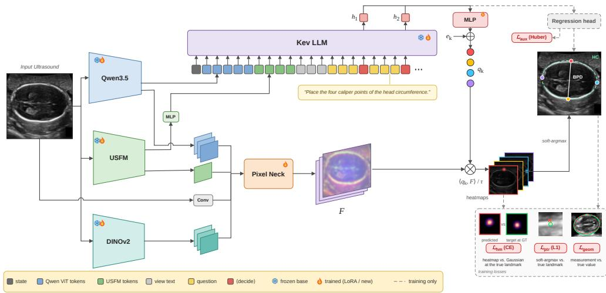
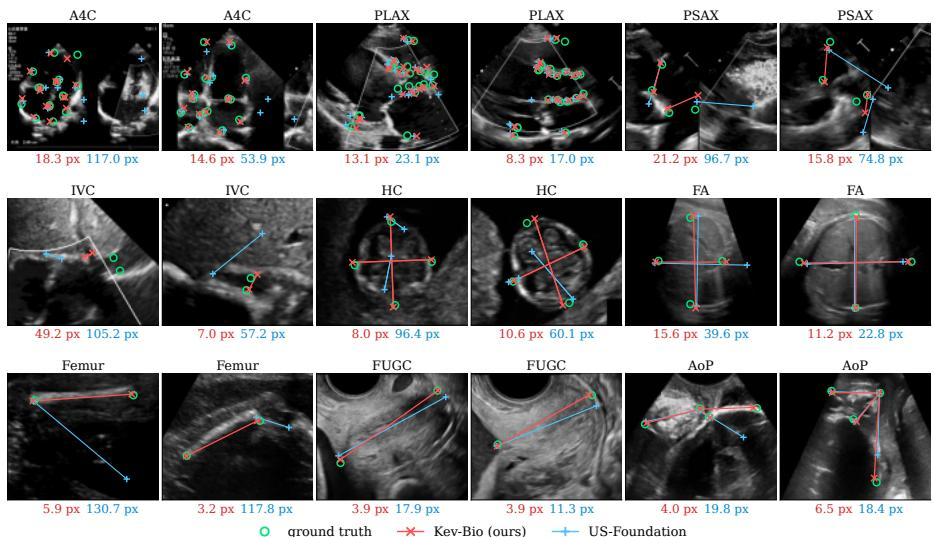
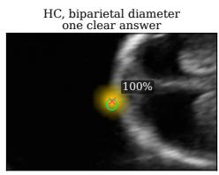
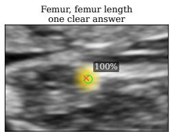
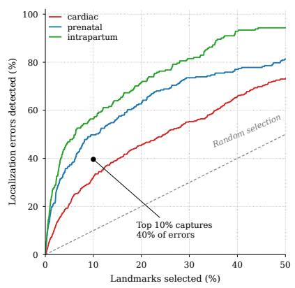
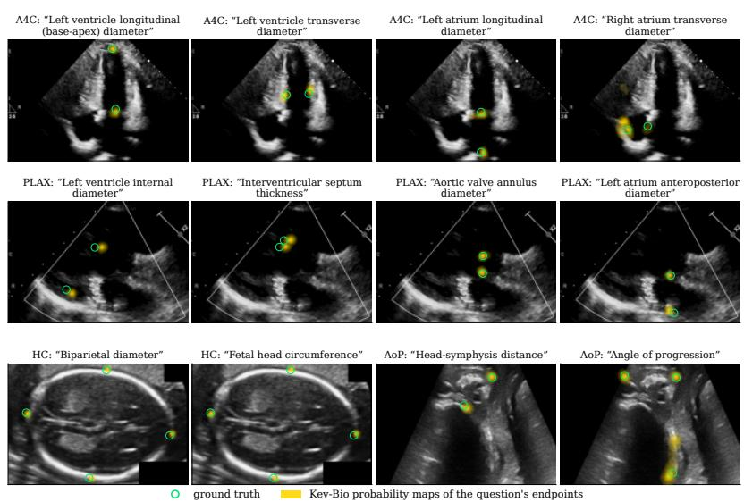

# Every Pixel Is an Option: A System One Model for Medical Ultrasound Biometry

Moein Heidari1\*, Junbo Rao1, Yudan Chen1, Yasamin Medghalchi1, River Jiang1, Wenjin Chen2, David J. Foran2, Jasmine Grewal1, Ilker Hacihaliloglu1

1\* University of British Columbia, Vancouver, Canada . 2 Rutgers Cancer Institute, New Brunswick, USA .

\*Corresponding author(s). E-mail(s): moein.heidari@ubc.ca;

## Abstract

Purpose: Ultrasound biometry is widely used across various clinical applications, including prenatal and cardiac examinations, to obtain quantitative measurements by placing calipers at anatomical landmarks. However, these measurements remain subject to interoperator variability as they rely largely on manual caliper placement. Conventional methods often use specialized prediction heads for diferent ultrasound tasks, whereas vision-language models ofer flexibility through text instructions. However, direct coordinate prediction does not explicitly model spatial likelihood distributions, limiting the representation of localization ambiguity. Methods: We propose Kev-Bio, a vision-language model that uses clinical measurement questions to guide ultrasound landmark detection. Inspired by System One decision models, Kev-Bio uses decision representations of the language model to generate queries for each caliper endpoint. These queries are matched against shared dense ultrasound features to produce spatial probability maps, from which landmark coordinates and clinical measurements are derived. The model is trained end-to-end using both landmark localization and clinical measurement losses. Results: On the nine-view FU/GU Biometry 2026 dataset, Kev-Bio achieves a mean radial error (MRE) of 22.50 pixels and a clinical measurement mean absolute error (MAE) of 15.38, outperforming the compared baselines in overall performance. Conclusion: These results demonstrate the efectiveness of Kev-Bio for ultrasound landmark detection and clinical measurement across diferent anatomical views. Our code and models are available at https://github.com/moeinheidari7829/Kev-Bio.

Keywords: Ultrasound Biometry, Vision-language Models, Landmark Detection, Large Language Models

## 1 Introduction

Ultrasound is widely used to examine anatomy during routine care and to guide clinical procedures. It provides real-time images without exposing patients to ionizing radiation [1]. Beyond visual assessment, many clinical examinations also require quantitative measurements of anatomical structures. These measurements are obtained by placing calipers at predefined landmarks and calculating distances, angles, or circumferences. Choosing the correct points requires knowledge of both anatomy and the measurement protocol. Although standardized training can yield high reproducibility, measurements can still difer between observers [2]. Automatic caliper placement could reduce this manual efort and make quantitative assessment more consistent [3].

Accurate anatomical landmark localization remains challenging in ultrasound imaging. Speckle noise, acoustic shadowing, and indistinct tissue boundaries can obscure anatomical structures, while changes in probe orientation alter their appearance. A single ultrasound image may support multiple clinical measurements, each requiring a distinct set of landmarks. Models developed for these tasks commonly use a shared image encoder with separate decoders or landmark-specific parameters [4]. Although these architectures can localize predefined landmarks, each measurement task remains tied to a fixed output head or task-specific parameter set, making adaptation to new anatomical structures or measurement tasks challenging.

Previous studies have used multimodal language models to predict segmentation masks and point locations from text and image representations [5, 6]. Ultrasound biometry, however, requires precise localization of multiple measurement endpoints, whose anatomical roles vary across tasks. The central challenge is to identify which endpoints a clinical instruction refers to and locate each endpoint accurately in the image within a shared framework.

Recent System One models, such as Jev [7] and its open-weight counterpart Kev [8], formulate prediction as scoring candidate responses rather than generating answers autoregressively. While primarily explored for decision-support tasks, this formulation ofers potential for spatial localization by treating image locations as candidate responses to clinical localization questions.

Building on this insight, we introduce Kev-Bio, a unified framework that translates clinical measurement questions into landmark queries and grounds them in dense ultrasound features to localize anatomical landmarks. Specifically, we initialize Qwen3.5 with Kev [8, 9] to interpret the ultrasound image and measurement instructions, generating queries for the required anatomical landmarks. These queries interact with a shared dense feature map combining representations from Qwen3.5, USFM, and DINOv2 [9–11] to produce landmark probability maps. The maps provide spatial information about localization ambiguity, while joint landmark and measurement supervision guides training. We evaluate this formulation across nine ultrasound views through comparisons with established methods and controlled ablation studies.

## 2 Related Work

## Landmark detection in medical images.

Landmark detectors commonly predict coordinates or heatmaps at predefined anatomical points. nnLandmark provides a self-configuring approach to three-dimensional landmark detection, while MedSapiens adapts pose estimation representations to medical images [12, 13]. For ultrasound biometry, CAMS and IMPACT-L combine shared image encoders with decoders specific to each task [4, 14]. Echo-CoPilot illustrates the use of learned measurement tools in a broader system for echocardiographic interpretation [15]. Our method instead derives endpoint queries from the representation of a clinical measurement question.

## Language models and spatial prediction.

LISA uses a language model state to predict segmentation masks, while recent point grounding work predicts heatmaps from multimodal representations [5, 6]. We build on this connection between language and spatial prediction, but focus on groups of caliper points whose geometry defines a clinical measurement. Kev is an open decision model trained on Qwen3.5 [8]. We initialize the Qwen3.5 language model with the pretrained Kev adapter and train a separate pixel pointer to localize ultrasound landmarks.

## 3 Method

Let I be an ultrasound image of width W and height H, with a known anatomical view v. Each view has a predefined set of clinical measurements $\mathcal { M } ( v )$ , where each measurement $m \in \mathcal { M } ( v )$ is associated with a clinical question $t _ { m }$ and the number of required anatomical landmarks is $K _ { m } \in \{ 2 , 3 , 4 \}$ . Kev-Bio predicts these landmarks and computes the corresponding measurements from their coordinates. As illustrated in Figure 1, the model combines a multimodal language model with a shared dense visual feature map. The language model produces a decision representation for each measurement, which is then transformed into endpoint-specific queries for locating landmarks in the feature map.

## 3.1 Instruction-guided Multimodal Encoding

We use the Qwen3.5 vision encoder [9] and an ultrasound foundation model (USFM) [10] to extract visual features from the input image. Their visual tokens are denoted by $Z ^ { Q } ( I )$ and $Z ^ { U } ( I )$ , respectively. The USFM tokens are projected into the language model’s embedding space using a learned projection network ${ \mathcal { P } } _ { U }$ . The input also includes a view instruction $t _ { v }$ describing the anatomical view and clinical domain, followed by a clinical measurement question $t _ { m }$ for each measurement $m \in \mathcal { M } ( v )$ Each question starts with a ${ \tt C q } >$ token and ends with a ${ \tt < d e c i d e > }$ token. The input sequence is

$$
X = [ \langle \mathrm { s t a t e } \rangle , Z ^ { Q } ( I ) , \mathcal { P } _ { U } ( Z ^ { U } ( I ) ) , t _ { v } , ( \langle \mathbf { q } \rangle , t _ { m } , \langle \mathrm { d e c i d e } \rangle ) _ { m \in \mathcal { M } ( v ) } ] .\tag{1}
$$

  
Fig. 1 Overview of Kev-Bio. Qwen3.5 and USFM provide visual tokens to the language model, while DINOv2 contributes additional localization features. Clinical questions are encoded into decision states at ⟨decide⟩ tokens, which generate queries for each landmark endpoint. A convolutional-based Pixel Neck combines features from the three visual encoders into a shared dense feature map. Endpoint queries are matched against this map to produce spatial probability maps, from which landmark coordinates and clinical measurements are derived.

The measurement questions are concatenated in a predefined order. We initialize the Qwen3.5 language backbone (LM) with the pretrained Kev adapter. The sequence $X$ is processed in a single forward pass, and the hidden state at each ⟨decide⟩ token is extracted as the corresponding measurement representation, $\mathbf { h } _ { m } = \operatorname { L M } ( X ) _ { \langle \mathrm { d e c i d e } \rangle _ { m } } .$

## 3.2 Dense Ultrasound Feature Fusion

We combine visual representations from Qwen3.5 [9], USFM [10], and DINOv2 [11] to construct a shared dense feature map for anatomical landmark localization. These encoders provide complementary language-aligned, ultrasound-specific, and multilevel spatial features, respectively, allowing the fused representation to capture both anatomical context and fine spatial details.

These features are aligned to a common spatial resolution using bilinear interpolation, normalized, and concatenated. A dense fusion module, termed the Pixel Neck, projects and progressively upsamples the combined features while incorporating shallow convolutional features from the input image to preserve fine spatial details:

$$
\mathbf { F } = \mathrm { n o r m } \Big ( \mathcal { N } \big ( \varLambda ( Z _ { \mathrm { d e n s e } } ^ { Q } , Z _ { \mathrm { d e n s e } } ^ { U } , Z _ { \mathrm { d e n s e } } ^ { D } ) , C ( I ) \big ) \Big ) \in \mathbb { R } ^ { d _ { p } \times H _ { p } \times W _ { p } } .\tag{2}
$$

Here, A denotes spatial alignment and concatenation, $\mathcal { N }$ represents the dense fusion module, Pixel Neck, and $C ( I )$ denotes shallow image features. The resulting map, ${ \mathrm { F } } ,$ is L2-normalized along the channel dimension and shared across measurement tasks.

## 3.3 Language Conditioned Pixel Pointer

The pixel pointer localizes anatomical landmarks by matching endpoint queries against a shared dense feature map to produce spatial probability maps. The decision representation $\mathbf { h } _ { m }$ is passed through an MLP to generate endpoint queries, with a learnable endpoint embedding $\mathbf { e } _ { m , k }$ added to distinguish the kth landmark of measurement m. The resulting queries are L2-normalized:

$$
\begin{array} { r } { \mathbf q _ { m , k } = \mathrm { n o r m } \bigl ( \mathrm { r e s h a p e } \bigl ( \mathrm { M L P } (  { \mathbf { h } } _ { m } ) \bigr ) _ { k } + \mathbf e _ { m , k } \bigr ) , \qquad k = 1 , \ldots , K _ { m } . } \end{array}\tag{3}
$$

Then, the similarity between $\mathbf { q } _ { m , k }$ and $\mathbf { F } ( i , j )$ is calculated at each spatial location using a dot product, followed by a spatial softmax to obtain the landmark probability maps:

$$
S _ { m , k } ( i , j ) = \frac { \mathbf { q } _ { m , k } ^ { \top } \mathbf { F } ( i , j ) } { \tau } , \qquad P _ { m , k } ( i , j ) = \mathrm { s o f t m a x } _ { i , j } \big ( S _ { m , k } ( i , j ) \big ) ,\tag{4}
$$

where $\tau \ > \ 0$ is a learnable temperature parameter. The probability map $P _ { m , k }$ represents the spatial distribution of the kth landmark for measurement m.

Landmark coordinates are calculated using diferentiable soft-argmax:

$$
\hat { \mathbf { p } } _ { m , k } = \left( W , H \right) \odot \sum _ { i , j } P _ { m , k } ( i , j ) \mathbf { c } _ { i , j } , \qquad \mathbf { c } _ { i , j } = \left( \frac { j + 1 / 2 } { W _ { p } } , \frac { i + 1 / 2 } { H _ { p } } \right) .\tag{5}
$$

Here, $\mathbf { c } _ { i , j }$ denotes the normalized center of each spatial cell, and $\odot$ represents elementwise multiplication.

## 3.4 Heatmap and Measurement Supervision

The predicted landmarks for measurement m are passed to a measurement-specific geometric function to calculate a biometric value, $\hat { y } _ { m } = g _ { m } \mathopen { } \mathclose \bgroup \left( \hat { \mathbf { p } } _ { m , 1 } , . . . , \hat { \mathbf { p } } _ { m , K _ { m } } \aftergroup \egroup \right)$ . The geometric function computes a distance, an angle, or a circumference approximation from the corresponding calipers depending on the measurement.

Training jointly supervises the predicted landmark coordinates, their spatial probability maps, and the clinical measurement values calculated from these coordinates. The pointer loss ${ \mathcal L } _ { \mathrm { p t r } }$ calculates the L1 error between predicted and ground-truth landmark coordinates and normalizes it by the image diagonal length. The heatmap loss ${ \mathcal { L } } _ { \mathrm { h m } }$ calculates the cross-entropy between the predicted spatial probability map and a normalized Gaussian distribution centered at the ground-truth landmark. This transforms point-based landmark supervision into a continuous probability field, encouraging high confidence near the true location while allowing spatial uncertainty around it. The geometric loss $\mathcal { L } _ { \mathrm { g e o m } }$ calculates the absolute error between the predicted and ground-truth measurement values and normalizes it by the training-set median of the corresponding measurement. An auxiliary regression head predicts endpoint coordinates and a measurement value directly from each decision state and uses Huber loss $\mathcal { L } _ { \mathrm { a u x } }$ to supervise

Table 1 FU/GU Biometry 2026 labelled dataset. Samples: number of labelled images; LM: landmarks per image; Meas.: clinical measurements per image (D: distance, C: ellipse circumference, A: angle).
<table><tr><td>Task</td><td>View</td><td>Samples</td><td>LM</td><td>Meas.</td></tr><tr><td colspan="5">Cardiac</td></tr><tr><td>A4C</td><td>Apical four-chamber</td><td>108</td><td>16</td><td>8 D</td></tr><tr><td>PLAX</td><td>Parasternal long-axis</td><td>87</td><td>22</td><td>11 D</td></tr><tr><td>PSAX</td><td>Parasternal short-axis</td><td>49</td><td>4</td><td>2 D</td></tr><tr><td>IVC</td><td>Subcostal inferior vena cava</td><td>38</td><td>2</td><td>1 D</td></tr><tr><td colspan="5">Prenatal</td></tr><tr><td>HC</td><td>Fetal head (transthalamic)</td><td>999</td><td>4</td><td>1 D + 1 C</td></tr><tr><td>FA</td><td>Fetal abdomen</td><td>500</td><td>4</td><td>1 C</td></tr><tr><td>Femur</td><td>Fetal femur</td><td>702</td><td>2</td><td>1 D</td></tr><tr><td>FUGC</td><td>Transvaginal cervix</td><td>260</td><td>2</td><td>1 D</td></tr><tr><td colspan="5">Intrapartum</td></tr><tr><td>AoP</td><td>Transperineal (angle of progression)</td><td>4,000</td><td>4</td><td> $1 \textrm { D } + 1 \textrm { A }$ </td></tr><tr><td>Total</td><td>9 views</td><td>6,743</td><td>60</td><td>29</td></tr></table>

both outputs. The complete objective is

$$
\mathcal { L } = \mathcal { L } _ { \mathrm { p t r } } + \lambda _ { \mathrm { h m } } \mathcal { L } _ { \mathrm { h m } } + \lambda _ { \mathrm { g e o m } } \mathcal { L } _ { \mathrm { g e o m } } + \lambda _ { \mathrm { a u x } } \mathcal { L } _ { \mathrm { a u x } } .\tag{6}
$$

The auxiliary regression head provides additional supervision during training. During inference, the landmark coordinates and the corresponding measurement values are obtained from the pixel pointer and the geometric functions, respectively.

## 4 Results

## 4.1 Dataset and Implementation Details

We evaluate Kev-Bio on the FU/GU Biometry 2026 benchmark, introduced at the MICCAI 2026 FoundUS challenge [16]. The dataset spans nine ultrasound views across three clinical domains: cardiac, prenatal, and intrapartum imaging (Table 1). The labelled benchmark contains 6,743 images, with 60 view-specific landmark definitions and 29 clinical measurements. These measurements include distances, ellipse circumferences, and angles, with each view requiring between one and eleven measurements. The dataset is highly imbalanced, ranging from 38 labelled images for IVC to 4,000 for AoP. An additional 191,170 unlabelled frames are provided but are not used in our experiments. Since the oficial challenge test annotations are unavailable for ofline evaluation, we perform five-fold cross-validation on the labelled data, with approximately 1,350 images held out per fold. All methods are trained and evaluated using the same partitions.

We initialize the language backbone from Kev [8], based on Qwen3.5-0.8B, and finetune it with LoRA adapters (r=16). The Qwen vision encoder and USFM are adapted with rank-16 LoRA, while DINOv2 ViT-L/14 uses rank-32. We set $\lambda _ { \mathrm { h m } } = 0 . 1 , \lambda _ { \mathrm { g e o m } } =$

0.2, and $\lambda _ { \mathrm { a u x } } = 1$ and train for 24 epochs using AdamW with a weight decay of 0.05 and an efective batch size of 8. Learning rates are $1 0 ^ { - 3 }$ for newly initialized modules, $1 0 ^ { - 4 }$ for the language model and DINOv2 adapters, and $5 \times 1 0 ^ { - 5 }$ for the remaining adapters. For all methods and baselines, we adopt the publicly released codebases and corresponding pretrained model weights. Training samples are drawn uniformly across the nine views, with photometric and afine augmentations following [17]. All experiments were conducted on NVIDIA H100 GPUs (80 GB GPU memory).

## 4.2 Comparison with Prior Methods

We compare Kev-Bio with two general-purpose landmark detectors, nnLandmark [12] and MedSapiens [13], and four methods developed for the FU/GU Biometry challenge: CAMS [14], IMPACT-L [4], FMUB [18], and US-Foundation [17]. We report mean radial error (MRE) for landmark localization and mean absolute error (MAE) for clinical measurements, both in pixels (degrees for AoP) averaged across the nine views. As shown in Table 2, Kev-Bio achieves the lowest average error on both metrics among the reported methods, with 22.50 pixels MRE and 15.38 MAE, compared with 23.88 and 17.47 for the strongest respective baselines. It achieves the best landmark localization on eight of the nine views and the lowest measurement error on six, spanning both cardiac and prenatal imaging, with a comparable parameter count. The improvement is particularly notable in fetal head biometry, where MRE decreases from 17.03 to 13.76 pixels. Notably, these results are obtained without using the additional unlabelled challenge data leveraged by CAMS and FMUB. Although competing methods achieve slightly lower measurement errors on femur length, cervical length, and angle of progression, Kev-Bio maintains the lowest average error across both metrics, demonstrating its efectiveness across diverse anatomical views and measurement tasks.

## 4.3 Qualitative Results

Figure 2 presents qualitative comparisons between Kev-Bio and US-Foundation [17] across all nine ultrasound views. Kev-Bio places most landmarks closer to their annotated anatomical targets, whereas US-Foundation shows larger localization errors, including predictions on neighboring structures. This is particularly evident in the IVC, fetal head, and femur examples, where substantial localization errors are observed for US-Foundation despite accurate predictions from Kev-Bio. In the A4C example containing adjacent cardiac views, Kev-Bio correctly identifies the target anatomy, while US-Foundation places several landmarks on the neighboring view. These examples illustrate the ability of text-conditioned spatial pointing to preserve anatomical correspondence across diverse ultrasound measurements.

Beyond landmark localization, Kev-Bio produces a spatial probability map for each endpoint (Figure 3a), whose entropy serves as an uncertainty score. To assess whether this score identifies localization failures, we consider predictions more than 5% of the image diagonal from ground truth as errors. We then rank predictions by decreasing entropy and measure the fraction of errors captured among the highest-ranked predictions (Figure 3b). Inspecting the 10% most uncertain predictions captures 40% of errors, compared with 10% under random selection. Error detection AUROCs reach 0.70, 0.76, and 0.86 for cardiac, prenatal, and intrapartum imaging, respectively. These results suggest that Kev-Bio’s probability maps can help clinicians identify caliper placements that warrant closer inspection, enabling more targeted verification of automated measurements.

Table 2 Comparison on 5-fold cross-validation of the FU/GU Biometry 2026 training set (lower is better). Top: mean radial error of landmarks (MRE, px). Bottom: mean absolute error of clinica measurements (MAE; px, degrees for AoP). Per-task values are averaged over five folds; Avg. is the macro mean over nine tasks ± s.d. over folds. Params: total trainable parameters in millions. Best and second best per column among reported values.
<table><tr><td rowspan="2">Method</td><td rowspan="2">Params (M)</td><td colspan="4">Cardiac</td><td colspan="4">Prenatal</td><td>Intrapartum</td><td rowspan="2">Avg.</td></tr><tr><td>A4C</td><td></td><td>PLAX PSAX</td><td>IVC</td><td>HC</td><td>FA</td><td>Femur FUGC</td><td></td><td>AoP</td></tr><tr><td>MRE (px) ↓</td><td></td><td></td><td></td><td></td><td></td><td></td><td></td><td></td><td></td><td></td><td></td></tr><tr><td>General Baselines</td><td></td><td></td><td></td><td></td><td></td><td></td><td></td><td></td><td></td><td></td><td></td></tr><tr><td>nnLandmark [12]</td><td>140.1</td><td>44.23</td><td>26.71</td><td>58.87</td><td>45.92</td><td>25.45</td><td>19.36</td><td>22.28</td><td>6.99</td><td>8.79</td><td>28.73 ± 4.12</td></tr><tr><td>MedSapiens [13]</td><td>24.0</td><td>118.85</td><td>76.49</td><td>108.41</td><td>130.09</td><td>35.32</td><td>24.34</td><td>24.75</td><td>11.56</td><td>9.61</td><td> $5 9 . 9 4 \pm 4 . 1 5$ </td></tr><tr><td>Challenge Baselines</td><td></td><td></td><td></td><td></td><td></td><td></td><td></td><td></td><td></td><td></td><td></td></tr><tr><td>CAMS [14]</td><td>35.5</td><td>44.92</td><td>20.99</td><td>42.76</td><td>36.31</td><td>18.07</td><td>17.04</td><td>19.29</td><td>6.86</td><td>8.71</td><td>23.88 ± 2.10</td></tr><tr><td>IMPACT-L [4]</td><td>144.4</td><td>44.40</td><td>23.32</td><td>60.22</td><td>51.72</td><td>17.03</td><td>15.95</td><td>19.66</td><td>7.54</td><td>9.41</td><td>27.70 ± 3.18</td></tr><tr><td>FMUB [18]</td><td>29.5</td><td>41.73</td><td>21.45</td><td>48.80</td><td>41.17</td><td>18.58</td><td>16.58</td><td>20.39</td><td>6.90</td><td>9.22</td><td>24.98 ± 3.41</td></tr><tr><td>US-Foundation [17]</td><td>56.1</td><td>44.69</td><td>22.15</td><td>51.33</td><td>45.10</td><td>17.70</td><td>16.48</td><td>20.16</td><td>6.61</td><td>8.44</td><td>25.85 ± 2.87</td></tr><tr><td>Kev-Bio (ours)</td><td>35.0</td><td>40.88</td><td>20.95</td><td>42.24</td><td></td><td>35.08 13.76 15.86 18.77</td><td></td><td></td><td>6.47</td><td>8.48</td><td>22.50 ± 2.10</td></tr><tr><td>MAE↓</td><td></td><td></td><td></td><td></td><td></td><td></td><td></td><td></td><td></td><td></td><td></td></tr><tr><td>General Baselines</td><td></td><td></td><td></td><td></td><td></td><td></td><td></td><td></td><td></td><td></td><td></td></tr><tr><td>nnLandmark [12]</td><td></td><td>25.65</td><td>12.31</td><td>35.31</td><td>22.43</td><td>23.47</td><td>53.96</td><td>18.85</td><td>4.46</td><td>4.85</td><td>22.37 ± 1.47</td></tr><tr><td>MedSapiens [13]</td><td></td><td>59.77</td><td>40.27</td><td>75.64</td><td>105.43</td><td>27.16</td><td>71.68</td><td>19.87</td><td>7.50</td><td>5.34</td><td>45.85 ± 4.15</td></tr><tr><td>Challenge Baselines</td><td></td><td></td><td></td><td></td><td></td><td></td><td></td><td></td><td></td><td></td><td></td></tr><tr><td>CAMS [14]</td><td></td><td>24.95</td><td>8.52</td><td>22.45</td><td>9.90</td><td>24.09</td><td>52.05</td><td>15.63</td><td>4.32</td><td>5.33</td><td>18.58 ± 1.28</td></tr><tr><td>IMPACT-L [4]</td><td></td><td>18.82</td><td>9.37</td><td>36.08</td><td>11.18</td><td>15.80</td><td>50.94</td><td>16.49</td><td>5.38</td><td>5.70</td><td> $1 8 . 8 6 \pm 1 . 2 0$ </td></tr><tr><td>FMUB [18]</td><td></td><td>18.00</td><td>8.74</td><td>25.10</td><td>11.12</td><td>15.00</td><td>52.23</td><td>17.45</td><td>4.22</td><td>5.34</td><td> $1 7 . 4 7 \pm 0 . 9 0$ </td></tr><tr><td>US-Foundation [17]</td><td></td><td>22.42</td><td>10.54</td><td>28.77</td><td>15.87</td><td>14.93</td><td>51.72</td><td>17.94</td><td>3.92</td><td>4.63</td><td> $1 8 . 9 7 \pm 1 . 4 1$ </td></tr><tr><td>Kev-Bio (ours)</td><td></td><td>16.12</td><td>8.42</td><td>19.23</td><td>9.48</td><td>10.59 49.22</td><td></td><td>16.53</td><td>4.00</td><td>4.84</td><td>15.38 ± 1.24</td></tr></table>

Finally, Figure 4 visualizes how clinical questions guide spatial localization. Given the same ultrasound image, diferent measurement questions produce distinct probability maps that concentrate on the corresponding anatomical landmarks. In A4C, for example, queries for ventricular length and atrial width highlight diferent anatom ical endpoints, while related fetal head measurements yield consistent responses at shared landmarks. These observations illustrate how Kev-Bio adapts its spatial predictions to diferent measurement definitions through a shared, question-conditioned pixel pointer.

## 4.4 Ablation Study

We assess the contribution of each component by retraining model variants under identical settings, as reported in Table 3. Removing the pixel pointer (replacing spatial localization with direct coordinate regression from the decision states) leads to the largest performance degradation, increasing MRE from 22.50 to 35.50 pixels and MAE from 15.38 to 23.64. This highlights the importance of matching measurementspecific queries to dense spatial features rather than directly regressing coordinates from the decision states. Removing DINOv2 also reduces performance, yielding 24.85 MRE and 16.94 MAE, indicating the benefit of complementary visual representations for precise landmark localization. Excluding the language model (LLM) and replacing its decision states with learned, image-conditioned measurement queries results in a smaller but consistent increase in error (23.66 MRE and 16.77 MAE), suggesting that language-conditioned queries contribute to localization accuracy even when measurement definitions are fixed.

  
Fig. 2 Qualitative comparison across nine ultrasound views. Landmark predictions from Kev-Bio (red) and US-Foundation (blue), with ground truth shown in green. Values indicate mean landmark error in pixels.

Table 3 Component ablation of Kev-Bio. We assess the impact of DINOv2, LLM-guided queries, and pointer-based localization. Results are the mean ± s.d. over five folds. Lower is better.
<table><tr><td>Variant</td><td>DINOv2</td><td>LLM</td><td>Pointer</td><td>MRE (px) ↓</td><td>MAE↓</td></tr><tr><td>w/o DINOv2</td><td>x</td><td>√</td><td>√</td><td> $2 4 . 8 5 \pm 2 . 6 6$ </td><td> $1 6 . 9 4 \pm 0 . 9 4$ </td></tr><tr><td>w/o LLM</td><td>√</td><td>x</td><td>√</td><td> $2 3 . 6 6 \pm 2 . 6 3$ </td><td> $1 6 . 7 7 \pm 1 . 2 3$ </td></tr><tr><td>w/o pixel pointer</td><td>√</td><td>√</td><td>x</td><td> $3 5 . 5 0 \pm 3 . 1 2$ </td><td> $2 3 . 6 4 \pm 1 . 6 0$ </td></tr><tr><td>Kev-Bio (full)</td><td>√</td><td>√</td><td>√</td><td> $\mathbf { 2 2 . 5 0 \ : \pm : 2 . 1 0 }$ </td><td> ${ \bf 1 5 . 3 8 \pm 1 . 2 4 }$ </td></tr></table>

## 5 Discussion and Limitations

Kev-Bio ofers a unified approach to ultrasound biometry by handling diferent clinical measurements through a shared localization framework, as opposed to task-specific prediction heads. Beyond predicting landmark coordinates, its spatial probability maps provide information about ambiguous predictions, potentially helping clinicians identify caliper placements that require verification. Nevertheless, our evaluation is limited to predefined measurements on a single benchmark, despite spanning multiple anatomical regions. Generalization to unseen measurement instructions, anatomical structures, and diferent imaging conditions remains to be explored. Future work will investigate these directions, alongside uncertainty calibration and computational eficiency.

(a) Each caliper endpoint is a probability map  
(b) Can map entropy identify localization errors?  
  
Fig. 3 Spatial probability maps and error detection. (a) Landmark probability maps showing confident and ambiguous predictions. (b) Landmarks are ranked by decreasing map entropy, and curves show the fraction of localization errors captured in each clinical domain. Errors are defined using ground truth as deviations exceeding 5% of the image diagonal. The black marker indicates the overall result, and the dashed line represents random selection.

  
Fig. 4 Question-conditioned landmark localization. Diferent clinical measurement questions produce distinct landmark probability maps on the same ultrasound image. Green circles denote ground truth, and yellow regions indicate predicted spatial distributions.

## 6 Conclusion

We introduced Kev-Bio, a System One framework that formulates medical ultrasound biometry as spatial decision-making. By grounding clinical measurement questions in dense visual features, the model localizes anatomical landmarks and derives clinical measurements within a unified framework. Experiments across nine ultrasound views demonstrate improvements over existing methods, while the predicted probability maps provide additional information about localization ambiguity.

## Acknowledgments.

This work was supported by the Canadian Foundation for Innovation-John R. Evans Leaders Fund (CFI-JELF) program grant number 42816. Mitacs Accelerate program grant number AWD024298-IT33280. We also acknowledge the support of the Natural Sciences and Engineering Research Council of Canada (NSERC), [RGPIN-2023-03575]. Cette recherche a ´et´e financ´ee par le Conseil de recherches en sciences naturelles et en g´enie du Canada (CRSNG), [RGPIN-2023-03575].

## Disclosure of Interests.

The authors have no competing interests in the paper.

## References

[1] Ceriani, E., Schiavon, R., La Cava, L., Ruscitti, C., Cogliati, C.: Point of care ultrasound: focus on evidence for a critical appraisal. European Journal of Internal Medicine (2025)

[2] Donadono, V., Ambroise Grandjean, G., Stegen, M.-L., Collin, A., Bertholdt, C., Casagrandi, D., Morel, O., Napolitano, R.: Training in obstetric ultrasound biometry: results from a multicenter reproducibility study. Journal of Ultrasound in Medicine 41(11), 2819–2825 (2022)

[3] Mor-Avi, V., Blitz, A., Schreckenberg, M., Addetia, K., Kebed, K., Scalia, G., Badano, L.P., Kirkpatrick, J.N., Gutierrez-Fajardo, P., Tude Rodrigues, A.C., et al.: Deep learning assisted measurement of echocardiographic left heart parameters: improvement in interobserver variability and workflow eficiency. The International Journal of Cardiovascular Imaging 39(12), 2507–2516 (2023)

[4] Rasaee, H., Rivaz, H.: Unified coarse-to-fine landmark localization for multidomain ultrasound biometry. In: Medical Image Computing and Computer Assisted Intervention – MICCAI 2026 Workshops and Challenges. Springer, ??? (2026)

[5] Lai, X., Tian, Z., Chen, Y., Li, Y., Yuan, Y., Liu, S., Jia, J.: Lisa: Reasoning segmentation via large language model. In: 2024 IEEE/CVF Conference on Computer Vision and Pattern Recognition (CVPR), pp. 9579–9589 (2024). IEEE

[6] Jhang, J.-C., Wang, F.-E., Yang, X., Qiao, N., Xia, L., Sun, M., Kuo, C.-H.: Enhancing part-level point grounding for any open-source mllms. arXiv preprint arXiv:2606.29267 (2026)

[7] Deußer, T., Sparrenberg, L., Sifa, R.: Evaluating and benchmarking the system one model jev. arXiv preprint arXiv:2609.37647 (2026)

[8] Palmer, J.: Kev-0.8B: a calibrated decision model on Qwen3.5-0.8B. https:// huggingface.co/jaredpalmer/kev-0.8b. Kev 1.0 (2026)

[9] Qwen Team: Qwen3.5: Towards Native Multimodal Agents. Oficial Qwen3.5 release (2026). https://qwen.ai/blog?id=qwen3.5

[10] Jiao, J., Zhou, J., Li, X., Xia, M., Huang, Y., Huang, L., Wang, N., Zhang, X., Zhou, S., Wang, Y., et al.: Usfm: A universal ultrasound foundation model generalized to tasks and organs towards label eficient image analysis. Medical image analysis 96, 103202 (2024)

[11] Oquab, M., Darcet, T., Moutakanni, T., Vo, H., Szafraniec, M., Khalidov, V., Fernandez, P., Haziza, D., Massa, F., El-Nouby, A., et al.: Dinov2: Learning robust visual features without supervision. arXiv preprint arXiv:2304.07193 (2023)

[12] Ertl, A., Denner, S., Peretzke, R., Xiao, S., Zimmerer, D., Fischer, M., Bujotzek, M., Yang, X., Neher, P., Isensee, F., et al.: nnlandmark: A self-configuring method for 3d medical landmark detection. Proceedings of Machine Learning Research 315, 894–927 (2026)

[13] Elbatel, M., Wang, A., Liu, K., Mouheb, K., Almar-Munoz, E., Lin, L., Yang, Y., Lekadir, K., Li, X.: Medsapiens: Taking a pose to rethink medical imaging landmark detection. Medical Image Analysis, 104015 (2026)

[14] Li, C., Li, X., Wang, Y., Wu, B., Qin, F., Chen, Y.: Cams: Coordinate-aware multi-task semi-supervised learning for ultrasound landmark localization. In: Medical Image Computing and Computer Assisted Intervention – MICCAI 2026 Workshops and Challenges. Springer, ??? (2026)

[15] Heidari, M., Mehrabian, A., Roohi, M.A., Jiang, R., Chen, W., Foran, D.J., Grewal, J., Hacihaliloglu, I.: Echo-copilot: A multiple-perspective agentic framework for reliable echocardiography interpretation. arXiv preprint arXiv:2512.09944 (2025)

[16] Bai, J., Yaqub, M., Ma, J., Lekadir, K., Gan, J., Cai, W., Ni, D., Li, S.: Foundation Model Challenge for Ultrasound Biometry. Zenodo (2026). https://doi.org/10. 5281/zenodo.19736827 . https://doi.org/10.5281/zenodo.19736827

[17] Panagiotakopoulou, A., Barmperis, A., Katsigiannis, V.E., Matsopoulos, G.K.: Self-supervised domain adaptation with dinov2-hrnet for multi-task ultrasound landmark detection. In: Medical Image Computing and Computer Assisted Intervention – MICCAI 2026 Workshops and Challenges. Springer, ??? (2026)

[18] Wu, Y., Zhang, J., Yang, Y., Yang, S., Shen, L.: A unified foundation-model framework with semi-supervised consistency and heatmap ensembling for ninetask ultrasound biometry regression. In: Medical Image Computing and Computer Assisted Intervention – MICCAI 2026 Workshops and Challenges. Springer, ??? (2026)