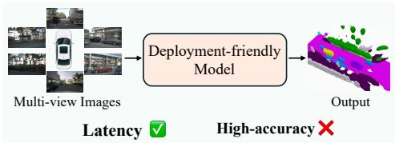
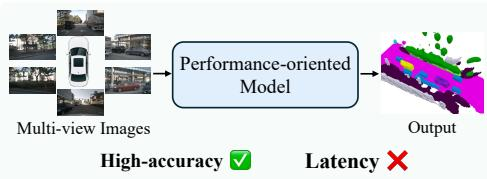
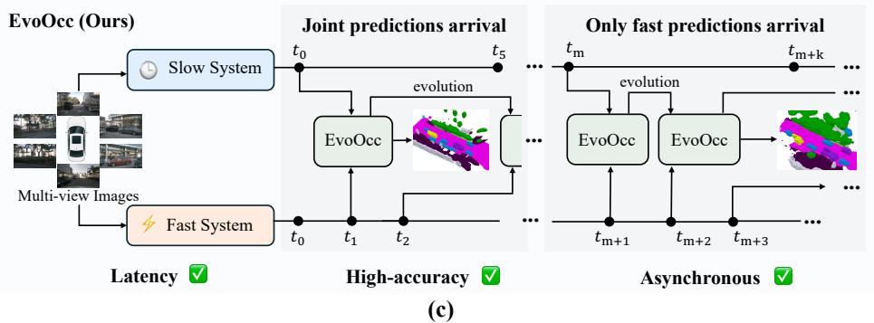
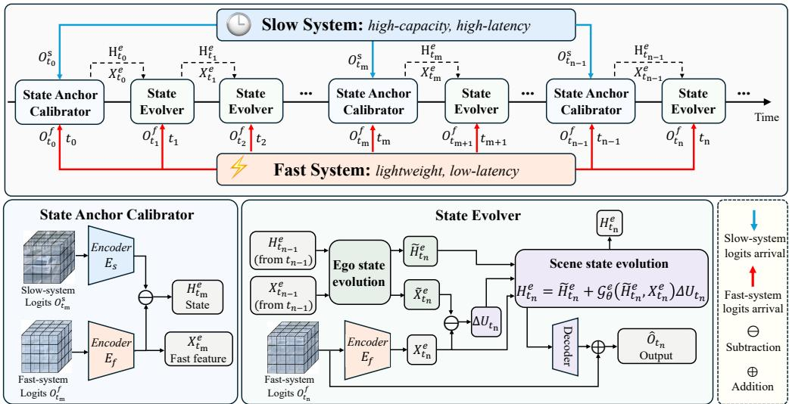
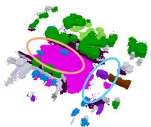
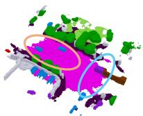
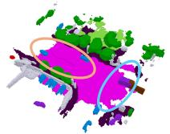
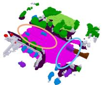
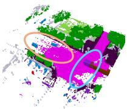

# Fast-Slow Evolutionary Occupancy Prediction via Controlled Dynamics

Runhe Yang1,∗ Zhiyuan Zhou1,∗ Yuxiang Yan1 Xuetong Yang1 Yikai Pan1 Jiacheng Tang1 Zhuolin He1,2 Jianhua Han2 Hang Xu2 Jian Pu1,†

1Fudan University 2Yinwang Intelligent Technology {rhyang26,zhouzy25}@m.fudan.edu.cn jianpu@fudan.edu.cn

## Abstract

3D semantic occupancy prediction provides dense geometric and semantic scene representations for autonomous driving, where both high accuracy and low response latency are crucial for safe downstream forecasting and planning. Existing methods usually exhibit different accuracy-latency characteristics. Performance-oriented models provide stronger geometric and semantic predictions, while deploymentfriendly models provide faster responses. This motivates EvoOcc, a fast-slow evolutionary occupancy prediction framework that jointly exploits their complementary strengths to improve the accuracy-latency balance without changing the upstream architectures. EvoOcc models evolutionary occupancy prediction as a continuous time controlled dynamical system, enabling flexible adaptation to variable slow system delays and irregular fast system arrivals. The framework further decomposes the evolution process into dual state evolution where ego state evolution compensates for the deterministic coordinate shifts and scene state evolution models the genuine geometric and semantic scene changes. Extensive experiments on three different fast-slow system pairs and irregular prediction arrivals show that EvoOcc consistently improves over fast system baselines while maintaining much lower latency than the slow system, indicating a favorable accuracy-latency balance and stable behavior under practical inference situations.

## 1 Introduction

3D semantic occupancy prediction [1, 2] has emerged as an important scene representation for autonomous driving [3]. It encodes the surrounding environment as a dense 3D volume with both geometric occupancy and semantic labels, providing cues for downstream motion forecasting [4, 5] and planning [6, 7]. However, practical deployment requires not only high prediction accuracy but also low response latency. An occupancy prediction can quickly become outdated as the ego vehicle and surrounding agents move, potentially leading to unsafe or overly conservative planning decisions [8–10]. These considerations make it essential to achieve a favorable balance between accuracy and latency for practical 3D semantic occupancy prediction.

Existing occupancy prediction systems have made various attempts to balance prediction accuracy and response latency. As illustrated in Fig. 1, we categorize them into two types: deploymentfriendly models and performance-oriented models [11]. Deployment-friendly models [12, 13] adopt lightweight designs and produce low-latency predictions for the current scene, but their limited model capacity often leads to inferior geometric and semantic accuracy. In contrast, performanceoriented models [1, 14] use stronger architectures to obtain higher accuracy, yet their larger inference cost delays the output and makes it stale when the scene has already evolved. These properties make deployment-friendly models and performance-oriented models naturally complementary. Such complementarity suggests the potential to exploit high-quality information from performance-oriented models while preserving deployment-friendly responsiveness under asynchronous prediction arrival.

  
(a)

  
(b)

  
Figure 1: Overview of fast-slow evolutionary occupancy prediction. (a) Deployment-friendly models provide timely occupancy predictions but sacrifice geometric and semantic accuracy. (b) Performance-oriented models are more accurate, yet their delayed outputs may become stale for real-time perception. (c) EvoOcc exploits high-quality information from the slow system without sacrificing the responsiveness of the fast system by switching between two operational modes.

Motivated by the complementarity, we propose EvoOcc, a fast-slow evolutionary occupancy prediction framework to improve both prediction accuracy and response latency. EvoOcc considers a realistic deployment scenario in which predictions of the fast and slow systems arrive asynchronously due to their different inference costs. To handle variable slow system delays and irregular fast system frame intervals, we formulate state evolution as a continuous time controlled dynamical system. This formulation allows EvoOcc to seamlessly adapt to asynchronous inputs by switching between two operational modes, as shown in Fig. 1(c). Recognizing that variations in occupancy prediction arise from both ego vehicle motion and genuine scene changes [15], we decouple the evolution process into dual state evolution: ego state evolution and scene state evolution. Under joint predictions arrival, EvoOcc utilizes the high-quality slow system predictions to calibrate a robust historical anchor. When only fast predictions arrive, we design a dual state evolution to evolve the state carrying historical slow system information. Deterministic coordinate shifts induced by ego movement are compensated through ego state evolution, while genuine geometric and semantic scene changes are captured through scene state evolution. By continuously evolving historical anchors to the present, EvoOcc achieves a favorable accuracy-latency trade-off.

We conduct extensive experiments in both offline and realistic streaming scenarios across three fast-slow system pairs, including two homogeneous pairs and one heterogeneous pair. The results show that EvoOcc consistently outperforms the fast system while maintaining much lower latency than the slow system, demonstrating that delayed high-quality predictions can effectively benefit real-time occupancy prediction when properly evolved. We further evaluate EvoOcc under sparse slow system invocations and irregular fast system arrivals. Our findings confirm the stability of the proposed framework and validate its favorable balance between accuracy and latency.

Our contributions are summarized as follows: (i) We introduce EvoOcc, a fast-slow evolutionary framework for occupancy prediction, which jointly exploits the complementary strengths of deployment-friendly and performance-oriented occupancy predictors to achieve a more favorable accuracy-latency balance. (ii) We formulate the framework as a continuous time controlled dynamical system and design a dual state evolution to model ego vehicle motion and genuine geometric and semantic scene changes. (iii) Extensive experiments on the Occ3D-nuScenes benchmark under three different fast-slow system pairs show that EvoOcc improves fast system predictions while maintaining much lower latency than slow system baselines and remains stable under irregular arrival conditions.

## 2 Related Work

## 2.1 3D Semantic Occupancy Prediction

3D semantic occupancy prediction represents the driving scene as a voxelized semantic volume with occupancy and semantic labels [16–18]. MonoScene [19] lifts monocular features into 3D for semantic scene completion, while recent surround-view methods [20, 21] improve dense occupancy modeling through multi-camera volumetric features in SurroundOcc [22], forward-backward view transformation in FB-Occ [1], and adaptive lifting in ALOcc [23]. However, dense voxel modeling is computationally expensive. Efficient alternatives [24, 25] thus explore compact or sparse representations [26]: FastOcc [13] uses a lightweight BEV design, SparseOcc [27] adopts sparse 3D computation, and OPUS [12] predicts occupancy via sparse set queries. Different from prior work that improves a single prediction framework, we view these methods as complementary fast and slow systems and propose fast-slow evolutionary occupancy prediction, which evolves residual information between slow and fast logits so that high-quality slow predictions can complement timely fast predictions, leading to a more favorable accuracy-latency balance.

## 2.2 Fast-Slow Architectures

Fast-slow architectures are motivated by Kahneman’s view [28], where fast processing is immediate and lightweight while slow processing is more deliberate and capable. In multimodal agents, fast pathways are commonly used for direct visual perception, while slow pathways are invoked for more complex reasoning or decision making [29]. Recent vision-language-action and robotic systems further combine high-frequency action generation with low-frequency reasoning or hierarchical planning, where the slow system provides cognitive guidance and the fast system enables responsive control [30, 31]. These works mainly study fast-slow coordination for reasoning, planning, or control [32, 33]. In contrast, EvoOcc focuses on 3D occupancy prediction in autonomous driving. EvoOcc treats existing fast and slow occupancy predictors as frozen asynchronous logit sources and evolves their complementary information without modifying the upstream architectures.

## 2.3 Neural Differential Equations

Neural differential equations model hidden representations through continuous time dynamics. Neural ODEs [34] parameterize state derivatives with neural networks and have been extended to irregularly sampled sequences by latent ODE [35] and GRU-ODE-Bayes models [36]. StreamingFlow [37] applies neural ODEs to asynchronous multi-modal streams for BEV occupancy forecasting at arbitrary timestamps. In standard Neural ODE formulations, once the initial state is given, the continuous trajectory is governed by the learned dynamics rather than continuously driven by incoming observations [38]. Neural controlled differential equations [39] instead treat observations as continuous control paths, enabling states to evolve under irregular external inputs. GraphNCDE [40] further combines NCDEs with graph neural networks for spatio-temporal traffic forecasting. EvoOcc follows this controlled-dynamics perspective for fast-slow evolutionary occupancy prediction, using the fast system prediction stream as a control signal to evolve delayed residual information.

## 3 Method

To jointly exploit the strength of fast and slow systems without changing their architectures, we propose EvoOcc, a fast-slow evolutionary occupancy prediction framework that balances accuracy and latency for real-time perception. As illustrated in Fig. 2, we model the dynamic process of evolutionary occupancy prediction as a continuous time controlled dynamical system to handle irregular fast system intervals and variable slow system delays. This formulation motivates a dual state evolution design to model the occupancy semantic changes caused by ego movement and scene changes. Finally, we train EvoOcc with a multi-task objective that combines voxel-wise semantic supervision with ray-guided geometric consistency to improve surface localization.

## 3.1 Problem Formulation

We study fast-slow evolutionary occupancy prediction under asynchronous logits arrival, where a high-capacity slow system and a lightweight fast system produce their occupancy logits, denoted by $O ^ { s }$ and $O ^ { f }$ , with different latencies and update frequencies. At the current timestamp $t _ { n }$ , the fast system provides timely occupancy logits $O _ { t _ { n } } ^ { f }$ , while the latest available slow system output $O _ { t _ { m } } ^ { s }$ may correspond to an earlier timestamp $t _ { m } \leq t _ { n }$ due to its larger inference latency.

Our task is to learn an evolutionary mapping $\mathcal { F } _ { \theta } : \{ O _ { t _ { m } } ^ { s } , { O } _ { t _ { m } : t _ { n } } ^ { f } \} \to \hat { O } _ { t _ { n } }$ , where $\mathcal { O } _ { t _ { m } : t _ { n } } ^ { f }$ denotes the fast logits observed between $t _ { m }$ and $t _ { n }$ and $\hat { O } _ { t _ { n } }$ denotes the refined occupancy prediction. Specifically, evolutionary mapping uses the delayed slow logits and the intervening fast logits stream to compensate the gap between $O _ { t _ { m } } ^ { s }$ and $O _ { t _ { n } } ^ { f }$ . By operating directly on logits, $\mathcal { F } _ { \theta }$ remains agnostic to specific upstream architectures while ensuring real-time response with higher accuracy.

## 3.2 Continuous Time State Dynamics

In practical deployments, slow logits may arrive with variable delays, and fast observations may have irregular temporal intervals. This asynchrony makes fixed step discrete updates less suitable, since the elapsed time between observations is not constant. We therefore formulate state evolution as a continuous time controlled dynamical system, which allows the state to evolve over arbitrary temporal intervals driven by the fast logits stream. Specifically, the state to be evolved is a residual between the slow and fast system logits, encoding the complementary information including high-quality geometric and semantic details.

Dynamics at Fixed Physical Locations. A direct temporal update in the ego frame entangles apparent coordinate shifts caused by ego motion with genuine scene changes. To define state evolution at fixed physical locations, we first use the world coordinate system as a reference for the dynamics. The state field $H _ { t } ^ { w }$ evolves under the control of the encoded fast feature field $X _ { t } ^ { w }$

$$
d H _ { t } ^ { w } = \mathcal G _ { \theta } ^ { w } ( H _ { t } ^ { w } , X _ { t } ^ { w } ) d X _ { t } ^ { w } ,\tag{1}
$$

where $\mathcal { G } _ { \theta } ^ { w }$ is a convolutional local spatial operator, and the differential d is taken with respect to time t. Eq. (1) defines how the state changes at fixed physical locations according to temporal changes in the fast feature field. The convolutional operator further allows each local update to use neighboring voxel context, so the evolution is not restricted to isolated voxel wise changes.

Dynamics in Moving Ego Coordinates. Fast and slow logits are predicted in ego coordinates. To use these inputs without modifying their original predictors, we express the same dynamics in the ego coordinate system. The corresponding ego coordinate fields are written as $H _ { t } ^ { e }$ and $X _ { t } ^ { e }$ , and ego motion induces an apparent velocity field $u _ { t }$ over the grid. The coordinate transformation gives

$$
d H _ { t } ^ { w } = d H _ { t } ^ { e } + ( u _ { t } \cdot \nabla H _ { t } ^ { e } ) d t , \quad d X _ { t } ^ { w } = d X _ { t } ^ { e } + ( u _ { t } \cdot \nabla X _ { t } ^ { e } ) d t ,\tag{2}
$$

where the derivation is provided in Appendix A. Eq. (2) makes the mixed nature of ego frame updates explicit and shows that the variation measured at a fixed physical location can be expressed as the sum of two ego frame components: the temporal variation observed on the ego grid and the apparent transport caused by ego motion. Substituting Eq. (2) into Eq. (1) rewrites the world reference dynamics using ego coordinate quantities:

$$
d H _ { t } ^ { e } + \big ( u _ { t } \cdot \nabla H _ { t } ^ { e } \big ) d t = \mathcal G _ { \theta } ^ { e } \big ( H _ { t } ^ { e } , X _ { t } ^ { e } \big ) \Big ( d X _ { t } ^ { e } + \big ( u _ { t } \cdot \nabla X _ { t } ^ { e } \big ) d t \Big ) ,\tag{3}
$$

where $\mathcal { G } _ { \theta } ^ { e }$ denotes the local spatial operator used in ego coordinates. Eq. (3) shows that the ego coordinate dynamics contain two coupled components: the left-hand side accounts for ego motion induced state transport, while the right-hand side interprets the driving fast feature change under the same coordinate transformation. For compact notation, we collect the motion compensated fast feature change into a control increment: $d U _ { t } : = d X _ { t } ^ { e } + \left( u _ { t } \cdot \nabla X _ { t } ^ { e } \right) d t$ . This definition turns the fast feature variation into a control signal measured consistently with the moving ego frame. With this control increment, the ego coordinate dynamics become

$$
\underbrace { d H _ { t } ^ { e } } _ { \mathrm { e g o ~ v a r i a t i o n } } + \underbrace { \left( u _ { t } \cdot \nabla H _ { t } ^ { e } \right) d t } _ { \mathrm { t r a n s p o r t ~ t e r m } } = \underbrace { \mathcal { G } _ { \theta } ^ { e } ( H _ { t } ^ { e } , X _ { t } ^ { e } ) d U _ { t } } _ { \mathrm { c o n t r o l l e d ~ t e r m } } .\tag{4}
$$

  
Figure 2: Main framework of EvoOcc. Along the timeline, EvoOcc switches between two operational modes depending on which logits arrive at the current timestamp. When slow system logits arrive, EvoOcc uses them to calibrate the state anchor. When only the fast system logits arrive, EvoOcc evolves the previous state by ego state evolution and scene state evolution, then decodes it as a residual correction to the current fast logits.

The transport term accounts for deterministic coordinate shifts induced by ego motion, while the controlled term models the remaining scene evolution driven by the fast logit stream. This structured design avoids treating ego motion and scene changes as a single entangled update. Ego state evolution first handles the deterministic coordinate shift using ego motion, and scene state evolution then evolves the state using the control signal from the fast logit stream.

## 3.3 Dual State Evolution

To implement the continuous time state dynamics, EvoOcc contains a dual state evolution process. Inspired by operator-splitting [41, 42], EvoOcc addresses these dynamics sequentially. EvoOcc first performs ego state evolution to compensate for coordinate shifts, followed by scene state evolution to capture environmental changes. When fresh slow system logits arrive, EvoOcc calibrates the state anchor to refresh the state with high-quality residual information.

State anchor calibrator. When fresh slow system logits $O _ { t _ { m } } ^ { s }$ become available, EvoOcc calibrates a new state anchor for future state evolution. Specifically, we encode the current slow and fast system logits and calibrate the state anchor as follows:

$$
H _ { t _ { m } } ^ { e } = E _ { s } ( O _ { t _ { m } } ^ { s } ) - E _ { f } ( O _ { t _ { m } } ^ { f } ) ,\tag{5}
$$

where $E _ { s }$ denotes the slow-branch encoder and $E _ { f }$ denotes the fast-branch encoder. This calibrated anchor explicitly captures the geometric and semantic details provided by the slow system but absent from the fast system, thereby establishing a high-quality state anchor for subsequent state evolution.

Ego state evolution. When only fast system logits arrive at timestamp $t _ { n }$ , no fresh slow system logits are available to recalibrate the state anchor. We therefore evolve the historical anchor from the previous timestamp $t _ { n - 1 }$ . We first consider the deterministic coordinate shifts caused by ego movement. The ego motion from $t _ { n - 1 }$ to $t _ { n }$ induces a spatial warping over the feature grid. We apply the operator $W _ { \mathrm { e g o } }$ to evolve both previous state anchor and fast features into the current ego grid,

$$
\tilde { H } _ { t _ { n } } ^ { e } = W _ { \mathrm { e g o } } ( H _ { t _ { n - 1 } } ^ { e } ) , \qquad \tilde { X } _ { t _ { n } } ^ { e } = W _ { \mathrm { e g o } } ( X _ { t _ { n - 1 } } ^ { e } ) ,\tag{6}
$$

where $\tilde { H } _ { t _ { n } } ^ { e }$ denotes the evolved state anchor and $\tilde { X } _ { t _ { n } } ^ { e }$ denotes the evolved fast system feature. By compensating for these coordinate shifts, this step removes the influence of ego motion, ensuring that the remaining occupancy variations are driven by genuine scene changes.

Scene state evolution. After ego state evolution, EvoOcc uses the discrepancy between the evolved fast system feature $\tilde { X } _ { t _ { n } } ^ { e }$ and the current fast system feature $X _ { t _ { n } } ^ { e }$ to characterize scene changes. Since both features are expressed in the same coordinate system, their difference $\Delta U _ { t _ { n } } = X _ { t _ { n } } ^ { e } - \tilde { X } _ { t _ { n } } ^ { e }$ measures the scene variation that cannot be explained by ego motion. Moreover, $\Delta { U _ { t _ { n } } ^ { ' } }$ serves as a discrete approximation of the control increment $d U _ { t }$ in Eq. (4) over $[ t _ { n - 1 } , t _ { n } ]$ , as derived in Appendix A. Given this control increment, EvoOcc discretizes the scene state evolution with a forward Euler step:

$$
H _ { t _ { n } } ^ { e } = \tilde { H } _ { t _ { n } } ^ { e } + \mathcal { G } _ { \theta } ^ { e } ( \tilde { H } _ { t _ { n } } ^ { e } , X _ { t _ { n } } ^ { e } ) \Delta U _ { t _ { n } } ,\tag{7}
$$

where $H _ { t _ { n } } ^ { e }$ denotes the final state after dual state evolution. Finally, EvoOcc decodes $H _ { t _ { n } } ^ { e }$ into a residual correction for the current fast system logits, yielding the refined occupancy prediction.

## 3.4 Training Objective

EvoOcc is supervised at every timestamp for which occupancy ground truth is available. The loss function consists of a voxel-wise semantic loss and a geometric regularization term that constrains surface placement. As discussed in SparseOcc [27], voxel-level supervision alone may not sufficiently constrain surface placement, and can favor over-thickened or depth-shifted occupancy. To better constrain the first visible surface along each ray, we complement the semantic supervision with a ray-termination likelihood loss, motivated by ray-based consistency [43] and depth-supervised volume-rendering objectives [44]. Along each ray r, the i-th sampled point is assigned a predicted free-space probability $p _ { r , i } ^ { \mathrm { f r e e } }$ . We denote the occupied probability $p _ { r , i }$ , the first-hit probability $q _ { r , i }$ , and the ray-termination likelihood loss as

$$
\begin{array} { r } { p _ { r , i } = 1 - p _ { r , i } ^ { \mathrm { f r e e } } , \quad q _ { r , i } = p _ { r , i } \prod _ { j < i } ( 1 - p _ { r , j } ) , \quad \mathcal { L } _ { \mathrm { t e r m } } = - \log \left( \sum _ { i \in \mathcal { W } _ { r } } q _ { r , i } \right) , } \end{array}\tag{8}
$$

where $\mathcal { W } _ { r }$ is a small local window around the ground-truth surface hit location. The overall training loss $\mathcal { L }$ is then the weighted sum of the semantic and geometric terms over all supervised timestamps:

$$
\mathcal { L } = \sum _ { k \in \mathcal { T } _ { \mathrm { s u p } } } \left( \mathcal { L } _ { \mathrm { s e m } } ^ { ( k ) } + \lambda _ { \mathrm { t e r m } } \mathcal { L } _ { \mathrm { t e r m } } ^ { ( k ) } \right) ,\tag{9}
$$

where $\tau _ { \mathrm { s u p } }$ is the supervised-timestamp set, and $\mathcal { L } _ { \mathrm { s e m } }$ combines weighted focal [45] and Lovász [46] losses to handle class imbalance and optimize an IoU surrogate.

## 4 Experiments

## 4.1 Experimental Setup

Dataset and metrics. We evaluate our EvoOcc on the validation split of Occ3D-nuScenes [2], which provides 1,000 annotated scenes for the nuScenes [47] with the standard 700/150/150 train/val/test split. We report mIoU, mIoU [23], and RayIoU [27], where mIoU evaluates the 17 non-free semantic classes, mIoU evaluates the subset of 8 dynamic foreground classes and RayIoU is averaged over distance thresholds of 1 m, 2 m, and 4 m.

Implementation details. We consider three different frozen fast-slow system pairs, including two homogeneous pairs and one heterogeneous pair: ALOcc-2D-mini/ ALOcc-3D [23], OPUS-T [12]/ OPUS-V2-L [48], and ALOcc-2D-mini/ OPUS-V2-L. We only train EvoOcc without modifying the original fast and slow system. During training, each sample takes the slow system prediction from 2.0 s earlier and evolves the state to the current frame. The model is trained for 20 epochs with batch size 2 on two NVIDIA RTX 5090 GPUs. We optimize the training process with AdamW [49] using a learning rate of $1 . 0 \times 1 0 ^ { - 4 }$ , weight decay 0.01, gradient clipping at max norm 5.0, and one warmup epoch. Unless otherwise specified, model training uses random seed 0. Besides, we maintain an exponential moving average with decay 0.999.

## 4.2 Experimental Results

## 4.2.1 Experiments in Offline Evolution Scenarios

We evaluate EvoOcc in an offline evolution scenario where fast system predictions arrive every 0.5 s and each current timestamp is paired with a slow system prediction from 2.0 s earlier. For boundary samples with shorter histories, we use the longest available history. As shown in Tab. 1, EvoOcc consistently improves over the timely fast system across all three fast-slow system pairs, with gains of 3.7-5.9 mIoU and 1.1-1.8 averaged RayIoU. Although this current time slow prediction is only an oracle reference and is unavailable in offline evolution, EvoOcc even surpasses the current-time slow system in mIoU for two of the three pairs. These results show that both voxel-level semantic quality and ray-based surface localization can benefit from our EvoOcc framework.

Table 1: Results for EvoOcc in offline evolution. Fast system predictions arrive every 0.5 s, and each current timestamp is paired with its own slow system prediction from 2.0 s earlier. The result of slow system evaluated at the current timestamp is reported only as a reference. Warped delayed slow applies only ego-motion warping to align the delayed slow predictions to the current timestamp. Values after ↑ denote absolute gains over the fast system.
<table><tr><td>Fast / Slow pair</td><td>Method</td><td>mIoU</td><td> $\mathrm { m I o U } _ { \mathrm { D } }$ </td><td> $\mathrm { R a y I o U _ { l m } }$ </td><td> $\mathrm { R a y I o U } _ { 2 \mathrm { m } }$ </td><td> $\mathrm { R a y I o U _ { 4 m } }$ </td><td>RayIoU</td></tr><tr><td rowspan="4">ALOcc-2D-mini [23] / ALOcc-3D</td><td>Fast System</td><td>33.4</td><td>31.3</td><td>32.9</td><td>40.1</td><td>44.8</td><td>39.3</td></tr><tr><td>Slow System</td><td>38.3</td><td>35.6</td><td>37.7</td><td>44.7</td><td>48.8</td><td>43.7</td></tr><tr><td>Warped delayed slow</td><td>26.5</td><td>20.0</td><td>25.1</td><td>30.5</td><td>34.4</td><td>30.0</td></tr><tr><td>EvoOcc (ours)</td><td> $3 9 . 3 _ { \uparrow 5 . 9 }$ </td><td> $3 3 . 7 _ { \uparrow 2 . 4 }$ </td><td> $3 4 . 7 _ { \uparrow 1 . 8 }$ </td><td> $4 1 . 3 _ { \uparrow 1 . 2 }$ </td><td> $4 5 . 6 _ { \uparrow 0 . 8 }$ </td><td> $4 0 . 5 _ { \uparrow 1 . 2 }$ </td></tr><tr><td rowspan="4">OPUS-T [12] / OPUS-V2-L [48]</td><td>Fast System</td><td>33.2</td><td>28.7</td><td>31.7</td><td>39.2</td><td>44.3</td><td>38.4</td></tr><tr><td>Slow System</td><td>38.6</td><td>34.0</td><td>37.9</td><td>44.9</td><td>49.1</td><td>44.0</td></tr><tr><td>Warped delayed slow</td><td>25.3</td><td>17.7</td><td>24.5</td><td>30.0</td><td>34.1</td><td>29.5</td></tr><tr><td>EvoOcc (ours)</td><td> $3 6 . 9 _ { \uparrow 3 . 7 }$ </td><td>31  $. 6 _ { \uparrow 2 . 8 }$ </td><td> $3 3 . 3 _ { \uparrow 1 . 6 }$ </td><td> $4 0 . 3 _ { \uparrow 1 . 1 }$ </td><td> $4 4 . 8 _ { \uparrow 0 . 5 }$ </td><td> $3 9 . 5 _ { \uparrow 1 . 1 }$ </td></tr><tr><td rowspan="4">ALOcc-2D-mini / OPUS-V2-L</td><td>Fast System</td><td>33.4</td><td>31.3</td><td>32.9</td><td>40.1</td><td>44.8</td><td>39.3</td></tr><tr><td>Slow System</td><td>38.6</td><td>34.0</td><td>37.9</td><td>44.9</td><td>49.1</td><td>44.0</td></tr><tr><td>Warped delayed slow</td><td>25.4</td><td>18.3</td><td>24.5</td><td>29.9</td><td>33.9</td><td>29.4</td></tr><tr><td>EvoOcc (ours)</td><td> $3 9 . 1 _ { \uparrow 5 . 7 }$ </td><td> $3 3 . 6 _ { \uparrow 2 . 3 }$ </td><td> $3 4 . 8 _ { \uparrow \uparrow . 9 }$ </td><td> $4 1 . 9 _ { \uparrow 1 . 8 }$ </td><td> $4 6 . 6 _ { \uparrow 1 . 8 }$ </td><td>41.1↑1.8</td></tr></table>

  
(a) Fast System

  
(b) Slow System

  
(c) Warped delayed slow

  
(d) EvoOcc (Ours)

  
(e) Ground Truth  
Figure 3: Visualizations of 3D semantic occupancy predictions on the OPUS-T / OPUS-V2-L pair. Orange and blue circles highlight representative dynamic-object and static-object regions.

To further evaluate evolution of dynamic objects, we design a warped delayed slow baseline that applies only ego-motion warping [50] to the delayed slow system prediction. As shown in Tab. 1, warped delayed slow performs substantially worse than the fast system on mIoU due to its ignorance of genuine scene changes. In contrast, EvoOcc improves $\mathrm { m I o U _ { D } }$ by 2.3-2.8 points over the fast system and by 13.7-15.3 points over warped delayed slow. These results demonstrate that our dual state evolution uses the fast system prediction stream to evolve the historical anchor state, jointly handling coordinate shifts and genuine scene changes. The qualitative results in Fig. 3 also illustrate that our EvoOcc benefits both static and dynamic objects. The orange and blue circles highlight cases where the fast system produces incomplete ground structures and warped delayed slow keeps stale object locations, while EvoOcc evolves these regions toward the current scene.

## 4.2.2 Experiments in Streaming Evolution Scenarios

We further evaluate EvoOcc in a more realistic and challenging streaming scenario without additional training. In this scenario, the forward inference latency of the slow system is approximately 0.2 s, while Occ3D-nuScenes annotates occupancy frames every 0.5 s. Therefore, slow system inference starting from the frame sensed at $t _ { m }$ completes before the next timestamp and its prediction naturally becomes available at $t _ { n } = t _ { m } + 0 . 5 \mathrm { s }$ , incurring a 0.5 s arrival delay. At $t _ { n }$ , EvoOcc recalibrates the historical anchor state using this delayed prediction from $t _ { m }$ and then evolves it to the current timestamp $t _ { n }$ for subsequent state evolution. Under this strictly causal streaming setting, the results shown in Tab. 2 indicate that EvoOcc consistently improves the fast system across all three representative model pairs by 4.3–6.9 mIoU, 2.5–3.5 mIoUD, and 1.9–2.3 RayIoU. Notably, the solid gains in mIoUD and RayIoU demonstrate that the dual state evolution can reliably evolve the delayed high-quality slow system features to the current timestamp, effectively compensating for coordinate shifts and scene changes to enhance timely occupancy prediction.

Table 2: Results for EvoOcc in streaming evolution. Fast system predictions arrive every 0.5 s. A slow prediction sensed at $t _ { m }$ becomes available at $t _ { n } = t _ { m } + 0 . 5 \ : \mathrm { s } .$ , recalibrates the state anchor, and is evolved to the current timestamp $t _ { n } .$ Values after ↑ denote absolute gains over the fast system.
<table><tr><td>Fast / Slow pair</td><td>Method</td><td>mIoU</td><td>mIoUD</td><td>RayIoU</td></tr><tr><td rowspan="3">ALOcc-2D-mini / ALOcc-3D</td><td>Fast System</td><td>33.4</td><td>31.3</td><td>39.3</td></tr><tr><td>Slow System</td><td>38.3</td><td>35.6</td><td>43.7</td></tr><tr><td>EvoOcc (ours)</td><td> $4 0 . 3 _ { \uparrow 6 . 9 }$ </td><td> $3 4 . 5 _ { \uparrow 3 . 2 }$ </td><td> $4 1 . 5 _ { \uparrow 2 . 2 }$ </td></tr><tr><td rowspan="3">OPUS-T / OPUS-V2-L</td><td>Fast System</td><td>33.2</td><td>28.7</td><td>38.4</td></tr><tr><td>Slow System</td><td>38.6</td><td>34.0</td><td>44.0</td></tr><tr><td>EvoOcc (ours)</td><td> $3 7 . 5 _ { \uparrow 4 . 3 }$ </td><td> $3 2 . 2 _ { \uparrow 3 . 5 }$ </td><td> $4 0 . 3 _ { \uparrow \uparrow . 9 }$ </td></tr><tr><td rowspan="3">ALOcc-2D-mini / OPUS-V2-L</td><td>Fast System</td><td>33.4</td><td>31.3</td><td>39.3</td></tr><tr><td>Slow Šystem</td><td>38.6</td><td>34.0</td><td>44.0</td></tr><tr><td>EvoOcc (ours)</td><td> $3 9 . 6 _ { \uparrow 6 . 2 }$ </td><td> $3 3 . 8 _ { \uparrow 2 . 5 }$ </td><td> $4 1 . 6 _ { \uparrow 2 . 3 }$ </td></tr></table>

Table 3: Results for EvoOcc under different slow system invocation intervals in streaming evolution, on the ALOcc-2D-mini / ALOcc-3D pair. Interval denotes the time between consecutive slow system invocations. The standalone fast and slow systems are listed for reference.
<table><tr><td></td><td></td><td colspan="3">Accuracy ↑</td><td>Cost↓</td></tr><tr><td>Method</td><td>Interval (s)</td><td>mIoU</td><td>mIoUD</td><td>RayIoU</td><td>TFLOPs/scene</td></tr><tr><td rowspan="2">Fast System Slow System</td><td>一</td><td>33.4</td><td>31.3</td><td>39.3</td><td>7.1</td></tr><tr><td>一</td><td>38.3</td><td>35.6</td><td>43.7</td><td>15.4</td></tr><tr><td rowspan="6">EvoOcc (ours)</td><td>0.5</td><td>40.3</td><td>34.5</td><td>41.5</td><td>23.6</td></tr><tr><td>2.0</td><td>39.7</td><td>34.0</td><td>40.9</td><td>13.2</td></tr><tr><td>5.0</td><td>38.9</td><td>33.5</td><td>40.4</td><td>11.0</td></tr><tr><td>10.0</td><td>37.4</td><td>32.6</td><td>39.9</td><td>10.3</td></tr><tr><td>15.0</td><td>36.8</td><td>32.4</td><td>39.8</td><td>10.3</td></tr><tr><td>20.0</td><td>35.6</td><td>31.7</td><td>39.4</td><td>9.9</td></tr></table>

Moreover, since our dual state evolution reliably updates the historical state, it eliminates the necessity to invoke the computationally heavy slow system at every timestamp. To investigate this advantage, we evaluate EvoOcc on a single RTX 3080 Ti GPU using slow system predictions delayed by 0.5 s while varying the invocation interval from 0.5 s to 20.0 s. As shown in Tab. 3, when the slow system is invoked every 0.5 s, it must compute at every step, resulting in a high computational cost of 23.6 TFLOPs per scene. When the interval is extended to 5.0 s, the slow system only predicts at 0 s, 5.0 s, 10.0 s, and 15.0 s, which decreases the total number of slow invocations to merely four and slashes the computation to 11.0 TFLOPs. Despite such substantially sparser inputs, the performance of EvoOcc degrades gracefully, retaining 38.9 mIoU which still surpasses the standalone slow system. Even under the extreme 20.0 s setting, where the slow system is invoked only once at the beginning of the scene, EvoOcc continues to outperform the timely fast system across all three metrics. This demonstrates the stability of our continuous time formulation in suppressing severe error accumulation while retaining useful information over long horizons. Such sparse execution makes it practical to incorporate larger, more accurate slow models into resource-constrained deployment.

The 5.0 s interval provides a favorable balance between perception performance and computational cost. Under this operating schedule, we evaluate the complete asynchronous pipeline, with end-to-end measurements accounting for the fast system, the slow system, and all EvoOcc operations. As shown in Tab. 4, the complete EvoOcc system achieves an average end-to-end latency of 101.8 ms compared with 216.6 ms for the slow system, while reducing the average per-frame computation from 0.384 to 0.273 TFLOPs. Furthermore, EvoOcc itself introduces only 23.2 ms extra latency and 0.061 TFLOPs per frame, demonstrating that our framework can achieve a more favorable accuracy-latency balance with limited incremental overhead.

Table 4: System-level results for EvoOcc in streaming evolution on the ALOcc-2D-mini / ALOcc-3D pair with a 5.0 s slow system invocation interval. E2E cost covers the fast system, the slow system, and all EvoOcc operations; latency and FLOPs are averaged per frame, and Mem. denotes peak memory. EvoOcc overhead is the incremental cost of EvoOcc itself.
<table><tr><td></td><td colspan="3">Accuracy ↑</td><td colspan="3">E2E cost ↓</td><td colspan="2">EvoOcc overhead ↓</td></tr><tr><td>Method</td><td>mIoU</td><td> $\mathrm { m I o U _ { D } }$ </td><td>RayIoU</td><td>Lat. (ms)</td><td>TFLOPs</td><td>Mem. (GB)</td><td>Lat. (ms)</td><td>TFLOPs</td></tr><tr><td>Fast System</td><td>33.4</td><td>31.3</td><td>39.3</td><td>63.3</td><td>0.177</td><td>0.82</td><td>一</td><td>一</td></tr><tr><td>Slow System</td><td>38.3</td><td>35.6</td><td>43.7</td><td>216.6</td><td>0.384</td><td>8.40</td><td></td><td></td></tr><tr><td>EvoOcc (ours)</td><td>38.9</td><td>33.5</td><td>40.4</td><td>101.8</td><td>0.273</td><td>8.80</td><td>23.2</td><td>0.061</td></tr></table>

Table 5: Results for EvoOcc under irregular fast system arrival rates. We evaluate EvoOcc without retraining under fixed 3 Hz, alternating 3/6 Hz, and random {2, 3, 6} Hz intervals. Random results are reported as mean±std over 10 seeds.
<table><tr><td>Fast / Slow pair</td><td>Fast rate</td><td>mIoU</td><td>mIoUD</td><td>RayIoU</td></tr><tr><td rowspan="3">ALOcc-2D-mini [23] / ALOcc-3D</td><td>Fixed 3 Hz</td><td>38.7</td><td>33.3</td><td>40.5</td></tr><tr><td>Alt. 3/6 Hz</td><td>38.2</td><td>33.3</td><td>40.5</td></tr><tr><td>Rand. 2/3/6 Hz</td><td> $3 8 . 6 _ { \pm 0 . 2 1 }$ </td><td> $3 3 . 3 _ { \pm 0 . 0 4 }$ </td><td> $4 0 . 5 _ { \pm 0 . 0 2 }$ </td></tr><tr><td rowspan="3">OPUS-T [12] / OPUS-V2-L</td><td>Fixed 3 Hz</td><td>36.5</td><td>31.4</td><td>39.2</td></tr><tr><td>Alt. 3/6 Hz</td><td>35.9</td><td>31.2</td><td>39.1</td></tr><tr><td>Rand. 2/3/6 Hz</td><td> $3 6 . 4 _ { \pm 0 . 3 1 }$ </td><td> $3 1 . 4 _ { \pm 0 . 1 2 }$ </td><td> $3 9 . 2 _ { \pm 0 . 0 8 }$ </td></tr><tr><td rowspan="3">ALOcc-2D-mini / OPUS-V2-L</td><td>Fixed 3 Hz</td><td>38.8</td><td>33.5</td><td>41.2</td></tr><tr><td>Alt. 3/6 Hz</td><td>38.4</td><td>33.3</td><td>41.1</td></tr><tr><td>Rand. 2/3/6 Hz</td><td> $3 8 . 7 _ { \pm 0 . 2 4 }$ </td><td> $3 3 . 5 { \scriptstyle \pm 0 . 1 0 }$ </td><td>41.1±0.02</td></tr></table>

## 4.2.3 Experiments under Irregular Fast System Arrival

To simulate realistic inference conditions where upstream sensor frequencies may fluctuate, we further evaluate EvoOcc under irregular fast system arrivals. Specifically, in the offline evolution scenario, we test different fast prediction rates, including fixed 3 Hz, alternating 3/6 Hz, and random {2, 3, 6} Hz, while keeping the slow system delay fixed at 2.0 s. As shown in Tab. 5, the perception performance remains exceptionally stable across all three different fast-slow system pairs, with mIoU varying by at most 0.2 points and RayIoU by at most 0.1 points.

Overall, these results strongly support our continuous time controlled dynamics formulation. By evolving states according to the continuous elapsed time rather than rigid discrete steps, EvoOcc can seamlessly adapt to irregular control signals, demonstrating robust stability and adaptability for unpredictable real-world deployment scenarios.

## 4.3 Ablation Study

We conduct an ablation study to assess the contribution of our core components in EvoOcc, as shown in Tab. 6. In the w/o control increment ablation, we retain the dual-state architecture but replace the control increment $\Delta U _ { t _ { n } }$ with the elapsed time $\Delta t _ { n }$ , changing the update equation in scene state evolution to $H _ { t _ { n } } ^ { e } = \tilde { H } _ { t _ { n } } ^ { e } + \mathcal { G } _ { \theta } ^ { e } ( \tilde { H } _ { t _ { n } } ^ { e } , X _ { t _ { n } } ^ { e } ) \Delta t _ { n }$ . The control increment $\Delta U _ { t _ { n } }$ in Eq. (7) measures scene variations and adjusts the evolution magnitude accordingly. Specifically, dynamic objects produce larger variations due to their motion, while static objects produce smaller variations due to stationary properties, enabling $\Delta U _ { t _ { n } }$ to adjust these different objects adaptively. When we replace the control increment $\Delta U _ { t _ { r } }$ with the elapsed time $\Delta t _ { n } .$ , this driving signal becomes spatially uniform across all objects, weakening the model’s sensitivity to dynamic scene changes.

The learned-fusion baselines instead replace the entire scene state evolution and directly fuse the current fast logits with the warped delayed slow logits using a residual dilated-convolution block and window attention, respectively. To ensure a fair comparison, we appropriately adapt these learnable fusion modules to our framework under comparable computational overheads, as supported by the module FLOPs reported in Tab. 6. Benefiting from effective updates to static objects, the three baselines achieve performance close to ours, while our EvoOcc still consistently outperforms them in overall accuracy across all semantic and geometric metrics.

Table 6: Ablation study in streaming evolution on the ALOcc-2D-mini / ALOcc-3D pair. w/o control increment replaces $\Delta \dot { U } _ { t _ { n } }$ with the elapsed time $\Delta t _ { n } ;$ learned fusion replaces scene state evolution by directly fusing fast and warped delayed slow logits. Module costs exclude the fast and slow systems.
<table><tr><td></td><td colspan="3">Accuracy ↑</td><td colspan="2">Module cost ↓</td></tr><tr><td>Method</td><td>mIoU</td><td> $\mathrm { m I o U _ { D } }$ </td><td>RayIoU</td><td>GFLOPs</td><td>Latency (ms)</td></tr><tr><td>Fast System</td><td>33.4</td><td>31.3</td><td>39.3</td><td>一</td><td>一</td></tr><tr><td>Slow System</td><td>38.3</td><td>35.6</td><td>43.7</td><td>一</td><td>一</td></tr><tr><td>w/o control increment</td><td>39.9</td><td>34.2</td><td>41.1</td><td>60.2</td><td>22.9</td></tr><tr><td>w/o  $\mathcal { L } _ { \mathrm { t e r m } }$ </td><td>40.6</td><td>34.4</td><td>40.4</td><td>60.8</td><td>23.2</td></tr><tr><td>Learned fusion (convolution)</td><td>39.8</td><td>34.0</td><td>41.1</td><td>62.9</td><td>22.1</td></tr><tr><td>Learned fusion (attention)</td><td>38.4</td><td>32.9</td><td>40.2</td><td>55.3</td><td>25.2</td></tr><tr><td>EvoOcc (ours)</td><td>40.3</td><td>34.5</td><td>41.5</td><td>60.8</td><td>23.2</td></tr></table>

Although removing the ray-termination loss yields slightly higher mIoU, it noticeably degrades RayIoU. This result indicates that some voxel-wise gains come from more aggressive occupancy completion rather than more accurate surface placement [27]. To further show this effect, we evaluate three surface-geometry metrics on the ALOcc-2D-mini / ALOcc-3D pair, which quantify extra occupancy ratio, length, and thickness outside

Table 7: Surface-geometry diagnostics (↓) for the ray-termination loss on the ALOcc-2D-mini / ALOcc-3D pair.
<table><tr><td>Metric</td><td> $\mathrm { w } / \mathrm { o } \ \mathcal { L } _ { \mathrm { t e r m } }$ </td><td>EvoOcc</td></tr><tr><td>Extra occ. (%)</td><td>4.30</td><td>3.01</td></tr><tr><td>Extra length (m)</td><td>0.72</td><td>0.65</td></tr><tr><td>Extra thickness (m)</td><td>0.15</td><td>0.10</td></tr></table>

the ground-truth geometry. As shown in Tab. 7, EvoOcc achieves the lower values on all three metrics, indicating that $\mathcal { L } _ { \mathrm { t e r m } }$ effectively suppresses aggressive occupancy completion and improves surface-level geometry. Overall, with all components enabled, EvoOcc improves both voxel-level prediction quality and fine geometric fidelity, yielding a favorable accuracy-latency trade-off.

## 5 Conclusion and Limitations

In this work, we present EvoOcc, a fast-slow evolutionary framework for real-time 3D semantic occupancy prediction. EvoOcc exploits the complementary strengths of deployment-friendly and performance-oriented occupancy predictors to achieve a more favorable accuracy-latency balance, while keeping the upstream architectures unchanged. By modeling evolutionary occupancy prediction as a continuous time controlled dynamical system and decoupling the evolution process into ego state and scene state evolution, EvoOcc effectively handles asynchronous prediction arrivals. We demonstrate that EvoOcc consistently improves fast system predictions while maintaining much lower latency than the slow system regardless of the combination of fast-slow predictor pairs and the prediction arrival patterns. These findings suggest that delayed high-quality predictions can also benefit real-time predictions when their complementary information is properly evolved, offering a promising alternative pathway toward deploying 3D occupancy systems.

Broader Impact. EvoOcc can improve real-time 3D occupancy prediction while preserving low response latency, benefiting downstream motion forecasting and planning under practical autonomous driving scenarios. Beyond autonomous driving, the fast-slow evolutionary perspective may also inspire other real-time intelligence systems.

Limitations. Despite these advantages, several limitations remain. EvoOcc still depends on the prediction quality of the underlying fast and slow systems. In addition, we currently focus on asynchronous arrival caused by inference latency and irregular prediction arrivals, without explicitly modeling uncertainty from signal transmission, or communication delay in real deployment.

## Acknowledgments and Disclosure of Funding

This research did not receive any specific grant from funding agencies in the public, commercial, or not-for-profit sectors. The authors declare that they have no known competing financial interests or personal relationships that could have appeared to influence the work reported in this paper.

## References

[1] Zhiqi Li, Zhiding Yu, David Austin, Mingsheng Fang, Shiyi Lan, Jan Kautz, and Jose M Alvarez. Fb-occ: 3d occupancy prediction based on forward-backward view transformation. arXiv preprint arXiv:2307.01492, 2023.

[2] Xiaoyu Tian, Tao Jiang, Longfei Yun, Yucheng Mao, Huitong Yang, Yue Wang, Yilun Wang, and Hang Zhao. Occ3D: A large-scale 3d occupancy prediction benchmark for autonomous driving. In Advances in Neural Information Processing Systems, volume 36, pages 64318–64330, 2023.

[3] Wenwen Tong, Chonghao Sima, Tai Wang, Li Chen, Silei Wu, Hanming Deng, Yi Gu, Lewei Lu, Ping Luo, Dahua Lin, et al. Scene as occupancy. In Proceedings of the IEEE/CVF International Conference on Computer Vision, pages 8406–8415, 2023.

[4] Xiaolong Tang, Meina Kan, Shiguang Shan, Zhilong Ji, Jinfeng Bai, and Xilin Chen. Hpnet: Dynamic trajectory forecasting with historical prediction attention. In Proceedings of the IEEE/CVF conference on computer vision and pattern recognition, pages 15261–15270, 2024.

[5] Bozhou Zhang, Nan Song, and Li Zhang. DeMo: Decoupling motion forecasting into directional intentions and dynamic states. In Advances in Neural Information Processing Systems, volume 37, pages 106582–106606, 2024.

[6] Wenzhao Zheng, Weiliang Chen, Yuanhui Huang, Borui Zhang, Yueqi Duan, and Jiwen Lu. Occworld: Learning a 3d occupancy world model for autonomous driving. In European conference on computer vision, pages 55–72. Springer, 2024.

[7] Jiacheng Tang, Zhiyuan Zhou, Zhuolin He, Jia Zhang, Kai Zhang, and Jian Pu. Causalvad: De-confounding end-to-end autonomous driving via causal intervention. In Proceedings of the IEEE/CVF Conference on Computer Vision and Pattern Recognition (CVPR), pages 32124– 32133, June 2026.

[8] Jinrong Yang, Songtao Liu, Zeming Li, Xiaoping Li, and Jian Sun. Real-time object detection for streaming perception. In Proceedings of the IEEE/CVF conference on computer vision and pattern recognition, pages 5385–5395, 2022.

[9] Mengtian Li, Yu-Xiong Wang, and Deva Ramanan. Towards streaming perception. In European conference on computer vision, pages 473–488. Springer, 2020.

[10] Jiacheng Tang, Mingyue Feng, Jiachao Liu, Yaonong Wang, and Jian Pu. Decoupling scene perception and ego status: A multi-context fusion approach for enhanced generalization in endto-end autonomous driving. In Proceedings ofthe AAAI Conference on Artificial Intelligence, volume 40, pages 9413–9420, 2026.

[11] Yanan Zhang, Jinqing Zhang, Zengran Wang, Junhao Xu, and Di Huang. Vision-based 3d occupancy prediction in autonomous driving: a review and outlook. Frontiers of Computer Science, 20(1):2001301, 2026.

[12] Jiabao Wang, Zhaojiang Liu, Qiang Meng, Liujiang Yan, Ke Wang, Jie Yang, Wei Liu, Qibin Hou, and Ming-Ming Cheng. OPUS: Occupancy prediction using a sparse set. In Advances in Neural Information Processing Systems, volume 37, pages 119861–119885, 2024.

[13] Jiawei Hou, Xiaoyan Li, Wenhao Guan, Gang Zhang, Di Feng, Yuheng Du, Xiangyang Xue, and Jian Pu. Fastocc: Accelerating 3d occupancy prediction by fusing the 2d bird’s-eye view and perspective view. In 2024 IEEE International Conference on Robotics and Automation (ICRA), pages 16425–16431. IEEE, 2024.

[14] Yunxiao Shi, Yinhao Zhu, Herbert Cai, Shizhong Han, Jisoo Jeong, Amin Ansari, and Fatih Porikli. ODG: Occupancy prediction using dual gaussians. In Advances in Neural Information Processing Systems, volume 38, pages 32104–32125, 2025.

[15] Zhuolin He, Jing Li, Guanghao Li, Xiaolei Chen, Jiacheng Tang, Siyang Zhang, Zhounan Jin, Feipeng Cai, Bin Li, Jian Pu, Jia Cai, and Xiangyang Xue. Dynamicvggt: Learning dynamic point maps for 4d scene reconstruction in autonomous driving. In Proceedings ofthe IEEE/CVF Conference on Computer Vision and Pattern Recognition (CVPR), pages 35670–35679, June 2026.

[16] Xiaofeng Wang, Zheng Zhu, Wenbo Xu, Yunpeng Zhang, Yi Wei, Xu Chi, Yun Ye, Dalong Du, Jiwen Lu, and Xingang Wang. Openoccupancy: A large scale benchmark for surrounding semantic occupancy perception. In Proceedings of the IEEE/CVF International Conference on Computer Vision, pages 17850–17859, 2023.

[17] Yuping Wang, Xiangyu Huang, Xiaokang Sun, Mingxuan Yan, Shuo Xing, Zhengzhong Tu, and Jiachen Li. Uniocc: A unified benchmark for occupancy forecasting and prediction in autonomous driving. In Proceedings ofthe IEEE/CVF International Conference on Computer Vision, pages 25560–25570, 2025.

[18] Yuxiang Yan, Boda Liu, Jianfei Ai, Qinbu Li, Ru Wan, and Jian Pu. PointSSC: A cooperative vehicle-infrastructure point cloud benchmark for semantic scene completion. In 2024 IEEE International Conference on Robotics and Automation (ICRA), pages 17027–17034, 2024. doi: 10.1109/ICRA57147.2024.10610043.

[19] Anh-Quan Cao and Raoul De Charette. Monoscene: Monocular 3d semantic scene completion. In Proceedings of the IEEE/CVF Conference on Computer Vision and Pattern Recognition, pages 3991–4001, 2022.

[20] Yuanhui Huang, Wenzhao Zheng, Yunpeng Zhang, Jie Zhou, and Jiwen Lu. Tri-perspective view for vision-based 3d semantic occupancy prediction. In Proceedings of the IEEE/CVF conference on computer vision and pattern recognition, pages 9223–9232, 2023.

[21] Yiming Li, Zhiding Yu, Christopher Choy, Chaowei Xiao, Jose M Alvarez, Sanja Fidler, Chen Feng, and Anima Anandkumar. Voxformer: Sparse voxel transformer for camera-based 3d semantic scene completion. In Proceedings of the IEEE/CVF conference on computer vision and pattern recognition, pages 9087–9098, 2023.

[22] Yi Wei, Linqing Zhao, Wenzhao Zheng, Zheng Zhu, Jie Zhou, and Jiwen Lu. Surroundocc: Multi-camera 3d occupancy prediction for autonomous driving. In Proceedings of the IEEE/CVF International Conference on Computer Vision, pages 21729–21740, 2023.

[23] Dubing Chen, Jin Fang, Wencheng Han, Xinjing Cheng, Junbo Yin, Chengzhong Xu, Fahad Shahbaz Khan, and Jianbing Shen. ALOcc: Adaptive lifting-based 3d semantic occupancy and cost volume-based flow predictions. In Proceedings ofthe IEEE/CVF International Confer ence on Computer Vision (ICCV), pages 4156–4166, 2025.

[24] Yuanhui Huang, Wenzhao Zheng, Yunpeng Zhang, Jie Zhou, and Jiwen Lu. Gaussianformer: Scene as gaussians for vision-based 3d semantic occupancy prediction. In European Conference on Computer Vision, pages 376–393. Springer, 2024.

[25] Yuanhui Huang, Amonnut Thammatadatrakoon, Wenzhao Zheng, Yunpeng Zhang, Dalong Du, and Jiwen Lu. Gaussianformer-2: Probabilistic gaussian superposition for efficient 3d occupancy prediction. In Proceedings of the computer vision and pattern recognition conference, pages 27477–27486, 2025.

[26] Yunpeng Zhang, Zheng Zhu, and Dalong Du. OccFormer: Dual-path transformer for visionbased 3d semantic occupancy prediction. In Proceedings of the IEEE/CVF International Conference on Computer Vision (ICCV), pages 9433–9443, 2023.

[27] Haisong Liu, Yang Chen, Haiguang Wang, Zetong Yang, Tianyu Li, Jia Zeng, Li Chen, Hongyang Li, and Limin Wang. Fully sparse 3d occupancy prediction. In European Conference on Computer Vision, pages 54–71. Springer, 2024.

[28] Daniel Kahneman. Thinking, fast and slow. Farrar, Straus and Giroux, 2011.

[29] Guangyan Sun, Mingyu Jin, Zhenting Wang, Cheng-Long Wang, Siqi Ma, Qifan Wang, Tong Geng, Ying Nian Wu, Yongfeng Zhang, and Dongfang Liu. Visual agents as fast and slow thinkers. In International Conference on Learning Representations, 2025.

[30] Hao Chen, Jiaming Liu, Chenyang Gu, Zhuoyang Liu, Renrui Zhang, Xiaoqi Li, Xiao He, Yandong Guo, Chi-Wing Fu, Shanghang Zhang, et al. Fast-in-slow: A dual-system vla model unifying fast manipulation within slow reasoning. In The Thirty-ninth Annual Conference on Neural Information Processing Systems, 2025.

[31] Jianke Zhang, Yanjiang Guo, Xiaoyu Chen, Yen-Jen Wang, Yucheng Hu, Chengming Shi, and Jianyu Chen. Hirt: Enhancing robotic control with hierarchical robot transformers. arXiv preprint arXiv:2410.05273, 2024.

[32] Duzhen Zhang, Zhong-Zhi Li, Ming-Liang Zhang, Jiaxin Zhang, Zengyan Liu, Yuxuan Yao, Haotian Xu, Junhao Zheng, Xiuyi Chen, Yingying Zhang, Fei Yin, Jiahua Dong, Zhijiang Guo, Le Song, and Cheng-Lin Liu. From system 1 to system 2: A survey of reasoning large language models. IEEE Transactions on Pattern Analysis and Machine Intelligence, 48(3):3335–3354, 2026. doi: 10.1109/TPAMI.2025.3637037.

[33] Wenyi Xiao and Leilei Gan. Fast-Slow Thinking GRPO for large vision-language model reasoning. In Advances in Neural Information Processing Systems, volume 38, pages 171601– 171631, 2025.

[34] Ricky T. Q. Chen, Yulia Rubanova, Jesse Bettencourt, and David K. Duvenaud. Neural ordinary differential equations. In Advances in Neural Information Processing Systems, volume 31, pages 6571–6583, 2018.

[35] Yulia Rubanova, Ricky TQ Chen, and David K Duvenaud. Latent ordinary differential equations for irregularly-sampled time series. Advances in neural information processing systems, 32, 2019.

[36] Edward De Brouwer, Jaak Simm, Adam Arany, and Yves Moreau. Gru-ode-bayes: Continuous modeling of sporadically-observed time series. Advances in neural information processing systems, 32, 2019.

[37] Yining Shi, Kun Jiang, Ke Wang, Jiusi Li, Yunlong Wang, Mengmeng Yang, and Diange Yang. Streamingflow: Streaming occupancy forecasting with asynchronous multi-modal data streams via neural ordinary differential equation. In Proceedings of the IEEE/CVF Conference on Computer Vision and Pattern Recognition, pages 14833–14842, 2024.

[38] James Morrill, Cristopher Salvi, Patrick Kidger, and James Foster. Neural rough differential equations for long time series. In International Conference on Machine Learning, pages 7829–7838. PMLR, 2021.

[39] Patrick Kidger, James Morrill, James Foster, and Terry Lyons. Neural controlled differential equations for irregular time series. In Advances in Neural Information Processing Systems, volume 33, pages 6696–6707, 2020.

[40] Jeongwhan Choi, Hwangyong Choi, Jeehyun Hwang, and Noseong Park. Graph neural controlled differential equations for traffic forecasting. In Proceedings ofthe AAAI Conference on Artificial Intelligence, volume 36, pages 6367–6374, 2022.

[41] Gilbert Strang. On the construction and comparison of difference schemes. SIAMjournal on numerical analysis, 5(3):506–517, 1968.

[42] Robert I McLachlan and G Reinout W Quispel. Splitting methods. Acta Numerica, 11:341–434, 2002.

[43] Shubham Tulsiani, Tinghui Zhou, Alexei A Efros, and Jitendra Malik. Multi-view supervision for single-view reconstruction via differentiable ray consistency. In Proceedings of the IEEE conference on computer vision and pattern recognition, pages 2626–2634, 2017.

[44] Kangle Deng, Andrew Liu, Jun-Yan Zhu, and Deva Ramanan. Depth-supervised nerf: Fewer views and faster training for free. In Proceedings of the IEEE/CVF conference on computer vision and pattern recognition, pages 12882–12891, 2022.

[45] Tsung-Yi Lin, Priya Goyal, Ross Girshick, Kaiming He, and Piotr Dollár. Focal loss for dense object detection. In Proceedings of the IEEE International Conference on Computer Vision (ICCV), pages 2980–2988, 2017.

[46] Maxim Berman, Amal Rannen Triki, and Matthew B. Blaschko. The Lovász-softmax loss: A tractable surrogate for the optimization of the intersection-over-union measure in neural networks. In Proceedings ofthe IEEE Conference on Computer Vision and Pattern Recognition (CVPR), pages 4413–4421, 2018.

[47] Holger Caesar, Varun Bankiti, Alex H. Lang, Sourabh Vora, Venice Erin Liong, Qiang Xu, Anush Krishnan, Yu Pan, Giancarlo Baldan, and Oscar Beijbom. nuScenes: A multimodal dataset for autonomous driving. In Proceedings of the IEEE/CVF Conference on Computer Vision and Pattern Recognition (CVPR), pages 11621–11631, 2020.

[48] Jiabao Wang, Qiang Meng, Liujiang Yan, Ke Wang, Qibin Hou, and Ming-Ming Cheng. Opusv2: Bridging the gap between sparse points and dense voxels. arXiv preprint arXiv:2608.29187, 2026.

[49] Ilya Loshchilov and Frank Hutter. Decoupled weight decay regularization. In International Conference on Learning Representations, 2019. URL https://arxiv.org/abs/1711.05101.

[50] Yunpeng Zhang, Zheng Zhu, Wenzhao Zheng, Junjie Huang, Guan Huang, Jie Zhou, and Jiwen Lu. Beverse: Unified perception and prediction in birds-eye-view for vision-centric autonomous driving. arXiv preprint arXiv:2205.09743, 2022.

## A Derivation of the Ego-Frame Controlled Dynamics

This appendix derives the ego-frame transport identities in Eq. (2) and the discrete control increment used in Sec. 3.3. The derivation is written for a scalar feature channel; for multi-channel evolving states and fast features, the same argument applies channel-wise. Spatial arguments are shown only when needed.

Coordinate transform and transport term. Let $\Omega ^ { w }$ and Ω denote the world and ego-frame spatial domains. Let $T _ { t } : \Omega  \Omega ^ { w }$ be the ego-to-world transform at time t. For an ego-frame grid location $p \in \Omega$ , denote its corresponding world location by $P _ { t } = T _ { t } ( p )$ . The ego-frame fields are the pullbacks of the world-frame fields:

$$
H _ { t } ^ { e } ( p ) = H _ { t } ^ { w } ( P _ { t } ) , \qquad X _ { t } ^ { e } ( p ) = X _ { t } ^ { w } ( P _ { t } ) .\tag{10}
$$

Differentiating the state pullback at a fixed ego-grid location p gives

$$
\frac { d } { d t } H _ { t } ^ { e } ( p ) = \partial _ { t } H _ { t } ^ { w } ( P _ { t } ) + \nabla _ { w } H _ { t } ^ { w } ( P _ { t } ) \cdot \dot { P } _ { t } .\tag{11}
$$

Let $J _ { t } ( p ) = \partial T _ { t } ( p ) / \partial p$ be the spatial Jacobian. Since $\nabla _ { e } H _ { t } ^ { e } ( p ) = J _ { t } ( p ) ^ { \top } \nabla _ { w } H _ { t } ^ { w } ( P _ { t } )$ , we define the ego-grid transport velocity under the sign convention of the main text as

$$
u _ { t } ( p ) : = - J _ { t } ( p ) ^ { - 1 } \dot { P } _ { t } .\tag{12}
$$

Then Eq. (11) can be rewritten as

$$
\partial _ { t } H _ { t } ^ { w } ( P _ { t } ) = \partial _ { t } H _ { t } ^ { e } ( p ) + \boldsymbol { u } _ { t } ( p ) \cdot \nabla _ { e } H _ { t } ^ { e } ( p ) .\tag{13}
$$

Applying the same chain-rule argument to $X _ { t }$ yields

$$
d H _ { t } ^ { w } = d H _ { t } ^ { e } + \left( \boldsymbol { u } _ { t } \cdot \nabla H _ { t } ^ { e } \right) d t , \qquad d \boldsymbol { X } _ { t } ^ { w } = d \boldsymbol { X } _ { t } ^ { e } + \left( \boldsymbol { u } _ { t } \cdot \nabla { \boldsymbol { X } } _ { t } ^ { e } \right) d t ,\tag{14}
$$

where ∇ denotes the ego-grid gradient. This gives Eq. (2): the world-frame variation at fixed physical locations is expressed as the sum of the temporal variation observed on the ego grid and the apparent transport induced by ego motion.

Ego-frame controlled dynamics. The world-reference dynamics in Eq. (1) are defined as

$$
d H _ { t } ^ { w } = \mathcal G _ { \theta } ^ { w } ( H _ { t } ^ { w } , X _ { t } ^ { w } ) d X _ { t } ^ { w } .\tag{15}
$$

Substituting Eq. (14) into Eq. (15), and denoting the ego-coordinate counterpart of the local spatial operator by $\mathcal { G } _ { \theta } ^ { e }$ , gives

$$
d H _ { t } ^ { e } + ( u _ { t } \cdot \nabla H _ { t } ^ { e } ) d t = \mathcal G _ { \theta } ^ { e } ( H _ { t } ^ { e } , X _ { t } ^ { e } ) \Big ( d X _ { t } ^ { e } + ( u _ { t } \cdot \nabla X _ { t } ^ { e } ) d t \Big ) .\tag{16}
$$

We collect the transport-aligned fast feature variation into a control increment,

$$
d U _ { t } : = d X _ { t } ^ { e } + \left( u _ { t } \cdot \nabla X _ { t } ^ { e } \right) d t , \qquad \dot { U } _ { t } = \partial _ { t } X _ { t } ^ { e } + u _ { t } \cdot \nabla X _ { t } ^ { e } .\tag{17}
$$

Thus, the ego-frame dynamics become

$$
d H _ { t } ^ { e } + \left( u _ { t } \cdot \nabla H _ { t } ^ { e } \right) d t = \mathcal { G } _ { \theta } ^ { e } ( H _ { t } ^ { e } , X _ { t } ^ { e } ) d U _ { t } .\tag{18}
$$

The left-hand side accounts for deterministic coordinate transport of the state, while $d U _ { t }$ measures the fast-feature variation after aligning the previous feature field to the same physical locations.

Discrete approximation of the control increment. Consider an online interval $[ t _ { n - 1 } , t _ { n } ]$ . The continuous control accumulated over this interval is

$$
\Delta U _ { t _ { n } } : = U _ { t _ { n } } - U _ { t _ { n - 1 } } = \int _ { t _ { n - 1 } } ^ { t _ { n } } \left( \partial _ { t } X _ { t } ^ { e } + u _ { t } \cdot \nabla X _ { t } ^ { e } \right) d t .\tag{19}
$$

Let $\chi _ { t _ { n - 1 }  t _ { n } } ( p )$ be the ego-grid location at $t _ { n - 1 }$ that corresponds to the same physical point as the current ego-grid location $p$ at $t _ { n } .$ . The backward warping operator induced by ego motion evaluates the previous fast feature at this transported location:

$$
\begin{array} { r } { \tilde { X } _ { t _ { n } } ^ { e } ( p ) = W _ { \mathrm { e g o } } ( X _ { t _ { n - 1 } } ^ { e } ) ( p ) \approx X _ { t _ { n - 1 } } ^ { e } \bigl ( \chi _ { t _ { n - 1 }  t _ { n } } ( p ) \bigr ) . } \end{array}\tag{20}
$$

By the first-order semi-Lagrangian approximation along the transport trajectory,

$$
\int _ { t _ { n - 1 } } ^ { t _ { n } } ( \partial _ { t } X _ { t } ^ { e } + u _ { t } \cdot \nabla X _ { t } ^ { e } ) d t \approx X _ { t _ { n } } ^ { e } ( p ) - X _ { t _ { n - 1 } } ^ { e } \big ( \chi _ { t _ { n - 1 }  t _ { n } } ( p ) \big ) .\tag{21}
$$

Combining Eq. (19)–(21) yields the discrete increment used in the main text:

$$
\Delta U _ { t _ { n } } \approx X _ { t _ { n } } ^ { e } - W _ { \mathrm { e g o } } ( X _ { t _ { n - 1 } } ^ { e } ) = X _ { t _ { n } } ^ { e } - \tilde { X } _ { t _ { n } } ^ { e } .\tag{22}
$$

Therefore, $\Delta U _ { t _ { n } }$ is not a raw ego-grid difference between two consecutive fast features; it is a transport-aligned approximation of the continuous control increment over $[ t _ { n - 1 } , t _ { n } ]$

## B Additional Implementation Details

Unless otherwise specified, all latency results reported in the main paper are measured on a single NVIDIA RTX 3080 Ti GPU. This runtime measurement is independent of the training hardware, where EvoOcc is trained on two NVIDIA RTX 5090 GPUs. All upstream fast and slow systems use officially released checkpoints.

Voxelization and ego-motion warping. We follow the standard Occ3D-nuScenes [2] voxelization setting. The point-cloud range is set to $\left[ - 4 0 . 0 , - 4 0 . 0 , - 1 . 0 , 4 0 . 0 , 4 0 . 0 , 5 . 4 \right]$ , the voxel size is [0.4, 0.4, 0.4], and the resulting occupancy grid size is $2 0 0 \times 2 0 0 \times 1 6$ . For the ego-motion warping operator $W _ { \mathrm { e g o } }$ , we use the official ego poses provided by nuScenes to construct the ego-to-global transformation at each timestamp. Given two timestamps $t _ { n - 1 }$ and $t _ { n } .$ , we compute their relative ego motion from the corresponding ego-to-global matrices and warp the state and fast feature to the current ego grid. This uses only the standard pose and calibration information provided by nuScenes [47] and introduces no additional external localization or calibration source. For the warped delayed slow baseline, out-of-boundary regions after warping are completed with the corresponding fast system predictions at the current timestamp.

Efficient realization of the controlled term. Eq. (7) writes the scene state evolution in the form of a controlled update, where $\mathcal { G } _ { \theta } ^ { e } ( \tilde { H } _ { t _ { n } } ^ { e } , X _ { t _ { n } } ^ { e } )$ maps the control increment to a state increment. A fully general realization would require predicting a dense matrix-valued operator for each voxel, which is computationally expensive for 3D occupancy grids. We therefore use a factorized realization of the controlled term.

Specifically, we augment the transport-aligned control increment with the elapsed time,

$$
\Delta \bar { U } _ { t _ { n } } = \mathrm { C o n c a t } ( \Delta t _ { n } , \Delta U _ { t _ { n } } ) , \qquad \Delta t _ { n } = t _ { n } - t _ { n - 1 } ,\tag{23}
$$

where $\Delta t _ { n }$ is broadcast over the spatial grid. A bias-free point-wise linear projection $\psi _ { \boldsymbol { \theta } }$ maps $\Delta \bar { U } _ { t _ { n } }$ to the hidden-state dimension, while a convolutional local operator ϕ predicts state-dependent modulation coefficients from the transported state and the current fast feature:

$$
\psi _ { \boldsymbol \theta } ( \Delta \bar { U } _ { t _ { n } } ) = W \Delta \bar { U } _ { t _ { n } } .\tag{24}
$$

The controlled increment is then computed by applying the predicted modulation coefficients as a diagonal matrix to the projected augmented control:

$$
\delta H _ { t _ { n } } ^ { e } = \mathrm { D i a g } \Big ( \phi _ { \theta } \big ( \tilde { H } _ { t _ { n } } ^ { e } , X _ { t _ { n } } ^ { e } \big ) \Big ) \psi _ { \theta } \big ( \Delta \bar { U } _ { t _ { n } } \big ) = \mathrm { D i a g } \Big ( \phi _ { \theta } \big ( \tilde { H } _ { t _ { n } } ^ { e } , X _ { t _ { n } } ^ { e } \big ) \Big ) W \Delta \bar { U } _ { t _ { n } } .\tag{25}
$$

The Euler update becomes

$$
H _ { t _ { n } } ^ { e } = \tilde { H } _ { t _ { n } } ^ { e } + \delta H _ { t _ { n } } ^ { e } .\tag{26}
$$

This factorization can be interpreted as a restricted matrix-valued interaction between the current state-feature context and the augmented control increment. Since $\Delta \bar { U } _ { t _ { n } }$ contains both the fast-feature change $\Delta U _ { t _ { n } }$ and the elapsed time $\Delta t _ { n } .$ , the hidden state can still receive a time-dependent update even when the short-term fast system change is small. Thus, the practical implementation provides a lightweight time-dependent component while keeping the main formulation driven by the fast system prediction stream. Therefore, the implementation remains consistent with the controlled dynamics in Eq. (4), while avoiding the cost of explicitly constructing dense voxel-wise matrices.

Table 8: Per-class results on the Occ3D-nuScenes [2] dataset in the offline evolution scenario. The slow system is evaluated directly at the current timestamp and reported only as a reference.
<table><tr><td></td><td></td><td></td><td>barier</td><td></td><td></td><td></td><td>motcocce</td><td>pedstian</td><td>tc.. cone</td><td>traier</td><td></td><td>die rr.</td><td>other at</td><td>sidealk</td><td></td><td>maadde</td><td></td><td></td><td></td><td></td><td></td><td>teiain</td></tr><tr><td>Method</td><td>mIoU</td><td>othrs</td><td></td><td></td><td>bieyce</td><td>snq</td><td>car</td><td>cons vveh.</td><td></td><td></td><td></td><td></td><td></td><td>tuck</td><td></td><td></td><td></td><td></td><td></td><td></td><td></td><td>veton</td></tr><tr><td>ALOcc-2D-mini /ALOcc-3D</td><td></td><td></td><td></td><td></td><td></td><td></td><td></td><td></td><td></td><td></td><td></td><td></td><td></td><td></td><td></td><td></td><td></td><td></td><td></td><td></td><td></td><td></td></tr><tr><td>Fast System</td><td>33.38</td><td></td><td>13.18</td><td>46.24</td><td></td><td>26.0640.4546.89</td><td></td><td>22.58</td><td>26.61</td><td>26.64 29.73</td><td></td><td>25.9335.53</td><td></td><td></td><td></td><td></td><td></td><td></td><td></td><td></td><td>59.8241.2942.1036.0824.7023.68</td><td></td></tr><tr><td>Slow System</td><td>38.29</td><td></td><td>14.27</td><td>49.09</td><td>31.48</td><td>42.11</td><td>50.26</td><td>27.74</td><td>31.63</td><td>29.82</td><td>36.30</td><td></td><td>32.98</td><td>38.73</td><td></td><td>64.80</td><td>44.37 45.52</td><td>46.93 53.06</td><td></td><td></td><td>42.4535.5732.32 52.8439.3035.36</td><td></td></tr><tr><td>EvoOcc (ours)</td><td>39.31</td><td></td><td>14.27</td><td>49.43</td><td>26.70</td><td>43.36</td><td>50.94</td><td>23.54</td><td>27.80</td><td>28.59</td><td>32.64</td><td>30.37</td><td></td><td>38.29</td><td></td><td>76.26</td><td></td><td></td><td></td><td></td><td></td><td></td></tr><tr><td>OPUS-T/OPUS-V2-L</td><td></td><td></td><td></td><td></td><td></td><td></td><td></td><td></td><td></td><td></td><td></td><td></td><td></td><td></td><td></td><td></td><td></td><td></td><td></td><td></td><td></td><td></td></tr><tr><td>Fast System</td><td>33.19</td><td></td><td>10.70</td><td>39.83</td><td>21.26</td><td>39.75</td><td>45.25</td><td>23.40</td><td>21.83</td><td>17.81</td><td>19.24</td><td></td><td>27.49</td><td>33.20</td><td></td><td>71.61</td><td>37.11</td><td></td><td></td><td></td><td>45.1443.5933.8033.18</td><td></td></tr><tr><td>Slow System</td><td>38.60</td><td>12.97</td><td></td><td>49.53</td><td>27.98</td><td>43.95 41.67</td><td>51.49 49.33</td><td>24.36 24.81</td><td>29.72 25.28</td><td>26.63 20.38</td><td>34.58 22.04</td><td>29.99</td><td>30.20</td><td>37.96 36.18</td><td>74.42</td><td>72.10</td><td>40.84 42.89</td><td>48.78 51.82</td><td></td><td></td><td>46.9341.0437.18 50.9538.4136.78</td><td></td></tr><tr><td>EvoOcc (ours)</td><td>36.88</td><td></td><td>11.36</td><td>45.72</td><td>24.83</td><td></td><td></td><td></td><td></td><td></td><td></td><td></td><td></td><td></td><td></td><td></td><td></td><td></td><td></td><td></td><td></td><td></td></tr><tr><td>ALOcc-2D-mini / OPUS-V2-L</td><td></td><td></td><td></td><td></td><td></td><td></td><td></td><td></td><td></td><td></td><td></td><td></td><td></td><td></td><td></td><td></td><td></td><td></td><td></td><td></td><td></td><td></td></tr><tr><td>Fast System</td><td>33.38</td><td></td><td>13.18</td><td>46.24</td><td>26.06</td><td>40.4546.89</td><td></td><td>22.5826.6126.6429.7325.9335.53</td><td></td><td></td><td></td><td></td><td></td><td></td><td></td><td></td><td></td><td></td><td></td><td></td><td>59.82 41.2942.10 36.08 24.70 23.68</td><td></td></tr><tr><td>Slow System</td><td>38.60</td><td></td><td>12.97</td><td>49.53</td><td>27.98</td><td>43.9551.49</td><td></td><td>24.36</td><td>29.7226.63</td><td></td><td>34.5830.2037.96</td><td></td><td></td><td></td><td></td><td></td><td></td><td></td><td></td><td></td><td>72.1040.84 48.7846.9341.04 37.18</td><td>48.86 26.8942.8950.50 23.87 27.94 28.2832.0031.00 37.5875.7744.8852.0351.8640.3236.24</td></tr></table>

Table 10: Results for EvoOcc across five training seeds in offline evolution on the Occ3D-nuScenes dataset, reported as mean±std over seeds 0–4.

Table 9: Offline evolution results on the SurroundOcc-nuScenes [22] with the ALOcc-2D-mini / ALOcc-3D pair.
<table><tr><td>Method</td><td>mIoU</td><td> $\mathrm { m I o U } _ { \mathrm { D } }$ </td><td>IoU</td></tr><tr><td>Fast System</td><td>21.5</td><td>19.5</td><td>31.5</td></tr><tr><td>Slow System</td><td>24.0</td><td>21.7</td><td>34.7</td></tr><tr><td>Warped delayed slow</td><td>18.9</td><td>14.3</td><td>32.3</td></tr><tr><td>EvoOcc (ours)</td><td>23.5</td><td>20.9</td><td>35.9</td></tr></table>

<table><tr><td>Fast / Slow pair</td><td>mIoU</td><td> $\mathrm { m I o U _ { D } }$ </td><td>RayIoU</td></tr><tr><td>ALOcc-2D-mini / ALOcc-3D</td><td> $3 9 . 2 8 { \scriptstyle \pm 0 . 0 4 }$ </td><td> $3 3 . 6 9 { \scriptstyle \pm 0 . 0 9 }$ </td><td> $4 0 . 5 5 { \scriptstyle \pm 0 . 0 4 }$ </td></tr><tr><td>OPUS-T / OPUS-V2-L</td><td> $3 6 . 8 4 { \scriptstyle \pm 0 . 0 6 }$ </td><td> $3 1 . 5 1 { \scriptstyle \pm 0 . 0 4 }$ </td><td> $3 9 . 4 5 _ { \pm 0 . 0 2 }$ </td></tr></table>

Ray sampling for the ray-termination loss. For ${ \mathcal { L } } _ { \mathrm { t e r m } } ,$ we use the same virtual LiDAR ray directions as the RayIoU [27]. Specifically, each LiDAR origin emits $R = 1 4 0 4 0$ rays generated from predefined pitch angles and 1◦ azimuth intervals. For each supervised timestamp, we keep at most $\mathbf { \bar { \mathit { K } } } = 8 \mathbf { \ L i D \bar { A } } \mathbf { R }$ origins from the past and future ego poses provided by the sweep annotations. Along each ray, we uniformly sample 50 points with a step size of 0.4 m, corresponding to depths $d _ { i } = \bar { ( } i + 0 . 5 ) \bar { \times } 0 . 4$ m and covering approximately 20 m. The free-space probability at each sampled point is obtained from the predicted occupancy logits by softmax followed by trilinear grid sampling. The termination window in Eq. (8) is defined around the ground-truth surface hit depth $d _ { r } ^ { * }$ as

$$
\mathcal { W } _ { r } = \{ i : | d _ { i } - d _ { r } ^ { * } | \leq 0 . 4 \mathrm { m } \} .
$$

This implementation makes $\mathcal { L } _ { \mathrm { t e r m } }$ directly aligned with the ray-based surface evaluation while keeping the supervision restricted to local neighborhoods around visible surface hits.

## C Additional Experiments

Per-class IoU analysis. As shown in Tab. 8, we further provide a per-class IoU analysis on Occ3DnuScenes. Across all three fast-slow system pairs, EvoOcc consistently achieves higher IoU than the fast system baselines for every semantic category, with improvements covering both large static regions, such as driveable surface, sidewalk, and challenging dynamic or small-object categories, such as bicycle, pedestrian and traffic cone. In several categories, EvoOcc also approaches or even surpasses the current-time slow system reference. These results demonstrate that our dual state evolution is effective, as it uses the fast system prediction stream to evolve the historical anchor state, thereby handling coordinate shifts and genuine scene changes.

Transfer beyond Occ3D-nuScenes. We also evaluate EvoOcc on SurroundOcc-nuScenes [22]. As shown in Tab. 9, EvoOcc improves the fast system by 2.0 mIoU and $1 . 4 ~ \mathrm { m I o U _ { D } }$ , demonstrating better overall semantic occupancy estimation and dynamic scene modeling. Its gains of 4.6 mIoU and $6 . 6 \mathrm { m I o U _ { D } }$ over warped delayed slow further show that the improvement cannot be explained by ego-motion warping alone. These results provide additional evidence that our dual state evolution framework remains effective under the different occupancy annotation protocol.

Statistical results across multiple training runs. We independently train EvoOcc using five random seeds (0–4) on two fast-slow system pairs. The random seed controls the parameter initialization of EvoOcc and stochastic operations during training. The frozen upstream systems, data split, and all other training settings remain unchanged across runs. As shown in Tab. 10, the standard deviation is at most 0.09 across all metrics. The mean results also closely match the single-seed results reported in Tab. 1. These results demonstrate that EvoOcc remains stable across independent training runs and that its improvements do not depend on a particular random seed.

Surface-geometry diagnostics. We introduce three surface-geometry diagnostics to quantify aggressive occupancy completion around the ground-truth surface. The extra occupancy ratio measures redundant occupied predictions in front of the ground-truth surface, reflecting premature occupancy before the true surface hit. The extra length measures the occupied extent behind the ground-truth surface, indicating whether the prediction continues to fill the space after the true surface. The extra thickness measures redundant vertical thickness for flat classes, including driveable surface, other flat, sidewalk and terrain, capturing whether thin ground-like regions are predicted as thick or elevated structures. Higher values indicate more severe over-completion and less accurate surface geometry. As shown in Tab. 7, EvoOcc achieves the lower values on all three diagnostics, showing that Lterm effectively suppresses aggressive occupancy completion and improves surface-level geometry.

## NeurIPS Paper Checklist

## 1. Claims

Question: Do the main claims made in the abstract and introduction accurately reflect the paper’s contributions and scope?

Answer: [Yes]

Justification: We have stated the challenge, our method, and our contributions in both the abstract and introduction.

Guidelines:

• The answer [N/A] means that the abstract and introduction do not include the claims made in the paper.

• The abstract and/or introduction should clearly state the claims made, including the contributions made in the paper and important assumptions and limitations. A [No] or [N/A] answer to this question will not be perceived well by the reviewers.

• The claims made should match theoretical and experimental results, and reflect how much the results can be expected to generalize to other settings.

• It is fine to include aspirational goals as motivation as long as it is clear that these goals are not attained by the paper.

## 2. Limitations

Question: Does the paper discuss the limitations of the work performed by the authors?

Answer: [Yes]

Justification: We have discussed the limitations in Sec. 5.

Guidelines:

• The answer [N/A] means that the paper has no limitation while the answer [No] means that the paper has limitations, but those are not discussed in the paper.

• The authors are encouraged to create a separate “Limitations” section in their paper.

• The paper should point out any strong assumptions and how robust the results are to violations of these assumptions (e.g., independence assumptions, noiseless settings, model well-specification, asymptotic approximations only holding locally). The authors should reflect on how these assumptions might be violated in practice and what the implications would be.

• The authors should reflect on the scope of the claims made, e.g., if the approach was only tested on a few datasets or with a few runs. In general, empirical results often depend on implicit assumptions, which should be articulated.

• The authors should reflect on the factors that influence the performance of the approach. For example, a facial recognition algorithm may perform poorly when image resolution is low or images are taken in low lighting. Or a speech-to-text system might not be used reliably to provide closed captions for online lectures because it fails to handle technical jargon.

• The authors should discuss the computational efficiency of the proposed algorithms and how they scale with dataset size.

• If applicable, the authors should discuss possible limitations of their approach to address problems of privacy and fairness.

• While the authors might fear that complete honesty about limitations might be used by reviewers as grounds for rejection, a worse outcome might be that reviewers discover limitations that aren’t acknowledged in the paper. The authors should use their best judgment and recognize that individual actions in favor of transparency play an important role in developing norms that preserve the integrity of the community. Reviewers will be specifically instructed to not penalize honesty concerning limitations.

## 3. Theory assumptions and proofs

Question: For each theoretical result, does the paper provide the full set of assumptions and a complete (and correct) proof?

Answer: [N/A]

Justification: We do not present formal theoretical results. We provide mathematical derivations for the ego-frame controlled dynamics and the discrete control increment in Appendix A.

## Guidelines:

• The answer [N/A] means that the paper does not include theoretical results.

• All the theorems, formulas, and proofs in the paper should be numbered and crossreferenced.

• All assumptions should be clearly stated or referenced in the statement of any theorems.

• The proofs can either appear in the main paper or the supplemental material, but if they appear in the supplemental material, the authors are encouraged to provide a short proof sketch to provide intuition.

• Inversely, any informal proof provided in the core of the paper should be complemented by formal proofs provided in appendix or supplemental material.

• Theorems and Lemmas that the proof relies upon should be properly referenced.

## 4. Experimental result reproducibility

Question: Does the paper fully disclose all the information needed to reproduce the main experimental results of the paper to the extent that it affects the main claims and/or conclusions of the paper (regardless of whether the code and data are provided or not)?

Answer: [Yes]

Justification: We have discussed the training implementation details and the dataset construction details in Sec. 4.1. We will make our source code publicly available.

Guidelines:

• The answer [N/A] means that the paper does not include experiments.

• If the paper includes experiments, a [No] answer to this question will not be perceived well by the reviewers: Making the paper reproducible is important, regardless of whether the code and data are provided or not.

• If the contribution is a dataset and/or model, the authors should describe the steps taken to make their results reproducible or verifiable.

• Depending on the contribution, reproducibility can be accomplished in various ways. For example, if the contribution is a novel architecture, describing the architecture fully might suffice, or if the contribution is a specific model and empirical evaluation, it may be necessary to either make it possible for others to replicate the model with the same dataset, or provide access to the model. In general. releasing code and data is often one good way to accomplish this, but reproducibility can also be provided via detailed instructions for how to replicate the results, access to a hosted model (e.g., in the case of a large language model), releasing of a model checkpoint, or other means that are appropriate to the research performed.

• While NeurIPS does not require releasing code, the conference does require all submissions to provide some reasonable avenue for reproducibility, which may depend on the nature of the contribution. For example

(a) If the contribution is primarily a new algorithm, the paper should make it clear how to reproduce that algorithm.

(b) If the contribution is primarily a new model architecture, the paper should describe the architecture clearly and fully.

(c) If the contribution is a new model (e.g., a large language model), then there should either be a way to access this model for reproducing the results or a way to reproduce the model (e.g., with an open-source dataset or instructions for how to construct the dataset).

(d) We recognize that reproducibility may be tricky in some cases, in which case authors are welcome to describe the particular way they provide for reproducibility. In the case of closed-source models, it may be that access to the model is limited in some way (e.g., to registered users), but it should be possible for other researchers to have some path to reproducing or verifying the results.

## 5. Open access to data and code

Question: Does the paper provide open access to the data and code, with sufficient instructions to faithfully reproduce the main experimental results, as described in supplemental material?

Answer: [No]

Justification: We have provided implementation details, and we will make our source code publicly available.

Guidelines:

• The answer [N/A] means that paper does not include experiments requiring code.

• Please see the NeurIPS code and data submission guidelines (https://neurips.cc/ public/guides/CodeSubmissionPolicy) for more details.

• While we encourage the release of code and data, we understand that this might not be possible, so [No] is an acceptable answer. Papers cannot be rejected simply for not including code, unless this is central to the contribution (e.g., for a new open-source benchmark).

• The instructions should contain the exact command and environment needed to run to reproduce the results. See the NeurIPS code and data submission guidelines (https: //neurips.cc/public/guides/CodeSubmissionPolicy) for more details.

• The authors should provide instructions on data access and preparation, including how to access the raw data, preprocessed data, intermediate data, and generated data, etc.

• The authors should provide scripts to reproduce all experimental results for the new proposed method and baselines. If only a subset of experiments are reproducible, they should state which ones are omitted from the script and why.

• At submission time, to preserve anonymity, the authors should release anonymized versions (if applicable).

• Providing as much information as possible in supplemental material (appended to the paper) is recommended, but including URLs to data and code is permitted.

## 6. Experimental setting/details

Question: Does the paper specify all the training and test details (e.g., data splits, hyperparameters, how they were chosen, type of optimizer, etc.) necessary to understand the results?

Answer: [Yes]

Justification: We have specified the training implementation details and the dataset construction details in Sec. 4.1.

Guidelines:

• The answer [N/A] means that the paper does not include experiments.

• The experimental setting should be presented in the core of the paper to a level of detail that is necessary to appreciate the results and make sense of them.

• The full details can be provided either with the code, in appendix, or as supplemental material.

## 7. Experiment statistical significance

Question: Does the paper report error bars suitably and correctly defined or other appropriate information about the statistical significance of the experiments?

Answer: [No]

Justification: Following the common deterministic evaluation protocol in 3D occupancy prediction, we fix the random seed to 0 and disable other sources of randomness when possible. Therefore, the main benchmark results are reported under a controlled deterministic setting without error bars or statistical significance tests. For the random fast-arrival setting, we additionally report mean and standard deviation over 10 random seeds in Tab. 5.

Guidelines:

• The answer [N/A] means that the paper does not include experiments.

• The authors should answer [Yes] if the results are accompanied by error bars, confidence intervals, or statistical significance tests, at least for the experiments that support the main claims of the paper.

• The factors of variability that the error bars are capturing should be clearly stated (for example, train/test split, initialization, random drawing of some parameter, or overall run with given experimental conditions).

• The method for calculating the error bars should be explained (closed form formula, call to a library function, bootstrap, etc.)

• The assumptions made should be given (e.g., Normally distributed errors).

• It should be clear whether the error bar is the standard deviation or the standard error of the mean.

• It is OK to report 1-sigma error bars, but one should state it. The authors should preferably report a 2-sigma error bar than state that they have a 96% CI, if the hypothesis of Normality of errors is not verified.

• For asymmetric distributions, the authors should be careful not to show in tables or figures symmetric error bars that would yield results that are out of range (e.g., negative error rates).

• If error bars are reported in tables or plots, the authors should explain in the text how they were calculated and reference the corresponding figures or tables in the text.

## 8. Experiments compute resources

Question: For each experiment, does the paper provide sufficient information on the computer resources (type of compute workers, memory, time of execution) needed to reproduce the experiments?

Answer: [Yes]

Justification: We have specified the experimental compute resource details in Sec. 4.1.

Guidelines:

• The answer [N/A] means that the paper does not include experiments.

• The paper should indicate the type of compute workers CPU or GPU, internal cluster, or cloud provider, including relevant memory and storage.

• The paper should provide the amount of compute required for each of the individual experimental runs as well as estimate the total compute.

• The paper should disclose whether the full research project required more compute than the experiments reported in the paper (e.g., preliminary or failed experiments that didn’t make it into the paper).

## 9. Code of ethics

Question: Does the research conducted in the paper conform, in every respect, with the NeurIPS Code of Ethics https://neurips.cc/public/EthicsGuidelines?

Answer: [Yes]

Justification: We have read and adhered to the NeurIPS Code of Ethics in conducting our research.

Guidelines:

• The answer [N/A] means that the authors have not reviewed the NeurIPS Code of Ethics.

• If the authors answer [No], they should explain the special circumstances that require a deviation from the Code of Ethics.

• The authors should make sure to preserve anonymity (e.g., if there is a special consideration due to laws or regulations in their jurisdiction).

## 10. Broader impacts

Question: Does the paper discuss both potential positive societal impacts and negative societal impacts of the work performed?

Answer: [Yes]

Justification: In Sec. 5, we have discussed the broader impacts of our work.

Guidelines:

• The answer [N/A] means that there is no societal impact of the work performed.

• If the authors answer [N/A] or [No], they should explain why their work has no societal impact or why the paper does not address societal impact.

• Examples of negative societal impacts include potential malicious or unintended uses (e.g., disinformation, generating fake profiles, surveillance), fairness considerations (e.g., deployment of technologies that could make decisions that unfairly impact specific groups), privacy considerations, and security considerations.

• The conference expects that many papers will be foundational research and not tied to particular applications, let alone deployments. However, if there is a direct path to any negative applications, the authors should point it out. For example, it is legitimate to point out that an improvement in the quality of generative models could be used to generate Deepfakes for disinformation. On the other hand, it is not needed to point out that a generic algorithm for optimizing neural networks could enable people to train models that generate Deepfakes faster.

• The authors should consider possible harms that could arise when the technology is being used as intended and functioning correctly, harms that could arise when the technology is being used as intended but gives incorrect results, and harms following from (intentional or unintentional) misuse of the technology.

• If there are negative societal impacts, the authors could also discuss possible mitigation strategies (e.g., gated release of models, providing defenses in addition to attacks, mechanisms for monitoring misuse, mechanisms to monitor how a system learns from feedback over time, improving the efficiency and accessibility of ML).

## 11. Safeguards

Question: Does the paper describe safeguards that have been put in place for responsible release of data or models that have a high risk for misuse (e.g., pre-trained language models, image generators, or scraped datasets)?

Answer: [N/A]

Justification: There are no such risks associated with our work.

Guidelines:

• The answer [N/A] means that the paper poses no such risks.

• Released models that have a high risk for misuse or dual-use should be released with necessary safeguards to allow for controlled use of the model, for example by requiring that users adhere to usage guidelines or restrictions to access the model or implementing safety filters.

• Datasets that have been scraped from the Internet could pose safety risks. The authors should describe how they avoided releasing unsafe images.

• We recognize that providing effective safeguards is challenging, and many papers do not require this, but we encourage authors to take this into account and make a best faith effort.

## 12. Licenses for existing assets

Question: Are the creators or original owners of assets (e.g., code, data, models), used in the paper, properly credited and are the license and terms of use explicitly mentioned and properly respected?

Answer: [Yes]

Justification: We properly cite the original papers for all datasets and baseline models in Sec. 3 and Sec. 4. Specifically, the nuScenes dataset is used under the CC BY-NC-SA 4.0 license, the Occ3D benchmark is used under its MIT and CC BY-NC-SA 4.0 terms, and the open-source codebases and baseline models (e.g., built upon PyTorch under the BSD license and MMDetection3D under the Apache-2.0 license) are used in strict compliance with their respective terms of use solely for non-commercial academic research.

Guidelines:

• The answer [N/A] means that the paper does not use existing assets.

• The authors should cite the original paper that produced the code package or dataset.

• The authors should state which version of the asset is used and, if possible, include a URL.

• The name of the license (e.g., CC-BY 4.0) should be included for each asset.

• For scraped data from a particular source (e.g., website), the copyright and terms of service of that source should be provided.

• If assets are released, the license, copyright information, and terms of use in the package should be provided. For popular datasets, paperswithcode.com/datasets has curated licenses for some datasets. Their licensing guide can help determine the license of a dataset.

• For existing datasets that are re-packaged, both the original license and the license of the derived asset (if it has changed) should be provided.

• If this information is not available online, the authors are encouraged to reach out to the asset’s creators.

## 13. New assets

Question: Are new assets introduced in the paper well documented and is the documentation provided alongside the assets?

Answer: [N/A]

Justification: This paper does not introduce new datasets or physical assets, and we will release the source code alongside full documentation.

Guidelines:

• The answer [N/A] means that the paper does not release new assets.

• Researchers should communicate the details of the dataset/code/model as part of their submissions via structured templates. This includes details about training, license, limitations, etc.

• The paper should discuss whether and how consent was obtained from people whose asset is used.

• At submission time, remember to anonymize your assets (if applicable). You can either create an anonymized URL or include an anonymized zip file.

## 14. Crowdsourcing and research with human subjects

Question: For crowdsourcing experiments and research with human subjects, does the paper include the full text of instructions given to participants and screenshots, if applicable, as well as details about compensation (if any)?

Answer: [N/A]

Justification: Our paper does not involve crowdsourcing experiments or research with human subjects.

Guidelines:

• The answer [N/A] means that the paper does not involve crowdsourcing nor research with human subjects.

• Including this information in the supplemental material is fine, but if the main contribution of the paper involves human subjects, then as much detail as possible should be included in the main paper.

• According to the NeurIPS Code of Ethics, workers involved in data collection, curation, or other labor should be paid at least the minimum wage in the country of the data collector.

## 15. Institutional review board (IRB) approvals or equivalent for research with human subjects

Question: Does the paper describe potential risks incurred by study participants, whether such risks were disclosed to the subjects, and whether Institutional Review Board (IRB) approvals (or an equivalent approval/review based on the requirements of your country or institution) were obtained?

Answer: [N/A]

Justification: Our work does not involve human subjects.

Guidelines:

• The answer [N/A] means that the paper does not involve crowdsourcing nor research with human subjects.

• Depending on the country in which research is conducted, IRB approval (or equivalent) may be required for any human subjects research. If you obtained IRB approval, you should clearly state this in the paper.

• We recognize that the procedures for this may vary significantly between institutions and locations, and we expect authors to adhere to the NeurIPS Code of Ethics and the guidelines for their institution.

• For initial submissions, do not include any information that would break anonymity (if applicable), such as the institution conducting the review.

## 16. Declaration of LLM usage

Question: Does the paper describe the usage of LLMs if it is an important, original, or non-standard component of the core methods in this research? Note that if the LLM is used only for writing, editing, or formatting purposes and does not impact the core methodology, scientific rigor, or originality of the research, declaration is not required.

## Answer: [N/A]

Justification: LLMs are not used as an important, original, or non-standard component of the core methods in this research. They are used only for writing, editing, formatting, and coding assistance, which does not affect the core methodology, scientific rigor, or originality of the research.

## Guidelines:

• The answer [N/A] means that the core method development in this research does not involve LLMs as any important, original, or non-standard components.

• Please refer to our LLM policy in the NeurIPS handbook for what should or should not be described.