# 3DGS-VBench+ and 3DGSV-Assessor: A Multi-Dimensional Subjective Benchmark and a Reference-Flexible Objective Model for 3D Gaussian Splatting Video Quality Assessment

Yuke Xing, William Gordon, Jiarui Wang, Yujie Zhang, Guangtao Zhai, Fellow, IEEE, and Yiling Xu, Member, IEEE

Abstract—3D Gaussian Splatting (3DGS) enables real-time novel view synthesis (NVS), but its heavy storage makes compression essential, and both training and compression introduce representation-specific distortions. Since generative compression in many methods treats geometric and color attributes via different parameters, it can induce dimension-specific distortions, motivating multi-dimensional assessment. Moreover, real-world captures generally lack an aligned ground-truth video for a synthesized, continuous camera trajectory, leaving only sparse captured views as references. To enable multi-dimensional quality assessment of 3DGS videos with scarce aligned references, we first present 3DGS-VBench+, a large-scale subjective video quality assessment (VQA) benchmark comprising 3,036 3DGS reconstructions, each paired with a rendered video, across 11 real-world and 22 synthetic scenes, generated by 6 representative compression algorithms at systematically designed levels and annotated with 9,108 MOSs covering overall, geometry, and color quality. Based on 3DGS-VBench+, we propose 3DGSV-Assessor, a reference-flexible, large multimodal framework that scores all three dimensions in one generation pass and fuses a ranking-based reference cue into the frozen regressor through a bounded gate, supporting both reduced-reference (RR) and noreference (NR) assessment. Extensive experiments demonstrate state-of-the-art correlation with human perception on 3DGS-VBench+ and strong zero-shot generalization to other NVS benchmarks. The dataset and code will be released at https: //github.com/YukeXing/3DGSV-Assessor.

Index Terms—3D Gaussian Splatting, video quality assessment, benchmark, compression, large language model

## I. INTRODUCTION

N OVEL View Synthesis (NVS) seeks to reconstruct com- plete scenes from a limited set of captured viewpoints and render images from arbitrary novel perspectives. The field has progressed rapidly from neural radiance fields (NeRF) [1] to 3D Gaussian Splatting (3DGS) [2], which replaces implicit volume rendering with an explicit set of anisotropic Gaussians, thereby achieving real-time, high-fidelity rendering [3]. However, this explicit form comes at the price of heavy storage footprints that limit practical use, motivating a wave of state-of-the-art (SOTA) 3DGS variants [4]–[9] that embed compression directly into the reconstruction pipeline. Despite this significant progress, 3DGS is still far from visually flawless: its training and compression introduce characteristic distortions [10]–[12]. Since human evaluation is expensive and inefficient, it is important to develop reliable 3DGS video quality assessment (VQA) metrics that align well with human perception, both to judge the perceptual quality of a reconstructed scene and to guide downstream applications.

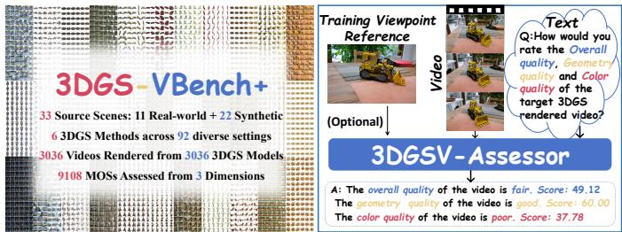  
Fig. 1. Overview of the proposed benchmark and model. Left: 3DGS-VBench+, a multi-dimensional subjective VQA benchmark for compressed 3DGS. Right: 3DGSV-Assessor scores the overall, geometry, and color quality of a rendered video, exploiting a training-viewpoint reference when available and operating no-reference otherwise.

Traditional metrics such as PSNR and SSIM [13] remain widely used for NVS evaluation, despite their limited correlation with perceived 3DGS quality [10]–[12], [14]. Developing a VQA metric tailored to 3DGS requires addressing three key challenges. First, the unique representation of 3DGS introduces characteristic artifacts, such as structural omissions, floating and fogging [11], [12]. Some of these, such as flickering caused by uneven fitting across training and novel views, further manifest as temporal instability that only a continuous viewing path can expose [10], [11], [15]. Second, 3DGS compression can affect geometric and color fidelity differently, making an overall quality score alone insufficient. Many 3DGS compression methods separately control the compression of geometric attributes (e.g., scale and rotation) and color attributes (e.g., spherical harmonic (SH) coefficients), resulting in different degrees of geometric and color degradation. These differences motivate separate geometry and color assessments alongside an overall quality judgment, as illustrated in Fig. 1. Third, reference information for 3DGS VQA is often limited and varies across practical scenarios. Scenes are reconstructed from discrete captured views but may be rendered along arbitrary, user-chosen trajectories, for which aligned ground-truth videos are generally unavailable. Full-reference (FR) assessment is therefore often impractical, whereas no-reference (NR) assessment is the common case, and reduced-reference (RR) assessment is feasible because a captured training view can accompany the model as a weak reference at marginal cost. Together, these challenges call for a single, multi-dimensional, reference-flexible VQA model that captures 3DGS-specific distortions, exploits the weak reference when available, and remains robust in its absence.

Developing and validating such a model requires a suitable subjective quality benchmark. However, current NVS VQA benchmarks exhibit three key limitations, as summarized in Table I: (1) Insufficient scale. Most existing datasets contain fewer than 500 videos, largely due to high reconstruction training costs, limiting their support for learning perceptually robust and generalizable models. (2) Limited distortion coverage. Few benchmarks systematically cover different compression strategies and parameter levels, resulting in limited diversity of compression-induced distortions. (3) Coarse annotation granularity. Existing benchmarks provide only overall quality scores, leaving geometric and color quality assessment without dedicated subjective supervision.

To address these gaps, we first present 3DGS-VBench+, a large-scale, multi-dimensional subjective VQA benchmark for compressed 3DGS. It contains 3,036 3DGS models reconstructed from 11 real-world and 22 synthetic scenes taken from mainstream multi-view datasets [11], [16]–[18]. Six representative compression algorithms [4]–[9] are applied at systematically designed levels, spanning a broad and controlled range of distortion types and strengths. Each model is rendered into a video along an orbital camera trajectory around the scene. Through a subjective study, we collect mean opinion scores (MOSs) for the overall, geometry, and color dimensions, giving 9,108 MOSs in total, and we verify the reliability of the dataset and the diversity of its content.

Building on 3DGS-VBench+, we propose 3DGSV-Assessor, a large multimodal model (LMM)-based framework for all-in-one, multi-dimensional 3DGS VQA that supports both NR and RR assessment through three stages. Stage 1 builds the foundation: an NR regressor that adapts a visionlanguage backbone to score all three quality dimensions jointly in a single generation pass, and stands alone as a complete NR assessor whenever no reference is available. Stage 2 brings the reference in: it treats a captured training view used for reconstruction as a weak reference. Supervised by human scores, it learns a cue that encourages higher-rated renderings of each scene to have greater embedding similarity to the reference, without requiring pixel-level alignment. Stage 3 makes the reference optional rather than required: a bounded gate folds the cue into the frozen regressor to refine its calibrated scores when a reference is available and reverts to the Stage-1 prediction otherwise, so a single model supports both the RR and NR assessment.

On 3DGS-VBench+, 3DGSV-Assessor surpasses traditional metrics, deep VQA models, and recent LMM-based assessors on all three dimensions, and it transfers zero-shot to other NVS quality assessment benchmarks.

The main contributions of this work are summarized as follows:

• We construct 3DGS-VBench+, a large-scale, multidimensional subjective VQA benchmark for compressed 3DGS, comprising 3,036 rendered videos across 33 scenes and 6 compression algorithms, annotated with MOSs for overall, geometry, and color dimensions. Extending the preliminary conference version 3DGS-VBench [19], this work adds 22 synthetic scenes to the original 11 real-world scenes, refines the distortionlevel design for each algorithm, and expands the single overall dimension into three fine-grained dimensions. These extensions grow the benchmark from 660 to 3,036 models and their rendered videos. The annotation volume grows correspondingly, from 660 to 9,108 MOSs.

• We propose 3DGSV-Assessor, the first multidimensional, reference-flexible VQA metric tailored to 3DGS. This LMM-based framework jointly scores the overall, geometry, and color dimensions, and exploits a captured view of the scene as a weak reference through a bounded gating mechanism, supporting both RR and NR assessment in a single model.

• Extensive experiments show that 3DGSV-Assessor achieves SOTA correlation with human perception on 3DGS-VBench+ under both RR and NR settings, and generalizes well to other NVS quality assessment benchmarks.

## II. RELATED WORK

## A. Quality Assessment Databases for NVS

Quality assessment research for NVS spans both imagelevel and video-level evaluation, as summarized in Table I. On the IQA side, NVS-QA [20] introduces a benchmark covering NeRF and 3DGS pipelines with 65 image samples. 3DGS-IEval-15K+ [12], [21] establishes the first large-scale 3DGS IQA dataset comprising 15,200 images rendered from 10 real-world scenes across 6 representative compression algorithms with multi-dimensional MOS annotations. In parallel, the VQA branch of NVS evaluation shifts from NeRF studies toward 3DGS-centered benchmarks. NeRF-QA [22] and NeRF-VSQA [23] provide subjective quality assessment datasets containing 48 and 88 videos, respectively. FFV [24] adopts a pairwise comparison protocol over 220 samples. ENeRF-QA [11] contributes systematic distortion modeling by leveraging NeRF compression pipelines across 440 sequences and characterizing nine NeRF-specific distortion categories. For 3DGS content, GSC-QA [14] examines a single 3DGS compression scheme with 120 samples, GS-QA [25] offers comparative evaluation between 3DGS and NeRF over 64 samples, and NVS-QA [20] contributes an additional 65 video samples alongside its image counterpart. However, existing 3DGS VQA datasets exhibit three key limitations: few systematically design compression parameters to cover diverse distortion types and severity levels; most contain fewer than 500 samples; and all provide only overall MOS, lacking the multi-dimensional annotations necessary for finegrained video screening and downstream 3DGS optimization. To address these gaps, we present 3DGS-VBench+, which contains 3,036 compressed 3DGS video sequences with threedimensional MOS annotations covering overall, geometry, and color quality, constituting the largest 3DGS VQA dataset to date and the first to provide multi-dimensional subjective labels for 3DGS video content.

TABLE I  
SUMMARY OF EXISTING NVS QUALITY EVALUATION DATASETS, WITH “SYN” AND “REAL” REPRESENTING SYNTHETIC AND REAL SCENES.
<table><tr><td>Dataset Type</td><td>Name</td><td colspan="2">Year</td><td colspan="2">Scenes Real</td><td colspan="2">NVS Models NeRF 3DGS</td><td colspan="2">Render Distortion Mode Level design</td><td colspan="2">Annotation Number of NeRF/3DGS</td><td>Number of videos/imgs</td><td>MOSs/JODs</td></tr><tr><td>IQA</td><td>NVS-QA [20]</td><td>2025</td><td>Syn</td><td>13</td><td>2</td><td>3</td><td>viewpoint</td><td>X</td><td>MOS</td><td>65</td><td>65</td><td></td></tr><tr><td></td><td>3DGS-IEval-15K+ [21]</td><td>2026</td><td></td><td>10</td><td></td><td>6</td><td>20 viewpoints</td><td></td><td>MOS</td><td>760</td><td>15,200</td><td>65 45,600</td></tr><tr><td></td><td>NeRF-QA[22]</td><td>2023</td><td>4</td><td>4</td><td>7</td><td></td><td>360°</td><td>X</td><td>DMOS</td><td>48</td><td>48</td><td>48</td></tr><tr><td></td><td>NeRF-VSQA [23]</td><td>2024</td><td>8</td><td>8</td><td></td><td></td><td>360°+Front</td><td>X</td><td>DMOS</td><td>88</td><td>88</td><td>88</td></tr><tr><td></td><td>FFV [24]</td><td>2024</td><td></td><td></td><td>7</td><td></td><td></td><td>X</td><td></td><td>220</td><td>220</td><td>144</td></tr><tr><td>VQA</td><td>ENeRF-QA [11]</td><td></td><td>22</td><td>22</td><td>8</td><td></td><td>Front 360°</td><td></td><td>Pairs</td><td>440</td><td>440</td><td>440</td></tr><tr><td></td><td></td><td>2024</td><td></td><td></td><td>4</td><td></td><td></td><td></td><td>MOS</td><td></td><td></td><td></td></tr><tr><td></td><td> $\mathrm { { G S C - Q \bar { A } \ [ i \bar { 4 } ] } } ^ { - }$ </td><td>2024</td><td>9</td><td>6</td><td></td><td>1</td><td>360°</td><td></td><td>MOS</td><td>120</td><td>120</td><td>120</td></tr><tr><td></td><td>GS-QA [25]</td><td>2025</td><td></td><td>8</td><td></td><td>7</td><td>360° + Front</td><td>X</td><td>DMOS</td><td>64</td><td>64</td><td>64</td></tr><tr><td></td><td>NVS-QA [20] 3DGS-VBench(Ours) [19]</td><td>2025 2025</td><td></td><td>13</td><td>2</td><td>3</td><td>360°+Front 360°</td><td>X</td><td>MOS MOS</td><td>65 660</td><td>65</td><td>65</td></tr><tr><td></td><td>3DGS-VBench+(Ours)</td><td>2026</td><td>22</td><td>11 11</td><td></td><td>6 6</td><td>360°</td><td></td><td>MOS</td><td>3,036</td><td>660 3,036</td><td>660 9,108</td></tr></table>

## B. Quality Assessment Metrics for NVS

Many video quality assessment models have been proposed in the literature. Learning-based VQA models (e.g., VSFA [26], SimpleVQA [27], FAST-VQA [28]) learn qualityaware representations to predict overall video quality but do not explicitly provide separate geometry and color scores in their original formulations, which is crucial for 3DGS quality monitoring. LMM-based models [29]–[31] offer strong visual understanding and the flexibility to report multiple dimensions, yet they remain limited in their sensitivity to lowlevel perceptual quality and often fail to give precise quality scores. For NVS in particular, evaluation still leans heavily on traditional IQA metrics (e.g., PSNR, SSIM [13]), which have been found inadequate in assessing perceptual quality of NVS content [10]–[12], [19].

Beyond these generic metrics, several NVS-specific quality assessment models have been developed for different evaluation settings. NVS-SQA [10] learns quality representations via self-supervised contrastive learning, but targets within-scene relative ranking rather than absolute quality prediction across scenes, and thus does not directly apply where absolute quality must be compared across scenes and methods, for example in application-side quality monitoring. Besides, its contrastive pairs rely on traditional distortions (e.g., noise, blur [32], [33]) rather than artifacts specific to 3DGS. NeRF-NQA [34] performs no-reference scene-level scoring, but requires a densely sampled view sequence with camera poses and a COLMAP point cloud, which are unavailable in many practical scenarios and in many subjective 3DGS datasets. Its original formulation is further restricted to front-facing NeRF scenes, leaving 360◦ content and 3DGS to future work. We therefore exclude it from the present comparison. 3DGSI-Assessor [21] is a multidimensional metric, but is designed for 3DGS image rather than video assessment. Motivated by these observations, we propose an LMM-based framework for all-in-one, referenceflexible 3DGS VQA that supports both NR and RR settings.

## III. DATABASE CONSTRUCTION

## A. Source Content Selection

To enable comprehensive quality assessment under diverse visual conditions, we collect 33 source scenes comprising 22 synthetic and 11 real-world scenes drawn from multiple canonical NVS multiview datasets. For synthetic content, as shown in Fig. 2 we adopt 22 scenes from two well-established sources: 8 scenes from NeRF Synthetic [1] (chair, lego, mic, drums, hotdog, materials, ficus, ship) and 14 scenes from Explicit-NeRF-QA-Synthetic [11] (bowl, Elena, fruit, lionfish, piano, pizza, sakura, car, phonograph, kitchenset, motorbike, pipeorgan, sofa, vase). For real-world content, as shown in Fig. 3, we select 11 scenes from four multiview datasets. Two outdoor scenes are obtained from Tanks & Temples [17]: train $( 9 8 0 ~ \times ~ 5 4 5 )$ and truck $( 9 7 9 ~ \times ~ 5 4 6 )$ . Two indoor scenes, playroom $( 1 2 6 4 ~ \times ~ 8 3 2 )$ and drjohnson $( 1 3 3 2 ~ \times ~ 8 7 6 )$ , are sourced from Deep Blending [18]. Six scenes are obtained from Mip-NeRF360 [16], including three outdoor scenes: bicycle $( 1 2 3 7 \times 8 2 2 )$ , flowers $( 1 2 5 6 ~ \times ~ 8 2 8 )$ , and garden $( 1 2 9 7 \times 8 4 0 )$ , and three indoor scenes counter $( 1 5 5 8 \times 1 0 3 8 )$ kitchen $( 1 5 5 8 ~ \times ~ 1 0 3 9 )$ , and room (1557 × 1038). We also include a human scene, Dance Dunhuang Pair (1600 × 876), from PKU-DyMVHumans [35].

This selection ensures diversity for 3DGS training and quality assessment. The joint inclusion of synthetic and real content covers two complementary regimes for 3DGS applications. The synthetic subset spans a wide range of object categories, surface materials, geometric structures, and texture complexities. The real-world subset encompasses varied lighting conditions, reflective materials, indoor and outdoor environments, complex textures, and human subjects. For resolution settings, we maintain native resolution settings from the original 3DGS work [2] for real-world scenes, and adopt the conventional $8 0 0 ~ \times ~ 8 0 0$ resolution for synthetic scenes, promoting consistent benchmarking and fair comparison in the NVS community.

## B. Camera Trajectory Construction for Video Rendering

Synthetic multi-view image datasets [1], [11] are constructed under virtual camera setups, with viewpoints organized into training, testing, and validation sets. The training set is used for 3DGS model training, the testing set provides reference images for quality assessment of reconstructed scenes, and the validation set defines a continuous camera trajectory for rendering video sequences for human viewing. For each synthetic scene, this native validation trajectory comprises 300 viewpoints [11], which are used directly for subsequent 3DGS rendering. However, real-world multi-view image datasets [16]–[18] are captured with sparsely distributed physical cameras and provide only training and testing sets, lacking the dense, continuous camera paths for smooth video rendering. Consequently, an additional validation viewpoint set must be constructed for each real-world scene to enable consistent video-based subjective evaluation.

No.1

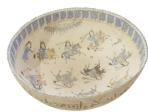  
bowl

No.2

No.3

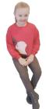  
Elena

  
fruit

No.4

  
No.12  
lionfish  
No.13

No.5

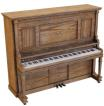  
No.14  
piano  
No.15

No.6

  
pizza  
No.16

No.7

  
sakura

No.8

  
car  
No.17

No.9

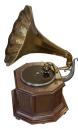  
phonograph

No.10

No.11

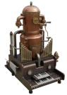

  
kitchenset

  
motorbike

  
No.22

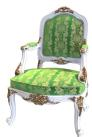  
sofa  
No.18  
No.19  
vase  
pipeorgan  
No.21  
No.20

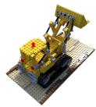  
chair

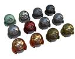  
lego

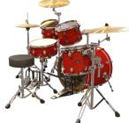

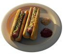  
mic

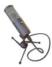  
Fig. 2. 22 selected synthetic source content in 3DGS-VBench+ with diverse material properties.

  
drums  
hotdog  
materials  
ficus

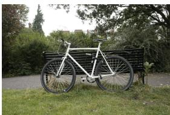  
ship  
No1. bicycle

  
No2. truck

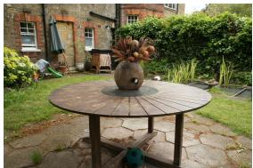

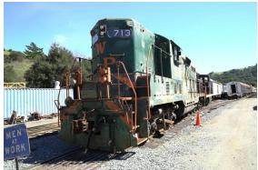

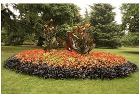  
No3. garden  
No4. train  
No5. flowers  
No6. room

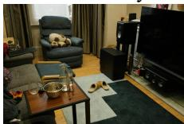

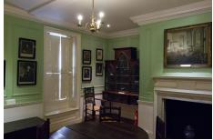  
No7. drjohnson

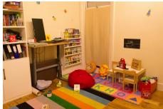  
No8. playroom

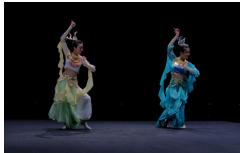  
No9. dance

  
No10. counter

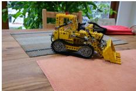  
No11. kitchen

Fig. 3. 11 selected real source content in 3DGS-VBench+: scenes 1-5 depict outdoor scenes, while scenes 6-11 depict indoor scenes.

To create the validation sets, we first train each 3DGS model on the training set to obtain its point cloud representation, which serves as a spatial reference for camera path design in Blender. For each real-world scene, we construct a smooth 360◦ orbital trajectory with the camera parameters adjusted to ensure appropriate framing of the main scene content, and uniformly sample 600 continuous viewpoints along it, consistent with the viewpoint count adopted by GSC-QA [14] for real-world content. The resulting validation sets yield smooth video sequences with resolutions consistent with their source datasets, providing a basis for video-level subjective quality assessment.

## C. 3DGS Model Selection & Compression Parameter Design

(CL1–CL8) to their key parameter, whereas multi-parameter methods assign five levels (CL1–CL5) to each key parameter. A smaller index denotes stronger compression, and the highest level corresponds to the highest-quality configuration. For real-world scenes, which are the main application scenario of 3DGS, the official methods provide recommended default settings, which we adopt as the highest level. For synthetic scenes, we adopt the official settings where available and otherwise use a high-quality configuration as the highest level.

To systematically characterize the distortions introduced by 3DGS generative compression, we select 6 representative algorithms and, for each, define compression parameter configurations to generate a set of reconstructions covering diverse distortion types and varying intensities. Based on compression architecture, these 3DGS methods fall into two groups: single-compression-parameter methods (HAC [5], Scaffold-GS [4]), which adopt anchor-based representations where a single dominant compression parameter controls the rate–distortion trade-off; and multi-compression-parameter methods (Compact-3DGS [9], CompGS [7], C3dgs [8], Light-Gaussian [6]), which independently configure the compression parameters of geometric and color attributes.

For each key compression parameter, we define a set of Compression Levels (CL) that monotonically control distortion intensity. Single-parameter methods assign eight levels

For each method, we strategically combine the compression parameters to obtain 3DGS samples of varying Distortion Levels (DL) and types. Single-parameter methods simply traverse (CL1–CL8), yielding 8 DL per scene. For multi-parameter methods, we combine the per-parameter CLs through three complementary strategies: (1) Single-parameter ablation, where one key parameter varies across (CL1–CL4) while the others are fixed at their default optimal level CL5. Since each key parameter mainly governs either geometric or color attributes, this strategy provides a controlled basis for dimension-specific annotation. (2) Cross combination: eight cross configurations per method are constructed by jointly assigning non-default values to two or more key parameters, so that cross samples fill the distortion space between ablation samples rather than repeat them. These configurations produce compound distortions beyond single-parameter perturbation, broadening the coverage of distortion types and better emulating practical deployment configurations, thereby enriching dataset diversity and the generalization of trained VQA models. The eight cross configurations of each method are listed in the supplementary material. (3) Default optimal configuration:

an all-CL5 reconstruction that provides the highest-quality reference of each method. Consequently, a method with n key parameters yields 4n(ablation)+8(cross)+1(default) DL per scene.

All methods follow the above combination strategy on both real and synthetic scenes. However, two distinct sets of CL values are designed separately for each content type, as synthetic and real scenes differ in visual characteristics and distortion tolerance, necessitating independent parameter calibration to maintain a rich and comparable perceptual-quality span within each scene type. The selected 3DGS algorithms and detailed CL configurations are presented as follows:

a) CompGS [7]: quantizes Gaussian attributes with Kmeans, maintaining separate codebooks for geometry and color; the two codebook capacities (g-size and c-size), together with an opacity regularization parameter (reg), determine the achievable fidelity. With 3 key parameters, we generate 3 parameters × 4 distorted CL = 12 single-parameter ablation configurations, 8 cross configurations, and 1 default sample with all optimal parameters, resulting in 21 DL per scene. CL settings are given in Table II.

TABLE II  
CL FOR COMPRESSION PARAMETERS IN COMPGS.
<table><tr><td>Type</td><td>Parameter</td><td>CL1</td><td>CL2</td><td>CL3</td><td>CL4</td><td>CL5</td></tr><tr><td rowspan="3">Real</td><td>g-size</td><td>1</td><td>2</td><td>23</td><td>25</td><td>212</td></tr><tr><td>c-size</td><td>1</td><td>2</td><td>22</td><td>23</td><td>212</td></tr><tr><td>reg</td><td>4×1e-6</td><td>3×1e-6</td><td>2×1e-6</td><td>1×1e-6</td><td>1×1e-7</td></tr><tr><td rowspan="3">Syn</td><td>g-size</td><td>1</td><td> $\mathbf { \Sigma } _ { 2 } ^ { 2 ^ { 2 } }$ </td><td>2⁴</td><td>2⁶</td><td>212</td></tr><tr><td>c-size</td><td>1</td><td></td><td>22</td><td>25</td><td> $\mathbf { 2 ^ { 1 2 } }$ </td></tr><tr><td>reg</td><td>5×1e-6</td><td>3×1e-6</td><td>2×1e-6</td><td>1×1e-6</td><td>1×1e-7</td></tr></table>

b) Compact-3DGS [9]: compresses the model along three fronts: a learnable mask weighted by λ removes redundant Gaussians, geometry attributes are encoded through residual vector quantization parameterized by codebook size and RVQ depth, and view-dependent color is represented by a hash-grid field (hashmap) in place of SH coefficients. With 3 key parameters, we generate $\mathbf { 3 } \times 4 ( a b l a t i o n ) + 8 ( c r o s s ) +$ $\mathbf { 1 } ( d e f a u l t ) = \mathbf { 2 1 }$ DL per scene. CL settings are given in Table III.

TABLE III  
CL FOR COMPRESSION PARAMETERS IN COMPACT-3DGS.
<table><tr><td>Type|</td><td>Parameter</td><td>CL1</td><td>CL2</td><td>CL3</td><td>CL4</td><td>CL5</td></tr><tr><td>Real</td><td>hashmap (codebook, rvq_depth) lambda</td><td>21  $( { \bf 2 ^ { 3 } } , 1 )$  0.014</td><td> $\mathbf { 2 ^ { 2 } }$   $( { \bf 2 ^ { 4 } } , 1 )$  0.012</td><td>27 (26, 1) 0.01</td><td>212 (23, 6) 0.006</td><td>219 (26, 6) 0.0005</td></tr><tr><td>Syn</td><td>hashmap (codebook, rvq_depth) lambda</td><td>21  $( \mathbf { 2 } ^ { \overline { { 1 } } } , 1 )$  0.022</td><td>22  $( \mathbf { 2 } ^ { \overline { { 2 } } } , 1 )$  0.020</td><td>24  $( { \bf 2 ^ { 4 } } , 1 )$  0.018</td><td>27  $( { \bf 2 ^ { 2 } } , 6 )$  0.015</td><td>216  $( { \bf 2 ^ { 6 } } , 6 )$  0.004</td></tr></table>

c) LightGaussian [6]: first removes Gaussians of low global significance, then distills high-degree SH coefficients into lower degrees and vector-quantizes the result; the pruning ratio (prune) and the SH quantization setting (c-ratio, c-size) jointly govern the compression. With 2 key parameters, we generate $2 \times 4 ( a b l a t i o n ) + 8 ( c r o s s ) + 1 ( d e f a u l t ) = 1 7$ DL per scene. CL settings are given in Table IV.

TABLE IV  
CL FOR PARAMETERS IN LIGHTGAUSSIAN.
<table><tr><td>Type|</td><td>Parameter</td><td>CL1</td><td>CL2</td><td>CL3</td><td>CL4</td><td>CL5</td></tr><tr><td>Real</td><td>prune (c-ratio, c-size)</td><td>0.97 (1, 2)</td><td>0.95 (1,22)</td><td>0.90 (1, 23)</td><td>0.85 (1, 25)</td><td>0.66  $( 0 . 6 , \ 2 ^ { 1 3 } )$ </td></tr><tr><td> $\mathtt { S y n }$ </td><td>prune (c-ratio, c-size)</td><td>0.95 (1, 1)</td><td>0.90 (1,2)</td><td>0.85 (1, 23)</td><td>0.75 (1, 25)</td><td>0.66  $( 0 . 6 , \ 2 ^ { 1 2 } )$ </td></tr></table>

d) C3dgs [8]: clusters geometry and color attributes into codebooks and entropy-codes them; for each attribute, a codebook size paired with an importance threshold: (c-size, cinclude) for color and (g-size, g-include) for geometry, decides which primitives are retained versus quantized. With 2 key parameters, we generate 2 × 4(ablation) + 8(cross) + $\mathbf { 1 } ( d e f a u l t ) = \mathbf { 1 7 }$ DL per scene. CL settings are given in Table V.

TABLE V  
CL FOR COMPRESSION PARAMETERS IN C3DGS.
<table><tr><td>Type</td><td>Parameter</td><td>CL1</td><td>CL2</td><td>CL3</td><td>CL4</td><td>CL5 (default)</td></tr><tr><td>Real</td><td>(c-size, c-include) (g-size, g-include)</td><td>(1, 0.6) (1, 0.3)</td><td>(2, 0.6) (23, 0.3)</td><td>(22, 0.6) (25, 0.3)</td><td>(25, 0.6) (28, 0.3)</td><td>(212, 0.6× 1e-6) (212, 0.3× 1e-5)</td></tr><tr><td>Syn</td><td>(c-size, c-include) (g-size, g-include)</td><td>(1, 0.6) (1, 0.3)</td><td>(2, 0.6) (22, 0.3)</td><td>(22, 0.6) (24, 0.3)</td><td>(24, 0.6) (26, 0.3)</td><td>(212, 0.6× 1e-6)  $( \mathbf { 2 } ^ { 1 2 } , 0 . 3 \times 1 \mathrm { e } . 5 )$ </td></tr></table>

e) Scaffold-GS [4]: organizes Gaussians around anchor points placed on a voxel grid and derives local Gaussians from these anchors; the voxel size (vsize) sets the anchor density and thereby the compression strength. As shown in Table VI, with 1 compression parameter corresponding to 8 CL, we generate 8 DL per scene.

TABLE VI  
CL FOR COMPRESSION PARAMETER IN SCAFFOLD-GS.
<table><tr><td>Param</td><td>CL1</td><td>CL2</td><td>CL3</td><td>CL4</td><td>CL5</td><td>CL6</td><td>CL7</td><td>CL8</td></tr><tr><td>vsize (real)</td><td>0.350</td><td>0.250</td><td>0.200</td><td>0.160</td><td>0.120</td><td>0.080</td><td>0.050</td><td>0.001</td></tr><tr><td>vsize (syn)</td><td>0.350</td><td>0.250</td><td>0.180</td><td>0.120</td><td>0.080</td><td>0.040</td><td>0.015</td><td>0.001</td></tr></table>

f) HAC [5]: couples an anchor-based representation with a hash-grid-assisted context model for entropy coding, and a single trade-off weight λ regulates the balance between bitrate and reconstruction fidelity. As shown in Table VII, with one compression parameter has 8 CLs, we generate 8 DL per scene.

TABLE VII  
CL FOR COMPRESSION PARAMETER IN HAC.
<table><tr><td>Param</td><td>CL1</td><td>CL2</td><td>CL3</td><td>CL4</td><td>CL5</td><td>CL6</td><td>CL7</td><td>CL8</td></tr><tr><td>λ (real)</td><td>0.800</td><td>0.600</td><td>0.400</td><td>0.300</td><td>0.200</td><td>0.120</td><td>0.060</td><td>0.004</td></tr><tr><td>λ (syn)</td><td>8.000</td><td>4.000</td><td>0.400</td><td>0.250</td><td>0.150</td><td>0.070</td><td>0.030</td><td>0.004</td></tr></table>

In all, we trained (11 real + 22 synthetic) scenes × $( { \bf 2 1 } + { \bf 2 1 } + { \bf 1 7 } + { \bf 1 7 } + { \bf 8 } + { \bf 8 } )$ model settings = 33 scenes ×92 reconstructions = 3036 3DGS reconstruction models, covering a broad and well-controlled space of distortion types and intensities.

## D. Subjective Experiment and Data Processing

Subjective Experiment Setup: Each of the 3,036 reconstructed 3DGS models is first turned into a Processed Video Sequence (PVS) by rendering along its scene’s validation trajectory (Sec. III-B). The frames are encoded using FFMPEG with the libx265 codec at 30 fps and a constant rate factor of 10, yielding 3,036 PVSs in total. To characterize the perceptual effects of 3DGS compression beyond a single overall score, each PVS is rated along three dimensions: (1) Overall Quality for global visual fidelity, (2) Geometry Quality for structural integrity and spatial accuracy, and (3) Color Quality for chromatic accuracy and plausibility. Every PVS is presented individually and scored on the 11-point numerical quality scale recommended by ITU-T P.910 [36]. The playback and rating interface is built with the Python Tkinter toolkit, and all sessions run on a calibrated 27-inch AOC Q2790PQ monitor in a controlled laboratory under fixed standard illumination. Finally, we obtain a total of 136,620 reliable score ratings (15 ratings × 3 dimensions × 3,036 PVSs).

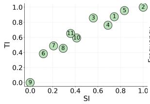  
(a)

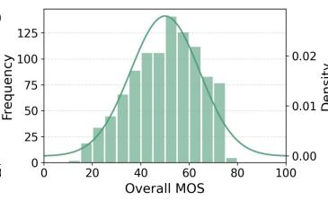  
(b)

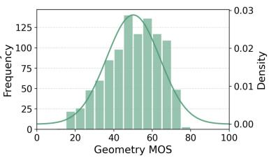  
(c)

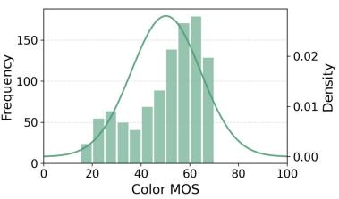  
(d)

Fig. 4. Statistical analysis of the 11 real-world scenes in 3DGS-VBench+ from content complexity and quality perspectives. (a) Scene distribution across SI and TI dimensions. (b)-(d) MOS distribution for overall quality, geometry quality, and color quality.  
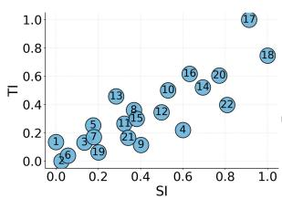  
(a)

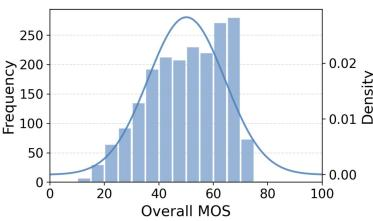  
(b)

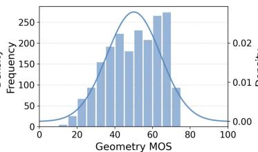  
(c)

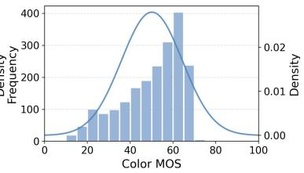  
(d)  
Fig. 5. Statistical analysis of the 22 synthetic scenes in 3DGS-VBench+ from content complexity and quality perspectives. (a) Scene distribution across SI and TI dimensions. (b)-(d) MOS distribution for overall quality, geometry quality, and color quality.

Subjective Data Processing: In order to obtain the MOS scores for each video, we first convert the ratings into $Z _ { - }$ scores, and then linearly remapped to the [0, 100] range, as demonstrated below:

$$
z _ { i j } = \frac { r _ { i j } - \mu _ { i } } { \sigma _ { i } } , z _ { i j } ^ { ' } = \frac { 1 0 0 ( z _ { i j } + 3 ) } { 6 }\tag{1}
$$

$$
\mu _ { i } = \frac { 1 } { N _ { i } } \sum _ { j = 1 } ^ { N _ { i } } r _ { i j } , \sigma _ { i } = \sqrt { \frac { 1 } { N _ { i } - 1 } \sum _ { j = 1 } ^ { N _ { i } } ( r _ { i j } - \mu _ { i } ) ^ { 2 } } ,\tag{2}
$$

where $r _ { i j }$ is the raw score given by the i-th subject to the j-th PVS. $N _ { i }$ is the number of PVSs rated by subject i. The MOS of each PVS is then obtained as the mean of the rescaled z-scores across all subjects as follows:

$$
M O S _ { j } = \frac { \mathbf { 1 } } { M _ { j } } \sum _ { i = 1 } ^ { M _ { j } } z _ { i j } ^ { ' } ,\tag{3}
$$

where $M _ { j }$ denotes the number of valid subjects who rated the j-th PVS, and $z _ { i j } ^ { ' }$ refers to the rescaled z-score. Therefore, applied independently to the three dimensions, a total of 9,108 MOSs (3 dimensions × 3,036 PVSs) are obtained.

## E. Subjective Data Analysis

Diversity of Source Content: To verify the diversity of the source content, we analyze the Spatial Information (SI) [36] and Temporal Information (TI) [36] characteristics of the selected scenes. Fig. 4(a) reports the SI-TI distribution of the 11 real-world scenes, where each numbered point corresponds to the scene index in Fig. 3. Fig. 5(a) reports the SI-TI distribution for the 22 synthetic scenes, with the numbered points corresponding to the scene index in Fig. 2. Both scene types yield balanced distribution across both complexity dimensions, confirming the visual diversity of our selected scenes and enhancing the generalization of our dataset for quality assessment model training.

MOS Analysis: To assess the rationality of the collected scores, Fig. 4(b)-(d) and Fig. 5(b)-(d) plot the MOS distributions of overall, geometry, and color quality for the real-world and synthetic scenes, respectively. All three perceptual dimensions show broad quality coverage under both scene types, ensuring sufficient characterization of different distortion levels and balanced data for training quality assessment models. The color quality MOS is right-skewed toward the high-score region (>60), since the anchor-based methods (HAC and Scaffold-GS) predominantly affect geometric quality under compression.

CL Design Analysis: To verify the collected MOS and the designed compression levels, we take LightGaussian as a representative case and inspect the MOS–storage relationship over the CL settings listed in Table IV. As noted in Section III-C, the CL values are calibrated separately for the two content types, so we select four scenes from each as examples to validate both CL grids: truck (Tanks & Temples), drjohnson (Deep Blending), room andflowers (Mip-NeRF360) for the real-world type, and pizza, sofa, bowl and chair for the synthetic type. Fig. 6(a) and (c) traverse the CLs of prune on the real and synthetic scenes respectively, while Fig. 6(b) and (d) traverse the CLs of (c-ratio, c-size), with the remaining parameter fixed at its default level CL5.

In all four panels, MOS decreases monotonically as the CL index descends from CL5 to CL1 with the model compressed to a smaller size. Since stronger compression discards more information, this consistency supports both the reliability of the collected MOS and the validity of the CL grids designed for each content type.

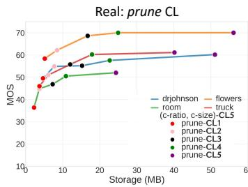  
(a)

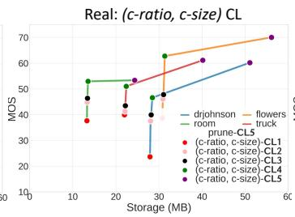  
(b)

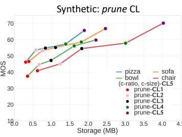  
(c)

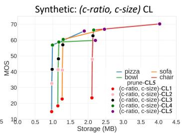  
(d)  
Fig. 6. MOS vs. Storage (MB) for LightGaussian on representative real-world and synthetic scenes in 3DGS-VBench+. (a) 5 CLs of prune for real-world scenes. (b) 5 CLs of (c-ratio, c-size) for real-world scenes. (c) 5 CLs of prune for synthetic scenes. (d) 5 CLs of (c-ratio, c-size) for synthetic scenes.

Both parameters show that in most cases the default configuration CL5 retains a varying degree of redundancy: CL5 - CL4 substantially reduces the storage at a relatively small MOS cost. The two parameters then diverge. prune keeps trading storage for quality gradually, whereas CL4 - CL1 of (c-ratio, c-size) remain within a narrow storage interval while quality falls sharply, sacrificing perceptual fidelity almost without additional saving. Prune therefore offers a more favorable quality-compression trade-off in practical use.

The content types also differ. On real-world scenes, compressing prune to CL3 is nearly free and only lower levels incur clear penalties, while synthetic scenes decline steadily from the first step, as their far fewer Gaussians mean an identical pruning ratio removes more of the primitives carrying visible structure. Compression behavior is therefore not transferable between content types, supporting both their joint coverage and their independent CL calibration.

## IV. THE 3DGSV-ASSESSOR APPROACH

In this section we present 3DGSV-Assessor, an LMMbased framework for all-in-one, reference-flexible VQA of compressed 3DGS. Given a 3DGS-rendered orbital video V and, when available, a captured training viewpoint reference of the scene, the framework outputs a triplet of continuous quality scores $\mathbf { y ^ { \star } } = ( y _ { o } ^ { \star } , y _ { q } ^ { \star } , y _ { c } ^ { \star } )$ , where $\boldsymbol { \mathcal { D } } = \{ o , g , c \}$ indexes the overall, geometry, and color dimensions. As shown in Fig. 7, the framework progresses from a no-reference base to reference-flexible assessment in three stages. Stage 1 (Sec. IV-A) is an LMM-based no-reference regressor that scores all three dimensions jointly and by itself constitutes the standalone NR mode. Stage 2 (Sec. IV-B) encodes a captured view that accompanies the 3DGS model into a referenceagreement cue, learning to pull higher-rated renderings of each scene closer to its own reference. Stage 3 (Sec. IV-C) folds this cue into the frozen regressor through a bounded gate, refining the calibrated scores when a reference is available and reverting exactly to the Stage-1 prediction otherwise, so a single model serves both the RR and the NR setting.

## A. Stage 1: LMM-based No-Reference Quality Regression

Structure. We adopt Qwen3.5 (9B) [37] as the pre-trained vision-language backbone $\mathcal { F } _ { \theta }$ , with final-layer width $D _ { h }$ . The video $V$ is sampled into a fixed number of T uniformly spaced frames and tokenized by the backbone’s native visual encoder. The visual sequence is interleaved with a fixed instruction I requesting a joint verdict, “The video: <video>. How would you rate the overall quality, geometry quality, and color quality of the video $\cdot ? ^ { \prime \prime }$ , and the model is supervised to answer with a template in which each dimension is summarized by a qualitylevel word, “The overall quality of the video is $\langle w _ { o } \rangle$ . The geometry quality of the video is $\langle w _ { g } \rangle$ . The color quality of the video is $\langle w _ { c } \rangle _ { \cdot } ^ { \ , }$ The training label for each slot $\langle w _ { d } \rangle$ is obtained by mapping the ground-truth MOS ${ \mathbf { } } _  { \mathbf { } } _ { } { \mathbf { } } _ { } { \mathbf { } } _ { } { \mathbf { } } _ { } { \mathbf { } } _ { } { \mathbf { } } _ { } { \mathbf { } } _ { } { \mathbf { } } _ { } { \mathbf { } } _ { } { \mathbf { } } _ { } { \mathbf { } } _ { } { \mathbf { } } _ { } { \mathbf { } } _ { } { \mathbf { } } _ { } { \mathbf { } } _ { } { \mathbf { } } _ { } { \mathbf { } } _ { } { \mathbf { } } _ { } { \mathbf { } } _ { } { \mathbf { } } _ { } { \mathbf { } } _ { } { \mathbf { } } _ { } { \mathbf { } } _ { } { \mathbf { } } _ { } { \mathbf { } } _ { } { \mathbf { } } _ { } { \mathbf { } } _ { } { } { \mathbf { } } _ { } { \mathbf { } } _ { } { } { \mathbf { } } _ { } { } _ { } { \mathbf { } } _ { } { } { \mathbf { } } _ { } { } { \mathbf { } } _ { } { } _ { } { } { \mathbf } _ { } { } { \mathbf { } } _ { } { } _ { } { } { \mathbf } _ { } { } { } _ { } { } { \mathbf } _ { } { } _ { } { } { \mathbf } _ { } { } { } _ { } { } _ { } { } { \mathbf } _ { } { } _ { } { } _ { } { } { \mathbf } _ { } { } _ { } { } _ { } { } { \mathbf } _ { } { } _ { } { } _ { } { } _ { } { } _ { } { } _ { } { } _ { } { } _ { } { } _ { } { } _ { } { } _ { } { } _ { } _ { } { } _ { } { } _ { } _ { } { } _ { } _ { } { } _ { } _ { } { } _ { } _ { } { } _ { } _ { } _ { } { } _ { } _ { } _ { } _ { } { } _ { } _ { } _ { } _ { } _ { } _ { } _ { } _ { } _ { } _ $ to one of five levels through uniform interval division, following ITU [38]. Let $y _ { d } ^ { \mathrm { m i n } }$ and $y _ { d } ^ { \mathrm { { m a x } } }$ denote the minimum and maximum MOS of dimension d in the dataset, and $\Delta _ { d } = y _ { d } ^ { \operatorname* { m a x } } - y _ { d } ^ { \operatorname* { m i n } }$ . We partition $[ y _ { d } ^ { \mathbf { m i n } } , y _ { d } ^ { \mathbf { m a x } } ]$ into five equal intervals:

$$
\begin{array} { r } { w _ { d } = s _ { k } ~ \mathrm { i f } ~ y _ { d } ^ { \operatorname* { m i n } } + \frac { k - 1 } { 5 } \Delta _ { d } < y _ { d } \leq y _ { d } ^ { \operatorname* { m i n } } + \frac { k } { 5 } \Delta _ { d } , } \end{array}\tag{4}
$$

where $\{ s _ { k } \} _ { k = 1 } ^ { 5 } = \{ \mathrm { B a d } _ { \mathrm { \Omega } }$ Poor, Fair, Good, Excellent}, and $y _ { d } = y _ { d } ^ { \operatorname* { m i n } }$ is assigned to $\pmb { s _ { 1 } }$

Since a five-level verdict is too coarse to serve as a continuous MOS, we further read the score from the internal representation that produces the verdict rather than from the decoded text. Letting $\textbf { H } \in \mathbb { R } ^ { L \times D _ { \boldsymbol { r } } }$ h denote the final-layer hidden states over the L-token answer, we extract the states at the three positions $\{ \pi _ { o } , \pi _ { g } , \pi _ { c } \}$ that predict the quality-level words,

$$
\mathbf { h } _ { d } = \mathbf { H } [ \pi _ { d } ] , \qquad d \in \mathcal { D } .\tag{5}
$$

The three states are concatenated into a shared representation $\mathbf { u } = [ \mathbf { h } _ { o } \| \mathbf { h } _ { g } \| \mathbf { h } _ { c } ] \in \mathbb { R } ^ { 3 D _ { h } }$ and mapped to scores by three independent five-layer MLP heads,

$$
\hat { y } _ { d } = \phi _ { d } ( \mathbf { u } ) , \qquad d \in \mathcal { D } .\tag{6}
$$

Sharing u preserves cross-dimensional dependencies inherent to 3DGS, while the separate heads grant each dimension a dimension-specific regression function.

Training. The backbone is adapted with LoRA [39] on both its visual encoder and language model, leaving the pretrained weights frozen, while the heads are trained from scratch. Optimization couples a cross-entropy loss $\pmb { \mathcal { L } } _ { \mathbf { c } \mathbf { e } }$ , the autoregressive objective over the answer tokens $\{ t _ { n } \} _ { n = 1 } ^ { L }$

$$
\mathcal { L } _ { \mathrm { c e } } = - \frac { 1 } { L } \sum _ { n = 1 } ^ { L } \log P \big ( t _ { n } \mid t _ { < n } , V , I ; \theta \big ) ,\tag{7}
$$

with an $\ell _ { 1 }$ regression loss over dimensions,

$$
\mathcal { L } _ { \mathrm { r e g } } = \sum _ { d \in \mathcal { D } } | \hat { y } _ { d } - y _ { d } | ,\tag{8}
$$

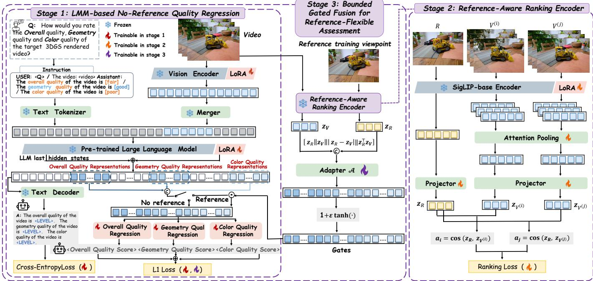  
Fig. 7. Framework of 3DGSV-Assessor, an LMM-based method for all-in-one, reference-flexible 3DGS VQA. Left: Stage 1 is an LMM-based no-reference regressor that scores all three dimensions jointly. Right: Stage 2 encodes a captured view and same-scene videos into a reference-agreement cue, trained b ranking to pull higher-rated renderings closer to the reference. Middle: Stage 3 turns the cue into a bounded gate that refines the Stage-1 representation when a reference is available and is bypassed otherwise, so a single model serves both RR and NR assessment.

combined as $\mathcal { L } _ { \mathrm { b a s e } } = \alpha \mathcal { L } _ { \mathrm { c e } } + \beta \mathcal { L } _ { \mathrm { r e g } } .$ , with $\beta$ ramped from zero so the randomly initialized heads do not destabilize early training, as detailed in Sec. V-A.

## B. Stage 2: Reference-Aware Ranking Encoder

Stage 2 learns a cue measuring how well the rendered video agrees with a reference: a captured training view of the scene (a photograph for real-world scenes and a ground-truth rendering for synthetic ones). This setting is practical because such a captured training view inherently exists for any 3DGS model and can accompany it at little extra cost.

Structure. We build the ranking encoder $\mathfrak { s }$ on a SigLIP visual backbone [40] adapted with LoRA and shared between the reference and video branches. For each scene we build a single reference anchor by encoding one such view R and projecting it with a head ${ \pmb p } _ { { \pmb R } }$ to an m-dimensional unit-norm embedding,

$$
\mathbf { z } _ { R } = \overline { { p _ { R } ( \mathcal { G } ( R ) ) } } \in \mathbb { R } ^ { m } ,\tag{9}
$$

where $\overline { { ( \cdot ) } }$ denotes $\ell _ { 2 }$ normalization. We use one reference view as the default scene anchor and evaluate the effect of additional views in Sec. V-D2. The anchor provides partial appearance information without requiring pixel-level alignment with the rendered video. The video is summarized from $\mathbf { \delta } _ { \mathbf { \mathcal { T } ^ { \prime } } }$ uniformly sampled frames via attention pooling and projected with a head $p _ { V }$

$$
\begin{array} { r } { \mathbf { z } _ { V } = \overline { { p _ { V } \left( \mathbf { A t t n P o o l } ( \{ \mathcal { G } ( V _ { t } ) \} _ { t = 1 } ^ { T ^ { \prime } } ) \right) } } \in \mathbb { R } ^ { m } . } \end{array}\tag{10}
$$

Training. The cue is trained only to order renderings within a scene. Since such an ordering depends solely on the relative comparison of same-scene pairs, the objective tolerates both noise in the absolute MOS labels and the viewpoint mismatch between a static reference and a moving camera, rewarding scene-level reference agreement rather than pixellevel alignment. A scene-stratified sampler draws each minibatch from a single scene spanning its quality levels, so all videos $\mathbf { V } ^ { ( i ) }$ in a batch share one anchor $\mathbf { z } _ { R } .$ . We form the set $\mathcal { P } = \{ ( i , j ) ~ : ~ y _ { o } ^ { ( i ) } - y _ { o } ^ { ( j ) } \geq \tau \}$ of pairs whose overall-MOS gap clears a noise margin $\tau$ (a batch with $\mathcal { P } ~ = ~ \emptyset$ contributes zero loss), and apply a margin-ranking penalty (margin $\rho )$ on each sample’s cosine agreement with the anchor, $a _ { i } = \cos ( \mathbf { z } _ { \mathbf { V } ^ { ( i ) } } , \mathbf { z } _ { R } )$

$$
\mathcal { L } _ { \mathrm { r a n k } } = \frac { 1 } { \mathbf { m a x } ( | \mathcal { P } | , 1 ) } \sum _ { ( i , j ) \in \mathcal { P } } \mathbf { m a x } \big ( 0 , ~ \rho - ( a _ { i } - a _ { j } ) \big ) ,\tag{11}
$$

driving higher-quality videos closer to the reference. We rank by overall MOS alone, since it is the holistic verdict a subject reaches after integrating every visible degradation, and leave Stage 3 to resolve the cue into per-dimension corrections. After convergence, $\mathfrak { s }$ is frozen and the embeddings $\left\{ \mathbf { z } _ { R } , \mathbf { z } _ { V } \right\}$ are pre-computed and cached offline, which fixes the cue as a stable input to Stage 3 and removes the encoding cost from its fine-tuning. Since $\mathfrak { s }$ is trained only on the training split of 3DGS-VBench+’s video–MOS samples, the cached embeddings introduce no evaluation leakage.

## C. Stage 3: Gated Fusion for Reference-Flexible Assessment

Stage 2 yields the reference cue but leaves it detached from the calibrated Stage-1 regressor. Stage 3 bridges the two while keeping the Stage-1 system intact. The reference never enters the LMM context and no Stage-1 weight is updated; the cue acts only through a bounded gate applied in feature space, so the RR and NR modes share an identical generation pass, and withholding the cue recovers the Stage-1 prediction exactly.

This non-invasive fusion is what lets a single model serve both settings.

Structure. From the cached embeddings, we construct a relational cue that combines reference and video features with their difference and similarity:

$$
\mathbf { c } = \left[ \mathbf { z } _ { R } \parallel \mathbf { z } _ { V } \parallel | \mathbf { z } _ { R } - \mathbf { z } _ { V } | \parallel \mathbf { z } _ { R } ^ { \top } \mathbf { z } _ { V } \right] ,\tag{12}
$$

concatenating the two embeddings, their element-wise absolute difference, and their inner product (the cosine agreement a of Sec. IV-B, since both embeddings are unit-norm). A lightweight adapter $\mathbf { \nabla } A ,$ consisting of a LayerNorm followed by a two-layer MLP with GELU activation, maps this cue to a bounded multiplicative modulation of the Stage-1 quality representation,

$$
\gamma = 1 + \epsilon \operatorname { t a n h } \left( A ( \mathbf { c } ) \right) \in [ 1 - \epsilon , 1 + \epsilon ] ^ { 3 D _ { h } } , \tilde { \mathbf { u } } = \mathbf { u } \odot \gamma ,\tag{13}
$$

after which the frozen heads yield the scores $\tilde { y } _ { d } = \phi _ { d } ( \tilde { \mathbf { u } } )$ The modulation is centered at $\gamma = 1$ and symmetric about it, so the cue can amplify or suppress any feature, while ϵ bounds the per-feature scaling, $\| \gamma - \mathbf { 1 } \| _ { \infty } \leq \epsilon$

Training. Stage 3 freezes the entire backbone, both LoRA adapters, and the reused Stage-1 heads, and trains only the adapter A with $\mathcal { L } _ { \mathrm { r e g } }$ computed on the scores ${ \tilde { y } } _ { d } .$ . When a scene provides no reference, the cue cannot be formed; A is then bypassed and $\gamma$ is set to 1, so that $\tilde { \textbf { u } } = \textbf { u }$ . The frozen Stage-1 heads therefore return exactly the Stage-1 NR prediction $\hat { y } _ { d } ,$ , and reference enhancement is optional rather than required. The scores $\tilde { y } _ { d }$ (RR), or ${ \hat { y } } _ { d }$ (NR) when no reference is available, constitute the framework output $\mathbf { y } ^ { \star }$ produced in a single generation pass.

## V. EXPERIMENTS

## A. Experiment Setup

1) Evaluation Datasets and Protocol: To quantify the correlation between each method’s predicted scores and the corresponding ground-truth MOSs, we adopt three evaluation criteria: Spearman Rank Correlation Coefficient (SRCC), Pearson Linear Correlation Coefficient (PLCC), and Kendall Rank Correlation Coefficient (KRCC). Higher SRCC/PLCC/KRCC indicate better performance. In addition to our own dataset, 3DGS-VBench+, three external NVS VQA benchmarks are incorporated for cross-dataset evaluation: GSC-QA [14], NeRF-VSQA [23], and ENeRF-QA [11].

2) Reference Algorithms: To assess the performance of our proposed method, we select representative VQA metrics for comparison, which can be classified into three groups: (1) Traditional QA Metrics, including: PSNR, SSIM [13], LPIPS [41], DISTS [42], VIF [43], FSIM [44], IW-SSIM [45], MS-SSIM [46], and BRISQUE [33]. (2) LMM-based Models, including: LLaVA-one-vision (7B) [47], mPLUG-Owl3 (7B) [48], InternVL3.5 (38B/8B) [49], InternVL3 (8B) [31], GLM-4.1V (9B) [30], Qwen3-VL (32B/8B) [50], and Qwen3.5 (35B/9B) [37]. (3) Deep Learning-based VQA Models, including: DOVER [52], FAST-VQA [28], simpleVQA [27], and VSFA [26].

3) Training Settings: Traditional metrics require no training and are applied directly to the dataset. For FR metrics, each 3DGS model is rendered at the held-out test viewpoints, each rendering is scored against the corresponding groundtruth view, and the scores are averaged into a single quality value per sequence. Since aligned ground-truth videos are generally unavailable along the rendered trajectories, FR scores are computed at these test viewpoints as a proxy. LMM-based models are first assessed in a zero-shot regime, using each model’s publicly released pre-trained weights for direct inference without any dataset-specific fine-tuning. To ensure a rigorous and fair comparison, we further fine-tune two representative LMMs, Llama3.2-Vision (11B) [51] and Qwen3.5 (9B) [37], under the identical training/testing split on 3DGS-VBench+, allowing for a direct comparison of their adaptability and performance potential. Consistent with their native generation-based formulation, these fine-tuned LMMs are supervised directly on textual score outputs via a cross-entropy objective. Deep learning-based VQA models are retrained following their original protocols, using the same dataset split as our framework. To examine whether our unified, all-in-one framework can match or exceed models specialized for a single dimension, training and inference for these fine-tuned baselines are conducted separately for each of the three quality dimensions.

Our proposed model is implemented in PyTorch and trained on a single 80 GB NVIDIA A800 GPU, with Qwen3.5 (9B) [37] serving as the backbone in bfloat16. The learning rate is set to $\mathbf { 2 \times 1 0 ^ { - 4 } }$ for the LoRA adapters and $\mathbf { 1 \times 1 0 ^ { - 3 } }$ for the regression/fusion components, both decayed with a cosine annealing schedule. We adopt the AdamW optimizer $( \beta _ { 1 } { = } 0 . 9 , \ \beta _ { 2 } { = } 0 . 9 9 9 )$ throughout training. Stage 1 uses a cross-entropy weight of ${ \alpha { = } 1 . 0 }$ and a regression weight linearly warmed to $\mathbf { \beta } \mathbf { \beta } \mathbf { = } \mathbf { 0 . 2 }$ over the first 500 steps. Stage 1 and Stage 3 each train for 3 epochs with an effective batch size of 16, while Stage 2 trains for up to 10 epochs with early stopping (patience 3) using MOS-stratified mini-batches of 12 renderings drawn from a single scene, so that every batch supplies same-scene ranking pairs. The ranking loss uses a margin of $\mathbf { \rho } _ { \rho = 0 . 1 }$ and ignores pairs whose overall-MOS gap falls below τ=5. Stage 3 bounds the modulation factor $\gamma \in [ 1 - \epsilon , 1 + \epsilon ]$ with ϵ=0.3. For RR assessment, each scene is paired with a single captured view randomly drawn from the views used to train its 3DGS model (Sec. III-B), fixed once per scene with a fixed random seed and shared by all videos of that scene. The same procedure is applied to the three external benchmarks. The robustness of the results to this random choice is examined in the supplementary material. Unless otherwise stated, we adopt a within-scene split: for each scene, the rendered videos are partitioned 4:1 into training and testing sets, such that no video appears in both, and results are averaged over 5-fold cross-validation. The three external benchmarks are used only for zero-shot testing, with no fine-tuning.

## B. Comparison with Existing Metrics on 3DGS-VBench+

As reported in Table VIII, traditional metrics such as PSNR and SSIM correlate only moderately with human judgments and cannot attribute degradation to its geometric or chromatic source, with NR metrics such as BRISQUE performing markedly worse, underscoring the difficulty of assessing 3DGS-specific distortions from low-level statistics alone. Larger zero-shot LMM variants generally achieve higher correlations, although the gains vary across models and quality dimensions. However, LMMs remain insufficient, as their strength in high-level semantic understanding does not translate to sensitivity for low-level compression artifacts. Fine-tuning two representative LMMs with the same LoRAbased procedure as ours yields substantial gains, confirming LoRA adaptation as an effective alignment mechanism, while the further margin achieved by our full model, which pairs the same backbone with dedicated regression heads under an additional $\pmb { \mathcal { L } } _ { r } e \pmb { g }$ objective, indicates that explicit continuousvalued regression adds perceptual sensitivity beyond LoRA adaptation alone. Deep learning-based VQA models such as DOVER and FAST-VQA are competitive but are trained and deployed as separate single-dimension predictors, unable to predict all three dimensional scores jointly. Both variants of 3DGSV-Assessor outperform every compared method across all nine metrics, with the RR variant leading overall and the NR variant close behind, confirming that the framework remains highly competitive even without access to reference views. Against the strongest baseline on each dimension, 3DGSV-Assessor (RR) improves SRCC by 6.1%, 4.6%, and 4.3% on three dimensions respectively, confirming that the all-in-one design unifies accurate multi-dimensional assessment while remaining robust across both RR and NR modes, underscoring its adaptability to real-world 3DGS evaluation settings.

TABLE VIII  
PERFORMANCE BENCHMARK ON 3DGS-VBENCH+. ♠ TRADITIONAL HANDCRAFTED QA MODELS, ♡ LMM-BASED MODELS, ♦ DEEP LEARNING-BASED VQA MODELS. BEST RESULTS ARE MARKED IN RED AND SECOND-BEST IN BLUE. \*REFERS TO FINETUNED MODELS.
<table><tr><td></td><td colspan="3">Overall Quality</td><td colspan="3">Geometry Quality</td><td colspan="3">Color Quality</td></tr><tr><td>Methods / Metrics</td><td>SRCC</td><td>PLCC</td><td>KRCC</td><td>SRCC</td><td>PLCC</td><td>KRCC</td><td>SRCC</td><td>PLCC</td><td>KRCC</td></tr><tr><td> PSNR [13]</td><td>0.5173</td><td>0.5042</td><td>0.3652</td><td>0.4976</td><td>0.4843</td><td>0.3316</td><td>0.4782</td><td>0.4691</td><td>0.3213</td></tr><tr><td>SSIM [13]</td><td>0.5391</td><td>0.5073</td><td>0.3845</td><td>0.5265</td><td>0.5076</td><td>0.3815</td><td>0.4845</td><td>0.4535</td><td>0.3364</td></tr><tr><td> LPIPS [41]</td><td>0.5448</td><td>0.4927</td><td>0.3770</td><td>0.5518</td><td>0.5033</td><td>0.3645</td><td>0.4683</td><td>0.4103</td><td>0.3024</td></tr><tr><td>DISTS [42]</td><td>0.7267</td><td>0.7246</td><td>0.5016</td><td>0.7109</td><td>0.6937</td><td>0.4976</td><td>0.6618</td><td>0.6403</td><td>0.4545</td></tr><tr><td>VIF [43]</td><td>0.4137</td><td>0.4228</td><td>0.2949</td><td>0.4003</td><td>0.4461</td><td>0.2842</td><td>0.3505</td><td>0.3537</td><td>0.2631</td></tr><tr><td>FSIM [44]</td><td>0.5991</td><td>0.5837</td><td>0.4275</td><td>0.5918</td><td>0.5754</td><td>0.4103</td><td>0.5377</td><td>0.5116</td><td>0.3765</td></tr><tr><td>IW-SSIM [45]</td><td>0.6252</td><td>0.5753</td><td>0.4178</td><td>0.6365</td><td>0.5718</td><td>0.4264</td><td>0.5578</td><td>0.4932</td><td>0.3294</td></tr><tr><td>MS-SSIM [46]</td><td>0.5237</td><td>0.4914</td><td>0.4075</td><td>0.5115</td><td>0.4767</td><td>0.4045</td><td>0.4613</td><td>0.4178</td><td>0.3631</td></tr><tr><td>BRISQUE [33]</td><td>0.2428</td><td>0.2018</td><td>0.1673</td><td>0.2796</td><td>0.2316</td><td>0.1976</td><td>0.2031</td><td>0.1516</td><td>0.1679</td></tr><tr><td> LLaVA-one-vision (7B) [47]</td><td>0.5040</td><td>0.4727</td><td>0.4471</td><td>0.4450</td><td>0.5067</td><td>0.3550</td><td>0.3727</td><td>0.3213</td><td>0.2833</td></tr><tr><td> mPLUG-Owl3 (7B) [48]</td><td>0.5001</td><td>0.4986</td><td>0.4231</td><td>0.5783</td><td>0.5644</td><td>0.5342</td><td>0.4037</td><td>0.3535</td><td>0.2931</td></tr><tr><td>InternVL3.5 (38B) [49]</td><td>0.6794</td><td>0.6795</td><td>0.5951</td><td>0.7459</td><td>0.7625</td><td>0.6654</td><td>0.6657</td><td>0.6683</td><td>0.5459</td></tr><tr><td> InternVL3.5 (8B) [49]</td><td>0.5337</td><td>0.5525</td><td>0.4763</td><td>0.6236</td><td>0.6102</td><td>0.5330</td><td>0.4911</td><td>0.5092</td><td>0.3975</td></tr><tr><td> InternVL3 (8B) [31]</td><td>0.4404</td><td>0.4010</td><td>0.3059</td><td>0.5202</td><td>0.4950</td><td>0.3971</td><td>0.3021</td><td>0.3114</td><td>0.2123</td></tr><tr><td> GLM-4.1V (9B) [30]</td><td>0.5857</td><td>0.6019</td><td>0.4571</td><td>0.6264</td><td>0.6388</td><td>0.5182</td><td>0.5213</td><td>0.4789</td><td>0.3810</td></tr><tr><td>♡ Qwen3-VL (32B) [50]</td><td>0.7571</td><td>0.7484</td><td>0.6395</td><td>0.7749</td><td>0.7750</td><td>0.6493</td><td>0.7249</td><td>0.6874</td><td>0.5948</td></tr><tr><td>♡ Qwen3-VL (8B) [50]</td><td>0.6669</td><td>0.6553</td><td>0.5698</td><td>0.7165</td><td>0.7173</td><td>0.6183</td><td>0.6279</td><td>0.5952</td><td>0.4830</td></tr><tr><td> Qwen3.5 (35B) [37]</td><td>0.7102</td><td>0.6922</td><td>0.5966</td><td>0.7858</td><td>0.7744</td><td>0.6742</td><td>0.6067</td><td>0.5627</td><td>0.4948</td></tr><tr><td> Qwen3.5 (9B) [37]</td><td>0.6715</td><td>0.6316</td><td>0.5406</td><td>0.6643</td><td>0.6785</td><td>0.5205</td><td>0.6133</td><td>0.5486</td><td>0.4757</td></tr><tr><td> Llama3.2-Vision (11B)* [51]</td><td>0.8547</td><td>0.8549</td><td>0.6616</td><td>0.8676</td><td>0.8583</td><td>0.6818</td><td>0.8315</td><td>0.8237</td><td>0.6228</td></tr><tr><td> Qwen3.5 (9B)* [37]</td><td>0.8946</td><td>0.8983</td><td>0.6919</td><td>0.8845</td><td>0.8818</td><td>0.6727</td><td>0.8624</td><td>0.8618</td><td>0.6737</td></tr><tr><td>◆ DOVER [52]</td><td>0.9154</td><td>0.9093</td><td>0.7479</td><td>0.9251</td><td>0.9111</td><td>0.7561</td><td>0.9159</td><td>0.9161</td><td></td></tr><tr><td>◆ FAST-VQA [28]</td><td>0.8616</td><td>0.8330</td><td>0.6650</td><td>0.8349</td><td>0.8381</td><td>0.6535</td><td>0.9269</td><td>0.9353</td><td>0.7420 0.7686</td></tr><tr><td>simpleVQA [27]</td><td>0.8718</td><td>0.8743</td><td>0.6715</td><td>0.8838</td><td>0.8911</td><td>0.6988</td><td>0.8648</td><td>0.8906</td><td>0.6766</td></tr><tr><td>◆ VSFA [26]</td><td>0.9055</td><td>0.8895</td><td>0.7287</td><td>0.9266</td><td>0.9099</td><td>0.7614</td><td>0.8925</td><td>0.8883</td><td>0.7095</td></tr><tr><td>3DGSV-Assessor (NR)</td><td>0.9617</td><td>0.9628</td><td>0.8367</td><td>0.9604</td><td>0.9628</td><td>0.8316</td><td>0.9590</td><td>0.9615</td><td></td></tr><tr><td>3DGSV-Assessor (RR)</td><td>0.9714</td><td>0.9726</td><td>0.8529</td><td>0.9691</td><td>0.9727</td><td>0.8461</td><td>0.9663</td><td>0.9703</td><td>0.8211 0.8385</td></tr></table>

## C. Zero-shot Cross-dataset Evaluation

In-domain correlation alone cannot show whether the learned quality scores transfer beyond a single benchmark. We therefore train all learning-based baselines and 3DGSV-Assessor on 3DGS-VBench+ and evaluate them on GSC-QA [14], NeRF-VSQA [23], and ENeRF-QA [11] without any fine-tuning on these benchmarks.

As shown in Table IX, both variants of 3DGSV-Assessor outperform every baseline on all three benchmarks, with the RR variant ranking first and the NR variant second on all nine columns. The baselines are less stable across benchmarks: simpleVQA, competitive on 3DGS-VBench+, drops to an SRCC of 0.2071 on NeRF-VSQA, and VSFA, the secondstrongest baseline on the overall quality of 3DGS-VBench+, drops to 0.5517 there. DOVER is the most stable baseline but remains behind both variants of our framework on all three benchmarks: relative to DOVER, the NR variant improves SRCC by 11.7%, 10.1%, and 3.6% on GSC-QA, NeRF-VSQA, and ENeRF-QA respectively, while the RR variant improves SRCC by 14.2%, 21.1%, and 5.5%.

The relative improvement of RR over NR is larger where NR is less accurate: it is 1.0%, 1.8%, 2.2%, and 10.0% on 3DGS-VBench+, ENeRF-QA, GSC-QA, and NeRF-VSQA, where the SRCC of NR is 0.9617, 0.9471, 0.9130, and 0.7437, respectively. This suggests that the reference cue is more useful when the no-reference prediction is less accurate.

TABLE IX  
ZERO-SHOT CROSS-DATASET CORRELATION PERFORMANCE ON MULTIPLE BENCHMARKS. BEST RESULTS ARE MARKED IN RED AND SECOND-BEST IN BLUE.
<table><tr><td rowspan="2">Method</td><td colspan="3">GSC-QA [14]</td><td colspan="3">NeRF-VSQA [23]</td><td colspan="3">ENeRF-QA [11]</td></tr><tr><td>SRCC</td><td>PLCC</td><td>KRCC</td><td>SRCC</td><td>PLCC</td><td>KRCC</td><td>SRCC</td><td>PLCC</td><td>KRCC</td></tr><tr><td>DOVER [52]</td><td>0.8174</td><td>0.7994</td><td>0.6257</td><td>0.6757</td><td>0.7281</td><td>0.5146</td><td>0.9138</td><td>0.8991</td><td>0.7525</td></tr><tr><td>FAST-VQA [28]</td><td>0.6066</td><td>0.5741</td><td>0.4427</td><td>0.4175</td><td>0.4922</td><td>0.3019</td><td>0.7842</td><td>0.7796</td><td>0.5996</td></tr><tr><td>simpleVQA [27]</td><td>0.7307</td><td>0.7196</td><td>0.5339</td><td>0.2071</td><td>0.1770</td><td>0.1520</td><td>0.7281</td><td>0.7611</td><td>0.5390</td></tr><tr><td>VSÉA [26]</td><td>0.7159</td><td>0.7101</td><td>0.5429</td><td>0.5517</td><td>0.5707</td><td>0.4043</td><td>0.9007</td><td>0.8862</td><td>0.7288</td></tr><tr><td>3DGSV-Assessor (NR)</td><td>0.9130</td><td>0.8950</td><td>0.7539</td><td>0.7437</td><td>0.7796</td><td>0.5647</td><td>0.9471</td><td>0.9296</td><td>0.8249</td></tr><tr><td>3DGSV-Assessor (RR)</td><td>0.9333</td><td>0.9141</td><td>0.7840</td><td>0.8180</td><td>0.8036</td><td>0.6452</td><td>0.9644</td><td>0.9393</td><td>0.8401</td></tr></table>

TABLE X  
ABLATION STUDY ON THE MACRO COMPONENTS AND LORA ADAPTATION STRATEGY OF 3DGSV-ASSESSOR.
<table><tr><td></td><td></td><td colspan="2">Component &amp; Strategy</td><td></td><td colspan="3">Overall Quality</td><td colspan="3">Geometry Quality</td><td colspan="3">Color Quality</td></tr><tr><td>No.</td><td>LMM</td><td>Ref-Cue</td><td>LoRA(vis)</td><td>LoRA(llm)</td><td>SRCC</td><td>PLCC</td><td>KRCC</td><td>SRCC</td><td>PLCC</td><td>KRCC</td><td>SRCC</td><td>PLCC</td><td>KRCC</td></tr><tr><td>(1)</td><td></td><td>V</td><td></td><td></td><td>0.8951</td><td>0.9029</td><td>0.7171</td><td>0.8391</td><td>0.8339</td><td>0.6448</td><td>0.8643</td><td>0.8666</td><td>0.6764</td></tr><tr><td>(2)</td><td>V</td><td>V</td><td></td><td></td><td>0.9008</td><td>0.9012</td><td>0.7195</td><td>0.8300</td><td>0.8448</td><td>0.6382</td><td>0.8885</td><td>0.8864</td><td>0.6985</td></tr><tr><td>(3)</td><td></td><td></td><td>V</td><td>V</td><td>0.9617</td><td>0.9628</td><td>0.8367</td><td>0.9604</td><td>0.9628</td><td>0.8316</td><td>0.9590</td><td>0.9615</td><td>0.8211</td></tr><tr><td>(4)</td><td></td><td></td><td>V</td><td></td><td>0.9489</td><td>0.9519</td><td>0.8216</td><td>0.9502</td><td>0.9571</td><td>0.8235</td><td>0.9451</td><td>0.9491</td><td>0.8076</td></tr><tr><td>(5)</td><td></td><td></td><td></td><td>V</td><td>0.9554</td><td>0.9552</td><td>0.8251</td><td>0.9472</td><td>0.9496</td><td>0.8195</td><td>0.9478</td><td>0.9523</td><td>0.8107</td></tr><tr><td>(6)</td><td>V</td><td>V</td><td>V</td><td>V</td><td>0.9714</td><td>0.9726</td><td>0.8529</td><td>0.9691</td><td>0.9727</td><td>0.8461</td><td>0.9663</td><td>0.9703</td><td>0.8385</td></tr></table>

## D. Ablation Study

1) Effectiveness of components and training strategy: We conduct ablation experiments to validate the effectiveness of the macro components and the LoRA adaptation strategy in 3DGSV-Assessor, with results summarized in Table X. Our analysis reveals three key findings. First, experiments (1), (2), and (6) show that the LMM contributes only once its representation is made quality-aware: experiment (1), regressing the three scores from the reference cue alone, already reaches 0.8951 SRCC on overall quality, confirming that referencevideo agreement is by itself a usable signal, while attaching a frozen LMM (2) yields only a marginal gain and even a small loss on geometry, indicating that a pre-trained backbone’s strength in high-level semantic understanding does not by itself transfer to low-level distortion sensitivity. Adapting the backbone with LoRA (6) then improves substantially over both, by 8.5%, 15.5%, 11.8% and 7.8%, 16.8%, 8.8% on the three dimensions respectively, confirming that reading quality from the hidden states requires a backbone tuned to distortion rather than to semantics, and that the LMM regressor delivers a substantial accuracy gain over the reference-cue-only pathway once properly adapted. Second, experiments (3)-(5) validate our joint LoRA strategy: adapting only the vision tower (4) or only the language model (5) each falls short of adapting both together (3), confirming that dual-tower adaptation is necessary for the strongest backbone representation. Third, comparing (3) and (6) isolates the reference-aware cue, which improves SRCC by 0.8–1.0% across the three dimensions. This gain is modest because the no-reference model is already strong on this in-domain benchmark, and it is larger in the zero-shot cross-dataset evaluation (Sec. V-C). Experiment (6), integrating all three components, achieves the best performance on all nine measures, confirming the necessity of the unified framework for multi-dimensional 3DGS video quality assessment.

2) Effect of the Number of Reference Views: Table XI varies the number of reference views K aggregated into the scene anchor z , where K=1 is the default single-reference encoder and K>1 averages the embeddings of K training viewpoints. Two observations support the single-view design. First, at the cue level, K=1 attains the best intra-scene ranking, with an Intra-RankAcc of 0.9683, and the best crossscene consistency, with a Global-RankAcc of 0.9200 and a Global- $. S { \mathrm { R C C } } _ { \mathbf { c u e } }$ of 0.8895, whereas multi-view anchors lower the global metrics. The only metric where a multi-view anchor is ahead is the per-scene $\mathrm { S R C C _ { c u e } }$ at K=3 (0.9362 against 0.9295), a gap that does not carry over to any downstream measure. Second, at the system level, Stage-3 prediction is nearly insensitive to K, with an SRCC spread below 0.002 on every dimension and K=1 best throughout. Since K=1 is also the cheapest setting, requiring only a single view per scene to encode, store, and transmit in the RR mode, we adopt it as the default.

3) Effect of the Stage-2 Training Objective: Table XII compares four Stage-2 training objectives: our default intrascene ranking, a global ranking variant that enforces MOSconsistent ordering across scenes, and each of the two combined with a cross-scene InfoNCE [53] term.

The central result is that intra-scene ranking is the best objective for the system as a whole: it achieves the highest Stage-3 performance on every reported prediction metric, together with the best Intra-RankAcc of 0.9683. Global ranking, as expected, attains the best scene-agnostic cue consistency, with a Global-RankAcc of 0.9432 and a Global-SRCCcue of 0.9213, yet this advantage does not transfer downstream. A possible reason is that Stage 3 pairs each video only with its own scene’s anchor, so it does not directly rely on the cross-scene ordering of the cue. Meanwhile, global ranking slightly lowers Intra-RankAcc (0.9625 against 0.9683) and brings no downstream gain, so the simpler intra-scene objective is preferred. Adding cross-scene InfoNCE is harmful at the cue level: on top of intra-scene ranking, it lowers Global-$\mathrm { S R C C _ { c u e } }$ from 0.8895 to 0.4211 and Intra-RankAcc to 0.9087. A possible reason is that the InfoNCE term separates embeddings by scene identity, which may compete with the qualityordering objective. Nevertheless, Stage-3 performance varies little across the four objectives, with an Overall SRCC between 0.9676 and 0.9714, all above the no-reference baseline of 0.9617. This is consistent with the bounded gate (Sec. IV-C), which limits how far a weakened cue can perturb the Stage-1 representation. Taken together, these results support training Stage 2 with the intra-scene ranking objective alone.

TABLE XI  
ABLATION ON THE NUMBER OF REFERENCE VIEWS K USED TO FORM THE SCENE ANCHOR $z _ { R } \left( \mathrm { A l . } \dots \mathrm { A K } \right)$ . STAGE-2 COLUMNS REPORT CUE-LEVEL QUALITY: INTRA-RANKACC $/ \mathrm { S R C C } _ { \mathbf { c u e } }$ ARE COMPUTED within EACH SCENE $( { \pmb a } _ { k } = \cos ( z _ { V } , z _ { R } )$ VS. OVERALL MOS; $\operatorname { S R C C } _ { \mathbf { c u e } }$ IS THE UNWEIGHTED MEAN OF PER-SCENE SPEARMAN). GLOBAL-RANKACC $/ \mathrm { G L O B A L } { \cdot } \mathrm { S R C C } _ { \mathbf { c u e } }$ IGNORE SCENE IDENTITY (ONE POOLED SPEARMAN). OVERALL / GEOMETRY / COLOR COLUMNS REPORT END-TO-END QUALITY PREDICTION AFTER GATED FUSION OF THE CORRESPONDING CUE. THE BEST RESULTS ARE MARKED IN RED.
<table><tr><td rowspan="2">K</td><td colspan="4">Stage 2 (cue)</td><td colspan="2">Overall</td><td colspan="2">Geometry</td><td colspan="2">Color</td></tr><tr><td> $\overline { { \mathrm { I n t r a - R a n k A c c } \uparrow } }$ </td><td> $\overline { { \mathrm { S R C C } _ { \mathbf { c u e } } } }$  ↑</td><td>Global-RankAcc↑</td><td> $\overline { { \mathrm { { G l o b a l } } { - } \mathrm { { S R C C } } _ { \mathbf { c u e } } } }$ </td><td>↑ SRCC</td><td>PLCC</td><td>SRCC</td><td>PLCC</td><td>SRCC</td><td>PLCC</td></tr><tr><td>K=1 (ours)</td><td>0.9683</td><td>0.9295</td><td>0.9200</td><td>0.8895</td><td>0.9714</td><td>0.9726</td><td>0.9691</td><td>0.9727</td><td>0.9663</td><td>0.9703</td></tr><tr><td>K=2</td><td>0.9619</td><td>0.9247</td><td>0.8616</td><td>0.7879</td><td>0.9702</td><td>0.9720</td><td>0.9678</td><td>0.9719</td><td>0.9655</td><td>0.9697</td></tr><tr><td>K=3</td><td>0.9641</td><td>0.9362</td><td>0.8159</td><td>0.7008</td><td>0.9701</td><td>0.9718</td><td>0.9676</td><td>0.9717</td><td>0.9655</td><td>0.9695</td></tr><tr><td>K=4</td><td>0.9565</td><td>0.9259</td><td>0.9037</td><td>0.8679</td><td>0.9700</td><td>0.9717</td><td>0.9676</td><td>0.9716</td><td>0.9654</td><td>0.9696</td></tr></table>

TABLE XII

ABLATION OF THE STAGE-2 TRAINING OBJECTIVE. INTRA-SCENE RANKING FORMS RANKING PAIRS ONLY WITHIN A SCENE, WHEREAS GLOBAL RANKING FORMS THEM ACROSS ALL SCENES IN A BATCH; CROSS-NCE IS A CONTRASTIVE TERM THAT TREATS SAME-SCENE EMBEDDINGS AS POSITIVES AND OTHER-SCENE EMBEDDINGS AS NEGATIVES. STAGE-2 COLUMNS REPORT CUE-LEVEL QUALITY USING THE COSINE AGREEMENT $a _ { i } = \cos ( { \mathbf z } _ { V ^ { ( i ) } } , { \mathbf z } _ { R } )$ AGAINST OVERALL MOS. RANKACC IS THE FRACTION OF VIDEO PAIRS WITH AN OVERALL-MOS GAP OF AT LEAST τ WHOSE CUE ORDERING MATCHES THE MOS ORDERING. INTRA-RANKACC AND $\mathrm { S R C C } _ { \mathrm { C U E } }$ ARE COMPUTED WITHIN EACH SCENE AND AVERAGED OVER SCENES; GLOBAL-RANKACC AND $\mathrm { G L O B A L - S R C C _ { C U E } }$ POOL ALL SCENES. STAGE-3 COLUMNS REPORT END-TO-END PREDICTION AFTER GATED FUSION OF THE CORRESPONDING CUE. BEST RESULTS ARE IN RED, SECOND-BEST IN BLUE.
<table><tr><td rowspan="2">Variant</td><td colspan="4">Stage 2 (cue)</td><td colspan="2">Overall</td><td colspan="2">Geometry</td><td colspan="2">Color</td></tr><tr><td>Intra-RankAcc↑</td><td> $\overline { { \mathrm { S R C C } _ { \mathbf { c u e } } } }$  ↑</td><td>Global-RankAcc↑</td><td>Global  $\overline { { \mathbf { \Omega } \mathbf { \Omega } \mathbf { \Omega } \mathbf { \Omega } \mathbf { \Omega } \mathbf { S R C C _ { c u e } } } }$ </td><td>↑ SRCC</td><td>PLCC</td><td>SRCC</td><td>PLCC</td><td>SRCC</td><td>PLCC</td></tr><tr><td>Intra-scene ranking (ours)</td><td>0.9683</td><td>0.9295</td><td>0.9200</td><td>0.8895</td><td>0.9714</td><td>0.9726</td><td>0.9691</td><td>0.9727</td><td>0.9663</td><td>0.9703</td></tr><tr><td>Global ranking</td><td>0.9625</td><td>0.9299</td><td>0.9432</td><td>0.9213</td><td>0.9689</td><td>0.9710</td><td>0.9689</td><td>0.9722</td><td>0.9651</td><td>0.9690</td></tr><tr><td>Intra-scene ranking + cross-NCE</td><td>0.9087</td><td>0.8445</td><td>0.6772</td><td>0.4211</td><td>0.9686</td><td>0.9708</td><td>0.9680</td><td>0.9724</td><td>0.9649</td><td>0.9682</td></tr><tr><td>Global ranking + cross-NCE</td><td>0.9504</td><td>0.9165</td><td>0.8890</td><td>0.8514</td><td>0.9676</td><td>0.9697</td><td>0.96740.9720</td><td></td><td>0.9656</td><td>0.9685</td></tr></table>

TABLE XIII

ABLATION ON THE STAGE-3 CUE-FUSION MECHANISM. STAGE-1 (NR) IS THE NO-REFERENCE BASELINE THAT PREDICTS FROM u ALONE; THE OTHERVARIANTS INJECT THE REFERENCE CUE c THROUGH DIFFERENT FUSION OPERATORS. HEADS INDICATES WHETHER THE STAGE-1 REGRESSION HEADSARE KEPT FROZEN OR RETRAINED AFTER FUSION. THE BEST RESULTS ARE MARKED IN RED
<table><tr><td rowspan="2">Variant</td><td rowspan="2">Fusion ǔ</td><td rowspan="2">Heads</td><td colspan="3">Overall</td><td colspan="3">Geometry</td><td colspan="3">Color</td></tr><tr><td>SRCC</td><td>PLCC</td><td>KRCC</td><td>SRCC</td><td>PLCC</td><td>KRCC</td><td>SRCC</td><td>PLCC</td><td>KRCC</td></tr><tr><td>Stage-1 (NR)</td><td>u</td><td>frozen</td><td>0.9617</td><td>0.9628</td><td>0.8367</td><td>0.9604</td><td>0.9628</td><td>0.8316</td><td>0.9590</td><td>0.9615</td><td>0.8211</td></tr><tr><td>Concatenate cue</td><td> $\big [ \mathbf { u } \big | \big | \mathcal { A } ( \mathbf { c } ) \big ]$ </td><td>retrained</td><td>0.9618</td><td>0.9669</td><td>0.8306</td><td>0.9666</td><td>0.9709</td><td>0.8389</td><td>0.9584</td><td>0.9673</td><td>0.8210</td></tr><tr><td>Sigmoid gate</td><td> $\overset { \cdot } { \mathbf { u } } \odot \sigma ( \mathcal { A } ( \mathbf { c } ) )$ </td><td>frozen</td><td>0.9688</td><td>0.9702</td><td>0.8469</td><td>0.9680</td><td>0.9711</td><td>0.8430</td><td>0.9641</td><td>0.9694</td><td>0.8347</td></tr><tr><td>Bounded gate (ours)</td><td> $\mathbf { u } \odot \left( \mathbf { 1 } + \epsilon \operatorname { t a n h } ( \mathbf { \mathcal { A } } ( \mathbf { c } ) ) \right)$ </td><td>frozen</td><td>0.9714</td><td>0.9726</td><td>0.8529</td><td>0.9691</td><td>0.9727</td><td>0.8461</td><td>0.9663</td><td>0.9703</td><td>0.8385</td></tr></table>

4) Effect of the Stage-3 Cue-Fusion Mechanism: Table XIII compares our bounded gate with the cue-free Stage-1 (NR) baseline and two alternative ways of injecting the reference cue: feature concatenation and a plain sigmoid gate. Two contrasts are informative. First, the injection form matters. Concatenation feeds $\pmb { A } ( \mathbf { c } )$ to retrained heads as an extra input, but its gains over the NR baseline are mixed: PLCC improves on all three dimensions, whereas Overall SRCC is nearly unchanged, Color SRCC falls slightly below the baseline (0.9584 against 0.9590), and Overall KRCC decreases. In contrast, both multiplicative gates improve all nine metrics while keeping the Stage-1 heads frozen. As these variants differ in both the fusion operator and whether the heads are retrained, this suggests that modulating the existing quality representation can be a more reliable way to use the cue. Second, constraining the modulation further improves performance. The sigmoid gate scales u by a factor in (0, 1), which can only attenuate the representation the frozen heads were calibrated on and never reproduces it exactly; our gate instead applies an identity-centered, bounded factor $\gamma \in [ 1 - \epsilon , 1 + \epsilon ]$ , which reduces to the Stage-1 representation when $\pmb { A } ( \mathbf { c } )$ outputs zero. This variant is the best on all nine metrics, consistent with both design choices: multiplicative modulation over concatenation, and an identitycentered bounded gate over a purely attenuating one.

## VI. CONCLUSION

In this paper, we introduce 3DGS-VBench+, a large-scale, multi-dimensional subjective VQA benchmark for compressed 3DGS, comprising 3,036 3DGS reconstructions, each paired with a rendered video, across 11 real-world and 22 synthetic scenes, six representative compression algorithms, and 9,108 MOSs over the overall, geometry, and color dimensions. Built on it, we propose 3DGSV-Assessor, an LMM-based framework that progresses from a no-reference base to referenceflexible assessment: an LMM-based NR regressor that jointly predicts all three quality dimensions. A reference-aware ranking encoder learns a quality-related cue from the rendered video and a reference view supervised by human scores, and a bounded gate makes the reference optional, refining the scores when a view is available and reverting exactly to the no-reference prediction otherwise. Experiments show SOTA correlation with human perception on 3DGS-VBench+ under both settings and strong zero-shot generalization to other NVS benchmarks. We hope this work serves as a testbed and a diagnostic tool for developing perceptually grounded evaluation and optimization of 3DGS.

## ACKNOWLEDGMENTS

This paper is supported in part by National Natural Science Foundation of China (62371290), National Key R&D Program of China (2024YFB2907204), STCSM under Grant(24511107100), Shanghai Key Lab of Digital Media Processing and Transmission, Shanghai Jiao Tong University.

## REFERENCES

[1] B. Mildenhall, P. P. Srinivasan, M. Tancik, J. T. Barron et al., “Nerf: representing scenes as neural radiance fields for view synthesis,” Communications of the ACM (CACM), vol. 65, no. 1, p. 99–106, 2021.

[2] B. Kerbl, G. Kopanas, T. Leimkuhler, and G. Drettakis, “3d gaussian¨ splatting for real-time radiance field rendering,” ACM Transactions on Graphics (ToG), vol. 42, no. 4, 2023.

[3] Y. Bao, T. Ding, J. Huo et al., “3d gaussian splatting: Survey, technologies, challenges, and opportunities,” IEEE Transactions on Circuits and Systems for Video Technology (TCSVT), vol. 35, no. 7, pp. 6832–6852, 2025.

[4] T. Lu, M. Yu, L. Xu et al., “Scaffold-gs: Structured 3d gaussians for view-adaptive rendering,” in Proceedings of the IEEE/CVF Conference on Computer Vision and Pattern Recognition (CVPR), 2024, pp. 20 654– 20 664.

[5] Y. Chen, Q. Wu, W. Lin et al., “Hac: Hash-grid assisted context for 3d gaussian splatting compression,” in European Conference on Computer Vision (ECCV). Springer, 2024, pp. 422–438.

[6] Z. Fan, K. Wang, K. Wen et al., “Lightgaussian: Unbounded 3d gaussian compression with 15x reduction and 200+ fps,” Advances in neural information processing systems (NIPS), vol. 37, pp. 140 138–140 158, 2024.

[7] K. Navaneet, K. Pourahmadi Meibodi, S. Abbasi Koohpayegani, and H. Pirsiavash, “Compgs: Smaller and faster gaussian splatting with vector quantization,” in European Conference on Computer Vision (ECCV). Springer, 2024, pp. 330–349.

[8] S. Niedermayr, J. Stumpfegger, and R. Westermann, “Compressed 3d gaussian splatting for accelerated novel view synthesis,” in Proceedings of the IEEE/CVF Conference on Computer Vision and Pattern Recognition (CVPR), June 2024, pp. 10 349–10 358.

[9] J. C. Lee, D. Rho, X. Sun, J. H. Ko, and E. Park, “Compact 3d gaussian splatting for static and dynamic radiance fields,” arXiv preprint arXiv:2408.03822, 2024.

[10] Q. Qu, Y. Shen, X. Chen et al., “Nvs-sqa: Exploring self-supervised quality representation learning for neurally synthesized scenes without references,” arXiv preprint arXiv:2501.06488, 2025.

[11] Y. Xing, Q. Yang, K. Yang, Y. Xu, and Z. Li, “Explicit-nerf-qa: A quality assessment database for explicit nerf model compression,” in 2024 IEEE International Conference on Visual Communications and Image Processing (VCIP), 2024, pp. 1–5.

[12] Y. Xing, J. Wang, P. Niu et al., “3dgs-ieval-15k: a large-scale image quality evaluation database for 3d gaussian-splatting,” in Proceedings of the 33rd ACM International Conference on Multimedia (ACMMM), 2025, pp. 12 682–12 689.

[13] Z. Wang, A. C. Bovik, H. R. Sheikh et al., “Image quality assessment: from error visibility to structural similarity,” IEEE transactions on image processing (TIP), vol. 13, no. 4, pp. 600–612, 2004.

[14] Q. Yang, K. Yang, Y. Xing, Y. Xu, and Z. Li, “A benchmark for gaussian splatting compression and quality assessment study,” in Proceedings of the 6th ACM International Conference on Multimedia in Asia (ACMMM Asia), 2024, pp. 1–8.

[15] K. Chen, Y. Zhong, Z. Li et al., “Quantifying and alleviating co-adaptation in sparse-view 3d gaussian splatting,” arXiv preprint arXiv:2508.12720, 2025.

[16] J. T. Barron, B. Mildenhall, D. Verbin et al., “Mip-nerf 360: Unbounded anti-aliased neural radiance fields,” in Proceedings of the IEEE/CVF conference on computer vision and pattern recognition (CVPR), 2022, pp. 5470–5479.

[17] A. Knapitsch, J. Park, Q.-Y. Zhou, and V. Koltun, “Tanks and temples: Benchmarking large-scale scene reconstruction,” ACM Transactions on Graphics (ToG), vol. 36, no. 4, pp. 1–13, 2017.

[18] P. Hedman, J. Philip, T. Price et al., “Deep blending for free-viewpoint image-based rendering,” ACM Transactions on Graphics (ToG), vol. 37, no. 6, pp. 1–15, 2018.

[19] Y. Xing, W. Gordon, Q. Yang, K. Yang, J. Wang, and Y. Xu, “3dgsvbench: A comprehensive video quality evaluation benchmark for 3dgs compression,” in 2025 International Conference on Visual Communications and Image Processing (VCIP), 2025.

[20] Y. Zhang, J. Maraval, Z. Zhang et al., “Evaluating human perception of novel view synthesis: Subjective quality assessment of gaussian splatting and nerf in dynamic scenes,” arXiv preprint arXiv:2501.08072, 2025.

[21] Y. Xing, J. Wang, W. Gordon, Z. Li, G. Zhai, and Y. Xu, “3dgsi-assessor: A large-scale dataset and an lmm-based method for 3d gaussian splatting image quality assessment,” arXiv preprint arXiv:2608.03279, 2026.

[22] P. Martin, A. Rodrigues et al., “Nerf-qa: Neural radiance fields quality assessment database,” in 2023 15th International Conference on Quality of Multimedia Experience (QoMEX), 2023, pp. 107–110.

[23] P. Martin, A. Rodrigues, J. Ascenso, and M. Paula Queluz, “Nerf view synthesis: Subjective quality assessment and objective metrics evaluation,” IEEE Access, vol. 13, pp. 26–41, 2025.

[24] H. Liang, T. Wu, P. Hanji et al., “Perceptual quality assessment of nerf and neural view synthesis methods for front-facing views,” in Computer Graphics Forum (CGF), vol. 43, no. 2. Wiley Online Library, 2024, p. e15036.

[25] P. Martin, A. Rodrigues, J. Ascenso, and M. P. Queluz, “Gs-qa: Comprehensive quality assessment benchmark for gaussian splatting view synthesis,” in 2025 17th International Conference on Quality of Multimedia Experience (QoMEX). IEEE, 2025, pp. 1–7.

[26] D. Li, T. Jiang, and M. Jiang, “Quality assessment of in-the-wild videos,” in Proceedings of the 27th ACM international conference on multimedia (ACMMM), 2019, pp. 2351–2359.

[27] W. Sun, X. Min, W. Lu, and G. Zhai, “A deep learning based noreference quality assessment model for ugc videos,” in Proceedings of the 30th ACM International Conference on Multimedia (ACMMM), 2022, pp. 856–865.

[28] H. Wu, C. Chen, J. Hou et al., “Fast-vqa: Efficient end-to-end video quality assessment with fragment sampling,” in European conference on computer vision (ECCV). Springer, 2022, pp. 538–554.

[29] S. Bai, K. Chen, X. Liu, J. Wang, W. Ge, S. Song, K. Dang, P. Wang, S. Wang, J. Tang, H. Zhong, Y. Zhu, M. Yang, Z. Li, J. Wan, P. Wang, W. Ding, Z. Fu, Y. Xu, J. Ye, X. Zhang, T. Xie, Z. Cheng, H. Zhang, Z. Yang, H. Xu, and J. Lin, “Qwen2.5-vl technical report,” arXiv preprint arXiv:2502.13923, 2025.

[30] W. Hong, W. Yu, X. Gu et al., “Glm-4.5 v and glm-4.1 v-thinking: Towards versatile multimodal reasoning with scalable reinforcement learning,” arXiv preprint arXiv:2507.01006, 2025.

[31] J. Zhu, W. Wang, Z. Chen et al., “Internvl3: Exploring advanced training and test-time recipes for open-source multimodal models,” arXiv preprint arXiv:2504.10479, 2025.

[32] S. Sun, T. Yu, J. Xu et al., “Graphiqa: Learning distortion graph representations for blind image quality assessment,” IEEE Transactions on Multimedia (TMM), vol. 25, pp. 2912–2925, 2023.

[33] A. Mittal, A. K. Moorthy, and A. C. Bovik, “No-reference image quality assessment in the spatial domain,” IEEE Transactions on Image Processing (TIP), vol. 21, no. 12, pp. 4695–4708, 2012.

[34] Q. Qu, H. Liang, X. Chen et al., “Nerf-nqa: No-reference quality assessment for scenes generated by nerf and neural view synthesis methods,” IEEE Transactions on Visualization and Computer Graphics, vol. 30, no. 5, pp. 2129–2139, 2024.

[35] X. Zheng, L. Liao, X. Li et al., “Pku-dymvhumans: A multi-view video benchmark for high-fidelity dynamic human modeling,” in Proceedings of the IEEE/CVF Conference on Computer Vision and Pattern Recognition, 2024, pp. 22 530–22 540.

[36] “Subjective video quality assessment methods for multimedia applications,” Recommendation ITU-T P.910, Sept, 1999.

[37] Q. Team, “Qwen3.5: Accelerating productivity with native multimodal agents,” February 2026. [Online]. Available: https://qwen.ai/blog?id= qwen3.5

[38] B. Series, “Methodology for the subjective assessment of the quality of television pictures,” Recommendation ITU-R BT.500-13, Jan., 2012.

[39] E. J. Hu, Y. Shen, P. Wallis et al., “Lora: Low-rank adaptation of large language models.” International Conference on Learning Representations (ICLR), vol. 1, no. 2, p. 3, 2022.

[40] M. Tschannen, A. Gritsenko, X. Wang, M. F. Naeem, I. Alabdulmohsin, N. Parthasarathy, T. Evans, L. Beyer, Y. Xia, B. Mustafa et al., “Siglip 2: Multilingual vision-language encoders with improved semantic understanding, localization, and dense features,” arXiv preprint arXiv:2502.14786, 2025.

[41] R. Zhang, P. Isola, A. A. Efros, E. Shechtman, and O. Wang, “The unreasonable effectiveness of deep features as a perceptual metric,” in Proceedings of the IEEE conference on computer vision and pattern recognition (CVPR), 2018, pp. 586–595.

[42] K. Ding, K. Ma, S. Wang, and E. P. Simoncelli, “Image quality assessment: Unifying structure and texture similarity,” IEEE transactions on pattern analysis and machine intelligence (TPAMI), vol. 44, no. 5, pp. 2567–2581, 2020.

[43] H. R. Sheikh and A. C. Bovik, “Image information and visual quality,” IEEE Transactions on image processing (TIP), vol. 15, no. 2, pp. 430– 444, 2006.

[44] L. Zhang, L. Zhang, X. Mou, and D. Zhang, “Fsim: A feature similarity index for image quality assessment,” IEEE transactions on Image Processing (TIP), vol. 20, no. 8, pp. 2378–2386, 2011.

[45] Z. Wang and Q. Li, “Information content weighting for perceptual image quality assessment,” IEEE Transactions on image processing (TIP), vol. 20, no. 5, pp. 1185–1198, 2011.

[46] Z. Wang, E. P. Simoncelli, and A. C. Bovik, “Multiscale structural similarity for image quality assessment,” in The Thrity-Seventh Asilomar Conference on Signals, Systems & Computers, vol. 2. IEEE, 2003, pp. 1398–1402.

[47] B. Li, Y. Zhang, D. Guo et al., “Llava-onevision: Easy visual task transfer,” arXiv preprint arXiv:2408.03326, 2024.

[48] J. Ye, H. Xu, H. Liu et al., “mplug-owl3: Towards long image-sequence understanding in multi-modal large language models,” arXiv preprint arXiv:2408.04840, 2024.

[49] W. Wang, Z. Gao, L. Gu et al., “Internvl3. 5: Advancing opensource multimodal models in versatility, reasoning, and efficiency,” arXiv preprint arXiv:2508.18265, 2025.

[50] S. Bai, Y. Cai, R. Chen et al., “Qwen3-vl technical report,” arXiv preprint arXiv:2511.21631, 2025.

[51] Meta, “LLaMA 3.2: Revolutionizing Edge AI and Vision with Open, Customizable Models,” https://ai.meta.com/blog/ llama-3-2-revolutionizing-edge-ai-and-vision/, 2024.

[52] H. Wu, E. Zhang, L. Liao, C. Chen, J. Hou, A. Wang, W. Sun, Q. Yan, and W. Lin, “Exploring video quality assessment on user generated contents from aesthetic and technical perspectives,” in Proceedings of the IEEE/CVF International Conference on Computer Vision (ICCV), 2023, pp. 20 144–20 154.

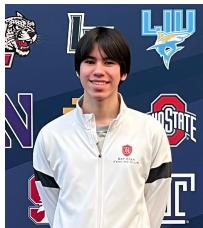

[53] A. v. d. Oord, Y. Li, and O. Vinyals, “Representation learning with contrastive predictive coding,” arXiv preprint arXiv:1807.03748, 2018.

William Gordon William Gordon is a junior at Basis Independent Silicon Valley. His research interests include 3D modeling, computer vision, and quality assessment. His other interests include fencing (with US national raking and medal) and building robotics.

VII. BIOGRAPHY SECTION  
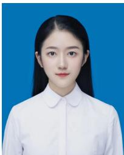

Jiarui Wang received the B.E. degree in communication engineering from Shanghai Jiao Tong University, Shanghai, China, in 2024. She is currently working toward the Ph.D. degree with the Department of Electronic Engineering, Shanghai Jiao Tong University, Shanghai, China. Her research interests include perceptual quality assessment, quality of experience, and multimodal signal processing.

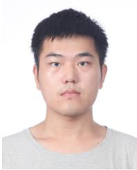

Yujie Zhang received the B.S. degree in electronic and information engineering from Beihang University, Beijing, China, in 2020, and the Ph.D. degree in information and communication engineering from Shanghai Jiao Tong University, Shanghai, China, in 2026. He is currently a researcher with JD.com. His research interests include visual quality assessment and reinforcement learning.

Guangtao Zhai (SM’19) received the B.E. and M.E. degrees from Shandong University, Shandong, China, in 2001 and 2004, respectively, and the Ph.D. degree from Shanghai Jiao Tong University, Shanghai, China, in 2009, where he is currently a Research Professor with the Institute of Image Communication and Information Processing. From 2008 to 2009, he was a Visiting Student with the Department of Electrical and Computer Engineering, McMaster University, Hamilton, ON, Canada, where he was a Post-Doctoral Fellow from 2010 to 2012.

From 2012 to 2013, he was a Humboldt Research Fellow with the Institute of Multimedia Communication and Signal Processing, Friedrich Alexander University of Erlangen-Nuremberg, Germany. He received the Award of National Excellent Ph.D. Thesis from the Ministry of Education of China in 2012. His research interests include multimedia signal processing and perceptual signal processing.

  
Yuke Xing received the B.E. degree in electronic engineering from Shanghai Jiao Tong University, Shanghai, China, in 2024. She is currently working toward the Ph.D. degree with the Cooperative MediaNet Innovation Center, Shanghai Jiao Tong University, Shanghai, China. Her research interests include perceptual quality assessment, 3D novel view synthesis, computer vision, and multimodal signal processing.

Yiling Xu received the B.S., M.S., and Ph.D degrees from the University of Electronic Science and Technology of China, in 1999, 2001, and 2004 respectively. From 2004 to 2013, she was a senior engineer with the Multimedia Communication Research Institute, Samsung Electronics Inc., South Korea. She joined Shanghai Jiao Tong University, where she is currently a professor in the areas of multimedia communication, 3D point cloud compression and assessment, system design, and network optimization. She is the associate editor of the IEEE

Transactions on Broadcasting. She is also an active member in standard organizations, including MPEG, 3GPP, and AVS.