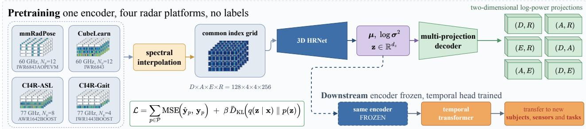
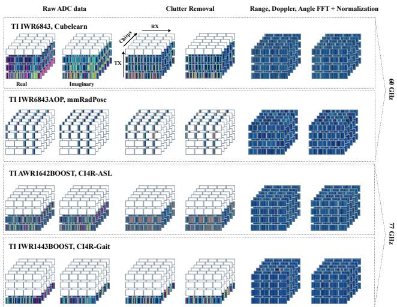

Accepted version of a paper to appear in the 2027 IEEE/CVF Winter Conference on Applications of Computer Vision (WACV). © 2027 IEEE. Personal use of this material is permitted. Permission from IEEE must be obtained for all other uses, in any current or future media, including reprinting/republishing this material for advertising or promotional purposes, creating new collective works, for resale or redistribution to servers or lists, or reuse of any copyrighted component of this work in other works.

# A Universal Raw-IQ Radar Encoder for Cross-Sensor Human Sensing

Jonas Leo Mueller1,3,5 Dario Zanca3 Sebastian Hoefler3,5 Jan Petermann1,5 Thomas Altstidl2,3,5 Naga Venkata Sai Jitin Jami3,5 Emmanuelle Salin2,5 Bjoern M. Eskofier1,2,3,4,5

1Institute for AI in Medicine, LMU Hospital, Munich, Germany

2Chair of AI-supported Therapy Decisions, Ludwig-Maximilians-Universitat M¨ unchen, Munich, Germany¨

3Department Artificial Intelligence in Biomedical Engineering, Friedrich-Alexander-Universitat Erlangen-N ¨ urnberg (FAU), Erlangen, Germany¨ 4Institute of AI for Health, Helmholtz Zentrum Munchen, Neuherberg, Germany ¨ 5Munich Center for Machine Learning (MCML), Munich, Germany jonas.leo.mueller@fau.de

## Abstract

Radar-based human sensing typically relies on end-to-end task-specific models trained on hand-chosen signal projections, which generalize poorly across unseen users, tasks, and hardware. We argue that the dominant signal processing choice, the micro-Doppler spectrogram, is a poor starting point for transfer because it keeps the Doppler axis, which carrierfrequency rescales, and discards the angular axis, which carrierfrequency leaves unchanged. We instead pretrain a convolutional β-VAE without labels on clutterremoved raw radar measurementsfromfour platforms spanning 60 and 77 GHz and 4 to 12 virtual antennas, aligned by a unified spectral interpolation grid. For every downstream benchmark the encoder staysfrozen, and only a small supervised temporal classifier is trained on its embeddings. We compare against supervised models trained end to end on each benchmark and a pretrained radarfoundation model across ten settings covering activity, gesture, sign-language, and gait recognition. When the test users and the radar are seen during training, our encoder is best on all five benchmarks. For users never seen in training, it leads on three offour benchmarks, by 4.8 to 23.2 points. On subjectdisjoint gait recognition, it is bestfor each ofthefour heldout subjects and 8.3 points above the strongest baseline on average, even though its pretraining excluded every recording of this radar. Excluding the test radar from pretraining costs at most 5.3 points on any benchmark. Code is available at https://github.com/jonasmueler/ UniversalRadarEncoder\_WACV.

## 1. Introduction

Radar-based contactless human sensing is gaining interest, from biomedical monitoring [8] to human pose estimation [2, 10, 13–16] and activity recognition [20, 21, 28–30].

Most models in this literature are trained and tested on one sensor. Radar hardware, however, differs substantially in antenna configuration, field of view, carrier frequency, and signal characteristics [3, 6], and representations do not carry over directly from one radar to another. Spectrogram classifiers for activity classification, for example, degrade severely when the test sensor differs from the training sensor [3], so transfer between sensors is a hard, open problem. We therefore pretrain one encoder across several radars, freeze it, and train only a small classifier on each benchmark’s labels (Fig. 1), so that what transfers to a new sensor is the representation rather than the classifier itself.

Before learning, the signal is usually tailored to the task. A frequency-modulated continuous-wave (FMCW) MIMO radar delivers a complex-valued multi-dimensional tensor, the radar cube, that combines range, velocity, and angular information from multiple synchronized transmit–receive antenna pairs [8]. Most pipelines collapse this cube early into a lower-dimensional, task-specific representation, and these representations differ in density and in the information they preserve [8]. Activity recognition sits at the dense, heavily projected end, where most models classify a single 2D time–frequency projection, above all the micro-Doppler spectrogram [3, 20, 21, 29], which preserves the Doppler dynamics of human motion but collapses range and angle entirely. Pose-estimation and automotive pipelines usually sit at the sparse end, reducing the signal to point clouds via constant false alarm rate (CFAR) detection and angleof-arrival (AoA) estimation [2, 26], which keeps an explicit representation suited to localization. Only a few systems operate close to the original tensor [10, 13, 16, 36]. For the input of such an encoder, new evidence favors data close to the raw signal. On a 3D occupancy-prediction task, omitting the Doppler FFT raises the test loss by 22.5%, replacing dense antenna measurements with AoA estimates by 28.0%, and applying CFAR thresholding by 31.5%, each as large a degradation as training on more than ten times less data [6]. Operating on the raw complex tensor [16] improves pose estimation by 19% over the CFAR point-cloud pipeline of Engel et al. [2], and in activity recognition the spectrogram yields 86.49% accuracy, the range–time map 95.25%, and fusing multiple views of the cube 95.80% [28]. In general, a gradient in performance gains can be observed by including more of the raw data in the input to the encoder.

  
Figure 1. One frozen encoder across four radar platforms. A β-VAE is pretrained without labels on raw IQ from four sensors spanning 60 and 77 GHz and 4 to 12 virtual antennas, aligned on a common index grid by spectral interpolation. The encoder is then frozen and reused unchanged, with only a small temporal head trained per benchmark, including under simultaneous shifts in subject, sensor, and task.

We also expect a physical advantage for transfer using the full tensor. As we derive in Sec. 3, the Doppler axis that the spectrogram keeps rescales with the carrier frequency, while the angular axis it discards does not on a half-wavelength array. Raw IQ, the complex-valued in-phase and quadrature (IQ) cube after a Fourier transform along all four axes, keeps both, since every measurement axis reaches the encoder uncollapsed. Whether one frozen encoder pretrained on raw IQ from several radars works on users and radars it has not seen remains open, and this is what our experiments test.

Two choices make joint pretraining across heterogeneous sensors possible. First, spectral interpolation and normalization align the radar tensors of all platforms on a common grid. Second, the encoder, a convolutional β-variational autoencoder (β-VAE) built on 3D High-Resolution Network (HRNet) layers [5, 16, 31], takes the real and imaginary components as two channels. It is trained to reconstruct six 2D log-power projections rather than the input cube, because reconstructing the full 4D tensor is expensive and largely redundant, while fusing several projections improves classification accuracy in practice [28]. Our contributions are:

• A spectral-interpolation grid that aligns radar cubes of differing geometry, enabling joint pretraining across 60 and 77 GHz single-chip platforms with 4 to 12 virtual antennas.

• A β-VAE that learns transferable representations from unlabeled raw IQ by reconstructing six log-power projections.

• A frozen-encoder evaluation over ten settings on these platforms, in which our representations lead the strongest supervised and pretrained baselines by up to 23.2 points for unseen users and by up to 22.9 points when the sensor is unseen as well.

## 2. Related Work

Representations for human sensing with radar. Most FMCW human-sensing pipelines reduce the raw cube before any learning, to point clouds or to micro-Doppler spectrograms. For activity recognition, the standard recipe treats the micro-Doppler spectrogram as a 2D Doppler–time image and classifies it with a convolutional network [3, 20, 21], which our Spectrogram CNN baseline reproduces. Working closer to the cube, Zhao et al. [36] make the range–Doppler transform itself learnable and train an end-to-end classifier on the result. We retrain their strongest model as our supervised reference. Stadelmayer et al. [25] classify activities directly from raw ADC samples with parametric sinc and wavelet kernels, but their proprietary sensor and unavailable code and recordings prevent replication here.

General-purpose radar encoders. The closest comparison is GRT [6], a foundation model pretrained on one million 4D radar cubes from a single sensor against lidarderived occupancy targets. It matches the single-chip geometry of our benchmarks and is available pretrained, so we evaluate it under our protocol. Other self-supervised radar work targets one problem each, for example gesture recognition [23], human pose [33], spatial uncertainty [32], or micro-Doppler recognition [18], rather than an encoder reused across tasks and sensors.

Cross-sensor and cross-domain transfer. The classification performance of radar models shifts across environments [27], subjects and positions [12, 17], and previously unseen actions [35]. Hardware heterogeneity is a particularly severe factor. Gurbuz et al. [3] document an approximate 70% performance collapse when the pretraining, fine-tuning, and evaluation platforms differ. Even the successful cross-frequency transfer of Shrestha et al. [24], which carries a 25 GHz model to a 5.8 GHz radar, relies on hand-crafted normalization of the spectrogram axis rather than a learned representation. Existing mitigation strategies fit models to each deployment through direct target measurement [17, 27], unsupervised collection [1], budgetconstrained labeling [12], or simulation [3, 22, 35]. They also predominantly use micro-Doppler or time-Doppler spectrograms [3, 12, 17, 22, 24]. We instead learn directly from raw IQ and evaluate a fully frozen encoder on radar hardware excluded from pretraining, across antenna configurations and carrier frequencies.

## 3. FMCW Radar Data Representation

Goal and common grid. We seek one encoder that transfers to radar platforms excluded from its pretraining, without adapting its weights. The obstacle is that platforms differ in antenna count, sample count, sweep timing, and carrier frequency, so their raw tensors agree in neither shape nor spectral scaling. We therefore map every recording onto one canonical tensor, the common index grid, with $R { = } 2 5 6$ fast-time samples, D=128 chirps, and a 4×4 antenna plane $\scriptstyle ( A = E = 4 )$ . Much like images from different cameras resized to one resolution, all sensors then share the same axes and origins after zero-filling and a Fourier transform, while each axis keeps a fixed scale per sensor, like a camera’s zoom. On the receive axis this scale is practically identical across carriers, because each board spaces its receivers at about its own half wavelength, so on the row boards equal indices mean equal directions at 60 and 77 GHz alike. On range and Doppler it remains a per-sensor constant, and the carrier adds a further stretch to Doppler from 60 to 77 GHz. Since these constants never change with the scene, the encoder can learn to absorb them, as we argue below.

The radar cube. An FMCW radar transmits short frequency sweeps, called chirps, and mixes each returning echo with the transmitted signal [11, 19]. Digitizing gives, per frame, a complex-valued tensor, the radar cube $x [ s , m , n _ { a } , n _ { e } ]$ , indexed by the sample s within a chirp (fast time), the chirp m (slow time), and two antenna axes $n _ { a } , n _ { e } ,$ on which a MIMO radar treats each transmit–receive pair as one virtual element. For K scatterers at range r, radial velocity v, and direction $( \theta , \phi )$ , each axis carries one phase term,

$$
x [ s , m , n _ { a } , n _ { e } ] = \sum _ { k = 1 } ^ { K } \alpha _ { k } e ^ { \jmath 2 \pi \left( f _ { k } ^ { R } s + f _ { k } ^ { D } m + \psi _ { k } ^ { A } ( n _ { a } ) + \psi _ { k } ^ { E } ( n _ { e } ) \right) } ,\tag{1}
$$

where $\alpha _ { k }$ is the complex reflectivity of scatterer k [11]. Along fast time, an echo from range r returns after a delay $2 r / c ,$ , with light speed c, so mixing with a sweep of slope

S leaves $f ^ { R } = 2 S r / ( c f _ { s } )$ cycles per sample at sampling rate $f _ { s } .$ . Along slow time, a scatterer moves by $v T _ { c }$ during the per-transmitter chirp interval $T _ { c }$ , advancing its phase by $f ^ { D } = 2 T _ { c } v / \lambda$ cycles per chirp at wavelength λ. Across the array, the phase is the extra path to a virtual antenna in wavelengths. It splits into one term per antenna axis, $\psi ^ { A }$ and $\psi ^ { E }$ On mmRadPose (Tab. 1) these follow azimuth and elevation, on the other boards $\psi ^ { A }$ follows the transmitters and $\psi ^ { E }$ the receivers. A Fourier transform along an axis turns a linear phase into a peak at an index proportional to its frequency.

Carrier-frequency invariant structure. Pretraining across radars depends on what an index means on each sensor, and Eq. (1) answers this axis by axis. Range is carrier-invariant, since $f ^ { R }$ contains no wavelength. The receive axis is carrier-invariant as well, because each board spaces its receivers at about its own $\lambda / 2 ,$ , in a row on three boards and in 2D on the IWR6843AOP of mmRadPose. Element $n _ { e }$ of a row then has phase ${ \scriptstyle { \frac { 1 } { 2 } } } n _ { e }$ sin θ, the wavelength cancels, and on the row boards the same E index means the same azimuth at 60 and 77 GHz, while on mmRadPose both array axes are carrier-free. Only Doppler keeps the carrier, through λ in $f ^ { D }$ . The encoder must learn to compensate for the remaining sensor-specific differences. On range and Doppler, sensors differ by a stretch that maps zero to zero, set by sweep slope and sampling rate for range and by chirp timing and wavelength for Doppler. On the antenna axes, each sensor contributes a fixed pattern. Time-division (mmRadPose, CubeLearn) and phase-coded (CI4R-ASL) boards also leave an uncompensated velocity-dependent phase or leakage between transmitter streams. Stretches and patterns are hardware constants, and this residual is a fixed per-sensor function of velocity, which makes joint pretraining plausible for arrays with a half-wavelength receive axis, while other receive geometries would need resampling or calibration. Our leave-one-sensor-out experiments test whether a frozen encoder absorbs these differences without adaptation.

Preprocessing onto the common grid. Four deterministic steps map every sensor to the common grid (Fig. 2). (i) Static clutter is removed by subtracting from every antenna– sample series its mean over the chirps of the frame, which suppresses the zero-Doppler component and keeps the moving returns. (ii) The cube is zero-filled into the canonical grid, which is the spectral interpolation of our pipeline and discards no sample. The twelve virtual antennas of the prevailing three-transmitter, four-receiver configuration are written into the $4 { \times } 4$ plane by a fixed element-to-cell map, sensors with fewer chains populate fewer cells, and, since R and D match or exceed every platform’s counts, no recording is truncated. (iii) A Fourier transform is applied along all four axes. (iv) Each frame is normalized to unit RMS magnitude to remove sensor gain and enters the model as two real channels holding its real and imaginary parts.

Table 1. Sensors and downstream benchmarks. HAR, HGR, AGR, and ASL denote human activity recognition, hand gesture recognition, arm gesture recognition, and American Sign Language, respectively. $N _ { v }$ is the number of virtual antenna channels embedded in the common 4×4 grid.
<table><tr><td>Dataset</td><td>Platform</td><td>Carrier</td><td> $N _ { v }$ </td><td>Benchmark</td><td>Split and evaluation role</td></tr><tr><td>mmRadPose</td><td>IWR6843AOPEVM</td><td>60 GHz</td><td>12</td><td>12 rehabilitation exercises</td><td>participant-disjoint, unseen-subject test</td></tr><tr><td>CubeLearn</td><td>IWR6843ISK</td><td>60 GHz</td><td>12</td><td>HAR, HGR, AGR</td><td>in-set comparison, out-of-set unseen-user test</td></tr><tr><td>CI4R-ASL</td><td>AWR1642BOOST</td><td>77 GHz</td><td>8</td><td>18 daily-activity and ASL classes</td><td>subject-mixed, published-protocol comparison</td></tr><tr><td>CI4R-Gait</td><td>IWR1443BOOST</td><td>77 GHz</td><td>4</td><td>11 activities and gaits</td><td>subject-mixed comparison, leave-one-subject-out test</td></tr></table>

## 4. Method

Our method has two phases. During unlabeled pretraining, an encoder maps each aligned IQ frame to a latent code, and a set of decoders reconstructs six power projections. The decoders are then discarded. For every downstream benchmark, the encoder remains frozen, each recording becomes a sequence of per-frame posterior means, and a small temporal classifier is trained on the benchmark’s labels.

## 4.1. Model architecture

The pretraining model is a β-variational autoencoder (β- VAE) [4, 7] that maps one radar frame to a compact latent vector and reconstructs a set of two-dimensional power projections.

  
Figure 2. Preprocessing on real recordings from all four sensors. Each block is one frame on the canonical $D \times A \times E \times R$ grid, with six chirp slices, the 4×4 antenna plane as cells, and range across each cell. Real and imaginary parts are shown separately. Outlined cells are zero-filled. The sensors populate 12, 12, 8, and 4 of the 16 antenna cells, respectively, and mmRadPose fills 64 of 256 range samples. The transform chain aligns range and Doppler while retaining each sensor’s fixed antenna pattern.

Encoder. The IQ input from Sec. 3 has shape $( D , A , E , R , C )$ , with D=128 chirps, $A { = } E { = } 4$ antenna dimensions, R range bins, and C=2 real and imaginary channels. To use a 3D backbone, we reshape the two IQ channels into the Doppler extent, giving a volume of size $( D \times C , A , E , R )$ , which preserves every input value. A 3D HRNet [5, 16, 31] extracts multi-resolution features, which a two-layer transformer aggregates through a learned [CLS] token. Two linear heads produce the mean µ and log-variance log $\sigma ^ { 2 }$ of a diagonal Gaussian with $d _ { z } = 2 5 6$ . During training, we sample $\mathbf { z } = \pmb { \mu } + \pmb { \sigma } \odot \pmb { \epsilon }$ with $\mathbf { \epsilon } \gets \mathcal { N } ( \mathbf { 0 } , \mathbf { I } )$

Multi-projection decoder. Rather than reconstructing the full four-dimensional cube, the decoders predict six two-dimensional log-power projections. For each retained pair of axes, we sum IQ power over the other two, giving range–Doppler (D, R), range–azimuth (A, R), range–elevation (E, R), Doppler–azimuth $( D , A )$ , azimuth– elevation (A, E), and Doppler–elevation $( D , E )$ . Each map has a lightweight decoder sized to its output resolution. Thus, the encoder receives the full complex tensor, while projection-space targets provide efficient supervision that preserves pairwise structure across range, velocity, and angle without full 4D reconstruction.

Downstream classifier. Each recording becomes a variable-length sequence of per-frame embeddings $( \mathbf { e } _ { 1 } , \hdots , \mathbf { e } _ { T } )$ , where $\mathbf { e } _ { t } = \pmb { \mu } _ { t } \in \mathbb { R } ^ { d _ { z } }$ is the latent mean of frame t. A temporal transformer with a learned [CLS] token, positional embeddings, and a padding mask maps that sequence to class logits. Within each benchmark, every encoder is evaluated with the identical head and training protocol, apart from its input width and the number of classes. The head has one layer on mmRadPose and CubeLearn and four layers on CI4R, whose recordings are an order of magnitude longer, with dropout 0.3 throughout. The head reads the deterministic mean at both training and test time and is trained for 200 epochs with cross-entropy and label smoothing of 0.1. The validation-selected checkpoint is evaluated once on the held-out test split.

Table 2. CubeLearn under the official protocol of [36], where in-set = seen users 0–5 and out = unseen users 6–7. Mea $1 \pm \mathrm { s t d }$ over 3 seeds. Bold = best per column and panel.
<table><tr><td></td><td colspan="2">Cube:HAR</td><td colspan="2">Cube:HGR</td><td colspan="2">Cube:AGR</td></tr><tr><td>Model</td><td>in-set</td><td>out</td><td>in-set</td><td>out</td><td>in-set</td><td>out</td></tr><tr><td colspan="7">(a) Accuracy</td></tr><tr><td>RDAT (DFT) [36]</td><td> $0 . 9 9 2 _ { \pm 0 . 0 0 3 }$ </td><td> $0 . 7 2 1 { \scriptstyle \pm 0 . 0 8 0 }$ </td><td> $0 . 9 7 3 { \scriptstyle \pm 0 . 0 0 1 }$ </td><td> $0 . 4 9 1 _ { \pm 0 . 0 3 0 }$ </td><td> $0 . 9 8 6 _ { \pm 0 . 0 1 1 }$ </td><td> $0 . 7 8 4 { \scriptstyle \pm 0 . 0 1 3 }$ </td></tr><tr><td>RDAT (CubeLearn) [36]</td><td> $0 . 9 9 2 _ { \pm 0 . 0 0 6 }$ </td><td> $0 . 7 6 5 { \scriptstyle \pm 0 . 1 0 3 }$ </td><td> $0 . 9 6 9 { \scriptstyle \pm 0 . 0 0 5 }$ </td><td> $0 . 4 9 1 { \scriptstyle \pm 0 . 0 4 3 }$ </td><td> $0 . 9 9 1 { \scriptstyle \pm 0 . 0 0 8 }$ </td><td> $0 . 8 4 7 { \scriptstyle \pm 0 . 0 1 6 }$ </td></tr><tr><td>RadMamba [34]</td><td> $0 . 9 3 0 { \scriptstyle \pm 0 . 0 5 0 }$ </td><td> $0 . 8 6 5 _ { \pm 0 . 0 9 7 }$ </td><td> $0 . 7 4 4 { \scriptstyle \pm 0 . 0 4 2 }$ </td><td> $0 . 6 2 9 { \scriptstyle \pm 0 . 0 5 3 }$ </td><td> $0 . 9 2 9 { \scriptstyle \pm 0 . 0 0 9 }$ </td><td> $0 . 8 1 0 { \scriptstyle \pm 0 . 0 1 1 }$ </td></tr><tr><td>GRT [6]</td><td> $0 . 9 9 4 { \scriptstyle \pm 0 . 0 0 6 }$ </td><td> $0 . 4 6 8 { \scriptstyle \pm 0 . 0 2 8 }$ </td><td> $0 . 9 6 9 { \scriptstyle \pm 0 . 0 0 5 }$ </td><td> $0 . 6 9 6 { \scriptstyle \pm 0 . 0 0 9 }$ </td><td> $0 . 9 9 0 { \scriptstyle \pm 0 . 0 0 3 }$ </td><td> $\mathbf { 0 . 9 6 4 } _ { \pm 0 . 0 1 6 }$ </td></tr><tr><td>Spectrogram CNN</td><td> $0 . 9 8 1 _ { \pm 0 . 0 0 6 }$ </td><td> $0 . 8 8 2 _ { \pm 0 . 0 0 4 }$ </td><td> $0 . 7 1 9 { \scriptstyle \pm 0 . 0 2 6 }$ </td><td> $0 . 6 0 2 _ { \pm 0 . 0 2 4 }$ </td><td> $0 . 9 5 5 { \scriptstyle \pm 0 . 0 0 1 }$ </td><td> $0 . 8 6 3 _ { \pm 0 . 0 1 3 }$ </td></tr><tr><td colspan="7">Ours</td></tr><tr><td>Raw-IQ VAE (all sensors)</td><td> $\mathbf { 0 . 9 9 5 { \scriptstyle \pm 0 . 0 0 6 } }$ </td><td> $\mathbf { 0 . 9 3 0 { \scriptstyle \pm 0 . 0 3 4 } }$ </td><td> $\mathbf { 0 . 9 8 0 { \scriptstyle \pm 0 . 0 0 5 } }$ </td><td> $\mathbf { 0 . 8 2 5 { \scriptstyle \pm 0 . 0 0 5 } }$ </td><td> $\mathbf { 0 . 9 9 6 } _ { \pm 0 . 0 0 6 }$ </td><td> $0 . 9 0 5 { \scriptstyle \pm 0 . 0 0 8 }$ </td></tr><tr><td>Raw-IQ VAE (sensor held out)</td><td> $0 . 9 9 2 _ { \pm 0 . 0 1 2 }$ </td><td> $0 . 8 7 7 { \scriptstyle \pm 0 . 0 5 1 }$ </td><td> $0 . 9 5 7 _ { \pm 0 . 0 0 6 }$ </td><td> $0 . 7 8 4 { \scriptstyle \pm 0 . 0 1 5 }$ </td><td> $\mathbf { 0 . 9 9 6 _ { \pm 0 . 0 0 3 } }$ </td><td> $0 . 9 5 6 _ { \pm 0 . 0 0 7 }$ </td></tr><tr><td colspan="7">(b) Macro-F1</td></tr><tr><td>RDAT (DFT) [36]</td><td> $0 . 9 9 2 _ { \pm 0 . 0 0 3 }$ </td><td> $0 . 7 1 0 { \scriptstyle \pm 0 . 0 8 3 }$ </td><td> $0 . 9 7 3 { \scriptstyle \pm 0 . 0 0 1 }$ </td><td> $0 . 4 7 5 { \scriptstyle \pm 0 . 0 2 3 }$ </td><td> $0 . 9 8 6 _ { \pm 0 . 0 1 1 }$ </td><td> $0 . 7 8 0 { \scriptstyle \pm 0 . 0 1 8 }$ </td></tr><tr><td>RDAT (CubeLearn) [36]</td><td> $0 . 9 9 2 _ { \pm 0 . 0 0 6 }$ </td><td> $0 . 7 5 4 { \scriptstyle \pm 0 . 1 0 3 }$ </td><td> $0 . 9 6 9 _ { \pm 0 . 0 0 5 }$ </td><td> $0 . 4 7 7 _ { \pm 0 . 0 3 4 }$ </td><td> $0 . 9 9 1 _ { \pm 0 . 0 0 8 }$ </td><td> $0 . 8 4 5 { \scriptstyle \pm 0 . 0 1 5 }$ </td></tr><tr><td>RadMamba [34]</td><td> $0 . 9 2 9 { \scriptstyle \pm 0 . 0 5 0 }$ </td><td> $0 . 8 5 8 { \scriptstyle \pm 0 . 1 0 4 }$ </td><td> $0 . 7 4 2 { \scriptstyle \pm 0 . 0 4 2 }$ </td><td> $0 . 6 2 8 { \scriptstyle \pm 0 . 0 5 3 }$ </td><td> $0 . 9 2 9 { \scriptstyle \pm 0 . 0 0 9 }$ </td><td> $0 . 8 0 8 { \scriptstyle \pm 0 . 0 1 1 }$ </td></tr><tr><td>GRT [6]</td><td> $0 . 9 9 4 _ { \pm 0 . 0 0 6 }$ </td><td> $0 . 4 5 9 { \scriptstyle \pm 0 . 0 3 9 }$ </td><td> $0 . 9 7 0 { \scriptstyle \pm 0 . 0 0 5 }$ </td><td> $0 . 6 7 6 { \scriptstyle \pm 0 . 0 0 3 }$ </td><td> $0 . 9 8 9 { \scriptstyle \pm 0 . 0 0 3 }$ </td><td> $\mathbf { 0 . 9 6 4 } _ { \pm 0 . 0 1 6 }$ </td></tr><tr><td>Spectrogram CNN</td><td> $0 . 9 8 1 { \scriptstyle \pm 0 . 0 0 6 }$ </td><td> $0 . 8 7 9 { \scriptstyle \pm 0 . 0 0 5 }$ </td><td> $0 . 7 1 5 { \scriptstyle \pm 0 . 0 2 7 }$ </td><td> $0 . 5 9 4 { \scriptstyle \pm 0 . 0 2 0 }$ </td><td> $0 . 9 5 5 { \scriptstyle \pm 0 . 0 0 1 }$ </td><td> $0 . 8 5 9 { \scriptstyle \pm 0 . 0 1 6 }$ </td></tr><tr><td colspan="7">Ours</td></tr><tr><td>Raw-IQ VAE (all sensors)</td><td> $\mathbf { 0 . 9 9 5 { \scriptstyle \pm 0 . 0 0 6 } }$ </td><td> $\mathbf { 0 . 9 2 8 _ { \pm 0 . 0 3 5 } }$ </td><td> $\mathbf { 0 . 9 8 0 _ { \pm 0 . 0 0 5 } }$ </td><td> $\mathbf { 0 . 8 1 2 _ { \pm 0 . 0 0 3 } }$ </td><td> $\mathbf { 0 . 9 9 6 _ { \pm 0 . 0 0 6 } }$ </td><td> $0 . 9 0 4 { \scriptstyle \pm 0 . 0 0 8 }$ </td></tr><tr><td>Raw-IQ VAE (sensor held out)</td><td> $0 . 9 9 1 { \scriptstyle \pm 0 . 0 1 3 }$ </td><td> $0 . 8 7 8 { \scriptstyle \pm 0 . 0 5 1 }$ </td><td> $0 . 9 5 7 { \scriptstyle \pm 0 . 0 0 6 }$ </td><td> $0 . 7 7 7 { \scriptstyle \pm 0 . 0 1 8 }$ </td><td> $\mathbf { 0 . 9 9 6 _ { \pm 0 . 0 0 3 } }$ </td><td> $0 . 9 5 6 { \scriptstyle \pm 0 . 0 0 6 }$ </td></tr></table>

## 4.2. Training

We train the β-VAE [4, 7] by minimizing the negative $\beta -$ weighted evidence lower bound of the projections, estimated with one reparameterized sample per frame,

$$
\mathcal { L } = \sum _ { p \in \mathcal { P } } \mathrm { M S E } \big ( \hat { \mathbf { y } } _ { p } , \mathbf { y } _ { p } \big ) + \beta \bar { D } _ { \mathrm { K L } } \big ( q ( \mathbf { z } \mid \mathbf { x } ) \parallel p ( \mathbf { z } ) \big ) ,\tag{2}
$$

where $\mathcal { P }$ is the set of six projections, $\hat { \mathbf { y } } _ { p }$ and $\mathbf { y } _ { p }$ are the predicted and target log-power maps, and $\bar { D } _ { \mathrm { K L } } = D _ { \mathrm { K L } } / d _ { z }$ is normalized per latent dimension. Element-wise MSE gives every projection equal weight regardless of its size, while the KL term regularizes the latent posterior toward $p ( \mathbf { z } ) = \mathcal { N } ( \mathbf { 0 } , \mathbf { I } )$ . We set $\beta { = } 0 . 1$ with a five-epoch linear warmup and train with AdamW, cosine annealing, gradient clipping at 1.0, batch size 16, and 50 fixed-length epochs of frames drawn with replacement. Each dataset receives an equal share, 1/4 in the all-sensor pool and $1 / 3$ in each leaveone-sensor-out pool, with CubeLearn’s share split evenly across HAR, HGR, and AGR, so every pool receives the same number of optimization steps.

## 4.3. Datasets

Four public FMCW radar datasets serve as unlabeled pretraining sources and labeled downstream benchmarks (Tab. 1). Wherever a release provides a participant-disjoint protocol, we use it, because it directly tests transfer to a new person. CI4R-ASL and CI4R-Gait publish subject-mixed protocols, which we keep for protocol-matched comparison with prior work, and we add leave-one-subject-out evaluation on CI4R-Gait to isolate subject transfer. Every pretraining pool contains only non-test data, and each downstream test set stays unseen during pretraining and classifier training. The held-out-sensor claims use leave-one-sensor-out encoders whose pool excludes the evaluated platform entirely (Sec. 6.3).

mmRadPose. mmRadPose [2, 16] holds raw ADC recordings of 12 participants performing 12 rehabilitation exercises. We use its participant-disjoint protocol [16], the release’s direct test of generalization to a new person, with p4–p11 for training, p3 for validation, and p1, p2, and p12 for testing. Both the VAE and the classifier train on p4–p11 and select their checkpoints on p3, and the classifier is evaluated once on the three test participants, which neither stage has seen.

Table 3. mmRadPose, 12-class participant-disjoint HAR, chance =0.083. $\mathbf { M e a n \pm s t d }$ over 3 seeds. Bold = best per column.
<table><tr><td>Model</td><td>Accuracy</td><td>Macro-F1</td></tr><tr><td>RDAT (DFT) [36]</td><td> $0 . 0 8 8 { \scriptstyle \pm 0 . 0 0 5 }$ </td><td> $0 . 0 1 3 { \scriptstyle \pm 0 . 0 0 1 }$ </td></tr><tr><td>RDAT (CubeLearn) [36]</td><td> $0 . 0 9 1 { \scriptstyle \pm 0 . 0 0 5 }$ </td><td> $0 . 0 1 4 { \scriptstyle \pm 0 . 0 0 1 }$ </td></tr><tr><td>RadMamba [34]</td><td> $0 . 4 8 4 { \scriptstyle \pm 0 . 0 3 9 }$ </td><td> $0 . 4 7 3 { \scriptstyle \pm 0 . 0 4 5 }$ </td></tr><tr><td>GRT [6]</td><td> $0 . 6 4 8 { \scriptstyle \pm 0 . 0 8 8 }$ </td><td> $0 . 6 2 9 { \scriptstyle \pm 0 . 1 0 1 }$ </td></tr><tr><td>Spectrogram CNN</td><td> $0 . 5 2 5 { \scriptstyle \pm 0 . 0 0 5 }$ </td><td> $0 . 5 1 5 { \scriptstyle \pm 0 . 0 0 9 }$ </td></tr><tr><td>Ours</td><td></td><td></td></tr><tr><td>Raw-IQ VAE (all sensors)</td><td> $\mathbf { 0 . 8 8 0 _ { \pm 0 . 0 7 7 } }$ </td><td> $0 . 8 7 0 { \scriptstyle \pm 0 . 0 8 9 }$ </td></tr><tr><td>Raw-IQ VAE (sensor held out)</td><td> $0 . 8 7 7 { \scriptstyle \pm 0 . 0 1 6 }$ </td><td> $\mathbf { 0 . 8 7 7 { \scriptstyle \pm 0 . 0 1 6 } }$ </td></tr></table>

Table 4. The two 77 GHz CI4R benchmarks under their releases’ subject-mixed protocols, namely CI4R-ASL [9] (18 activity and sign classes, chance =0.056) and CI4R-Gait [3] (11 activities and gaits, chance =0.091). $\mathbf { M e a n } _ { \pm \mathrm { s t d } }$ over 3 seeds. Every row is scored on one identical partition per release, so all rows are directly comparable. Bold = best per column.
<table><tr><td></td><td colspan="2">CI4R-ASL</td><td colspan="2">CI4R-Gait</td></tr><tr><td>Model</td><td> $\operatorname { A c c } .$ </td><td>Macro-F1</td><td> $\operatorname { A c c } .$ </td><td>Macro-F1</td></tr><tr><td>GRT [6]</td><td> $0 . 9 3 8 { \scriptstyle \pm 0 . 0 1 0 }$ </td><td> $0 . 8 9 9 { \scriptstyle \pm 0 . 0 1 5 }$ </td><td> $0 . 9 1 5 { \scriptstyle \pm 0 . 0 2 3 }$ </td><td> $0 . 9 2 7 { \scriptstyle \pm 0 . 0 2 0 }$ </td></tr><tr><td>RDAT (DFT) [36]</td><td> $0 . 7 3 7 { \scriptstyle \pm 0 . 0 3 6 }$ </td><td> $0 . 5 3 5 { \scriptstyle \pm 0 . 0 6 4 }$ </td><td> $0 . 6 7 5 { \scriptstyle \pm 0 . 0 5 1 }$ </td><td> $0 . 6 9 6 _ { \pm 0 . 0 6 0 }$ </td></tr><tr><td>RDAT (CubeLearn) [36]</td><td> $0 . 6 7 9 { \scriptstyle \pm 0 . 0 1 9 }$ </td><td> $0 . 4 4 4 _ { \pm 0 . 0 3 1 }$ </td><td> $0 . 6 3 3 { \scriptstyle \pm 0 . 0 2 5 }$ </td><td> $0 . 6 3 2 _ { \pm 0 . 0 4 1 }$ </td></tr><tr><td>RadMamba [34]</td><td> $0 . 9 3 4 { \scriptstyle \pm 0 . 0 0 6 }$ </td><td> $0 . 8 9 0 { \scriptstyle \pm 0 . 0 1 0 }$ </td><td> $0 . 8 1 0 { \scriptstyle \pm 0 . 0 2 3 }$ </td><td> $0 . 8 1 5 { \scriptstyle \pm 0 . 0 3 2 }$ </td></tr><tr><td>Spectrogram CNN</td><td> $0 . 9 5 1 { \scriptstyle \pm 0 . 0 0 3 }$ </td><td> $0 . 9 1 8 { \scriptstyle \pm 0 . 0 0 4 }$ </td><td> $0 . 7 2 3 { \scriptstyle \pm 0 . 0 0 8 }$ </td><td> $0 . 7 1 6 { \scriptstyle \pm 0 . 0 0 7 }$ </td></tr><tr><td colspan="5">Ours</td></tr><tr><td>Raw-IQ VAE (all sensors)</td><td> $\mathbf { 0 . 9 7 1 { \scriptstyle \pm 0 . 0 0 7 } }$ </td><td> $\mathbf { 0 . 9 5 3 _ { \pm 0 . 0 1 0 } }$ </td><td> $\mathbf { 0 . 9 5 1 } _ { \pm 0 . 0 1 2 }$ </td><td> $\mathbf { 0 . 9 5 3 _ { \pm 0 . 0 1 1 } }$ </td></tr><tr><td>Raw-IQ VAE (sensor held out)</td><td> $0 . 9 6 7 _ { \pm 0 . 0 0 2 }$ </td><td> $0 . 9 4 6 _ { \pm 0 . 0 0 3 }$ </td><td> $0 . 9 0 0 { \scriptstyle \pm 0 . 0 2 0 }$ </td><td> $0 . 9 0 6 _ { \pm 0 . 0 1 5 }$ </td></tr></table>

CI4R-ASL. CI4R-ASL is the ASL Sequential Dataset of [9]. The benchmark classifies ground-truth segments, 1496 labeled repetitions in 324 recordings, split into 1047 training, 150 validation, and 299 test repetitions. We keep the authors’ shuffled subject-mixed protocol, the only published setting for a protocol-matched comparison. Since every participant appears in training and test, the comparison is protocol-matched rather than evidence of cross-user transfer. Only the 1047 training repetitions enter any pretraining pool, and the VAE carves its own validation slice from them, so benchmark validation and test repetitions enter neither pretraining nor classifier training.

CubeLearn. CubeLearn [36] holds raw ADC data of 8 users in HAR, hand-gesture (HGR), and arm-gesture (AGR) subsets. Its in-set split, the standard in-distribution comparison, divides the recording indices of users 0–5 into 15/5/10 train, validation, and test samples. The out-of-set split withholds users 6–7 entirely and tests on all 30 of their samples per user and class, giving 360 recordings on HAR and 720 on each gesture task, and is our second participantdisjoint test. The VAE uses only in-set train and validation frames, without labels, so no component sees an out-of-set user. HGR and AGR contribute their training splits to the all-sensor pool and, under leave-one-sensor-out, are unseen as both task and sensor.

CI4R-Gait. CI4R-Gait is the activity-and-gait release of [3], in which six participants perform 11 daily activities and ambulatory gaits in 652 recordings under five released subject codes, which we treat as subjects. We use only its 77 GHz channel and keep the shuffled subject-mixed protocol, with 457 training, 65 validation, and 130 test recordings, for a protocol-matched comparison with its published spectrogram classifier. Only the 457 training recordings enter any pretraining pool, again with the VAE’s validation slice carved from them. Because subject mixing cannot test person-independent recognition, we add leave-one-subjectout folds (Sec. 6.3). Four usable subject codes contribute 116, 91, 221, and 214 recordings, and a fifth with ten singleclass recordings always stays in training, which fixes the evaluation at four folds.

## 5. Experimental Setup

We evaluate two kinds of encoder. The all-sensor encoder is pretrained without labels on all four platforms and every task. Each leave-one-sensor-out encoder drops one platform from that pool and is evaluated on the dropped platform’s benchmark, so its test sensor contributed no frame to its pretraining. Pretraining draws only on the training and validation frames of each benchmark, and a held-out subject is withheld from it as well as from the classifier. Every number is mean $\pm \mathrm { s t d }$ over three seeds, reported as accuracy and macro-F1.

## 5.1. Baselines

We compare against three published methods, each run from its authors’ released code under our splits and seeds. One rule governs all inputs. Every method runs in the configuration its authors published, receives clutter removal only if its authors used it, and is never given range bins cherrypicked for a particular dataset. RDAT 3DCNNLSTM [36], the supervised model of CubeLearn, is evaluated with its conventional DFT and its learnable CubeLearn front end, denoted RDAT (DFT) and RDAT (CubeLearn), and keeps its published crop of 64 chirps × 128 range samples, because its LSTM input size is tied to that crop. RadMamba [34], a supervised micro-Doppler model, runs the authors’ spectrogram pipeline identically on every benchmark, without clutter removal and over the full range axis instead of their sensor-specific range window. GRT [6], a pretrained radar encoder foundation model, is frozen at its released checkpoint, receives every sensor on the Doppler–range grid and virtual-array layout it was pretrained on, and is classified with our temporal head. As the standard micro-Doppler pipeline, a Spectrogram CNN classifies the Doppler–time spectrogram of one receive channel over the whole recording, computed with clutter removal, with a 2D CNN trained from scratch on each benchmark. The published systems of the two CI4R releases [3, 9] used train/test partitions whose seeds are unpublished, so we cite rather than tabulate them.

Table 5. Leave-one-subject-out CI4R-Gait, where each fold holds one subject code out of training, validation, and model selection. Per-fold cells are accuracy with held-out recordings beneath, and the last two columns average over folds. All cells are $\mathrm { \ m e a n _ { \pm s t d } }$ over 3 seeds. Bold = best per column
<table><tr><td></td><td colspan="4">Per-fold accuracy</td><td colspan="2">Mean over folds</td></tr><tr><td>Model</td><td>S1 116</td><td>S2 91</td><td>S3 221</td><td>S4 214</td><td>Accuracy 642</td><td>Macro-F1</td></tr><tr><td>GRT [6]</td><td> $0 . 4 9 1 _ { \pm 0 . 0 2 6 }$ </td><td> $0 . 4 8 4 { \scriptstyle \pm 0 . 0 9 4 }$ </td><td> $0 . 5 4 9 { \scriptstyle \pm 0 . 0 1 9 }$ </td><td> $0 . 6 0 6 _ { \pm 0 . 0 1 0 }$ </td><td> $0 . 5 3 2 _ { \pm 0 . 0 2 7 }$ </td><td> $0 . 4 8 8 _ { \pm 0 . 0 2 0 }$ </td></tr><tr><td>RDAT (DFT) [36]</td><td> $0 . 4 7 4 { \scriptstyle \pm 0 . 1 0 6 }$ </td><td> $0 . 5 0 9 { \scriptstyle \pm 0 . 0 2 2 }$ </td><td> $0 . 4 3 9 { \scriptstyle \pm 0 . 0 1 2 }$ </td><td> $0 . 5 4 0 { \scriptstyle \pm 0 . 0 2 6 }$ </td><td> $0 . 4 9 0 { \scriptstyle \pm 0 . 0 3 0 }$ </td><td> $0 . 4 4 7 _ { \pm 0 . 0 2 6 }$ </td></tr><tr><td>RDAT (CubeLearn) [36]</td><td> $0 . 3 6 8 { \scriptstyle \pm 0 . 0 5 7 }$ </td><td> $0 . 3 8 1 { \scriptstyle \pm 0 . 0 1 7 }$ </td><td> $0 . 3 9 5 { \scriptstyle \pm 0 . 0 1 7 }$ </td><td> $0 . 4 2 2 { \scriptstyle \pm 0 . 0 8 5 }$ </td><td> $0 . 3 9 2 _ { \pm 0 . 0 1 2 }$ </td><td> $0 . 3 5 8 { \scriptstyle \pm 0 . 0 2 4 }$ </td></tr><tr><td>RadMamba [34]</td><td> $0 . 5 7 5 { \scriptstyle \pm 0 . 0 8 8 }$ </td><td> $0 . 5 9 3 { \scriptstyle \pm 0 . 0 3 8 }$ </td><td> $0 . 6 0 3 { \scriptstyle \pm 0 . 0 2 5 }$ </td><td> $0 . 6 7 0 { \scriptstyle \pm 0 . 0 3 5 }$ </td><td> $0 . 6 1 0 { \scriptstyle \pm 0 . 0 2 8 }$ </td><td> $0 . 5 8 7 { \scriptstyle \pm 0 . 0 2 6 }$ </td></tr><tr><td>Spectrogram CNN</td><td> $0 . 4 8 9 { \scriptstyle \pm 0 . 0 1 8 }$ </td><td> $0 . 6 1 1 { \scriptstyle \pm 0 . 0 1 3 }$ </td><td> $0 . 5 8 7 { \scriptstyle \pm 0 . 0 1 1 }$ </td><td> $0 . 6 4 6 { \scriptstyle \pm 0 . 0 1 9 }$ </td><td> $0 . 5 8 3 { \scriptstyle \pm 0 . 0 0 9 }$ </td><td> $0 . 5 5 7 { \scriptstyle \pm 0 . 0 0 9 }$ </td></tr><tr><td>Ours</td><td></td><td></td><td></td><td></td><td></td><td></td></tr><tr><td>Raw-IQ VAE (sensor held out)</td><td> $\mathbf { 0 . 6 3 5 _ { \pm 0 . 0 1 8 } }$ </td><td> $\mathbf { 0 . 6 9 6 _ { \pm 0 . 0 3 4 } }$ </td><td> $\mathbf { 0 . 6 7 9 _ { \pm 0 . 0 3 9 } }$ </td><td> $\mathbf { 0 . 7 6 2 _ { \pm 0 . 0 0 5 } }$ </td><td> $\mathbf { 0 . 6 9 3 _ { \pm 0 . 0 1 2 } }$ </td><td> $\mathbf { 0 . 6 6 6 _ { \pm 0 . 0 1 0 } }$ </td></tr></table>

## 6. Results

## 6.1. No domain shift

On the three CubeLearn in-set tasks, our encoder is on par with or above the best supervised model, with the largest margin on 12-class hand gestures (0.980 vs. 0.973). Activity and arm-gesture recognition saturate at or above 0.99 for the best model of each paradigm (Tab. 2). On the subjectmixed CI4R protocols, our encoder reaches 0.971 on ASL and 0.951 on Gait, 2.0 points above the Spectrogram CNN and 3.6 points above GRT, the strongest baselines on the two partitions (Tab. 4). The systems published with the two releases report 0.935 on the hearing participants of ASL [9] and 0.915 on Gait [3], on partitions drawn with unpublished seeds. On the hearing subset of our partition, our encoder reaches 0.982. Without a domain shift, the strongest models are therefore within a few points of each other.

## 6.2. Unseen subjects

CubeLearn’s out-of-set protocol evaluates on users 6 and 7, who are absent from training. On these users, our all-sensor encoder is the best model for activities (0.930, 4.8 points above the Spectrogram CNN) and hand gestures (0.825, 12.9 points above GRT), and GRT is the best model for arm gestures, with 0.964 against our 0.905 (Tab. 2). From in-set to out-of-set, our encoder loses 6.5 to 15.5 points, whereas the two RDAT variants lose 14 to 48, consistent with the identity dependence the CubeLearn authors observed for their supervised models [36]. On the participant-disjoint mmRadPose benchmark, our encoder is the best model with 0.880, ahead of GRT (0.648) and the Spectrogram CNN (0.525), while both RDAT variants remain at chance level (Tab. 3). With new subjects, the frozen encoder therefore loses less accuracy than RDAT and is the best model on three of the four benchmarks, although only its temporal classifier is trained on the target benchmark, whereas RDAT and RadMamba train their entire networks on it.

## 6.3. Unseen sensors

Each leave-one-sensor-out encoder is pretrained without any recording of the evaluated platform. Every platform was recorded in its own environment with its own label set, so holding out a sensor also withholds its motions from pretraining, and sensor and task change together throughout this section. As in all experiments, the temporal head is trained on the labeled training split of the target benchmark. Relative to the all-sensor encoder, holding the sensor out costs at most 5.3 points (Cube:HAR out-of-set).

Subject-mixed protocols. On CubeLearn in-set, CI4R-ASL, and CI4R-Gait, the test subjects appear in training. Here the held-out encoder outperforms all baselines on CI4R-ASL (0.967 against 0.951 for the Spectrogram CNN) and on CubeLearn arm gestures (0.996). GRT is ahead on CI4R-Gait (0.915 vs. 0.900) and on CubeLearn activities (0.994 vs. 0.992), and RDAT (DFT) on hand gestures (0.973 vs. 0.957) (Tabs. 2 and 4). With its sensor in pretraining, our encoder is the best model on all five subject-mixed benchmarks. Without it, the encoder still leads on two and trails the best model by at most 1.6 points on the other three, although it has seen no recording of the target sensor before its classifier is trained, whereas RDAT and RadMamba learn their entire networks on that sensor’s data.

Table 6. Parameters (encoder and head, or the end-to-end model), forward GFLOPs (model forward only) per recording on CI4R-ASL, the largest benchmark, with recordings of intermediate length (69 frames on average), and input values per parameter (Val./Par.).
<table><tr><td>Model</td><td>Params (M)</td><td>GFLOPs</td><td>Val./Par.</td></tr><tr><td>RDAT</td><td>25.252</td><td>28.39</td><td>0.36</td></tr><tr><td>RadMamba</td><td>0.048</td><td>0.0035</td><td>1.04</td></tr><tr><td>Spectrogram CNN</td><td>0.393</td><td>0.25</td><td>0.09</td></tr><tr><td>GRT</td><td>25.886</td><td>5,967</td><td>1.40</td></tr><tr><td>Raw-IQ VAE</td><td>41.832</td><td>29,534</td><td>1.73</td></tr></table>

Subject-disjoint protocols. On mmRadPose, CubeLearn out-of-set, and the CI4R-Gait folds below, no test subject appears in training. On mmRadPose, the held-out encoder is the best model with 0.877, 22.9 points above GRT (Tab. 3). On CubeLearn’s unseen users, it outperforms all baselines on hand gestures (0.784, 8.8 points above GRT), while the Spectrogram CNN is best on activities with 0.882 against 0.877 and GRT on arm gestures with 0.964 against 0.956 (Tab. 2). Of the two CI4R releases, only CI4R-Gait permits a subject-disjoint evaluation (Sec. 4.3). We run it as four leave-one-subject-out folds with the encoder pretrained without CI4R-Gait, each withholding one subject from training, validation, and model selection (Tab. 5). The second fold lacks one activity, so its macro-F1 covers ten classes. Our encoder is the best model on every fold and reaches 0.693 on average, 8.3 points above RadMamba. Relative to the subject-mixed protocol, our accuracy drops by 20.7 points and that of GRT by 38.3, which places GRT below Rad-Mamba. When the sensor and the test subjects are both new, the held-out encoder is therefore ahead of all baselines on three of the five benchmarks, with the Spectrogram CNN ahead on activities and GRT on arm gestures, even though RDAT and RadMamba train their entire networks on the target sensor’s data and the encoder has seen no recording of that sensor before its classifier is trained.

Computational cost. Our encoder is the most expensive model in parameters and forward cost (Tab. 6), because it reads the full raw cube of every frame. RadMamba and the Spectrogram CNN compress each recording into one image and are far cheaper, but trail our encoder on most domain-shift benchmarks. Among the models that read the radar cube, model size follows the input. To relate the two, we compute the ratio of the input values a model processes over one recording, after its own preprocessing, to its parameter count. On CI4R-ASL, our encoder processes 1.73 input values per parameter, GRT 1.40, and RDAT 0.36, so our encoder needs about five times fewer parameters per input value than RDAT and fewer than GRT. Adapting it to a new benchmark trains only the temporal head. Encoding a recording on an NVIDIA A40 with PyTorch’s default precision takes 26 ms per frame for our encoder and 7.7 ms for GRT. As GPU throughput and memory continue to grow, we consider this cost worth paying for the full resolution of the raw cube and the higher accuracy under domain shift, especially since pretraining is paid for only once.

## 7. Limitations

Our experiments attribute the gains to the combination of our design choices rather than to any individual one. The common grid and its 4×4 angular resolution, the encoder architecture and objective, multi-sensor pretraining, and preprocessing such as clutter removal all differ between our encoder and the baselines. The benchmarks are single-person and short-range.

## 8. Conclusion

We pretrain a β-VAE on unlabeled raw radar IQ data from four platforms and keep it frozen afterwards. A small temporal head trained on its embeddings then suffices for activity, gesture, sign-language, and gait recognition. In distribution it matches supervised end-to-end training, and on unseen subjects it is substantially more accurate. When the sensor is also held out from pretraining, it still outperforms all baselines on hand gestures, on mmRadPose, and on subjectdisjoint gait recognition, and remains within one point of the best baseline on arm gestures and activities. These results show that a simple VAE can be pretrained jointly on radar IQ data from several sensors, datasets, and tasks, and that its benefit is largest out of distribution. The encoder incurs a higher computational cost, which we consider acceptable given the continued growth of GPU throughput and memory, and because each recording is encoded only once while all downstream tasks operate on the stored embeddings. Our contribution is therefore not a superior architecture but a simple recipe for pooling radar IQ data from different sensors into one larger pretraining corpus, since more data yields more general representations. We expect such pooled corpora to enable radar foundation models and cross-sensor synergies that the limited data available per sensor has so far precluded.

## References

[1] Ning Ding, Yixing Xu, Yehui Tang, Chao Xu, Yunhe Wang, and Dacheng Tao. Source-free domain adaptation via distribution estimation. In Proceedings of the IEEE/CVF con-

ference on computer vision and pattern recognition, pages 7212–7222, 2022. 3

[2] Lukas Engel, Jonas Mueller, Eduardo Javier Feria Rendon, Eva Dorschky, Daniel Krauss, Ingrid Ullmann, Bjoern M. Eskofier, and Martin Vossiek. Advanced millimeter wave radarbased human pose estimation enabled by a deep learning neural network trained with optical motion capture ground truth data. IEEE Journal ofMicrowaves, 5(2):373–387, 2025. 1, 2, 5

[3] Sevgi Z. Gurbuz, M. Mahbubur Rahman, Emre Kurtoglu, Trevor Macks, and Francesco Fioranelli. Cross-frequency training with adversarial learning for radar micro-Doppler signature classification (Rising Researcher). In Radar Sensor Technology XXIV, page 114080A. International Society for Optics and Photonics, SPIE, 2020. 1, 2, 3, 6, 7

[4] Irina Higgins, Loic Matthey, Arka Pal, Christopher Burgess, Xavier Glorot, Matthew Botvinick, Shakir Mohamed, and Alexander Lerchner. beta-vae: Learning basic visual concepts with a constrained variational framework. In International conference on learning representations, 2017. 4, 5

[5] Yuan-Hao Ho, Jen-Hao Cheng, Sheng Yao Kuan, Zhongyu Jiang, Wenhao Chai, Hsiang-Wei Huang, Chih-Lung Lin, and Jenq-Neng Hwang. Rt-pose: A 4d radar tensor-based 3d human pose estimation and localization benchmark. In European Conference on Computer Vision, pages 107–125. Springer, 2024. 2, 4

[6] Tianshu Huang, Akarsh Prabhakara, Chuhan Chen, Jay Karhade, Deva Ramanan, Matthew O’toole, and Anthony Rowe. Towards foundational models for single-chip radar. In Proceedings of the IEEE/CVF International Conference on Computer Vision, pages 24655–24665, 2025. 1, 2, 5, 6, 7

[7] Diederik P Kingma and Max Welling. Auto-encoding variational bayes. arXiv preprint arXiv:1312.6114, 2013. 4, 5

[8] Daniel Krauss, Lukas Engel, Tabea Ott, Johanna Braunig,¨ Robert Richer, Markus Gambietz, Nils Albrecht, Eva M Hille, Ingrid Ullmann, Matthias Braun, et al. A review and tutorial on machine learning-enabled radar-based biomedical monitoring. IEEE open journal of engineering in medicine and biology, 5:680–699, 2024. 1

[9] Emre Kurtoglu, Ali C. Gurbuz, Evie A. Malaia, Darrin Grif-˘ fin, Chris Crawford, and Sevgi Z. Gurbuz. Asl trigger recognition in mixed activity/signing sequences for rf sensor-based user interfaces. IEEE Transactions on Human-Machine Systems, 52(4):699–712, 2022. 6, 7

[10] Shih-Po Lee, Niraj Prakash Kini, Wen-Hsiao Peng, Ching-Wen Ma, and Jenq-Neng Hwang. Hupr: A benchmark for human pose estimation using millimeter wave radar. In 2023 IEEE/CVF Winter Conference on Applications of Computer Vision (WACV), pages 5704–5713. IEEE, 2023. 1

[11] Xinrong Li, Xiaodong Wang, Qing Yang, and Song Fu. Signal processing for tdm mimo fmcw millimeter-wave radar sensors. IEEE Access, 9:167959–167971, 2021. 3

[12] Mingzhi Lin, Teng Huang, Han Ding, Cui Zhao, Fei Wang, Ge Wang, and Wei Xi. Active domain adaptation for mmwave-based har via renyi entropy-based uncertainty es-´ timation. IEEE Transactions on Mobile Computing, 2026. 2, 3

[13] Jonas Mueller, Lukas Engel, Daniel Krauss, Ingrid Ullmann, Martin Vossiek, Bjoern M Eskofier, and Eva Dorschky. Endto-end learning for human pose estimation from raw millimeter wave radar data. In 2024 58th Asilomar Conference on Signals, Systems, and Computers, pages 1495–1499. IEEE, 2024. 1

[14] Jonas Leo Mueller, Markus Gambietz, Alexander Weiss, Daniel Krauss, and Bjoern M Eskofier. Learning biomechanically plausible human motion from sparse radar point clouds. arXiv preprint arXiv:2608.03637, 2026.

[15] Jonas Leo Mueller, Sebastian Hoefler, Dario Zanca, Naga Venkata Sai Jitin Jami, Thomas Altstidl, and Bjoern M Eskofier. You only flow once: Calibrated and real-time radar pose estimation with multi-hypothesis normalizing flows. arXiv preprint arXiv:2608.09579, 2026.

[16] Jonas Leo Muller, Lukas Engel, Eva Dorschky, Daniel¨ Krauss, Ingrid Ullmann, Martin Vossiek, and Bjorn M Es-¨ kofier. Radproposer: Probabilistic radar tensor human pose estimation that knows its limits. In 2026 International Joint Conference on Neural Networks (IJCNN), pages 1–8. IEEE, 2026. 1, 2, 4, 5

[17] Ekkasit Pinyoanuntapong, Ayman Ali, Kalvik Jakkala, Pu Wang, Minwoo Lee, Qucheng Peng, Chen Chen, and Zhi Sun. Gaitsada: Self-aligned domain adaptation for mmwave gait recognition. In 2023 IEEE 20th International Conference on Mobile Ad Hoc and Smart Systems (MASS), pages 218–226. IEEE, 2023. 2, 3

[18] Mohammad Mahbubur Rahman and Sevgi Zubeyde Gurbuz. Self-supervised contrastive learning for radar-based human activity recognition. In 2023 IEEE Radar Conference (Radar-Conf23), pages 1–6. IEEE, 2023. 2

[19] M.A. Richards. Fundamentals of Radar Signal Processing. Mcgraw-hill, 2005. 3

[20] Mehmet Saygın Seyfioglu and Sevgi Z˘ ubeyde G¨ urb¨ uz. Deep¨ neural network initialization methods for micro-doppler classification with low training sample support. IEEE Geoscience and Remote Sensing Letters, 14(12):2462–2466, 2017. 1, 2

[21] Mehmet Saygın Seyfioglu, Ahmet Murat˘ Ozbayo¨ glu, and˘ Sevgi Zubeyde Gurb¨ uz. Deep convolutional autoencoder for¨ radar-based classification of similar aided and unaided human activities. IEEE Transactions on Aerospace and Electronic Systems, 54(4):1709–1723, 2018. 1, 2

[22] Mehmet Saygin Seyfioglu, Baris Erol, Sevgi Zubeyde Gurbuz, and Moeness G. Amin. Dnn transfer learning from diversified micro-doppler for motion classification. IEEE Transactions on Aerospace and Electronic Systems, 55(5): 2164–2180, 2019. 3

[23] Zhiyao Sheng, Huatao Xu, Qian Zhang, and Dong Wang. Facilitating radar-based gesture recognition with selfsupervised learning. In 2022 19th Annual IEEE International Conference on Sensing, Communication, and Networking (SECON), pages 154–162. IEEE, 2022. 2

[24] Aman Shrestha, Corben Murphy, Ivan Johnson, Ajaymehul Anbulselvam, Francesco Fioranelli, Julien Le Kernec, and Sevgi Zubeyde Gurbuz. Cross-frequency classification of indoor activities with dnn transfer learning. In 2019 IEEE Radar Conference (RadarConf), pages 1–6. IEEE, 2019. 3

[25] Thomas Stadelmayer, Avik Santra, Robert Weigel, and Fabian Lurz. Data-driven radar processing using a parametric convolutional neural network for human activity classification. IEEE Sensors Journal, 21(17):19529–19540, 2021. 2

[26] Shunqiao Sun, Athina P Petropulu, and H Vincent Poor. Mimo radar for advanced driver-assistance systems and autonomous driving: Advantages and challenges. IEEE Signal Processing Magazine, 37(4):98–117, 2020. 1

[27] Tomoya Tanaka, Tomonori Ikeda, and Ryo Yonemoto. Comprehensive deployment-oriented assessment for crossenvironment generalization in deep learning-based mmwave radar sensing. arXiv preprint arXiv:2512.13018, 2025. 2, 3

[28] Ingrid Ullmann, Ronny G Guendel, Nicolas Christian Kruse, Francesco Fioranelli, and Alexander Yarovoy. Radar-based continuous human activity recognition with multi-label classification. In 2023 IEEE SENSORS, pages 1–4. IEEE, 2023. 1, 2

[29] Ingrid Ullmann, Ronny G Guendel, Nicolas Christian Kruse, Francesco Fioranelli, and Alexander Yarovoy. A survey on radar-based continuous human activity recognition. IEEE Journal ofMicrowaves, 3(3):938–950, 2023. 1

[30] Ingrid Ullmann, Ronny G Guendel, Nicolas Christian Kruse, Francesco Fioranelli, and Alexander Yarovoy. Classification strategies for radar-based continuous human activity recognition with multiple inputs and multilabel output. IEEE Sensors Journal, 24(24):40251–40261, 2024. 1

[31] Jingdong Wang, Ke Sun, Tianheng Cheng, Borui Jiang, Chaorui Deng, Yang Zhao, Dong Liu, Yadong Mu, Mingkui Tan, Xinggang Wang, Wenyu Liu, and Bin Xiao. Deep high-resolution representation learning for visual recognition. IEEE Transactions on Pattern Analysis and Machine Intelligence, 43(10):3349–3364, 2021. 2, 4

[32] Shengpeng Wang, Kuangyu Wang, and Wei Wang. Rauf: Learning the spatial uncertainty field of radar. In Proceedings ofthe IEEE/CVF Conference on Computer Vision and Pattern Recognition (CVPR), pages 42474–42483, 2026. 2

[33] Xijia Wei, Yuan Fang, Kevin Chetty, Youngjun Cho, and Nadia Bianchi-Berthouze. Maepose: Self-supervised spatiotemporal learning for human pose estimation on mmwave video. arXiv preprint arXiv:2605.00242, 2026. 2

[34] Yizhuo Wu, Francesco Fioranelli, and Chang Gao. Radmamba: Efficient human activity recognition through a radarbased micro-doppler-oriented mamba state-space model. IEEE Transactions on Radar Systems, 4:261–272, 2026. 5, 6, 7

[35] Hongfei Xue, Qiming Cao, Chenglin Miao, Yan Ju, Haochen Hu, Aidong Zhang, and Lu Su. Towards generalized mmwave-based human pose estimation through signal augmentation. In Proceedings ofthe 29th Annual International Conference on Mobile Computing and Networking, pages 1– 15, 2023. 2, 3

[36] Peijun Zhao, Chris Xiaoxuan Lu, Bing Wang, Niki Trigoni, and Andrew Markham. Cubelearn: End-to-end learning for human motion recognition from raw mmwave radar signals. IEEE Internet ofThings Journal, 10(12):10236–10249, 2023. 1, 2, 5, 6, 7