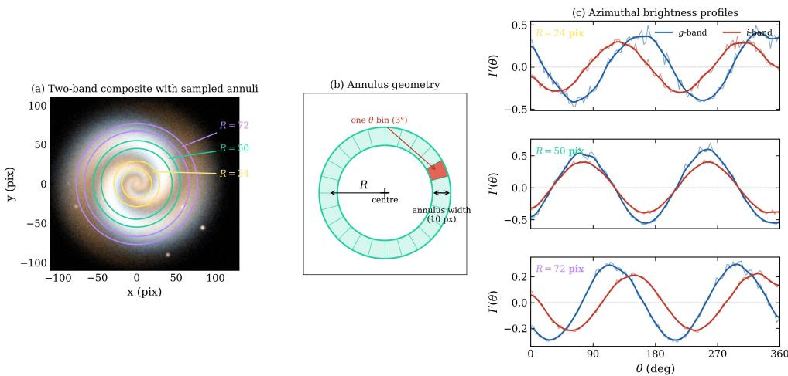
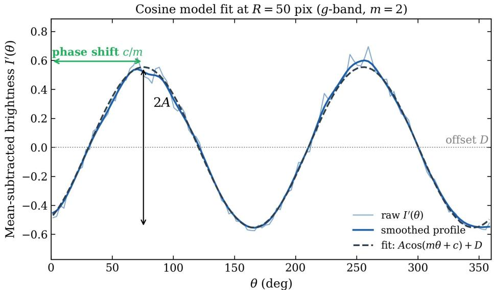
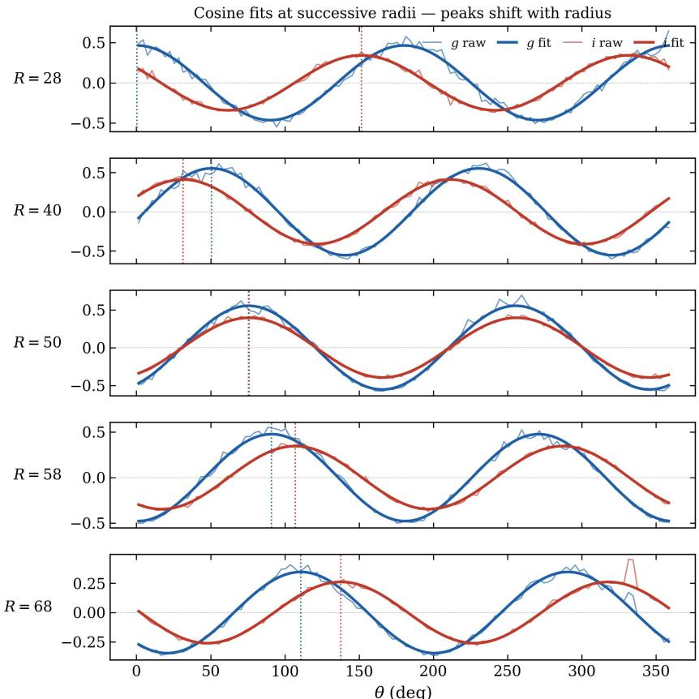
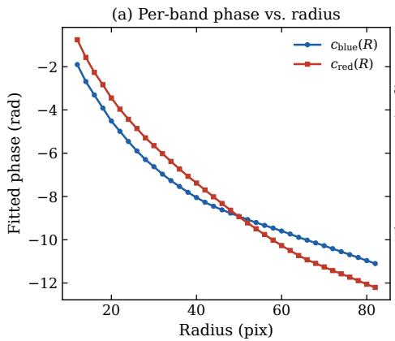
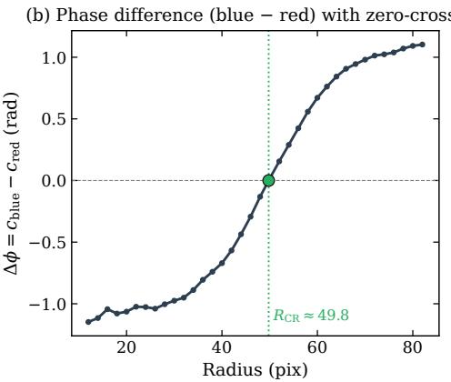
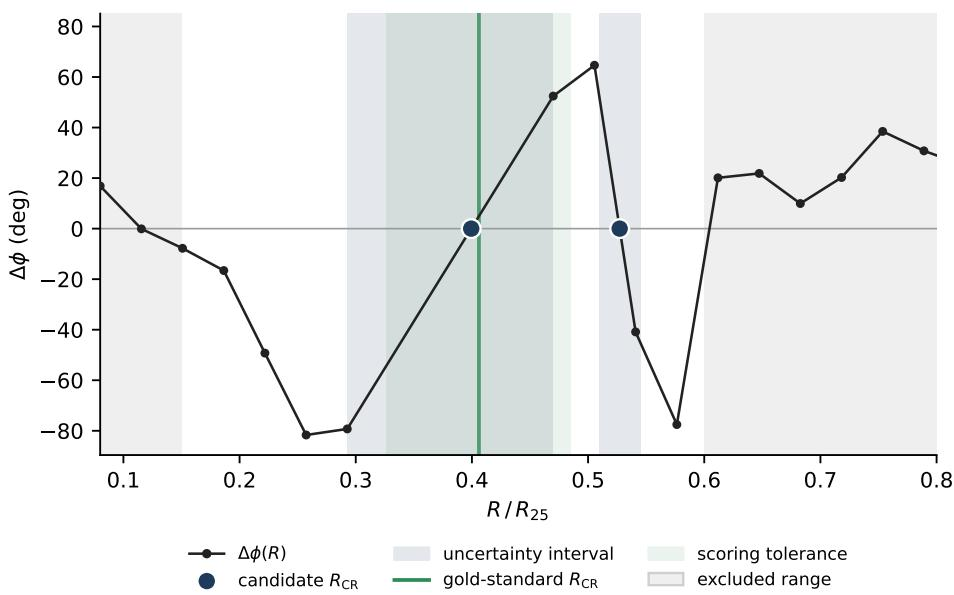
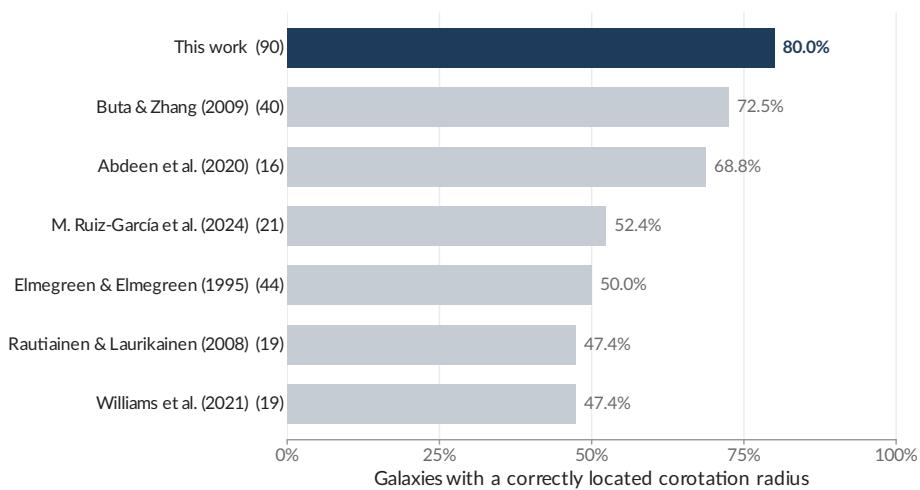
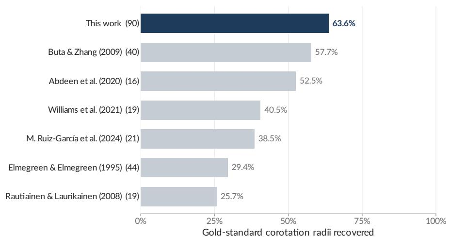
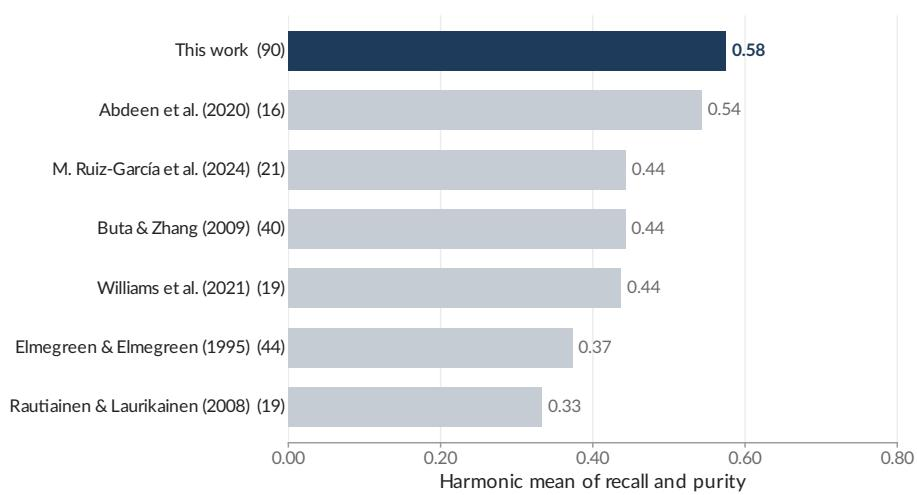
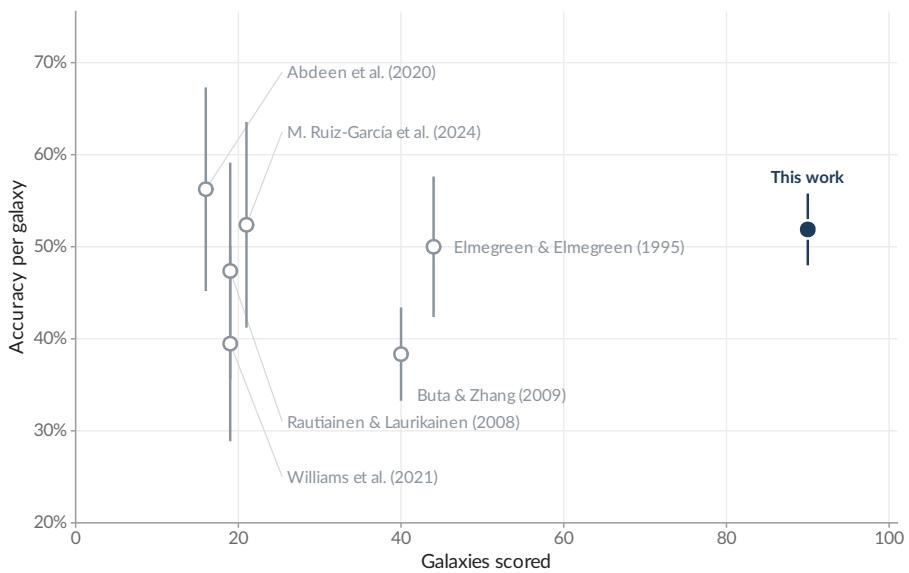

# An automated photometric pipeline for measuring the corotation radius of spiral galaxies

Kimia Yazdani, Sahel Mesforoush and Wayne Hayes

## Abstract

The corotation radius (R ) is a fundamental property of spiral galaxies, marking the location where the angular speed of the spiral pattern matches the orbital speed of the disk material. Despite its importance for understanding spiral struc ture and galaxy evolution, corotation measurements remain available for only a relatively small number of galaxies and are often derived using heterogeneous techniques. We present a fully automated, purely photometric pipeline for identifying one or more corotation radii by tracking the azimuthal phase ofset between young and old stellar populations as a function of galactocentric radius. Building on the color-gradient framework of Puerari and Dottori (1997), we extract azimuthal brightness profiles from deprojected dual-band images, fit periodic models to the profiles, and identify corotation candidates at radii where the phase diference between the two stellar tracers changes sign. Each candidate is assigned an adaptive uncertainty interval and reported with a goodness-of-fit metric. We benchmark the method against a cross-method literature compilation, scoring every technique – including our own – against a reference built from the published measurements alone and evaluated leave-one-out. Over the 90 galaxies for which such a reference exists, the pipeline places a correct corotation radius in 80.0% of them, recovers 63.6% of their known corotation radii, and reaches a harmonic mean of recall and purity of 0.58, the highest values of any method in the comparison. Unlike the published methods, each of which was applied to a small, curated set of galaxies, our pipeline is run on the entire reference sample without any pre-selection, a sample two to six times larger than existing methods. The pipeline is scalable to large surveys, flexible with respect to spiral mode, and naturally recovers multiple corotation radii in galaxies with complex spiral structure, providing a uniform framework for studying disk resonances across diverse galaxy populations.

Keywords: spiral galaxies, galaxy dynamics, corotation radius, density waves, photometric methods, automated pipeline

## 1 Introduction

The origin and persistence of spiral structure in disk galaxies remain unresolved problems in galactic dynamics. Two main frameworks are currently discussed in the literature. The first is the quasi-stationary density wave (QSDW) theory proposed by Lin and Shu (1964), in which spiral arms are interpreted as density waves rotating with a constant pattern speed, $\Omega _ { \mathrm { p } } .$ , independent of galactocentric radius. In this picture, the corotation radius (CR) marks the location where the angular velocity of the disk material equals the pattern speed, dividing the disk into two dynamical regions: inside CR, the material overtakes the pattern, while outside, the pattern moves faster than the material.

The alternative view is that spiral arms are transient and recurrent features (Sellwood 2011; Baba et al. 2013). In this model, arms continuously form, shear, and dissipate under the influence of diferential rotation and local gravitational instabilities, leading to a pattern speed that varies with radius. Recent simulations, together with kinematic analyses of observed galaxies (Meidt et al. 2009), and the diversity of observed spiral morphologies, suggest that multiple mechanisms are at play in shaping spiral structure (Dobbs and Baba 2014). Bar-driven or tidally induced spirals may coexist with dynamically formed transient arms within the same disk, indicating that the formation and maintenance of spiral patterns cannot be explained by a single universal process.

The corotation radius plays a critical role in discriminating between these models and in understanding the evolution of galaxies. The CR is a key site of angular momentum exchange between the disk and the spiral pattern (Sellwood and Binney 2002) and can influence stellar migration, chemical gradients, and orbital stability (Contopoulos and Harsoula 2013; Scarano and L´epine 2013). Its location relative to the bar also provides constraints on the dynamical coupling between the stellar disk and the dark matter halo (Debattista and Sellwood 2000).

Despite extensive theoretical and observational eforts, reliable determination of the corotation radius remains challenging. A variety of techniques have been developed, including the Tremaine–Weinberg method (Tremaine and Weinberg 1984), the potential–density phase-shift approach (Zhang and Buta 2007), and photometric diagnostics based on color gradients or age ofsets (Puerari and Dottori 1997; Tamburro et al. 2008). However, these methods often produce inconsistent results, reflecting observational limitations (Vall´ee 2020; Williams et al. 2021).

Recent meta-analyses of published corotation measurements further emphasize the complexity of this problem. A cross-method survey of 547 galaxies compiling 1,711 published measurements (Kostiuk et al. 2024) revealed that diferent methods agree on a consistent corotation radius for only about 15–25% of galaxies, while for the majority the measurements from diferent techniques are widely scattered or produce multi-peaked distributions of $R _ { \mathrm { C R } }$ estimates. In roughly 10% of the sample, multiple localized corotation radii were found, consistent with the presence of several spiral modes rotating at distinct pattern speeds. These results provide compelling observational support for the presence of multiple corotation resonances within individual galaxies, consistent with either the coexistence of multiple driving mechanisms or a single mechanism — such as recurrent, transient spirals — that produces multiple pattern speeds over time. We use the per-galaxy measurements from this compilation as the reference set for validating our method (§3), restricted to the 161 galaxies with corotation measurements from at least two diferent methods, since a cross-method comparison requires more than one method per galaxy.

The increasing evidence for complex, multi-mode spiral dynamics highlights the need for automated and scalable techniques capable of systematically identifying multiple corotation radii across large samples. To address this, we present a new, purely photometric pipeline that quantifies the asymmetry of the surface-brightness profile across spiral arms, an efect that reverses at the corotation radius due to the change in the relative motion of stars and gas. By measuring this asymmetry, the method can locate one or more corotation radii without requiring kinematic data, making it suitable for both nearby and distant galaxies. The pipeline is fully automated and optimized for large survey datasets, enabling consistent detection of multiple resonance positions and facilitating statistical analyses of corotation radii in relation to galaxy morphology and dynamics. We validate the method using a set of local galaxies with existing corotation measurements and demonstrate its scalability for application to large samples.

Our method follows the conceptual framework of Puerari and Dottori (1997), which identifies the corotation radius through the reversal of color gradients across spiral arms. In their picture, the relative azimuthal phase between young (blue) and old (red) stellar populations changes sign at the location where the angular velocity of the spiral pattern matches that of the disk material. This provides a purely photometric route to corotation, independent of kinematic data. We measure color gradients directly; stellar age is not measured but inferred from the well-established color–age relation, in which younger stellar populations are bluer and older populations are redder. While the original Puerari and Dottori method demonstrated this principle for a small number of manually analyzed galaxies, its scalability was limited by image noise, subjective phase tracing, and fixed model assumptions.

In this study, we generalize and automate the Puerari and Dottori approach to enable systematic application across large galaxy samples. Our pipeline extracts azimuthal brightness profiles in two wavebands, fits the underlying periodic structure with a parametric function, and computes the radial phase diference ∆ϕ(R) between the bands to locate the radii at which it changes sign. Unlike previous implementations, both the spiral mode number (m) and the functional form of the fitting model are configurable.

The remainder of the paper is organized as follows. Section 2 describes the photometric pipeline, from the extraction of azimuthal brightness profiles to the identification and validation of candidate corotation radii. Section 3 presents the validation of the method against a cross-method literature compilation and quantifies its accuracy at the galaxy level and per corotation radius (per-RCR). Section 4 discusses the implications of these results for the dynamical interpretation of spiral structure and outlines future extensions of the framework.

## 2 Methods

The corotation radius $( R _ { \mathrm { C R } } )$ of a spiral galaxy is an important dynamical parameter. It marks the distance from the galactic center where the angular velocity of the spiral pattern matches that of the stars and gas orbiting within it. At this radius, the phase diference between tracers of the spiral pattern, such as older (redder) stars, and tracers of recent star formation, such as younger (bluer) stars, is expected to reach zero and switch sign.

To identify $R _ { \mathrm { C R } }$ , we developed an automated pipeline that measures this phase diference as a function of galactocentric radius. The overall procedure consists of five main steps: (1) extracting azimuthal brightness profiles from images in two wavebands; (2) modeling these profiles to estimate their phase; (3) computing the phase diference between the two wavebands; (4) identifying zero-crossings that correspond to candidate corotation radii; and (5) assigning each candidate an uncertainty interval and a goodness-of-fit measure. Each of these steps is described in detail below.

## 2.1 Azimuthal brightness profile extraction

We begin with deprojected (face-on) galaxy images. We work from the calibrated FITS images, which keep the full dynamic range of the data and a known pixel scale, so that radii can be placed on a physical scale. Both wavebands are resampled onto a common grid in sky coordinates centred on the galaxy, and deprojected with a single geometric transform derived from the second moments of the light distribution in the longerwavelength image, which traces the smooth old stellar disk. Applying one transform to both bands guarantees that they are deprojected identically, so that any residual error in the deprojection cancels in the phase diference. The images are cutouts spanning $3 R _ { 2 5 } .$ , so that the full radial range sampled below lies inside the image; rings that extend beyond the image footprint are discarded. For our analysis, we primarily use SDSS g-band and i-band images, which serve as proxies for young and older stellar populations, respectively. For the galaxies that lie outside the SDSS footprint we substitute the closest available equivalents from all-sky surveys – typically DSS2 blue for the young tracer and WISE 3.4 µm for the old tracer – so the wavelength baseline is not identical across the sample. Because the measured phase diference grows with the separation in wavelength between the two tracers, results for the two subsamples are not directly interchangeable.

For each galaxy, we analyze a set of discrete galactocentric radii, R (see Fig. 1). Radii are chosen in units of each galaxy’s own size: we take 34 radii spaced uniformly over 0.08 $R _ { 2 5 } < R < 1 . 2 5 R _ { 2 5 }$ , with an annulus width of 0.04 $R _ { 2 5 }$ . Sampling in units of $R _ { 2 5 }$ ensures that the same radial grid corresponds to the same relative position in every disk. We take $R _ { 2 5 }$ from the PGC catalogue (Paturel et al. 2003). At each radius $R _ { : }$ , we compute the azimuthal profile as follows. The pixels within this annulus are divided into 120 azimuthal bins, each spanning $3 ^ { \circ }$ . For each bin, we compute the mean brightness, which gives the azimuthal brightness profile, $I _ { R } ( \theta )$ , for that waveband. We then normalize each profile by subtracting the mean brightness of the annulus,

$$
\begin{array} { r } { I _ { R } ^ { \prime } ( \theta ) = I _ { R } ( \theta ) - \langle I _ { R } \rangle _ { \mathrm { a n n u l u s } } , } \end{array}\tag{1}
$$

  
Fig. 1 Construction of the azimuthal brightness profiles. (a) Two-band composite of a deprojected synthetic spiral galaxy with three sampled annuli highlighted in color. (b) Schematic of a single annulus, showing its radial width, set to 0.04 $R _ { 2 5 }$ in the analysis and drawn here schematically, and the partition into 120 equal-azimuth bins of 3◦ each, one of which is highlighted. (c) Mean-subtracted azimuthal brightness profiles $I _ { R } ^ { \prime } ( \theta )$ in the $g -$ and i-bands at the three sample radii. The thin lines show the raw mean-subtracted profiles, while the thick lines show Gaussian-smoothed versions for display. Note that the blue curve shifts leftward from the top panel to the bottom $( { \mathrm { i . e . } }$ , with increasing radius).

so that $I _ { R } ^ { \prime } ( \theta )$ encodes only the azimuthal modulation produced by spiral structure. Repeating this process across all radii yields a set of normalized azimuthal brightness profiles for both the blue (g-band) and red (i-band) images.

## 2.2 Quantifying the spiral arm phase

More flexible descriptions of the azimuthal profile, such as a Fourier decomposition with several harmonics or a wavelet analysis, can in principle capture asymmetric or multi-armed structure. In practice, however, these models also fit the small-scale fluctuations in the profile — individual H ii regions, foreground stars, dust lanes and photon noise — and the azimuthal position of the arms read from such a reconstruction is pulled by every component that is included. In our tests this shifted the inferred position of the two-armed pattern from radius to radius in a way that did not reflect the spiral structure itself. We therefore model each profile with a single $m = 2$ cosine. Restricting the model in this way forces all of the azimuthal structure, including the noise, to be described by one mode, so that the fitted phase measures the position of the dominant two-armed pattern alone, while the remaining structure is left in the residuals rather than in the arm position.

To estimate the azimuthal position of the spiral arms at each radius, we model the normalized brightness profile $I _ { R } ^ { \prime } ( \theta )$ with a cosine function. This choice is motivated by the fact that spiral arms introduce a periodic signal in azimuth, and a cosine function provides a simple way to capture that structure while still allowing a well-defined phase. We assume that the dominant structure is a two-armed spiral pattern $( m = 2 )$

We fit the binned profile directly; smoothing it with a one-dimensional Gaussian filter before fitting changes the results negligibly.

We then fit the binned profile with the function

$$
\begin{array} { r } { f ( \theta ) = A \cos ( m \theta + c ) + D , } \end{array}\tag{2}
$$

where $\theta$ is the azimuthal angle, A is the amplitude, m is the mode number (fixed to 2 in this work), c is the phase shift, and D is a vertical ofset (Fig. 2). While the default form is a single cosine, both m and the analytic form of the fitting function are userconfigurable parameters of the pipeline, which allows the framework to be extended to higher-order or asymmetric spiral patterns.

The main quantity we extract from the fit is the phase shift c. The fitting procedure is applied independently to the blue and red profiles at each radius R, yielding two functions $c _ { \mathrm { b l u e } } ( R )$ and $c _ { \mathrm { r e d } } ( R )$ (Fig. 3). Each band is fitted from a starting point derived from its own profile.

Two conventions are required to make the fitted phase well defined. First, the model is invariant under $A \to - A , c \to c + \pi$ , so we canonize every fit to $A > 0 .$ adding π to c where necessary; without this the two bands may be returned on opposite branches and the inferred phase diference is displaced by π. Second, the azimuthal position of an m-fold pattern is defined only modulo $2 \pi / m$ , so the phase diference of Eq. 3 is wrapped into the interval $( - \pi / m , + \pi / m ]$ before any zero-crossing is sought.

Because the phase measurements depend on how well the cosine model describes the brightness profile, we use the mean squared error (MSE) of each fit as a quality metric. A high MSE indicates that the model does not describe the brightness profile well, which can occur when the spiral structure is weak, noisy, or not adequately represented by a simple two-armed pattern. In such cases, the phase estimate is considered unreliable.

Candidate corotation radii (Section 2.3) located near regions with high MSE are flagged as low confidence and reported alongside the radius itself, so that users of the catalogue can apply their own quality threshold.

Concretely, the MSE of each band is normalized by the mean brightness of the corresponding annulus, and we define a per-radius confidence as the reciprocal of the larger of the two normalized residuals.

## 2.3 Phase diference and corotation radius identification

We define the phase diference between the young (blue) and old (red) stellar populations as

$$
\Delta \phi ( R ) = c _ { \mathrm { b l u e } } ( R ) - c _ { \mathrm { r e d } } ( R ) .\tag{3}
$$

This phase diference is the key quantity for identifying corotation. The corotation radius $R _ { \mathrm { C R } }$ is defined as the radius at which the phase diference changes sign,

$$
\Delta \phi ( R _ { \mathrm { C R } } ) = 0 ,\tag{4}
$$

  
Fig. 2 Anatomy of the cosine fit at a single annulus. The light curve shows the raw mean-subtracted brightness profile $I _ { R } ^ { \prime } ( \theta )$ , the bold curve the smoothed version, and the dashed black curve the bestfit cosine model $\operatorname { E q . 2 }$ with $m = 2$ . The peak-to-peak amplitude 2A, the constant ofset $D ,$ and the phase shift $c / m$ that defines the angular position of the arms are indicated.

i.e. the radius at which the two populations are aligned in azimuth, with $\Delta \phi ( R )$ having opposite signs on either side of $R _ { \mathrm { C R } } . ~ \mathrm { A }$ galaxy may possess one or several such radii, depending on the complexity of its spiral structure (Fig. 4).

## 2.4 Automated zero-crossing detection and uncertainty estimation

To locate the zero-crossings we scan $\Delta \phi ( R )$ for changes of sign between adjacent sampled radii. Each such bracketing pair defines one candidate $R _ { \mathrm { C R } }$ , whose position is obtained by linear interpolation between the two radii that bracket it; no smoothing or resampling onto a finer grid is performed. A candidate is recorded only where $\Delta \phi ( R )$ changes sign between adjacent radii (or is exactly zero at a sampled radius); a curve that approaches zero and turns back without changing sign does not produce a candidate.

Candidates are further restricted to the radial range $0 . 1 5 R _ { 2 5 } < R _ { \mathrm { C R } } < 0 . 6 0 R _ { 2 5 }$ This is a noise filter. Towards the centre the annuli contain few independent resolution elements and are dominated by the bulge, while in the outermost annuli the arm amplitude falls towards the sky background; in both tails the fitted phase is poorly constrained, so $\Delta \phi$ fluctuates and crosses zero at radii unrelated to any resonance.

For each detected $R _ { \mathrm { C R } }$ we also report an uncertainty interval. Rather than imposing a fixed threshold, we take the interval to be the contiguous range of radii about the zero-crossing over which $| \Delta \phi |$ stays below a threshold that adapts to the local steepness of the curve. Let $\Delta \phi _ { j }$ denote the phase diference at the j-th radius $R _ { j }$ and $\Delta \phi _ { j } ^ { \prime } = ( \mathrm { d } \Delta \phi / \mathrm { d } R ) _ { j }$ its finite-diference derivative. The threshold at ring $j$ is

  
Fig. 3 Schematic evolution of the cosine fits across radii in both bands. Each panel shows the raw azimuthal profiles (thin lines) and the corresponding cosine fits (thick lines) for the g-band (blue) and i-band (red) at increasing galactocentric radius. The dotted vertical lines mark the angular position of the fitted peak in each band; their relative shift with radius reflects the radial dependence of the phase diference between the two stellar populations.

$$
T _ { j } = \epsilon _ { 0 } \left( 1 + \frac { \alpha } { | \Delta \phi _ { j } ^ { \prime } | } \right) , \qquad \epsilon _ { 0 } = \eta \left[ \operatorname* { m a x } _ { j } \Delta \phi _ { j } - \operatorname* { m i n } _ { j } \Delta \phi _ { j } \right] ,\tag{5}
$$

with $\eta = 0 . 0 1$ and $\alpha = 1$ rad $R _ { 2 5 } ^ { - 1 }$ . Beginning from the two rings that bracket the crossing, we extend the interval outward in both directions for as long as $| \Delta \phi _ { j } | \le T _ { j }$ ; the interval is the radial span of the rings so accepted, floored at one ring spacing $( \pm \Delta R / 2$ about the candidate) when the walk terminates immediately. Because $T _ { j }$ grows as the curve flattens, a crossing that cuts steeply through zero is bracketed tightly while a shallow one is assigned a wide interval.

  
Fig. 4 Per-band phase as a function of radius and the resulting phase diference. (a) Fitted phase shifts $c _ { \mathrm { b l u e } } ( R )$ and $c _ { \mathrm { r e d } } ( R )$ obtained from the g- and i-band fits. (b) Phase diference $\Delta \phi ( R ) =$ $c _ { \mathrm { b l u e } } ( R ) - c _ { \mathrm { r e d } } ( R )$ . Zero-crossings of $\Delta \phi ( R )$ , marked by green points, define the candidate corotation radii of the galaxy.

## 3 Results

## 3.1 Reference set

We validate the pipeline against the compilation of Kostiuk et al. (2024), which gathers published corotation radii measured with a wide range of techniques. A meaningful cross-method test requires at least two independent measurements of the same galaxy, so we restrict the compilation to the 161 galaxies whose corotation radius has been measured by at least two diferent methods, not including ours. These galaxies span a broad range of morphologies, sizes and distances, and the published values for many of them disagree with one another, which makes them a demanding benchmark for any new technique.

The pipeline was applied to all 161 galaxies without any manual intervention or galaxy-specific tuning. Of these, 93 lie in the SDSS footprint and were analysed in the g and i bands, and 68 were analysed with DSS2 blue and WISE 3.4 µm images (Section 2.1). The pipeline yields a measurement for 161 galaxies.

The reference against which every method is scored is built from the published measurements alone. For each galaxy we intersect the reported corotation intervals of every pair of distinct literature sources and merge the non-empty intersections into a disjoint set; a galaxy enters this gold standard when at least two independent sources agree. Requiring agreement between independent sources suppresses the method-specific scatter that dominates individual measurements, and leaves a reference that no single technique controls. Our own measurements take no part in its construction, and each published method is scored against a gold standard rebuilt without its own measurements, so that no method is compared with a reference it helped to define.

  
Fig. 5 Candidate corotation radii for NGC 6300. The curve is the measured phase diference $\Delta \phi ( R )$ which is scanned for sign changes. Dark circles mark the two candidates, at 0.40 and 0.53 $R _ { 2 5 } ,$ , with their uncertainty intervals shaded. The vertical green line is the gold-standard value, 0.41 $R _ { 2 5 }$ , and the green band the tolerance used for scoring; the candidate at 0.40 $R _ { 2 5 }$ coincides with it. Grey bands mark the radial range excluded from candidate selection.

## 3.2 Scoring and published methods

The resulting gold standard contains 90 galaxies, 58 from SDSS imaging and 32 from the all-sky surveys. A predicted corotation radius is counted as correct when it lies within $0 . 1 0 R _ { 2 5 }$ of the midpoint of a gold-standard interval, where $R _ { 2 5 }$ is the isophotal radius quoted in the compilation, so that every method is measured on the same scale. The criterion depends only on the location of each predicted radius, not on the width of its reported uncertainty, and therefore applies in the same way to methods that quote intervals and to those that quote single values. Published methods are scored by their reported $R _ { \mathrm { C R } }$ values.

From this criterion we compute five quantities for each method. The completeness is the fraction of scored galaxies with at least one correct RC ; it measures how often a method recovers the corotation radius of a galaxy. The recall is the fraction of all gold-standard corotation radii that are matched by at least one predicted radius; it measures how many of the known resonances a method finds. The purity is the fraction of all predicted radii that are correct; it measures on average how reliable an individual prediction is. The harmonic mean of recall and purity, the $F _ { 1 }$ score, combines them into a single figure of merit that is high only when a method finds most of the known resonances and is reliable in doing so. Finally, the accuracy per galaxy is the fraction of a galaxy’s predicted radii that are correct, averaged over galaxies, which weights every galaxy equally regardless of how many radii a method reports for it.

We compare the pipeline with every published method in the compilation that can be scored on at least 16 galaxies. Six methods meet this requirement, and together they represent the main families of corotation diagnostics: the potential–density phaseshift method of Buta and Zhang (2009), applied to near-infrared images; the multiwavelength azimuthal ofset method of Abdeen et al. (2020); the bar-torque analysis of Ruiz-Garc´ıa et al. (2024); the morphological criteria of Elmegreen and Elmegreen (1995); the kinematic Tremaine–Weinberg measurements of Williams et al. (2021); and the numerical models of Rautiainen et al. (2008). All of these were applied to their samples individually, with substantial human input, whereas our pipeline runs unsupervised. The results are summarised in Table 1.

Table 1 Agreement of each method with the literature gold standard (criterion: predicted $R _ { \mathrm { C R } }$ within $0 . 1 0 R _ { 2 5 }$ of a gold-standard value). N is the number of galaxies scored, $N _ { \mathrm { c } }$ the number with a correctly located $R _ { \mathrm { C R } } ,$ and F1 the harmonic mean of recall and purity. Recall and purity are counted per corotation radius, completeness per galaxy; all three are conditional on the galaxies each method reports on, and N therefore difers between rows.
<table><tr><td>Method</td><td>Type</td><td>N</td><td> $N _ { \mathrm { c } }$ </td><td>Compl.</td><td>Recall</td><td>Purity</td><td> $F _ { 1 }$ </td></tr><tr><td>This work</td><td>phase offset</td><td>90</td><td>72</td><td>80.0%</td><td>63.6%</td><td>52.5%</td><td>0.58</td></tr><tr><td>Buta and Zhang (2009)</td><td>potential-density</td><td>40</td><td>29</td><td>72.5%</td><td>57.7%</td><td>35.9%</td><td>0.44</td></tr><tr><td>Abdeen et al. (2020)</td><td>multi-band offset</td><td>16</td><td>11</td><td>68.8%</td><td>52.5%</td><td>56.2%</td><td>0.54</td></tr><tr><td>Ruiz-García et al. (2024)</td><td>bar torque</td><td>21</td><td>11</td><td>52.4%</td><td>38.5%</td><td>52.4%</td><td>0.44</td></tr><tr><td>Elmegreen and Elmegreen (1995)</td><td>morphological</td><td>44</td><td>22</td><td>50.0%</td><td>29.4%</td><td>51.1%</td><td>0.37</td></tr><tr><td>Williams et al. (2021)</td><td>Tremaine-Weinberg</td><td>19</td><td>9</td><td>47.4%</td><td>40.5%</td><td>47.5%</td><td>0.44</td></tr><tr><td>Rautiainen et al. (2008)</td><td>models</td><td>19</td><td>9</td><td>47.4%</td><td>25.7%</td><td>47.4%</td><td>0.33</td></tr></table>

## 3.3 Galaxy-level agreement

Our pipeline places a correct corotation radius in 72 of its 90 scored galaxies, a galaxylevel agreement of 80.0%, the highest of all the methods considered (Fig. 6). The next highest are Buta and Zhang (2009), with 72.5% (29 of 40 galaxies), and Abdeen et al. (2020), with 68.8% (11 of 16). The remaining four methods, including the kinematic Tremaine–Weinberg measurements and the dynamical models, recover the corotation radius in only 47–52% of their galaxies.

This result is notable because our pipeline obtains it without supervision and from photometry alone. The methods it outperforms include techniques that require integral-field kinematics or detailed dynamical modelling, and that were applied by hand to carefully selected galaxies. Our pipeline reaches a higher agreement on a sample that was not selected for the quality of its spiral structure and that includes images from several diferent surveys.

## 3.4 Recall and purity

Galaxies frequently host more than one corotation radius, and the gold standard contains 195 corotation radii for the 90 galaxies scored. Our pipeline recovers 124 of them, a recall of 63.6%, the highest of the methods compared (Fig. 7). It is followed by Buta and Zhang (2009), with 57.7%, and Abdeen et al. (2020), with 52.5%; the remaining methods recover between 26% and 41% of the known corotation radii in their galaxies.

A method can achieve high recall by reporting many radii for each galaxy, at the cost of reliability, or high purity by reporting only its most secure radius, at the cost of recall. The harmonic mean of the two rewards methods that achieve both. Our pipeline reaches $F _ { 1 } = 0 . 5 8$ , from a recall of 63.6% and a purity of 52.5% (Fig. 8), again the highest value among the methods compared. It is followed by Abdeen et al. (2020) at 0.54; Buta and Zhang (2009), Ruiz-Garc´ıa et al. (2024) and Williams et al. (2021) reach 0.44, and the remaining two methods 0.33–0.37.

The comparison with Buta and Zhang (2009) illustrates why both quantities are needed. Their galaxy-level agreement, 72.5%, and their recall, 57.7%, are the second highest, but only 35.9% of their individual radii are correct, giving $F _ { 1 } = 0 . 4 4$ . The pipeline’s purity of 52.5% is among the highest in the comparison, close to that of Abdeen et al. (2020; 56.2%) and comparable to those of Ruiz-Garc´ıa et al. (2024; 52.4%) and Elmegreen and Elmegreen (1995; 51.1%), so its high completeness is not obtained at the expense of reliability.

## 3.5 Accuracy and coverage

Figure 9 places the accuracy of each method against the number of galaxies on which it can be scored. Our pipeline’s accuracy per galaxy, $5 1 . 9 \pm 3 . 9 \%$ , lies within the range of the published methods (38–56%), and its uncertainty is the smallest in the comparison, because its scored sample of 90 galaxies is two to six times larger than theirs (16–44 galaxies). No published method combines a comparable accuracy with a comparable sample size.

In absolute terms, our pipeline recovers the corotation radius in 72 galaxies, more than twice as many as any single published method, the largest of which recovers 29. Because the pipeline requires only two-band imaging and no manual input, this number is limited by the size of the reference set rather than by the method itself, and it can be applied directly to the much larger samples provided by current and forthcoming imaging surveys.

## 4 Discussion and conclusions

Although the spiral mode number and the fitting function are configurable, in this work we fix $m = 2$ and use a single cosine model. While a cosine model captures most symmetric structures efectively, alternative periodic or data-driven functions can be substituted to model higher-order, asymmetric, or transient patterns. This flexibility allows the method to adapt to a wide range of spiral morphologies while maintaining quantitative consistency.

Where $\Delta \phi ( R )$ shows a clear reversal of sign, as in NGC 6300 (Fig. 5), the derived $R _ { \mathrm { C R } }$ coincides with the published value. In systems showing multiple resonances, our method detects several distinct zero-crossings, consistent with coupled or evolving patterns reported previously. These results support a hybrid interpretation of spiral structure in which both quasi-stationary density waves and transient, bar-driven, or tidally induced features can coexist within the same disk.

  
Fig. 6 Fraction of galaxies in which at least one predicted RCR lies within 0.10 R25 of the gold standard. Numbers in brackets give the number of galaxies scored. Each published method is scored against a gold standard built without its own measurements.

  
Fig. 7 Fraction of gold-standard corotation radii recovered by at least one predicted $R _ { \mathrm { C R } }$ within 0.10 $R _ { 2 5 }$ (recall). Numbers in brackets give the number of galaxies scored.

The principal limitations of the method arise in galaxies with weak or irregular arm structure, where stochastic star-forming regions dominate the brightness signal. Restricting candidates to the radial range of Section 2.4 removes most spurious crossings, but such morphologies remain challenging. Incorporating multi-band phase analysis, mode-adaptive fitting, and improved noise filtering may further enhance robustness for these cases.

Validated against a cross-method reference catalog, our approach achieves the highest galaxy-level agreement, the highest recall and the highest harmonic mean of recall and purity among the methods compared, while operating without supervision on a larger sample. The published techniques were applied with substantial manual work to samples selected by their authors, and several quote wide uncertainty intervals (a median of $3 1 ^ { \prime \prime }$ for Abdeen et al. 2020 and $3 4 ^ { \prime \prime }$ for Williams et al. 2021), whereas the pipeline runs on every galaxy of the reference set with intervals a median $7 . 5 ^ { \prime \prime }$ wide. Its adaptability, both in the chosen spiral mode number and in the fitting function, extends applicability to grand-design, multi-arm, and flocculent spirals alike. The observed diversity of single and multiple resonances across our sample provides new large-scale evidence that spiral galaxies may host a combination of stable and transient dynamical modes.

  
Fig. 8 Harmonic mean of recall and purity (the F score), for the same methods and criterion as Fig. 6.

  
Fig. 9 Accuracy per galaxy, the mean fraction of a galaxy’s predicted radii within 0.10 $R _ { 2 5 }$ of the gold standard, against the number of galaxies scored. Error bars are one standard error over galaxies.

Future work will focus on testing the method with alternative parameters and functional models to further assess its stability and precision across diferent galaxy types. We plan to study correlations between the detected corotation radii and known galactic features, such as bar presence and morphology. Finally, we aim to build an easy-touse tool that allows astronomers to apply this method to their own datasets and to publish a public database of galaxies with automatically detected corotation radii. Together, these eforts will make the automated photometric color-gradient framework a practical and widely accessible resource for future studies of galactic dynamics.

## References

Abdeen, S., Kennefick, D., Kennefick, J., Miller, R., Shields, D.W., Monson, E.B., Davis, B.L.: Determining the co-rotation radii of spiral galaxies using spiral arm pitch angle measurements at multiple wavelengths. MNRAS 496(2), 1610–1619 (2020) https://doi.org/10.1093/mnras/staa1596

Baba, J., Saitoh, T.R., Wada, K.: Dynamics of Non-steady Spiral Arms in Disk Galaxies. ApJ 763(1), 46 (2013) https://doi.org/10.1088/0004-637X/763/1/46

Buta, R.J., Zhang, X.: Pattern Corotation Radii from Potential-Density Phase-Shifts for 153 OSUBGS Sample Galaxies. ApJS 182(2), 559–583 (2009) https://doi.org/ 10.1088/0067-0049/182/2/559

Contopoulos, G., Harsoula, M.: 3D chaotic difusion in barred spiral galaxies. MNRAS 436(2), 1201–1214 (2013) https://doi.org/10.1093/mnras/stt1640

Dobbs, C., Baba, J.: Dawes Review 4: Spiral Structures in Disc Galaxies. PASA 31, 035 (2014) https://doi.org/10.1017/pasa.2014.31

Debattista, V.P., Sellwood, J.A.: Constraints from Dynamical Friction on the Dark Matter Content of Barred Galaxies. ApJ 543(2), 704–721 (2000) https://doi.org/ 10.1086/317148

Elmegreen, D.M., Elmegreen, B.G.: Inner Two-Arm Symmetry in Spiral Galaxies. ApJ 445, 591 (1995) https://doi.org/10.1086/175723

Kostiuk, V.S., Marchuk, A.A., Gusev, A.S.: Cross-method Analysis of Corotation Radii Data Set for Spiral Galaxies. Res. Astron. Astrophys. 24(7), 075007 (2024) https://doi.org/10.1088/1674-4527/ad4d3b

Lin, C.C., Shu, F.H.: On the Spiral Structure of Disk Galaxies. ApJ 140, 646 (1964) https://doi.org/10.1086/147955

Meidt, S.E., Rand, R.J., Merrifield, M.R.: Uncovering the Origins of Spiral Structure by Measuring Radial Variation in Pattern Speeds. ApJ 702(1), 277–290 (2009) https://doi.org/10.1088/0004-637X/702/1/277

Puerari, I., Dottori, H.: A Morphological Method to Determine Corotation Radii in Spiral Galaxies. ApJ 476(2), 73–75 (1997) https://doi.org/10.1086/310502

Paturel, G., Petit, C., Prugniel, P., Theureau, G., Rousseau, J., Brouty, M., Dubois, P., Cambr´esy, L.: HYPERLEDA. I. Identification and designation of galaxies. A&A 412, 45–55 (2003) https://doi.org/10.1051/0004-6361:20031411

Ruiz-Garc´ıa, M., Querejeta, M., Garc´ıa-Burillo, S., Emsellem, E., Meidt, S.E., Sormani, M.C., Schinnerer, E., Williams, T.G., Bazzi, Z., Colombo, D., Gleis, D.R., Gnedin, O.Y., Klessen, R.S., Leroy, A.K., S´anchez-Bl´azquez, P., Stuber, S.K.: Dynamical resonances in PHANGS galaxies. A&A 691, 351 (2024) https://doi.org/ 10.1051/0004-6361/202450935

Rautiainen, P., Salo, H., Laurikainen, E.: Model-based pattern speed estimates for 38 barred galaxies. MNRAS 388(4), 1803–1818 (2008) https://doi.org/10.1111/j. 1365-2966.2008.13522.x

Sellwood, J.A., Binney, J.J.: Radial mixing in galactic discs. MNRAS 336(3), 785–796 (2002) https://doi.org/10.1046/j.1365-8711.2002.05806.x

Sellwood, J.A.: The lifetimes of spiral patterns in disc galaxies. MNRAS 410(3), 1637 (2011) https://doi.org/10.1111/j.1365-2966.2010.17545.x

Scarano, S., L´epine, J.R.D.: Radial metallicity distribution breaks at corotation radius in spiral galaxies. MNRAS 428(1), 625–640 (2013) https://doi.org/10.1093/mnras/ sts048

Tamburro, D., Rix, H.-W., Walter, F., Brinks, E., de Blok, W.J.G., Kennicutt, R.C., Mac Low, M.-M.: Geometrically Derived Timescales for Star Formation in Spiral Galaxies. AJ 136(6), 2872–2885 (2008) https://doi.org/10.1088/0004-6256/136/6/ 2872

Tremaine, S., Weinberg, M.D.: A kinematic method for measuring the pattern speed of barred galaxies. ApJ 282, 5 (1984) https://doi.org/10.1086/184292

Vall´ee, J.P.: Statistics on 24 spiral galaxies having diferent observed arm locations using diferent arm tracers. New Astron. 76, 101337 (2020) https://doi.org/10.1016/ j.newast.2019.101337

Williams, T.G., Schinnerer, E., Emsellem, E., Meidt, S., Querejeta, M., Belfiore, F., Beˇsli´c, I., Bigiel, F., Chevance, M., Dale, D.A., Glover, S.C.O., Grasha, K., Klessen, R.S., Kruijssen, J.M.D., Leroy, A.K., Pan, H.-A., Pety, J., Pessa, I., Rosolowsky, E., Saito, T., Santoro, F., Schruba, A., Sormani, M.C., Sun, J., Watkins, E.J.:

Applying the Tremaine-Weinberg Method to Nearby Galaxies: Stellar-mass-based Pattern Speeds and Comparisons with ISM Kinematics. AJ 161(4), 185 (2021) https://doi.org/10.3847/1538-3881/abe243

Zhang, X., Buta, R.J.: The Potential-Density Phase-Shift Method for Determining the Corotation Radii in Spiral and Barred Galaxies. AJ 133(6), 2584–2606 (2007) https://doi.org/10.1086/514337