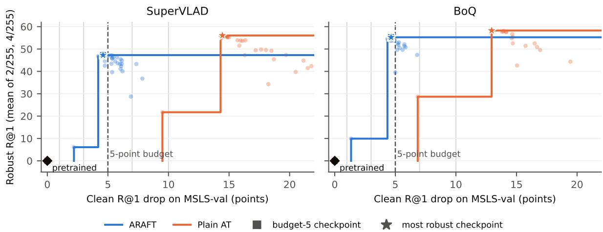
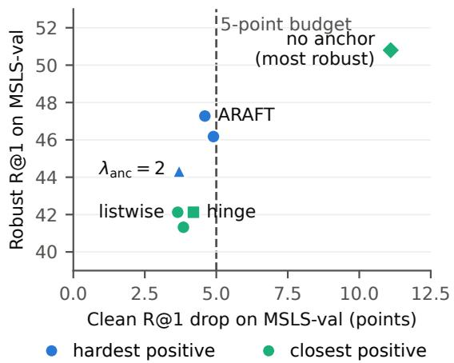
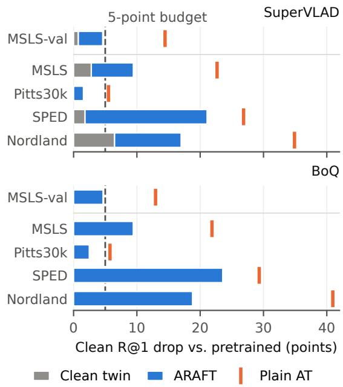

# Anchored Rank-Adversarial Fine-Tuning of Pretrained Visual Place Recognition Models

Mostafa Kira1\*, Bader Rasheed1 and Manuel Mazzara1

1\*Faculty of Computer Science and Engineering, Innopolis University, Innopolis, Russia.

\*Corresponding author(s). E-mail(s): m.kira@innopolis.university; Contributing authors: b.rasheed@innopolis.university; m.mazzara@innopolis.ru;

## Abstract

Visual place recognition (VPR) localises a camera by retrieving similar geo-tagged images, and current foundation-model VPR models are accurate across cities, seasons and illumination, but not robust to adversarial perturbations: under a white-box attack on the ranking at an imperceptible budget of 1/255, SuperVLAD and BoQ keep at most 0.2% top-1 recall (R@1) on four benchmarks. We propose anchored rank-adversarial fine-tuning (ARAFT), which fine-tunes a released model with a listwise rank loss on each adversarial query’s hardest positive and an anchor to the clean descriptor of the frozen pretrained model. Checkpoints are selected under a clean-accuracy budget fixed in advance, and the full trade-of is reported. Within five validation R@1 points of clean cost, plain adversarial training has no admissible checkpoint, whereas ARAFT raises robust R@1 from zero to 47.3 on SuperVLAD and 55.3 on BoQ; plain adversarial training exceeds this only at about three times the clean cost. Against unbudgeted plain adversarial training on the test sets, ARAFT matches its robust R@1 at 2/255 with about ten more clean R@1 points. At 4/255, plain adversarial training is 6–9 robust R@1 points ahead, while ARAFT still keeps its ten-point clean advantage. Developed on SuperVLAD, ARAFT transfers to BoQ without re-tuning, and its robustness holds against stronger optimisers, with no sign of gradient masking.

Keywords: Visual place recognition, Adversarial robustness, Adversarial fine-tuning, Image retrieval, Adversarial ranking attacks

## 1 Introduction

Visual place recognition (VPR) estimates where an image was taken by retrieving the most similar images from a database of geo-tagged references. It provides the coarse localisation and loop-closure candidates on which mobile robots, autonomous vehicles and augmented-reality systems build their metric pose estimates. Modern VPR models encode each image into a global descriptor with a pretrained backbone and a learned aggregation layer, and rank the database by descriptor distance [1, 2]. The most accurate current models build on the self-supervised DINOv2 backbone [3] with aggregators such as SALAD [4], BoQ [5] and SuperVLAD [6], are trained on large street-view collections [7], and are deployed as released checkpoints.

Deep retrieval models are vulnerable to adversarial perturbations: small, crafted changes to a query image can push its true matches down the ranking or pull a chosen wrong image to the top [8, 9]. Malone et al. [10] showed that VPR models, including a DINOv2-based one, are vulnerable to attacks that alter the query features, and proposed to detect them; no defense has been trained for VPR. We find that the gap is severe for current models. Under a white-box attack on the ranking, both models we study keep at most 0.2% top-1 recall on four benchmarks at a budget of 1/255. For a system that relies on VPR to localise, this means an imperceptible perturbation of the camera image is enough to make it report the wrong place.

Existing defenses do not address this setting. Adversarial training for retrieval and deep metric learning [9, 11–13] trains ResNet-18 or smaller networks on retrieval benchmarks and loses about 15–26 points of clean R@1 on CUB and SOP. Adversarial fine-tuning of foundation encoders [14–17] preserves clean accuracy better, but it targets classification and zero-shot transfer, its objectives do not reason about rankings, and it has not been evaluated on place recognition.

We propose anchored rank-adversarial finetuning (ARAFT), which fine-tunes a pretrained VPR model end to end on three terms: its original metric-learning loss on clean images; a listwise rank loss that requires an adversarially perturbed query to rank its hardest positive above the nearest negatives; and an anchor that keeps the perturbed query’s descriptor close to the clean descriptor of the frozen pretrained model. Because adversarial fine-tuning trades clean accuracy for robustness and the trade-of moves during training, we select checkpoints under an explicit cleanaccuracy budget, fixed before the experiments, and report the full trade-of curve rather than a single operating point.

We develop ARAFT on SuperVLAD and apply it unchanged to BoQ, and compare it with plain adversarial training that uses the same attack, positives and schedule but no anchor. Within a 5-point clean budget on the validation set, plain adversarial training has no usable checkpoint on either model, whereas ARAFT reaches a robust R@1 of 47.3 (SuperVLAD) and 55.3 (BoQ). Plain adversarial training exceeds this robustness only after giving up about three times as much clean accuracy. On the test sets, ARAFT matches plain adversarial training at its most robust checkpoint at 2/255 while keeping about ten more clean R@1 points, and it is less robust at 4/255 and beyond. Its robustness holds against stronger optimisers, with no sign of gradient masking. The clean cost under strong distribution shift, up to 24 points on SPED and Nordland, remains the main limitation.

Our contributions are:

• a threat model and evaluation protocol for adversarial robustness of VPR, with rank attacks, robustness curves and gradientmasking checks, and the finding that current foundation-model VPR models have no robustness under it;

• ARAFT, a rank-aware, anchored adversarial fine-tuning method for pretrained VPR models, with checkpoint selection under an explicit clean-accuracy budget;

• an evaluation on two architectures and four benchmarks, with paired significance tests and ablations, showing that ARAFT is the only one of the compared methods that provides robustness within a small clean budget, that it transfers to a second architecture without retuning, and that protecting the hardest positive and anchoring to the pretrained model are what make it work.

## 2 Related work

## Visual place recognition.

VPR is commonly cast as image retrieval with global descriptors. NetVLAD [1] made the VLAD aggregation of local CNN features trainable end to end, and later work improved training data and objectives [7, 18] and aggregation, for example with the feature-mixing MixVPR [19]. Recent state-of-the-art models replace the CNN backbone with DINOv2 [3]: SALAD [4] aggregates its patch features by optimal transport, BoQ [5] with a bag of learnable queries, and SuperVLAD [6] with a compact VLAD layer and a cross-image encoder. These models are typically trained on GSV-Cities with a multi-similarity loss [20] and evaluated on benchmarks that span urban, seasonal and day– night change [2]. Their robustness is studied with respect to such natural changes, not to adversarial perturbations.

## Adversarial attacks on retrieval and VPR.

Adversarial examples were first studied for classification [21–23], where AutoAttack [24] has become the standard for reliable evaluation. For retrieval,

Tolias et al. [8] showed that a query can be perturbed to retrieve the results of an unrelated image, and Zhou et al. [9, 12] formalised attacks that raise or lower the rank of chosen candidates by perturbing the query or the database. For VPR, Malone et al. [10] showed that NetVLAD-, AP-GeM- and DINOv2-based models are vulnerable to feature-space attacks that copy reference or query content and, to a lesser degree, to FGSM attacks transferred from another model, and proposed detecting attacks as a safeguard for robot navigation. They train no defense. We study the white-box, query-side threat model in which the attacker optimises against the ranking itself, and train models to resist it.

## Adversarially robust retrieval and metric learning.

Defenses for ranking models adapt adversarial training [23] to triplet or ranking losses. Zhou et al. [9, 12] proposed embedding-shifting and anticollapse objectives; hardness manipulation [11] perturbs training triplets to a chosen hardness, which makes adversarial training eficient; and CA-TRIDE [13] decouples the perturbation of anchors and candidates and adapts it to the model’s state of collapse. These methods train ResNet-18 or smaller networks on fine-grained retrieval benchmarks (MNIST, Fashion-MNIST, CUB, Cars, SOP), the later ones from ImageNet initialisation at budgets of 8/255, and lose about 15–26 points of clean R@1 on CUB and SOP. They do not start from a strong pretrained retrieval model, do not consider geographic retrieval under distribution shift, and do not bound the clean cost. Our plain adversarial-training baseline follows this line with a hinge ranking loss, and our collapse guard is motivated by the collapse these works report.

## Robust fine-tuning of pretrained encoders.

A second line adversarially fine-tunes large pretrained models while trying to keep their clean ability. TeCoA [14] fine-tunes CLIP with a supervised contrastive adversarial loss; PMG-AFT [16] adds a term that keeps the outputs close to the original model’s; FARE [15] fine-tunes the image encoder without labels so that adversarial embeddings stay close to the original clean embeddings; and LORE [17] turns this proximity into an explicit constraint and also applies it to DINOv2. TWINS [25] keeps frozen statistics of the pretrained network during adversarial fine-tuning, and Ngnaw´e et al. [26] show that fine-tuning a non-robust model directly at the target budget transfers poorly and that ramping the budget avoids this. Croce et al. [27] evaluate such robust encoders on image retrieval. These methods target classification, zero-shot transfer or general-purpose features; their losses do not involve rankings, and none is evaluated on place recognition. ARAFT borrows FARE’s anchor and the budget ramp from this line and combines them with a rank-aware loss on the hardest positive, applied to a complete VPR model.

## 3 Method

We consider a pretrained VPR model $f _ { 0 }$ that maps an image to an ℓ2-normalised global descriptor, and fine-tune it into a model $f _ { \theta } ,$ initialised at $f _ { 0 } ,$ whose top-1 retrieval survives perturbations of the query image while its clean retrieval stays close to that of $f _ { 0 } .$ This section defines the threat model (Sect. 3.1), the rank attacks used for both training and evaluation (Sect. 3.2), the proposed objective (Sect. 3.3), the plain adversarial-training baseline (Sect. 3.4) and how checkpoints are selected (Sect. 3.5).

## 3.1 Problem setting and threat model

## Retrieval.

A database of geo-tagged images $\{ d _ { j } \} _ { j = 1 } ^ { M }$ is encoded once, ofline, into descriptors $f ( \bar { d } _ { j } )$ . A query image x is localised by ranking the database by the Euclidean distance $\| f ( x ) - f ( d _ { j } ) \| _ { 2 }$ . The positives ${ \mathcal { P } } ( x )$ are the database images taken within a fixed distance of the query’s true position, and the query is retrieved correctly at rank one (R@1) if its nearest database descriptor belongs to ${ \mathcal { P } } ( x )$

## Adversary.

The adversary has white-box access to the model weights and to the clean database descriptors, and perturbs only the query. The database is built ofline and is read-only, as in prior work on VPR attacks [10]; attacks on database images are out of scope. The perturbation δ lies in an $\ell _ { \infty }$ ball, $\| \delta \| _ { \infty } \leq \varepsilon .$ applied in the ImageNet-normalised input space in which the model operates. A normalised budget $\varepsilon _ { n }$ corresponds to a pixel budget of $\varepsilon _ { n } \sigma _ { c }$ in channel $^ { c , }$ with $\sigma = ( 0 . 2 2 9 , 0 . 2 2 4 , 0 . 2 2 5 ) ;$ we quote the largest of these, $\varepsilon = \varepsilon _ { n } { \cdot } 0 . 2 2 9$ , in units of $1 / 2 5 5 .$ , so a stated budget of $4 / 2 5 5$ bounds every channel by 4/255. Physical and patch attacks are out of scope, and all robustness we report is empirical rather than certified.

## Attack goal.

An attack succeeds when no positive remains at rank one.

## 3.2 Rank attacks

Attacks on a retrieval model have no class logits to maximise; we attack the ranking directly. For a query x let $\mathcal { P }$ be its positive descriptors and $\mathcal { N }$ the descriptors of its $k = 5$ nearest non-positive database images under the clean query. The rank score of a perturbed query $x ^ { \prime } = x + \delta$ is

$$
s ( x ^ { \prime } ) = m + \operatorname* { m i n } _ { p \in \mathcal { P } } \| f ( x ^ { \prime } ) - p \| _ { 2 } - \operatorname* { m i n } _ { n \in \mathcal { N } } \| f ( x ^ { \prime } ) - n \| _ { 2 } ,\tag{1}
$$

with margin $m = 0 . 1$ . The query is pushed out of rank one once $s ( x ^ { \prime } ) > m$ . Following the ranking attacks of Zhou et al. [9], rank-PGD ascends $s$ by $T$ signed-gradient steps of size $\alpha = 2 \varepsilon / T ,$ each followed by projection onto the ε-ball and clipping to the valid image range, and returns the iterate with the highest score. It ascends the raw score rather than its hinge max(0, s): the hinge has zero gradient for a confidently correct query, which would leave exactly the queries that matter most unattacked. The first run starts from the clean image and further restarts from a uniformly random point in the ball. Rank-APGD uses the same objective with a per-query step size that is halved whenever the best score has not improved over the last $T / 4$ iterations, a simplified form of the step-size control of APGD [24] without its momentum, restarts from the best point or non-uniform checkpoints.

In every case success is measured by the true ranking of the perturbed query against the full database, not by the surrogate score.

## 3.3 Anchored rank-adversarial fine-tuning

ARAFT (Anchored Rank-Adversarial Fine-Tuning) fine-tunes the whole network on three terms: the model’s original metric-learning loss on clean images, a listwise rank loss on adversarial queries computed against the hardest positive, and an anchor that ties adversarial descriptors to the frozen pretrained model. Algorithm 1 summarises one training step.

## Batch and targets.

A training batch holds B places with K images each. For every place, the first image is the query x. Its clean descriptor, and those of all other batch images, are computed with the current model without gradients. For SuperVLAD the query is encoded on its own and the other batch images in one joint pass (Sect. 4.1). The hardest positive $p ^ { + }$ is the other image of the same place whose descriptor is farthest from the query’s, and $\mathcal { N }$ holds the five images of other places nearest to the query. The training attack is rank-PGD (Sect. 3.2) with $\begin{array} { r } { \mathcal { P } = \{ p ^ { + } \} } \end{array}$ , budget $\varepsilon _ { \mathrm { t r a i n } }$ and $T = 5$ steps, run against the current model; it yields the adversarial query $x ^ { \prime }$

## Objective.

With B the clean batch, the loss is

$$
\begin{array} { r l } & { { \mathcal { L } } = { \mathcal { L } } _ { \mathrm { c l e a n } } ( { \mathcal { B } } ) + \lambda _ { \mathrm { r a n k } } { \mathcal { L } } _ { \mathrm { r a n k } } \big ( f _ { \theta } ( x ^ { \prime } ) ; p ^ { + } , { \mathcal { N } } \big ) } \\ & { \qquad + \lambda _ { \mathrm { a n c } } \big \| f _ { \theta } ( x ^ { \prime } ) - f _ { 0 } ( x ) \big \| _ { 2 } ^ { 2 } , } \end{array}\tag{2}
$$

averaged over the queries of the batch. $\mathcal { L } _ { \mathrm { c l e a n } }$ is the multi-similarity loss with its pair miner [20], the loss with which the pretrained models were trained, applied unchanged to the clean batch.

## Listwise rank loss.

Writing $q = f _ { \theta } ( x ^ { \prime } )$ and $d ( \cdot , \cdot )$ for the Euclidean distance, the soft rank of the hardest positive among $\{ p ^ { + } \} \cup \mathcal { N }$ is

$$
\tilde { r } ( q ) = 1 + \sum _ { n \in \mathcal { N } } \sigma \biggl ( \frac { d ( q , p ^ { + } ) - d ( q , n ) } { \tau } \biggr ) ,\tag{3}
$$

which tends to its integer rank as $\tau  0$ . The loss penalises a soft rank above $K$

$$
{ \mathcal { L } } _ { \mathrm { r a n k } } = 4 \tau ^ { 2 } \mathrm { s o f t p l u s } \left( { \frac { { \tilde { r } } ( q ) - K - { \frac { 1 } { 2 } } } { \tau } } \right) ,\tag{4}
$$

with $K \ = \ 1$ and $\tau ~ = ~ 0 . 0 5$ . It belongs to the Smooth-AP family [28] but targets top-1 recall, the metric VPR is judged on, instead of average precision. The ofset of one half separates an acceptable rank $K$ from a violating rank $K + 1$ The factor $4 \tau ^ { 2 }$ cancels the two factors $1 / \tau$ and the maximum sigmoid slope of $1 / 4 .$ , so the derivative of $\mathcal { L } _ { \mathrm { r a n k } }$ with respect to each negative distance $d ( q , n )$ is at most one in magnitude, the slope of the hinge in Eq. (5). The positive distance $d ( q , p ^ { + } )$ enters all $| \mathcal { N } |$ terms of $\tilde { r } ( q )$ , so the derivative with respect to it can reach $| \dot { \mathcal { N } } | = 5$ . The factor therefore sets the scale of the loss but does not bound the rank term relative to $\mathcal { L } _ { \mathrm { c l e a n } } ;$ their balance is set by $\lambda _ { \mathrm { { r a n k } } }$

## Why the hardest positive.

A query is retrieved correctly when any positive is ranked first. Defending only the closest positive is therefore suficient for correctness, but the resulting loss is close to zero as soon as one positive is safe, so most queries contribute no gradient. Requiring the hardest positive to outrank the negatives is the tightest version of the same constraint, and it keeps every attacked query in the loss. Section 5 compares the two choices.

## Anchor.

The last term of Eq. (2) is the unsupervised embedding-alignment loss of FARE [15]: the descriptor of the adversarial query under the finetuned model must stay close to the descriptor of the clean query under the frozen pretrained model $f _ { 0 } .$ . Because descriptors have unit norm, the term lies in [0, 4]. It serves two purposes at once. For robustness, it asks the attacked query to land where the pretrained model placed the clean one, independently of the mined positives and negatives. For clean accuracy, it ties $f _ { \theta }$ to the released model; at zero perturbation it reduces to $\| f _ { \theta } ( x ) - f _ { 0 } ( x ) \| _ { 2 } ^ { 2 }$ , a direct penalty on clean drift. It is applied to the attacked queries only.

Algorithm 1 One ARAFT training step   
Require: batch of B places $\overline { { \times \ K } }$ images; model   
$f _ { \boldsymbol { \theta } } ;$   
frozen $f _ { 0 } ;$ budget ε of this epoch   
1: compute clean descriptors of all batch images   
with $f _ { \theta } ,$ without gradients   
2: for each place i do   
3: $x _ { i } \gets$ first image; $p _ { i } ^ { + } \gets$ farthest same-place   
descriptor   
4: $\mathcal { N } _ { i } \gets 5$ nearest other-place descriptors   
5: end for   
6: $x _ { i } ^ { \prime } \gets$ rank- $- \mathrm { P G D } ( f _ { \theta } , x _ { i } , \{ p _ { i } ^ { + } \} , \mathcal { N } _ { i } , \varepsilon , T { = } 5 )$   
7: $\ell _ { i } \gets \lambda _ { \mathrm { r a n k } } \mathcal { L } _ { \mathrm { r a n k } } ( f _ { \theta } ( x _ { i } ^ { \prime } ) ; p _ { i } ^ { + } , \mathcal { N } _ { i } )$   
$+ \left. \lambda _ { \mathrm { a n c } } \right| \rvert f _ { \theta } ( x _ { i } ^ { \prime } ) - f _ { 0 } ( x _ { i } ) \rvert \rvert _ { 2 } ^ { 2 }$   
8: $\begin{array} { r } { \mathcal { L }  \mathcal { L } _ { \mathrm { c l e a n } } ( \mathrm { b a t c h } ) + \frac { 1 } { B } \sum _ { i } \ell _ { i } } \end{array}$   
9: update θ with a gradient step on $\mathcal { L }$

## Training schedule and collapse guard.

Robust fine-tuning of a non-robust pretrained model loses clean accuracy when trained at the full budget from the start [26]. ARAFT therefore trains the first epoch without attacks and then ramps the training budget linearly from $0 . 1 \varepsilon _ { \mathrm { t r a i n } }$ to $\varepsilon _ { \mathrm { t r a i n } }$ over five epochs. Validations during the ramp still update the saved checkpoints but do not count toward learning-rate or early-stopping patience. To detect representation collapse, a known failure of adversarial metric learning [11, 13], we measure after each validation the mean overlap between the 10 nearest neighbours of 256 fixed validation images under $f _ { \theta }$ and under $f _ { 0 } ,$ and abort training if it falls below 0.15.

## 3.4 Plain adversarial training baseline

The baseline is adversarial training with a ranking loss in the style of Madry et al. [23] and of robust deep metric learning [9, 11]:

$$
\begin{array} { r } { \mathcal { L } _ { \mathrm { A T } } = \mathcal { L } _ { \mathrm { c l e a n } } ( \mathcal { B } ) + \lambda _ { \mathrm { r a n k } } \operatorname* { m a x } \bigl ( 0 , \phantom { \frac { 1 } { n \in \mathcal { N } } } } \\ { m + d ( q , p ^ { + } ) - \underset { n \in \mathcal { N } } { \operatorname* { m i n } } d ( q , n ) \bigr ) . } \end{array}\tag{5}
$$

It uses the same hardest positive, negatives, training attack, schedule, collapse guard and checkpoint selection as ARAFT, and difers from it in having no anchor and a hinge in place of the listwise surrogate. Section 5 reports the efect of each diference separately.

## 3.5 Checkpoint selection under a clean budget

Adversarial fine-tuning trades clean accuracy for robustness, and the trade-of moves during training. Published robust-retrieval defenses report clean costs of about 15–26 R@1 points on CUB and SOP [9, 11, 13], and none selects checkpoints under an explicit clean-accuracy budget. A deployed VPR system has a limit on how much clean accuracy it can give up, so we select checkpoints under an explicit clean budget and also report the full trade-of.

Every three epochs, the model is validated on a fixed set of validation queries: clean R@1 $C _ { e } ,$ and R@1 under rank-PGD with 10 steps at 2/255 and at 4/255. The robust score $S _ { e }$ is the mean of the two attacked R@1 values. With $C _ { 0 }$ the clean R@1 of the pretrained model, each run keeps

• the most robust checkpoint, $e ^ { \star } = \arg \operatorname* { m a x } _ { e } S _ { e } $ and

• for each clean budget $b ,$ the budget-b checkpoint $e _ { b } ~ = ~ \mathrm { a r g } \mathrm { m a x } _ { e : C _ { 0 } - C _ { e } \leq b } S _ { e }$ , which is the pretrained model itself if no trained epoch stays within the budget.

The headline budget, b = 5 R@1 points, was fixed before any experiment. It is well above the variation of clean fine-tuning alone and below the clean cost of published ranking defenses. The budget is a rule applied on the validation set; the clean cost realised on the test sets can difer and is always reported next to the robust numbers. Test sets are used only for final models.

## 4 Experimental setup

## 4.1 Models

We developed and tuned the method on one VPR model and then applied the same recipe, without re-tuning, to a second model with a diferent aggregator.

## SuperVLAD.

SuperVLAD [6] aggregates DINOv2 ViT-B/14 [3] patch features with a VLAD-style layer of four clusters and one ghost cluster, followed by a cross-image encoder. We start from the released checkpoint trained on GSV-Cities and use 322 ×

322 inputs for training and testing. The crossimage encoder attends across all images of a batch, so a descriptor depends on the other images it is encoded with. An attack evaluated in batches would then succeed or fail per batch rather than per query. In all attacks, validation and testing we therefore encode every query and database image on its own, passing a sequence of length one to the cross-image encoder. During training the clean loss keeps the original batch-level encoding, and adversarial queries and anchor descriptors are encoded individually. The positive and negative descriptors that serve as training targets are taken, without gradients, from a batch-level pass over all 80 images of the batch; only the query’s clean descriptor, which is used to mine them, is encoded on its own. Training targets are therefore encoded in a diferent context from the validation and test databases, in which every image is encoded on its own.

## BoQ.

BoQ [5] uses the same DINOv2 ViT-B/14 backbone with a Bag-of-Queries aggregator and 12 288-dimensional descriptors. We start from the released GSV-Cities checkpoint and, like its public training code, train at 224 × 224 and test at 322 × 322. BoQ encodes each image independently. All ARAFT and baseline settings are those selected on SuperVLAD; only the starting checkpoint and the input resolution change. BoQ therefore tests whether the recipe transfers to a new architecture without a new hyperparameter search.

## Compared models.

For each architecture we evaluate the released model, plain adversarial training (Sect. 3.4) and ARAFT, each at its budget-5 and most robust checkpoints (Sect. 3.5). On SuperVLAD we also train a second ARAFT seed and a clean twin, fine-tuned with the same data, depth and schedule but without attacks. The twin separates the clean cost of fine-tuning itself from the cost of robustness. Clean fine-tuning never improved on the pretrained model’s validation R@1, so the twin is evaluated at its last checkpoint.

## 4.2 Training details

All models are trained on GSV-Cities [7] in batches of B = 20 places with K = 4 images each, 200 batches per epoch, with all network parameters trainable. Table 1 lists the settings, which are identical for ARAFT and plain adversarial training and for both architectures. We use Adam with learning rate $1 0 ^ { - 5 }$ , no weight decay, gradient clipping at norm 1, mixed precision and gradient checkpointing. Training runs for at most 100 epochs. The learning rate is divided by 10 after three validations without improvement of the robust score, and training stops after six. The headline training budget $\varepsilon _ { \mathrm { t r a i n } } = 4 / 2 5 5$ matches the budget used for robust fine-tuning of foundation encoders [15].

Table 1 Training settings, shared by ARAFT and plain adversarial training and by both architectures except where noted.
<table><tr><td>Setting</td><td>Value</td></tr><tr><td>Training data Batches/epoch,</td><td>GSV-Cities, 20 places × 4 images 200  /  100</td></tr><tr><td>epochs Optimiser</td><td>Adam, lr 10−5, no weight decay</td></tr><tr><td>Trainable layers Input size (train / test)</td><td>all SuperVLAD 322 / 322; BoQ 224 /</td></tr><tr><td></td><td>322 rank-PGD  $\ell _ { \infty } , \varepsilon = 4 / 2 5 5 , T = 5$ </td></tr><tr><td>Training attack Budget ramp</td><td>1 clean epoch, then 0.1ε → ε over</td></tr><tr><td>Loss weights</td><td>5 epochs  $\lambda _ { \mathrm { r a n k } } = 1 , \lambda _ { \mathrm { a n c } } = 1 ( \mathrm { A R A F T } )$ </td></tr><tr><td>Rank loss</td><td>listwise,  $\begin{array} { r l r l r l } { K } & { { } = } & { 1 , } & { \tau } & { { } = } & { ( } \end{array}$  0.05 (ARAFT); hinge (plain AT)</td></tr><tr><td>Margin m, negatives |N|</td><td>0.1  $/ ~ 5$ </td></tr><tr><td>Validation</td><td>every 3 epochs, 2 000 MSLS-val queries</td></tr><tr><td>LR decay / early stop</td><td>×0.1 after 3 / stop after 6 valida- tions</td></tr><tr><td>Collapse guard</td><td>abort if 10-NN overlap &lt; 0.15</td></tr></table>

## Hyperparameter search.

All settings were chosen on SuperVLAD using MSLS-val only, by a sequential one-factor-at-atime search. Short screens of 12 epochs first fixed the fine-tuning depth and learning rate (0, 4 or 8 frozen DINOv2 blocks; $1 0 ^ { - 5 } \mathrm { o r } 3 { \cdot } 1 0 ^ { - 6 } )$ , the set of training attacks $( \ell _ { \infty }$ rank-PGD alone, or together with two perceptual attacks [29]) and the anchor weight $( \lambda _ { \mathrm { a n c } } \in \{ 0 , 0 . 1 , 1 , 1 0 \} )$ . These screens used the closest positive as the rank target. Full-length runs then compared the closest and the hardest positive, and the anchor weight was re-checked with the hardest positive $( \lambda _ { \mathrm { a n c } } ~ \in ~ \{ 1 , 2 \} )$ ). The baseline received its own learning-rate search over the same two values. Appendix A gives the full search.

Table 2 Evaluation datasets. Attacked queries are evenly spaced over all queries with at least one positive. This holds for the test sets; the 2000 MSLS-val queries are a fixed random sample of such queries, on which validation measures both clean and attacked R@1.
<table><tr><td>Dataset</td><td>Database</td><td>Queries</td><td>Attacked</td></tr><tr><td>MSLS-val (val.)</td><td>18871</td><td>11084</td><td>2000</td></tr><tr><td>MSLS</td><td>36 558</td><td>25 622</td><td>1000</td></tr><tr><td>Pitts30k</td><td>10 000</td><td>6816</td><td>1000</td></tr><tr><td>SPED</td><td>607</td><td>607</td><td>607</td></tr><tr><td>Nordland</td><td>27592</td><td>27592</td><td>1000</td></tr></table>

## 4.3 Datasets and metrics

Models are validated on 2 000 fixed queries of MSLS-val [30] and tested on four benchmarks: MSLS, Pitts30k [1, 31], SPED [32] and Nordland [33] (Table 2). No test image is used for training or model selection. MSLS shares its domain with the validation set, whereas Pitts30k, SPED and Nordland measure behaviour under distribution shift, including seasonal and day– night change. We use the dataset formats and the 25 m positive threshold of the VPR benchmark of Berton et al. [2]. The MSLS test set is the oficial test split (Athens, Bengaluru, Buenos Aires, Kampala, Miami and Stockholm), disjoint from the validation cities (Copenhagen and San Francisco). SPED and Nordland have no geographic coordinates; the benchmark format assigns synthetic ones so that a SPED query has a single positive, the database image of the same place, and a Nordland query has as positives the database frames within ±10 frames of it.

## Clean and attacked recall.

Clean R@1 is computed on all queries of each test set. Running strong attacks on every query is too expensive (a single 20-step attack on all of Nordland takes about 6.6 hours per model and budget), so attacked R@1 is computed on at most 1 000 queries per dataset, evenly spaced over the query list so that they cover whole routes; SPED is attacked in full. All attacked numbers for a dataset use the same queries for every model.

## Summary metrics.

Besides R@1 at each budget we report the clean drop: the loss in clean R@1 relative to the pretrained model and, on SuperVLAD, relative to the clean twin. Per-query outcomes of two models on the same attacked queries are compared with the exact McNemar test [34].

## 4.4 Attack protocol

Table 3 lists the evaluation attacks. The headline attack is rank-APGD with 100 steps at 2/255 and 4/255; rank-PGD with 20 steps traces the robustness curve. Both architectures are evaluated with these two attacks. The remaining attacks test, on SuperVLAD, whether the robustness could be an artefact of gradient masking: attacked R@1 must not grow with ε, must reach about zero at a very large budget, and must not change when the optimiser gets five times more steps or three restarts.

## 5 Results

## 5.1 Pretrained VPR models are not robust

Both pretrained models lose all top-1 recall under the smallest budget we test. Rank-PGD at 1/255 reduces R@1 to 0.0 on all four test sets for Super-VLAD and to at most 0.2 for BoQ, and every larger budget gives 0.0. A perturbation below the visibility threshold is therefore enough to make a VPR system report the wrong place.

## 5.2 Clean–robust trade-of

Figure 1 plots every validated epoch of every run by its clean cost and its robust score on MSLS-val, together with the best robust score each method reaches within a given clean cost. The two methods follow diferent paths from the first adversarial epoch on. After three epochs, plain adversarial training has already lost 9.5 clean R@1 points on SuperVLAD and 6.9 on BoQ; ARAFT has lost 2.2 and 1.4. ARAFT’s robust score then rises while its clean drop stays between about 4 and 8 points, and its most robust checkpoint lies inside the 5- point budget on both models: 47.3 robust R@1 at a clean drop of 4.6 on SuperVLAD, and 55.3 at 4.7 on BoQ.

Plain adversarial training has no checkpoint inside the 5-point budget on either model, so its budget-5 model is the unmodified pretrained one, with zero robustness. Even with a 10-point budget its best robust score is 21.7 on SuperVLAD and 28.7 on BoQ, less than half of ARAFT’s. Plain adversarial training first exceeds ARAFT’s robust score at a clean drop of 14.3 points on SuperVLAD and 13.0 on BoQ, and peaks at 56.1 and 58.3. Within the range of clean costs that a deployed system can plausibly accept, ARAFT is therefore the only one of the two methods that provides robustness; plain adversarial training buys more robustness only at roughly three times the clean cost.

## 5.3 Robustness on the test sets

We compare the two methods on the test sets twice: under the 5-point clean budget, each at its budget-5 checkpoint (Table 4), and without the budget, each at its most robust checkpoint (Table 5). On both models ARAFT’s most robust checkpoint is its budget-5 one, so its rows are the same in both tables.

## Under the clean budget.

Within the budget, plain adversarial training leaves the model unchanged and with zero robustness. ARAFT raises attacked R@1 at 2/255 from 0 to 24.7–76.4 points on SuperVLAD and to 27.6– 78.8 points on BoQ, and at 4/255 to 3.7–50.1 and 4.9–54.0 points (Table 4).

## Without the clean budget.

Plain adversarial training gives up about ten more clean points than ARAFT on average (mean test clean R@1 61.7 vs. 71.9 on SuperVLAD and 63.4 vs. 74.3 on BoQ) and in exchange is more robust at 4/255: by 9.2 mean points on SuperVLAD and 5.6 on BoQ, significant on every dataset (paired McNemar tests on the same attacked queries, $p \leq$ 0.003). At 2/255 the two methods are level on average (46.1 vs. 46.4 on SuperVLAD, 49.8 vs. 47.2 on BoQ). Per dataset, ARAFT is significantly better on MSLS for both models $( p = 0 . 0 1 8$ and $p < 1 0 ^ { - 3 } )$ and on Nordland for BoQ $( p = 0 . 0 0 4 )$ ， plain adversarial training on Nordland for Super-VLAD $( p = 0 . 0 1 6 )$ , and the remaining diferences are not significant $( p \ge 0 . 1 7 )$

Table 3 Evaluation attacks. All attacks are white-box and use the full model; budgets are the largest per-channel pixel budget, with the normalised value εn in parentheses.
<table><tr><td>Attack</td><td>Steps×restarts</td><td>Budget</td><td>Purpose</td><td>Models</td></tr><tr><td> $\mathrm { R a n k - A P G D } ~ \ell _ { \infty }$ </td><td>100 × 1</td><td>2/255 (0.03425), 4/255 (0.0685)</td><td>headline</td><td>both</td></tr><tr><td> $\mathrm { R a n k - P G D } \ \ell _ { \infty }$ </td><td> $2 0 \times 1$ </td><td>1, 2, 4, 8/255 (to 0.137)</td><td>budget sweep</td><td>both</td></tr><tr><td> $\mathrm { R a n k - A P G D } \stackrel { \sim } { \ell } _ { \infty }$ </td><td> $5 0 0 \times 1 ; 1 0 0 \times 3$ </td><td>4/255, MSLS</td><td>convergence</td><td>SuperVLAD</td></tr><tr><td> $\mathrm { R a n k - P G D } \ \ell _ { \infty }$ </td><td> $2 0 \times 1$ </td><td>≈ 32/255 (0.548)</td><td>large budget</td><td>SuperVLAD</td></tr></table>

  
Fig. 1 Clean–robust trade-of on MSLS-val. Each dot is one validated epoch; the robust score is the mean R@1 under rank-PGD at 2/255 and 4/255. Lines give the highest robust score reached within each clean drop. Squares and stars mark the budget-5 and most robust checkpoints; the dashed line is the 5-point budget, grey lines the other budgets.

Rank-PGD-20 over $\varepsilon \in \{ 1 , 2 , 4 , 8 \} / 2 5 5$ shows the same pattern across budgets. On all eight model–dataset pairs ARAFT has the higher R@1 at ε = 0 and at 1/255, the two methods cross near 2/255, and plain adversarial training is ahead at 4/255 and 8/255. At 8/255, twice the training budget, ARAFT retains 0.0–6.4 R@1 against 0.4–31.0 for plain adversarial training. ARAFT’s robustness is concentrated at and below the training budget, where its lower clean cost also lifts the curve.

## Transfer to BoQ.

The recipe tuned on SuperVLAD carries over to BoQ unchanged: its most robust checkpoint again lies inside the budget, the ordering against plain adversarial training is the same, and ARAFT’s mean R@1 is higher than on SuperVLAD at both budgets (49.8 and 26.0 vs. 46.1 and 22.8) for a similar clean drop (13.6 vs. 12.3 mean test points).

## 5.4 Gradient masking

Four checks on SuperVLAD find no sign of obfuscated gradients in ARAFT. (i) Rank-APGD with 100 steps and rank-PGD with 20 steps agree within 0.4 R@1 points at 4/255 on every dataset. (ii) On MSLS, rank-APGD with 500 steps, or with 100 steps and three restarts, changes R@1 by 0.00 points relative to the headline attack. (iii) At $\varepsilon \approx 3 2 / 2 5 5$ , R@1 falls to 0.00. (iv) Attacked R@1 never increases with ε.

## 5.5 Ablations

Table 6 and Fig. 2 vary one component of ARAFT at a time on SuperVLAD; the figure gives the validation results, the table the test results.

## Hardest positive.

Protecting the hardest instead of the closest positive raises the validation robust score by 5.2 points, against a seed-to-seed spread of at most 1.1 points within each variant. The gain holds on the test sets: at 4/255 the hardest-positive model is better on MSLS, Pitts30k, SPED and Nordland (14.8 vs. 10.3, 50.1 vs. 42.9, 22.4 vs. 20.1, 3.7 vs.

Table 4 Test results under the 5-point clean budget, each method at its budget-5 checkpoint. Plain AT has no checkpoint within the budget, so its budget-5 model is the unchanged pretrained model. Clean R@1 on all queries; R@1 under rank-APGD-100 at 2/255 and 4/255 on the attacked queries. Best value per model block in bold.
<table><tr><td>Method</td><td colspan="3">MSLS</td><td colspan="3">Pitts30k</td><td colspan="3">SPED</td><td colspan="3">Nordland</td><td colspan="3">Mean</td></tr><tr><td></td><td>Clean</td><td>2</td><td>4</td><td>Clean</td><td>2</td><td>4</td><td>Clean</td><td>2</td><td>4</td><td>Clean</td><td>2</td><td>4</td><td>Clean</td><td>2</td><td>4</td></tr><tr><td>SuperVLAD</td><td></td><td></td><td></td><td></td><td></td><td></td><td></td><td></td><td></td><td></td><td></td><td></td><td></td><td></td><td></td></tr><tr><td>Plain AT</td><td>68.9</td><td>0.0</td><td>0.0</td><td>92.3</td><td>0.0</td><td>0.0</td><td>90.0</td><td>0.0</td><td>0.0</td><td>85.7</td><td>0.0</td><td>0.0</td><td>84.2</td><td>0.0</td><td>0.0</td></tr><tr><td>ARAFT (Ours)</td><td>59.4</td><td>38.0</td><td>14.8</td><td>90.7</td><td>76.4</td><td>50.1</td><td>68.9</td><td>45.1</td><td>22.4</td><td>68.7</td><td>24.7</td><td>3.7</td><td>71.9</td><td>46.1</td><td>22.8</td></tr><tr><td>BoQ</td><td></td><td></td><td></td><td></td><td></td><td></td><td></td><td></td><td></td><td></td><td></td><td></td><td></td><td></td><td></td></tr><tr><td>Plain AT</td><td>74.5</td><td>0.0</td><td>0.0</td><td>93.7</td><td>0.0</td><td>0.0</td><td>92.6</td><td>0.0</td><td>0.0</td><td>90.7</td><td>0.0</td><td>0.0</td><td>87.9</td><td>0.0</td><td>0.0</td></tr><tr><td>ARAFT (Ours)</td><td>65.1</td><td>45.5</td><td>21.7</td><td>91.3</td><td>78.8</td><td>54.0</td><td>69.0</td><td>47.5</td><td>23.6</td><td>71.9</td><td>27.6</td><td>4.9</td><td>74.3</td><td>49.8</td><td>26.0</td></tr></table>

Table 5 Test results without the clean budget, each method at its most robust checkpoint. Metrics as in Table 4. Best value per model block in bold.
<table><tr><td></td><td colspan="3">MSLS</td><td colspan="3">Pitts30k</td><td colspan="3">SPED</td><td colspan="3">Nordland</td><td colspan="3">Mean</td></tr><tr><td>Method</td><td>Clean</td><td>2</td><td>4</td><td>Clean</td><td>2</td><td>4</td><td>Clean</td><td>2</td><td>4</td><td>Clean</td><td>2</td><td>4</td><td>Clean</td><td>2</td><td>4</td></tr><tr><td>SuperVLAD</td><td></td><td></td><td></td><td></td><td></td><td></td><td></td><td></td><td></td><td></td><td></td><td></td><td></td><td></td><td></td></tr><tr><td>Plain AT</td><td>46.2</td><td>34.9</td><td>24.9</td><td>86.8</td><td>77.0</td><td>60.8</td><td>63.1</td><td>45.8</td><td>29.3</td><td>50.8</td><td>28.0</td><td>12.8</td><td>61.7</td><td>46.4</td><td>32.0</td></tr><tr><td>ARAFT (Ours)</td><td>59.4</td><td>38.0</td><td>14.8</td><td>90.7</td><td>76.4</td><td>50.1</td><td>68.9</td><td>45.1</td><td>22.4</td><td>68.7</td><td>24.7</td><td>3.7</td><td>71.9</td><td>46.1</td><td>22.8</td></tr><tr><td>BoQ</td><td></td><td></td><td></td><td></td><td></td><td></td><td></td><td></td><td></td><td></td><td></td><td></td><td></td><td></td><td></td></tr><tr><td>Plain AT</td><td>52.7</td><td>41.1</td><td>26.7</td><td>88.0</td><td>78.7</td><td>64.0</td><td>63.3</td><td>45.1</td><td>27.8</td><td>49.8</td><td>23.7</td><td>7.8</td><td>63.4</td><td>47.2</td><td>31.6</td></tr><tr><td>ARAFT (Ours)</td><td>65.1</td><td>45.5</td><td>21.7</td><td>91.3</td><td>78.8</td><td>54.0</td><td>69.0</td><td>47.5</td><td>23.6</td><td>71.9</td><td>27.6</td><td>4.9</td><td>74.3</td><td>49.8</td><td>26.0</td></tr></table>

  
Fig. 2 Ablations on MSLS-val. Each marker is the budget-5 checkpoint of one run, or for the run without an anchor, which has none, its most robust checkpoint. Colour gives the protected positive and the marker the other change: circles are the listwise loss with $\lambda _ { \mathrm { a n c } } = 1$ (two seeds each), the square the hinge loss, the triangle $\lambda _ { \mathrm { a n c } } = 2$ and the diamond $\lambda _ { \mathrm { a n c } } = 0 .$ The robust score is the mean R@1 under rank-PGD at 2/255 and 4/255.

2.4), significantly so on all four (paired McNemar, $p \leq 0 . 0 1 6 )$ , at a clean cost 0.1–2.5 points higher.

## Anchor.

Without the anchor, no checkpoint stays within the 5-point budget; the most robust one reaches a validation robust score of 50.8 at a clean drop of 11.1 points, and loses 18.9 test clean points on MSLS and 27.7 on Nordland. The anchor is therefore what places the defense inside the budget. Doubling its weight moves the clean drop from 4.6 to 3.7 validation points but lowers the robust score from 47.3 to 44.3, and in the short screens (Appendix A) weights of 0.1 and 10 were worse than 1.

## Rank surrogate.

With the closest positive, the listwise and hinge surrogates give the same validation robust score (42.1) and test robustness within 0.6 points. We did not train a hinge variant with the hardest positive, so the surrogate’s efect is established for the closest-positive setting only.

Table 6 Ablations on SuperVLAD. R@1 under rank-APGD-100 at 4/255 on the test sets (clean R@1 in parentheses) of the most robust checkpoint. Validation results are in Fig. 2.
<table><tr><td></td><td></td><td></td><td></td><td colspan="2">Test, rank-APGD 4/255</td></tr><tr><td>Variant</td><td>Positive</td><td>Rank loss</td><td> $\lambda _ { \mathrm { a n c } }$ </td><td>MSLS</td><td>Nordland</td></tr><tr><td>ARAFT</td><td>hardest</td><td>listwise</td><td>1</td><td>14.8 (59.4)</td><td>3.7 (68.7)</td></tr><tr><td>Closest positive</td><td>closest</td><td>listwise</td><td>1</td><td>10.3 (60.4)</td><td>2.4 (70.4)</td></tr><tr><td>Closest positive, hinge</td><td>closest</td><td>hinge</td><td>1</td><td>10.9 (59.7)</td><td>2.6 (71.4)</td></tr><tr><td>No anchor</td><td>closest</td><td>listwise</td><td>0</td><td>19.8 (50.0)</td><td>8.0 (58.0)</td></tr><tr><td>Stronger anchor</td><td>hardest</td><td>listwise</td><td>2</td><td>11.8 (60.4)</td><td>3.4 (71.0)</td></tr></table>

## Depth and training attack.

In the short screens, fine-tuning the whole network was necessary: with 8 or 4 frozen DINOv2 blocks the budget-5 robust score was at most 0.15, against 35.4 with none frozen. Adding two perceptual attacks to the training mix reduced it from 35.4 to 6.3.

## 5.6 Clean cost under distribution shift

The 5-point budget is a rule on the validation set, and the test sets show how far it transfers (Fig. 3; exact values in Table B2 of Appendix B). On Pitts30k, ARAFT’s clean cost is small (1.6 points on SuperVLAD, 2.5 on BoQ). On MSLS it roughly doubles relative to validation, to 9.4 points on both models, and on SPED and Nordland, whose seasonal and illumination changes are far from the training data, it reaches 17–24 points. Part of this cost comes from fine-tuning itself: the clean twin, trained without any attack, already loses 2.8 points on MSLS and 6.5 on Nordland. Relative to the twin, ARAFT’s robustness costs 1.6–19.3 clean points. Plain adversarial training at its most robust checkpoint loses more on every dataset, up to 34.9 (SuperVLAD) and 41.0 (BoQ) points on Nordland.

## 6 Discussion and limitations

## Why the anchor keeps the defense inside the budget.

The two methods difer most in the first adversarial epochs: after three epochs, plain adversarial training has lost 7–10 clean points and ARAFT 1–2 (Fig. 1). A rank loss only asks the attacked query to stay closer to its positive than to its negatives; any rearrangement of the descriptor space that achieves this is acceptable to it, including one that degrades the clean neighbourhoods learned during pretraining. The anchor removes most of this freedom. By asking the attacked descriptor to coincide with the pretrained model’s clean descriptor, it makes robustness and preservation of the pretrained geometry the same goal. The ablations agree: without the anchor no checkpoint stays within the budget, and with it the most robust checkpoint lies inside the budget, or for one seed 0.4 points outside it, on both architectures. The rank target matters as well: protecting the hardest positive instead of the closest one improves test robustness on all four datasets.

  
Fig. 3 Clean R@1 drop relative to the pretrained model on MSLS-val, where the budget is set, and on the four test sets (all queries). On SuperVLAD the grey part is the drop of the clean twin, clipped at zero on Pitts30k, where the twin is 0.03 points above the pretrained model, and the blue part the additional drop of ARAFT; BoQ has no twin. ARAFT at its budget-5 checkpoint, plain AT (ticks) at its most robust checkpoint.

## Clean cost under distribution shift.

The 5-point budget is enforced on MSLS-val, and it does not transfer to strongly shifted domains: on SPED and Nordland ARAFT loses 17–24 clean points. Part of this cost is due to fine-tuning on GSV-Cities at all, since the clean twin alone loses up to 6.5 points, but most of it comes with robustness. Because the anchor needs no labels, one possible remedy is to apply it to unlabelled images of the target domain during fine-tuning. Until such a remedy is shown to work, practitioners should measure the clean cost on data from their own deployment domain rather than rely on the validation budget.

## Limitations.

Our robustness is empirical. We tested it with several optimisers and budgets and found no sign of gradient masking, but we did not run gradient-free or transfer attacks against the ARAFT models, and certified guarantees are out of scope. Our rank-APGD uses APGD’s step-size control without its momentum term; increasing its steps five-fold or adding restarts did not change the results. The gradient-masking checks, the clean twin and the second seed are available for Super-VLAD only; BoQ was trained and evaluated with one seed and the two headline attacks. The threat model covers digital perturbations of the query; attacks on the database and physical or patch attacks are not addressed. Finally, robustness at 4/255 on Nordland is near zero for every method we trained, so on this benchmark only the 2/255 results indicate a meaningful defense.

## 7 Conclusion

Current foundation-model VPR models lose essentially all top-1 recall under imperceptible whitebox perturbations of the query. We introduced ARAFT, which fine-tunes a released VPR model with a listwise rank loss on the hardest positive and an anchor to the frozen pretrained model, and selects checkpoints under an explicit cleanaccuracy budget. Both components matter: the anchor makes robustness and preservation of the pretrained geometry the same goal, and without it no checkpoint stays within the budget, while protecting the hardest rather than the closest positive improves test robustness on all four datasets.

Within a 5-point validation budget, ARAFT raises the validation robust R@1 from zero to 47.3 on SuperVLAD and 55.3 on BoQ, where plain adversarial training has no admissible checkpoint; it carries over to a second architecture without retuning, and its robustness holds against stronger optimisers. Plain adversarial training exceeds this robustness only at about three times the clean cost. On the test sets, ARAFT matches plain adversarial training at its most robust checkpoint at 2/255 with about ten more clean R@1 points, but falls 6–9 points behind at 4/255. Reducing the clean cost under strong distribution shift, and extending robustness beyond the training budget, are the main open problems for robust place recognition.

## Statements and Declarations

Funding. No funds, grants, or other support were received for this work.

Competing interests. The author has no relevant financial or non-financial interests to disclose.

Data availability. All datasets analysed in this study are publicly available: GSV-Cities, MSLS, Pitts30k, SPED and Nordland, from the sources cited in Section 4.3. The pretrained SuperVLAD and BoQ models are those released by their authors.

Code availability. The code for training and evaluation is publicly available at https://github.com/MostafaKhaled2017/ vpr-adversarial-robustness.

## Appendix A Hyperparameter search

All tuning used SuperVLAD and MSLS-val only. Each screen trained for 12 epochs with the settings of Table 1 and was scored by the robust score of its budget-5 checkpoint (Sect. 3.5). Stages ran in order, and each carried its winner forward. The screens used the closest positive as the rank target, which was compared with the hardest positive only afterwards, in full-length runs.

## Full-length runs.

With the screened settings fixed, full-length runs compared the closest and the hardest positive (Table 6). The hardest positive won by 5.2 robust points and defines ARAFT. Because it moves the model further from its clean behaviour, the anchor weight was re-checked with the hardest positive; $\lambda _ { \mathrm { a n c } } = 2$ lowered the robust score (44.3 vs. 47.3), and $\lambda _ { \mathrm { a n c } } = 1$ was kept.

Table A1 Short screens (12 epochs, closest positive). Clean drop and robust score of the budget-5 checkpoint on MSLS-val; the winner of each stage in bold.
<table><tr><td>Stage</td><td>Setting</td><td>Drop</td><td>Robust</td></tr><tr><td rowspan="2">Attack set</td><td> $\ell _ { \infty } + \mathrm { p e r c } . , 8$  frozen</td><td>-0.70</td><td>0.00</td></tr><tr><td> $\ell _ { \infty } , 8 \ \mathrm { f r o z e n }$ </td><td>0.50</td><td>0.00</td></tr><tr><td rowspan="4">Depth, lr</td><td> $8 \ \mathrm { f r o z e n } , 3 \cdot 1 0 ^ { - 6 }$ </td><td>3.00</td><td>0.03</td></tr><tr><td>4 frozen, 10−5</td><td>1.05</td><td>0.15</td></tr><tr><td>4 frozen,  $3 \cdot 1 0 ^ { - 6 }$ </td><td>0.60</td><td>0.05</td></tr><tr><td>0 frozen,  $1 0 ^ { - 5 }$ </td><td>4.25</td><td>35.38</td></tr><tr><td rowspan="5"> $\lambda _ { \mathrm { a n c } }$ </td><td>0 frozen,  $3 \cdot 1 0 ^ { - 6 }$ </td><td>4.90</td><td>30.90</td></tr><tr><td>0</td><td></td><td>none in budget</td></tr><tr><td>0.1</td><td>3.25</td><td>4.75</td></tr><tr><td>1</td><td>4.25</td><td>35.38</td></tr><tr><td>10</td><td>3.40</td><td>30.70</td></tr><tr><td>Re-check</td><td> $\ell _ { \infty } + \mathrm { p e r c } .$  , 0 frozen</td><td>1.00</td><td>6.32</td></tr></table>

## Baseline.

Plain adversarial training was screened at learning rates $1 0 ^ { - 5 }$ and $3 \cdot 1 0 ^ { - 6 }$ with no frozen blocks. Neither screen had a checkpoint within the 5-point budget; at epoch 12 they reached robust scores of 40.75 and 38.90 at clean R@1 of 65.70 and 67.15. The full-length run uses $1 0 ^ { - 5 }$

## Appendix B Clean recall on the test sets

Table B2 gives the values plotted in Fig. 3.

## References

[1] Arandjelovi´c, R., Gronat, P., Torii, A., Pajdla, T., Sivic, J.: NetVLAD: CNN architecture for weakly supervised place recognition. In: Proceedings of the IEEE Conference on Computer Vision and Pattern Recognition, pp. 5297–5307 (2016)

[2] Berton, G., Mereu, R., Trivigno, G., Masone, C., Csurka, G., Sattler, T., Caputo, B.: Deep visual geo-localization benchmark. In: Proceedings of the IEEE/CVF Conference on

Table B2 Test clean R@1 on all queries, and drops relative to the pretrained model and to the clean twin (SuperVLAD only).
<table><tr><td></td><td>MSLS</td><td>Pitts30k</td><td>SPED</td><td>Nordland</td></tr><tr><td>SuperVLAD</td><td></td><td></td><td></td><td></td></tr><tr><td>Pretrained</td><td>68.85</td><td>92.30</td><td>89.95</td><td>85.68</td></tr><tr><td>Clean twin</td><td>66.05</td><td>92.33</td><td>88.14</td><td>79.20</td></tr><tr><td>ARAFT (seed 0)</td><td>59.41</td><td>90.74</td><td>68.86</td><td>68.69</td></tr><tr><td>drop vs. pretrained</td><td>9.44</td><td>1.56</td><td>21.09</td><td>16.99</td></tr><tr><td>drop vs. twin</td><td>6.63</td><td>1.58</td><td>19.28</td><td>10.51</td></tr><tr><td>Plain AT drop</td><td>22.67</td><td>5.52</td><td>26.85</td><td>34.90</td></tr><tr><td> $B o Q$ </td><td></td><td></td><td></td><td></td></tr><tr><td>Pretrained</td><td>74.51</td><td>93.74</td><td>92.59</td><td>90.72</td></tr><tr><td>ARAFT</td><td>65.08</td><td>91.26</td><td>69.03</td><td>71.93</td></tr><tr><td>drop vs. pretrained</td><td>9.43</td><td>2.48</td><td>23.56</td><td>18.79</td></tr><tr><td>Plain AT drop</td><td>21.86</td><td>5.76</td><td>29.33</td><td>40.95</td></tr></table>

Computer Vision and Pattern Recognition (2022)

[3] Oquab, M., Darcet, T., Moutakanni, T., Vo, H.V., Szafraniec, M., Khalidov, V., Fernandez, P., Haziza, D., Massa, F., El-Nouby, A., Assran, M., Ballas, N., Galuba, W., Howes, R., Huang, P.-Y., Li, S.-W., Misra, I., Rabbat, M., Sharma, V., Synnaeve, G., Xu, H., J´egou, H., Mairal, J., Labatut, P., Joulin, A., Bojanowski, P.: DINOv2: Learning robust visual features without supervision. Transactions on Machine Learning Research (2024)

[4] Izquierdo, S., Civera, J.: Optimal transport aggregation for visual place recognition. In: Proceedings of the IEEE/CVF Conference on Computer Vision and Pattern Recognition, pp. 17658–17668 (2024)

[5] Ali-bey, A., Chaib-draa, B., Gigu\`ere, P.: BoQ: A place is worth a bag of learnable queries. In: Proceedings of the IEEE/CVF Conference on Computer Vision and Pattern Recognition, pp. 17794–17803 (2024)

[6] Lu, F., Zhang, X., Ye, C., Dong, S., Zhang, L., Lan, X., Yuan, C.: SuperVLAD: Compact and robust image descriptors for visual place recognition. In: Advances in Neural Information Processing Systems, vol. 37, pp. 5789–5816 (2024). https://doi.org/10.52202/ 079017-0188

[7] Ali-bey, A., Chaib-draa, B., Gigu\`ere, P.: GSV-Cities: Toward appropriate supervised

visual place recognition. Neurocomputing 513, 194–203 (2022) https://doi.org/10. 1016/j.neucom.2022.09.127

[8] Tolias, G., Radenovi´c, F., Chum, O.: Targeted mismatch adversarial attack: Query with a flower to retrieve the tower. In: Proceedings of the IEEE/CVF International Conference on Computer Vision (2019)

[9] Zhou, M., Niu, Z., Wang, L., Zhang, Q., Hua, G.: Adversarial ranking attack and defense. In: Computer Vision – ECCV 2020, pp. 781–799 (2020). https://doi.org/10.1007/ 978-3-030-58568-6 46

[10] Malone, C., Claxton, O., Shames, I., Milford, M.: Adversarial attacks and detection in visual place recognition for safer robot navigation. In: 2025 IEEE/RSJ International Conference on Intelligent Robots and Systems, pp. 12916–12923 (2025). https://doi. org/10.1109/IROS60139.2025.11246866

[11] Zhou, M., Patel, V.M.: Enhancing adversarial robustness for deep metric learning. In: Proceedings of the IEEE/CVF Conference on Computer Vision and Pattern Recognition, pp. 15325–15334 (2022)

[12] Zhou, M., Wang, L., Niu, Z., Zhang, Q., Zheng, N., Hua, G.: Adversarial attack and defense in deep ranking. IEEE Transactions on Pattern Analysis and Machine Intelligence 46(8) (2024)

[13] Tian, Q., Lin, C., Zhao, Z., Li, Q., Shen, C.: Collapse-aware triplet decoupling for adversarially robust image retrieval. In: Proceedings of the 41st International Conference on Machine Learning. Proceedings of Machine Learning Research, vol. 235, pp. 48139– 48153. PMLR, Vienna, Austria (2024)

[14] Mao, C., Geng, S., Yang, J., Wang, X., Vondrick, C.: Understanding zero-shot adversarial robustness for large-scale models. In: International Conference on Learning Representations (2023)

[15] Schlarmann, C., Singh, N.D., Croce, F., Hein, M.: Robust CLIP: Unsupervised adversarial

fine-tuning of vision embeddings for robust large vision-language models. In: Proceedings of the 41st International Conference on Machine Learning. Proceedings of Machine Learning Research, vol. 235. PMLR, Vienna, Austria (2024)

[16] Wang, S., Zhang, J., Yuan, Z., Shan, S.: Pretrained model guided fine-tuning for zeroshot adversarial robustness. In: Proceedings of the IEEE/CVF Conference on Computer Vision and Pattern Recognition (2024)

[17] Khodabandeh, B., Afzali, A., Afsharrad, A., Mousavi, S.S., Lall, S., Amini, S., Moosavi-Dezfooli, S.-M.: LORE: Lagrangianoptimized robust embeddings for visual encoders. In: Advances in Neural Information Processing Systems (2025)

[18] Berton, G., Trivigno, G., Caputo, B., Masone, C.: EigenPlaces: Training viewpoint robust models for visual place recognition. In: Proceedings of the IEEE/CVF International Conference on Computer Vision, pp. 11080–11090 (2023)

[19] Ali-bey, A., Chaib-draa, B., Gigu\`ere, P.: MixVPR: Feature mixing for visual place recognition. In: Proceedings of the IEEE/CVF Winter Conference on Applications of Computer Vision, pp. 2998–3007 (2023)

[20] Wang, X., Han, X., Huang, W., Dong, D., Scott, M.R.: Multi-similarity loss with general pair weighting for deep metric learning. In: Proceedings of the IEEE/CVF Conference on Computer Vision and Pattern Recognition (2019)

[21] Szegedy, C., Zaremba, W., Sutskever, I., Bruna, J., Erhan, D., Goodfellow, I., Fergus, R.: Intriguing properties of neural networks. In: International Conference on Learning Representations (2014)

[22] Goodfellow, I.J., Shlens, J., Szegedy, C.: Explaining and harnessing adversarial examples. In: International Conference on Learning Representations (2015)

[23] Madry, A., Makelov, A., Schmidt, L., Tsipras, D., Vladu, A.: Towards deep learning models resistant to adversarial attacks. In: International Conference on Learning Representations (2018)

[24] Croce, F., Hein, M.: Reliable evaluation of adversarial robustness with an ensemble of diverse parameter-free attacks. In: Proceedings of the 37th International Conference on Machine Learning. Proceedings of Machine Learning Research, vol. 119. PMLR, Virtual (2020)

[25] Liu, Z., Xu, Y., Ji, X., Chan, A.B.: TWINS: A fine-tuning framework for improved transferability of adversarial robustness and generalization. In: Proceedings of the IEEE/CVF Conference on Computer Vision and Pattern Recognition (2023)

[26] Ngnaw´e, J., Heuillet, M., Sahoo, S., Pequignot, Y., Ahmad, O., Durand, A., Precioso, F., Gagn´e, C.: Robust fine-tuning from nonrobust pretrained models: Mitigating suboptimal transfer with epsilon-scheduling. In: International Conference on Learning Representations (2026)

[27] Croce, F., Schlarmann, C., Singh, N.D., Hein, M.: Adversarially robust CLIP models can induce better (robust) perceptual metrics. In: IEEE Conference on Secure and Trustworthy Machine Learning (SaTML) (2025)

[28] Brown, A., Xie, W., Kalogeiton, V., Zisserman, A.: Smooth-AP: Smoothing the path towards large-scale image retrieval. In: Computer Vision – ECCV 2020 (2020)

[29] Laidlaw, C., Singla, S., Feizi, S.: Perceptual adversarial robustness: Defense against unseen threat models. In: International Conference on Learning Representations (2021)

[30] Warburg, F., Hauberg, S., Lopez-Antequera, M., Gargallo, P., Kuang, Y., Civera, J.: Mapillary street-level sequences: A dataset for lifelong place recognition. In: Proceedings of the IEEE/CVF Conference on Computer Vision and Pattern Recognition, pp. 2626– 2635 (2020)

[31] Torii, A., Sivic, J., Pajdla, T., Okutomi, M.: Visual place recognition with repetitive structures. In: Proceedings of the IEEE Conference on Computer Vision and Pattern Recognition (2013)

[32] Chen, Z., Jacobson, A., S¨underhauf, N., Upcroft, B., Liu, L., Shen, C., Reid, I., Milford, M.: Deep learning features at scale for visual place recognition. In: Proceedings of the IEEE International Conference on Robotics and Automation, pp. 3223–3230 (2017). https://doi.org/10.1109/ICRA.2017. 7989366

[33] S¨underhauf, N., Neubert, P., Protzel, P.: Are we there yet? Challenging SeqSLAM on a 3000 km journey across all four seasons. In: Workshop on Long-Term Autonomy, IEEE International Conference on Robotics and Automation (2013)

[34] McNemar, Q.: Note on the sampling error of the diference between correlated proportions or percentages. Psychometrika 12(2), 153–157 (1947)