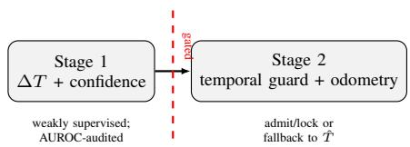
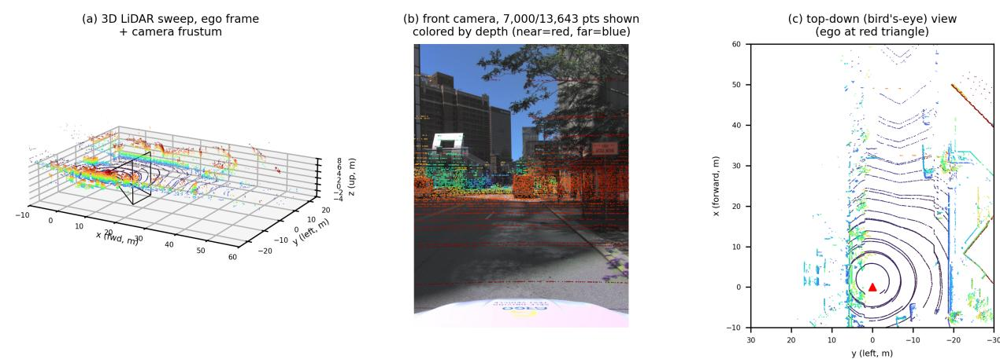
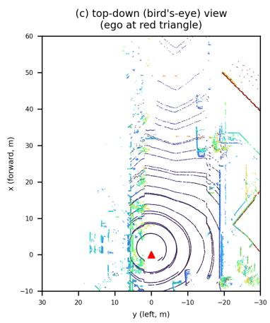
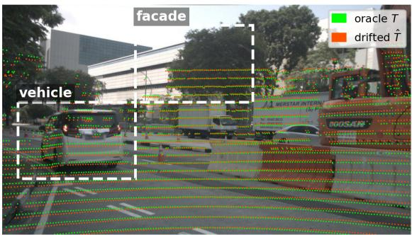
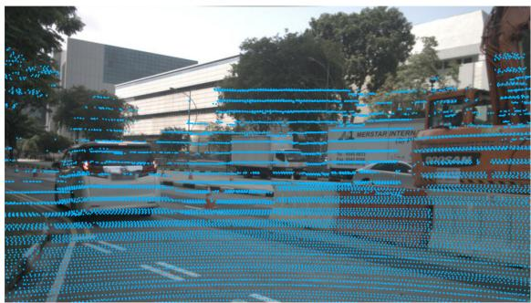
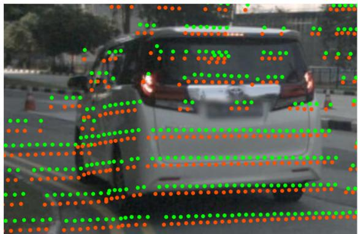
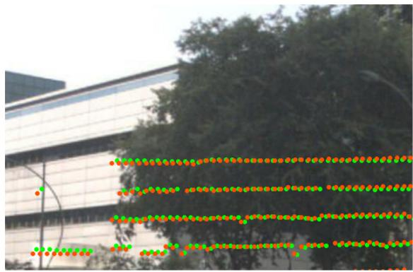

# Auditing Targetless Camera–LiDAR Extrinsic Correction before

Recursive Use

Bo Ma and Weiqi Yan

Auckland University of Technology, Auckland 1024, New Zealand

rcn4743@aut.ac.nz, weiqi.yan@aut.ac.nz

Abstract—Camera–LiDAR fusion repeatedly uses an extrinsic transform in projection, association, and recursive state estimation. We study whether a targetless correction should be admitted to a downstream consumer only after separate audits of correction quality, confidence ranking, and recursive risk. Our log-disjoint protocol evaluates these stages under synthetic extrinsic drift on Argoverse 2 and treats cross-dataset and odometry experiments as bounded diagnostics.

On 27 test-split logs, single-frame Canny alignment is harmful in the mild tier. Multi-frame alignment improves severe-tier rotation by 2.52◦ but worsens translation by 0.177 m; its declared joint error-magnitude improvement is also negative (−0.158, 95% CI [−0.223, −0.098]), so the rotation gain is not a six-degree-offreedom correction success. A zero-injection check moves away from the true extrinsic, and solver-disagreement AUROC on selected splits does not yield a validated nonzero-coverage risk– coverage operating point.

In a 15-log final system role, the locked conservative policy admits no candidate and equals Raw, whereas Always-correct increases trajectory error. These results support an auditable separation of correction, confidence, and recursive contamination; they do not establish a deployable calibration gate, positive odometry or SLAM improvement, map consistency, or closedloop safety.

## I. INTRODUCTION

Camera–LiDAR fusion systems increasingly consume Li-DAR point clouds projected into the camera frame, or bird’seye-view features fused from both modalities, as evidence for 3D scene understanding [1]. Every such pipeline assumes a particular extrinsic transform T between the LiDAR and camera frames is correct. In practice T is estimated once, offline, and treated as a constant; real vehicles experience rotation and translation drift around that estimate from vibration, thermal cycling, and mounting tolerances. Temporal misalignment is a separate failure mode and is outside the evaluated protocol. A system that silently trusts a stale T propagates the resulting misprojection into every cross-modal judgment it makes, with no signal that this happened.

Two adjacent literatures address pieces of this problem without addressing it jointly. Learning-based extrinsic calibration [2]–[4] regresses T (or a correction to it) from paired image/point-cloud evidence, and recent work adds calibrated uncertainty via conformal prediction [5]; this line reports interval coverage on the calibration error itself, not the downstream effect on a 3D understanding task. Learned drivingperception systems such as BEVFusion [1] consume calibrated sensor geometry as a given input and are not evaluated here under deliberately injected extrinsic drift. We ask the bounded operational question: when a downstream 3D understanding system is given a possibly miscalibrated extrinsic, can it detect and recover from it without trusting a separate offline calibration procedure blindly?

This paper makes a narrower claim. We introduce a confidence-gated protocol for extrinsic correction and test whether its components can be made reliable under synthetic drift. The single-frame edge-alignment instantiation fails under mild drift, while multi-frame evidence recovers a severe-tier rotation signal and descriptive confidence ranking but does not establish a safe two-tier gate. Sections III–IV define the protocol and its stopping rules; Sections V and VI report the observed evidence. A recursive visual–LiDAR odometry extension is evaluated as a bounded negative result, not as a claim of improved odometry or deployment safety.

Scope. We study whether a guarded correction module can correct synthetic extrinsic drift without applying harmful corrections when its confidence is unreliable. We do not claim a general-purpose calibration-quality certificate – a caller who wants only a calibration error bound should use a dedicated audit such as [5] – and we do not claim positive bounded visual–LiDAR odometry, trajectory, map, or closed-loop control performance. A stage whose admission criteria are not met is reported as negative with its criteria and observed values, not dropped or re-run with relaxed criteria.

## II. RELATED WORK

Calibration. Targetless calibration aligns projected LiDAR discontinuities with image structure [6]; learned methods regress or geometrically supervise the 6-DoF transform [2]– [4]. Recent work adds conformal uncertainty for the calibration error itself [5], but does not audit whether a correction is safe for a downstream recursive estimator. Our contribution is a log-disjoint reliability audit and negative case study that exposes this missing correction–confidence–consumer separation.

Recursive fusion and uncertainty. Visual–LiDAR odometry uses the extrinsic in feature association and motion estimation [7]; this is the recursive consumer audited here. BEVFusion [1] represents the downstream fusion setting. Conformal prediction [5] motivates auditing a score before using it as a gate; solver disagreement is an analogous uncertainty proxy, but here it measures a classical cost surface rather than model parameter uncertainty.

  
Fig. 1. The evaluated two-stage protocol connects a frozen correction module to a bounded visual–LiDAR odometry consumer through an explicit gate. The consumer uses a correction only when it is admitted and locked for a segment; otherwise it falls back to $\hat { T } .$ The extension evaluates longer trajectories and reports reprojection/association proxies when an HD-map archive is unavailable.

## III. METHOD

Problem statement. Both $T$ and $\hat { T }$ map camera coordinates to the ego frame. Given image $I ,$ point set ${ \mathcal P } ,$ and a possibly drifted extrinsic ${ \hat { T } } ,$ Stage 1 estimates a 6-DoF correction $\Delta \hat { T }$ and confidence. We define $T \ominus \hat { T } = \hat { T } ^ { - 1 } T$ in the cameralocal right-action convention, so $T = \hat { T } \Delta T$ in homogeneous coordinates. With J denoting an image–LiDAR alignment cost and B a fixed search box,

$$
\begin{array} { r l } & { \Delta \hat { T } = \arg \underset { \Delta T \in \cal B } { \operatorname* { m i n } } J ( \Delta T ; I , \mathcal { P } , \hat { T } ) , } \\ & { T _ { \mathrm { c o r r } } = \hat { T } \Delta \hat { T } , } \end{array}\tag{1}
$$

For our camera-local right-action convention, $R _ { \mathrm { c o r r } } = { \hat { R } } \Delta R$ and $t _ { \mathrm { c o r r } } = \hat { t } + \hat { R } \Delta t$ . We report rotation geodesic error, translation error, and the declared, task-scaled composite spatial score $d _ { \mathrm { c o m p } } ( s _ { t } ) = \sqrt { \theta _ { \mathrm { r a d } } ^ { 2 } + ( \Vert t _ { 1 } - t _ { 2 } \Vert / s _ { t } ) ^ { 2 } }$ , with the primary analysis using $s _ { t } = 1$ m and a pre-specified sensitivity audit at $s _ { t } \in \{ 0 . 1 , 1 , 1 0 \}$ m. This is an error-magnitude reporting composite, not an invariant geodesic metric on SE(3). The consumer admits a correction only after multistart and temporal checks; otherwise it retains ${ \hat { T } } .$

Stage 1 (evaluated protocol). Inputs are the front-center camera image, the LiDAR point cloud, and a perturbed extrinsic ${ \hat { T } } ;$ the true T is used only to generate the training label $\Delta T \ = \ T \ominus \hat { T }$ and to evaluate errors, never as a model input. Argoverse 2 [8] supplies three pre-declared tiers: correct $( \Delta = 0 )$ , mild (rotation $0 . 5 ^ { \circ } - 2 ^ { \circ }$ , translation 2–10 cm), and severe (rotation $5 ^ { \circ } - 1 0 ^ { \circ }$ , translation 20–35 cm). These ranges are fixed before evaluation and cover the spatial error magnitudes used in prior calibration work [2], [3]. The model outputs a 6-DoF correction and a scalar confidence; it is not given the injected severity.

Information boundary. The true extrinsic is used only for weak-label construction, offline error evaluation, and the non-deployable Oracle arm; logged ego pose is used only for offline sweep compensation. Injected tier, learned targets, and final reference poses are restricted to stratification, training, and evaluation respectively: none is an online feature, score, threshold-selection input, or final-rollout decision. Table I puts the split roles and privileged-data boundary in one place; extended parameter tables are given in Appendix H.

<table><tr><td>Data role / fixed sample</td><td>Boundary and prohibited inference</td></tr><tr><td>logs; every 3rd frame; 1,435 derived threshold or decision frames/tier/condition</td><td>Stage 1 formal: AV2 test, 27 True T: weak labels and offline metrics only; no test-</td></tr><tr><td>fixed 18/9 train/holdout; 473 used for tuning holdout frames/tier</td><td>Learned split: same 27 logs, Heatmap targets use T on train only; holdout is not</td></tr><tr><td>train/val, 60 logs; post-hoc cannot select the system threshold 30/30 split</td><td>Exploratory ranking: AV2 Severity is for stratification only; ranking/risk scans</td></tr><tr><td>opment/calibration/final logs; pose is offline/oracle compensation 100 sweeps,  $\geq$  30 frames, target 50 External diagnostic: 170/850 Plumbing/failure-pattern diagnostic only; no cross-</td><td>System audit: 3/15/15 devel- Calibration locks; final is evaluation only; logged ego</td></tr></table>

TABLE I  
DATA ROLES AND PRIVILEGED-INFORMATION BOUNDARY; NO TRUTH ENTERS ONLINE DECISIONS.

Stage 2. The recursive consumer compares raw ${ \hat { T } } ,$ oracle $T ,$ always-correct, and guarded policies on the same fixed-drift logs. All arms share timestamps, initial state, frame schedule, observations, and seed. The guard locks only after agreeing independent re-solves and temporally consistent adjacent windows; a failed current check resets the streak, and decisions use only current or past observations. Raw and Oracle ignore the guard schedule, while Always-correct applies the current candidate. The online-motion extension’s locked never-admit outcome remains a negative recursive-risk result, not positive downstream-odometry or deployment evidence.

The guard is a finite state machine: each window starts in Rejected; a window satisfying both observable checks increments the consecutive-pass streak, while any failed check resets it to Rejected. After H consecutive passes the current candidate enters Locked for its declared segment. No future window is read to make the current decision, and a segment reset returns to Rejected; the four arms use the same schedule and observations.

For a K-frame window, the shared correction minimizes $\begin{array} { r } { J _ { K } ( \Delta T ) = K ^ { - 1 } \sum _ { k } J _ { k } ( \Delta T ) } \end{array}$ after each sweep is motioncompensated into the reference camera frame. The online score $b _ { w }$ is the mean pairwise rotation-geodesic distance among the canonical solve and randomized re-solves in window w; $a _ { w }$ measures disagreement with preceding windows. The legacy score is a clipped relative cost drop multiplied by a point-count factor. These scores are used only for ranking until a threshold is selected on calibration data. Recorded ego poses are used for offline sweep-to-camera compensation, so the multi-frame result does not validate an estimated online motion model. A separate no-motion or noisy-pose dependency audit is therefore not silently substituted for the reported matrix.

## IV. EVALUATION PROTOCOL AND ADMISSION GATES

Statistical hierarchy. We declare one primary unit, comparison, safety constraint, and confidence interval before any secondary analysis: the log (log-disjoint splits, log-level resampling); Guarded versus Raw tier-blind trajectory error on the 15-log final split (Table VI); Guarded’s non-inferiority to Raw on ATE/RPE; and the accompanying log-level bootstrap 95% CI. The earlier 30-log bounded consumer remains a historical diagnostic. All other results, including basin-consistency and the selective-risk scans, are secondary or exploratory.

Chronology. The system-audit roles and the primary system contract were fixed before execution. The initial Stage 1 correction tables and the system audit were run first; the 60-log basin, declared composite-score, and selective-risk analyses were designed after early results and are therefore secondary exploratory/post-hoc diagnostics. Later pre-specified observability and resolution-matched candidate audits were also negative, so they selected no guard threshold or final rerun. This ordering is a dependency chain: observability audit → candidate generator → selective-risk control → online system audit.

Every recursive result uses four arms: raw ${ \hat { T } } ,$ oracle T (a non-deployable upper bound), always-correct, and guarded. A single-arm result is never used to support a recursive claim. Frames are correlated within a log, so intervals use log-level cluster resampling rather than per-frame bootstrap, and every calibration/evaluation split is log-disjoint. Confidence AUROC is computed within each severity tier: pooling tiers would allow confidence to appear predictive merely by tracking severity instead of whether a particular correction is trustworthy. The pre-specified gate requires a 95% lower bound above chance and a target AUROC of 0.70; only then may the confidence score gate Stage 2.

The ablation ladder is correct/mild/severe extrinsic error. Because Stage 1 is undefined without LiDAR, a literal no-LiDAR arm is not meaningful; instead an edge-vs-randompoint control uses the same point budget without rangediscontinuity selection, testing whether the specific geometric signal drives the correction. If any criterion fails, the result is retained as a negative result against its pre-specified threshold. We do not relax a threshold or re-run the final unit to obtain a pass. All runs use fixed seeds, versioned manifests, and resumable checkpoints; intervals below use 2,000 log-level bootstrap resamples.

The resulting decision sequence is deliberately asymmetric: a candidate may be rejected by any early audit, but it cannot be admitted by a later positive metric if an earlier sanity check has failed. This prevents downstream trajectory numbers from masking a correction that is already unreliable at the transform level.

## V. STATUS: A FIRST STAGE 1 RUN (NEGATIVE RESULT)

We ran Stage 1’s estimator as a classical, non-learned optimizer: candidate LiDAR points at range discontinuities within each scan ring (a single-frame instantiation of [6]) are projected under a candidate extrinsic and scored against an image edge-distance transform; a bounded search (Powell’s method) over a small ∆R, ∆t around the perturbed extrinsic minimizes this score. The fixed implementation uses a 2– 55 m range window, > 0.5 m jump, 2,500-point cap, Canny 50/150 with a $5 \times 5$ distance transform, Powell maxiter=60 over ±0.24 rad/±0.45 m, K = 20, and seed 1337. Confidence combines the optimizer’s relative cost improvement and the number of edge points used. Every frame is compensated for the ∼10 ms LiDAR-sweep/camera-shutter time gap via interpolated ego pose before scoring, so residual ego motion is not mistaken for miscalibration. Only rotation-andtranslation perturbation/correction were exercised in this run; time-synchronization perturbation was not, as a static ∆T cannot repair a frame-pairing error.

Algorithm 1 Audit-gated correction decision   
Require: Log-disjoint calibration set $D _ { c } ,$ evaluation set $D _ { e } ;$   
candidate corrector $f ;$ fixed risk targets   
1: Fit no final threshold on $D _ { e } ;$ retain the frozen search box   
and seeds   
2: Run $f$ from the true extrinsic with zero injected drift on   
$D _ { c }$   
3: if the zero-injection sanity check shows systematic move  
ment from truth then   
4: Flag the corrector for a wrong-basin failure-pattern   
diagnostic; continue only as a diagnostic   
5: end if   
6: Measure tier-wise correction improvement and confidence   
AUROC on $D _ { c }$   
7: if any tier fails the pre-specified correction or AUROC   
gate then   
8: Do not promote f directly to the recursive consumer   
9: end if   
10: Select a threshold on $D _ { c }$ under minimum coverage and   
false-admission risk   
11: Evaluate raw, oracle, always-correct, and guarded arms on   
$D _ { e }$   
12: if guarded fails downstream benefit or safety then   
13: Run the pre-specified complete system audit as a neg  
ative control   
14: Freeze the negative result; make no deployment claim   
15: else   
16: Re-test the complete frozen protocol on a fresh log  
disjoint unit   
17: end if

Data. All 27 Argoverse 2 test-split logs available at the time of this run, the front-center camera only, every third LiDAR frame (1,435 frames/tier/condition, 5,740 rows total). Intervals below are log-level cluster bootstraps (2,000 resamples, resampling whole logs with replacement, not individual frames) rather than the descriptive 2-log comparison of an earlier pilot; this is the protocol’s formal admission-decision statistic (§IV), illustrated in Fig. 2.

None of Stage 1’s three criteria are met. Correction does not reduce error at both tiers: at mild severity it is significantly harmful for both edge and random points, while at severe severity the point estimate is small and its interval includes zero. Within-tier AUROC is significantly above chance only for edge points at the severe tier (0.649, lower bound 0.605), still below the 0.70 target. Edge-selected points are less harmful than random points at both tiers (severe: +0.18◦ versus −1.57◦), but this does not amount to a significant net improvement. Translation is significantly harmful in all four cells, including severe/edge, where rotation is not: the simultaneous rotation/translation component reading of Table II is uniformly negative even where the rotation-only reading is ambiguous. This is a negative result for the single-frame Canny instantiation and does not open Stage 2.

Fig. 2. One representative Argoverse 2 frame, true extrinsic, no synthetic drift. (a) LiDAR sweep, height-colored, camera frustum from calibration. (b) Same sweep projected into the camera image, depth-colored. (c) Top-down view standing in for a map panel (no HD-map archive for this log).
<table><tr><td>Tier</td><td>Points</td><td>Raw→Corr. (rot.)</td><td>Rot. impr. [95% CI]</td><td>Trans. impr. (m) [95% CI]</td><td>Joint impr.  $[ s _ { t } = 1$  m]</td><td>AUROC [95% CI]</td></tr><tr><td>Mild</td><td>Edge</td><td> $1 . 2 5 ^ { \circ }  6 . 2 4 ^ { \circ }$ </td><td> $- 4 . 9 9 \ [ - 5 . 4 7 , - 4 . 4 6 ] ^ { \dagger }$ </td><td> $- 0 . 2 4 8 \ [ - 0 . 2 5 7 , - 0 . 2 3 9 ] ^ { \dagger }$ </td><td> $- 0 . 2 6 8 \ [ - 0 . 2 7 7 , - 0 . 2 5 9 ] ^ { \dag }$ </td><td>0.512 [0.428, 0.608]</td></tr><tr><td>Mild</td><td>Random</td><td> $1 . 2 5 ^ { \circ }  8 . 1 4 ^ { \circ }$ </td><td> $- 6 . 8 9 \ [ - 7 . 5 8 , - 6 . 2 1 ] ^ { \dag }$ </td><td> $- 0 . 2 7 4 \ [ - 0 . 3 0 0 , - 0 . 2 5 0 ] ^ { \dagger }$ </td><td> $- 0 . 3 0 6 \ [ - 0 . 3 3 2 , - 0 . 2 8 1 ] ^ { \dagger }$ </td><td>0.298 [0.040, 0.550]</td></tr><tr><td>Severe</td><td>Edge</td><td> $7 . 5 2 ^ { \circ }  7 . 3 4 ^ { \circ }$ </td><td> $+ 0 . 1 8 \ [ - 0 . 4 0 , 0 . 8 0 ]$ </td><td> $- 0 . 1 2 6 \ [ - 0 . 1 3 6 , - 0 . 1 1 7 ] ^ { \dagger }$ </td><td> $- 0 . 1 2 4 \ [ - 0 . 1 3 4 , - 0 . 1 1 5 ] ^ { \dag }$ </td><td>0.649 [0.605, 0.694]‡</td></tr><tr><td>Severe</td><td>Random</td><td> $7 . 5 2 ^ { \circ }  9 . 0 9 ^ { \circ }$ </td><td> $- 1 . 5 7 \ [ - 2 . 2 8 , - 0 . 8 6 ] ^ { \dagger }$ </td><td> $- 0 . 1 6 5 \ [ - 0 . 1 8 7 , - 0 . 1 4 3 ] ^ { \dagger }$ </td><td> $- 0 . 1 7 0 \ [ - 0 . 1 9 4 , - 0 . 1 4 6 ] ^ { \dag }$ </td><td> $0 . 5 3 1 \ [ 0 . 4 7 0 , 0 . 5 9 4 ]$ </td></tr></table>

TABLE II  
LOG-CLUSTER-BOOTSTRAP ROTATION- AND TRANSLATION-ERROR IMPROVEMENT (RAW MINUS CORRECTED; POSITIVE IS BETTER), THE DECLARED JOINT ERROR-MAGNITUDE IMPROVEMENT, AND WITHIN-TIER CONFIDENCE AUROC, 27 LOGS, 1,435 FRAMES/TIER/CONDITION. THE JOINT COLUMN USES RADIANS AND $s _ { t } = 1$ M; IT IS NOT AN INVARIANT SE(3) DISTANCE. †: CI EXCLUDES ZERO IN THE harmful DIRECTION. ‡: CI LOWER BOUND EXCEEDS 0.5 (SIGNIFICANTLY BETTER THAN CHANCE) BUT NOT THE 0.70 TARGET. POOLED (NOT WITHIN-TIER) AUROC WOULD READ 0.753 (EDGE) APPEARING TO PASS 0.70; SEE DISCUSSION BELOW. TRANSLATION IS SIGNIFICANTLY HARMFUL IN every CELL, INCLUDING SEVERE/EDGE, WHERE ROTATION IS NOT SIGNIFICANTLY HARMED: THE SIMULTANEOUS ROTATION/TRANSLATION/JOINT READ IS UNIFORMLY NEGATIVE EVEN WHERE THE ONE-DOF (ROTATION) READ IS NOT.

The pooled AUROC is a methodological trap. Pooling both tiers gives an apparently passing AUROC of 0.753 for edge points because confidence tracks severity, not perinstance quality. The within-tier statistic is the one relevant to a gate, and it does not pass. The fact that this artifact persists after increasing the data by roughly 13× over an earlier pilot shows that it is a property of the evaluation design rather than small-sample noise.

Diagnosis. A direct cost sweep around the true calibration, one rotation axis at a time, is not reliably unimodal: on two of three axes the minimum in $\mathrm { \ a \ \pm 3 ^ { \circ } }$ window is offset $0 . 5 \mathrm { ^ { \circ } - }$ 1◦ from zero, and on the third the cost decreases toward the window edge. On a diagnostic 27-log subsample, the cost surface favored the true pose over the starting pose in 77.1% of mild cases, yet in 93.1% the optimizer found an even lower-cost wrong basin and moved $4 . 6 0 ^ { \circ }$ on average for a 1.29◦ injected error. Single outdoor frames contain many Canny edges unrelated to depth discontinuities (foliage, road texture, and shadows), consistent with why multi-frame accumulation and learned features are natural remediations. The result is negative for this classical single-frame cost surface, not evidence against the staged audit protocol or a learned Stage 1 estimator.

## VI. REMEDIATION ATTEMPTS

We compare the original single-frame Canny solver with two remediations. First, multi-frame accumulation jointly optimizes one correction over K = 20 frames per log, using one session-level perturbation and a matched single-frame baseline. Second, a five-convolution fully convolutional network predicts a depth-discontinuity heatmap from the image using ground-truth- assisted weak labels on an 18/9 train/holdout partition of the same 27 formal logs. The learned heatmap replaces Canny edges but leaves the optimizer, search box, and confidence evaluation unchanged. Specifically, the Edge-LikelihoodNet has channels $3  1 6  3 2  3 2  1 6  1$ with dilations 1, 2, 4, 1, BatchNorm/ReLU hidden blocks, a sigmoid output, and no downsampling; it is trained with MSE and Adam (learning rate $1 0 ^ { - 3 } )$ for 40 epochs, batch size 8, no augmentation, seed 1337, and a fixed final-epoch checkpoint. Table III shows the matched rotation results.

Multi-frame accumulation yields a significant severe-tier correction (+2.52◦, CI [0.90, 4.06]) and AUROC 0.879 (CI [0.714, 0.986]), the only cell clearing both pre-specified rotation and confidence targets. The learned solver also improves the severe tier (+2.21◦ single-frame; +5.22◦ multi-frame on 9 held-out logs), but its confidence remains below the 0.70 target and the mild tier is unresolved. Critically, the component and declared-joint analysis shows that both rotation-improving cells make translation worse at the same time (−0.177 m and −0.139 m respectively); their joint improvements are −0.158 and −0.113, with the latter interval crossing zero. Thus the corrector that ”passes” on rotation and confidence would still inject a systematically larger translation error if it were admitted, which is exactly the failure mode a rotation-only gate cannot see. Neither remediation passes both tiers on rotation alone, and none passes on the declared composite criterion, so Stage 2 remains closed.

<table><tr><td>Method</td><td>Tier</td><td>Rot. impr. [95% CI]</td><td>Trans. impr. (m) [95% CI]</td><td>Joint impr. [st=1 m]</td><td>AUROC [95% CI]</td></tr><tr><td>Canny, single-framea</td><td>Mild</td><td>-5.06 [-5.80, -4.31]</td><td> $- 0 . 2 4 6 \ [ - 0 . 2 6 0 , - 0 . 2 3 1 ] ^ { \ddagger }$ </td><td> $- 0 . 2 6 8 \ [ - 0 . 2 8 4 , - 0 . 2 5 1 ]$ </td><td>0.500</td></tr><tr><td> $\mathrm { C a n n y , ~ s i n g l e \mathrm { - } f r a m e } ^ { \alpha }$ </td><td>Severe</td><td> $+ 0 . 0 8 \ [ - 0 . 6 8 , 0 . 8 8 ]$ </td><td> $- 0 . 1 2 9 \ [ - 0 . 1 4 4 , - 0 . 1 1 4 ] ^ { \ddagger }$ </td><td>-0.128 [-0.142, -0.112]</td><td>0.658</td></tr><tr><td> $\mathrm { C a n n y , ~ m u l t i - f r a m e } ^ { b }$ </td><td>Mild</td><td>-2.62 [-3.94, -1.47]</td><td> $- 0 . 3 3 1 \ [ - 0 . 3 8 7 , - 0 . 2 7 9 ] ^ { \ddagger }$ </td><td>-0.340 [-0.394, -0.294]</td><td>0.437</td></tr><tr><td> $\mathrm { C a n n y , ~ m u l t i - f r a m e } ^ { b }$ </td><td>Severe</td><td>+2.52 [0.90, 4.06]</td><td> $- 0 . 1 7 7 \ [ - 0 . 2 4 4 , - 0 . 1 1 5 ] ^ { \ddagger }$ </td><td>-0.158 [-0.223, -0.098]</td><td>0.879†</td></tr><tr><td> ${ \mathrm { L e a r n e d , ~ s i n g l e \mathrm { - } f r a m e } } ^ { a }$ </td><td>Mild</td><td>-3.47 [-4.15, -2.82]</td><td> $- 0 . 3 3 2 \ [ - 0 . 3 5 4 , - 0 . 3 0 7 ] ^ { \ddagger }$ </td><td>-0.341[-0.363, -0.317]</td><td>0.614 [0.517, 0.696]</td></tr><tr><td> $\mathrm { L e a r n e d } , \mathrm { s i n g l e \mathrm { - } f r a m e } ^ { a }$ </td><td>Severe</td><td>+2.21 [1.44, 2.84]</td><td> $- 0 . 1 9 3 \ [ - 0 . 2 1 1 , - 0 . 1 7 4 ] ^ { \ddagger }$ </td><td>-0.176 [-0.195, -0.157]</td><td>0.641 [0.532, 0.743]</td></tr><tr><td>Learned, multi-framec</td><td>Mild</td><td>-0.26 [-0.83, 0.30]</td><td> $- 0 . 3 2 9 \ [ - 0 . 3 9 5 , - 0 . 2 5 2 ] ^ { \ddagger }$ </td><td>-0.327[-0.391, -0.250]</td><td>0.600 [0.000, 1.000]</td></tr><tr><td>Learned, multi-frame</td><td>Severe</td><td>+5.22 [4.62, 5.95]</td><td>-0.139 [-0.302, 0.004]</td><td>-0.113[-0.272, +0.027]</td><td>n/a</td></tr></table>

TABLE III  
ROTATION-, TRANSLATION-, AND DECLARED JOINT ERROR-MAGNITUDE IMPROVEMENT, AND CONFIDENCE AUROC, BOLD WHERE THE 95% CI EXCLUDES ZERO IN THE HELPFUL DIRECTION (ROTATION IMPROVEMENT) OR THE LOWER BOUND EXCEEDS 0.5 (AUROC). †: THE ONLY CELL CLEARING THE PRE-SPECIFIED 0.70 AUROC TARGET. ‡: TRANSLATION CI EXCLUDES ZERO IN THE harmful DIRECTION – TRUE FOR EVERY CELL EXCEPT LEARNED MULTI-FRAME/SEVERE, WHOSE INTERVAL IS THE WIDEST (n=9 LOGS) AND MERELY TOUCHES ZERO. BOTH CELLS WITH A BOLD (SIGNIFICANT) ROTATION GAIN – CANNY AND LEARNED MULTI-FRAME/SEVERE – HAVE SIGNIFICANTLY WORSE TRANSLATION AT THE SAME TIME: THE COMPONENT-WISE READ FINDS NO CELL IN THIS TABLE THAT IS UNAMBIGUOUSLY HELPFUL. THE DECLARED JOINT ENDPOINT IS INCLUDED IN THE TABLE; ITS DEFINITION IS GIVEN IN SECTION III, AND THE PRE-SPECIFIED SCALE SENSITIVITY IS SUMMARIZED BELOW. a: PER-FRAME PERTURBATION, 473 FRAMES ON THE SAME 9 LOG-DISJOINT LOGS USED TO EVALUATE THE LEARNED MODEL (CANNY ROW RECOMPUTED ON THIS SUBSET FOR A MATCHED COMPARISON: THE 27-LOG CANNY NUMBERS IN TABLE IIL ARE SIMILAR BUT NOT IDENTICAL). b: PER-LOG PERTURBATION, 27 LOGS (DIFFERENT UNIT; SEE TEXT), SINGLE-FRAME ROW USES THE SAME PER-LOG PERTURBATION AND FIRST FRAME ONLY, ISOLATING THE EFFECT OF ACCUMULATION. c: LEARNED HEATMAP WITH THE SAME K=20 MULTI-FRAME PROTOCOL ON THE 9 HELD-OUT LOGS; AUROC IS UNDEFINED FOR SEVERE BECAUSE ALL NINE CORRECTIONS IMPROVED, AND THE MILD INTERVAL IS EXPLORATORY RATHER THAN A FORMAL 27-LOG GATE.

On the same 9-log holdout, the learned solver’s zeroinjection run wandered more than $0 . 5 ^ { \circ }$ on 99.15% of frames and its basin-consistency AUROC was 0.623/0.662 on mild/severe, below target. This small diagnostic is consistent with a wrong-basin failure pattern beyond Canny, but does not justify a gating decision.

As a pre-specified follow-up, the same learned producer was retrained with the native $ 3 8 8 \times 5 1 2  2 5 6 \times 3 4 0$ path. On the 9-log holdout, mild and severe rotation improvements were −3.471◦ (AUROC 0.510) and +2.548◦ (AUROC 0.681), respectively. Although 45 helpful severe candidates appeared in 8/15 calibration logs, all 916 correct-tier zero-injection candidates were harmful; this follow-up therefore closed without a guard or final-log rerun.

The preceding observability audit reused the fixed 15-log calibration role: all 2,748 observations had complete descriptors and 90 offline-helpful candidates occurred across 12 logs, but all 916 correct-tier zero-injection candidates were harmful. Its safety gate therefore failed; no descriptor was promoted and no downstream rerun was authorized.

A. External-Dataset Geometry Plumbing Diagnostic (nuScenes)

We re-implemented the projection chain on nuScenes [9] to test sensor-convention portability, not to waive the Stage 1 gates. Unlike Argoverse 2, nuScenes stores orientation as $[ w , x , y , z ]$ quaternions and composes sensor-to-ego and egoto-global transforms independently. The implementation therefore checks both the quaternion convention and the sweep accumulation order before any optimizer is run.

On a fixed nuScenes Mini sample, single-frame projection placed 2,668 of 34,688 input LiDAR points inside the image under the true extrinsic (7.7% coverage) and 2,672 under a fixed camera-local perturbation of 1◦ about the optical axis and 5 cm along the image-right axis, with a 7.36-pixel median shift over the points visible under both transforms. Accumulating four preceding sweeps through their logged ego poses into the same reference camera frame under the true extrinsic raised the point count to 173,376 (12,211 in image, 7.0% coverage). The lower accumulated coverage reflects the wider spatial footprint of five sweeps, not a projection failure. These results are a geometric plumbing check only: no correspondenceconfidence or correction model is fit here, and passing this check does not relax any Stage 1 admission criterion. Crossdomain diagnostic. We also ran the classical single- and multi-frame Canny correctors, unchanged from Section VI, as an external diagnostic baseline on a 170-scene nuScenes calibration role drawn from an 850-scene Trainval manifest. The correctors were harmful at every tested threshold; for example, severe multi-frame changed $7 . 6 0 ^ { \circ } ~  ~ 9 . 2 8 ^ { \circ }$ (CI [−2.63, −0.76]). Starting from the true pose with zero injected error still lowered the cost while wandering 8–10◦ on 92– 94% of scenes. An independent 20-log Argoverse 2 training sample reproduced the failure: zero of 2,102 frames improved, with degradation CIs [−7.42, −6.27]◦ for edge points and $[ - 9 . 7 9 , - 8 . 2 2 ] ^ { \circ }$ for the random control. These checks support a cross-dataset wrong-basin failure-pattern diagnostic, not a deployment gate; the original 27 test logs are analyzed directly below. The remaining nuScenes scenes are not used for threshold tuning or as a second positive claim. Because no locked scene-manifest hash exists for this role, this is not a cross-domain generalization benchmark.

## B. Solver-Disagreement Diagnostic: Basin Consistency

Every true-pose comparison so far (§V, above) detects the failure by comparing the optimizer’s solution against the true extrinsic – information a deployed system never has. We test whether the failure instead leaves a trace in something a deployed system does have: disagreement between independent re-solves of the same correction problem. If the edgealignment cost surface has one dominant basin, re-solving from different starting points should converge to (nearly) the same pose, whether or not that pose is correct. If it has two or more comparably-deep basins – the shape the mild-tier diagnosis above describes – restarts should disagree more often on exactly the frames where the canonical solve lands in the wrong one.

For each (log, tier, method) cell, we re-solve the identical correction problem – same LiDAR points, same image-edge cost surface, same classical Canny corrector used throughout this paper – five additional times from starting points drawn uniformly across the full search box, alongside the canonical zero-init solve. We summarize the six resulting poses by their mean pairwise geodesic rotation angle (basin spread); low spread is the candidate confidence signal, in place of the cost-drop heuristic used elsewhere in this paper. This extends the zero-injection check above from 20 to all 60 downloaded Argoverse 2 train/val exploratory-pool logs and adds the mild and severe tiers, reusing the same disjointness argument: since these are from the official train/val splits and Table III’s 27 logs are test-split, the two samples cannot share a log ID regardless of which 27 test-split logs were originally selected.

Basin-consistency is above chance on the exploratory pool for mild/multi-frame (0.673, CI [0.519, 0.811]) and severe/multi-frame (0.770, CI [0.620, 0.888]), while the legacy score gives 0.548 and 0.603. It outperforms the legacy score in every defined row except mild/single-frame, and is the only signal significantly above chance in this table. The severe multi-frame result clears the 0.70 target that the legacy score misses on this disjoint sample, whereas the formal 27- log unit below reverses that ranking. This split-dependent reversal is itself evidence that one sample’s admission result is insufficient to establish a general capability. The mild multiframe signal is also the strongest mild-tier ranking found in this study, but it does not make mild correction admissible. Zero injection improves no log in either method. These results are exploratory and do not reopen Stage 2; the formal test below checks whether the signal survives on the original unit.

## C. Resolving Contamination on the Formal 27-Log Unit

We re-run the identical zero-injection and basin-consistency protocol on the 27 test-split logs behind Table III, reproducing its severe/multi-frame result within 0.005◦. Starting from the true pose with no injected drift, 0 of 27 logs improve under either solver. Thus the one cell that passed the original admission criteria is consistent with a wrong-basin failure pattern on its own formal unit, although this does not prove that every severe-tier improvement is spurious.

Basin-consistency. On the formal unit, basin-consistency clears 0.70 significantly for mild/multi-frame (0.814, CI [0.611, 0.968]) and severe/multi-frame (0.757, CI [0.529, 0.935]). The mild correction remains net harmful (25.9% of logs improved), but the confidence ranking separates the minority of helpful cases without access to the true pose. On severe/multi-frame, the legacy score is higher (0.879), illustrating that a single sample cannot establish a general admission rule.

Shared-attractor audit. For each log, a Monte Carlo null holds the two observed errors fixed while randomizing independent rotation axes. On the formal unit, 7/27 logs fall in the 5% tail, Fisher’s test gives $p < 1 0 ^ { - 6 } ,$ , and the paired rotation difference is smaller than chance on 20/27 logs $( p = 0 . 0 0 7 )$ The full spatial audit gives observed distance 4.990 versus null 6.314 (difference −1.324, 95% CI [−2.431, −0.286]). On the disjoint exploratory train/val pool the analogous values are 5.734 versus 7.540 (difference −1.806, 95% CI [−3.032, −0.741]; 22/60 per-log $p ~ < ~ 0 . 0 5 )$ . With the declared 1-m scale, these remain observational, not causal. The pre-specified audit retains a negative difference at $s _ { t } =$ 0.1, 1, 10 m in both roles (formal −2.421, −1.324, −1.294; exploratory $- 2 . 0 9 5 , - 1 . 8 0 6 , - 1 . 7 9 6 )$ , but its magnitude is scale-dependent; these values are reported as a sensitivity summary rather than as a causal mechanism test.

Lower basin spread also predicts a smaller correct–severe angle on the 60-log pool (Spearman $\rho = 0 . 6 2$ correct tier and 0.66 severe tier, $p \ < \ 1 0 ^ { - 4 } )$ , a replicated but observational association rather than causal evidence.

## D. Selective Risk and Coverage

Selective risk. A post-hoc hash split of the 60-log pool (30 calibration/30 evaluation) scanned both scores under minimum coverage, 5% false-admission, and log-bootstrap risk constraints. Neither score had a validated nontrivial threshold; both selected never-admit and accepted no evaluation window. Both scores have 0/90 admitted rows, 0/30 admitted logs, and [0, 0] coverage intervals in both roles; all admitted-row risks are undefined. Thus AUROC is a ranking statistic, not a selective safety certificate.

## VII. BOUNDED VISUAL–LIDAR ODOMETRY DIAGNOSTIC

To evaluate recursive-system safety, we ran the pre-specified extension rather than treating a calibration score as a downstream odometry result. The consumer is a bounded, projectnative AV2-LIMO-lite visual–LiDAR front end: projected Li-DAR points are associated with LK features and adjacent camera motion is estimated by RANSAC PnP [7]. This is a bounded visual–LiDAR diagnostic contract, implemented without ROS, IMU, semantic labels, or hidden ground truth at decision time. Its output includes relative pose arrays, fixed

<table><tr><td>Tier</td><td>Method</td><td>% Improved</td><td>Basin-consistency AUROC [95% CI]</td><td>Legacy (cost-drop) AUROC [95% CI]</td></tr><tr><td>Correct</td><td>Multi-frame</td><td>0.0%</td><td>n/a (no frame improved)</td><td>n/a</td></tr><tr><td>Correct</td><td>Single-frame</td><td>0.0%</td><td>n/a (no frame improved)</td><td>n/a</td></tr><tr><td>Mild</td><td>Multi-frame</td><td>31.7%</td><td>0.673 [0.519, 0.811]*</td><td>0.548 [0.403, 0.693]</td></tr><tr><td>Mild</td><td>Single-frame</td><td>5.0%</td><td>0.596 [0.458, 0.719]</td><td>0.632 [0.203, 0.898]</td></tr><tr><td>Severe</td><td>Multi-frame</td><td>70.0%</td><td>0.770† [0.620, 0.888]*</td><td>0.603 [0.437,0.758]</td></tr><tr><td>Severe</td><td>Single-frame</td><td>38.3%</td><td>0.623 [0.464, 0.779]</td><td>0.563 [0.408, 0.702]</td></tr></table>

TABLE IV  
BASIN-CONSISTENCY VERSUS THE EXISTING COST-DROP CONFIDENCE HEURISTIC FOR PREDICTING WHETHER A CORRECTION REDUCED ROTATION ERROR ON ALL 60 ARGOVERSE 2 TRAIN/VALIDATION EXPLORATORY-POOL LOGS (360 ROWS; SIX RESTART-SOLVES PER ROW). BOLD MARKS A POINT ESTIMATE ABOVE THE LEGACY HEURISTIC. ∗ DENOTES A 95% CI EXCLUDING 0.5; † DENOTES THE PRE-SPECIFIED 0.70 TARGET.

<table><tr><td>Tier</td><td>Method</td><td>% Improved</td><td>Basin-consistency AUROC [95% CI]</td><td>Legacy (cost-drop) AUROC [95% CI]</td></tr><tr><td>Correct</td><td>Multi-frame</td><td>0.0%</td><td>n/a (no frame improved)</td><td>n/a</td></tr><tr><td>Correct</td><td>Single-frame</td><td>0.0%</td><td>n/a (no frame improved)</td><td>n/a</td></tr><tr><td>Mild</td><td>Multi-frame</td><td>25.9%</td><td>0.814† [0.611, 0.968]*</td><td>0.393 [0.160, 0.632]</td></tr><tr><td>Mild</td><td>Single-frame</td><td>3.7%</td><td>0.500 [0.308, 0.692]</td><td>0.231 [0.077, 0.417]</td></tr><tr><td>Severe</td><td>Multi-frame</td><td>74.1%</td><td>0.757† [0.529, 0.935]*</td><td>0.879† [0.714, 0.986]*</td></tr><tr><td>Severe</td><td>Single-frame</td><td>59.3%</td><td>0.722† [0.489, 0.909]</td><td>0.659 [0.437, 0.864]</td></tr></table>

TABLE V  
BASIN-CONSISTENCY VS. THE EXISTING COST-DROP CONFIDENCE HEURISTIC ON THE FORMAL 27-LOG ARGOVERSE 2 TEST-SPLIT UNIT (162 ROWS; 6 RESTART-SOLVES PER ROW) – THE SAME LOGS AND PERTURBATIONS BEHIND TABLE III. BOLD WHERE BASIN-CONSISTENCY’S POINT ESTIMATE EXCEEDS THE LEGACY HEURISTIC’S. ∗: 95% CI EXCLUDES 0.5 (SIGNIFICANTLY ABOVE CHANCE). †: POINT ESTIMATE EXCEEDS THE PRE-SPECIFIED 0.70 TARGET (SEVERE/SINGLE-FRAME’S CI STILL CROSSES 0.5, SO IT DOES NOT COUNT AS A SIGNIFICANT PASS DESPITE CLEARING THE POINT-ESTIMATE TARGET).

1/5/10/25-frame RPE, tracking loss, reprojection RMSE, inlier association, and online-motion success.

Protocol. The immutable manifest contains 3 development, 15 calibration, and 15 final logs, all log-disjoint, using the front-center camera and fixed seed 1337. Each bundle requests 100 sweeps, requires at least 30 usable frames, and targets 50 consecutive frames; one final log is therefore marked short and the other 14 qualify for the long-horizon target. Raw bundles are prepared without recorded-pose compensation. In the online condition, adjacent visual–LiDAR 3D–2D associations feed RANSAC PnP and a fractional SE(3) transform is applied according to the timestamp gap. Recorded ego pose is not used by the online decision or compensation path.

Each tier uses four paired arms: Raw, Oracle, Alwayscorrect, and Guarded. Oracle is a non-deployable diagnostic; Always-correct exposes recursive pollution; Guarded is the evaluated admission policy, not a validated deployment mechanism. The calibration guard uses only observable solver fields. Its safety condition is the one-sided 95% upper bound on harmful admissions among admitted zero-injection candidates, while minimum coverage, distinct-log coverage, an injectedtier admission, and a helpful admission prevent a reject-all policy from passing.

Guard lock. Calibration produced 2,748 candidate observations over 15 logs. No threshold satisfied both the conditional zero-injection safety constraint and the non-degeneracy requirements, so the locked policy was never-admit negative control (0/2,748 candidate admissions, 0/15 logs, zeroinjection upper bound 1.00 because no zero-injection candidate was admitted). The final matrix below was nevertheless run with this locked negative control to expose the complete recursive-system risk; neither its threshold nor any final metric was used to change calibration.

<table><tr><td>Metric</td><td>Raw</td><td>Oracle</td><td>Always-correct</td><td>Guarded</td></tr><tr><td>ATE RMSE (m)</td><td>7.458</td><td>4.520</td><td>20.474</td><td>7.458</td></tr><tr><td>Rotation RMSE (deg)</td><td>6.193</td><td>5.975</td><td>11.274</td><td>6.193</td></tr><tr><td>10-frame RPE rot. (deg)</td><td>3.153</td><td>2.854</td><td>5.500</td><td>3.153</td></tr><tr><td>10-frame RPE trans. (m)</td><td>3.214</td><td>2.239</td><td>7.245</td><td>3.214</td></tr><tr><td>10-frame joint RPE</td><td>3.215</td><td>2.240</td><td>7.246</td><td>3.215</td></tr><tr><td>Reprojection RMSE (px)</td><td>1.973</td><td>1.981</td><td>1.942</td><td>1.973</td></tr><tr><td>Association coverage</td><td>0.165</td><td>0.177</td><td>0.141</td><td>0.165</td></tr><tr><td>Tracking loss (%)</td><td>0.22</td><td>0.23</td><td>1.24</td><td>0.22</td></tr></table>

TABLE VI  
FINAL TIER-BLIND SYSTEM METRICS, AVERAGED WITHIN EACH LOG BEFORE THE 15-LOG BOOTSTRAP. ATE 95% CIS ARE RAW [5.203, 9.855], ORACLE [2.404, 7.257], ALWAYS-CORRECT [15.108, 26.258], AND GUARDED [5.203, 9.855] M. THE CORRESPONDING 10-FRAME JOINT-RPE CIS ARE RAW [2.228, 4.329], ORACLE [1.369, 3.391], ALWAYS-CORRECT [5.504, 9.302], AND GUARDED [2.228, 4.329]. GUARDED EQUALS RAW BECAUSE THE LOCKED POLICY ADMITS NO CORRECTION.

Table VI shows that the online consumer and all requested map-proxy diagnostics are now present, but the result remains negative: Guarded–Raw ATE is 0.000 m (95% CI [0.000, 0.000]), whereas Always-correct–Raw is −13.017 m ([−18.639, −7.729]). The Oracle arm provides a useful upper reference, but does not rescue the correction mechanism. Across Raw and Guarded, 3,291 of 3,297 adjacent edges were estimated online and six used the explicit fallback. No HDmap archive was available for these bundles, so we report reprojection and association consistency rather than claiming map consistency.

<table><tr><td>Evaluation item</td><td>Calibration</td><td>Final</td><td>Decision</td></tr><tr><td>Logs / tier rollouts</td><td>15 /  45</td><td>15 /  45</td><td>log-disjoint</td></tr><tr><td>Candidate observations</td><td>2,748</td><td>2,748</td><td>audit only</td></tr><tr><td>Usable frames</td><td>≥ 35</td><td>≥ 36</td><td>min. 30</td></tr><tr><td>Long-horizon logs (≥ 50)</td><td></td><td>14/15</td><td>1 short-log</td></tr><tr><td>Guarded admissions</td><td>locked 0</td><td>0</td><td>negative control</td></tr></table>

TABLE VII  
SYSTEM-AUDIT DATA AND GUARD RESULTS. THE FINAL CANDIDATE COUNT IS SHOWN ONLY TO DOCUMENT THE FROZEN STREAM; THE GUARD DECISION WAS MADE FROM THE CALIBRATION ROLE, AND THE FINAL CANDIDATE OBSERVATIONS WERE NOT USED FOR SELECTION.

This extension closes the requested measurement gaps but does not support the stronger system claim: it has complete six-DoF correction/trajectory metrics, online motion compensation, and a bounded visual–LiDAR diagnostic consumer, longer trajectories, and reprojection/association measures, yet no non-degenerate guarded operating point. We therefore retain the paper’s negative conclusion and do not infer deployment safety, mapping quality, or closed-loop benefit from the negative-control audit.

## VIII. DISCUSSION

Contribution, given the observed outcome. We provide a scope-limited audit protocol that separates correction quality, confidence ranking, and recursive risk. The single-frame Canny solver fails under mild drift; multi-frame accumulation recovers a severe-tier rotation point estimate, but translation worsens simultaneously, and zero-injection and compositescore audits are consistent with a wrong-basin failure pattern. The learned solver improves the severe tier on a small holdout, but its confidence remains below target. Basin-consistency ranks selected cases more informatively, yet the post-hoc selective-risk audit finds no validated nonzero-coverage gate. Thus correction reliability and gating reliability are separate: a useful ranking signal need not support a safe threshold.

The system-level result strengthens this interpretation. Among 2,748 calibration candidates over 15 logs, the conditional zero-injection safety and non-degeneracy requirements have no common operating point. The locked negative control therefore admits no correction on the independent final role, so the present stream supports neither a safe threshold nor a downstream improvement claim.

Recursive relevance. In the visual–LiDAR odometry consumer, a stale transform can bias feature association repeatedly. Across 15 final logs and 45 tier rollouts, the locked guard admitted nothing and matched Raw (ATE 7.458 m; 10- frame joint RPE 3.215), whereas Always-correct was worse (20.474 m; 7.246). This supports auditing recursive pollution, not a claim that the guard improves odometry.

Audit implication. Future studies should gate zeroinjection, tier-wise confidence, and selective risk before the recursive consumer; here the severe rotation signal fails on translation, basin ranking has no selective threshold, and Guarded=Raw is not an improvement.

Threats to validity and reporting discipline. We keep distinct roles rather than pooling evidence: 27 test logs are the formal Stage 1 unit, 60 train/validation logs are exploratory, nine held-out logs compare learned signals, and the system audit uses separate 15-log calibration and final roles. The 170- scene nuScenes sample is diagnostic, not frozen transfer. This separation limits external validity but prevents exploratory results from becoming admission claims. Holm–Bonferroni hardening and log-cluster intervals/MDEs (Appendix C) are reported separately from ranking, selective-risk, and deployment claims.

Limitations and implications. We use synthetic drift and one AV2 camera. The 30–100-frame consumer has no HDmap archive, so reprojection/association are map-independent proxies; degenerate PnP edges can fall back. Time-offset and organic mounting drift remain outside scope, and the 12-log pose/no-motion audit is exploratory. The 1-m spatial score is task-scaled, not a dimensionless certificate; AUROC is ranking, not safety. The $0 . 1 / 1 / 1 0 { \cdot } \mathrm { m }$ audit preserves the sign but changes magnitude and tail counts. A successor must reopen the same log-disjoint gates before any deployment or closed-loop claim.

## IX. CONCLUSION

We introduced a confidence-gated camera–LiDAR correction protocol and separated correction quality, confidence ranking, and recursive risk. Multi-frame accumulation improves severe-tier rotation but worsens translation and fails zeroinjection; learned correspondence retains a severe-tier gain on a small holdout, but its confidence misses the admission target. The resolution-matched audit also fails zero-injection, so no candidate reopens the recursive branch.

On the formal 27-log unit, basin-consistency clears the 0.70 ranking target for multi-frame conditions; the declared composite score is 4.990 versus 6.314 under its independentdirection null. The exploratory pool gives 5.734 versus 7.540 (difference −1.806, 95% CI [−3.032, −0.741]). These are observational, use a declared 1-m translation scale, and do not identify a causal basin. The pre-specified 0.1/1/10-m audit keeps the sign but changes magnitude and tail counts; the nuScenes and Argoverse 2 zero-injection checks support a failure-pattern diagnostic, not causal or generalization claims.

A calibration-selected guard has no validated nonzerocoverage operating point. In the extended consumer, the locked negative control therefore admits nothing and matches Raw, whereas unconditional correction is harmful. Even with auxiliary six-DoF, online-motion, long-horizon, reprojection, and association audits, the recursive branch lacks a safe correction gate. A future system would need to pass the same tierwise correction, confidence, zero-injection, and downstream benefit/safety gates before claiming deployment or closed-loop benefit. Until then, the evidence supports auditing correction, confidence, and recursive contamination separately, but not a deployable calibration gate, downstream odometry improvement, or closed-loop safety claim.

## APPENDIX A

## DATA CONTRACT

Table VIII lists every dataset role used in the main text and this appendix, with its official split, camera, sampling unit, perturbation rule, log/scene count, and split identity. Two intersections are easy to misread and are stated explicitly here rather than only in prose: (i) the learned corrector’s 18- log training role and 9-log evaluation role are not a separate sample – they are a fixed partition of the same 27 formal test-split logs used throughout Stage 1; and (ii) the selectiverisk audit’s 30/30 calibration/evaluation split is not a new sample either – it is a post-hoc partition of the same 60-log exploratory pool used for the exploratory basin-consistency and full-SE(3) results. Neither partition was chosen after inspecting the partition’s own held-out outcomes.

## APPENDIX B

## AUXILIARY SIX-DOF ENDPOINT

The historical scalar Stage 1 artifacts preserve rotation and translation error magnitudes but not the corrected pose itself. For that fixed error-magnitude reanalysis we therefore report the declared composite, not a full-pose geodesic or a pixel-space reprojection metric; the independently rerun posepersisted audit is reported in Appendix D. Rotation values are converted from degrees to radians before combining with translation at $s _ { t } = 1 \mathrm { m }$ . All intervals resample complete logs (2,000 draws); positive improvement means raw error minus corrected error.

## APPENDIX C

## STATISTICAL HARDENING

To strengthen the statistical audit without changing any data role or decision, we reanalyzed the fixed twelve-cell grid at the log level. Each frame-level endpoint was first averaged within log; 10,000 complete-log bootstrap draws provide the intervals below, and two-sided sign-flip tests are adjusted by Holm– Bonferroni separately within each endpoint family. Positive values are improvements. The table reports the mean and 95% CI, followed by the adjusted p-value in parentheses.

The severe Canny multi-frame rotation gain survives the declared family correction, but its simultaneous translation and joint improvements remain negative. Thus the stronger statistical accounting reinforces the existing negative safety conclusion rather than reopening the correction guard. AU-ROC is still a tier-stratified ranking gate, not an applicationindependent safety guarantee; the 0.70 value is retained as a screening target.

## APPENDIX D

## POSE-PERSISTED PIXEL AUDIT

The producer reruns persist the complete raw and corrected pose rather than only scalar pose errors. We use those poses to reconstruct the same time-compensated point sets and compare projections with the true calibration. The 3-pixel column is the fraction within 3 pixels of a Canny edge and is an edgeconsistency proxy, not a visual feature-association accuracy measure. The final column is the median corrected-to-true pixel displacement on common input-point identities.

## APPENDIX E

## INDEPENDENT ASSOCIATION-LABEL AUDIT

To determine whether the missing association labels could be recovered from public calibration resources, we audited a checkerboard evaluator fixture, a target-based correspondence export, and a held-out camera–LiDAR detection cache. The first uses the checkerboard configuration and template released with the Vicon calibration software [10]; it passes a 30-keypoint projection smoke and a deterministic TP/FP/FN metric case. This is a software check, not a natural-scene benchmark.

The target-based example from Xiaoliang [11] contains 36 image/cloud frames, 48 canonical image corner points, 100 LiDAR target points per frame, and 33 frames with both camera and LiDAR target models. These files establish framelevel target pairing, but they do not provide shared point identities between the camera and LiDAR observations.

The public xcalib-A9 cache [12] supplies an independent label format for 2D camera detections and 3D LiDAR detections. We used its test cache without fitting thresholds. For transparency, the all-pairs row in Table XII predicts every camera–LiDAR pair; it is a diagnostic lower bound, not a prediction from the proposed corrector.

These checks improve reproducibility of the evaluator and provide a detection-level association reference, but they do not close the original natural-scene feature-track limitation. The Stage 1 Canny quantity therefore remains an edge-consistency proxy rather than a feature-association precision/recall measurement.

The ranked follow-up experiments are summarized in Table XIII. The xiaoliang rows use real camera images and independently detected checkerboard corners; their raw and corrected poses are controlled perturbations of a per-frame PnP reference. Consequently, they validate the target-image evaluator but do not constitute an independent camera– LiDAR feature-track experiment. The A9 baseline uses the train/validation-locked threshold and evaluates the test cache once.

## APPENDIX F

## SELECTIVE-RISK ENDPOINT

The post-hoc selective-risk audit uses the same 60-log exploratory pool as the basin analysis, with a fixed 30-log calibration role and 30-log held-out role. Thresholds were selected on calibration only using minimum five admissions, false-admission rate at most 5%, and an upper selective-risk bound of zero; uncertainty uses 10,000 complete-log bootstrap draws. The selected threshold for both scores is the explicit never-admit sentinel.

## APPENDIX G

## QUALITATIVE NUSCENES PROJECTION FIGURE

The main text’s nuScenes geometric-portability check reports the finding numerically (a 7.36-pixel single-frame median shift for a 1◦/5 cm perturbation, and the in-image point count of a 5-sweep accumulation). This is not a Stage 1 correction or admission result – no correspondence-confidence or correction model is fit here – but the same shift is shown directly in Fig. 3 for a reader who wants to see it rather than take the pixel figure on faith.

<table><tr><td>Role</td><td>Dataset / split</td><td>Unit, stride, perturbation</td><td>N</td><td>Split identity</td></tr><tr><td>Stage 1 formal (Tables II and III Canny; formal basin-consistency)</td><td>AV2 Sensor Dataset, official test split</td><td>per-frame, every 3rd LiDAR frame; 3 tiers 27 logs, 1,435 (correct/mild/severe) sampled once per (log, frame, tier) via a deterministic hash seed</td><td>frames/tier/condition</td><td>Pre-specified 27-log test-split list</td></tr><tr><td>Learned-corrector training role</td><td>Same 27 formal logs (fixed 18-log subset)</td><td>per-frame, same tier sampling as above</td><td>18 of the 27 logs above</td><td>Fixed log-level training partition</td></tr><tr><td>Learned-corrector evaluation role</td><td>9-log subset)</td><td>Same 27 formal logs (disjoint per-frame, same tier sampling as above</td><td>9 of the 27 logs above; 473 frames/tier</td><td>Fixed log-level evaluation partition</td></tr><tr><td>AV2 60-log exploratory pool (basin-consistency, full-S E(3) exploratory)</td><td>AV2 Sensor Dataset, official train+val splits (30 train, 15 val_calibration, 15 val_eval)</td><td>per-frame, same tier sampling as above</td><td>60 logs</td><td>Pre-specified train/validation log membership and source-split labels</td></tr><tr><td>Selective-risk calibration / evaluation split</td><td>Post-hoc 30/30 partition of the same 60-log pool above</td><td>same as the 60-log pool</td><td>30 + 30</td><td>Post-hoc calibration/evaluation partition of the same pool</td></tr><tr><td>System audit: development, calibration, final</td><td>(no new logs) AV2 Sensor Dataset, official train and validation splits</td><td>Requested 100 sweeps; at least 30 usable consecutive frames and a 50-frame target; 3 tiers sampled once per log and evaluated</td><td>3 + 15 + 15 = 33 logs</td><td>Fixed role manifest with log-disjoint development, calibration, and final roles</td></tr><tr><td>Exploratory motion-compensation audit</td><td>AV2 Sensor Dataset, separate from the final system audit</td><td>with four paired arms Recorded-pose, no-motion, and synthetic-noisy-pose conditions on</td><td>12 logs</td><td>Exploratory diagnostic only; not used to select the final guard</td></tr><tr><td>nuScenes external diagnostics (projection</td><td>NuScenes Mini (projection chain); NuScenes Trainval</td><td>otherwise matched bundles Fixed Mini sample; 170-scene calibration role drawn from an 850-scene manifest. with correctors unchanged from the main</td><td>Mini sample; 170 of 850 scenes</td><td>Diagnostic only; no locked scene-manifest hash</td></tr><tr><td>chain; classical Canny correctors) nuScenes system-audit transfer</td><td>(correctors) NuScenes Trainval</td><td>text Transfer was deferred because the Argoverse 2 system audit did not pass its</td><td>Not run</td><td></td></tr></table>

TABLE VIII  
DATA CONTRACT FOR EVERY DATASET ROLE REFERENCED IN THE MAIN TEXT AND THIS APPENDIX. ALL ARGOVERSE 2 ROWS USE THE RING\_FRONT\_CENTER CAMERA. THE SPLIT IDENTITY DENOTES A PRE-SPECIFIED LOG-LEVEL MEMBERSHIP RECORD; NO FINAL METRIC IS USED TO CHANGE ROLE ASSIGNMENT.

<table><tr><td>Source</td><td>Tier</td><td>Logs</td><td>Rotation [95% CI]</td><td>Translation (m) [95% CI]</td><td>Joint (st=1 m) [95% CI]</td></tr><tr><td>Table II edge</td><td>Mild</td><td>27</td><td>-4.99 [-5.47, -4.46]</td><td>-0.248[-0.257, -0.239]</td><td>-0.268[-0.277, -0.259]</td></tr><tr><td>Table II random</td><td>Mild</td><td>27</td><td>-6.89 [-7.58, -6.21]</td><td>-0.274[-0.300, -0.250]</td><td>-0.306 [-0.332, -0.281]</td></tr><tr><td>Table II edge</td><td>Severe</td><td>27</td><td>+0.18 [-0.40, +0.80]</td><td>-0.126 [-0.136, -0.117]</td><td>-0.124 [-0.134, -0.115]</td></tr><tr><td>Table II random</td><td>Severe</td><td>27</td><td>-1.57[-2.28, -0.86]</td><td>-0.165 [-0.187, -0.143]</td><td>-0.170 [-0.194, -0.146]</td></tr><tr><td>Canny single</td><td>Mild</td><td>9</td><td>-5.06 [-5.80, -4.31]</td><td>-0.246[-0.260, -0.231]</td><td>-0.268[-0.284, -0.251]</td></tr><tr><td>Canny single</td><td>Severe</td><td>9</td><td>+0.08 [-0.68, +0.88]</td><td>-0.129 [-0.144, -0.114]</td><td>-0.128 [−0.142, -0.112]</td></tr><tr><td>Canny multi</td><td>Mild</td><td>27</td><td>-2.62 [−3.94, -1.47]</td><td>-0.331 [-0.387, -0.279]</td><td>-0.340 [-0.394, -0.294]</td></tr><tr><td>Canny multi</td><td>Severe</td><td>27</td><td>+2.52 [+0.90, +4.06]</td><td>-0.177 [-0.244, -0.115]</td><td>-0.158 [-0.223, -0.098]</td></tr><tr><td>Learned single</td><td>Mild</td><td>9</td><td>-3.47 [-4.15, -2.82]</td><td>-0.332 [-0.354, -0.307]</td><td>-0.341 [-0.363, -0.317]</td></tr><tr><td>Learned single</td><td>Severe</td><td>9</td><td>+2.21 [+1.44, +2.84]</td><td>-0.193 [-0.211, -0.174]</td><td>-0.176 [-0.195, -0.157]</td></tr><tr><td>Learned multi</td><td>Mild</td><td>9</td><td>-0.26 [-0.83, +0.30]</td><td>-0.329 [-0.395, -0.252]</td><td>-0.327[-0.391, -0.250]</td></tr><tr><td>Learned multi</td><td>Severe</td><td>9</td><td>+5.22 [+4.62, +5.95]</td><td>-0.139 [-0.302, +0.004]</td><td>-0.113 [-0.272, +0.027]</td></tr></table>

TABLE IX  
AUXILIARY SIX-DOF ERROR-MAGNITUDE REANALYSIS OF THE STAGE 1 TABLES. THE JOINT COLUMN IS DIMENSIONLESS NORMALIZED SCALE UNITS FROM ${ \sqrt { \theta _ { \mathrm { r a d } } ^ { 2 } + ( t / 1 \mathrm { m } ) ^ { 2 } } } ;$ IT IS NOT A CLAIM OF AN INVARIANT SE(3) DISTANCE. A 12-CELL ROTATION CHECK REPRODUCED THE POINT ESTIMATES OF THE MAIN TABLES BEFORE THE ADDITIONAL COLUMNS WERE COMPUTED.

<table><tr><td>Source</td><td>Tier</td><td>Variant</td><td colspan="3">Rotation (deg)</td><td colspan="3">Translation (m)</td><td colspan="3">Joint (st=1 m)</td></tr><tr><td></td><td></td><td></td><td></td><td>Mean [95% CI] pH</td><td></td><td>Mean [95% CI]</td><td></td><td>pH</td><td>Mean [95% CI]</td><td></td><td>pH</td></tr><tr><td>Formal Canny</td><td>Mild</td><td>edge</td><td></td><td>-4.974 [-5.462, -4.464] .006</td><td></td><td>-0.247[-0.256, -0.238]</td><td></td><td>.006</td><td></td><td>-0.268 [-0.277, -0.258]</td><td>.006</td></tr><tr><td>Formal Canny</td><td>Mild</td><td>control</td><td></td><td>-6.885 [-7.584, -6.215] .006</td><td></td><td>-0.274[-0.303, -0.250]</td><td></td><td>.006</td><td></td><td>-0.306 [-0.335, -0.281]</td><td>.006</td></tr><tr><td>Formal Canny</td><td>Severe</td><td>edge</td><td></td><td>+0.194 [-0.387, +0.814]</td><td>1.000</td><td>-0.126 [-0.136, -0.117]</td><td></td><td>.006</td><td></td><td>-0.124 [-0.134, -0.115]</td><td>.006</td></tr><tr><td>Formal Canny</td><td>Severe</td><td>control</td><td></td><td>-1.569[-2.297, -0.847]</td><td>.006</td><td>-0.165 [-0.190, -0.143]</td><td></td><td>.006</td><td></td><td>-0.170 [-0.195, -0.147]</td><td>.006</td></tr><tr><td>Held-out Canny</td><td>Mild</td><td>edge</td><td></td><td>-5.064 [-5.835, -4.325]</td><td>.031</td><td>-0.246[-0.260, -0.231]</td><td></td><td>.012</td><td></td><td>-0.268[-0.284, -0.251]</td><td>.018</td></tr><tr><td>Held-out Canny</td><td>Severe</td><td>edge</td><td></td><td>+0.072 [-0.696, +0.851] 1.000</td><td></td><td>-0.129 [-0.144, -0.114].020</td><td></td><td></td><td></td><td>-0.128 [-0.142, -0.111] .018</td><td></td></tr><tr><td>Canny multi</td><td>Mild</td><td>K=20</td><td></td><td>-2.625 [-3.926, -1.459].006</td><td></td><td>-0.331[-0.384, -0.277].006</td><td></td><td></td><td></td><td>-0.340 [-0.389, -0.292] .006</td><td></td></tr><tr><td>Canny multi</td><td>Severe</td><td>K=20</td><td></td><td>+2.522[+0.951, +4.082].040</td><td></td><td>-0.177[-0.245, -0.115].006</td><td></td><td></td><td></td><td>-0.158[-0.224, -0.097].007</td><td></td></tr><tr><td>Learned single</td><td>Mild</td><td>edge</td><td></td><td>-3.462 [-4.161, -2.811] .031</td><td></td><td>-0.332[-0.354, -0.308] .020</td><td></td><td></td><td></td><td>-0.341 [-0.363, -0.316].020</td><td></td></tr><tr><td>Learned single</td><td>Severe</td><td>edge</td><td></td><td>+2.218[+1.480, +2.841] .040</td><td></td><td>-0.193 [-0.210, -0.174].020</td><td></td><td></td><td></td><td>-0.176 [-0.194, -0.158].020</td><td></td></tr><tr><td>Learned multi</td><td>Mild</td><td>K=20</td><td></td><td>0 -0.263[-0.842, +0.310] 1.000</td><td></td><td>-0.329 [-0.396, -0.250].020</td><td></td><td></td><td></td><td>-0.327 [-0.393, -0.247] .020</td><td></td></tr><tr><td>Learned multi</td><td>Severe</td><td></td><td></td><td>K=20 +5.219 [+4.602, +5.967] .028</td><td></td><td>-0.139 [-0.301, +0.014].138</td><td></td><td></td><td></td><td>-0.113[-0.270, +0.034].186</td><td></td></tr></table>

TABLE X  
LOG-LEVEL STATISTICAL HARDENING. p IS HOLM–BONFERRONI ADJUSTED WITHIN THE TWELVE-CELL FAMILY FOR THE DISPLAYED ENDPOINT; THE THREE ENDPOINT FAMILIES ARE NOT POOLED. THE PROSPECTIVE 80%-POWER MDE RANGES ACROSS THE GRID ARE 0.728–2.271◦ FOR ROTATION, 0.013–0.239 M FOR TRANSLATION, AND 0.014–0.234 JOINT UNITS. MDE IS A PRECISION DIAGNOSTIC, NOT POST-HOC ACHIEVED POWER.

<table><tr><td>Source</td><td>Tier</td><td>Variant</td><td>Corrected RMSE (px)</td><td>True RMSE (px)</td><td>Corrected 3px</td><td>True 3px</td><td>Corr.-true median (px)</td></tr><tr><td>Formal Canny</td><td>Mild</td><td>edge</td><td>12.13</td><td>15.32</td><td>.5323</td><td>.4639</td><td>147.13</td></tr><tr><td>Formal Canny</td><td>Mild</td><td>control</td><td>21.26</td><td>35.90</td><td>.4473</td><td>.3277</td><td>217.25</td></tr><tr><td>Formal Canny</td><td>Severe</td><td>edge</td><td>12.48</td><td>15.32</td><td>.5257</td><td>.4639</td><td>167.49</td></tr><tr><td>Formal Canny</td><td>Severe</td><td>control</td><td>21.69</td><td>35.90</td><td>.4410</td><td>.3277</td><td>237.72</td></tr><tr><td>Canny multi</td><td>Mild</td><td>K=20</td><td>14.32</td><td>15.21</td><td>.4793</td><td>.4644</td><td>92.57</td></tr><tr><td>Canny multi</td><td>Mild</td><td>single</td><td>10.58</td><td>13.33</td><td>.5457</td><td>.4640</td><td>148.77</td></tr><tr><td>Canny multi</td><td>Severe</td><td>K=20</td><td>14.85</td><td>15.21</td><td>.4818</td><td>.4644</td><td>107.70</td></tr><tr><td>Canny multi</td><td>Severe</td><td>single</td><td>10.85</td><td>13.33</td><td>.5336</td><td>.4640</td><td>153.08</td></tr><tr><td>Learned single</td><td>Mild</td><td>edge</td><td>19.05</td><td>16.75</td><td>.3896</td><td>.4347</td><td>113.15</td></tr><tr><td>Learned single</td><td>Severe</td><td>edge</td><td>19.34</td><td>16.75</td><td>.3890</td><td>.4347</td><td>117.12</td></tr><tr><td>Learned multi</td><td>Mild</td><td>K=20</td><td>17.62</td><td>16.84</td><td>.4103</td><td>.4348</td><td>28.95</td></tr><tr><td>Learned multi</td><td>Mild</td><td>single</td><td>13.84</td><td>13.02</td><td>.4250</td><td>.4614</td><td>49.19</td></tr><tr><td>Learned multi</td><td>Severe</td><td>K=20</td><td>17.55</td><td>16.84</td><td>.4093</td><td>.4348</td><td>30.80</td></tr><tr><td>Learned multi</td><td>Severe</td><td>single</td><td>14.17</td><td>13.02</td><td>.4556</td><td>.4614</td><td>115.25</td></tr></table>

TABLE XI  
POSE-PERSISTED STAGE 1 PIXEL AUDIT ON THE SAME ROWS AS THE CORRECTION OUTPUTS. RMSE AND 3-PIXEL RATES ARE EVALUATED AGAINST THE CANNY DISTANCE TRANSFORM FOR EACH IMAGE; THEY ARE NOT INDEPENDENT FEATURE-TRACK ASSOCIATION METRICS. LARGE CORRECTED-TO-TRUE DISPLACEMENT SHOWS THAT A COST-SURFACE SOLUTION CAN IMPROVE EDGE PROXIMITY WHILE MOVING AWAY FROM THE TRUE CALIBRATION.

<table><tr><td>Audit role</td><td>Unit</td><td>Observed data or metric</td><td>Interpretation</td></tr><tr><td>Vicon checkerboard</td><td>30 keypoints</td><td>Projection finite; GT ID pairs TP/FP/FN = 30/0/0; adversarial case = 29/2/1</td><td>Evaluator smoke only</td></tr><tr><td>Xiaoliang target example</td><td>36 image/cloud frames</td><td>48 image points; 100 LiDAR points/frame; 33 paired target-model frames</td><td>Target-frame format; no point-level cross-sensor IDs</td></tr><tr><td>A9 north</td><td>29 sensor-frames</td><td>691 camera detections; 410 LiDAR detections; 319 labels; all-pairs precision 0.0321, recall 1.0</td><td>Detection-level label audit</td></tr><tr><td>A9 south</td><td>29 sensor-frames</td><td>699 camera detections; 525 LiDAR detections; 0 labels; all-pairs precision 0, recall n/a</td><td>; No positive labels in this channel</td></tr><tr><td>A9 total</td><td>58 sensor-frames</td><td>1,390 camera detections; 935 LiDAR detections; 319 labels; all-pairs precision 0.0141, recall 1.0</td><td>Not method P/R and not feature-track P/R</td></tr></table>

TABLE XII  
INDEPENDENT ASSOCIATION-LABEL AUDIT. THE A9 ALL-PAIRS VALUES ARE COMPUTED AGAINST ITS PUBLISHED MATCH MATRICES AND ARE INCLUDED TO EXPOSE THE LABEL ACCOUNTING SCALE, NOT TO CLAIM PERFORMANCE FOR THE PROPOSED METHOD.

<table><tr><td>Experiment / role</td><td>Unit</td><td>Reprojection RMSE (px)</td><td>Association P/R/F1</td><td>Coverage</td></tr><tr><td>Synthetic AprilGrid-like / raw</td><td>1 frame, 46 reference pairs</td><td>22.584</td><td>0/0/0</td><td>0</td></tr><tr><td>Synthetic AprilGrid-like / corrected</td><td>1 frame, 46 reference pairs</td><td>3.068</td><td>0.9111/0.8913/0.9011</td><td>0.8913</td></tr><tr><td>Synthetic AprilGrid-like / true Xiaoliang checkerboard / raw</td><td>1 frame, 46 reference pairs</td><td>0.504</td><td>1/1/1</td><td>1</td></tr><tr><td></td><td>32 real target images, 1,536 pairs</td><td>38.168</td><td>0/0/0</td><td>0</td></tr><tr><td>Xiaoliang checkerboard / corrected</td><td>32 real target images, 1,536 pairs</td><td>3.897</td><td>1/1/1</td><td>1</td></tr><tr><td>Xiaoliang checkerboard / true PnP reference</td><td>32 real target images, 1,536</td><td>0.609</td><td>1/1/1</td><td>1</td></tr><tr><td>A9 geometric baseline / test micro</td><td>pairs 58 sensor-frames, 319 labels</td><td></td><td>0.3761/0.9279/0.5353</td><td>0.9279</td></tr><tr><td>A9 geometric baseline / north</td><td>29 sensor-frames, 319 labels</td><td></td><td>0.8481/0.9279/0.8862</td><td>0.9279</td></tr><tr><td>A9 geometric baseline / south</td><td>29 sensor-frames, 0 labels</td><td></td><td>0/-1-</td><td>-; 438 FP</td></tr><tr><td>Synthetic tolerance sweep</td><td>216 evaluator cells</td><td></td><td>Monotonicity checks passed</td><td></td></tr></table>

TABLE XIII  
RESULTS OF THE RANKED ASSOCIATION EXPERIMENTS. TARGET ROWS ARE CONTROLLED EVALUATOR DIAGNOSTICS; THE A9 ROWS ARE DETECTION-LEVEL BASELINE RESULTS. A9 THRESHOLD CANDIDATES CAME FROM TRAIN AND THE LOCKED THRESHOLD 0.80478728 WAS SELECTED ON VALIDATION. NO ROW IS A NATURAL-SCENE FEATURE-TRACK RESULT OR A STAGE 1 METHOD GAIN.

<table><tr><td>Score</td><td>Role</td><td>Decision / admitted rows</td><td>Admitted logs</td><td>Coverage [95% CI]</td><td>Helpful / false / risk</td></tr><tr><td>Basin spread</td><td>Calibration</td><td>never-admit / 0 of 90</td><td>0 of 30</td><td>0% [0, 0]</td><td>n/a / n/a / n/a</td></tr><tr><td>Basin spread</td><td>Held-out</td><td>never-admit / 0 of 90</td><td>0 of 30</td><td>0% [0, 0]</td><td>n/a / n/a / n/a</td></tr><tr><td>Legacy cost drop</td><td>Calibration</td><td>never-admit / 0 of 90</td><td>0 of 30</td><td>0% [0, 0]</td><td>n/a / n/a / n/a</td></tr><tr><td>Legacy cost drop</td><td>Held-out</td><td>never-admit / 0 of 90</td><td>0 of 30</td><td>0% [0, 0]</td><td>n/a / n/a / n/a</td></tr></table>

TABLE XIV  
COMPLETE SELECTIVE-RISK ENDPOINT. THE FINAL COLUMN IS HELPFUL-ADMISSION RATE / FALSE-ADMISSION RATE / SELECTIVE ROTATION RISK; TRANSLATION AND JOINT RISK ARE ALSO UNDEFINED BECAUSE NO ROW IS ADMITTED. THE HELD-OUT ROWS ARE EVALUATED ONCE USING THE CALIBRATION-SELECTED DECISION; NO FINAL OUTCOME IS USED FOR THRESHOLD SELECTION.

(a) oracle T (green) vs. drifted Î (orange) single frame, front camera  
  
(c) zoom on (a): vehicle

(b) 5-sweep accumulation under oracle T 12,211 pts in image (vs. 2,668 single-frame)  

(d) zoom on (a): facade  
  
Fig. 3. Qualitative camera–LiDAR projection on one representative real nuScenes Mini frame, front camera. (a) LiDAR points projected under the oracle extrinsic T (green) and under a 1◦/5 cm synthetic drift Tˆ (orange), single frame; dashed boxes mark the two crops shown below. (b) Points from 5 accumulated LiDAR sweeps projected into the same camera frame under T (cyan), 4.6× the single-frame point count. (c)/(d) Zoomed crops of (a) on a vehicle silhouette and a building facade. The offset between the oracle and drifted point rows is larger in (c), away from the image center, than in (d), as expected for a rotation about the optical axis; its median over all points is the ∼7-pixel shift reported in the main text’s nuScenes subsection. No correction or confidence model is applied here; this figure illustrates the projection/coverage check only, not a Stage 1 admission result.

## APPENDIX H REPRODUCIBILITY PARAMETERS

Table XV lists the numeric parameters that determine every correction or gate reported in the main text, so that a reader does not have to reconstruct them from source. All values are read directly from the frozen implementation.

TABLE XV: Reproducibility parameters for every correction and gate reported in the main text.
<table><tr><td>Parameter</td><td>Value</td></tr><tr><td>Candidate LiDAR points (“edge&quot;)</td><td>Range-discontinuity points: adjacent, within the same scan ring in azimuth order, to a range jump &gt; 0.5 m; range window 2–55 m; capped at 2,500 points, subsampled uniformly at random if exceeded.</td></tr><tr><td>Random-point control</td><td>Same range window and point budget as the edge set, drawn uniformly at random with no discontinuity selection.</td></tr><tr><td>Image cost surface</td><td>Canny edge map (OpenCV, thresholds 50/150) on grayscale, inverted, then an L2 distance transform with a 5 × 5 mask.</td></tr><tr><td>Depth / occlusion filtering</td><td>A candidate point is kept only if it is in front of the camera (z &gt; 0.5 m) and within a normalized radius &lt; 1.2 (bounds AV2&#x27;s radial distortion polynomial to its well-behaved range). If fewer than 20 points survive filtering, the cost function</td></tr><tr><td>Dynamic-object handling</td><td>returns a fixed penalty (200) instead of a projection-based value. None: no separate moving-object filter is applied beyond the depth/radius and range-window checks above. This is disclosed as a limitation, not assumed away.</td></tr><tr><td>Optimizer</td><td>scipy.optimize.minimize, Powell method, maxiter=60, xtol=1e-4, ftol=1e-4.</td></tr><tr><td>Search box B</td><td>Rotation ±0.24 rad (≈ 13.7°) per axis, translation ±0.45 m per axis − comfortably above the severe tier&#x27;s injected range on both axes.</td></tr><tr><td>Initialization</td><td>The canonical solve starts at  $\Delta T = 0 \quad$  Multistart/basin-consistency solves add 5 further restarts drawn uniformly from the full search box (6 solves total per window); the mean pairwise geodesic rotation angle among the 6 is the basin-spread</td></tr><tr><td>Legacy confidence heuristic</td><td>confidence signal. improvement_ratio × point_factor, clipped to [0, 1], where point_factor= min(1,  $n _ { \mathrm { p o i n t s } } / 5 0 0 )$  and improvement_ratio is the relative</td></tr><tr><td>Camera</td><td>cost drop from start to end of the optimization. ring_front_center for every AV2 experiment; CAM_FRONT for the nuScenes diagnostic. No other camera is used anywhere in the paper.</td></tr><tr><td>Frame sampling</td><td>Every 3rd LiDAR frame for the 27-log formal unit and the 60-log exploratory pool; every frame for the learned corrector&#x27;s 9-log evaluation subset; consecutive frames from each 100-sweep system-audit bundle, with a 30-frame minimum and a</td></tr><tr><td>Motion compensation</td><td>50-frame target. Raw bundles preserve the LiDAR sweep and camera timestamps without using recorded poses. The online mode estimates adjacent camera motion from visual–LiDAR 3D-2D associations with RANSAC PnP and applies a fractional SE(3) transform for the timestamp gap. If estimation fails, the declared fallback is</td></tr><tr><td>System-audit guard</td><td>exploratory dependency comparison. Window length W = 3, M = 2 multistart restarts, H = 2-window hysteresis, and a 32-quantile threshold grid including a never-admit sentinel. The locked final policy uses  $\tau _ { b } = \tau _ { a } = 0 ^ { \circ }$  because no non-degenerate candidate operating point met the</td></tr><tr><td>Random seeds</td><td>conditional safety and coverage rules. A global seed of 1337 fixes all bootstraps, multistart draws, and system-audit log ordering. Per-frame draws (point extraction, perturbation sampling) instead use a deterministic seed derived from sha256 (log_id, frame_idx, purpose), not a single shared stream, so that adding or removing a log or a tier cannot change</td></tr></table>

TABLE XVI LOG-DISJOINT ROLES FOR THE RECURSIVE EXPERIMENT.

## APPENDIX I PROTOCOL DETAILS OF THE BOUNDED VISUAL–LIDAR ODOMETRY DIAGNOSTIC

This appendix gives the detailed protocol and audit record for the visual–LiDAR odometry extension in the main text. The final result is negative rather than a positive deployment claim: three development, fifteen calibration, and fifteen final Argoverse 2 logs were assigned before evaluation, and the final role was evaluated with the four-arm matrix. The calibration role produced no non-degenerate safe operating point, so the locked Guarded policy admitted no correction and matched Raw. The final mixture nevertheless exposes the recursivesystem risk: Always-correct has substantially larger trajectory error than Raw, whereas Oracle provides a non-deployable upper reference. Fourteen final logs reach the 50-frame target and one is retained and marked short; all satisfy the 30-frame minimum.

## A. Scope and Baseline-Selection Gate

The extension evaluates a visual–LiDAR odometry front end in which the camera–LiDAR extrinsic affects visual association, measurement residuals, or state updates. It does not call a monocular visual SLAM system (which does not consume this extrinsic) a valid test. Nor can a LiDAR-only system such as LOAM [13] be the sole primary baseline: it is useful as a diagnostic localization reference, but it cannot establish whether a camera–LiDAR correction is safe to admit.

The intended protocol prefers a maintained open-source visual–LiDAR or LiDAR-visual-inertial implementation. The selected front end follows the LIMO measurement pattern but is a dependency-light implementation for the available Argoverse 2 bundles; it is not claimed to reproduce a complete ROS mapping backend. Its result is therefore interpreted as a bounded, project-native visual–LiDAR diagnostic contract, rather than as a benchmark claim about every visual–LiDAR odometry system. The baseline was required to pass the following compatibility checks:

1) Every required image, LiDAR, timestamp, calibration, and evaluation field has an explicit source; no unavailable IMU input is silently emulated.

2) The candidate extrinsic enters point projection and visual–LiDAR association before relative motion estimation, and the Oracle arm passes an end-to-end health check.

3) A zero-injection smoke test runs end-to-end before any injected-drift result is considered. It is a failure diagnostic, not a row that may be discarded merely because the injected drift is zero.

The selected AV2 development baseline is a dependencylight LIMO-style implementation. It reads deterministic paired sensor bundles, projects each unorganised point with the calibrated intrinsics and camera←ego transform, associates returns to LK feature tracks, and solves the relative edge with RANSAC PnP. It intentionally avoids assumptions about AV2’s per-point scan-ring ordering and does not require ROS or IMU. The three development logs produced valid three-tier, four-arm rollouts with 41, 75, and 97 usable frames; online motion estimation succeeded on every adjacent edge in these development runs. The 15-log calibration and 15-log final system audit are reported in the main text. The development smoke passes the plumbing gate only; it does not by itself establish a positive correction method.

LIMO’s LiDAR-to-image depth association for tracked camera features [7] supplies the measurement pattern used by this baseline. Visual-LiDAR Odometry and Mapping [14], LIO-SAM [15], and FAST-LIO [16] clarify the recursiveestimation context, but no claim is made that a complete mapping backend has been reproduced.

## B. Correction Admission and Fallback

For a fixed-extrinsic log session, a frozen correspondence/cost module produces a candidate correction $\Delta \hat { T } _ { w }$ on each window w of length W. Starting from the nominal initialization plus M deterministic random initializations, independently re-solve the same window and define $b _ { w }$ as the mean pairwise geodesic distance between solutions (basin spread). Let $a _ { w }$ be the geodesic disagreement between the candidate from the current window and the candidates in the preceding L windows. A correction is admitted only if

$$
b _ { w } \le \tau _ { b } , \qquad a _ { w } \le \tau _ { a }
$$

for H consecutive windows. All W, $M , L , H , \tau _ { b } , \tau _ { a }$ , random seeds, and the acceptance-rate operating limit are selected on a calibration split and then locked. On rejection, the front end uses the nominal injected extrinsic $\hat { T } ;$ ; it does not insert a partial correction, alter a past state, or use a score threshold selected on final logs. An admitted correction is fixed for its declared segment, which makes state changes attributable and prevents a single noisy window from repeatedly rewriting the estimator.

## C. Split and Perturbation Contract

Table XVI fixes roles at log granularity. The existing 27-log formal set and 60-log exploratory set are evidence about the cost surface, not a license to choose the system-audit guard and report its final performance on the same data.

<table><tr><td>Role</td><td colspan="3">Exclusive use</td></tr><tr><td>Development</td><td>Baseline, Oracle, zero-injection, and online- motion smoke tests only; no reported threshold</td><td colspan="2"></td></tr><tr><td>Calibration</td><td>or final metric. Fix baseline  $W , M , L , H , \tau _ { b } , \tau _ { a } ;$ </td><td>configuration choose the</td><td>and guard</td></tr><tr><td>Final</td><td colspan="3">operating point once. Run all arms and report intervals; never tune parameters or replace a failed baseline.</td></tr><tr><td>External trans- fer</td><td colspan="3">Deferred unless the Argoverse 2 system audit clears its locked safety and benefit gates.</td></tr></table>

Each perturbation is sampled once per log/session and held fixed across all frames and arms. The final report includes zero injection, mild, and severe tiers, plus a tier-blind mixture. It may not infer an operating decision from a confidence AUROC pooled across severity tiers.

## D. Four-Arm Rollout Matrix

<table><tr><td>Arm</td><td>Extrinsic policy</td></tr><tr><td>Raw</td><td>Always use injected  $\hat { T } .$ </td></tr><tr><td>Oracle</td><td>Always use true T; upper reference and adapter health check.</td></tr><tr><td>Always-correct</td><td>Always inject  $\Delta \hat { T } _ { w } ;$  exposes recursive am- plification of a bad correction.</td></tr><tr><td>Guarded</td><td>Admit only temporal basin-consistent correc- tions; otherwise fall back to Raw.</td></tr></table>

TABLE XVII  
ALL ARMS USE IDENTICAL TIMESTAMPS, INITIAL POSE, DATA, AND ODOMETRY SETTINGS. ORACLE IS NOT A DEPLOYABLE METHOD.

The secondary ablations are (i) legacy cost-drop confidence, (ii) basin spread only, and (iii) basin spread plus temporal agreement. The final system audit reports all four paired arms rather than only accepted windows or the always-correct arm.

## E. Admission Checklist

The statistical unit is one log, with paired log bootstrap intervals; frames within a trajectory are not independent replicates. Define the pre-specified safety vector as endpoint ATE, fixed-horizon RPE, tracking-loss/fallback rate, reprojection and association diagnostics, and zero-injection acceptance rate. If a front end does not expose a safety field, the field is reported as unavailable and the corresponding safety gate cannot be claimed to pass. The non-inferiority margins and the fixed RPE horizons are selected on calibration data before final runs. Table XVIII states the decision rule.

<table><tr><td>Criterion</td><td>Required outcome</td></tr><tr><td>Benefit</td><td>Guarded improves Raw on ATE or RPE in the tier-blind final mixture; paired-log 95%</td></tr><tr><td>Safety</td><td>CI excludes zero. Guarded is non-inferior to Raw on every predeclared safety metric, including zero injec-</td></tr><tr><td>Mechanism</td><td>tion. Always-correct versus Guarded is reported. If it is worse, this supports recursive-risk mitiga-</td></tr><tr><td>Failure handling</td><td>tion; if not, no necessity claim. Any failed criterion is a nega- tive result. Parameters, thresh- olds, and final logs are not re- cycled for a new attempt.</td></tr></table>

TABLE XVIII

ADMISSION GATES FOR THE VISUAL–LIDAR ODOMETRY EXTENSION.

## F. Observed System-Audit Result

The calibration role used $W = 3 , M = 2 , H = 2 .$ and a 32-quantile grid for basin-spread and temporal-agreement thresholds, including an explicit never-admit sentinel. It produced 2,748 candidate observations over 15 logs. Harmfuladmission risk was computed conditionally among admitted zero-injection candidates; an empty admitted set receives an upper bound of one, so reject-all cannot satisfy the safety rule. No candidate operating point met both the conditional safety constraint and the requirements for coverage across logs, injected-tier admission, and at least one helpful admission. The locked policy is therefore the negative-control never-admit policy with $\tau _ { b } = \tau _ { a } = 0 ^ { \circ }$

The final tier-blind mixture contains 15 logs, 45 tier rollouts, and 180 arm records. Fourteen logs reach the 50-frame target and one is marked short; all reach the 30-frame minimum. The absolute ATE means are 7.458 m (Raw), 4.520 m (Oracle), 20.474 m (Always-correct), and 7.458 m (Guarded). The corresponding 10-frame joint RPE means are 3.215, 2.240, 7.246, and 3.215, respectively. The Guarded–Raw ATE difference is 0.000 m with 95% CI [0.000, 0.000], while Always-correct– Raw is −13.017 m with 95% CI [−18.639, −7.729]. Across Raw and Guarded, online motion estimation succeeded on 3,291 of 3,297 adjacent edges; the six remaining edges used the declared fallback. Tracking loss, reprojection error, and association coverage are reported in the main system table. The negative-control result does not certify tracking safety or deployment benefit.

## G. Additional Guard Diagnostics

The final guard uses only quantities available before a correction is applied: basin spread across deterministic restarts and temporal agreement with recent candidate estimates. Earlier diagnostics considered alternative signals, including costdrop confidence and cross-modal consistency. They are not used to select the final operating point. The final calibration instead performs a single pre-specified grid search over the observable basin and temporal features, with the conditional zero-injection safety rule and the non-degeneracy requirements described above.

This separation is important for interpreting the negative result. A ranking statistic can identify a subset of corrections that is more promising on a retrospective sample without supplying a safe threshold at nonzero coverage. The final calibration did not find such a threshold. The never-admit policy is consequently reported as a negative control, not as evidence that a different future guard could not succeed.

## H. Metric Definitions and Long-Horizon Reporting

For a trajectory with estimated poses $\{ \hat { T } _ { i } \}$ and reference poses $\{ T _ { i } \}$ , absolute trajectory error is reported as the position RMSE after the declared trajectory alignment. Fixed-horizon relative pose error at horizon h is computed from

$$
E _ { i } ^ { ( h ) } = \left( T _ { i } ^ { - 1 } T _ { i + h } \right) ^ { - 1 } \left( \hat { T } _ { i } ^ { - 1 } \hat { T } _ { i + h } \right) ,
$$

<table><tr><td>Role</td><td> $s _ { t } \mathrm { ~ } ( \mathrm { m } )$ </td><td>Observed</td><td>Null mean</td><td>Observed–null [95% CI]</td><td> $p < 0 . 0 5$  logs</td></tr><tr><td>Formal 27-log</td><td>0.1</td><td>6.523</td><td>8.944</td><td> $- 2 . 4 2 1 \ [ - 3 . 5 9 5 , - 1 . 2 2 5 ]$ </td><td>11/27</td></tr><tr><td>Formal 27-log</td><td>1.0</td><td>4.990</td><td>6.314</td><td> $- 1 . 3 2 4 \ [ - 2 . 4 3 1 , - 0 . 2 8 6 ]$ </td><td>7/27</td></tr><tr><td>Formal 27-log</td><td>10.0</td><td>4.965</td><td>6.259</td><td> $- 1 . 2 9 4 \ [ - 2 . 4 1 2 , - 0 . 2 5 3 ]$ </td><td>7/27</td></tr><tr><td>Exploratory 60-log</td><td>0.1</td><td>8.069</td><td>10.164</td><td> $- 2 . 0 9 5 \ [ - 3 . 1 7 6 , - 1 . 1 2 6 ]$ </td><td>21/60</td></tr><tr><td>Exploratory 60-log</td><td>1.0</td><td>5.734</td><td>7.540</td><td> $- 1 . 8 0 6 \ [ - 3 . 0 3 2 , - 0 . 7 4 1 ]$ </td><td>22/60</td></tr><tr><td>Exploratory 60-log</td><td>10.0</td><td>5.686</td><td>7.482</td><td> $- 1 . 7 9 6 \ [ - 3 . 0 2 8 , - 0 . 7 2 8 ]$ </td><td>20/60</td></tr></table>

TABLE XIX  
PRE-SPECIFIED SENSITIVITY OF THE SHARED-ATTRACTOR COMPOSITE TO THE TRANSLATION SCALE. ROTATION AXES, NULL DIRECTION SEED (1337), 20,000 NULL DRAWS PER LOG, AND 10,000 LOG-LEVEL BOOTSTRAP DRAWS ARE HELD FIXED ACROSS SCALES. THE QUALITATIVE SIGN IS STABLE, WHILE THE COMPOSITE MAGNITUDE AND TAIL-LOG COUNT ARE SCALE-DEPENDENT.

using the rotational geodesic angle and translation norm of $E _ { i } ^ { ( h ) }$ . The primary fixed-horizon comparison uses $h ~ = ~ 1 0$ frames; $h ~ \in ~ \{ 1 , 5 , 2 5 \}$ is retained as secondary trajectory evidence. The joint score in the main table is the declared composite

$$
d _ { \mathrm { j o i n t } } = \sqrt { \theta ^ { 2 } + \left( \frac { \| t \| } { 1 \mathrm { m } } \right) ^ { 2 } } ,
$$

where θ is in radians. It is a reporting composite and is not claimed to be an invariant metric on SE(3). The primary scale is 1 m; the pre-specified translation-scale sensitivity is reported below.

The sensitivity audit does not alter the primary 1 m analysis or any admission threshold. It bounds the interpretation: the shared-attractor pattern is a reproducible observational cooccurrence under all three declared scales, not a scale-free causal or geometric certificate.

Reprojection RMSE is computed for associated LiDAR returns projected into the camera image, while association coverage is the fraction of tracked visual features with a valid LiDAR association. Tracking loss and online motionestimation fallback are counted per adjacent edge. Because no high-definition map archive was available for these bundles, reprojection and association are reported as map-independent consistency proxies rather than as map-consistency scores. All trajectory summaries average within each log before paired bootstrap resampling of logs; frames and edges are not treated as independent replicates.

## I. Scope of the Negative Result

The final audit demonstrates that the online consumer, full six-DoF trajectory metrics, fixed-horizon evaluation, reprojection and association diagnostics, and long-horizon data contract can be executed under a log-disjoint protocol. It also shows that Always-correct can amplify a wrong correction substantially, while the locked Guarded policy remains identical to Raw because calibration found no non-degenerate admitted set. These observations support the stated audit conclusion, but they do not establish deployment safety, map quality, or a positive recursive correction method. The deferred crossdomain transfer and the absence of a full mapping backend remain explicit scope limitations.

## REFERENCES

[1] Z. Liu, H. Tang, A. Amini, X. Yang, H. Mao, D. Rus, and S. Han, “BEVFusion: Multi-task multi-sensor fusion with unified bird’s-eye view representation,” in IEEE International Conference on Robotics and Automation (ICRA), 2023.

[2] N. Schneider, F. Piewak, C. Stiller, and U. Franke, “RegNet: Multimodal sensor registration using deep neural networks,” in IEEE Intelligent Vehicles Symposium (IV), 2017, pp. 1803–1810.

[3] G. Iyer, R. K. Ram, J. K. Murthy, and K. M. Krishna, “CalibNet: Geometrically supervised extrinsic calibration using 3D spatial transformer networks,” in IEEE/RSJ International Conference on Intelligent Robots and Systems (IROS), 2018.

[4] X. Lv, B. Wang, Z. Dou, D. Ye, and S. Wang, “LCCNet: LiDAR and camera self-calibration using cost volume network,” in Proceedings of the IEEE/CVF Conference on Computer Vision and Pattern Recognition Workshops (CVPRW), 2021, pp. 2894–2901.

[5] M. Cocheteux, J. Moreau, and F. Davoine, “Uncertainty-aware online extrinsic calibration: A conformal prediction approach,” in IEEE/CVF Winter Conference on Applications of Computer Vision (WACV), 2025.

[6] J. Levinson and S. Thrun, “Automatic online calibration of cameras and lasers,” in Robotics: Science and Systems (RSS), 2013.

[7] J. Graeter, A. Wilczynski, and M. Lauer, “LIMO: Lidar-Monocular Visual Odometry,” in IEEE/RSJ International Conference on Intelligent Robots and Systems (IROS), 2018.

[8] B. Wilson, W. Qi et al., “Argoverse 2: Next generation datasets for self-driving perception and forecasting,” in Proceedings of the Neural Information Processing Systems Track on Datasets and Benchmarks (NeurIPS Datasets and Benchmarks), 2021

[9] H. Caesar, V. Bankiti et al., “nuScenes: A multimodal dataset for autonomous driving,” in IEEE/CVF Conference on Computer Vision and Pattern Recognition (CVPR), 2020.

[10] N. Charron, H. Weng, S. L. Waslander, and S. Narasimhan, “Vicon calibration: A target-based extrinsic calibration framework for nonoverlapping camera-lidar systems,” Software repository, 2025. [Online]. Available: https://github.com/nickcharron/vicon calibration

[11] C. Xiaoliang, “Lidar camera calibration based on ros and matlab,” Software repository, 2019. [Online]. Available: https://github.com/ xiaoliangabc/lidar camera calibration

[12] University of Arizona, “xcalib-a9: Camera–lidar calibration dataset,” Hugging Face dataset, 2025. [Online]. Available: https://huggingface. co/datasets/UArizona/xcalib-a9

[13] J. Zhang and S. Singh, “LOAM: Lidar odometry and mapping in realtime,” in Robotics: Science and Systems (RSS), 2014.

[14] ——, “Visual-lidar odometry and mapping: Low-drift, robust, and fast,” in IEEE International Conference on Robotics and Automation (ICRA), 2015, pp. 2174–2181.

[15] T. Shan, B. Englot, D. Meyers, W. Wang, C. Ratti, and D. Rus, “LIO-SAM: Tightly-coupled lidar inertial odometry via smoothing and mapping,” in IEEE/RSJ International Conference on Intelligent Robots and Systems (IROS), 2020, pp. 5135–5142.

[16] W. Xu and F. Zhang, “FAST-LIO: A fast, robust LiDAR-inertial odometry package by tightly-coupled iterated kalman filter,” IEEE Robotics and Automation Letters, vol. 6, no. 2, pp. 3317–3324, 2021.