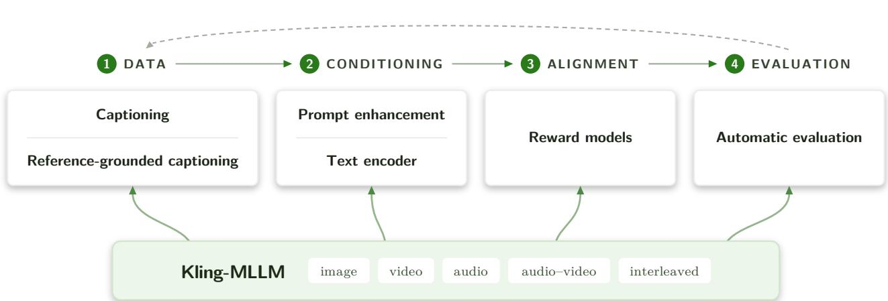
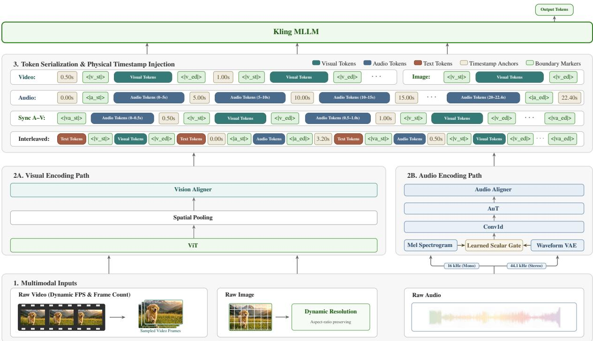
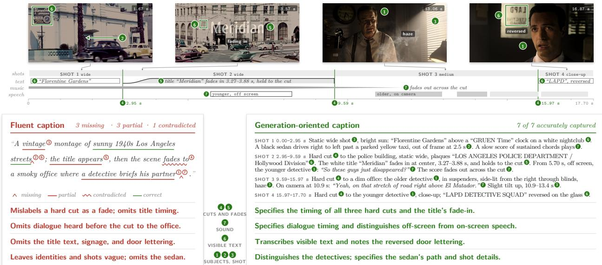
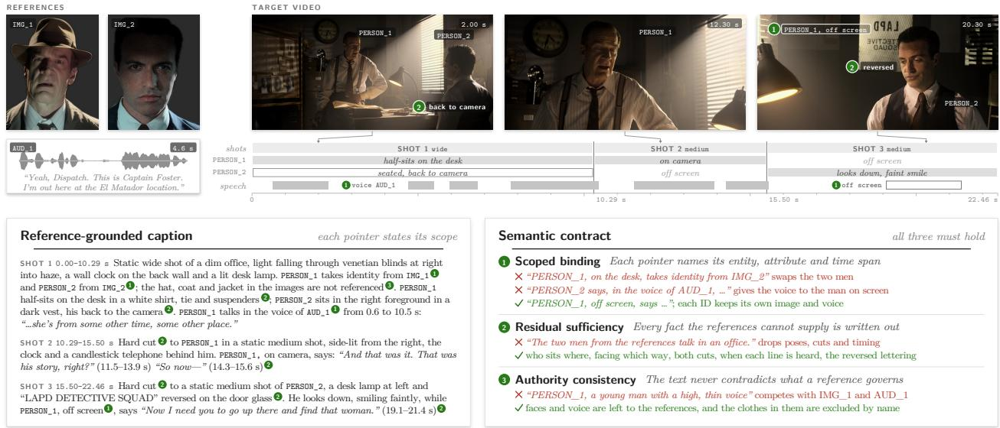
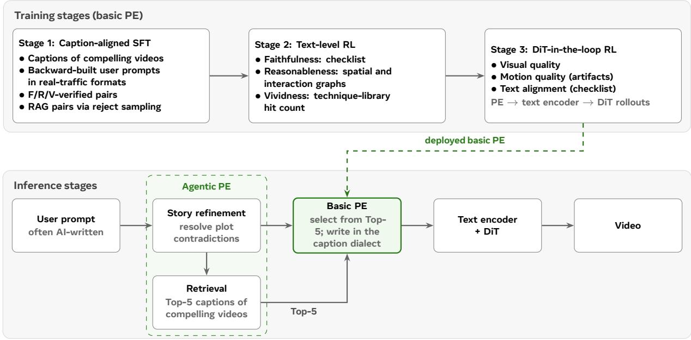
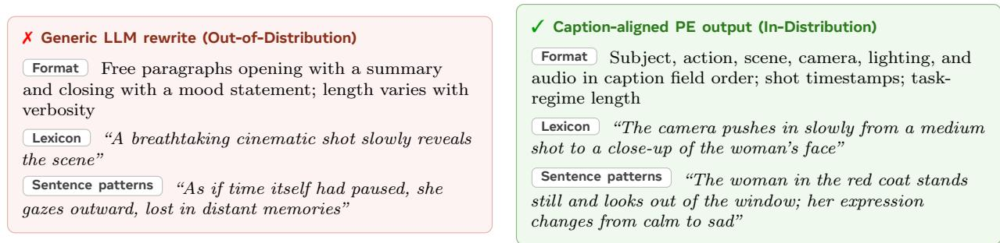
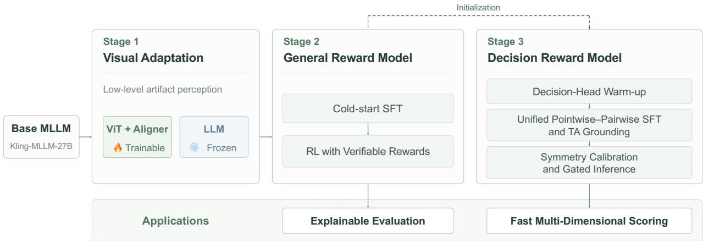

# Behind Video Generation: Observations and Insights on Multimodal Understanding from Kling

Kling Team

Video generation has progressed from isolated clips to coherent short-form audiovisual sequences, and the bottleneck is shifting from rendering to semantic control. This report summarizes the observations and insights on multimodal understanding gained from successive generations of Kling. We argue that generation quality is the projection of multimodal understanding through the entire data– conditioning–alignment–evaluation chain, and we examine this chain module by module. Kling-MLLM, a shared multimodal foundation model that unifies image, video, audio, synchronized audio–video, and interleaved inputs, is specialized for each downstream module. Because a DiT is trained on far fewer training samples than a language model, we treat captioning as a semantic contract that maximizes description density, and extend it to reference-grounded captioning that makes reference bindings explicit. Prompt enhancement translates user intent into this caption distribution: basic PE is derived from captions of compelling videos and refined with text-level and generator-in-the-loop reinforcement learning, while agentic PE refines the story and retrieves compelling examples. We show that a reliable text encoder comes from perceptual training rather than from stronger language ability, and that candidates can be screened from text alone before end-to-end training. Reward modeling pairs a general reward model for explainable, localized critiques with a decision reward model for fast multidimensional scoring, treating perceptual bandwidth as a first-class design parameter. Finally, we review task-specific automatic evaluation, focusing on protocols that expose scoring shortcuts and help trace failures to their upstream source. We hope these lessons ofer practical guidance for building the understanding stack behind controllable video generation.

Keywords: Multimodal understanding, Video generation, Omni captioning, Prompt enhancement, Text encoder,   
Reward model, Evaluation & benchmark   
Date: November 3, 2026

  
Figure 1 Multimodal understanding along the data–conditioning–alignment–evaluation chain behind Kling.

## Contents

1 Introduction 3   
Multimodal Understanding Foundation Models 4   
2.1 Objective and Scope 4   
2.2 Kling-MLLM Architecture . 4   
2.3 Four-Stage Training Curriculum 6   
2.4 Data Construction 7   
2.5 Evaluation . 8   
3 Caption: From Pixels to Trainable Semantics 10   
3.1 The Semantic Contract: Content and Conventions 11   
3.2 The Supervision Pipeline: Separating Complex Discovery from Eficient Deployment 12   
3.3 Acceptance Criteria: Conjunctive Quality and Atomic Benchmarking 12   
3.4 Downstream Validation: The Generator as the Final Consumer 13   
3.5 Experiments . 14   
3.6 Discussion . 14   
Reference-Grounded Captioning: Orchestrating Coherent Multimodal Anchors 14   
4.1 Task Definition: Reference Semantics and Systemic Challenges 15   
4.2 The Semantic Contract: Scoped Binding, Residual Suficiency, and Authority Consistency 16   
4.3 Relational Supervision: Learning from Arbitrary Video Pairs 17   
4.4 Unified Representation: Integrating Captions with Reference Pointers 17   
4.5 The Supervision Pipeline: Extending for Cross-Modal Correspondences 18   
4.6 Experiments . 19   
4.7 Discussion . 19   
Prompt Enhancement: From User Intent to the Caption Distribution 19   
5.1 Basic PE: Caption Alignment through Backward Construction 20   
5.2 Text-Level Quality: Faithfulness, Reasonableness, and Vividness 21   
5.3 DiT-in-the-Loop RL . 22   
5.4 Agentic PE: Story Refinement and Retrieval 22   
5.5 Experiments . 23   
5.6 Discussion 24   
Text Encoder: Perceptual Grounding for Conditioning 24   
6.1 Representation Evaluation Beyond General Proxies 25   
6.2 Adapting Foundation Backbones for Video Conditioning 25   
6.3 Multi-Granular Semantic Conditioning 26   
6.4 Stable Conditioning During Difusion Training 26   
6.5 Empirical Evaluation . 26   
6.6 Discussion 27   
7 Reward Models: Turning Understanding into an Optimization Signal 27   
7.1 Objectives, Challenges, and Application Scenarios 27   
7.2 Model Design 28   
7.3 Experimental Evaluation 31   
7.4 Discussion 31   
8 Automatic Evaluation: Measuring What Each Task Requires 32   
8.1 Task Taxonomy: What Should Be Evaluated? 32   
8.2 Evaluation Tools and Reliability: How Can Each Property Be Measured Accurately? 33   
8.3 Operational Evaluation: How Should Evaluation Be Used in Practice? 33   
9 Conclusion 34   
Contributors 38

## 1 Introduction

Over four years, video generation has passed through several distinct regimes. In 2023, general-purpose video creation remained largely aspirational. In 2024, early systems produced compelling demonstrations, but with limited reliability and control. By 2025, leading models could generate production-usable shots and creative assets. By 2026, frontier systems had begun to produce usable short-form audiovisual sequences that coordinate multiple shots, persistent subjects, performance, camera language, dialogue, music, and sound. The unit by which progress is judged has expanded from the frame to the clip, then to the shot, and now to the complete sequence.

This expansion changes the technical problem. Quality at the frame or clip level can often be assessed locally, whereas usefulness at the sequence level is compositional: constraints interact, errors accumulate over time, and decisions in one shot afect the interpretation of the next. The system must infer a latent creative specification from heterogeneous inputs, express it as conditions the generator can execute, and evaluate the result at the same semantic granularity. Multimodal understanding has evolved accordingly, from coarse text–video correspondence to dense spatiotemporal description, reference grounding, creative planning, and multidimensional judgment, and it has helped make synthesis controllable and usable.

General-purpose multimodal benchmarks capture only part of this requirement. High aggregate scores in visual question answering (VQA) do not imply reliable understanding of camera language, left–right relations, composition, lighting, shot boundaries, identity binding, or dense temporal change. These capabilities are weakly represented in standard supervision, yet they determine whether a generated result is controllable and editable; evaluation research has shifted in the same direction, from superficial realism toward controllability, commonsense, and physical faithfulness [1, 69]. For video generation, the question is therefore not whether a multimodal large language model (MLLM) is broadly capable, but which semantics reach the generator, through what representation, and with what evidence of downstream benefit.

This perspective is grounded in our work on Kling 1.0 through Kling 4.0 [50], together with Kling AI Avatar [51] and Kling Motion Control [52]. Across these releases, we specialized Kling-MLLM, our shared multimodal foundation model, into captioners, prompt enhancement (PE) models, text encoders, reward models, and automatic evaluators, as requirements progressed from basic text–video correspondence to reference binding, identity preservation, motion transfer, precise editing, audiovisual synchronization, and complete video generation. As generation capabilities advanced, progress depended increasingly on understanding what to generate, what to preserve, how to organize it over time, and how to verify the result. Our central thesis is:

Video generation quality is the projection of multimodal understanding through the entire data– conditioning–alignment–evaluation chain.

An observed generation failure is not, by itself, a diagnosis. The same symptom may originate from a caption that omits the relevant supervision, a conditioning representation that discards temporal structure, a reward model that favors smooth but static motion, or an evaluator that never tests the requested event. We therefore treat multimodal understanding as a property of the entire chain rather than as a score attached to a single model. This perspective leads to four claims:

• The bottleneck is shifting from rendering to semantic control. Improvements in visual fidelity do not automatically yield correct actions, camera language, reference binding, or narrative continuity. Generation-oriented understanding is an independent axis of progress.

• Data efficiency depends on description density. A difusion transformer (DiT) is trained on far fewer samples than a language model, and both training throughput and the supply of usable video preclude closing this gap through scaling. Each training video must therefore carry as much supervision as possible, which makes the density of textual description per unit of video duration the central measure of data eficiency. Dense, generation-oriented captions and reference-grounded captions with explicit bindings are designed to maximize this density, and a perception-tuned text encoder ensures that it actually reaches the generator.

• A mature DiT has a sweet spot, and agentic methods help reach it. Trained on dense captions, the generator responds best to conditions written in its caption distribution, and a mature model can usually realize the user’s request from a description in this distribution. Basic PE translates requests into this distribution, but a single PE model has limited capacity and may fail to capture the vividness of compelling videos, while asking it to both preserve and repair a contradictory request places conflicting goals on one model. Agentic PE, such as story refinement that repairs contradictory requests and retrieval of captions of compelling videos, divides this work and improves reasonableness, faithfulness, and vividness together.

• Evaluation should follow the task. Because a failure can originate anywhere in the chain, a single aggregate score says little about its source. Generation tasks difer in their success criteria and in the shortcuts that inflate scores, so evaluation protocols should be task-specific and decomposed into directly observable criteria. Inexpensive proxies, such as text-only encoder screening and text-level PE verifiers, can filter candidates before costly end-to-end training. Together, these practices make failures easier to trace upstream.

The following sections trace this chain from Kling-MLLM through standard and reference-grounded captioning, PE, text encoding, and reward modeling, and conclude with a review of task-specific evaluation practices. Each module section follows the same discipline: observation, mechanism, and engineering implication. Our aim is to explain how advances in multimodal understanding became deployable capabilities across successive generations of Kling, and which aspects of that experience may generalize beyond a single model family.

## 2 Multimodal Understanding Foundation Models

## 2.1 Objective and Scope

The multimodal understanding foundation model serves as the shared perception and reasoning backbone for Kling’s image-generation, video-generation, image-editing, and video-editing tasks. It is not tied to a single endpoint. Instead, the foundation checkpoints are specialized through task-specific post-training for use as captioners, PE models, reward models, text encoders, and other experts. This design centralizes visual, temporal, and acoustic knowledge in a reusable base model while allowing each upstream task to select an appropriate accuracy–latency operating point. We refer to this model as Kling-MLLM; it unifies images, videos, audio, synchronized audio–video, and arbitrarily interleaved media in one autoregressive interface.

## 2.2 Kling-MLLM Architecture

The Kling-MLLM family comprises a dense 27B variant and two mixture-of-experts (MoE) variants, 35B-A3B and 397B-A17B. Across scales and development iterations, the large language model (LLM) and vision backbones are initialized from compatible checkpoints in the Qwen3.5–Qwen3.8 model families [39]. Starting from these checkpoints, we add scale-dependent audio towers, described in Audio below. We also redesign the modality-processing logic for images, videos, audio, synchronized audio–video, and interleaved media, and conduct multimodal mid-training to obtain the Kling-MLLM foundation models.

At the input interface, every supported stream is mapped to a common sequence consumed by a single LLM (Figure 2). The visual path consists of a ViT, spatial pooling, and a vision aligner. The audio path uses a scale-dependent audio tower and projects its output to the LLM hidden width. Consequently, the LLM can process text, visual embeddings, and acoustic embeddings in a single sequence without quantizing the input media into a shared discrete codebook.

Text and interleaved records. Text is segmented by the native LLM tokenizer and mapped through its embedding table. Modality-specific boundary tokens make each span self-delimiting, so multiple images, videos, and audio clips can appear at arbitrary positions in one context.

Images and videos. Images are processed at dynamic resolution while preserving their aspect ratios. The resolution is selected jointly with the available context budget, allowing the model to retain useful visual detail without requiring a fixed input shape.

Videos use both a dynamically selected frame rate and frame count. The processor adapts these choices to the video’s duration and the available context, while sampling across the full temporal range so that short and long videos can be represented eficiently. The selected frames follow the same dynamic-resolution path as images and are encoded into visual-token blocks. Each block is associated with its frame’s physical timestamp, enabling the LLM to reason about event order and temporal location without fixed sampling assumptions.

  
Figure 2 Kling-MLLM architecture. Multimodal inputs are encoded by visual and audio paths into aligned continuous tokens, delimited by modality boundary markers, anchored with physical timestamps, and interleaved with text before entering the LLM backbone. The audio path illustrates the dual-branch Mel–VAE tower used in larger variants. ‘Sync A-V’ denotes synchronized audio–video input.

Audio. Kling-MLLM uses two scale-dependent audio towers. For smaller model variants, the tower follows the Qwen3-Omni design [63]: a 16-kHz monaural waveform is converted to a Mel spectrogram and encoded as 13 audio tokens per second. Larger model variants instead use a dual-branch tower that fuses Mel and waveform-VAE features. For each clip, the data pipeline supplies two time-aligned views: a 16-kHz, 128-bin Mel spectrogram at 100 frames per second and a 44.1-kHz waveform for an in-house VAE. A Conv1d front end maps the Mel stream to the target 25-token-per-second grid. In parallel, the VAE latent sequence is linearly interpolated along the temporal axis to match the Mel-branch token grid, then normalized and projected to the Mel hidden width. A learned scalar gate adds these aligned VAE features residually to the Mel features. Positional encoding and the audio Transformer operate on the fused sequence, after which the output projection maps it to LLM-width embeddings $Z _ { A } \in \mathbb { R } ^ { L _ { A } \times d }$ at 25 audio tokens per second. The two tower designs therefore expose the same embedding interface to the LLM. The processor instantiates audio-boundary, timestamp-injection, and synchronized audio–video serialization at the selected tower’s token rate. Audio boundary markers delimit each span, and absolute timestamps provide temporal anchors for long audio sequences.

Audio timestamp injection. Within each audio branch, the acoustic-token rate is fixed, so elapsed time is in principle recoverable from token position. In practice, however, this implicit clock provides insuficient temporal control: the language model does not always convert token indices into reliable absolute-time estimates, which weakens duration awareness and temporal grounding. Prompting experiments with Gemini APIs [11] support this interpretation: explicitly providing the total audio duration in the prompt produces a marked improvement in temporal grounding.

The adopted representation places explicit start and end timestamps around each audio span and inserts absolute-time anchors every five seconds. The boundary timestamps expose the clip duration directly, while the periodic anchors reduce the interval over which time must be inferred and support fine-grained event localization. They also align the temporal organization of audio with synchronized audio–video sequences, where acoustic and visual tokens share a timestamped timeline.

Synchronized audio–video. Audio and video are serialized jointly inside one synchronized multimedia element, rather than represented as two separate media elements. Each processed video frame forms an atomic visual-token block whose tokens share the frame timestamp, while individual audio tokens retain timestamps determined by the audio-token rate. The processor traverses the video frames chronologically and, before each visual block, inserts all audio tokens that occur after the preceding frame and no later than the current frame. Thus, the original order within each modality is preserved, and an audio token is placed before a visual block when they have the same timestamp. The concrete token arrangement is illustrated in Figure 2.

## 2.3 Four-Stage Training Curriculum

Training follows a curriculum that broadens multimodal supervision and progressively increases temporal coverage and context capacity.

Stage 1: acoustic initialization. The vision tower and LLM are frozen, and only the audio tower is optimized. Training uses a short sequence length, and the data mixture consists entirely of audio data. Its core speech component combines Mandarin, English, and multilingual transcription data with spoken question answering, speech-conditioned text continuation, and instruction following. Non-speech audio coverage includes environmental and acoustic events, music, non-verbal vocalizations, speaker and accent attributes, and detailed captioning. Data from concatenated speech, multi-speaker dialogues, emotion-rich conversations, audiobooks, and other long recordings provide longer acoustic contexts. Thus, this stage establishes a broad acoustic representation rather than an ASR-only encoder, without perturbing the other pretrained components.

Stage 2: joint multimodal training. All three modules are unfrozen, and training uses a short sequence length. Audio and synchronized audio–video data constitute the largest part of the mixture. This is the first stage in which the audio tower and LLM are optimized jointly, so the curriculum deliberately emphasizes audio and synchronized audio–video data to establish robust acoustic–language alignment and teach the LLM to integrate temporally synchronized auditory and visual evidence. Audio supervision covers multilingual ASR, spoken question answering and instruction following, environmental sounds, music, timbre, non-verbal vocalizations, and detailed captioning. Synchronized audio–video examples add joint captioning, transcription, and basic temporal-event alignment.

Image, video, text, and other mixed-modality data remain in the mixture at smaller proportions. Their role is to preserve the model’s visual perception, language understanding, reasoning, and general multimodal capabilities while the acoustic pathway is being integrated, thereby mitigating catastrophic forgetting. These retained data include dense image and video captioning, edit-instruction inference, multi-image composition, counting, OCR, document and chart understanding, spatial reasoning, and educational and scientific text.

Stage 3: temporal-capacity expansion. All modules remain trainable, and training transitions to a long sequence length. The mixture shifts toward audio, video, and audio–video data. Its objective is to improve fine-grained temporal perception. The video sources span movie and general video question answering, timestamped procedural steps, instruction-guided temporal grounding, multi-shot narrative understanding, spatial reasoning, unusual or anomalous action recognition, and playback-speed-sensitive motion. Audio training continues to include multilingual ASR, spoken instructions, sound and music captioning, and audio question answering; synchronized examples add timestamped audiovisual event alignment. Counting, OCR, document and chart understanding remain in the mixture alongside multilingual instruction, mathematical, and multi-domain reasoning data. Additional supervision covers detailed media captioning, shot-boundary understanding, visual artifact localization, and reference-conditioned generation-prompt rewriting.

Stage 4: long-context consolidation. Both modality towers are frozen and only the LLM is updated. This stage also uses a long sequence length, allowing the model to focus on long-form integration while retaining the frozen modality encoders. The highest-quality data available for every supported modality are placed in this stage, allowing the final LLM update to consolidate capabilities using the cleanest and most reliable supervision. Long-video data provide supervision for retrieval, question answering, multi-span temporal grounding, reference-conditioned search, fine-grained motion, and evidence aggregation over extended timelines. Long-form audio receives parallel treatment through event localization, interval-conditioned description, timestamped summarization, temporal-event reasoning, spoken QA, and soundscape segmentation. Joint audio–visual data emphasize synchronized description, detail recovery, cross-stream reasoning, and constraintfollowing, while interleaved audio–image examples require evidence to be composed across modalities. Visual logic, science, counting, text recognition, document/chart understanding, and general text reasoning remain in the mixture. The capstone stage is designed to help the LLM organize fixed perceptual features over longer evidence chains and return grounded, structured responses.

The supervision mix is likewise adjusted by stage. Captioning is combined with recognition, retrieval, localization, structured extraction, question answering, and both direct-response and reasoning-oriented examples. Several large sources are partitioned across successive stages, preserving selected speech, OCR/document, chart, video, and reasoning coverage as new task families are introduced. The curriculum is therefore a progression in both modality coupling and task diversity, with increasing temporal and contextual demands, rather than a sequence of four disjoint corpora. We also explore model merging and find that merging the Stage 1 and Stage 4 checkpoints yields a better checkpoint than either alone.

## 2.4 Data Construction

The training corpus combines public data, Kling-specific task data, and agent-oriented data. At the systemdesign level, heterogeneous sources are represented through a common conversation-oriented schema, with media metadata and modality boundaries retained so that one loader can construct image, video, audio, synchronized audio–video, and interleaved examples, following common practice in omni-modal systems [63].

Public Data Ingestion Public corpora enter a three-part workflow: AutoResearch → Auto Data Process → Auto Revise, with revised records looping back from Auto Revise to Auto Data Process for revalidation. In AutoResearch, one search agent monitors Hugging Face Daily Papers, filters work on text, image, video, audio, audio–video, and multimodal foundation models, and extracts candidate datasets from the selected papers. A second agent monitors trending Hugging Face datasets. Their results are merged and deduplicated both against one another and against the historical registry. During dataset selection, we also exclude datasets containing sensitive material, datasets whose licenses are incompatible with the intended use, and datasets that overlap with any evaluation set. Papers associated with the remaining candidates are routed for review, while the selected new datasets enter automated processing.

Auto Data Process downloads each selected dataset and invokes a modality-specific conversion skill for text, image, video, audio, audio–video, or interleaved-media records. Table 1 summarizes this interface.

Table 1 High-level normalization and supervision pipelines by modality.
<table><tr><td>Modality</td><td>Conversion-time normalization and validation</td><td>Representative supervision</td></tr><tr><td>Text</td><td>Encoding &amp; language checks, document deduplication, conversational turn normalization</td><td>Next-token prediction, instruction following, reasoning</td></tr><tr><td>Image</td><td>Decode &amp; resolution checks, perceptual deduplication, aspect-ratio handling, OCR/metadata extraction</td><td>Short &amp; dense captions, VQA, OCR, grounding, counting, pose</td></tr><tr><td>Video</td><td>Decode check, shot segmentation, timestamped frame selection, optional OCR; audio routed to sync branch</td><td>Temporal captioning, event &amp; motion QA, camera understanding, multi-shot reasoning</td></tr><tr><td>Audio</td><td>Waveform/channel normalization, segmentation, VAD &amp; signal-quality checks, transcript alignment</td><td>ASR, audio captioning &amp; QA, acoustic-event reasoning, temporal grounding</td></tr><tr><td>Audio-video</td><td>Synchronization validation, shared timestamped token timeline construction</td><td>Joint transcription, cross-modal QA, grounding, captioning</td></tr><tr><td>Interleaved media</td><td>Document/dialogue order preservation, media-reference checking, cross-record deduplication</td><td>Contextual QA &amp; reasoning over multiple heterogeneous media items</td></tr></table>

Auto Revise progressively narrows the audit set. A coarse pass samples questions to assess formatting and question diversity. The first fine pass computes perplexity with Qwen3-Omni, and the second samples multimodal content and question–answer pairs for review by Gemini. The resulting error report undergoes human review. Accepted data are assigned to an appropriate training stage; low-quality data are removed or repaired, with repaired data returning to Auto Data Process for revalidation.

Kling-Specific Task Data Internal task data target the perception and reasoning capabilities required by Kling’s image and video generation and editing systems. They cover world knowledge through interleaved image–text records and a controlled taxonomy of actions, sounds, subjects, and scenes; image perception through bilingual OCR across diverse text appearances and layouts, counting, grounding, metadata-aware description, and pose understanding; dense image and video captioning of scenes, subjects, motion, style, camera behavior, and multi-shot structure; and editing and reference understanding through paired source– target images or videos, instructions for addition, deletion, and modification, and multi-reference conditioning.

Multimodal Agent Data The agent-data mixture spans both general-purpose tool use and multimodal perception-to-action tasks. General-agent examples cover multi-step API and transactional workflows, search and evidence-grounded web research, software-engineering and terminal interaction, structured reasoning and data transformation, and safety-aware everyday assistance. Their supervision ranges from complete tool-use loops to partial trajectories for next-action selection and direct responses, training the model to plan dependent actions, interpret tool returns, verify intermediate results, and decide when tool use is necessary. Multimodal-agent examples include image-grounded retrieval and visual reasoning, GUI interaction grounded in screen observations, agentic video understanding that searches and reasons over temporally distributed evidence, and Blender-based tasks involving controllable 3D scenes, objects, motion, camera viewpoints, and rendering. These data may be constructed or augmented with model-generated instructions, trajectories, and responses followed by consistency checks.

## 2.5 Evaluation

Evaluation covers five input settings: audio, synchronized audio–video, multimodal interleaving, image, and video. Tables 2–5 combine the corresponding public and Kling-specific benchmarks. We use the LMMs-Eval framework [66]; when a benchmark is already integrated into LMMs-Eval, we use its default evaluation prompt. Arrows indicate metric direction, and “–” denotes an unavailable score. For open-weight models, paired values list our evaluation result followed by the model developer’s reported result; a single value means that no directly comparable oficial score is included. For LATBench, values separated by “ |” denote Chinese and English results, respectively; for VidCapBench, they denote Accuracy and Coverage, respectively. Boldface marks the best internally evaluated value in each metric; ties are bolded jointly.

Table 2 Audio benchmarks. Paired values normally list our evaluation result followed by the model developer’s reported result; for LATBench, values separated by “|” denote Chinese and English results, respectively.
<table><tr><td rowspan="2">Model</td><td colspan="2">LibriSpeech</td><td rowspan="2">WorldSense ↑ TREA↑</td><td rowspan="2"></td><td colspan="5">LATBench</td></tr><tr><td>clean↓</td><td>other↓</td><td>mloU↑</td><td>R@0.3↑</td><td></td><td>R@0.5↑ R@0.7↑</td><td>FENSE↑</td></tr><tr><td>Qwen3-Omni-30B-A3B-Instruct</td><td>1.32 / 1.22</td><td>2.66 / 2.48</td><td>46.03</td><td>71.0</td><td>14.8|15.8</td><td>21.4|26.4</td><td>12.4|16.0</td><td>7.0|7.0</td><td>28.4|31.0</td></tr><tr><td>MiniCPM-o-4.5</td><td>1.54/1.4</td><td>3.79 / 2.8</td><td>44.99</td><td>54.8</td><td>3.0|5.2</td><td>4.0|7.4</td><td>2.1|3.7</td><td>0.8|2.0</td><td>41.1|41.9</td></tr><tr><td>Qwen3.5-Omni-Plus (DashScope)</td><td>1.32</td><td>3.14</td><td>63.90</td><td>87.7</td><td>60.2|51.2</td><td>81.1|71.1</td><td>63.2|54.5</td><td>40.5|33.8</td><td>64.2|53.5</td></tr><tr><td>Doubao2.0-Lite (non-thinking)</td><td>1.28</td><td>2.41</td><td>53.94</td><td>71.5</td><td>53.1|53.2</td><td>73.9|73.2</td><td>58.9|57.9</td><td>38.2|37.2</td><td>57.4|48.7</td></tr><tr><td>Doubao2.0-Lite (thinking, high)</td><td>1.35</td><td>2.55</td><td>66.77</td><td>79.2</td><td>52.6|55.1</td><td>72.4|77.5</td><td>59.1|61.9</td><td>39.0|37.8</td><td>58.7|42.1</td></tr><tr><td>Kling-MLLM-35B-A3B</td><td>1.68</td><td>3.30</td><td>61.92</td><td>93.0</td><td>58.8|51.4</td><td>81.8|71.2</td><td>61.3|55.1</td><td>38.7|35.4</td><td>66.5|72.0</td></tr><tr><td>Kling-MLLM-27B</td><td>1.32</td><td>2.93</td><td>61.79</td><td>93.2</td><td>61.0|62.7</td><td>82.0|87.7</td><td>66.2|71.9</td><td>42.2|43.8</td><td>67.6|70.5</td></tr><tr><td>Kling-MLLM-397B-A17B</td><td>1.18</td><td>2.71</td><td>63.56</td><td>91.2</td><td>65.0|61.7</td><td>86.4|85.4</td><td>68.1|68.2</td><td>47.4|43.4</td><td>70.8|68.9</td></tr></table>

Audio. Table 2 combines LibriSpeech [37], WorldSense [15], TREA [2], and LAT-Bench [42]. Together they cover speech recognition, audio understanding, and temporal grounding. Kling-MLLM-397B-A17B gives the lowest LibriSpeech clean WER and the strongest Chinese LATBench results, while Kling-MLLM-27B gives the strongest TREA and English LATBench temporal-grounding results. Kling-MLLM-35B-A3B gives the strongest English LATBench FENSE result. The comparison remains mixed on the other columns: Doubao2.0-Lite gives the best LibriSpeech other and WorldSense scores.

Table 3 Audio–video and multimodal-interleaving benchmarks.
<table><tr><td rowspan="2">Model</td><td rowspan="2">OmniBench↑</td><td colspan="3">video-SALMONN</td><td rowspan="2">UGC-VideoCap</td><td colspan="2">OmniCap-IF</td><td colspan="2">Multimodal interleaving</td></tr><tr><td>Miss↓</td><td>Hallucination↓</td><td>Total error ↓</td><td>CSR↑</td><td>ISR↑</td><td>IV-Bench↑</td><td>MVU-Eval ↑</td></tr><tr><td>Qwen3-Omni-30B-A3B-Instruct</td><td>60.35</td><td>36.32</td><td>16.87</td><td>53.20</td><td>80.01</td><td>65.87</td><td>9.06</td><td>35.02</td><td>56.41</td></tr><tr><td>MiniCPM-o-4.5</td><td>52.04</td><td>33.37</td><td>15.35</td><td>48.72</td><td>78.45</td><td>70.84 11.69</td><td></td><td>24.70</td><td>47.81</td></tr><tr><td>Qwen3.5-Omni-Plus (DashScope)</td><td>67.61</td><td>17.47</td><td>21.67</td><td>39.13</td><td>87.78</td><td>75.9018.95</td><td></td><td>53.31</td><td>60.64</td></tr><tr><td>Doubao2.0-Lite (non-thinking)</td><td>57.79</td><td>28.20</td><td>17.26</td><td>45.46</td><td>84.22</td><td></td><td>76.56 20.29</td><td>43.48</td><td>60.42</td></tr><tr><td>Doubao2.0-Lite (thinking, high)</td><td>70.18</td><td>19.47</td><td>19.97</td><td>39.45</td><td>91.05</td><td>78.21</td><td>21.62</td><td>61.41</td><td>63.71</td></tr><tr><td>Kling-MLLM-35B-A3B</td><td>61.15</td><td>21.63</td><td>18.55</td><td>40.19</td><td>85.65</td><td></td><td>81.02 25.39</td><td>54.23</td><td>61.18</td></tr><tr><td>Kling-MLLM-27B</td><td>62.57</td><td>22.47</td><td>18.02</td><td>40.49</td><td>84.61</td><td>81.55</td><td>26.06</td><td>57.31</td><td>61.02</td></tr><tr><td>Kling-MLLM-397B-A17B</td><td>69.38</td><td>20.00</td><td>17.07</td><td>37.07</td><td>88.21</td><td>82.75</td><td>28.13</td><td>61.05</td><td>63.16</td></tr></table>

Audio–video. Table 3 reports synchronized audio–video and multimodal interleaving results on OmniBench [25], video-SALMONN [46], UGC-VideoCap [62], OmniCap-IF [53], IV-Bench [35], and MVU-Eval [38]. On video-SALMONN, Kling-MLLM-397B-A17B has the lowest total error, Qwen3.5-Omni-Plus has the lowest miss rate, and MiniCPM-o-4.5 has the lowest hallucination rate. Doubao2.0-Lite (thinking, high) leads UGC-VideoCap, while Kling-MLLM-397B-A17B leads both OmniCap-IF metrics. Its OmniBench audio-transcript score is slightly below the strongest reported result.

Multimodal interleaving. Kling-MLLM-397B-A17B achieves the strongest results among the Kling-MLLM variants on both interleaving benchmarks. It is particularly competitive on IV-Bench and MVU-Eval, reaching 61.05 and 63.16, respectively—within 0.36 and 0.55 points of the best reported results. This consistent performance indicates strong cross-modal evidence integration across interleaved inputs.

Table 4 Image benchmarks.
<table><tr><td rowspan="2">Model</td><td colspan="2">MMBench</td><td rowspan="2">OCRBench ↑</td><td colspan="4">TextPecker</td><td rowspan="2">PerceptionBench ↑</td></tr><tr><td>EN (dev) ↑</td><td>CN (dev) ↑</td><td></td><td>EN⁺↑ EN↓</td><td>CN⁺↑</td><td>CN↓</td></tr><tr><td>Qwen3-Omni-30B-A3B-Instruct</td><td>87.29</td><td>83.68</td><td>86.80</td><td>0.032</td><td>0.078</td><td>0.047</td><td>0.041</td><td>32.17</td></tr><tr><td>MiniCPM-o-4.5</td><td>85.22</td><td>82.99</td><td>61.00 / 87.6</td><td>0.094</td><td>0.099</td><td>0.024</td><td>0.085</td><td>29.37</td></tr><tr><td>Gemma-4-31B-IT</td><td>87.11</td><td>87.11</td><td>84.70</td><td>0.252</td><td>0.054</td><td>0.187</td><td>0.072</td><td>47.23</td></tr><tr><td>Qwen3-VL-32B</td><td>87.63</td><td>86.17</td><td>84.80 / 89.5</td><td>0.159</td><td>0.166</td><td>0.171</td><td>0.069</td><td>33.97</td></tr><tr><td>Qwen3.5-Omni-Plus (DashScope)</td><td>91.24</td><td>88.75</td><td>85.20</td><td>0.106</td><td>0.060</td><td>0.072</td><td>0.038</td><td>37.50</td></tr><tr><td>Qwen3.5-397B-A17B</td><td>90.03 / 93.7</td><td>89.09</td><td>83.70 / 93.1</td><td>0.187</td><td>0.078</td><td>0.087</td><td>0.044</td><td>47.47</td></tr><tr><td>Doubao2.0-Lite (non-thinking)</td><td>89.60</td><td>87.54</td><td>82.90</td><td>0.430</td><td>0.071</td><td>0.347</td><td>0.045</td><td>44.13</td></tr><tr><td>Doubao2.0-Lite (thinking, high)</td><td>91.84</td><td>89.26</td><td>84.50</td><td>0.453</td><td>0.078</td><td>0.371</td><td>0.049</td><td>53.93</td></tr><tr><td>Kling-MLLM-35B-A3B</td><td>88.40</td><td>86.94</td><td>84.90</td><td>0.649</td><td>0.092</td><td>0.774</td><td>0.053</td><td>39.00</td></tr><tr><td>Kling-MLLM-27B</td><td>87.29</td><td>87.54</td><td>83.10</td><td>0.536</td><td>0.103</td><td>0.702</td><td>0.049</td><td>40.90</td></tr><tr><td>Kling-MLLM-397B-A17B</td><td>90.55</td><td>89.52</td><td>87.20</td><td>0.660</td><td>0.090</td><td>0.782</td><td>0.036</td><td>48.63</td></tr></table>

Image. Table 4 combines MMBench [32], OCRBench [33], TextPecker [71], and PerceptionBench [27], covering image perception, OCR, and text-rendering assessment. Kling-MLLM-397B-A17B leads MMBench-CN, OCRBench, and three of the four TextPecker measures, while Doubao2.0-Lite (thinking, high) leads MMBench-EN and PerceptionBench. Gemma-4-31B-IT leads TextPecker EN−.

Video. Table 5 covers both general and fine-grained video understanding. It includes LongVideoBench [59], MVBench [24], MME-VideoOCR [44], VSI-Bench [64], ShortVid-Bench [10], DSI-Bench [68], Event-Bench [7], MotionBench [16], TimeLens [65], Camera Motion VQA [8], and VidCapBench [5]. The TimeLens results additionally report subsets derived from Charades [45], QVHighlights [21], and ActivityNet Captions [20]. Kling-MLLM-397B-A17B leads five columns: DSI-Bench, Event-Bench, MotionBench, Camera Motion VQA, and VidCapBench coverage, while Kling-MLLM-35B-A3B leads VSI-Bench. The high-thinking Doubao2.0-Lite setting leads LongVideoBench, MME-VideoOCR, ShortVid-Bench, the overall TimeLens score and all three of its subset scores, and VidCapBench accuracy.

Table 5 Video benchmarks. For VidCapBench, values separated by “|” denote Accuracy and Coverage.
<table><tr><td rowspan="2">Model</td><td rowspan="2">LongVideo Bench ↑</td><td rowspan="2">MVBench↑</td><td rowspan="2">MME- VideoOCR ↑</td><td rowspan="2">VSI- Bench↑</td><td rowspan="2">ShortVid- Bench↑ Bench↑ Bench↑</td><td rowspan="2">DSI-</td><td rowspan="2">Event-</td><td rowspan="2">Motion- Bench↑</td><td colspan="4">TimeLens</td><td rowspan="2">CameraMotion VidCapBench↑ VQA↑</td><td rowspan="2"></td></tr><tr><td>Overall↑ Charades↑ QVHighlights↑ ActivityNet↑</td><td></td><td></td><td></td></tr><tr><td>Qwen3-Omni-30B-A3B-Instruct</td><td>64.70</td><td>70.00</td><td>62.35</td><td>61.12</td><td>63.90</td><td>51.95</td><td>69.91</td><td>61.57</td><td>12.64</td><td>14.90</td><td>8.77</td><td>14.26</td><td>31.68</td><td>17.78|84.24</td></tr><tr><td>MiniCPM-o-4.5</td><td>64.85 / 66.0</td><td>64.00</td><td>62.20</td><td>50.38</td><td>64.60</td><td>26.23</td><td>66.48</td><td>60.75 / 61.4</td><td>10.01</td><td>9.21</td><td>9.62</td><td>11.19</td><td>23.53</td><td>15.22|79.16</td></tr><tr><td>Gemma-4-31B-IT</td><td>61.78</td><td>64.40</td><td>68.25</td><td>48.10</td><td>68.50</td><td>55.23</td><td>65.11</td><td>61.05</td><td>51.98</td><td>46.66</td><td>61.80</td><td>47.49</td><td>28.09</td><td>16.64|90.17</td></tr><tr><td>Qwen3-VL-32B</td><td>67.61</td><td>73.65 / 72.8</td><td>75.25</td><td>64.16 / 61.5</td><td>67.30</td><td>53.36</td><td>74.89</td><td>67.32</td><td>52.16</td><td>52.79</td><td>55.71</td><td>47.99</td><td>26.71</td><td>20.01|87.49</td></tr><tr><td>Qwen3.5-Omni-Plus (DashScope)</td><td>69.26</td><td>80.37</td><td>79.20</td><td>60.67</td><td>70.10</td><td>59.36</td><td>76.62</td><td>71.55</td><td>33.31</td><td>43.14</td><td>25.92</td><td>30.88</td><td>37.70</td><td>18.29|92.60</td></tr><tr><td>Qwen3.5-397B-A17B</td><td>68.44</td><td>73.90 / 77.6</td><td>76.70</td><td>58.68</td><td>69.80</td><td>58.68</td><td>76.16</td><td>68.62</td><td>38.74</td><td>44.77</td><td>42.87</td><td>28.59</td><td>32.90</td><td>16.44|90.34</td></tr><tr><td>Doubao2.0-Lite (non-thinking)</td><td>71.20</td><td>73.30</td><td>76.70</td><td>48.83</td><td>69.40</td><td>49.97</td><td>71.42</td><td>68.96</td><td>58.72</td><td>52.66</td><td>67.74</td><td>55.77</td><td>31.84</td><td>15.83|75.85</td></tr><tr><td>Doubao2.0-Lite (thinking, high)</td><td>75.17</td><td>78.25</td><td>84.65</td><td>53.03</td><td>70.70</td><td>58.62</td><td>72.69</td><td>71.98</td><td>62.35</td><td>58.50</td><td>69.98</td><td>58.56</td><td>35.42</td><td>20.08|91.36</td></tr><tr><td>Kling-MLLM-35B-A3B</td><td>73.37</td><td>75.58</td><td>76.00</td><td>75.07</td><td>68.60</td><td>57.94</td><td>77.31</td><td>70.98</td><td>60.64</td><td>57.72</td><td>67.15</td><td>57.04</td><td>42.02</td><td>19.87|85.59</td></tr><tr><td>Kling-MLLM-27B</td><td>73.22</td><td>75.35</td><td>78.80</td><td>73.20</td><td>70.60</td><td>62.86</td><td>76.35</td><td>71.83</td><td>58.25</td><td>56.45</td><td>63.53</td><td>54.75</td><td>47.23</td><td>19.35|88.20</td></tr><tr><td>Kling-MLLM-397B-A17B</td><td>72.48</td><td>77.88</td><td>80.40</td><td>74.77</td><td>70.40</td><td>65.52</td><td>78.58</td><td>73.94</td><td>60.55</td><td>58.31</td><td>65.53</td><td>57.82</td><td>54.72</td><td>19.51|93.81</td></tr></table>

Overall, the combined results show the clearest gains for Kling-MLLM-397B-A17B on video perception and temporal understanding, audio temporal grounding, and audio–video captioning. Image, speech recognition, video captioning, and multimodal interleaving results remain mixed across systems.

## 3 Caption: From Pixels to Trainable Semantics

When training a video generator, a caption is more than a human-readable summary: it is the semantic interface that converts visual evidence into conditional supervision. Omitted details leave controllable factors underspecified, forcing the generator to fall back on dataset priors, whereas inaccurate statements inject conflicting training signals. Building a production-grade captioning system therefore requires rethinking both what information captions preserve and how they organize visual and acoustic evidence over time.

A fluent sentence may correctly identify a scene while reversing spatial directions, collapsing sequential actions into a single state, hallucinating sounds, or losing subject identity across shots. Figure 3 shows how linguistic fluency conceals supervision errors: the caption recognizes the setting, yet mislabels a hard cut as a fade, omits the title’s timing, misses pre-appearance dialogue, and leaves visible text untranscribed. Such captions may score well on lexical-overlap metrics despite errors that compromise their value as supervision for generation.

## Observation

Traditional captioning leaderboards and production captioning emphasize different objectives. Standard metrics reward linguistic similarity to acceptable references, while training generative models requires faithful, complete, temporally organized, and consistently formatted representations of the source video.

This gap is increasingly recognized in the research literature. Standard sentence-level metrics fail to capture hallucinations even in short image captions [41]. As captions become denser, evaluation has shifted from direct sentence matching toward decomposed multidimensional question-answer verification [5]. These eforts suggest that once captions become supervision for generation, evaluation should move from sentence-level resemblance toward verifiable semantic facts.

However, evaluation using verifiable questions risks conflating captioning capability with VQA capability. VQA tests whether a model can verify a specified detail on demand, bypassing the harder problem of deciding what to state on its own. As CAPability shows, models exhibit a “know but cannot tell” gap: strong visual recognition does not guarantee comprehensive autonomous description [34]. Consequently, strong VQA performance alone is insuficient to establish that a model can produce efective captions for training.

This section formalizes captioning as a tightly coupled engineering system comprising four core components: (1) a semantic contract specifying what to describe and how to express it; (2) a multi-expert production pipeline that distills complex signals into a deployable student model; (3) conjunctive acceptance criteria for assessing caption usability; and (4) downstream validation protocols that determine whether improved captions translate into better generation.

  
Figure 3 Two captions of a 17.7 s clip from Meridian. Circled numbers link seven facts across the frames, timeline, and captions. The fluent caption reads well but omits or misrepresents key details. The generation-oriented caption preserves shot timing, audiovisual alignment, and visible text, including mirror-reversed lettering.

## 3.1 The Semantic Contract: Content and Conventions

The content specification of a caption should be dictated by the controllable factors and failure modes of the downstream generator. Table 6 lists six types of information relevant to generation, including details that existing captioning datasets do not consistently capture.

Table 6 Generation-oriented caption specification.
<table><tr><td>Information family</td><td>Required caption elements</td><td>Downstream failure if omitted or corrupted</td></tr><tr><td>Subject &amp; action</td><td>Distinct entities, action phases, interaction objects, resulting states</td><td>Static posing, role swaps, unresolved actions</td></tr><tr><td>Space &amp; composition</td><td>Left-right/front-back relations, entry/exit directions, framing, depth</td><td>Reversed motion, misplaced subjects, uncontrolled composition</td></tr><tr><td>Cinematography &amp; light</td><td>Shot scale, viewpoint, camera motion, focal shift, light direction/quality, contrast, color temp.</td><td>Generic camera behavior, appealing but irreproducible style</td></tr><tr><td>Time &amp; shots</td><td>Event order, state changes, shot boundaries, timestamps, recurring subjects</td><td>Frame-list descriptions, discontinuity, unintended cuts or freezes</td></tr><tr><td>Visible &amp; audible text</td><td>Faithful OCR, dialogue/narration, env. &amp; action sounds, music, time anchors</td><td>Misspelled text, hallucinated audio, misaligned A-V events</td></tr><tr><td>Aesthetics</td><td>Concrete texture, palette, medium, style, and finish (beyond composition/light)</td><td>Vague non-executable descriptors (e.g., &quot;cinematic&quot;)</td></tr></table>

However, rigidly enforcing this specification can be counterproductive. Subject identity, action, and temporal order are generally mandatory, while OCR, speech, sound efects, and multi-shot structure should be included only when supported by the input. Furthermore, caption granularity also depends on the downstream use case. Short captions suit retrieval, whereas dense captions provide richer supervision for generation. Mixing the two without a clear policy creates an unmanageable training distribution.

Even when generating fluent descriptions, models frequently fail on critical dimensions, including spatial relations, camera movement, composition, lighting, and shot boundaries. While often attributed to limited capacity, these failures stem primarily from supervision gaps. Generic datasets prioritize vague aesthetic descriptors such as “cinematic lighting” and “beautiful composition” over explicit spatial and technical labels, limiting the benefits of scaling. Long videos further expose temporal failures, including reordered events, merged shots, and inconsistent references. Therefore, a video caption should not be viewed as an extended image description but rather as a compact temporal data structure.

While content dictates which facts enter the supervision signal, writing conventions determine whether those facts form a stable, bindable interface for the text encoder and generator. To reliably transmit these semantic details, four formatting practices yield disproportionate engineering leverage:

1. Name entities explicitly and consistently. Use discriminative noun phrases and retain them across sentences and shots. Avoid ambiguous expressions such as “he”, “it”, or “the other person” when the referent may be unclear to the generator. Stable naming improves both textual coreference and visual identity continuity.

2. Treat shot timestamps as alignment signals. Anchor each shot boundary to its corresponding content using monotonic, validated timestamps. Accurate timestamp-content pairs explicitly teach the model when semantic conditions shift.

3. Transcribe visible text faithfully. Preserve original characters and salient styles instead of paraphrasing. Omitting visible text teaches the model that lettering is an uncontrolled texture, while incorrect transcription introduces contradictory supervision.

4. Integrate audio with visual elements temporally. Describe dialogue, salient sound efects, and music at the points where they occur within the visual narrative. Crucially, audio-related fields should be activated only when an audio track has been inspected.

## 3.2 The Supervision Pipeline: Separating Complex Discovery from Efficient Deployment

Satisfying this semantic contract at production scale is beyond what a single prompt to a proprietary model can deliver. Constructing reliable supervision requires a multi-stage pipeline:

1. Inspection and Routing: Videos are classified by content type, duration, motion dynamics, shot density, and audio availability to determine the necessary expert pathways.

2. Perceptual Evidence Preservation: Preprocessing steps such as downsampling, black-frame removal, audio decoding, and OCR/ASR ensure that critical signals remain intact before reaching expert models.

3. Routed Expert Claims: A general visual expert identifies subjects and scene content, while specialized models extract specific dimensions, such as camera motion, spatial relations, lighting, and shot boundaries.

4. Integration and Conflict Resolution: The integration layer resolves conflicting expert claims against source evidence, normalizes terminology, assigns stable entity names, and removes redundancy.

5. Conjunctive Quality Gating: Candidates should strictly satisfy thresholds across accuracy, coverage, and diversity, alongside cross-modal and cross-shot consistency checks. Rejected cases flow into a dificulty indexed error pool for diagnosis and targeted remediation.

## Insight

Robust supervision originates from orchestrated pipelines. Explicitly mining previously unobserved dimensions and resolving inter-expert conflicts expand semantic coverage and accuracy far more efectively than simply scaling up a general-purpose annotator.

Although this multi-expert pipeline produces comprehensive and reliable supervision, deploying it directly incurs prohibitive latency because of its serial execution. To address this limitation, the pipeline’s output should be distilled into a single-pass student model. This reduces the deployment footprint while preserving globally consistent entity naming and the semantic contract synthesized by the ofline factory.

## 3.3 Acceptance Criteria: Conjunctive Quality and Atomic Benchmarking

A production-grade caption should satisfy four criteria simultaneously: factual accuracy, semantic coverage, beneficial diversity, and internal consistency. These four criteria are strictly conjunctive: optimizing any single dimension in isolation induces predictable shortcuts and specific generation failures, as illustrated in Table 7.

Table 7 Shortcuts from optimizing each caption criterion in isolation.
<table><tr><td>Criterion</td><td>Characteristic shortcut</td><td>Downstream consequence</td></tr><tr><td>Factual accuracy</td><td>Omit uncertain or complex attributes</td><td>Underspecified condition → dataset-prior fallback</td></tr><tr><td>Semantic coverage</td><td>Add plausible but unverified details</td><td>Hallucinated entities, actions, relations, or text</td></tr><tr><td>Beneficial diversity</td><td>Use uncontrolled synonyms or poetic terms</td><td>Fragmented TE distribution → unstable control</td></tr><tr><td>Internal consistency</td><td>Reuse rigid templates; ignore local nuances</td><td>Lost dynamic state changes → robotic generation</td></tr></table>

To prevent these shortcuts, evaluation should move beyond lexical metrics and test these criteria directly. As CHAIR demonstrates, higher sentence-level scores do not imply fewer hallucinations [41]. This vulnerability is especially pronounced in dense captions, where local errors are easily diluted by surrounding fluent text.

Therefore, the appropriate evaluation unit is an atomic, source-grounded information item. Instead of matching surface text, evaluators should verify whether a candidate caption correctly expresses predefined essential facts and their temporal scopes. This atomic formulation is largely agnostic to surface phrasing, efectively disentangling the four acceptance criteria that reference-based metrics tend to conflate.

A comprehensive benchmark should expose at least four complementary views:

• Content validity: factual precision, semantic coverage, beneficial diversity, and internal consistency;

• Generation-specific dimensions: action progression, spatial direction, cinematography, composition, lighting, temporal ordering, shot transitions, OCR, speech, and sound;

• Interface compliance: parse rate, timestamp validity, terminology compliance, and marker validity;

• Difficulty slices: duration, shot count, entity count, event count, motion speed, OCR density, audio complexity, and content domain.

Finally, automatic judges require rigorous stability validation prior to deployment. This entails measuring judgment variance on identical captions, calibrating against human annotations on stratified subsets, and checking ranking robustness across diferent model families. Crucially, evaluation should control for caption length to prevent judges from conflating verbosity with true semantic coverage. More broadly, the judge model, evaluation prompt, decoding parameters, and preprocessing steps together define the benchmark configuration and should therefore be versioned as part of the evaluation protocol.

Insight

True superiority withstands granular decomposition. A credible improvement specifies which facts are more accurate, which dimensions are more complete, and under which dificulty slices the improvements persist. Gains that vanish when controlling for caption length or appear only in aggregate scores provide insuficient evidence of better supervisory quality.

## 3.4 Downstream Validation: The Generator as the Final Consumer

Intrinsic caption evaluations function as proxies until validated by a downstream consumer. Recent benchmarks such as VidCapBench [5] and CapRiCorn-1K [6] demonstrate strong correlations between their evaluation scores and downstream performance, including text-to-video generation quality and video reconstruction fidelity, thereby establishing a core experimental principle: caption quality should ultimately be judged by the generative capabilities it enables in the downstream model.

## Observation

Descriptive quality does not automatically translate into supervisory quality. A caption may become more readable while exceeding the text encoder’s efective context, adding details that the generator cannot localize in time, or inflating evaluation scores via generic aesthetic terms. Downstream validation is essential to distinguish superficial linguistic improvement from usable conditional information.

Controlled downstream experiments help distinguish usable conditional information from superficial linguistic gains. Matching caption lengths and verified fact counts can reduce confounding efects, while targeted interventions, such as modifying camera-motion descriptions alone, can reveal whether improvements transfer to the corresponding generation capability. Combining human preferences with fine-grained metrics—spanning subject identity, action, space, camera, temporal structure, text rendering, audio alignment, and visual quality—exposes specific control failures that a global text–video similarity score obscures.

Ultimately, the value of a captioning strategy lies in its measurable efect on generation. Small-scale fine-tuning or evaluation with a frozen generator provides a practical way to assess whether improved captions yield more faithful instruction following before changes are scaled to larger training pipelines.

## 3.5 Experiments

Table 8 Captioning benchmarks.
<table><tr><td>Model</td><td colspan="4">VidCapBench</td><td colspan="4">UGC-VideoCap</td><td colspan="2">Motion (Internal)</td><td colspan="2">Camera (Internal)</td><td colspan="2">Sound (Internal)</td></tr><tr><td></td><td>Acc.</td><td>Pre.</td><td>Cov.</td><td>Con.</td><td>Audio</td><td>Visual</td><td>Detail</td><td>Avg.</td><td>Pre.</td><td>Rec.</td><td>Pre.</td><td>Rec.</td><td>Pre.</td><td>Rec.</td></tr><tr><td>Gemini-4-Argon</td><td>16.20</td><td>51.66</td><td>85.63</td><td>10.69</td><td>79.80</td><td>87.69</td><td>85.67</td><td>84.38</td><td>64.62</td><td>45.78</td><td>40.83</td><td>76.22</td><td>79.74</td><td>29.38</td></tr><tr><td>Doubao2.1-Lite (non-thinking)</td><td>17.20</td><td>51.78</td><td>87.47</td><td>8.32</td><td>82.88</td><td>90.67</td><td>88.81</td><td>87.45</td><td>62.87</td><td>56.31</td><td>28.37</td><td>61.46</td><td>73.18</td><td>26.79</td></tr><tr><td>Doubao2.1-Lite (thinking, high)</td><td>20.23</td><td>56.44</td><td>94.15</td><td>3.36</td><td>90.37</td><td>96.10</td><td>94.97</td><td>93.81</td><td>64.15</td><td>59.02</td><td>32.89</td><td>64.61</td><td>77.56</td><td>31.69</td></tr><tr><td>Kling-Captioner-35B-A3B</td><td>21.84</td><td>59.28</td><td>94.81</td><td>3.56</td><td>92.83</td><td>96.46</td><td>95.90</td><td>95.06</td><td>67.28</td><td>64.75</td><td>52.18</td><td>80.93</td><td>78.52</td><td>55.83</td></tr><tr><td>Kling-Captioner-397B-A17B</td><td>21.70</td><td>60.51</td><td>96.05</td><td>3.19</td><td>93.41</td><td>96.70</td><td>96.38</td><td>95.50</td><td>68.11</td><td>67.42</td><td>54.82</td><td>83.43</td><td>80.21</td><td>58.11</td></tr></table>

Building on Kling-MLLM-35B-A3B and Kling-MLLM-397B-A17B, we construct targeted post-training data guided by the insights in this section to obtain Kling-Captioner. Table 8 compares Kling-Captioner with frontier models on VidCapBench [5], UGC-VideoCap [62], and our internal benchmark. The results show tha Kling-Captioner consistently outperforms the baselines across all three benchmarks, achieving the best overall accuracy, precision, and coverage on VidCapBench while leading in every dimension on UGC-VideoCap and across our internal evaluation targets for motion, camera, and sound.

## 3.6 Discussion

Scaling the captioning system described in this section leaves several open challenges for future research. First, accurately capturing highly dynamic details necessitates balancing temporal and spatial fidelity against limited context capacity. Second, long-form videos demand sophisticated strategies to navigate the trade-of between overall caption length and descriptive density while maintaining robust referential consistency for subjects over extended time horizons. Finally, stronger audiovisual integration is needed to accurately align acoustic and visual events and explicitly associate speakers with their utterances.

The framework developed in this section focuses on absolute video descriptions, detailing the objective content of a target video. Reference-conditioned generation, however, introduces new operational constraints: the caption should additionally specify reference bindings, isolate preserved attributes, and describe relative transformations while maintaining compatibility with the existing textual conditioning interface. The engineering principles governing this relative semantic contract are discussed in the next section.

## 4 Reference-Grounded Captioning: Orchestrating Coherent Multimodal Anchors

Reference-conditioned generation enables controllable video creation through multimodal references, such as character portraits, source clips, and voice tracks. However, introducing reference conditions creates a demanding correspondence problem. Each reference requires explicit binding to the correct target entity, property, modality, and temporal interval. Without precise alignment, a generated video may appear perceptually flawless while sufering from critical systemic failures, such as exchanged identities, leaked attributes, edited protected content, or broken state continuity.

Reference-grounded captioning (RGC) describes target videos conditioned on one or more multimodal references. Extending the semantic interface from Section 3, RGC explicitly specifies reference-target bindings, modified properties, and supplemental target facts. At training scale, simply pairing references with conventional captions leaves these relationships implicit, causing the generator to learn global appearance correlations without reliable entity-level control. RGC resolves this problem by making the intended correspondences explicit, thereby providing robust supervision for both reference fidelity and controlled modification. Figure 4 illustrates RGC on a multi-shot clip conditioned on two character portraits and a voice track.

  
Figure 4 Reference-grounded captioning on a 22.5 s clip from Meridian, given two portraits (IMG\_1, IMG\_2) and a voice track (AUD\_1). The caption states each binding with its scope and writes out everything the references cannot supply. The timeline shows who is on screen and when PERSON\_1 speaks. Circled numbers mark where each property of the semantic contract applies, contrasting typical shortcuts with correct formulations.

## 4.1 Task Definition: Reference Semantics and Systemic Challenges

Rather than generating an unconstrained summary from a target video, reference assets, and task instructions, RGC defines the resulting caption as an integration of three distinct components: explicit pointers linking reference assets to target entities, supplementary descriptions capturing unreferenced facts, and scoped preservation or change records preventing text-reference conflicts.

Crucially, RGC requires determining the scope of each reference’s authority, which is asymmetric across properties. For instance, a portrait may dictate facial identity while leaving body pose free; a source video may lock background geometry while licensing a requested localized edit; and an audio clip may define voice or rhythm without dictating visual action. Table 9 outlines how superficially similar inputs carry divergent semantic authority based on the product task.

Table 9 Product tasks covered by RGC.
<table><tr><td>Product task</td><td>Typical references</td><td>Binding question</td><td>Residual target facts</td></tr><tr><td>Video editing</td><td>Source video, instruction, optional local ref.</td><td>Edited entity/region and protected properties</td><td>Requested state change, time span, secondary effects</td></tr><tr><td>Multi-reference generation</td><td>Character, object, scene, style, voice, or motion refs.</td><td>Reference governing each role, attribute, and modality</td><td>Target interaction, action, camera, timing, composition</td></tr><tr><td>Video continuation</td><td>Prefix video + optional entity or style refs.</td><td>Subjects, states, and scene geometry persisting across cut</td><td>Post-boundary events and causal link to prefix</td></tr><tr><td>Performance transfer</td><td>Driving video, pose, trajectory, or audio</td><td>Identity source and performance source</td><td>Target retargeting, camera behavior, synchronization</td></tr></table>

RGC inherits all requirements of standard captioning while introducing four additional challenges:

• Reference-target confusion: Populating a scene with multiple entities introduces severe combinatorial assignment ambiguity, especially when the references are semantically similar.

• Asymmetric modality authority: Diferent modalities naturally govern distinct properties (e.g., pixels for appearance, audio for timbre, video for motion), yet explicit instructions can selectively override these priors, requiring dynamic conflict resolution at the granular level of entities, attributes, and temporal intervals.

• Temporal binding persistence: Maintaining consistent identity associations across time is inherently fragile. Models should track and bind entities through severe visual and temporal disruptions, such as occlusions, abrupt cuts, and drastic viewpoint changes.

• Degenerate shortcuts: Models can artificially inflate precision by omitting entity IDs, using vague phrasing, or skipping complex edits entirely. Although factually safe, these shortcuts starve the generator of essential supervision, necessitating strict evaluation of required coverage alongside correctness.

## Observation

Difficulty is governed by reference separability and complex attribute binding, not by reference count alone. Similar subjects increase assignment ambiguity, while capturing localized state changes requires isolating relevant properties from a vast set of contextual invariants.

## 4.2 The Semantic Contract: Scoped Binding, Residual Sufficiency, and Authority Consistency

Reliable RGC supervision relies on three conjunctive properties: scoped binding, residual suficiency, and authority consistency. Table 10 summarizes their roles and illustrates how violating any single axis compromises the reliability of the resulting supervision signal.

Table 10 The semantic contract of RGC.
<table><tr><td>Requirement</td><td>What it guarantees</td><td>Characteristic shortcut and downstream failure</td></tr><tr><td>Scoped binding</td><td>Pointer binds to target entity, attribute, event, 1 &amp; interval</td><td>Property bound to wrong target → spurious correlations</td></tr><tr><td>Residual sufficiency</td><td>All unreferenced target facts stated explicitly</td><td>Vague “same as ref” omits action/camera/time/audio → underspecified</td></tr><tr><td>Authority consistency</td><td>Reference-governed traits kept unless scoped override</td><td>Verbose text contradicts ref. → competing conditions</td></tr></table>

These requirements extend the four caption criteria introduced in Section 3.3. Factual accuracy now mandates rigorous binding verification alongside factual correctness. Semantic coverage expands to encompass standard target facts, required references, and residual target specifications. Beneficial diversity primarily applies to the target description, while pointer syntax and entity naming should remain deliberately stable. Internal consistency requires strict alignment among the caption, references, and the target.

Scoped Binding. A valid binding specifies the source evidence, target entity, authorized attribute, and temporal scope. The instruction “Use image 2” is incomplete when the image contains a person, a specific garment, a room, and a photographic style. A suficient binding should instead specify, for example, that “ PERSON\_1 takes its identity and outfit from IMG\_2; the background is not referenced.” Persistent identifiers are thus essential, as bare noun phrases cannot reliably anchor identities when multiple entities recur.

Residual Sufficiency. While an RGC caption need not reproduce the entire target description, it should specify every generation-relevant fact that cannot be recovered from authorized references. For character portraits, the caption usually includes action, interaction, camera behavior, timing, scene placement, and sound. For continuation, it details the post-prefix event and the state transition at the temporal boundary. For editing, it includes the edited attribute, region, and temporal interval, along with any intended cross-modal consequence.

Authority Consistency. Once an attribute is delegated to a reference, the caption should not independently assign it an incompatible value. Re-describing intricate facial geometry, voice timbre, or complex motion in text is inherently lossy and may also introduce competing conditions. To enforce authority consistency, the caption should defer to the authorized reference for governed properties, except where an override is explicitly declared together with its scope. By otherwise restricting itself to the necessary residual facts, the caption avoids silent cross-modal overrides.

Insight

The semantic contract transforms the caption into an active control schematic. Scoped binding delegates authority to the reference evidence, residual suficiency fills the contextual gaps, and authority consistency prevents cross-modal interference, delivering a coherent and unambiguous instruction set to the generator.

## 4.3 Relational Supervision: Learning from Arbitrary Video Pairs

RGC lets us turn any two videos with suficient visual or acoustic similarity into training data for the DiT. We take one as the reference and annotate the other as the target, describing what they share and what the generator needs to change. The videos need not come from an editing process, and no original edit instruction is required. The reference and the resulting caption serve as conditioning inputs, with the target video providing the supervision

The similarity may cover only part of the content. Two videos can show a similar action performed by diferent people in diferent surroundings. The caption uses the reference for the shared movement and writes out the target’s appearance, setting, and diferences in the performance. Two recordings of the same speaker can likewise share a voice while difering in words and delivery. The target dialogue and its timing remain in the caption. In either case, the annotation specifies which part of the target the reference supplies, in accordance with the scope established above.

This expands the supply of training data beyond purpose-built editing pairs. A target clip can be paired with several references: it may share a subject with one clip and a motion pattern with another. Each pairing asks the DiT to use its reference diferently. The target remains fixed, but the caption and the content drawn from the reference both change. One video can therefore contribute several reference-conditioned examples alongside its standard caption. The number and variety of useful training pairs can grow with the video collection, without producing a separate edited result for every pair.

Training on this wider range of pairs strengthens the Omni DiT’s ability to follow visual and acoustic conditions. Each example requires it to use the relevant content from the reference and produce the diferences described by the caption, including changes that unfold over time. This improvement is reflected in reference fidelity and in edits that change the intended content while preserving the rest. The captions retain the target coverage and conventions of standard captioning, allowing standard and reference-conditioned data to be used together.

Insight

Any sufficiently similar video pair is a potential training example for the DiT. Relational annotation makes the pair usable by stating what to retain and what to change.

## 4.4 Unified Representation: Integrating Captions with Reference Pointers

Reference-grounded tasks inherit the structure, terminology, and descriptive granularity of standard captions and augment them with stable reference pointers and explicit change scopes. This unified representation allows standard and reference-grounded data to share the same captioner, text encoder, PE policy, and validators, with standard captioning treated as a zero-reference case. The generator therefore preserves a consistent target organization regardless of whether details are expressed literally or supplied through reference pointers. As a result, large-scale standard-caption data can provide broad semantic supervision, while scarcer multi-reference data focuses on learning reference binding and controlled modification.

Insight

Representation consistency enables compositional supervision. A unified representation allows the model to combine broad semantic coverage learned from large-scale standard captions with the reference-binding logic derived from scarcer multi-reference data.

Diferent reference modalities contribute distinct information and introduce unique ambiguities. Table 11 summarizes the typical authority, main ambiguity, and corresponding caption-side response for each modality.

Table 11 Authority and ambiguity of each reference modality.
<table><tr><td>Reference</td><td>Typical authority</td><td>Main ambiguity</td><td>Caption-side response</td></tr><tr><td>Image</td><td>Identity, appearance, object detail, scene/style</td><td>Which entity and image subset should transfer</td><td>Bind explicit ID &amp; scope; state target action, placement, camera, changes</td></tr><tr><td>Video</td><td>Motion, state, performance, continuity, camera</td><td>Time alignment; transfer vs. keep; cut boundary</td><td>Declare source interval &amp; role; timestamp new events &amp; preserved content</td></tr><tr><td>Audio</td><td>Voice, dialogue, rhythm, sound effects</td><td>Speaker/source assignment &amp; A-V sync</td><td>Bind speaker/event IDs to visible actions; no unseen visual hallucination</td></tr><tr><td>Text</td><td>Edit instruction, script, names, constraints</td><td>Conflicts with sources or over-specifies details</td><td>Treat as typed change spec.; resolve authority at attribute level</td></tr><tr><td>Mixed set</td><td>Joint composition of the above</td><td>Overlapping authority, duplication, contradiction</td><td>Build attribute-level authority map before composing final caption</td></tr></table>

Specifically, image references risk identity swaps and attribute leakage, demanding bindings that distinguish identity, pose, and style while defining the precise transfer scope for each attribute. Video references introduce role and temporal ambiguity. Since a source video may dictate content, motion, editing, or camera behavior, captions require explicit role bindings and temporal scopes that withstand shifts in speed, viewpoint, or duration. Audio references trigger source-assignment ambiguity, necessitating independent speaker and event scopes. Text instructions encode intended transformations rather than the actual state of the target, meaning captions must verify execution outcomes to diferentiate intent from observed reality.

Together, these modality-specific requirements converge on a hybrid representation featuring (1) a compact reference registry with stable IDs, modalities, roles, and permitted scopes; (2) a foundational target-video description utilizing registered IDs; (3) explicit preservation and modification records for editing and continuation; and (4) shot or event timestamps that connect bindings to applicable intervals.

## 4.5 The Supervision Pipeline: Extending for Cross-Modal Correspondences

Generating RGC data at scale requires extending the multi-expert design in Section 3.2 to include dedicated stages for cross-modal reference parsing, rigorous correspondence checking, and systematic conflict resolution.

1. Type the task and references. Identify whether each input supplies identity, appearance, motion, camera, voice, style, or instruction. Record its modality, quality, temporal extent, and permissible transfer scope.

2. Describe target and references independently. Preserve a standard target description to maintain target-side coverage. In parallel, extract entities, attributes, actions, shots, audio events, and specialist evidence from each reference without prematurely assuming correspondences.

3. Propose and verify bindings. Use detection, segmentation, tracking, OCR or ASR, motion features, and MLLM reasoning to generate and jointly verify candidate matches across viewpoints and over time.

4. Determine preservation and residual sufficiency. Compare target and source under the declared task. Explicitly distinguish requested changes, preserved properties, incidental changes, and unresolved evidence.

5. Resolve authority and conflicts. Construct an entity-attribute-time map in which each cell identifies the authoritative input. Adjudicate mutually inconsistent expert claims before prose generation.

6. Write once in the common format. Insert scoped pointers, retain standard target facts not supplied by references, and remove only verified redundancy. A single integrated target description is preferable to serial rewrites that repeatedly rename or rebind entities.

7. Apply deterministic and semantic gates. Check pointer validity, binding coverage, forbidden cross-scope transfer, text-reference conflicts, temporal alignment, and the four standard captioning criteria.

Table 12 RGC benchmarks.
<table><tr><td>Model</td><td colspan="3">ViDiC</td><td colspan="6">MRVBench</td></tr><tr><td></td><td>Avg.</td><td>Diff.</td><td>Sim.</td><td>KP-Cov</td><td>VQA</td><td>Ref-Tag-R</td><td>Ref-Bind</td><td>Subj-F1</td><td>MRVScore</td></tr><tr><td>Gemini-4-Argon</td><td>77.18</td><td>75.51</td><td>81.86</td><td>93.31</td><td>74.41</td><td>97.23</td><td>93.56</td><td>90.37</td><td>91.22</td></tr><tr><td>Doubao2.1-Lite (non-thinking)</td><td>69.24</td><td>65.27</td><td>80.33</td><td>89.45</td><td>68.09</td><td>75.43</td><td>93.35</td><td>49.45</td><td>78.10</td></tr><tr><td>Doubao2.1-Lite (thinking, high)</td><td>75.63</td><td>74.96</td><td>77.49</td><td>90.75</td><td>71.55</td><td>81.41</td><td>93.98</td><td>56.86</td><td>81.32</td></tr><tr><td>Kling-RGC-35B-A3B</td><td>77.57</td><td>75.59</td><td>83.06</td><td>94.12</td><td>76.01</td><td>94.80</td><td>92.88</td><td>84.51</td><td>88.57</td></tr><tr><td>Kling-RGC-397B-A17B</td><td>78.89</td><td>76.29</td><td>86.12</td><td>95.18</td><td>76.34</td><td>95.28</td><td>94.85</td><td>85.24</td><td>90.31</td></tr></table>

## 4.6 Experiments

Following the relational supervision pipeline and unified pointer representation introduced in this section, we further post-train Kling-Captioner on curated cross-modal correspondence data to obtain Kling-RGC. Table 12 compares Kling-RGC with frontier models on ViDiC [60] and MRVBench [29]. Kling-RGC leads across all ViDiC metrics in both diference and similarity captioning; on MRVBench, it achieves the highest keypoint coverage, VQA accuracy, and reference-binding precision while remaining highly competitive with Gemini-4-Argon and substantially outperforming Doubao2.1-Lite across the remaining metrics.

## 4.7 Discussion

Future work could increase the flexibility of reference content and composition. Key directions include supporting diverse input forms (e.g., selected regions, sketches, and trajectories), enabling complex multimodal combinations to jointly specify a single target, and developing finer-grained temporal binding for precise synchronization and transitions. Advancing these areas requires targeted supervision and evaluation.

In real-world inference, user requests typically ofer references and brief instructions without specifying the complete binding structure or scope of each reference. The remaining challenge is therefore to translate these underspecified requests into the same scoped, residual-suficient, and authority-consistent caption distribution used during training. We address this challenge through PE in the following section.

## 5 Prompt Enhancement: From User Intent to the Caption Distribution

Captioning determines the language that the generator learns (Sections 3 and 4); PE determines whether inference-time requests arrive in that language. Production requests are often short and colloquial or, increasingly, long passages written by other AI models, whereas the generator is trained on dense captions that describe subjects, action phases, camera movements, lighting, shots, and sound with a consistent vocabulary and sentence style. PE rewrites a request into a condition drawn from this caption distribution while preserving the user’s intent [72]. HunyuanVideo established learned prompt rewriting for video generation [19], and RAPO showed that retrieval can move prompts toward the training distribution [9].

We split PE into two modules (Figure 5). Basic PE is the trained rewriter that produces the final condition in the caption dialect. Agentic PE runs before it at inference and decides what that condition should contain: it makes the story coherent and retrieves compelling examples. Our experience across Kling releases can be distilled into five lessons, the first three concerning basic PE and the last two concerning agentic PE. (1) PE output must match captions in wording and sentence patterns as well as in format; we achieve this by constructing data backward from captions of compelling videos. (2) Much of the gain comes from making the text faithful, reasonable, and vivid, which can be verified and optimized without running the generator. (3) Reinforcement learning (RL) with the DiT in the loop then aligns PE with product objectives and stabilizes quality, at a measurable cost in peak vividness. (4) Contradictions in AI-written prompts are best resolved by a story-refinement step before basic PE. (5) Retrieving compelling captions raises vividness, provided that training uses strict rejection sampling.

  
Figure 5 Overview of PE. Top: three training stages of basic PE. Stage 1 learns the mapping from real-format user prompts to captions of compelling videos, using only pairs that pass faithfulness, reasonableness, and vividness (F/R/V) verification; Stage 2 optimizes the same three properties with text-only rewards; Stage 3 optimizes basic PE through the frozen text encoder and DiT with video-level rewards. Bottom: at inference, agentic PE makes the plot coherent and retrieves five captions of compelling videos; basic PE writes the final condition, using the retrieved captions as optional evidence.

## 5.1 Basic PE: Caption Alignment through Backward Construction

A user request always contains text and may also include images, videos, or audio clips as references. Basic PE rewrites only the text. It keeps every reference pointer in the instruction intact but does not modify the attached media, which reach the generator unchanged (Section 4). The alignment problem discussed below therefore concerns the text condition alone.

Two conditions with similar semantics can produce visibly diferent videos when their length, slot order, terminology, or sentence structure difer. A generic LLM rewriter tends to write metaphors, evaluative adjectives, motivational clauses, and long subordinate sentences. Such text reads well but lies outside the caption distribution: the generator spends conditioning capacity on language patterns it has rarely seen and may ignore controls phrased in unfamiliar terms. We therefore require alignment at three levels: format, meaning field order, length regime, and shot and timestamp markers; lexicon, meaning the camera, lighting, and action terms of the caption pipeline; and sentence patterns, meaning the declarative, present-tense, entity-explicit sentences of production captions. Matching format alone leaves the other two levels free to drift. Figure 6 contrasts typical generic rewrites with caption-aligned output at each level.

  
Figure 6 Three levels of caption alignment contrasting generic LLM rewrites with caption-aligned PE.

The most reliable way to achieve alignment at all three levels is to use real captions as training targets. We construct the data backward: starting from the caption of a real video, a teacher model writes the user prompt that could have produced it, and PE learns the mapping from prompt to caption. Synthetic prompts follow the statistics of real trafic rather than the teacher’s own style. For each pair we sample a target length, language mixture, register, typo rate, and set of omitted slots from logged queries, and include references, multi-shot requests, and explicit exclusions at their observed frequencies. Prompts that leak the caption’s skeleton, for example by listing every action phase in caption order, are rejected, since PE would otherwise learn copying instead of completion. Exclusions follow the same principle. Captions describe what is visible, so PE rewrites “no people” as “an empty street with unobstructed pavement” and routes exclusions without a positive equivalent either to a negative-conditioning field or to sampling-time rejection.

Backward construction also fixes the creative ceiling of PE, because the model learns to write like its target captions. If source captions are a random sample of training videos, most targets describe ordinary footage with static framing and uneventful action, and PE learns to expand every request into a competent but flat description. We therefore draw source captions mainly from videos that are compelling in themselves, such as professionally shot scenes, performances with clear dramatic beats, and clips with deliberate camera design, selected using aesthetic and motion scores and the vividness metric of Section 5.2. Domain and length quotas prevent this selection from collapsing onto a few genres.

## Observation

PE inherits the temperament of its target captions. When source captions are drawn uniformly from the training corpus, PE outputs are well formed and faithful but dull: diferent requests converge to similar generic framing, even lighting, and uneventful action. Choosing compelling source videos addresses this in the data, before any change to the model or the objective.

## 5.2 Text-Level Quality: Faithfulness, Reasonableness, and Vividness

Optimizing PE through the generator is expensive: every rollout requires video sampling and judging, and video-level rewards are noisy. A large fraction of the end-to-end gain is available earlier, from the text alone. Reasonableness deserves particular attention. The DiT is trained almost exclusively on real or carefully produced videos, so it has rarely seen a condition that describes an impossible scene. When the text contains a spatial contradiction, an object that changes identity, or an interaction without a physical cause, the generator has no supervised behavior to fall back on and improvises freely. The result appears as identity drift, inconsistent layouts, objects passing through one another, or hands that never make contact. Unreasonable text is thus one of the most direct causes of consistency and interaction failures.

We measure three properties, each scored on a scale from 1 to 5, and use them in two places: every supervised fine-tuning (SFT) pair must pass all three verifiers, and the same scores serve as rewards for text-level RL.

Faithfulness measures whether the output preserves user intent. A judge decomposes the user prompt into a checklist of atomic requirements covering entities, attributes, counts, actions, spatial relations, camera instructions, quoted text, audio, reference bindings, and exclusions. It then marks each item in the PE output as satisfied, violated, or unaddressed. Violations weigh more than omissions, and an addition that contradicts an item counts as a violation. The checklist makes the score attributable, because a regression can be traced to the requirement type that failed.

Reasonableness measures whether the described video could exist. The judge reads the output sentence by sentence and incrementally builds two graphs. The spatial graph links entities by relative position, contact, containment, and viewpoint over time; the interaction graph links agents, actions, and patients together with their preconditions and resulting states. Each new sentence is checked against both graphs and against world knowledge: whether positions remain consistent, whether an object used in an action is present, whether a result follows from its cause, and whether the number of events fits the duration. Each conflict lowers the score and is reported together with the sentence that introduced it. For example, in “the man sets the cup on the table and walks to the door; he takes a sip as he opens it,” the spatial graph places the cup on the table and the man at the door, so the final interaction lacks its object. A generator conditioned on this text must either duplicate the cup or teleport it, and both outcomes appear as artifacts.

Vividness measures expressive richness. The judge extracts expressive elements along several axes, including performance and facial expression, camera movement and shot design, lighting and color, pacing, and sound design. It matches them against a curated library of professional techniques compiled from compelling videos and cinematographic references, and the score increases with the number of distinct, contextually appropriate hits. Hits are deduplicated per axis and capped, and only elements that pass the reasonableness check are counted, so stacking technical terms does not raise the score.

Text-level RL uses GRPO to optimize a reward that combines the three scores [43]. Faithfulness should gate the other terms: an output that violates an explicit requirement earns no credit for vividness, which prevents the policy from trading intent for spectacle. A distribution term can additionally penalize outputs that fall outside the caption length and vocabulary regime, protecting the alignment of Section 5.1. Because no video is rendered, this stage is cheap enough to cover many prompts and iterations, and it precedes any DiT-in-the-loop training.

## Insight

Solve text problems in text. Faithfulness, reasonableness, and vividness can be verified without rendering a single frame. Removing these defects before involving the generator makes end-to-end RL cheaper and its rewards easier to interpret, because the remaining failures are more likely to be genuine generation limits.

## 5.3 DiT-in-the-Loop RL

Text-level judges approximate what the generator needs, but they cannot observe how a specific checkpoint responds to a condition. In the final training stage, we connect PE to the frozen text encoder and DiT, sample several rewrites per prompt, render a video for each, and update PE with a group-relative policy gradient on video-level rewards. All three rewards come from the decision reward model of Section 7: visual quality and motion quality, the latter covering structural, physical, and temporal artifacts, are read from its taxonomy fields, and text alignment between the rendered video and the user prompt is scored by its checklist fields (Section 7.2). This stage aligns PE with product objectives and checkpoint-specific behavior, including which camera moves the current model executes reliably, while reducing quality variance across prompts and seeds.

The order of the stages matters. DiT-in-the-loop RL starts from the text-level RL checkpoint, so its rollouts are already faithful, reasonable, and vivid, and the video rewards spend their limited sample budget on checkpoint-specific behavior instead of on defects that a text judge could have caught. Because each update requires rendering several videos per prompt, this stage uses far fewer prompts than text-level RL, and those prompts are chosen to cover product domains and the failure slices found in production.

## Observation

DiT-in-the-loop RL raises the floor and lowers the ceiling. After this stage, severe failures become rarer and worst-case quality improves. At the same time, the most impressive outputs become less impressive: PE learns to avoid complex choreography, large camera moves, and dense interactions, which are precisely the descriptions with the highest artifact risk.

A plausible explanation is that all three rewards penalize risk. None of them measures whether a video is exciting, and a conservative condition is the easiest way to avoid a low score. Candidate remedies include keeping the vividness reward in the end-to-end objective, regularizing the policy toward the text-level RL checkpoint, and selecting checkpoints based on ceiling as well as floor metrics. Rewarding ambition directly without reintroducing artifacts remains an open problem.

## 5.4 Agentic PE: Story Refinement and Retrieval

Basic PE is trained primarily for faithfulness. Reasonableness and vividness act on it as floors: its output must be no less reasonable and no less vivid than the user’s input, and every detail it adds must itself be reasonable. It is not, however, the place where the input itself is rethought: repairing a contradiction that the user wrote would require departing from that input. Agentic PE takes that role at inference. It runs before basic PE and performs two steps: story refinement makes the requested plot coherent, and retrieval supplies captions of compelling videos as creative evidence. Its output is still a user-level specification plus optional context; basic PE always writes the final condition, so the caption dialect learned in Sections 5.1–5.3 is preserved regardless of what agentic PE adds. This division keeps creative decisions inspectable and lets each part be evaluated against its own objective.

Story Refinement In production, many user prompts are themselves written by AI models through scripting assistants or upstream agent pipelines. These prompts are long and fluent but often internally inconsistent: a character’s clothing changes between paragraphs, a scene is both indoors and outdoors, more events are planned than the duration allows, or an action depends on an object that was never introduced. Asking basic PE alone to repair them places two conflicting goals on one model, since faithfulness asks it to preserve what the user wrote while reasonableness asks it to change it.

Story refinement resolves this conflict upstream. It works at the level of plot and leaves caption language to basic PE. It detects contradictions with the same spatial and interaction graphs used for reasonableness scoring, applies minimal edits that restore coherence while keeping the core intent, and passes the revised prompt on. Basic PE treats the refined prompt as authoritative and concentrates on translation into the caption distribution, without pressure to silently rewrite the story.

Story refinement follows three rules. First, explicit hard constraints such as quoted dialogue, counts, reference bindings, and requested camera moves are never edited unless two of them conflict, in which case the refiner makes the smallest change that resolves the conflict and records the decision. Second, its edits are minimal and local: the refiner reorders, merges, or drops events and fixes attributes, but does not introduce new characters or change the premise. Third, its output is checked by the reasonableness judge and by a faithfulness checklist computed on the non-conflicting part of the original prompt, before it reaches basic PE. When no coherent edit exists, the refiner can pass the prompt through unchanged with a conflict flag, so that the product can ask the user instead of guessing.

Retrieval of Compelling Captions Retrieval raises vividness further by showing basic PE how compelling videos with similar content are actually described [9]. The index contains captions from the same pool of compelling videos used for backward construction. For each refined request, agentic PE retrieves the top five captions and passes them as context. Basic PE decides which camera patterns, performance details, lighting setups, or sound designs suit the request. Letting the model choose among several candidates avoids dependence on a single top hit, which often matches the topic but not the intended action or tone.

Training basic PE to use this context requires strict rejection sampling. Retrieved captions contain specific entities, scene layouts, brands, and dialogue. If training targets copy such details, the model learns to import content the user never requested, a form of hallucination that the faithfulness checklist detects only partially. For each training prompt we sample multiple candidates with retrieval context and reject any candidate that introduces an entity, attribute, or event that cannot be traced to either the user prompt or a deliberate and compatible borrowing from a retrieved caption. Surviving candidates must also pass all three text verifiers. The training set further includes cases in which all five retrieved captions are irrelevant and the accepted target ignores them, so that the model treats retrieval as optional evidence.

## 5.5 Experiments

Table 13 reports the contribution of each component. Text metrics are computed on held-out real user prompts. For faithfulness, reasonableness, and vividness, we report the average score on a 1–5 scale, and the share of outputs scoring at least 4, which reflects how often an output is directly usable. Video metrics use a fixed generator, sampler, and seed policy and report the overall scores of StoryEval [56], T2AV-Compass [4], AVE-Compass [57], and MultiRef-Compass [67]. StoryEval (averaged across seven scores) tests whether consecutive events are completed in order; T2AV-Compass (averaged across IF and Realism scores) covers joint audio-video generation; AVE-Compass (averaged across Editing Intent, Fidelity Preserving, and Realism scores) covers audiovisual editing; and MultiRef-Compass (averaged across IF and RC scores) covers multireference generation. For editing and multi-reference prompts, PE rewrites the instruction while preserving reference pointers, following Section 4. Rows are cumulative: each adds one component to the row above.

Table 13 Cumulative contribution of PE components.
<table><tr><td rowspan="3" colspan="2">Setting</td><td colspan="6">Text metrics</td><td colspan="4">Video metrics</td></tr><tr><td colspan="2">Faithfulness</td><td colspan="2">Reasonableness</td><td colspan="2">Vividness</td><td rowspan="2">StoryEval</td><td>T2AV- Compass</td><td>AVE- Compass</td><td>MultiRef- Compass</td></tr><tr><td>Avg.</td><td>≥4(%)</td><td>Avg.</td><td>≥4(%)</td><td>Avg.</td><td>≥4 (%)</td><td></td><td></td><td></td></tr><tr><td>Basic PE</td><td></td><td></td><td></td><td></td><td></td><td></td><td></td><td></td><td></td><td></td></tr><tr><td>SFT, random-source captions</td><td>4.02</td><td>75.42</td><td>3.95</td><td>69.17</td><td>3.72</td><td>62.33</td><td>65.42</td><td>70.15</td><td>56.2</td><td>4.6137</td></tr><tr><td>+ compelling-video sources</td><td>4.00</td><td>74.92</td><td>3.92</td><td>68.08</td><td>4.03</td><td>72.58</td><td>66.87</td><td>70.60</td><td>56.7</td><td>4.6224</td></tr><tr><td>+ F/R/V data verification</td><td>4.27</td><td>80.83</td><td>4.18</td><td>74.33</td><td>4.11</td><td>75.08</td><td>71.93</td><td>73.07</td><td>57.9</td><td>4.6591</td></tr><tr><td>+ text-level RL</td><td>4.45</td><td>86.67</td><td>4.31</td><td>79.25</td><td>4.25</td><td>79.83</td><td>75.58</td><td>75.34</td><td>58.4</td><td>4.7012</td></tr><tr><td>+ DiT-in-the-loop RL</td><td>4.38</td><td>83.50</td><td>4.42</td><td>83.67</td><td>4.23</td><td>81.42</td><td>76.46</td><td>75.91</td><td>59.3</td><td>4.7163</td></tr><tr><td>Agentic PE + Basic PE</td><td></td><td></td><td></td><td></td><td></td><td></td><td></td><td></td><td></td><td></td></tr><tr><td>Hailuo IR (over Basic PE)</td><td>4.19</td><td>77.17</td><td>4.51</td><td>85.83</td><td>4.21</td><td>80.08</td><td>73.38</td><td>74.62</td><td>58.1</td><td>4.6987</td></tr><tr><td>Gemini 4 Argon (over Basic PE)</td><td>4.34</td><td>81.75</td><td>4.57</td><td>88.58</td><td>4.30</td><td>83.17</td><td>75.73</td><td>75.37</td><td>58.8</td><td>4.7098</td></tr><tr><td>Agentic, random few-shot + reflection</td><td>4.43</td><td>85.25</td><td>4.48</td><td>85.50</td><td>4.22</td><td>81.33</td><td>76.79</td><td>76.12</td><td>59.5</td><td>4.7142</td></tr><tr><td>+ story refinement</td><td>4.41</td><td>84.58</td><td>4.67</td><td>91.92</td><td>4.26</td><td>82.25</td><td>77.53</td><td>76.03</td><td></td><td>4.7249</td></tr><tr><td>+ retrieval (Top-5)</td><td>4.36</td><td>82.17</td><td>4.65</td><td>91.42</td><td>4.44</td><td>87.33</td><td>77.72</td><td>75.68</td><td></td><td>4.7158</td></tr></table>

## 5.6 Discussion

PE translates user intent into the language the generator was trained on, and it does so through two modules. Basic PE owns the caption dialect. Backward construction from compelling videos aligns its output with captions in format, wording, and sentence patterns, while also setting its creative ceiling. Faithfulness, reasonableness, and vividness verification, applied first as a data filter and then as text-level rewards, removes the defects most likely to make the generator improvise. DiT-in-the-loop RL aligns basic PE with product objectives and raises the quality floor, at a current cost in peak vividness. Agentic PE owns the content: story refinement resolves contradictions in AI-written prompts, and retrieval supplies compelling examples, so that no single module carries every responsibility. Two directions remain open: rewards that credit ambitious but executable content, and joint training of agentic PE and basic PE against shared verifiers.

Several extensions of agentic PE are ongoing work. In experimental versions it calls tools to edit the user’s image, video, or audio references, or to supply information that the request leaves out. We are also exploring low-resolution previews that expose composition and motion before full-resolution generation, 3D previsualization that fixes layout and camera paths in advance, and post-generation verification that checks the output against the request and triggers revision when it fails. The main bottlenecks are latency and cost, since every tool call, preview, or verification pass adds inference time and compute to a request. We expect these costs to fall as inference eficiency improves.

## 6 Text Encoder: Perceptual Grounding for Conditioning

Captioning, RGC, and PE establish the explicit semantic contract of our pipeline, translating visual evidence and user intent into dense, structured text (Sections 3–5). Yet a critical last-mile question remains: does the model that reads this text actually understand what it describes? The text encoder (TE) plays this pivotal role by converting the text prompt into the continuous conditioning representations consumed by the DiT. At the level of the generator, this conditioning interface can be written abstractly as

$$
{ \bf H } _ { \mathrm { c o n d } } = \Phi _ { \boldsymbol \theta } ( { \boldsymbol { c } } ) , \qquad { \boldsymbol { \widehat { v } } } = G _ { \boldsymbol \phi } ( { \bf H } _ { \mathrm { c o n d } } , \epsilon ) ,\tag{1}
$$

where c denotes the text prompt, $\Phi _ { \theta }$ the TE, $G _ { \phi }$ the video generator, and ϵ the sampling randomness. Because $G _ { \phi }$ observes the prompt solely through the sequence representation $\mathbf { H } _ { \mathrm { c o n d } } .$ , any visual or temporal semantics left unresolved by $\Phi _ { \theta }$ cannot reach the generator, no matter how faithfully c is written upstream.

To make $\mathbf { H } _ { \mathrm { c o n d } }$ a reliable conditioning signal for video generation, the TE must internalize visual, spatial, and temporal knowledge and express semantics across multiple granularities—spanning fine-grained lexical details, mid-level relational layouts, and global narrative structure. Large text encoders ofer substantial representational potential: their parameter counts provide ample capacity, while extensive pre-training exposes them to broad lexical, relational, and conceptual structures. However, this potential does not automatically translate into efective video conditioning. Existing approaches typically rely directly on of-the-shelf TE weights and expose the DiT to features from only a single encoder layer, even when inserting small-parameter auxiliary modules such as lightweight connectors or token refiners between the TE and the DiT [19]. Using unadapted backbone weights while collapsing the encoder output to a single layer leaves much of its representational capacity unused and discards distinctions needed for video generation.

We therefore unlock this representational potential at both the backbone and interface levels by adapting the encoder for perceptual grounding and extracting a multi-granular, training-stable conditioning sequence. Across Kling iterations, our experience can be distilled into four core lessons:

• Sequence-level evaluation rather than general proxies. General QA benchmarks and single-vector retrieval fai to reflect how a DiT consumes full sequence representations.

• Perceptual adaptation rather than reliance on off-the-shelf backbones. Current foundation models prioritize agentic skills over perception, and even MLLMs are trained on broad task mixtures. These trends motivate adaptation for spatiotemporal grounding.

• Multi-granular semantic conditioning. Video generation requires preserving literal details, relations, temporal structure, and global narrative context in one usable condition. The multi-layer representations of the TE provide complementary levels of abstraction that support these granularities.

• A stable conditioning interface. The multi-layer conditioning representation must remain stable as the difusion generator progresses across noise regimes and training stages.

## 6.1 Representation Evaluation Beyond General Proxies

Selecting a TE requires measuring whether its frozen hidden states resolve a prompt as a fine-grained scene specification. However, common lightweight proxies—general comprehension benchmarks and retrieval metrics—are structurally mismatched with how a DiT uses the encoder [22]. When serving as a TE, the encoder performs only a prefill forward pass and supplies a sequence of token-level hidden states $\mathbf { H } _ { \mathrm { c o n d } }$ to the DiT. General QA and comprehension benchmarks instead evaluate autoregressive decoding, measuring generated token outputs rather than the underlying hidden states used for conditioning. Cross-modal retrieval, meanwhile, evaluates single-vector matching, pooling the entire prompt into one vector rather than preserving the sequence dimension that the DiT attends to throughout generation. Evaluating a TE for video conditioning should therefore operate directly on sequence-level hidden states [22].

## Observation

General evaluation proxies are structurally mismatched with DiT conditioning. A DiT conditions on the full sequence of prefill hidden states, whereas QA benchmarks evaluate autoregressively decoded outputs and retrieval metrics evaluate pooled single-vector representations; neither proxy directly measures the representation interface consumed by the generator.

Efective TE screening should therefore probe the sequence of prefill hidden states on minimally contrasting descriptions [22]. Such fine-grained semantic contrasts enable rapid text-only filtering of candidate backbones and post-training checkpoints before costly end-to-end DiT training.

## 6.2 Adapting Foundation Backbones for Video Conditioning

Current foundation models increasingly prioritize agentic capabilities over multimodal perception. Even among multimodal models, training spans a wide variety of task types with a heavy emphasis on visually grounded agent workflows. While such broad supervision produces versatile general-purpose assistants, it does not specialize the backbone’s hidden states for the dense spatiotemporal grounding required by video conditioning. Empirical evidence supports this distinction: although multimodal pre-training improves generative conditioning over pure-text LLMs, broad multi-task instruction tuning ofers no reliable gain, and reasoning-oriented post-training can even degrade prefill hidden states when it shifts capacity from descriptive grounding toward step-by-step deduction [22].

We therefore strengthen the TE through targeted multimodal adaptation rather than relying on of-the-shelf weights. We build on Kling-MLLM (Section 2), which already provides stronger spatiotemporal perception than general Qwen backbones, and further adapt it using dense video descriptions and perceptual understanding tasks (Section 3). This adaptation enhances the perceptual representation capacity of $\Phi _ { \theta }$ in Eq. 1, allowing its hidden states to more faithfully encode the visual and temporal details specified in the prompt.

Insight

Perceptual adaptation strengthens the TE for video conditioning. Training the backbone on dense descriptions and spatiotemporal perception tasks enhances its ability to resolve visual and temporal details in its hidden states, providing stronger conditioning representations.

## 6.3 Multi-Granular Semantic Conditioning

Beyond adapting the backbone weights, efective conditioning also depends on how features are extracted from the TE. Video-generation prompts are inherently multi-granular and hierarchical: at the local level, they specify visible text, appearance, and instantaneous actions; at the relational level, they bind attributes to entities and encode spatial or temporal interactions; at the global level, they organize scene context, shot progression, and narrative intent. The TE exhibits a related hierarchy across its depth, with diferent layers capturing complementary levels of lexical, relational, and conceptual abstraction [12, 23]. Exposing only a single layer to the DiT therefore creates a structural mismatch between the multi-granular prompt and the representation supplied to the generator. Instead, the conditioning interface should aggregate information across encoder layers so that local details remain anchored to relational structure and global scene context.

Insight

A multi-granular prompt requires a multi-layer condition. Aggregating complementary encoder layers preserves lexical details, entity relations, temporal structure, and global context in one sequence representation rather than forcing a single layer to carry every level of abstraction.

## 6.4 Stable Conditioning During Diffusion Training

Combining features across multiple TE layers typically relies on a learnable fusion module optimized alongside the DiT. However, difusion training is inherently non-stationary: the generator primarily optimizes coarsegrained structure in early training and gradually shifts toward fine-grained details in later stages, while training configurations such as timestep sampling and video resolution also change across stages. Because diferent TE layers capture diferent semantic granularities, these shifting optimization targets continuously pull the fusion module toward diferent layer combinations. Rather than converging to a stationary weighting, the fusion module exhibits fusion instability—its layer weights continue to drift or fluctuate throughout training [22, 23].

Even when the TE backbone itself is frozen, an unstable fusion module makes the fused representation $\mathbf { H } _ { \mathrm { c o n d } }$ non-stationary. As the fusion weights drift across training stages, the conditioning distribution supplied to the DiT shifts accordingly, forcing the generator to repeatedly re-adapt to the same text prompt. Stabilizing the fusion module is therefore essential to prevent conditioning drift and maintain a consistent semantic interface across all stages of difusion training [22, 23].

Insight

Unstable multi-layer fusion creates a non-stationary condition. As difusion training shifts from coarse structure to fine-grained details across stages, learnable fusion weights tend to drift; stabilizing the fusion module keeps the condition from becoming a moving target for the DiT.

## 6.5 Empirical Evaluation

We evaluate candidate TEs by training the video generator on dense captions (Section 3) under strictly controlled settings—using the same DiT backbone, training data stream, and number of training steps— and comparing the resulting generated videos directly instead of relying on training loss. On a stratified internal benchmark, raters compare videos produced by paired TE configurations side by side and record Good/Same/Bad (GSB) judgments along three dimensions: overall preference, instruction following, and aesthetics. The three Kling-MLLM configurations cumulatively introduce multimodal adaptation (Section 6.2), multi-granular conditioning (Section 6.3), and conditioning stability (Section 6.4). Each configuration is compared against the same Qwen text-encoder baseline rather than only against the preceding row, using the preference ratio $( G + S ) / ( S + B )$ , where values above 1.00 indicate net gains over the baseline.

Table 14 Human preference evaluation $( ( G + S ) / ( S + B ) )$ relative to the Qwen baseline.
<table><tr><td>Kling-MLLM TE configuration</td><td>Overall</td><td>Instruction Following</td><td>Aesthetics</td></tr><tr><td>Multimodal adaptation</td><td>1.10</td><td>1.04</td><td>1.11</td></tr><tr><td>+ Multi-granular conditioning</td><td>1.22</td><td>1.11</td><td>1.22</td></tr><tr><td>+ Conditioning stability</td><td>1.27</td><td>1.14</td><td>1.25</td></tr></table>

Table 14 shows that all three refinements yield consistent gains over the Qwen baseline across every dimension, with performance improving monotonically as multimodal adaptation, multi-granular conditioning, and conditioning stability are added. Notably, the gains in overall preference and aesthetics are even larger than those in instruction following, indicating that stronger perceptual encoding and stable multi-layer conditioning improve not only prompt adherence but also overall visual quality.

## 6.6 Discussion

The TE is more than a passive linguistic lookup module attached to the DiT: it is the component that maps multimodal understanding into the continuous conditioning space of the generator. While captioning, RGC, and PE express multimodal understanding explicitly as structured text, the TE converts that text into an implicit, multi-granular scene representation—screened at the sequence level, adapted for spatiotemporal perception, aggregated across encoder layers, and stabilized throughout difusion training.

## 7 Reward Models: Turning Understanding into an Optimization Signal

The preceding sections construct a semantic contract across the video generation pipeline: captioning specifies what training videos contain, RGC states what should be preserved or modified, PE translates user requests into that contract, and the TE determines which distinctions reach the generator. Post-training and inferencetime selection require an explicit optimization direction to enforce this contract: among candidate rollouts, the system must determine which video should be assigned a higher probability and identify which specific regions or time intervals failed and why. A reward model (RM) supplies this executable utility signal.

## 7.1 Objectives, Challenges, and Application Scenarios

Building MLLM-based video RMs across successive Kling generations exposed three challenges:

1. Perceptual bandwidth before reasoning depth. For generated-video defects, visual perception is a tighter bottleneck than language reasoning [26]. Scaling a general-purpose MLLM or eliciting a long chain of thought (CoT) does not improve artifact detection if the vision tower is insensitive to low-level synthesis distortions, or if transient anatomical and physical anomalies are erased by sparse frame sampling and token compression [49].

2. Dimensional entanglement and loser-centric attribution bias. Video quality decomposes into at least four axes—visual quality (VQ), motion quality (MQ), consistency, and text alignment (TA)—each with finer sub-dimensions (Table 16) [28]. In human pairwise annotations, however, dimensions are strongly coupled with overall preference, and defect attributions are loser-centric: annotators reliably record the decisive flaw of the losing video but frequently leave the winning video’s defects unannotated. Treating unannotated winners as clean negatives or deriving criteria from candidate contrasts with metadata shortcuts [31], corrupts the decision boundary.

Table 15 Application scenarios of our RMs.
<table><tr><td>Scenario</td><td>Model</td><td>Regime</td><td>Input</td><td>Output</td><td>Key constraint</td></tr><tr><td>DiT RL</td><td>DRM</td><td>Online</td><td>Rollouts of one prompt</td><td>Per-dimension rewards (GRPO); preference pairs (DPO)</td><td>Latency</td></tr><tr><td>PE RL</td><td>DRM</td><td>Online</td><td>Videos rendered from candidate rewrites</td><td>Per-rewrite reward on VQ, MQ, and TA</td><td>TA judged against the user prompt</td></tr><tr><td>Auxiliary machine evaluation</td><td>GRM</td><td>Offline</td><td>Single video with prompt or reference</td><td>Defect tags, intervals, boxes, and rationale</td><td>Verifiable evidence</td></tr><tr><td>Checkpoint selection</td><td>DRM &amp; GRM</td><td>Offline</td><td>Videos from competing checkpoints</td><td>Per-dimension win rates; defect profiles</td><td>Low variance</td></tr><tr><td>Data filtering</td><td>DRM</td><td>Offline</td><td>Single clip</td><td>Calibrated defect probabilities for keep/drop</td><td>Throughput; low false positives</td></tr></table>

3. The tension between interpretability and fast decision-making. Diagnostic evaluation requires structured rationales with spatial bounding boxes and temporal intervals [14], whereas online RL for DiTs and PE models requires scoring thousands of rollouts across dozens of dimensions with minimal latency. Free-form CoT generation is computationally prohibitive for online RL and prone to tie-abstention on close pairs, whereas linear scalar heads discard semantic grounding and sufer from variance collapse.

To trade of latency against explainability, we split reward modeling between two complementary models: a General Reward Model (GRM) that produces explainable, spatiotemporally localized critiques, and a Decision Reward Model (DRM) that scores many dimensions in a single prefill. Together they serve five production scenarios (Table 15): (1) DiT RL with GRPO and DPO [28, 40, 43]; (2) PE RL with the generator in the loop (Section 5.3); (3) auxiliary machine evaluation that supplies human raters with localized evidence; (4) checkpoint selection across capability slices; and (5) data filtering of pre-training and SFT corpora. The scenarios difer in what is queried, how the output is consumed, and whether they run online or ofline; Table 15 summarizes these diferences and the model used for each scenario.

## 7.2 Model Design

Built on Kling-MLLM-27B (Section 2), our pipeline unifies all supervision sources under a hierarchical evaluation taxonomy (Table 16) spanning four Level-1 categories, ten Level-2 dimensions, and fine-grained leaf defect tags. Each L2 dimension is scored on its own rather than only through an overall preference, so that a reward can be traced to the dimension that produced it and a dimension can be added when optimization exposes a blind spot. Training progresses through three stages (Figure 7).

## Observation

Penalizing artifacts alone rewards stillness. A generator optimized against defect penalties can lower its risk by moving less, and a slow or frozen video contains few anatomical or physical errors. Motion magnitude is therefore scored as a dimension of its own and acts as a counterweight in DiT RL.

Stage 1: Visual Adaptation for Low-Level Artifact Perception. General-purpose vision encoders are pretrained for semantic recognition, which encourages invariance to high-frequency texture noise, frame-to-frame flicker, and local geometric distortions [26]. In Stage 1, we freeze the LLM and optimize only the vision encoder and aligner on two tasks: (1) VAE reconstruction discrimination, pairing natural clips with VAE-decoded counterparts to sensitize the encoder to subtle blur, codec, and smoothing artifacts; and (2) templated defect probes derived from RL-pair and single-video defect logs. Frame sampling is tailored to the dimension being judged: densely sampled frames are used for motion and artifact dimensions, whereas sparsely sampled frames at native high resolution are used for VQ dimensions. Retaining a 20% Stage 1 replay in later stages prevents catastrophic forgetting of low-level visual discrimination.

## Observation

A judge cannot reason about a defect it does not see. Longer chains of thought do not recover an artifact that the vision encoder smooths away or that sparse frame sampling skips, and many anatomical and physical anomalies last under two seconds. Perception has to be trained before judgment.

  
Figure 7 Three-stage training pipeline for our RMs, starting from Kling-MLLM-27B. Stage 1 adapts the vision encoder and aligner with the LLM frozen for low-level artifact perception; Stage 2 trains the General Reward Model (GRM) with cold-start SFT and RL with verifiable rewards for explainable evaluation; Stage 3 initializes the Decision Reward  
grounding, and symmetry calibration with gated inference for fast multi-dimensional scoring.

Stage 2: GRM for Explainable Evaluation with Localized Evidence. Stage 2 unfreezes the backbone and trains the GRM on three sources: the training splits of open-source datasets (their validation and test splits are never used); our human-annotated forensic corpus, which specifies a defect category, a temporal interval [tstart, tend], per-frame bounding boxes, and a rationale; and rubric-derived checklist VQA instances written without access to preference labels [31]. The GRM is trained in two steps:

• Step 1: Cold-start SFT. We fine-tune the GRM to produce structured critiques, defect evidence tubes (each consisting of a temporal interval with per-frame boxes), and ordinal ratings in a fixed output format; the probability-weighted expectation of the rating serves as its scalar score. Training uses a 1 : 10 vision-to-LLM learning-rate ratio and a 20% Stage 1 replay so that the low-level perception acquired in Stage 1 is preserved.

• Step 2: RL with verifiable rewards. We optimize G = 8 rollouts per video via GRPO [43] with a verifiable reward that is gated by output-format validity and combines four checkable terms: ordinal rating calibration against human scores, defect-presence correctness, tag-set F1 against the annotated defect categories, and spatiotemporal mIoU of the predicted intervals and bounding boxes. Unmatched ground-truth defects are penalized, so the policy cannot raise its reward by reporting fewer defects.

Insight

Charge a judge for what it misses. Scoring only reported defects rewards omission. Penalizing unmatched ground-truth defects makes missed and incorrect reports equally costly.

Stage 3: DRM for Fast Multi-Dimensional Scoring. Initialized from the GRM, Stage 3 trains the DRM, a unified evaluator that answers K fine-grained questions—taxonomy defect checks, atomic prompt-verification items, and pairwise dimension comparisons—in a single prefill, with a readout adapted from Intern-Decision [18]. Its decision head is the option-letter rows of the language-model head, read at the placeholder positions; no parameters are added. A prefill holds one or two videos. Scoring N rollouts pointwise costs N prefills; in the two-video form, pointwise fields name the video they inspect (Video 1 or Video 2) and pairwise fields compare the two, so per-video defect checks, prompt-verification items, and dimension comparisons are answered in one pass, and the shared context is markedly more reliable on subtle motion defects than isolated single-video scoring. The template below shows the two-video form.

Table 16 Unified evaluation taxonomy of our RMs.
<table><tr><td>L1 Category</td><td>L2 Evaluation Dimension</td><td>Input</td><td>Representative L3/L4 Leaf Defects</td></tr><tr><td>1. Visual Quality</td><td>1.1 Image Clarity &amp; Compression</td><td>Video</td><td>Low clarity/defocus blur, codec blockiness &amp; mosquito noise</td></tr><tr><td></td><td>1.2 Visual Content Integrity</td><td>Video</td><td>AI plastic/greasy skin, texture smearing, edge halo, text distortion, watermark, exposure</td></tr><tr><td></td><td>1.3 Visual Aesthetics</td><td>Video</td><td>Color/lighting harmony, spatial composition, material texture, subject styling, set design</td></tr><tr><td>2. Motion Quality</td><td>2.1 Basic Motion Quality</td><td>Video</td><td>Anatomy, deformation/liquefaction, temporal drift,</td></tr><tr><td></td><td>2.2 Motion Aesthetics &amp; Narrative</td><td>Video</td><td>collision, physics, flicker Weak pacing, acting, editing, framing, camera path, or creativity</td></tr><tr><td></td><td>2.3 Motion Magnitude</td><td>Video</td><td>Insufficient motion amplitude, abnormal freezing</td></tr><tr><td>3. Consistency</td><td>3.1 Input Image Consistency</td><td>Video + input/ref image</td><td>First-frame color/style shift, subject ID drift, text preservation</td></tr><tr><td></td><td>3.2 Multi-Shot Consistency &amp; Coherence</td><td>Multi-shot video</td><td>Cross-shot action, spatial axis, narrative, scene, appearance, color</td></tr><tr><td></td><td>4. Text Alignment 4.1 Basic Prompt Following</td><td>Video + prompt</td><td>Core action, temporal order, details, speed, subject count, camera, spatial logic, OCR</td></tr><tr><td></td><td>4.2 Multi-Shot Prompt Following</td><td>Multi-shot video + prompt</td><td>Shot count omission/addition, shot order swap, cut timing/transition</td></tr></table>

[user]   
## State: Video 1: <video> | Video 2: <video> | Prompt: ...   
## Guidelines: ...   
## Decision schema:   
1. Human Anatomy (Video 1): ... A=no | B=yes   
2. Human Anatomy (Video 2): ... A=yes | B=no   
3. Subject Action (Video 1, "a cat leaps onto the chair"): ... A=yes | B=partial | C=no   
4. Subject Action (Video 2, "a cat leaps onto the chair"): ... A=no | B=partial | C=yes   
5. Motion Quality - Worse: ... A=Video 1 | B=Video 2 | C=Tie   
6. Motion Quality - Better: ... A=Video 1 | B=Video 2 | C=Tie   
[assistant]   
{"Human Anatomy (Video 1)": <|fim\_pad|>, "Human Anatomy (Video 2)": <|fim\_pad|>, ...,   
"Motion Quality - Worse": <|fim\_pad|>, "Motion Quality - Better": <|fim\_pad|>}

At each placeholder, normalizing the option-letter logits over that field’s options yields a continuous score and probability in one forward pass. Because placeholders are fixed in the prefix rather than decoded autoregressively, earlier answers cannot leak into later fields, reinforced by option-letter randomization, field permutation, and placeholder-only loss masking. The DRM is trained in three steps:

• Step 1: Decision-Head Warm-up. With the backbone frozen, we train only the decision head on generic multiple-choice corpora (VQA, preference, and tool-use samples), then unfreeze the full model on video critiques with vote-aggregated soft labels and on temporal localization. Each field is supervised with soft cross-entropy over its options, plus a ranked probability score (RPS) term for ordinal fields.

• Step 2: Unified Pointwise–Pairwise SFT and TA Grounding. We fine-tune jointly on single-video defect and checklist items and on two-video packs that carry per-video and pairwise fields, so that defect sensitivity and pairwise discrimination are learned in the same prefill. Text alignment is strengthened with instructionfollowing pairs and with audiovisual checklists comprising several atomic questions per video. As an auxiliary task, a randomly sampled subset of checklist items in each training sample is paired with temporal fields, one binary field per one-second bin, to mark when the prompted event occurs; this anchors alignment decisions to the frames that support them and improves the judgment of event timing and temporal order.

• Step 3: Symmetry Calibration and Gated Inference. Causal/linear attention and M-RoPE [54] induce position bias across video order [70], and the worse and better fields of one dimension can disagree; averaging over swapped orders and both polarities costs two to four passes per pair. We instead place both polarities in one prefill and regularize training with (i) a symmetric KL between the worse field and the option-swapped better field of each dimension and (ii) a cross-order Bradley–Terry loss [3] between original and order-swapped packs. At inference, a confidence gate invokes the swapped pass only on low-margin cases, matching multipass accuracy at near-single-pass latency; when invoked, the second pass uses complementary dense/sparse frame sampling to catch transient collapses within the context limit.

Table 17 Pairwise preference accuracy (%) on the internal benchmark.
<table><tr><td></td><td colspan="2">Avg</td><td colspan="2">VQ</td><td colspan="3">MQ</td><td colspan="2">Consistency</td><td colspan="2">TA</td></tr><tr><td>Model</td><td>Macro</td><td>Micro</td><td>Visual Content Integrity</td><td>Visual Aesthetics</td><td>Quality</td><td>Basic Motion Motion Aesth. &amp; Narrative</td><td>Motion Magnitude</td><td>Input Image Consistency</td><td>Multi-Shot Consistency</td><td>Basic Prompt Following</td><td>Multi-Shot Prompt Fol.</td></tr><tr><td>Prompting MLLM</td><td></td><td></td><td></td><td></td><td></td><td></td><td></td><td></td><td></td><td></td><td></td></tr><tr><td>Gemini-3.8-Flash†</td><td>67.59</td><td>67.13</td><td>66.27</td><td>67.03</td><td>61.99</td><td>69.81</td><td>88.89</td><td>75.00</td><td>58.93</td><td>47.10</td><td>73.33</td></tr><tr><td> $\mathrm { G e m i n i - 4 - A r g o n ^ { \dagger } }$ </td><td>73.54</td><td>72.59</td><td>72.78</td><td>76.92</td><td>65.42</td><td>72.96</td><td>85.71</td><td>75.00</td><td>66.07</td><td>60.30</td><td>86.67</td></tr><tr><td>Ours</td><td></td><td></td><td></td><td></td><td></td><td></td><td></td><td></td><td></td><td></td><td></td></tr><tr><td>GRM</td><td>74.72</td><td>73.32</td><td>75.15</td><td>79.67</td><td>70.40</td><td>75.47</td><td>93.65</td><td>72.50</td><td>71.43</td><td>65.30</td><td>68.89</td></tr><tr><td>DRM‡</td><td>77.86</td><td>75.53</td><td>78.11</td><td>81.32</td><td>72.27</td><td>78.62</td><td>96.83</td><td>77.50</td><td>75.89</td><td>66.90</td><td>73.33</td></tr></table>

† Accessed through an internal API gateway; the macro accuracy of the same Gemini model varies by up to 1.8 points across gateways. ‡ Motion dimensions are judged without the prompt; all others are judged with the prompt.

Table 18 Accuracy (%) on open-source video reward and scoring benchmarks.
<table><tr><td>Model</td><td>VideoScore-Bench-v2</td><td>VideoPhy2-test</td><td>VideoGen-RewardBench</td></tr><tr><td colspan="4">Prompting MLLM</td></tr><tr><td>Gemini-3.8-Flash</td><td>36.90</td><td>47.80</td><td>54.37</td></tr><tr><td>Gemini-4-Argon</td><td>33.60</td><td>43.70</td><td>56.00</td></tr><tr><td colspan="4">Reward/Scoring Models for Video</td></tr><tr><td>VideoReward [28]</td><td></td><td>31.33</td><td>59.69</td></tr><tr><td>UnifiedReward [55]</td><td>25.07</td><td>22.02</td><td>53.31</td></tr><tr><td>VideoPhy2 [1]</td><td>22.35</td><td>37.64</td><td>30.75</td></tr><tr><td>VideoScore1.1 [13]</td><td>38.41</td><td>27.95</td><td>16.79</td></tr><tr><td>VideoScore2 [14]</td><td>44.35</td><td>33.58</td><td>51.53</td></tr><tr><td>Dover [58]</td><td>34.00</td><td>28.21</td><td>54.27</td></tr><tr><td colspan="4">Ours</td></tr><tr><td>GRM</td><td>51.60</td><td>38.53</td><td>55.24</td></tr><tr><td>DRM</td><td>52.00</td><td>44.23</td><td>57.33</td></tr></table>

## Insight

Decide in the prefix, not in the decode. Fixing every answer slot in the prompt allows K questions to be answered in one prefill and keeps each answer independent of the others; the same mechanism that reduces latency also removes the ordering shortcuts a decoded answer sequence would learn.

## 7.3 Experimental Evaluation

We evaluate our models on an internal pairwise benchmark covering nine of the ten L2 dimensions of Table 16 (all except 1.1 Image Clarity & Compression) and on three public benchmarks, VideoScore-Bench-v2, VideoPhy2-test, and VideoGen-RewardBench. The baselines include prompted MLLMs (Gemini-3.8-Flash and Gemini-4-Argon) and open-source video reward models [1, 13, 14, 28, 55, 58].

On the internal benchmark (Table 17), the DRM achieves the highest macro and micro accuracies and leads on eight of the nine dimensions; Gemini-4-Argon remains stronger only on multi-shot prompt following. The GRM already surpasses Gemini-4-Argon in macro accuracy, and Stage 3 adds a further 3.1 points only at a single-prefill inference cost. On public benchmarks (Table 18), the DRM achieves leading performance on VideoScore-Bench-v2, VideoPhy2-test, and VideoGen-RewardBench.

## 7.4 Discussion

The RMs close the chain that the preceding sections open. The taxonomy that organizes human annotation also names the fields the DRM scores, the defects the GRM localizes, and the slices on which checkpoints and training data are screened, so a failure surfaced by any consumer of the reward can be attributed to a specific dimension and traced to its upstream source. A reward signal, however, is also the quantity a generator is optimized against, and it cannot by itself reveal the shortcuts that optimization finds; Section 8 turns to evaluation protocols that remain independent of it.

Table 19 Evaluation taxonomy by task.
<table><tr><td>Task</td><td>Core Objective</td><td>Main Failure Modes</td><td>Representative Tools</td></tr><tr><td>Video captioning</td><td>Accurate &amp; consistent coverage of salient facts</td><td>Omissions, hallucinations, vague references, lost temporal structure</td><td>Keypoint QA, entailment judges, coreference metrics, downstream generation tests</td></tr><tr><td>T2V/T2AV</td><td>Prompt adherence &amp; perceptual/physical plausibility</td><td>Missing attributes/events, implausible motion, visual artifacts, wrong/desynced audio</td><td>Checklist judges, DOVER++, aesthetic/audio quality models, CLIP/CLAP, Synchformer, lip-sync</td></tr><tr><td>Reference-conditioned</td><td>Identity/detail preservation, binding, &amp; natural integration</td><td>Identity drift, entity swaps, attribute leakage, source mismatch, copy-paste</td><td>Detectors/segmenters, ID embeddings, face/speaker models, binding checks, anti-paste judges</td></tr><tr><td>Keyframe / storyboard</td><td>Prescribed frames in correct order, timing, &amp; duration</td><td>Missed/reordered frames, hard cuts, flashes, freezes, repeats, static storyboard</td><td>DINO/SSIM/PSNR matching, Kendall rank correlation, window matching, camera/tracking</td></tr><tr><td>Video / A-V editing</td><td>Execute requested changes while preserving unedited content</td><td>Non-response, incomplete edit, total regeneration, collateral changes, A-V mismatch</td><td>Atomic edit checklists, response detection, source-target tracking/seg., SSIM/DINO</td></tr></table>

## 8 Automatic Evaluation: Measuring What Each Task Requires

Automatic evaluation serves as the measurement layer for video generation. While training loss can indicate optimization failures, it cannot directly assess whether generated videos satisfy task-specific requirements, such as correct actions, consistent identity preservation, or audiovisual alignment. These properties must instead be evaluated on the generated outputs. Accordingly, the objective is not to design a single universal video quality score, but to determine four fundamental aspects of evaluation: the target task, the failure modes that matter, the tools capable of detecting them, and the reliability of the resulting measurements. Table 19 summarizes the first three aspects for each major task; measurement reliability is discussed below.

## 8.1 Task Taxonomy: What Should Be Evaluated?

The evaluation protocol should be defined by the underlying generation task. Diferent tasks have distinct success criteria and correspondingly diferent failure modes. More importantly, they difer in the ways in which models can achieve high evaluation scores without genuinely satisfying the intended objective.

Captioning. Lexical-overlap metrics such as BLEU and CIDEr penalize valid paraphrases and are poorly suited to dense video descriptions. Recent benchmarks therefore shift from wording similarity to semantic coverage, decomposing video content into atomic keypoints and verifying whether each fact is correctly expressed. VidCapBench [5] exemplifies this paradigm with 643 videos and 10,644 QA pairs spanning aesthetics, content, motion, and physical laws, while distinguishing items suitable for automatic evaluation from those requiring human judgment. CapRiCorn-1K [6] extends this paradigm to long videos by also evaluating referential consistency, testing whether entities remain consistently identified across time and shots. For comparative captioning, factual coverage alone is insuficient: similarities and diferences must be evaluated separately, as in ViDiC [60]. Caption evaluation should also demonstrate downstream validity. VidCapBench reports correlations of 0.89–0.92 between caption accuracy and downstream text-to-video generation quality, while CapRiCorn-1K shows that caption quality correlates strongly with long-video reasoning and video reconstruction performance. These results highlight a key criterion for caption evaluation: a metric should guide data or captioner design only if improvements in the metric translate into measurable downstream gains.

Text-driven Generation. Text-to-video evaluation should distinguish instruction following, perceptual quality, and physical or commonsense plausibility. VBench [17] decomposes video quality into 16 dimensions rather than collapsing them into a single score, while VBench-2.0 [69] further extends evaluation to human fidelity, controllability, creativity, physics, and commonsense. For compositional prompts, attributes, spatial relations, interactions, and motion are evaluated with specialized tools, as no single similarity metric reliably captures all these aspects [47]. Audio introduces additional dimensions that must be evaluated independently. T2AV-Compass [4] and LongAV-Compass [30] jointly assess video and audio quality, text–video and text–audio alignment, audiovisual synchronization, instruction following, and realism. Their results reveal substantial asymmetry across these dimensions: strong video quality does not necessarily imply realistic audio or consistent material–timbre correspondence. This distinction is fundamental: instruction-following checklists measure whether the requested content is present, whereas realism criteria assess whether that content is perceptually and physically plausible.

Reference and Keyframe Control. Reference-conditioned generation requires more than embedding similarity. Evaluation should account for entity identity, fine-grained details, role binding, and natural integration. MultiRef-Compass [67] further introduces an anti-paste coeficient,

$$
\mathrm { E F _ { f i n a l } } = \mathrm { E F _ { b a s e } } P _ { \mathrm { p a s t e } } ,\tag{2}
$$

which penalizes direct copying of reference content and prevents copy–paste behavior from inflating fidelity scores. Keyframe-conditioned generation introduces an additional temporal dimension: detecting whether a keyframe appears is necessary but insuficient. KeyFrame-Compass [48] therefore decomposes keyframe response into presence, visual fidelity, temporal order, temporal position, persistence, and response uniqueness. This decomposition distinguishes successful temporal integration from failure modes such as slideshow-like transitions, transient flashes, prolonged freezes, and reversed sequences. The same principle generalizes to other temporally controlled settings, including first- and last-frame-conditioned generation, shot planning, and camera trajectory control.

Editing. Video editing must satisfy two competing objectives: the requested content should change, while unrelated content should remain intact. CoVEBench [61] decomposes complex editing instructions into atomic checks and separately evaluates instruction compliance, output quality, and source fidelity. AVE-Compass [57] extends this evaluation to joint audio–video editing. Its Editing Intent score is defined for each case and each modality as

$$
\begin{array} { r } { \mathrm { E I } _ { M } ^ { \left( c \right) } = \mathrm { I F } _ { M } ^ { \left( c \right) } \mathrm { F P } _ { M } ^ { \left( c \right) } , } \end{array}\tag{3}
$$

where IF measures instruction following and FP measures fidelity preservation. The multiplicative formulation ensures that neither leaving the source unchanged nor regenerating it indiscriminately can achieve a high score. Response gating provides an additional safeguard: preservation and realism are evaluated only when the target modality responds to the edit, while non-responses are retained as instruction-following failures.

## 8.2 Evaluation Tools and Reliability: How Can Each Property Be Measured Accurately?

No single tool observes every property of a generated video. Signal-based and embedding-based metrics such as DOVER++, CLIP, CLAP, and Synchformer are inexpensive and stable, yet they capture only global quality and similarity. Specialist perception models, including detectors, trackers, and identity or speech models, add localized evidence about where and when an entity or change appears. MLLM checklist judges [14] cover the remaining semantic requirements that resist simple measurement. In practice, each property is routed to the simplest tool able to observe it reliably, with specialist evidence grounding the semantic judgments.

Accurate evaluation, however, depends as much on protocol design as on the tools themselves. Holistic ratings should be replaced by atomic, directly observable criteria, and competing requirements should be scored jointly so that trivial shortcuts—such as leaving a video unedited or pasting a reference—cannot inflate the result. Frame rate, resolution, and token budget belong to the protocol rather than to implementation details; a genuine temporal metric must change when temporal evidence is removed or shufled [36]. Automatic judges also require calibration against human annotations and explicit control of known biases [70], together with a fixed configuration for reproducibility. Finally, reporting results per dimension and dificulty slice exposes weaknesses that a single aggregate score would hide, while hidden prompts and periodic human review guard against benchmark overfitting.

## 8.3 Operational Evaluation: How Should Evaluation Be Used in Practice?

The same evaluation taxonomy can be instantiated at three cost levels. An hourly smoke test relies on deterministic signal-based metrics and a small set of high-agreement checklist items. A daily regression board adds specialist evidence, stable MLLM-based checks, a fixed anchor model, and performance deltas across dificulty levels. A release-level evaluation runs the full routed protocol on challenging public benchmarks and hidden prompts, with repeated judging and human calibration. These levels difer in evaluator configuration and rigor rather than merely in the number of evaluated samples.

Evaluation outputs should ultimately support diagnosis. For each failure, the system should retain the evaluation criterion, sampled evidence, tool outputs, judge rationale, and likely upstream source. Caption failures should be traced back to annotation or captioning, reference-binding failures to conditioning, realism failures to generation or reward modeling, and evaluator disagreements to protocol calibration. A useful benchmark should therefore do more than rank models: it should identify which capability fails, under what conditions, and where in the generation pipeline the failure originates.

## 9 Conclusion

This report summarizes the observations and insights into multimodal understanding that we gained from successive generations of Kling, viewing generation quality as the projection of understanding through the entire data–conditioning–alignment–evaluation chain. Kling-MLLM, a shared multimodal foundation model, provides the perceptual foundation for every downstream module. Captioning serves as a dense semantic contract for training, and RGC extends this contract with explicit reference bindings. PE translates user intent into this caption distribution, with agentic steps that refine the story and retrieve compelling examples. A reliable TE comes from perceptual training and multi-layer fusion, and candidate TEs can be screened from text alone. Reward modeling pairs an explainable GRM with a fast DRM, treating perceptual bandwidth as a primary design parameter. For automatic evaluation, our review suggests that protocols should follow the task, expose scoring shortcuts, and help trace failures to their upstream source. We hope these lessons ofer practical guidance for building the understanding stack that supports controllable video generation.

## References

[1] Hritik Bansal, Clark Peng, Yonatan Bitton, Roman Goldenberg, Aditya Grover, and Kai-Wei Chang. VideoPhy-2: A challenging action-centric physical commonsense evaluation in video generation. arXiv preprint arXiv:2503.06800, 2025.

[2] Debarpan Bhattacharya, Apoorva Kulkarni, and Sriram Ganapathy. Benchmarking and confidence evaluation of lalms for temporal reasoning. arXiv preprint arXiv:2505.13115, 2025.

[3] Ralph Allan Bradley and Milton E. Terry. Rank analysis of incomplete block designs: I. the method of paired comparisons. Biometrika, 39(3/4):324–345, 1952.

[4] Zhe Cao, Tao Wang, Jiaming Wang, Yanghai Wang, Yuanxing Zhang, Jialu Chen, Miao Deng, Jiahao Wang, Yubin Guo, Chenxi Liao, Yize Zhang, Zhaoxiang Zhang, and Jiaheng Liu. T2AV-Compass: Towards unified evaluation for text-to-audio-video generation. In International Conference on Machine Learning, 2026.

[5] Xinlong Chen, Yuanxing Zhang, Chongling Rao, Yushuo Guan, Jiaheng Liu, Fuzheng Zhang, Chengru Song, Qiang Liu, Di Zhang, and Tieniu Tan. VidCapBench: A comprehensive benchmark of video captioning for controllable text-to-video generation. In Findings of the Association for Computational Linguistics: ACL 2025, pages 8543–8563, 2025. doi: 10.18653/v1/2025.findings-acl.449.

[6] Xinlong Chen, Jiafu Tang, Yue Ding, Yizhuo Jia, Bozhou Li, Bohan Zeng, Yang Shi, Shihao Li, Yiyan Ji, Qiang Liu, et al. CapRiCorn-1K: A comprehensive benchmark for video captioning and subject referential consistency across temporal scales. arXiv preprint arXiv:2606.21949, 2026.

[7] Yifan Du, Kun Zhou, Yuqi Huo, Yifan Li, Wayne Xin Zhao, Haoyu Lu, et al. Towards event-oriented long video understanding. arXiv preprint arXiv:2406.14129, 2024.

[8] Haoan Feng, Sri Harsha Musunuri, and Guan-Ming Su. Geometry-guided camera motion understanding in VideoLLMs. arXiv preprint arXiv:2603.13119, 2026.

[9] Bingjie Gao, Xinyu Gao, Xiaoxue Wu, Yujie Zhou, Yu Qiao, Li Niu, Xinyuan Chen, and Yaohui Wang. The devil is in the prompts: Retrieval-augmented prompt optimization for text-to-video generation. In Proceedings of the IEEE/CVF Conference on Computer Vision and Pattern Recognition, pages 3173–3183, 2025.

[10] Yuying Ge, Yixiao Ge, Chen Li, Teng Wang, Junfu Pu, Yizhuo Li, et al. ARC-Hunyuan-Video-7B: Structured video comprehension of real-world shorts. arXiv preprint arXiv:2507.20939, 2025.

[11] Google DeepMind. Gemini 3.1 Pro, 2026. https://deepmind.google/models/gemini/pro/. Accessed October 23, 2026.

[12] Wes Gurnee and Max Tegmark. Language models represent space and time. arXiv preprint arXiv:2310.02207, 2023.

[13] Xuan He, Dongfu Jiang, Ge Zhang, Max Ku, Achint Soni, Sherman Siu, Haonan Chen, Abhranil Chandra, Ziyan Jiang, Aaran Arulraj, et al. VideoScore: Building automatic metrics to simulate fine-grained human feedback for video generation. arXiv preprint arXiv:2406.15252, 2024.

[14] Xuan He, Dongfu Jiang, Ping Nie, Minghao Liu, Zhengxuan Jiang, Mingyi Su, Wentao Ma, Junru Lin, Chun Ye, Yi Lu, Keming Wu, et al. VideoScore2: Think before you score in generative video evaluation. arXiv preprint arXiv:2509.22799, 2025.

[15] Jack Hong, Shilin Yan, Jiayin Cai, Xiaolong Jiang, Yao Hu, and Weidi Xie. WorldSense: Evaluating real-world omnimodal understanding for multimodal LLMs. arXiv preprint arXiv:2502.04326, 2026.

[16] Wenyi Hong, Yean Cheng, Zhuoyi Yang, Weihan Wang, Lefan Wang, Xiaotao Gu, et al. MotionBench: Benchmarking and improving fine-grained video motion understanding for vision language models. arXiv preprint arXiv:2501.02955, 2026.

[17] Ziqi Huang, Yinan He, Jiashuo Yu, Fan Zhang, Chenyang Si, Yuming Jiang, Yuanhan Zhang, Tianxing Wu, Qingyang Jin, Nattapol Chanpaisit, Yaohui Wang, Xinyuan Chen, Limin Wang, Dahua Lin, Yu Qiao, and Ziwei Liu. VBench: Comprehensive benchmark suite for video generative models. In Proceedings of the IEEE/CVF Conference on Computer Vision and Pattern Recognition, pages 21807–21818, 2024.

[18] InternLM Team. Intern-decision: Typed decisions with probabilities from a single forward pass. https:// huggingface.co/collections/internlm/intern-decision, 2026. Model weights, training and inference code. Accessed 2026-11-01.

[19] Weijie Kong, Qi Tian, Zijian Zhang, Rox Min, Zuozhuo Dai, Jin Zhou, Jiangfeng Xiong, Xin Li, Bo Wu, Jianwei Zhang, et al. HunyuanVideo: A systematic framework for large video generative models. arXiv preprint arXiv:2412.03603, 2024.

[20] Ranjay Krishna, Kenji Hata, Frederic Ren, Li Fei-Fei, and Juan Carlos Niebles. Dense-captioning events in videos. In Proceedings of the IEEE International Conference on Computer Vision, 2017.

[21] Jie Lei, Tamara L. Berg, and Mohit Bansal. QVHighlights: Detecting moments and highlights in videos via natural language queries. In Advances in Neural Information Processing Systems, 2021.

[22] Bozhou Li, Sihan Yang, Yushuo Guan, Ruichuan An, Xinlong Chen, Yang Shi, Pengfei Wan, Wentao Zhang, et al. GRAN-TED: Generating robust, aligned, and nuanced text embedding for difusion models. arXiv preprint arXiv:2512.15560, 2025.

[23] Bozhou Li, Yushuo Guan, Haolin Li, Bohan Zeng, Yiyan Ji, Yue Ding, Pengfei Wan, Kun Gai, Yuanxing Zhang, and Wentao Zhang. Semantic routing: Exploring multi-layer LLM feature weighting for difusion transformers. arXiv preprint arXiv:2602.03510, 2026.

[24] Kunchang Li, Yali Wang, Yinan He, Yizhuo Li, Yi Wang, Yi Liu, Zun Wang, Jilan Xu, Guo Chen, Ping Luo, Limin Wang, and Yu Qiao. Mvbench: A comprehensive multi-modal video understanding benchmark. In Proceedings o the IEEE/CVF Conference on Computer Vision and Pattern Recognition, pages 22195–22206, 2024.

[25] Yizhi Li, Yinghao Ma, Ge Zhang, Ruibin Yuan, Kang Zhu, Hangyu Guo, et al. OmniBench: Towards the future of universal omni-language models. arXiv preprint arXiv:2409.15272, 2025.

[26] Kaiqing Lin, Zhiyuan Yan, Ruoxin Chen, Junyan Ye, Ke-Yue Zhang, Yue Zhou, Peng Jin, Bin Li, Taiping Yao, and Shouhong Ding. Seeing before reasoning: A unified framework for generalizable and explainable fake image detection. arXiv preprint arXiv:2509.25502, 2025.

[27] Zichao Lin, Yifeng Xie, Bowen Qu, Haiming Wang, Jia Li, Haoning Wu, et al. PerceptionBench: Evaluating atomic visual perception in multimodal large language models. arXiv preprint arXiv:2607.24957, 2026.

[28] Jie Liu, Gongye Liu, Jiajun Liang, Ziyang Yuan, Xiaokun Liu, Mingwu Zheng, Xiele Wu, Qiulin Wang, Menghan Xia, Xintao Wang, Xiaohong Liu, Fei Yang, Pengfei Wan, Di Zhang, Kun Gai, Yujiu Yang, and Wanli Ouyang. Improving video generation with human feedback. In Advances in Neural Information Processing Systems, 2025.

[29] Tengfei Liu, Yang Shi, Yuran Wang, Xiaohan Zhang, Yuqing Wen, Yuqi Tang, Qixun Wang, Zhuoran Zhang, Xuanyu Zhu, Weihong Lin, et al. Refcaptioner: Multi-reference image-grounded video captioning. arXiv preprint arXiv:2607.28509, 2026.

[30] Tengfei Liu, Yang Shi, Xuanyu Zhu, Jiafu Tang, Liu Yang, Qixun Wang, Zhuoran Zhang, Yuqi Tang, Fengxiang Wang, Yuhao Dong, et al. Longav-compass: Towards unified evaluation of minute-scale audio-visual generation across t2av, i2av, and v2av. arXiv preprint arXiv:2605.26244, 2026.

[31] Tianci Liu and Haoyu Wang. Rubrics from the task, verdicts from evidence: Pointwise rubric rewards with tool-augmented judges. arXiv preprint arXiv:2610.18766, 2026.

[32] Yuan Liu, Haodong Duan, Yuanhan Zhang, Bo Li, Songyang Zhang, Wangbo Zhao, et al. MMBench: Is your multi-modal model an all-around player? arXiv preprint arXiv:2307.06281, 2024.

[33] Yuliang Liu, Zhang Li, Mingxin Huang, Biao Yang, Wenwen Yu, Chunyuan Li, et al. OCRBench: On the hidden mystery of OCR in large multimodal models. Science China Information Sciences, 2024. doi: 10.1007/ s11432-024-4235-6.

[34] Zhihang Liu, Chen-Wei Xie, Bin Wen, Feiwu Yu, Jixuan Chen, Pandeng Li, Boqiang Zhang, Nianzu Yang, Yinglu Li, Zuan Gao, Yun Zheng, and Hongtao Xie. CAPability: A comprehensive visual caption benchmark for evaluating both correctness and thoroughness. In Advances in Neural Information Processing Systems, Datasets and Benchmarks Track, 2025.

[35] David Ma, Yuanxing Zhang, Jincheng Ren, Jarvis Guo, Yifan Yao, Zhenlin Wei, et al. IV-Bench: A benchmark for image-grounded video perception and reasoning in multimodal LLMs. arXiv preprint arXiv:2504.15415, 2025.

[36] Hyunjong Ok and Jaeho Lee. TempCore: Are video QA benchmarks temporally grounded? a frame selection sensitivity analysis and benchmark. arXiv preprint arXiv:2509.01167, 2025.

[37] Vassil Panayotov, Guoguo Chen, Daniel Povey, and Sanjeev Khudanpur. LibriSpeech: An ASR corpus based on public domain audio books. In 2015 IEEE International Conference on Acoustics, Speech and Signal Processing, pages 5206–5210, 2015. doi: 10.1109/ICASSP.2015.7178964.

[38] Tianhao Peng, Haochen Wang, Yuanxing Zhang, Zekun Wang, Zili Wang, Ge Zhang, et al. MVU-Eval: Towards multi-video understanding evaluation for multimodal LLMs. arXiv preprint arXiv:2511.07250, 2025.

[39] Qwen Team. Qwen3.5: Towards native multimodal agents, February 2026. https://qwen.ai/blog?id=qwen3.5.

[40] Rafael Rafailov, Archit Sharma, Eric Mitchell, Christopher D Manning, Stefano Ermon, and Chelsea Finn. Direct preference optimization: Your language model is secretly a reward model. Advances in neural information processing systems, 36:53728–53741, 2023.

[41] Anna Rohrbach, Lisa Anne Hendricks, Kaylee Burns, Trevor Darrell, and Kate Saenko. Object hallucination in image captioning. In Proceedings of the 2018 Conference on Empirical Methods in Natural Language Processing, pages 4035–4045, 2018. doi: 10.18653/v1/D18-1437.

[42] Mingchen Shao, Hang Su, Wenjie Tian, Bingshen Mu, Zhennan Lin, Lichun Fan, Zhenbo Luo, Jian Luan, and Lei Xie. Listening with time: Precise temporal awareness for long-form audio understanding. arXiv preprint arXiv:2604.22245, 2026.

[43] Zhihong Shao, Peiyi Wang, Qihao Zhu, Runxin Xu, Junxiao Song, Xiao Bi, Haowei Zhang, Mingchuan Zhang, YK Li, Y Wu, et al. Deepseekmath: Pushing the limits of mathematical reasoning in open language models, 2024. URL https://arxiv. org/abs/2402.03300, 2(3):5, 2024.

[44] Yang Shi, Huanqian Wang, Wulin Xie, Huanyao Zhang, Lijie Zhao, Yi-Fan Zhang, et al. MME-VideoOCR: Evaluating OCR-based capabilities of multimodal LLMs in video scenarios. arXiv preprint arXiv:2505.21333, 2026.

[45] Gunnar A. Sigurdsson, Gül Varol, Xiaolong Wang, Ali Farhadi, Ivan Laptev, and Abhinav Gupta. Hollywood in homes: Crowdsourcing data collection for activity understanding. In European Conference on Computer Vision, 2016.

[46] Guangzhi Sun, Wenyi Yu, Changli Tang, Xianzhao Chen, Tian Tan, Wei Li, et al. video-SALMONN: Speechenhanced audio-visual large language models. arXiv preprint arXiv:2406.15704, 2024.

[47] Kaiyue Sun, Kaiyi Huang, Xian Liu, Yue Wu, Zihan Xu, Zhenguo Li, and Xihui Liu. T2V-CompBench: A comprehensive benchmark for compositional text-to-video generation. In Proceedings of the IEEE/CVF Conference on Computer Vision and Pattern Recognition, pages 8406–8416, 2025.

[48] Yuqi Tang, Tengfei Liu, Yizheng Lai, Yuran Wang, Yang Shi, Wanshun Su, Zhuoran Zhang, Qixun Wang, Xiaohan Zhang, Xinlei Yu, Xuehai Bai, Xuanyu Zhu, Bohan Zeng, Bozhou Li, Shujie Li, Yifan Dai, Yujie Wei, Shixuan Liu, Haotian Wang, Jialu Chen, and Yuanxing Zhang. KeyFrame-Compass: Towards comprehensive evaluation of keyframe-conditioned video generation. arXiv preprint arXiv:2607.14202, 2026.

[49] Yuqi Tang, Yang Shi, Zhuoran Zhang, Qixun Wang, Xuehai Bai, Yue Ding, Ruizhe Chen, Bohan Zeng, Xinlong Chen, Xuanyu Zhu, Bozhou Li, Yuran Wang, Yifan Dai, Chengzhuo Tong, Xinyu Liu, Yiyan Ji, Yujie Wei, Yuhao Dong, Shilin Yan, Fengxiang Wang, Yi-Fan Zhang, Haotian Wang, Yuanxing Zhang, and Pengfei Wan. Artifact-Bench: Evaluating MLLMs on detecting and assessing the artifacts of AI-generated videos. arXiv preprint arXiv:2605.18984, 2026.

[50] Kling Team, Jialu Chen, Yuanzheng Ci, Xiangyu Du, Zipeng Feng, Kun Gai, Sainan Guo, Feng Han, Jingbin He, Kang He, et al. Kling-omni technical report. arXiv preprint arXiv:2512.16776, 2025.

[51] Kling Team, Jialu Chen, Yikang Ding, Zhixue Fang, Kun Gai, Yuan Gao, Kang He, Jingyun Hua, Boyuan Jiang, Mingming Lao, et al. Klingavatar 2.0 technical report. arXiv preprint arXiv:2512.13313, 2025.

[52] Kling Team, Jialu Chen, Yikang Ding, Zhixue Fang, Kun Gai, Kang He, Xu He, Jingyun Hua, Mingming Lao, Xiaohan Li, et al. Kling-motioncontrol technical report. arXiv preprint arXiv:2603.03160, 2026.

[53] Jiahao Wang, An Ping, Yanghai Wang, Yuanxing Zhang, Shihao Li, Hanyan Bian, et al. OmniCap-IF: Benchmarking and improving instruction following abilities for omni-video captioning. arXiv preprint arXiv:2606.08572, 2026.

[54] Peng Wang, Shuai Bai, Sinan Tan, Shijie Wang, Zhihao Fan, Jinze Bai, Keqin Chen, Xuejing Liu, Jialin Wang, Wenbin Ge, Yang Fan, Kai Dang, Mengfei Du, Xuancheng Ren, Rui Men, Dayiheng Liu, Chang Zhou, Jingren Zhou, and Junyang Lin. Qwen2-vl: Enhancing vision-language model’s perception of the world at any resolution. arXiv preprint arXiv:2409.12191, 2024.

[55] Yibin Wang, Zhimin Li, Yuhang Zang, Chunyu Wang, Qinglin Lu, Cheng Jin, and Jiaqi Wang. Unified multimodal chain-of-thought reward model through reinforcement fine-tuning. arXiv preprint arXiv:2505.03318, 2025.

[56] Yiping Wang, Xuehai He, Kuan Wang, Luyao Ma, Jianwei Yang, Shuohang Wang, Simon Shaolei Du, and Yelong Shen. Is your world simulator a good story presenter? A consecutive events-based benchmark for future long video generation. In Proceedings of the IEEE/CVF Conference on Computer Vision and Pattern Recognition, 2025.

[57] Yuqing Wen, Yukai Huang, Qianqian Xie, Jiangtao Wu, Yibin Lin, Yikai Gu, Jialu Chen, Yuanxing Zhang, and Jiaheng Liu. AVE-Compass: Towards holistic evaluation for audio-video editing abilities. arXiv preprint arXiv:2607.24821, 2026.

[58] Haoning Wu, Erli Zhang, Liang Liao, Chaofeng Chen, Jingwen Hou, Annan Wang, Wenxiu Sun, Qiong Yan, and Weisi Lin. Exploring video quality assessment on user generated contents from aesthetic and technical perspectives. In Proceedings of the IEEE/CVF International Conference on Computer Vision, pages 20144–20154, 2023.

[59] Haoning Wu, Dongxu Li, Bei Chen, and Junnan Li. LongVideoBench: A benchmark for long-context interleaved video-language understanding. arXiv preprint arXiv:2407.15754, 2024.

[60] Jiangtao Wu, Shihao Li, Zhaozhou Bian, Jialu Chen, Runzhe Wen, An Ping, Yiwen He, Jiakai Wang, Yuanxing Zhang, and Jiaheng Liu. ViDiC: Video diference captioning. arXiv preprint arXiv:2512.03405, 2025.

[61] Jiangtao Wu, Jiaming Wang, Yiwen He, Yuanxing Zhang, Shihao Li, Dunyuan Liu, Xuedong Zhao, Jialu Chen, Zekun Moore Wang, and Jiaheng Liu. CoVEBench: Can video editing models handle complex instructions? arXiv preprint arXiv:2606.08415, 2026.

[62] Peiran Wu, Yunze Liu, Zhengdong Zhu, Enmin Zhou, and Junxiao Shen. UGC-VideoCaptioner: An omni UGC video detail caption model and new benchmarks. arXiv preprint arXiv:2507.11336, 2025.

[63] Jin Xu, Zhifang Guo, Hangrui Hu, Yunfei Chu, Xiong Wang, Jinzheng He, Yuxuan Wang, Xian Shi, Ting He, Xinfa Zhu, Yuanjun Lv, Yongqi Wang, Dake Guo, He Wang, Linhan Ma, Pei Zhang, Xinyu Zhang, Hongkun Hao, Zishan Guo, Baosong Yang, Bin Zhang, Ziyang Ma, Xipin Wei, Shuai Bai, Keqin Chen, Xuejing Liu, Peng Wang, Mingkun Yang, Dayiheng Liu, Xingzhang Ren, Bo Zheng, Rui Men, Fan Zhou, Bowen Yu, Jianxin Yang, Le Yu, Jingren Zhou, and Junyang Lin. Qwen3-omni technical report. arXiv preprint arXiv:2509.17765, 2025. https://arxiv.org/abs/2509.17765.

[64] Jihan Yang, Shusheng Yang, Anjali W. Gupta, Rilyn Han, Li Fei-Fei, and Saining Xie. Thinking in space: How multimodal large language models see, remember, and recall spaces. arXiv preprint arXiv:2412.14171, 2025.

[65] Jun Zhang, Teng Wang, Yuying Ge, Yixiao Ge, Xinhao Li, Ying Shan, and Limin Wang. TimeLens: Rethinking video temporal grounding with multimodal LLMs. arXiv preprint arXiv:2512.14698, 2026.

[66] Kaichen Zhang, Bo Li, Peiyuan Zhang, Fanyi Pu, Joshua Adrian Cahyono, Kairui Hu, Shuai Liu, Yuanhan Zhang, Jingkang Yang, Chunyuan Li, and Ziwei Liu. Lmms-eval: Reality check on the evaluation of large multimodal models. arXiv preprint arXiv:2407.12772, 2024.

[67] Xiaohan Zhang, Yuqing Wen, Junlin Chen, Yuqi Tang, Yiting He, Lizhuo Shao, Weiming Zhu, Tengfei Liu, Yang Shi, Jialu Chen, Yuanxing Zhang, and Huaxiong Li. MultiRef-Compass: Towards comprehensive evaluation of multi-reference-to-audio-video generation. arXiv preprint arXiv:2607.14189, 2026.

[68] Ziang Zhang, Zehan Wang, Guanghao Zhang, Weilong Dai, Yan Xia, Ziang Yan, et al. DSI-Bench: A benchmark for dynamic spatial intelligence. arXiv preprint arXiv:2510.18873, 2025.

[69] Dian Zheng, Ziqi Huang, Hongbo Liu, Kai Zou, Yinan He, Fan Zhang, Lulu Gu, Yuanhan Zhang, Jingwen He, Wei-Shi Zheng, Yu Qiao, and Ziwei Liu. VBench-2.0: Advancing video generation benchmark suite for intrinsic faithfulness. arXiv preprint arXiv:2503.21755, 2025.

[70] Lianmin Zheng, Wei-Lin Chiang, Ying Sheng, Tianle Zhuang, Zhanghao Wu, Yonghao Zhuang, Zi Lin, Zhuo Li, Dacheng Li, Eric P. Xing, et al. Judging LLM-as-a-judge with MT-Bench and chatbot arena. In Advances in Neural Information Processing Systems, volume 36, pages 46595–46623, 2023.

[71] Hanshen Zhu, Yuliang Liu, Xuecheng Wu, An-Lan Wang, Hao Feng, Dingkang Yang, et al. TextPecker: Rewarding structural anomaly quantification for enhancing visual text rendering. arXiv preprint arXiv:2602.20903, 2026.

[72] Yubo Zhu, Yawen Shao, Ziyun Dai, Zixun Fang, Kai Zhu, Siyang Sun, Haolan Xue, Chuxin Wang, Tingyu Weng, Jingming Luo, et al. Wanpe: Towards cinematic prompt enhancement for modern text-to-video generation. arXiv preprint arXiv:2609.30221, 2026.

## Contributors

Names within each group are listed in alphabetical order by surname.

## Contributors

Dong Chen, Jialu Chen, Xinlong Chen, Yifan Dai, Haotian Dong, Binzong Geng, Yushuo Guan, Minghu Guo, Guanlin He, Guanxiao He, Jingyun Hua, Yanwei Huang, Yiyan Ji, Xueping Jia, Yizhuo Jia, Bozhou Li, Jiaze Li, Min Li, Shihao Li, Shujie Li, Shengyi Liao, Weihong Lin, Shiyuan Liu, Xinyu Liu, Siyang Mao, Xiaoru Qu, Dianmo Sheng, Yang Shi, Jiafu Tang, Longxiang Tang, Yuqi Tang, Chengzhuo Tong, Kuo Wang, Qixun Wang, Rui Wang, Tianduo Wang, Yuran Wang, Zekun Wang, Zihao Wang, Boyang Xia, Yifan Xu, Liu Yang, Zhenlong Yuan, Bohan Zeng, Mujin Zhang, Yuanxing Zhang†, Zhicheng Zhang, Zhuoran Zhang, Yuanhong Zheng

## Project Sponsors

Kun Gai, Chengru Song, Pengfei Wan