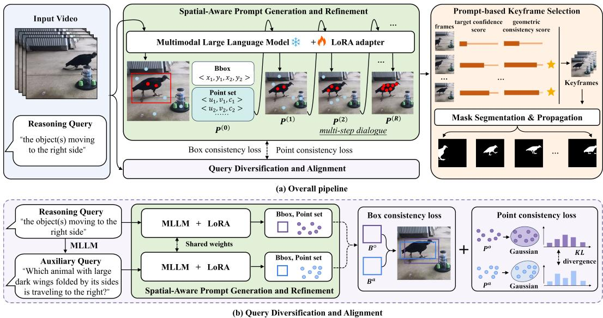
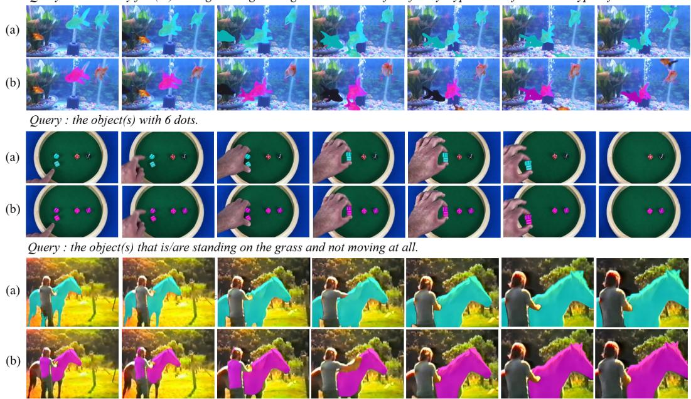
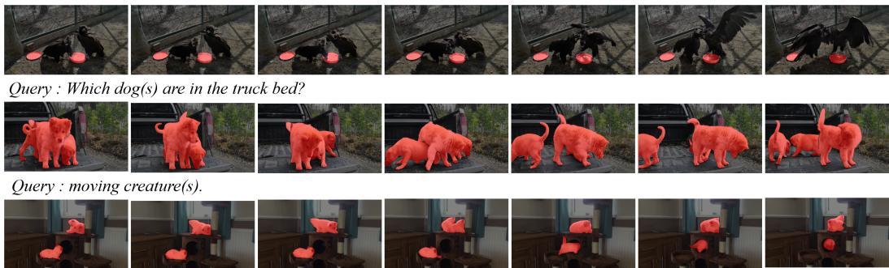
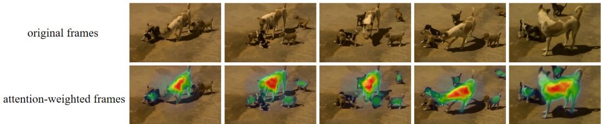
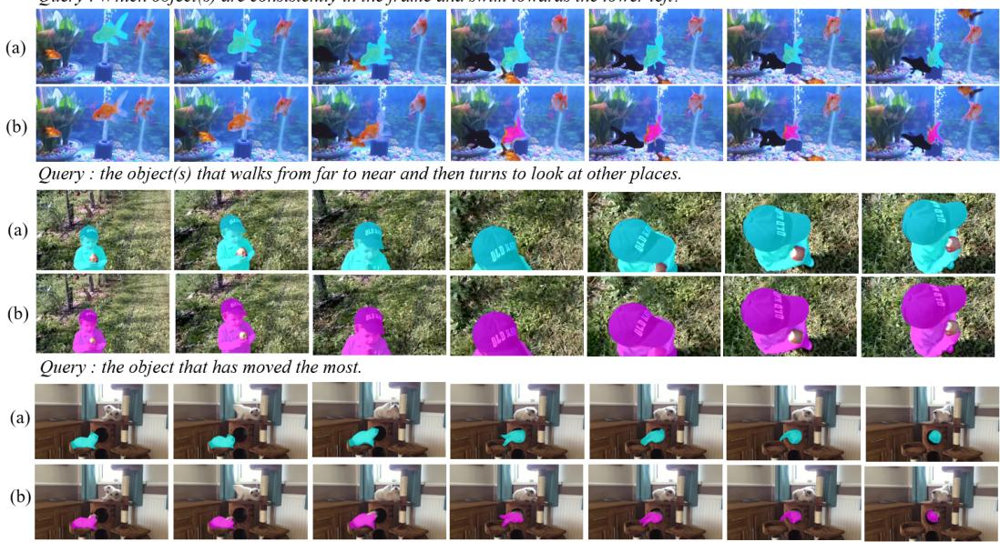
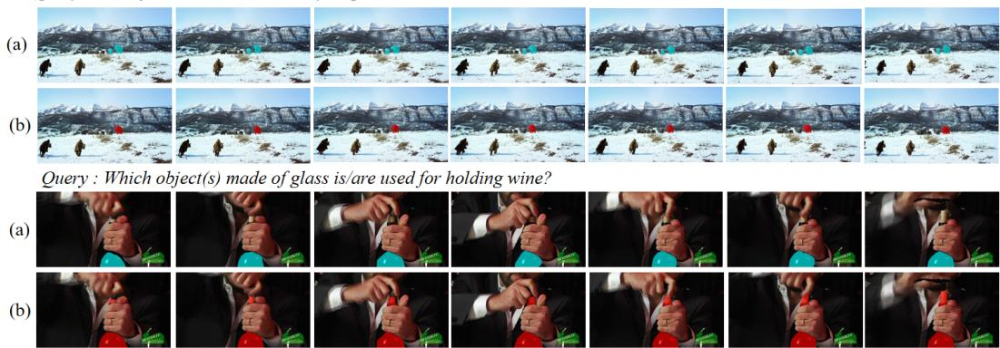

# Beyond Token Representations: Explicit Visual Object Grounding for Video Reasoning Segmentation

Jun Huang1 Junyang Zhang1,2 Zijie Yue1 Bingkun Wang1 Yong Luo3 Miaojing Shi1,4˚

1College of Electronic and Information Engineering, Tongji University

2Shanghai Zhenhua Heavy Industries Co., Ltd.

3College of Computer Science, Wuhan University

4Shanghai Institute of Intelligent Science and Technology, Tongji University {jhuang,zhangjunyang,zijie,wangbingkun,mshi}@tongji.edu.cn yong.luo@whu.edu.cn

## Abstract

Video Reasoning Segmentation (VRS) aims to infer and segment target objects specified by reasoning queries in videos. Existing methods typically first infer the target and generate a few segmentation tokens for it, which are then fed into a mask decoder for mask prediction. However, such segmentation tokens tend to be both semantically monotonous and spatially ambiguous, making them largely insufficient to represent the target to guide mask prediction. In this paper, we propose an explicit visual object grounding framework for VRS. Specifically, we first propose a spatial-aware prompt generation and refinement scheme, in which we query a multimodal large language model to generate explicit spatial prompts (i.e., bounding box and point set) for the target and then refine them through multistep dialogue. Furthermore, we introduce a query diversification and alignment module to generate auxiliary queries that describe the same target from different perspectives. We then enforce cross-query consistency between their predicted spatial prompts to alleviate the training bias caused by query limitations. Finally, we select several reliable frames using a prompt-based keyframe selection strategy to support mask decoding and propagation. Extensive experiments on eight datasets demonstrate that our method significantly outperforms state-of-the-art methods. The code is available at https://github.com/viscom-tongji/EVOG.

## 1 Introduction

Video Reasoning Segmentation (VRS) [55, 46, 14, 43] aims to generate segmentation masks for objects specified by reasoning queries in videos. For example, given queries such as “the tool used to cut the tomato” or “the object that causes the pedestrian to stop before crossing”, the model first implicitly reasons the target object (i.e., a knife or a car) from the video, then grounds it and generates corresponding pixel-level mask. VRS can be viewed as a more challenging task from Referring Video Object Segmentation (RVOS) [27, 50, 38]. The latter leverages a direct referring paradigm, where the referring expression explicitly specifies the target object via its categorical or visual attributes, e.g., “the knife cutting the tomato” or “the red car in front of the pedestrian”.

Recent VRS methods [16, 23, 33, 47, 14] have increasingly adopted Multimodal Large Language Models (MLLMs) to bridge language reasoning and video segmentation. A seminal work is VISA [47], which employs Chat-UniVi [19] to analyze the reasoning query and video content and generates a special segmentation token for the target object. This token is then used as a prompt fed into

SAM [22] to predict initial masks for some selected keyframes, which are further propagated to the remaining frames by an object tracker [9]. This paradigm has been widely adopted and extended by subsequent VRS studies [51, 4, 14].

Thus far, the key limitation of VRS methods lies in the insufficient representation of target objects, which comes from two aspects: on one hand, the target object is associated with only a few reasoning queries, primarily focusing on its relationship with the environment, thereby leading to a partial observation of the target object. Consequently, the model may draw a biased semantic/spatial view on the object in the scene; on the other hand, recent methods typically leverage the MLLM to infer the target object into only a few segmentation tokens before feeding them into the mask decoder. As a result, these tokens tend to be both semantically monotonous and spatially ambiguous for the follow-up mask decoder.

In this paper, we propose an explicit visual object grounding framework for VRS that connects query reasoning and video segmentation through bounding boxes and point sets. First, to enhance the spatial indication of the target object beyond the abstract segmentation tokens, we propose a spatial-aware prompt generation and refinement scheme that explicitly queries the MLLM to localize the target object in the form of a bounding box and a set of points. Considering that the initial predictions of MLLM may be unreliable, we further refine them through a multi-step dialogue process, in which the MLLM re-evaluates and progressively updates its predictions. This provides more explicit and reliable spatial guidance for the subsequent segmentation decoder. Second, to enrich the semantic understanding of the target object beyond the given query context, we introduce a query diversification and alignment module that utilizes the MLLM to generate an auxiliary query to inquire the same target from a different perspective; cross-query consistency is then enforced over the generated spatial predictions corresponding to different queries. Third, to reduce computational cost, existing VRS methods [47, 4, 14] typically select a small set of keyframes from the video and propagate their mask to remaining frames. Keyframes are determined by their relevance to the reasoning query. Given the generated spatial-aware prompts, we introduce the prompt-based keyframe selection strategy by evaluating the geometric correspondence between the box- and point-based prompts on the same object, such that the selected frames are more likely to have the correct target and accurate masks.

Extensive experiments on VRS dataset ReVOS [47] and RVOS datasets including Ref-DAVIS17 [21], Ref-YouTube-VOS [36] and MeViS [12] validate the effectiveness of the proposed framework.

## 2 Related Work

Referring Video Object Segmentation. RVOS [27, 5, 49, 38, 26] aims to segment target objects in videos based on explicit referring expressions. The success of query-based Transformer architectures in computer vision [7, 53] has recently inspired significant advances in RVOS. For example, MTTR [6] adapts the DETR framework [7] to RVOS, while ReferFormer [44] optimizes the Deformable DETR [53] using fewer instance queries to improve the segmentation efficiency. SgMg [31] improves ReferFormer [44] by incorporating spectral features to enhance segmentation performance. More recently, some methods [54, 41] exploit text-to-video diffusion models for RVOS. For example, VD-IT [54] leverages the rich semantic priors and inherent temporal coherence of latent representations learned from ModelScopeT2V [40] to promote consistent segmentation across frames.

Video Reasoning Segmentation. Unlike RVOS, where the target object is explicitly specified in the text query, VRS [15, 55, 46, 13, 37] requires the model to first infer the target object through reasoning over the input query and video content, and then localize and segment it across frames. For example, VISA [47], the first VRS method, leverages an MLLM to perform cross-modal reasoning and generate a special <SEG> token, which serves as a feature representation for predicting the target object mask. HyperSeg [42] proposes a temporal adapter in MLLM that performs global prompt aggregation and injects local space-time information to improve temporal understanding for VRS. VRS-HQ [14] employs Chat-UniVi [19] to generate both frame-level and temporal-level tokens, enabling joint modeling of frame details and temporal dynamics of the target object for segmentation. However, token-level target representations are inherently abstract and tend to be both semantically monotonous and spatially ambiguous, making it difficult for the segmentation decoder to accurately localize the target object.

Multimodal Large Language Models. MLLMs [25, 29, 2, 39, 18] have garnered significant attention due to their impressive performance across a variety of multimodal downstream tasks, such as visual question answering [24] and image captioning [52]. They learn cross-modal representations by aligning visual and linguistic features through training on a vast corpus of vision-language pairs. Recently, several studies [51, 47, 4, 28, 11] have explored the use of MLLMs to solve VRS task. For example, VideoSeg-R1 [46] introduces reinforcement learning to optimize the reasoning process of an MLLM [3], thereby improving the segmentation performance. SDAM [55] leverages an MLLM to analyze object motions in the video and select motion-informative keyframes for mask decoding.

  
Figure 1: Illustration of our proposed framework. (a) overall pipeline; (b) query diversification and alignment module.

## 3 Method

Let V $\in \mathbb { R } ^ { T \times 3 \times H \times W }$ denote an input video with $T$ frames, and $Q ^ { o }$ denote the corresponding reasoning query. The objective of VRS is to predict the binary mask sequence $\mathcal { M } \in \mathbb { R } ^ { T \times \dot { H } \times W }$ for the target object(s) specified by $Q ^ { o }$ across frames. Figure 1 illustrates the framework of our proposed method. We build on the widely used VRS framework [47, 4, 14], where an MLLM infers the target object from the reasoning query into a few tokens, which are then fed into a mask decoder $( e . g .$ SAM [22] or SAM2 [34]) to produce the final segmentation mask. Given the insufficiency of token representations, we offer three new components: spatial-aware prompt generation and refinement scheme, query diversification and alignment module, and prompt-based keyframe selection strategy, to enrich the abstract tokens via explicit spatial-semantic object grounding.

## 3.1 Spatial-aware Prompt Generation and Refinement

Existing VRS methods typically infer the target object(s) into implicit token-level representations, which provide limited visual information and are difficult to verify or refine before mask decoding. To bridge this gap, we first represent the target object(s) with explicit spatial prompts, i.e., we query the MLLM $( i . e .$ , Qwen2.5-VL-7B [3]) to predict a bounding box and a sparse set of points for the target object(s). These prompts provide explicit spatial cues and are better aligned with the input format of widely used segmentation models, such as SAM [22] and SAM2 [34], enabling more reliable guidance for mask decoding.

Specifically, given the video V and the original reasoning query $Q ^ { o }$ , we query the MLLM to generate the spatial prompts using the template:

You are given a video and a query that describes the target object(s). Pleasefirst localize the target object(s) with a bounding box, and then provide a set of K discriminative points on the target object(s) together with their confidence scoresfor eachframe. Your output mustfollow theformat: <BOX> x1 y1 x2 y2 </BOX>; <POINTS> u1 v1 c1; ...; uK vK cK </POINTS>.

Given V, $Q ^ { o }$ , and the above prompt, the MLLM infers the target object and auto-regressively generates the bounding box and point predictions, $i . e .$ , a bounding box set $\boldsymbol { B } = \{ B _ { t } \} _ { t = 1 } ^ { T }$ and a point set $\mathcal { P } = \{ P _ { t } \} _ { t = 1 } ^ { T }$ . Here, $B _ { t } = ( x _ { 1 } , y _ { 1 } , x _ { 2 } , y _ { 2 } )$ denotes the bounding box at the t-th frame, where $( x _ { 1 } , y _ { 1 } )$ and $( x _ { 2 } , y _ { 2 } )$ indicate its top-left and bottom-right corners, respectively. The point set at the t-th frame is denoted as $P _ { t } = \{ p _ { k } \} _ { k = 1 } ^ { K }$ with $K = 7$ , where each point is represented as $p _ { k } = \left( { { u } _ { k } } , { { v } _ { k } } , { { c } _ { k } } \right)$ . Here, $( u _ { k } , v _ { k } )$ is the 2D coordinate of the k-th point, and $c _ { k } \in [ 0 , 1 ]$ denotes its confidence score.

However, the MLLM is typically optimized for semantic understanding rather than spatial localization during their pretraining, $i . e . ,$ although it may correctly infer which object is the target, it could fail to localize the object. This issue becomes more pronounced in VRS, when the target object is small, partially occluded or temporally ambiguous. To address this issue, we further refine the predictions through a multi-step dialogue process, in which the MLLM is guided to re-evaluate and progressively update its point predictions. Specifically, as shown in Fig. 1, given the video V and the original query $\hat { Q } ^ { o }$ , we feed the predicted point set into the MLLM using the following template:

You are given a video, a query that describes the target object(s), and a point set with K points predicted in the previous step. Please refine the previous point set by checking whether each point lies on the target object(s) described by the reasoning query. Keep reliable points and replace unreliable points with better suitable points, while maintaining a total of K points for each frame. Your output mustfollow theformat exactly:

<POINTS> u1 v1 c1; ...; uK vK cK </POINTS>.

Let ${ \mathcal { P } } ^ { ( 0 ) }$ denote the initial point set generated by the MLLM. At the r-th refinement step, the MLLM takes $( \nu , Q ^ { o } )$ and the point set from the previous step $\mathcal { P } ^ { ( r - 1 ) }$ as input, and produces an updated point set $\mathcal { P } ^ { ( r ) }$ . In practice, we perform $R = 4$ refinement steps during training.

To optimize the MLLM’s point predictions during iterative steps, we introduce a point calibration loss:

$$
\mathcal { L } _ { \mathrm { p o i n t } } = \frac { 1 } { T R } \sum _ { t = 1 } ^ { T } \sum _ { r = 1 } ^ { R } \frac { 1 } { K } \sum _ { i = 1 } ^ { K } \left[ c _ { t , i } ^ { ( r ) } ( 1 - m _ { t , i } ^ { ( r ) } ) + ( 1 - c _ { t , i } ^ { ( r ) } ) m _ { t , i } ^ { ( r ) } \right] .\tag{1}
$$

where $m _ { t , i } ^ { ( r ) } = 1$ if the i-th point in the t-th frame lies inside the corresponding ground-truth target mask, and $m _ { t , i } ^ { ( r ) } = 0$ otherwise. This loss encourages high confidence for correct points and low confidence for wrong points, thereby reducing false point predictions during iterative refinement.

Moreover, we follow [53] to optimize the bounding box predictions using the bounding box loss ${ \mathcal { L } } _ { \mathrm { b b o x } }$ . Notice the bounding box set is empirically chosen to be generated only once.

## 3.2 Query Diversification and Alignment

In real-world scenarios, the same target can be described from diverse perspectives, such as appearance, action, interaction, and spatial relation. However, existing VRS datasets typically provide limited reasoning queries primarily describing the target object from a narrow perspective. As a result, the model may overfit to the specific aspect emphasized by the original query and fail to identify the same target when described from another perspective. To mitigate this issue, we utilize the MLLM to randomly generate an auxiliary query for each target object from an alternative perspective. We then encourage the model to produce consistent predictions for both the original and auxiliary queries.

Specifically, given the video $\nu ,$ the original query $Q ^ { o }$ , and the corresponding ground-truth target mask $\mathcal { M } ^ { g t }$ , we utilize the MLLM to generate an auxiliary query $Q ^ { a }$ using the following prompt:

You are given a video, a reasoning query that describes the target object(s) and the corresponding mask. Generate one additional query that refers to the same target object(s) but from a different perspective, such as: (1) visual appearance (color, shape, size, texture, distinctive look); (2) action or interaction (what it is doing, how it interacts with other objects); (3) spatial relation (its position relative to other objects).

Next, we follow the pipeline described in Sec. 3.1 to generate the bounding box set $B ^ { a } = \{ B _ { t } ^ { a } \} _ { t = 1 } ^ { T }$ and point set $\mathbf { \mathcal { P } } ^ { a } = \bar { \{ P _ { t } ^ { a } \} } _ { t = 1 } ^ { T }$ for the target object specified by $Q ^ { a }$ . Since both $Q ^ { a }$ and $Q ^ { o }$ refer to the same target object, their predictions at each frame, i.e., $B _ { t } ^ { o }$ and $B _ { t } ^ { a } , P _ { t } ^ { o }$ and $P _ { t } ^ { a }$ , are expected to be consistent with each other. For bounding box predictions, we minimize a box consistency loss:

$$
\mathcal { L } _ { \mathrm { b } } = \frac { 1 } { T } \sum _ { t = 1 } ^ { T } \left[ 1 - \mathrm { I o U } ( B _ { t } ^ { o } , B _ { t } ^ { a } ) \right] .\tag{2}
$$

While for point set predictions, directly matching individual points between $P _ { t } ^ { o }$ and $P _ { t } ^ { a }$ is unrealistic because different queries may activate on different yet valid regions of the same target. Instead, we represent each point set as a Gaussian distribution and align the two distributions. It should be noted that, we follow [32] to adopt the single Gaussian as the representation of each point set, with its mean and covariance capturing the overall location. We use Qwen2.5-VL to directly predict the locations of these points and Qwen learns visual-semantic representations from large-scale image-text pairs [3]. This suggests that, when prompted to localize the target with a few points, the model is more likely to place them in semantically salient regions of the targets although the targets may involve complex, non-rigid, or articulable objects. The detailed analysis can be found in the appendix. Specifically, let $P _ { t } ^ { o } = \overline { { { \{ p _ { k } ^ { o } \} } } } _ { k = 1 } ^ { K }$ and $P _ { t } ^ { a } = \bar { \{ } p _ { k } ^ { a } \} _ { k = 1 } ^ { K }$ . We compute:

$$
\mu _ { t } ^ { o } = \frac { 1 } { K } \sum _ { k = 1 } ^ { K } p _ { k } ^ { o } , \quad \Sigma _ { t } ^ { o } = \frac { 1 } { K } \sum _ { k = 1 } ^ { K } ( p _ { k } ^ { o } - \mu _ { t } ^ { o } ) ( p _ { k } ^ { o } - \mu _ { t } ^ { o } ) ^ { \top } + \epsilon I .\tag{3}
$$

$$
\mu _ { t } ^ { a } = \frac { 1 } { K } \sum _ { k = 1 } ^ { K } p _ { k } ^ { a } , \quad \Sigma _ { t } ^ { a } = \frac { 1 } { K } \sum _ { k = 1 } ^ { K } ( p _ { k } ^ { a } - \mu _ { t } ^ { a } ) ( p _ { k } ^ { a } - \mu _ { t } ^ { a } ) ^ { \top } + \epsilon I .\tag{4}
$$

where $\epsilon I$ is added for numerical stability, with I denoting the identity matrix. Accordingly, $P _ { t } ^ { o }$ and $P _ { t } ^ { a }$ are represented as Gaussian distributions $\mathcal { N } _ { t } ^ { o }$ and $\mathcal { N } _ { t } ^ { \breve { a } }$ , parameterized by $\textstyle ( \mu _ { t } ^ { o } , \Sigma _ { t } ^ { o } )$ and $( \mu _ { t } ^ { a } , \Sigma _ { t } ^ { a } )$ , respectively. We use a point consistency loss to minimize their symmetric KL divergence:

$$
\mathcal { L } _ { \mathrm { p } } = \frac { 1 } { 2 T } \sum _ { t = 1 } ^ { T } \left[ D _ { \mathrm { K L } } (  { \mathcal { N } } _ { t } ^ { o } \|  { \mathcal { N } } _ { t } ^ { a } ) + D _ { \mathrm { K L } } (  { \mathcal { N } } _ { t } ^ { a } \|  { \mathcal { N } } _ { t } ^ { o } ) \right] .\tag{5}
$$

The overall consistency loss is:

$$
\mathcal { L } _ { \mathrm { c } } = \mathcal { L } _ { \mathrm { b } } + \mathcal { L } _ { \mathrm { p } } ,\tag{6}
$$

Note that this module is used only during training.

## 3.3 Prompt-based Keyframe Selection

To reduce the computational cost, existing VRS methods [47, 4, 14] typically avoid repeatedly applying the mask decoder to every video frame for mask prediction. Instead, they select a small set of keyframes from the input video, predict target masks on these frames and then propagate them through an object tracker $( e . g .$ , Cutie [10]) to the remaining frames. The selected keyframes in these methods are typically based on their image-to-text similarities to the reasoning query, yet lack the assessment on the grounded objects in these frames.

To address this issue, we select keyframes based on two evidence scores: a target confidence score evaluates whether the target object is present in the frame, and a geometric consistency score measures whether the predicted points and bounding box correspond to the same object region. Candidate frames with high average scores are selected as keyframes for mask decoding and propagation.

Specifically, we follow [14] to leverage SAM2 [34] to compute the target confidence score, which indicates the target object’s presence in a frame:

$$
s _ { t } ^ { 1 } = \mathrm { S A M 2 } \left( \mathcal { V } , B _ { t } ^ { o } , P _ { t } ^ { o } \right) ,\tag{7}
$$

where $B _ { t } ^ { o }$ and $P _ { t } ^ { o }$ denote the predicted bounding box and refined point set for the t-th frame, respectively. A higher $s _ { t } ^ { 1 }$ indicates a higher likelihood that the target object is present in the frame.

We then measure the geometric consistency score between the point set and the bounding box:

$$
s _ { t } ^ { 2 } = \frac { 1 } { | P _ { t } ^ { o } | } \sum _ { ( u , v , c ) \in P _ { t } ^ { o } } \mathbb { I } \left[ ( u , v ) \in B _ { t } ^ { o } \right] ,\tag{8}
$$

Query : Which bony fish(es) belongs/belong to the genus Carassius of the family Cyprinidae of the order Cypriniformes?  
  
Figure 2: Visualization results on ReVOS. (a) Our method, (b) UniPixel [30].

where Ir¨s is the indicator function. This score computes the proportion of points that fall inside the predicted bounding box, with a higher value indicating stronger geometric consistency between the bounding box and point set. For each frame in the video, we compute the above two scores and average them to obtain the final score. The top-N frames with the highest scores are selected as keyframes (N “ 3).

Next, we follow [14, 15] to utilize SAM2 [34] for mask segmentation. For each selected keyframe $v ^ { \star }$ we use its corresponding predicted bounding box $B ^ { \star }$ and point set $P ^ { \star }$ as spatial cues to guide SAM2 to generate the keyframe mask. We then leverage Cutie [10] to propagate the keyframe masks to the remaining frames, yielding the final video mask sequence. SAM2 and Cutie are kept frozen during training. Without loss generality, our framework naturally supports multi-instance segmentation when a query refers to multiple target objects. The implementation details are provided in the appendix.

## 3.4 Model Training and Inference

Our method is optimized in an end-to-end manner using a combination of point calibration loss (Sec. 3.1), bounding box loss (Sec. 3.1), consistency loss (Sec. 3.2), and mask loss. The mask loss combines binary cross-entropy (BCE) loss and Dice loss:

$$
\mathcal { L } _ { \mathrm { m a s k } } = \mathcal { L } _ { \mathrm { b c e } } ( \mathcal { M } , \mathcal { M } ^ { g t } ) + \mathcal { L } _ { \mathrm { d i c e } } ( \mathcal { M } , \mathcal { M } ^ { g t } ) ,\tag{9}
$$

$$
\mathcal { L } _ { \mathrm { t o t a l } } = \mathcal { L } _ { \mathrm { b b o x } } + \mathcal { L } _ { \mathrm { p o i n t } } + \mathcal { L } _ { \mathrm { m a s k } } + \lambda _ { \mathrm { c } } \mathcal { L } _ { \mathrm { c } } ,\tag{10}
$$

During inference, the model takes only the video V and the original reasoning query $Q ^ { o }$ as input. It predicts spatial prompts, refines them through two-step dialogue, selects reliable keyframes, and then decodes and propagates masks.

## 4 Experiments

## 4.1 Experimental Settings

We follow [14, 46] to train and evaluate our model on a VRS dataset ReVOS [47] and three RVOS datasets, $i . e .$ , Ref-DAVIS17 [21], Ref-YouTube-VOS [36] and MeViS [12]. The ReVOS dataset consists of two splits: a referring split for RVOS task with explicit referring expressions and a reasoning split with implicit reasoning queries for VRS task. The evaluation metrics are region similarity ( \protect \mathcal {J} ), contour accuracy ( \protect \mathcal {F}), and their mean ( \protec \mathc l {J}\& mathc l {F} ) [36]. Moreover, we further evaluate the model on four referring image segmentation datasets, i.e., RefCOCO, RefCOCO+, RefCOCOg [20] and ReasonSeg [23]. The evaluation metrics are generalized intersection over union (gIoU) [23] and cumulative intersection over union (cIoU) [23]. Notice that the same pipeline in our method applies to VRS, RVOS, and RIS tasks.

Table 1: Performance comparison on the ReVOS benchmark. Best results are in bold, and second-best results are underlined.
<table><tr><td rowspan="2">Method</td><td rowspan="2">Venue</td><td rowspan="2">Size</td><td colspan="3">Referring</td><td colspan="3">Reasoning</td><td colspan="3">Overall</td></tr><tr><td>J</td><td>F</td><td> $J \& F$ </td><td>J</td><td>F</td><td> $J \& F$ </td><td>J</td><td>F</td><td>J&amp;F</td></tr><tr><td>LISA [23]</td><td>CVPR&#x27;24</td><td>7B</td><td>44.3</td><td>47.1</td><td>45.7</td><td>33.8</td><td>38.4</td><td>36.1</td><td>39.1</td><td>42.7</td><td>40.9</td></tr><tr><td>VISA [47]</td><td>ECCV’24</td><td>7B</td><td>49.2</td><td>52.6</td><td>50.9</td><td>40.6</td><td>45.4</td><td>43.0</td><td>44.9</td><td>49.0</td><td>46.9</td></tr><tr><td>HyperŠeg [42]</td><td>CVPR&#x27;25</td><td>3B</td><td>56.0</td><td>60.9</td><td>58.5</td><td>50.2</td><td>55.8</td><td>53.0</td><td>53.1</td><td>58.4</td><td>55.7</td></tr><tr><td>VRS-HQ [14]</td><td>CVPR&#x27;25</td><td>7B</td><td>59.8</td><td>64.5</td><td>62.1</td><td>53.5</td><td>58.7</td><td>56.1</td><td>56.6</td><td>61.6</td><td>59.1</td></tr><tr><td>InstructSeg [43]</td><td>ICCV’25</td><td>3B</td><td>54.8</td><td>59.2</td><td>57.0</td><td>49.2</td><td>54.7</td><td>51.9</td><td>52.0</td><td>56.9</td><td>54.5</td></tr><tr><td>ViLLa [51]</td><td>ICCV’25</td><td>6B</td><td>57.7</td><td>61.3</td><td>59.5</td><td>52.1</td><td>56.7</td><td>54.4</td><td>54.9</td><td>59.1</td><td>57.0</td></tr><tr><td>UniPixel [30]</td><td>NeurIPS&#x27;25</td><td>7B</td><td>63.9</td><td>67.8</td><td>65.8</td><td>59.4</td><td>63.7</td><td>61.5</td><td>61.7</td><td>65.7</td><td>63.7</td></tr><tr><td>Veason-R1 [13]</td><td>arXiv&#x27;25</td><td>7B</td><td>60.7</td><td>66.5</td><td>63.6</td><td>55.8</td><td>62.2</td><td>59.0</td><td>58.2</td><td>64.4</td><td>61.3</td></tr><tr><td>SDAM [55]</td><td>AAAI&#x27;26</td><td>7B</td><td>59.0</td><td>63.9</td><td>61.5</td><td>51.8</td><td>57.5</td><td>54.6</td><td>55.4</td><td>60.7</td><td>58.0</td></tr><tr><td>VideoSeg-R1 [46]</td><td>AAAI&#x27;26</td><td>7B</td><td>60.5</td><td>66.3</td><td>63.4</td><td>55.5</td><td>61.9</td><td>58.7</td><td>58.2</td><td>64.0</td><td>61.1</td></tr><tr><td>DecAF [15]</td><td>ICLR’26</td><td>7B</td><td>54.8</td><td>62.6</td><td>58.7</td><td>45.4</td><td>53.9</td><td>49.7</td><td>50.1</td><td>58.2</td><td>54.2</td></tr><tr><td>Ours</td><td></td><td>3B</td><td>65.8</td><td>69.6</td><td>67.7</td><td>59.2</td><td>63.6</td><td>61.4</td><td>62.5</td><td>66.6</td><td>64.6</td></tr><tr><td>Ours</td><td></td><td>7B</td><td>67.5</td><td>70.7</td><td>69.1</td><td>61.5</td><td>65.1</td><td>63.3</td><td>64.5</td><td>67.9</td><td>66.2</td></tr></table>

Table 2: Performance comparison on three RVOS datasets. Best results are in bold, and second-best results are underlined.
<table><tr><td rowspan="2">Method</td><td rowspan="2">Venue</td><td rowspan="2">Size</td><td colspan="3">MeViS</td><td colspan="3">Ref-YouTube-VOS</td><td colspan="3">Ref-DAVIS17</td></tr><tr><td>J</td><td>F</td><td> $J \& F$ </td><td>J</td><td>F</td><td> $J \& F$ </td><td>J</td><td>F</td><td>J&amp;F</td></tr><tr><td>LISA [23]</td><td>CVPR&#x27;24</td><td>7B</td><td>35.1</td><td>39.4</td><td>37.2</td><td>53.4</td><td>54.3</td><td>53.9</td><td>62.2</td><td>67.3</td><td>64.8</td></tr><tr><td>VISA [47]</td><td>ECCV’24</td><td>7B</td><td>40.7</td><td>46.3</td><td>43.5</td><td>59.8</td><td>63.2</td><td>61.5</td><td>66.3</td><td>72.5</td><td>69.4</td></tr><tr><td>VideoLISA [4]</td><td>NeurIPS&#x27;24</td><td>4B</td><td>41.3</td><td>47.6</td><td>44.4</td><td>61.7</td><td>65.7</td><td>63.7</td><td>64.9</td><td>72.7</td><td>68.8</td></tr><tr><td>HyperSeg [42]</td><td>CVPR’25</td><td>3B</td><td></td><td></td><td></td><td>65.7</td><td>71.3</td><td>68.5</td><td>67.9</td><td>74.5</td><td>71.2</td></tr><tr><td>VRS-HQ [14]</td><td>CVPR&#x27;25</td><td>7B</td><td>47.6</td><td>53.7</td><td>50.6</td><td>68.3</td><td>72.5</td><td>70.4</td><td>72.6</td><td>79.4</td><td>76.0</td></tr><tr><td>InstructSeg [43]</td><td>ICCV’25</td><td>3B</td><td></td><td></td><td></td><td>65.4</td><td>69.5</td><td>67.5</td><td>67.3</td><td>74.9</td><td>71.1</td></tr><tr><td>ViLLa [51]</td><td>ICCV’25</td><td>6B</td><td>46.5</td><td>52.3</td><td>49.4</td><td>64.6</td><td>70.4</td><td>67.5</td><td>70.6</td><td>78.0</td><td>74.3</td></tr><tr><td>UniPixel [30]</td><td>NeurIPS&#x27;25</td><td>7B</td><td>53.2</td><td>58.3</td><td>55.8</td><td>69.5</td><td>72.4</td><td>71.0</td><td>72.7</td><td>80.1</td><td>76.4</td></tr><tr><td>SDAM [55]</td><td>AAAI&#x27;26</td><td>7B</td><td>45.5</td><td>51.7</td><td>48.6</td><td>63.4</td><td>67.1</td><td>65.3</td><td>73.2</td><td>78.8</td><td>76.0</td></tr><tr><td>VideoSeg-R1 [46]</td><td>AAAI&#x27;26</td><td>7B</td><td>52.7</td><td>57.8</td><td>55.3</td><td>78.2</td><td>84.4</td><td>81.3</td><td>77.4</td><td>82.2</td><td>79.8</td></tr><tr><td>DecAF [15]</td><td>ICLR&#x27;26</td><td>7B</td><td>44.0</td><td>52.1</td><td>48.1</td><td>56.2</td><td>63.5</td><td>59.9</td><td>70.9</td><td>79.5</td><td>75.2</td></tr><tr><td>Ours</td><td>一</td><td>3B</td><td>55.9</td><td>61.0</td><td>58.5</td><td>72.8</td><td>76.8</td><td>74.8</td><td>75.2</td><td>82.2</td><td>78.7</td></tr><tr><td>Ours</td><td>一</td><td>7B</td><td>57.7</td><td>62.5</td><td>60.1</td><td>78.4</td><td>84.7</td><td>81.6</td><td>77.5</td><td>83.8</td><td>80.6</td></tr></table>

## 4.2 Implementation Details

The default MLLM is Qwen2.5-VL [3], and the mask decoder is SAM2 [34], which align with most existing works [55, 46]. We report results with two MLLM versions, i.e., Qwen2.5-VL-3B and Qwen2.5-VL-7B, to evaluate our method at different MLLM scales. We apply LoRA [17] to the MLLM for parameter-efficient fine-tuning, with the LoRA rank set to 16 and the scaling factor set to 2. The loss weight is set to $\lambda _ { \mathrm { c } } = 0 . 2$ . We utilize the same data loading and preprocessing pipeline as UniPixel [30]. During training, we follow [44] to randomly sample $\bar { T } = 4$ frames per video with a 10-frame interval. We optimize the model using the AdamW optimizer with a learning rate of $1 e ^ { - 4 }$ and a WarmupDecayLR scheduler with 100 warmup iterations. All experiments are conducted using four NVIDIA A40 GPUs.

Table 3: Performance comparison on four image segmentation datasets. Best results are in bold, and second-best results are underlined.
<table><tr><td rowspan="2">Method</td><td rowspan="2">Venue</td><td rowspan="2">Size</td><td colspan="3">RefCOCO</td><td colspan="3">RefCOCO+</td><td colspan="2">RefCOCOg</td><td colspan="2">ReasonSeg</td></tr><tr><td>val</td><td>testA</td><td>testB</td><td>val</td><td>testA</td><td>testB</td><td></td><td>val(U) test(U)</td><td>gIoU</td><td>cIoU</td></tr><tr><td>LISA [23]</td><td>CVPR&#x27;24</td><td>7B</td><td>74.9</td><td>79.1</td><td>72.3</td><td>65.1</td><td>70.8</td><td>58.1</td><td>67.9</td><td>70.6</td><td>52.9</td><td>54.0</td></tr><tr><td>PixelLM [35]</td><td>CVPR&#x27;24</td><td>7B</td><td>73.0</td><td>76.5</td><td>68.2</td><td>66.3</td><td>71.7</td><td>58.3</td><td>69.3</td><td>70.5</td><td>一</td><td></td></tr><tr><td>GLaMM [33]</td><td>CVPR’24</td><td>7B</td><td>79.5</td><td>83.2</td><td>76.9</td><td>72.6</td><td>78.7</td><td>64.6</td><td>74.2</td><td>74.9</td><td></td><td></td></tr><tr><td>VISA [47]</td><td>ECCV’24</td><td>7B</td><td>72.4</td><td>75.5</td><td>68.1</td><td>59.8</td><td>64.8</td><td>53.1</td><td>65.5</td><td>66.4</td><td>52.7</td><td>57.8</td></tr><tr><td>VideoLISA [4]</td><td>NeurIPS’24</td><td>4B</td><td>73.8</td><td>76.6</td><td>68.8</td><td>63.4</td><td>68.8</td><td>56.2</td><td>68.3</td><td>68.8</td><td>61.4</td><td>67.1</td></tr><tr><td>VRS-HQ [14]</td><td>CVPR’25</td><td>7B</td><td>73.5</td><td>77.5</td><td>69.5</td><td>61.7</td><td>67.6</td><td>54.3</td><td>66.7</td><td>67.5</td><td>55.2</td><td>51.8</td></tr><tr><td>HyperSeg [42]</td><td>CVPR’25</td><td>3B</td><td>84.8</td><td>85.7</td><td>83.4</td><td>79.0</td><td>83.5</td><td>75.2</td><td>79.4</td><td>78.9</td><td>59.2</td><td>56.7</td></tr><tr><td>InstructSeg [43]</td><td>ICCV’25</td><td>3B</td><td>85.8</td><td>86.6</td><td>84.0</td><td>80.1</td><td>83.8</td><td>75.6</td><td>79.3</td><td>80.3</td><td>61.9</td><td>65.2</td></tr><tr><td>UniPixel [30]</td><td>NeurIPS’25</td><td>7B</td><td>80.8</td><td>83.0</td><td>77.4</td><td>75.3</td><td>80.1</td><td>70.0</td><td>76.4</td><td>77.1</td><td>60.5</td><td>58.7</td></tr><tr><td>VideoSeg-R1 [46]</td><td>AAAI&#x27;26</td><td>7B</td><td>78.2</td><td>82.3</td><td>75.1</td><td>71.8</td><td>76.1</td><td>64.7</td><td>73.1</td><td>74.1</td><td>69.8</td><td>68.2</td></tr><tr><td>Ours</td><td></td><td>3B</td><td>84.8</td><td>86.9</td><td>79.4</td><td>76.8</td><td>82.2</td><td>71.9</td><td>80.0</td><td>81.1</td><td>65.8</td><td>64.4</td></tr><tr><td>Ours</td><td>一</td><td>7B</td><td>86.0</td><td>88.2</td><td>83.8</td><td>79.5</td><td>83.9</td><td>74.1</td><td>81.5</td><td>82.6</td><td>70.1</td><td>68.4</td></tr></table>

## 4.3 Comparison Results

As shown in Fig. 2, our method can accurately reason and segment target objects across frames.

VRS. We first report the model performance on the VRS dataset ReVOS in Tab. 1. We can see our method achieves the best performance across all metrics. In particular, it reaches 69.1%, 63.3%, and 66.2% in J&F on the referring, reasoning, and overall splits, respectively. Compared with the previous best-performing method, UniPixel [30], our method achieves +1.8% J&F on the reasoning split and +2.5% J&F overall. The gain on the overall split demonstrates that our method not only enhances reasoning segmentation that requires world knowledge and temporal understanding, but also maintains strong generalization ability under the referring setting.

RVOS. Tab. 2 shows that our method achieves the best performance across all RVOS benchmarks. For example, on the MeViS dataset, we achieve 60.1% in J&F, outperforming the previous bestperforming method UniPixel [30] by +4.3%. On the Ref-DAVIS17 dataset, we achieve the best results, surpassing VideoSeg-R1 [46] by 0.8% in J&F. On the Ref-YouTube-VOS dataset, our method obtains 81.6% in J&F, outperforming UniPixel by 10.6% in J&F.

RIS. We follow [47, 30, 46] to seamlessly extend our method to achieve referring image segmentation (RIS) by treating each image as a single-frame video. As shown in Tab. 3, our method achieves the best results on RefCOCO val/testA, RefCOCO+ testA, RefCOCOg val(U)/test(U) and ReasonSeg gIoU/cIoU splits. For example, compared with the previous best method InstructSeg [43], our method improves performance on RefCOCO testA by +1.6%, RefCOCOg val(U) by +2.2%, and RefCOCOg test(U) by +2.3%. Notably, the previous best-performing method InstructSeg [43] was trained with more data (i.e., plus LLAVA-150k [29]) than our method.

Computational cost. Tab. 4 compares our method with existing methods on ReVOS dataset in terms of trainable parameters (TP), GFLOPs, memory usage, and inference speed. Our model has the fewest trainable parameters among the compared methods at 212M, with a computational cost of 1521 GFLOPs and a memory usage of 32.1 GB. It runs at 1.32 FPS, comparable to UniPixel (1.31 FPS), faster than VRS-HQ (1.14 FPS) and VideoSeg-R1 (0.23 FPS), and slower than VISA (1.58 FPS), while achieving better segmentation performance in the reported comparisons as detailed above. We further examine the cumulative inference cost as components are progressively incorporated into the baseline. Starting from a baseline speed of 2.48 FPS, adding Spatial-aware Prompt Generation and Refinement (SPGR) without point refinement reduces the speed to 2.02 FPS, and enabling point refinement further reduces it to 1.89 FPS. Query Diversification and Alignment (QDA) introduces no inference overhead because it is used only during training. Subsequently adding Prompt-based Keyframe Selection (PKS), SAM2 decoding, and Cutie propagation yields 1.78, 1.46, and 1.32 FPS, respectively. Mask decoding and propagation together account for the largest share of the additional per-frame latency.

Table 4: Computational cost and cumulative inference speed. Rows below Baseline progressively add components.
<table><tr><td>Method TP (M)</td></tr><tr><td>GFLOPs Memory (GB) FPS 1340 30.5 1.58</td></tr><tr><td>VISA [47] 279 VRS-HQ [14] 288 1765 33.9 1.14</td></tr><tr><td>UniPixel [30] 256 1511 32.4 1.31</td></tr><tr><td>VideoSeg-R1 [46] 432 6890 45.8 0.23</td></tr><tr><td>Baseline 2.48 + SPGR w/o point refinement 2.02 + Point refinement 1.89</td></tr></table>

Table 5: Quality of MLLM-generated spatial prompts before mask decoding.
<table><tr><td>Method</td><td>Box IoU</td><td>Point-in-Mask</td></tr><tr><td>Ours</td><td>84.63</td><td>87.32</td></tr></table>

Table 6: Ablation study on the SPGR module.
<table><tr><td>Method</td><td>J</td><td>F</td><td> $\mathcal { T } \& \mathcal { F }$ </td></tr><tr><td>Ours w/o SPGR</td><td>43.0</td><td>48.1</td><td>45.5</td></tr><tr><td>SPGR w/o point</td><td>48.7</td><td>50.3</td><td>49.5</td></tr><tr><td>SPGR w/o box</td><td>55.6</td><td>59.2</td><td>57.4</td></tr><tr><td>SPGR w/ box refinement</td><td>57.8</td><td>62.5</td><td>60.1</td></tr><tr><td>Ours</td><td>57.7</td><td>62.5</td><td>60.1</td></tr></table>

Table 7: Ablation study on the number of refinement steps in SPGR module. We report $\mathcal { T } \& \mathcal { F }$  
Table 8: Ablation study on the QDA module.
<table><tr><td></td><td colspan="5">Training steps</td></tr><tr><td>Test steps</td><td>R = 1</td><td> $R = 2$ </td><td> $R = 3$ </td><td> $R = 4$ </td><td> $R = 5$ </td></tr><tr><td>R = 1</td><td>53.7</td><td>55.4</td><td>56.1</td><td>56.3</td><td>56.4</td></tr><tr><td>R = 2</td><td>56.4</td><td>58.2</td><td>59.6</td><td>60.1</td><td>60.1</td></tr><tr><td>R = 3</td><td>57.4</td><td>59.6</td><td>60.0</td><td>60.1</td><td>60.2</td></tr><tr><td>R = 4</td><td>57.9</td><td>59.9</td><td>60.1</td><td>60.2</td><td>60.2</td></tr></table>

<table><tr><td>Method</td><td> $\mathcal { T }$ </td><td>F</td><td> $\mathcal { T } \& \mathcal { F }$ </td></tr><tr><td>Ours w/o QDA</td><td>54.959.6</td><td></td><td>57.2</td></tr><tr><td>Ours w/o  $\mathcal { L } _ { \mathrm { b } }$ </td><td>56.9 61.3</td><td></td><td>59.1</td></tr><tr><td>Ours w/o  ${ \mathcal { L } } _ { \mathrm { p } }$ </td><td>57.2 61.6</td><td></td><td>59.4</td></tr><tr><td> ${ \mathcal { L } } _ { \mathrm { p } } \to { \mathcal { L } } _ { \mathrm { p } \cdot \mathrm { s t r i c t } }$ </td><td>55.2 60.0</td><td></td><td>57.6</td></tr><tr><td>Ours</td><td>57.7 62.5</td><td></td><td>60.1</td></tr></table>

## 4.4 Ablation Studies

We follow [30] to conduct ablation studies on the MeViS dataset [12].

Spatial-aware Prompt Generation and Refinement. We evaluate the effectiveness of the proposed spatial-aware prompt generation and refinement (SPGR) module in Tab. 6. We first propose a variant by removing this module and following VISA [47] to use the MLLM to generate token-level target representations to guide mask decoding. This variant leads to a substantial performance drop, i.e., from 60.1% to 45.5% in $\mathcal { T } \& \mathcal { F }$ . We further evaluate the contribution of each type of spatial prompts, i.e., the bounding box and point set predictions. Removing the point set decreases $\mathcal { T } \& \mathcal { F }$ from 60.1% to 49.5%, while removing the bounding box reduces it to 57.4%. These results indicate that both prompts are beneficial for target grounding and mask decoding.

Furthermore, we query the MLLM to refine the predicted point set through a multi-step dialogue process. Tab. 7 reports the model performance under different numbers of refinement steps. When both training and test steps are set to R “ 1, i.e. the refinement process is removed, reducing $\mathcal { T } \& \mathcal { F }$ from 60.1% to 53.7%. We observe that increasing the number of refinement steps during either training or inference consistently improves performance. The performance becomes stable when the training step $R \geqslant { \mathrm { ~ 4 ~ } }$ 4 and the inference step $\dot { R } \geqslant 2$ . In fact, each refinement step brings in about only 5% additional time, to balance segmentation accuracy and computational efficiency, we use 4 training steps and 2 inference steps as the default setting. In addition, we evaluate a variant that also applies multi-step dialogue refinement to bounding box predictions, allowing the MLLM to re-evaluate and update the predicted bounding box. As shown in Tab. 6, this variant (SPGR w/ box refinement) yields negligible performance gains, suggesting that the initial bounding box already provides sufficient coarse-grained information by capturing the overall extent of the target object.

We assess the box IoU and point-in-mask accuracy of the final MLLM-refined prompts. Box IoU is the IoU between the predicted bounding box and the bounding box derived from the ground truth mask. Point-in-mask accuracy is the percentage of predicted points that fall inside the ground truth mask. As shown in Table 5, our method achieves 84.63% Box IoU and 87.32% point-in-mask accuracy, validating that the refined prompts could reliably localize the target before SAM2.

Table 9: Ablation study on the PKS module.
<table><tr><td>Method</td><td> $\mathcal { T }$ </td><td> $\mathcal { F }$ </td><td>J&amp;F</td></tr><tr><td>Ours w/o PKS</td><td>54.6</td><td>59.4</td><td>57.0</td></tr><tr><td>PKS w/o</td><td>56.8</td><td>61.4</td><td>59.1</td></tr><tr><td></td><td>56.4</td><td>61.0</td><td>58.7</td></tr><tr><td>SAM3 [8]</td><td>32.3</td><td>37.5</td><td>34.9</td></tr><tr><td>Ours w/ SAM3</td><td>58.0</td><td>63.2</td><td>60.6</td></tr><tr><td>Ours</td><td>57.7</td><td>62.5</td><td>60.1</td></tr></table>

Table 10: Ablation study on different MLLMs.
<table><tr><td>Backbone</td><td> $\mathcal { T }$ </td><td> $\mathcal { F }$ </td><td> $\mathcal { T } \& \mathcal { F }$ </td></tr><tr><td>DeepSeek-VL2-3B [45]</td><td>54.5</td><td>59.4</td><td>57.0</td></tr><tr><td>DeepSeek-VL2-16B [45]</td><td>57.8</td><td>62.8</td><td>60.3</td></tr><tr><td>LLaVA-OneVision-1.5-4B [1]</td><td>55.8</td><td>61.0</td><td>58.4</td></tr><tr><td>LLaVA-OneVision-1.5-8B [1]</td><td>57.2</td><td>62.0</td><td>59.6</td></tr><tr><td>Qwen2.5-VL-3B [3]</td><td>55.9</td><td>61.0</td><td>58.5</td></tr><tr><td>Qwen2.5-VL-7B [3]</td><td>57.7</td><td>62.5</td><td>60.1</td></tr></table>

Query Diversification and Alignment. We evaluate the effectiveness of the query diversification and alignment (QDA) module in Tab. 8. Removing this module entirely leads to a clear performance drop, i.e., from 60.1% to 57.2% in J&F. Moreover, we evaluate two variants that discard one type of consistency constraint. Removing the box-level consistency (Ours w/o ${ \mathcal L } _ { \mathrm b } )$ or the pointlevel consistency (Ours w/o $\mathcal { L } _ { \mathrm { p } } )$ results in a performance decrease. These results indicate that both box-level and point-level consistencies contribute to QDA, and their combination achieves the best performance. We represent the point sets predicted from the original and auxiliary queries as Gaussian distributions and minimize their symmetric KL divergence. If we instead directly enforce point-wise consistency between the two point sets by minimizing the distance between each point in one set and its nearest point in the other set $( \mathcal { L } _ { \mathrm { p } } \longrightarrow \mathcal { L } _ { \mathrm { p - s t r i c t } } )$ , the performance drops to 57.6% in $\mathcal { T } \& \mathcal { F }$

In addition, we assess the failure rate of the generated auxiliary queries. Specifically, we randomly pick 200 samples (each consisting of a video, an original query and an auxiliary query) from ReVOS dataset, then feed each instance into the GPT-5.5 model and ask it to make a binary judgment, i.e. it outputs “Yes” only if the two queries refer to the same instance in the video, and “No” otherwise. As a result, the failure rate of auxiliary queries is only 2%.

Prompt-based Keyframe Selection. The prompt-based keyframe selection (PKS) module aims to select reliable frames in terms of a target confidence score and a geometric consistency score. In Tab. 9, we denote Ours w/o PKS as a variant that follows [47] to simply select keyframes based on their image-to-text similarities to the reasoning query. This variant decreases $\mathcal { I } \& \mathcal { F }$ from 60.1% to 57.0%, indicating that reliable keyframe selection is important for VRS. Moreover, we evaluate two variants that separately use only one of the proposed scores. Using either score alone leads to a performance drop and combining both scores achieves the best.

Choices of SAM series. We compare our model with a direct deployment of SAM3 [8] and a variant of our model in which SAM2 is replaced with SAM3. As shown in Tab. 9, SAM3 produces only 34.9% J&F, revealing its limited ability to reason the target object from an implicit query. Moreover, replacing SAM2 with SAM3 in our model yields slight performance improvement (from 60.1% to 60.6% in J&F), demonstrating the primary gains of our method arise from developing explicit spatial prompts for visual reasoning segmentation, rather than from the mask decoder choice.

Choice of MLLMs. We further evaluate the influence of different MLLM backbones in Tab. 10. As shown in Tab. 10, increasing the backbone scale generally leads to better performance. Although DeepSeek-VL2-16B [45] achieves the best results, we use Qwen2.5-VL-7B as the default backbone because it has comparable results with DeepSeek-VL2-16B using fewer parameters.

## 5 Conclusion

In this paper, we present an explicit visual object grounding framework for video reasoning segmentation. We first propose a spatial-aware prompt generation and refinement module, where the MLLM is queried to infer the target object and explicitly predict its bounding box and point set as spatial prompts. We further design a multi-step dialogue process to progressively update the spatial predictions to guide mask decoding. Moreover, we introduce a query diversification and alignment module that generates auxiliary queries describing the same target object from different perspectives and enforces cross-query consistency between their predicted spatial prompts. Finally, we propose a prompt-based keyframe selection module that selects keyframes based on a target confidence score and a geometric consistency score. This module enables the model to perform mask segmentation on reliable frames, thereby improving the quality of mask propagation. Extensive experiments demonstrate the effectiveness and generalization ability of our method.

Acknowledgments. This work was supported by the National Natural Science Foundation of China (Grant No.62672351 and No.62401393), the Fundamental Research Funds for the Central Universities, and the Xiaomi Young Scholar Project.

Declaration of competing interests. The authors declare that they have no known competing financial interests or personal relationships that could have appeared to influence the work reported in this paper.

## References

[1] Xiang An, Yin Xie, Kaicheng Yang, Wenkang Zhang, Xiuwei Zhao, Zheng Cheng, Yirui Wang, Songcen Xu, Changrui Chen, Didi Zhu, et al. Llava-onevision-1.5: Fully open framework for democratized multimodal training. arXiv preprint arXiv:2509.23661, 2025.

[2] Shuai Bai, Yuxuan Cai, Ruizhe Chen, Keqin Chen, Xionghui Chen, Zesen Cheng, Lianghao Deng, Wei Ding, Chang Gao, Chunjiang Ge, et al. Qwen3-vl technical report. arXiv preprint arXiv:2511.21631, 2025.

[3] Shuai Bai, Keqin Chen, Xuejing Liu, Jialin Wang, Wenbin Ge, Sibo Song, Kai Dang, Peng Wang, Shijie Wang, Jun Tang, Humen Zhong, Yuanzhi Zhu, Mingkun Yang, Zhaohai Li, Jianqiang Wan, Pengfei Wang, Wei Ding, Zheren Fu, Yiheng Xu, Jiabo Ye, Xi Zhang, Tianbao Xie, Zesen Cheng, Hang Zhang, Zhibo Yang, Haiyang Xu, and Junyang Lin. Qwen2.5-vl technical report. arXiv preprint arXiv:2502.13923, 2025.

[4] Zechen Bai, Tong He, Haiyang Mei, Pichao Wang, Ziteng Gao, Joya Chen, Lei Liu, Zheng Zhang, and Mike Z Shou. One token to seg them all: Language instructed reasoning segmentation in videos. Advances in Neural Information Processing Systems, 37:6833–6859, 2024.

[5] Miriam Bellver, Carles Ventura, Carina Silberer, Ioannis Kazakos, Jordi Torres, and Xavier Giro-i Nieto. A closer look at referring expressions for video object segmentation. Multimedia Tools and Applications, 82 (3):4419–4438, 2023.

[6] Adam Botach, Evgenii Zheltonozhskii, and Chaim Baskin. End-to-end referring video object segmentation with multimodal transformers. In Proceedings of the IEEE/CVF Conference on Computer Vision and Pattern Recognition, pages 4985–4995, 2022.

[7] Nicolas Carion, Francisco Massa, Gabriel Synnaeve, Nicolas Usunier, Alexander Kirillov, and Sergey Zagoruyko. End-to-end object detection with transformers. In European conference on computer vision, pages 213–229. Springer, 2020.

[8] Nicolas Carion, Laura Gustafson, Yuan-Ting Hu, Shoubhik Debnath, Ronghang Hu, Didac Suris Coll-Vinent, Chaitanya Ryali, Kalyan Vasudev Alwala, Haitham Khedr, Andrew Huang, et al. Sam 3: Segment anything with concepts. In International conference on learning representations, pages 138846–138923, 2026.

[9] Ho Kei Cheng and Alexander G Schwing. Xmem: Long-term video object segmentation with an atkinsonshiffrin memory model. In European conference on computer vision, pages 640–658. Springer, 2022.

[10] Ho Kei Cheng, Seoung Wug Oh, Brian Price, Joon-Young Lee, and Alexander Schwing. Putting the object back into video object segmentation. In 2024 IEEE/CVF Conference on Computer Vision and Pattern Recognition (CVPR), pages 3151–3161. IEEE, 2024.

[11] Andong Deng, Tongjia Chen, Shoubin Yu, Taojiannan Yang, Lincoln Spencer, Yapeng Tian, Ajmal Saeed Mian, Mohit Bansal, and Chen Chen. Motion-grounded video reasoning: Understanding and perceiving motion at pixel level. In Proceedings of the Computer Vision and Pattern Recognition Conference, pages 8625–8636, 2025.

[12] Henghui Ding, Chang Liu, Shuting He, Xudong Jiang, and Chen Change Loy. Mevis: A large-scale benchmark for video segmentation with motion expressions. In Proceedings of the IEEE/CVF international conference on computer vision, pages 2694–2703, 2023.

[13] Sitong Gong, Lu Zhang, Yunzhi Zhuge, Xu Jia, Pingping Zhang, and Huchuan Lu. Reinforcing video reasoning segmentation to think before it segments. arXiv preprint arXiv:2508.11538, 2025.

[14] Sitong Gong, Yunzhi Zhuge, Lu Zhang, Zongxin Yang, Pingping Zhang, and Huchuan Lu. The devil is in temporal token: High quality video reasoning segmentation. In Proceedings of the IEEE/CVF Conference on Computer Vision and Pattern Recognition, pages 29183–29192, 2025.

[15] Su Ho Han, Jeongseok Hyun, Pilhyeon Lee, Minho Shim, Dongyoon Wee, and Seon Joo Kim. Decomposed attention fusion in mllms for training-free video reasoning segmentation. In International Conference on Learning Representations, pages 28342–28370, 2026.

[16] Junwen He, Yifan Wang, Lijun Wang, Huchuan Lu, Jun-Yan He, Jin-Peng Lan, Bin Luo, and Xuansong Xie. Multi-modal instruction tuned llms with fine-grained visual perception. In Proceedings ofthe ieee/cvf conference on computer vision and pattern recognition, pages 13980–13990, 2024.

[17] Edward J Hu, Yelong Shen, Phillip Wallis, Zeyuan Allen-Zhu, Yuanzhi Li, Shean Wang, Lu Wang, and Weizhu Chen. Lora: Low-rank adaptation of large language models. arXiv preprint arXiv:2106.09685, 2021.

[18] Jun Huang, Meiyi Chen, Zijie Yue, Yuhang Xiao, Fang Li, Hanli Wang, Xiaowen Tong, Yi Guo, and Miaojing Shi. Bootstrapping vision-language model for hysteroscopic surgical scene segmentation. Biomedical Signal Processing and Control, 127:111214, 2026.

[19] Peng Jin, Ryuichi Takanobu, Wancai Zhang, Xiaochun Cao, and Li Yuan. Chat-univi: Unified visual representation empowers large language models with image and video understanding. In Proceedings of the IEEE/CVF Conference on Computer Vision and Pattern Recognition, pages 13700–13710, 2024.

[20] Sahar Kazemzadeh, Vicente Ordonez, Mark Matten, and Tamara Berg. Referitgame: Referring to objects in photographs of natural scenes. In Proceedings ofthe 2014 conference on empirical methods in natural language processing (EMNLP), pages 787–798, 2014.

[21] Anna Khoreva, Anna Rohrbach, and Bernt Schiele. Video object segmentation with language referring expressions. In Computer Vision–ACCV 2018: 14th Asian Conference on Computer Vision, Perth, Australia, December 2–6, 2018, Revised Selected Papers, Part IV 14, pages 123–141. Springer, 2019.

[22] Alexander Kirillov, Eric Mintun, Nikhila Ravi, Hanzi Mao, Chloe Rolland, Laura Gustafson, Tete Xiao, Spencer Whitehead, Alexander C Berg, Wan-Yen Lo, et al. Segment anything. In Proceedings of the IEEE/CVF International Conference on Computer Vision, pages 4015–4026, 2023.

[23] Xin Lai, Zhuotao Tian, Yukang Chen, Yanwei Li, Yuhui Yuan, Shu Liu, and Jiaya Jia. Lisa: Reasoning segmentation via large language model. In Proceedings of the IEEE/CVF conference on computer vision and pattern recognition, pages 9579–9589, 2024.

[24] Bo Li, Yuanhan Zhang, Dong Guo, Renrui Zhang, Feng Li, Hao Zhang, Kaichen Zhang, Peiyuan Zhang, Yanwei Li, Ziwei Liu, et al. Llava-onevision: Easy visual task transfer. arXiv preprint arXiv:2408.03326, 2024.

[25] Junnan Li, Dongxu Li, Silvio Savarese, and Steven Hoi. Blip-2: Bootstrapping language-image pre-training with frozen image encoders and large language models. In International conference on machine learning, pages 19730–19742. PMLR, 2023.

[26] Chen Liang, Yu Wu, Tianfei Zhou, Wenguan Wang, Zongxin Yang, Yunchao Wei, and Yi Yang. Rethinking cross-modal interaction from a top-down perspective for referring video object segmentation. arXiv preprint arXiv:2106.01061, 2021.

[27] Tianming Liang, Kun-Yu Lin, Chaolei Tan, Jianguo Zhang, Wei-Shi Zheng, and Jian-Fang Hu. Referdino: Referring video object segmentation with visual grounding foundations. In Proceedings ofthe IEEE/CVF International Conference on Computer Vision, pages 20009–20019, 2025.

[28] Lang Lin, Xueyang Yu, Ziqi Pang, and Yu-Xiong Wang. Glus: Global-local reasoning unified into a single large language model for video segmentation. In Proceedings ofthe Computer Vision and Pattern Recognition Conference, pages 8658–8667, 2025.

[29] Haotian Liu, Chunyuan Li, Qingyang Wu, and Yong Jae Lee. Visual instruction tuning. Advances in neural information processing systems, 36:34892–34916, 2023.

[30] Ye Liu, Zongyang Ma, Junfu Pu, Zhongang Qi, Yang Wu, Ying Shan, and Chang Chen. Unipixel: Unified object referring and segmentation for pixel-level visual reasoning. Advances in Neural Information Processing Systems, 38:126078–126108, 2026.

[31] Bo Miao, Mohammed Bennamoun, Yongsheng Gao, and Ajmal Mian. Spectrum-guided multi-granularity referring video object segmentation. In Proceedings of the IEEE/CVF International Conference on Computer Vision, pages 920–930, 2023.

[32] Jeffri Murrugarra-Llerena, Lucas N Kirsten, Luis Felipe Zeni, and Claudio R Jung. Probabilistic intersection-over-union for training and evaluation of oriented object detectors. IEEE Transactions on Image Processing, 33:671–681, 2024.

[33] Hanoona Rasheed, Muhammad Maaz, Sahal Shaji, Abdelrahman Shaker, Salman Khan, Hisham Cholakkal, Rao M Anwer, Eric Xing, Ming-Hsuan Yang, and Fahad S Khan. Glamm: Pixel grounding large multimodal model. In Proceedings ofthe IEEE/CVF Conference on Computer Vision and Pattern Recognition, pages 13009–13018, 2024.

[34] Nikhila Ravi, Valentin Gabeur, Yuan-Ting Hu, Ronghang Hu, Chaitanya Ryali, Tengyu Ma, Haitham Khedr, Roman Rädle, Chloe Rolland, Laura Gustafson, et al. Sam 2: Segment anything in images and videos. In International Conference on Learning Representations, pages 28085–28128, 2025.

[35] Zhongwei Ren, Zhicheng Huang, Yunchao Wei, Yao Zhao, Dongmei Fu, Jiashi Feng, and Xiaojie Jin. Pixellm: Pixel reasoning with large multimodal model. In 2024 IEEE/CVF Conference on Computer Vision and Pattern Recognition (CVPR), pages 26364–26373. IEEE, 2024.

[36] Seonguk Seo, Joon-Young Lee, and Bohyung Han. Urvos: Unified referring video object segmentation network with a large-scale benchmark. In European conference on computer vision, pages 208–223. Springer, 2020.

[37] Yiqing Shen, Bohan Liu, Chenjia Li, Lalithkumar Seenivasan, and Mathias Unberath. Online reasoning video segmentation with just-in-time digital twins. In Proceedings of the IEEE/CVF International Conference on Computer Vision, pages 24698–24706, 2025.

[38] Miaojing Shi, Jun Huang, Zijie Yue, and Hanli Wang. Weakly-supervised referring video object segmentation through text supervision. arXiv preprint arXiv:2604.17797, 2026.

[39] Michael Tschannen, Alexey Gritsenko, Xiao Wang, Muhammad Ferjad Naeem, Ibrahim Alabdulmohsin, Nikhil Parthasarathy, Talfan Evans, Lucas Beyer, Ye Xia, Basil Mustafa, et al. Siglip 2: Multilingual vision-language encoders with improved semantic understanding, localization, and dense features. arXiv preprint arXiv:2502.14786, 2025.

[40] Jiuniu Wang, Hangjie Yuan, Dayou Chen, Yingya Zhang, Xiang Wang, and Shiwei Zhang. Modelscope text-to-video technical report. arXiv preprint arXiv:2308.06571, 2023.

[41] Zanyi Wang, Dengyang Jiang, Liuzhuozheng Li, Sizhe Dang, Chengzu Li, Harry Yang, Guang Dai, Mengmeng Wang, and Jingdong Wang. Deforming videos to masks: Flow matching for referring video segmentation. In International Conference on Learning Representations, pages 65586–65601, 2026.

[42] Cong Wei, Yujie Zhong, Haoxian Tan, Yong Liu, Jie Hu, Dengjie Li, Zheng Zhao, and Yujiu Yang. Hyperseg: Hybrid segmentation assistant with fine-grained visual perceiver. In Proceedings of the Computer Vision and Pattern Recognition Conference, pages 8931–8941, 2025.

[43] Cong Wei, Yujie Zhong, Haoxian Tan, Yingsen Zeng, Yong Liu, Hongfa Wang, and Yujiu Yang. Instructseg: Unifying instructed visual segmentation with multi-modal large language models. In Proceedings ofthe IEEE/CVF International Conference on Computer Vision, pages 20193–20203, 2025.

[44] Jiannan Wu, Yi Jiang, Peize Sun, Zehuan Yuan, and Ping Luo. Language as queries for referring video object segmentation. In Proceedings of the IEEE/CVF Conference on Computer Vision and Pattern Recognition, pages 4974–4984, 2022.

[45] Zhiyu Wu, Xiaokang Chen, Zizheng Pan, Xingchao Liu, Wen Liu, Damai Dai, Huazuo Gao, Yiyang Ma, Chengyue Wu, Bingxuan Wang, et al. Deepseek-vl2: Mixture-of-experts vision-language models for advanced multimodal understanding. arXiv preprint arXiv:2412.10302, 2024.

[46] Zishan Xu, Yifu Guo, Yuquan Lu, Fengyu Yang, Junxin Li, and Lihua Cai. Videoseg-r1: reasoning video object segmentation via reinforcement learning. In Proceedings of the AAAI Conference on Artificial Intelligence, pages 11496–11504, 2026.

[47] Cilin Yan, Haochen Wang, Shilin Yan, Xiaolong Jiang, Yao Hu, Guoliang Kang, Weidi Xie, and Efstratios Gavves. Visa: Reasoning video object segmentation via large language models. In European Conference on Computer Vision, pages 98–115. Springer, 2024.

[48] Xue Yang, Xiaojiang Yang, Jirui Yang, Qi Ming, Wentao Wang, Qi Tian, and Junchi Yan. Learning high-precision bounding box for rotated object detection via kullback-leibler divergence. Advances in Neural Information Processing Systems, 34:18381–18394, 2021.

[49] Linwei Ye, Mrigank Rochan, Zhi Liu, Xiaoqin Zhang, and Yang Wang. Referring segmentation in images and videos with cross-modal self-attention network. IEEE Transactions on Pattern Analysis and Machine Intelligence, 44(7):3719–3732, 2021.

[50] Linfeng Yuan, Miaojing Shi, Zijie Yue, and Qijun Chen. Losh: Long-short text joint prediction network for referring video object segmentation. In Proceedings ofthe IEEE/CVF Conference on Computer Vision and Pattern Recognition, pages 14001–14010, 2024.

[51] Rongkun Zheng, Lu Qi, Xi Chen, Yi Wang, Kun Wang, and Hengshuang Zhao. Villa: Video reasoning segmentation with large language model. In Proceedings ofthe IEEE/CVF International Conference on Computer Vision, pages 23667–23677, 2025.

[52] Deyao Zhu, Jun Chen, Xiaoqian Shen, Xiang Li, and Mohamed Elhoseiny. Minigpt-4: Enhancing vision-language understanding with advanced large language models. arXiv preprint arXiv:2304.10592, 2023.

[53] Xizhou Zhu, Weijie Su, Lewei Lu, Bin Li, Xiaogang Wang, and Jifeng Dai. Deformable detr: Deformable transformers for end-to-end object detection. arXiv preprint arXiv:2010.04159, 2020.

[54] Zixin Zhu, Xuelu Feng, Dongdong Chen, Junsong Yuan, Chunming Qiao, and Gang Hua. Exploring pre-trained text-to-video diffusion models for referring video object segmentation. In European Conference on Computer Vision, pages 452–469. Springer, 2024.

[55] Zhengtong Zhu, Jiaqing Fan, Zhixuan Liu, and Fanzhang Li. Training-free spatio-temporal decoupled reasoning video segmentation with adaptive object memory. In Proceedings of the AAAI Conference on Artificial Intelligence, pages 14022–14030, 2026.

Query : utensil(s) for holding food with a shallow bottom.  
  
Figure S1: Visualization results of some multi-instance cases.

Table S1: Detailed analysis on the ReVOS test set.
<table><tr><td>Subset</td><td>Samples</td><td>J&amp;F</td></tr><tr><td>Single-instance</td><td>4,719</td><td>66.5</td></tr><tr><td>Multi-instance</td><td>880</td><td>64.6</td></tr><tr><td>Overall</td><td>5,599</td><td>66.2</td></tr></table>

Table S2: Ablation of point-refinement steps using Qwen3-VL-8B on the MeViS dataset. We report $\mathcal { T } \& \mathcal { F }$
<table><tr><td rowspan="2">Qwen3-VL-8B</td><td colspan="4">Training steps</td></tr><tr><td> $R = 1$ </td><td> $R = 2$ </td><td> $R = 3$ </td><td> $R = 4$ </td></tr><tr><td>Test steps R = 1</td><td>55.1</td><td>56.8</td><td>57.7</td><td>58.0</td></tr><tr><td>R = 2</td><td>59.1</td><td>60.4</td><td>62.5</td><td>62.8</td></tr></table>

Table S3: Ablation study on the number of points K in the SPGR module.
<table><tr><td>K</td><td> $\mathcal { T }$ </td><td>F</td><td>J&amp;F</td></tr><tr><td>1</td><td>53.6</td><td>58.4</td><td>56.0</td></tr><tr><td>3</td><td>56.9</td><td>61.6</td><td>59.2</td></tr><tr><td>5</td><td>57.5</td><td>62.4</td><td>60.0</td></tr><tr><td>7</td><td>57.7</td><td>62.5</td><td>60.1</td></tr><tr><td>9</td><td>57.7</td><td>62.6</td><td>60.1</td></tr></table>

## Overview of Appendix

This supplementary material provides 1) additional ablation studies, 2) more visualization results, 3) failure cases.

## S1 Additional Ablation Studies

## S1.1 Spatial-aware Prompt Generation and Refinement.

Multi-instance segmentation. Our method is able to handle cases where a single query refers to multiple object instances. Specifically, for a multi-instance query, we regard all instances as a target set and define the ground truth mask as the union of their individual masks. Our model still predicts one bounding box and one point set for the target set. For box supervision, we use the enclosing box of all target instances as the ground truth box. For point supervision, each predicted point is regarded as valid as long as it falls inside any of the referred instance masks. SAM2 then treats the box and all point prompts jointly as spatial guidance and predicts the masks for target instances. Thus, no extra modification is required for multi-instance expressions. We report results on the ReVOS dataset, which contains 4,719 single-instance samples and 880 multi-instance samples. As shown in

Query : The object with the most size  
  
Figure S2: Visualization of attention-weighted results.

Table S4: Comparison of different point set distribution methods on ReVOS dataset.
<table><tr><td>Method</td><td>Referring</td><td>Reasoning</td><td>Overall</td></tr><tr><td>Ours w/ GMM (7 points)</td><td>68.5</td><td>61.5</td><td>65.0</td></tr><tr><td>Ours w/ GMM (21 points)</td><td>69.2</td><td>63.4</td><td>66.3</td></tr><tr><td>Ours</td><td>69.1</td><td>63.3</td><td>66.2</td></tr></table>

Table S1, our method achieves an overall J&F of 66.5% on single-instance samples and 64.6% on multi-instance samples. They are not much different. As shown in Fig. S1, our method can effectively handle multi-instance expressions.

The point refinement on Qwen3-VL-8B. We replace the default Qwen2.5-VL backbone of our model with stronger Qwen3-VL-8B. As shown in Table S2, point refinement consistently improves performance across different Qwen-VL backbones. In particular, increasing the number of refinement steps (R in the table) during either training or inference leads to performance gains for Qwen3-VL-8B.

The number of predicted points. We further verify the effect of different number of points in the predicted point set K in the Spatial-aware Prompt Generation and Refinement (SPGR) module. As shown in Tab. S3, increasing K from 1 to 7 consistently improves the performance, while the performance becomes stable when $K \geqslant 7 .$ . Therefore, we set K “ 7 as default.

## S1.2 Query Diversification and Alignment

Analysis of the Gaussian distribution assumption. In our design, we utilize a single Gaussian distribution to represent the point distribution. Previous works such as KLD [48] and ProbIOU [32] demonstrate that a single Gaussian distribution can effectively characterize common objects. Although the reasoning targets involve complex, non-rigid, or articulable objects, as reported in [3], the foundational vision-language capabilities of Qwen2.5-VL-7B are primarily learned from large-scale image-text pairs through image-level semantic alignment, leading the model to focus on semantically salient object regions. When we ask the Qwen model to ground the object with a few points, the points are thus most likely from the salient region of the object. We show an example in Figure S2, for a dog with large limb motion, the MLLM’s attended regions are mainly concentrated around the main body part, while the limbs receive much weaker attention. This attention pattern suggests that a single Gaussian distribution is sufficient to capture the main attended region of the target object.

Furthermore, we also consider using Gaussian Mixture Models (GMMs) to better model the potential target, which meanwhile introduce additional hyperparameters, including the number of mixture components, the number of EM iterations and the number of Monte-Carlo samples for divergence estimation. Theoretically, the appropriate number of Gaussians may even vary across objects, making it difficult to determine a universally optimal configuration. To examine whether a more expressive distribution improves performance, we replace our default single-Gaussian model with a threecomponent GMM. Each component is represented by 7 points, making a point set of 21 points. Specifically, given the point set, we first use k-means clustering to obtain three spatial groups and use these groups to initialize the mixture components. We then run five EM iterations to estimate the mixture weights, component means, and full covariance matrices. To compute the GMM consistency loss, we follow [48] to approximate the symmetric KL divergence with Monte-Carlo sampling. As shown in Table S4, the GMM achieves 66.3% J&F, which is slightly higher than the 66.2% J&F obtained by our default setup. Nevertheless, we notice that our single Gaussian uses 7 points in total, while the GMM uses 21 points. If we stick to only 7 points for the GMM, the overall performance drops significantly to 65.0% J&F. Therefore, although a single Gaussian may be less precise in a few cases, it provides a more favorable trade-off between simplicity, efficiency, and accuracy.

Table S5: Method comparison with Qwen2.5-VL-7B backbone and SAM2 decoder on ReVOS dataset.
<table><tr><td>Method</td><td>Backbone</td><td>decoder</td><td>Referring</td><td>Reasoning</td><td>Overall</td></tr><tr><td>LISA [23]</td><td>Qwen2.5-VL-7B</td><td>SAM2</td><td>50.2</td><td>40.8</td><td>45.5</td></tr><tr><td>VISA [47]</td><td>Qwen2.5-VL-7B</td><td>SAM2</td><td>55.6</td><td>49.7</td><td>52.7</td></tr><tr><td>Ours</td><td>Qwen2.5-VL-7B</td><td>SAM2</td><td>69.1</td><td>63.3</td><td>66.2</td></tr></table>

Query : Which object(s) are consistently in the frame and swim towards the lower left?  
  
Figure S3: More Visualization results on ReVOS. (a) Our method, (b) UniPixel [30].

Next, we argue that different reasoning queries are designed to highlight different regions of the same target object. Strict point-wise matching methods, such as the Chamfer distance and Earth Mover’s Distance, impose strong correspondence constraint between the two point sets, which can be overly restrictive for our setting. In fact, our ablation in Table 8 in the paper confirms this, i.e., replacing $\dot { \mathcal { L } _ { p } }$ with nearest-point matching $( { \mathcal { L } } _ { p - \operatorname { s t r i c t } } )$ decreases performance from 60.1% to 57.6% J&F.

Finally, we optimize both the means and covariance matrices of the Gaussian distributions via the symmetric KL divergence point consistency loss, as detailed in Sec 3.2 (Eq. 5) in the paper. Therefore, it is unlikely that the actual activated regions from the two distributions are completely disjointed when we jointly align their means and variances.

## S1.3 Additional study regarding baselines

Tables 1 and 2 in the paper already include some state-of-the-art methods that utilize the same Qwen2.5-VL-7B backbone and SAM2 decoder as our model, $e . g .$ , UniPixel [30] (NeurIPS 2025), SDAM [55] (AAAI 2026), VideoSeg-R1 [46] (AAAI 2026), and DecAF [15] (ICLR 2026). Our method consistently outperforms them. Moreover, as shown in Table S5, we replace the original MLLM backbones of LISA [23] and VISA [47] with Qwen2.5-VL-7B and replace their original decoders with SAM2 to enable a fair comparison to ours. We can see our method still outperforms VISA by 13.5% and LISA by 20.7% in J&F on ReVOS dataset.

## S2 More Visualization Results

We present additional qualitative results of our method and a comparison method, i.e., UniPixel [30] across video frames in Fig. S3.

Query : the object that chases the baby elephant  
  
Figure S4: Failure cases on ReVOS. (a) Our method, (b) ground truth.

## S3 Failure Cases

We present some failure cases in Fig. S4 and summarize the key limitations. First, when numerous instances from the same or visually similar categories appear simultaneously, our method may struggle to distinguish the target. Second, our method may fail when the target object is heavily occluded.

## NeurIPS Paper Checklist

## 1. Claims

Question: Do the main claims made in the abstract and introduction accurately reflect the paper’s contributions and scope?

Answer: [Yes]

Justification: The main claims made in the abstract and introduction accurately reflect the paper’s contributions and scope.

Guidelines:

• The answer [N/A] means that the abstract and introduction do not include the claims made in the paper.

• The abstract and/or introduction should clearly state the claims made, including the contributions made in the paper and important assumptions and limitations. A [No] or [N/A] answer to this question will not be perceived well by the reviewers.

• The claims made should match theoretical and experimental results, and reflect how much the results can be expected to generalize to other settings.

• It is fine to include aspirational goals as motivation as long as it is clear that these goals are not attained by the paper.

## 2. Limitations

Question: Does the paper discuss the limitations of the work performed by the authors?

Answer: [Yes]

Justification: We discuss the failure cases in the appendix.

Guidelines:

• The answer [N/A] means that the paper has no limitation while the answer [No] means that the paper has limitations, but those are not discussed in the paper.

• The authors are encouraged to create a separate “Limitations” section in their paper.

• The paper should point out any strong assumptions and how robust the results are to violations of these assumptions (e.g., independence assumptions, noiseless settings, model well-specification, asymptotic approximations only holding locally). The authors should reflect on how these assumptions might be violated in practice and what the implications would be.

• The authors should reflect on the scope of the claims made, e.g., if the approach was only tested on a few datasets or with a few runs. In general, empirical results often depend on implicit assumptions, which should be articulated.

• The authors should reflect on the factors that influence the performance of the approach. For example, a facial recognition algorithm may perform poorly when image resolution is low or images are taken in low lighting. Or a speech-to-text system might not be used reliably to provide closed captions for online lectures because it fails to handle technical jargon.

• The authors should discuss the computational efficiency of the proposed algorithms and how they scale with dataset size.

• If applicable, the authors should discuss possible limitations of their approach to address problems of privacy and fairness.

• While the authors might fear that complete honesty about limitations might be used by reviewers as grounds for rejection, a worse outcome might be that reviewers discover limitations that aren’t acknowledged in the paper. The authors should use their best judgment and recognize that individual actions in favor of transparency play an important role in developing norms that preserve the integrity of the community. Reviewers will be specifically instructed to not penalize honesty concerning limitations.

## 3. Theory assumptions and proofs

Question: For each theoretical result, does the paper provide the full set of assumptions and a complete (and correct) proof?

Answer: [N/A]

Justification: The paper does not include theoretical results.

## Guidelines:

• The answer [N/A] means that the paper does not include theoretical results.

• All the theorems, formulas, and proofs in the paper should be numbered and crossreferenced.

• All assumptions should be clearly stated or referenced in the statement of any theorems.

• The proofs can either appear in the main paper or the supplemental material, but if they appear in the supplemental material, the authors are encouraged to provide a short proof sketch to provide intuition.

• Inversely, any informal proof provided in the core of the paper should be complemented by formal proofs provided in appendix or supplemental material.

• Theorems and Lemmas that the proof relies upon should be properly referenced.

## 4. Experimental result reproducibility

Question: Does the paper fully disclose all the information needed to reproduce the main experimental results of the paper to the extent that it affects the main claims and/or conclusions of the paper (regardless of whether the code and data are provided or not)?

Answer: [Yes]

Justification: The paper fully discloses all the information needed to reproduce the main experimental results.

Guidelines:

• The answer [N/A] means that the paper does not include experiments.

• If the paper includes experiments, a [No] answer to this question will not be perceived well by the reviewers: Making the paper reproducible is important, regardless of whether the code and data are provided or not.

• If the contribution is a dataset and/or model, the authors should describe the steps taken to make their results reproducible or verifiable.

• Depending on the contribution, reproducibility can be accomplished in various ways. For example, if the contribution is a novel architecture, describing the architecture fully might suffice, or if the contribution is a specific model and empirical evaluation, it may be necessary to either make it possible for others to replicate the model with the same dataset, or provide access to the model. In general. releasing code and data is often one good way to accomplish this, but reproducibility can also be provided via detailed instructions for how to replicate the results, access to a hosted model (e.g., in the case of a large language model), releasing of a model checkpoint, or other means that are appropriate to the research performed.

• While NeurIPS does not require releasing code, the conference does require all submissions to provide some reasonable avenue for reproducibility, which may depend on the nature of the contribution. For example

(a) If the contribution is primarily a new algorithm, the paper should make it clear how to reproduce that algorithm.

(b) If the contribution is primarily a new model architecture, the paper should describe the architecture clearly and fully.

(c) If the contribution is a new model (e.g., a large language model), then there should either be a way to access this model for reproducing the results or a way to reproduce the model (e.g., with an open-source dataset or instructions for how to construct the dataset).

(d) We recognize that reproducibility may be tricky in some cases, in which case authors are welcome to describe the particular way they provide for reproducibility. In the case of closed-source models, it may be that access to the model is limited in some way (e.g., to registered users), but it should be possible for other researchers to have some path to reproducing or verifying the results.

## 5. Open access to data and code

Question: Does the paper provide open access to the data and code, with sufficient instructions to faithfully reproduce the main experimental results, as described in supplemental material?

Answer: [Yes]

Justification: The full code has been released after being accepted.

## Guidelines:

• The answer [N/A] means that paper does not include experiments requiring code.

• Please see the NeurIPS code and data submission guidelines (https://neurips.cc/ public/guides/CodeSubmissionPolicy) for more details.

• While we encourage the release of code and data, we understand that this might not be possible, so [No] is an acceptable answer. Papers cannot be rejected simply for not including code, unless this is central to the contribution (e.g., for a new open-source benchmark).

• The instructions should contain the exact command and environment needed to run to reproduce the results. See the NeurIPS code and data submission guidelines (https: //neurips.cc/public/guides/CodeSubmissionPolicy) for more details.

• The authors should provide instructions on data access and preparation, including how to access the raw data, preprocessed data, intermediate data, and generated data, etc.

• The authors should provide scripts to reproduce all experimental results for the new proposed method and baselines. If only a subset of experiments are reproducible, they should state which ones are omitted from the script and why.

• At submission time, to preserve anonymity, the authors should release anonymized versions (if applicable).

• Providing as much information as possible in supplemental material (appended to the paper) is recommended, but including URLs to data and code is permitted.

## 6. Experimental setting/details

Question: Does the paper specify all the training and test details (e.g., data splits, hyperparameters, how they were chosen, type of optimizer) necessary to understand the results?

Answer: [Yes]

Justification: We specify all the training and test details in the implementation details section. Guidelines:

• The answer [N/A] means that the paper does not include experiments.

• The experimental setting should be presented in the core of the paper to a level of detail that is necessary to appreciate the results and make sense of them.

• The full details can be provided either with the code, in appendix, or as supplemental material.

## 7. Experiment statistical significance

Question: Does the paper report error bars suitably and correctly defined or other appropriate information about the statistical significance of the experiments?

Answer: [No]

Justification: We do not report the information about the statistical significance of the experiments.

Guidelines:

• The answer [N/A] means that the paper does not include experiments.

• The authors should answer [Yes] if the results are accompanied by error bars, confidence intervals, or statistical significance tests, at least for the experiments that support the main claims of the paper.

• The factors of variability that the error bars are capturing should be clearly stated (for example, train/test split, initialization, random drawing of some parameter, or overall run with given experimental conditions).

• The method for calculating the error bars should be explained (closed form formula, call to a library function, bootstrap, etc.)

• The assumptions made should be given (e.g., Normally distributed errors).

• It should be clear whether the error bar is the standard deviation or the standard error of the mean.

• It is OK to report 1-sigma error bars, but one should state it. The authors should preferably report a 2-sigma error bar than state that they have a 96% CI, if the hypothesis of Normality of errors is not verified.

• For asymmetric distributions, the authors should be careful not to show in tables or figures symmetric error bars that would yield results that are out of range (e.g., negative error rates).

• If error bars are reported in tables or plots, the authors should explain in the text how they were calculated and reference the corresponding figures or tables in the text.

## 8. Experiments compute resources

Question: For each experiment, does the paper provide sufficient information on the computer resources (type of compute workers, memory, time of execution) needed to reproduce the experiments?

Answer: [Yes]

Justification: We report the computer resources in Section Experiments.

Guidelines:

• The answer [N/A] means that the paper does not include experiments.

• The paper should indicate the type of compute workers CPU or GPU, internal cluster, or cloud provider, including relevant memory and storage.

• The paper should provide the amount of compute required for each of the individual experimental runs as well as estimate the total compute.

• The paper should disclose whether the full research project required more compute than the experiments reported in the paper (e.g., preliminary or failed experiments that didn’t make it into the paper).

## 9. Code of ethics

Question: Does the research conducted in the paper conform, in every respect, with the NeurIPS Code of Ethics https://neurips.cc/public/EthicsGuidelines?

Answer: [Yes]

Justification: Our research conforms with the NeurIPS Code of Ethics.

Guidelines:

• The answer [N/A] means that the authors have not reviewed the NeurIPS Code of Ethics.

• If the authors answer [No], they should explain the special circumstances that require a deviation from the Code of Ethics.

• The authors should make sure to preserve anonymity (e.g., if there is a special consideration due to laws or regulations in their jurisdiction).

## 10. Broader impacts

Question: Does the paper discuss both potential positive societal impacts and negative societal impacts of the work performed?

Answer: [No]

Justification: We do not discuss the potential positive societal impacts and negative societal impacts of the work.

Guidelines:

• The answer [N/A] means that there is no societal impact of the work performed.

• If the authors answer [N/A] or [No], they should explain why their work has no societal impact or why the paper does not address societal impact.

• Examples of negative societal impacts include potential malicious or unintended uses (e.g., disinformation, generating fake profiles, surveillance), fairness considerations (e.g., deployment of technologies that could make decisions that unfairly impact specific groups), privacy considerations, and security considerations.

• The conference expects that many papers will be foundational research and not tied to particular applications, let alone deployments. However, if there is a direct path to any negative applications, the authors should point it out. For example, it is legitimate to point out that an improvement in the quality of generative models could be used to generate Deepfakes for disinformation. On the other hand, it is not needed to point out that a generic algorithm for optimizing neural networks could enable people to train models that generate Deepfakes faster.

• The authors should consider possible harms that could arise when the technology is being used as intended and functioning correctly, harms that could arise when the technology is being used as intended but gives incorrect results, and harms following from (intentional or unintentional) misuse of the technology.

• If there are negative societal impacts, the authors could also discuss possible mitigation strategies (e.g., gated release of models, providing defenses in addition to attacks, mechanisms for monitoring misuse, mechanisms to monitor how a system learns from feedback over time, improving the efficiency and accessibility of ML).

## 11. Safeguards

Question: Does the paper describe safeguards that have been put in place for responsible release of data or models that have a high risk for misuse (e.g., pre-trained language models, image generators, or scraped datasets)?

Answer: [N/A]

Justification: The paper poses no such risks.

Guidelines:

• The answer [N/A] means that the paper poses no such risks.

• Released models that have a high risk for misuse or dual-use should be released with necessary safeguards to allow for controlled use of the model, for example by requiring that users adhere to usage guidelines or restrictions to access the model or implementing safety filters.

• Datasets that have been scraped from the Internet could pose safety risks. The authors should describe how they avoided releasing unsafe images.

• We recognize that providing effective safeguards is challenging, and many papers do not require this, but we encourage authors to take this into account and make a best faith effort.

## 12. Licenses for existing assets

Question: Are the creators or original owners of assets (e.g., code, data, models), used in the paper, properly credited and are the license and terms of use explicitly mentioned and properly respected?

Answer: [Yes]

Justification: We have properly credited all original owners of assets.

Guidelines:

• The answer [N/A] means that the paper does not use existing assets.

• The authors should cite the original paper that produced the code package or dataset.

• The authors should state which version of the asset is used and, if possible, include a URL.

• The name of the license (e.g., CC-BY 4.0) should be included for each asset.

• For scraped data from a particular source (e.g., website), the copyright and terms of service of that source should be provided.

• If assets are released, the license, copyright information, and terms of use in the package should be provided. For popular datasets, paperswithcode.com/datasets has curated licenses for some datasets. Their licensing guide can help determine the license of a dataset.

• For existing datasets that are re-packaged, both the original license and the license of the derived asset (if it has changed) should be provided.

• If this information is not available online, the authors are encouraged to reach out to the asset’s creators.

## 13. New assets

Question: Are new assets introduced in the paper well documented and is the documentation provided alongside the assets?

Answer: [N/A]

Justification: The paper does not release new assets.

Guidelines:

• The answer [N/A] means that the paper does not release new assets.

• Researchers should communicate the details of the dataset/code/model as part of their submissions via structured templates. This includes details about training, license, limitations, etc.

• The paper should discuss whether and how consent was obtained from people whose asset is used.

• At submission time, remember to anonymize your assets (if applicable). You can either create an anonymized URL or include an anonymized zip file.

## 14. Crowdsourcing and research with human subjects

Question: For crowdsourcing experiments and research with human subjects, does the paper include the full text of instructions given to participants and screenshots, if applicable, as well as details about compensation (if any)?

Answer: [N/A]

Justification: The paper does not involve crowdsourcing nor research with human subjects. Guidelines:

• The answer [N/A] means that the paper does not involve crowdsourcing nor research with human subjects.

• Including this information in the supplemental material is fine, but if the main contribution of the paper involves human subjects, then as much detail as possible should be included in the main paper.

• According to the NeurIPS Code of Ethics, workers involved in data collection, curation, or other labor should be paid at least the minimum wage in the country of the data collector.

## 15. Institutional review board (IRB) approvals or equivalent for research with human subjects

Question: Does the paper describe potential risks incurred by study participants, whether such risks were disclosed to the subjects, and whether Institutional Review Board (IRB) approvals (or an equivalent approval/review based on the requirements of your country or institution) were obtained?

Answer: [N/A]

Justification: The paper does not involve crowdsourcing nor research with human subjects. Guidelines:

• The answer [N/A] means that the paper does not involve crowdsourcing nor research with human subjects.

• Depending on the country in which research is conducted, IRB approval (or equivalent) may be required for any human subjects research. If you obtained IRB approval, you should clearly state this in the paper.

• We recognize that the procedures for this may vary significantly between institutions and locations, and we expect authors to adhere to the NeurIPS Code of Ethics and the guidelines for their institution.

• For initial submissions, do not include any information that would break anonymity (if applicable), such as the institution conducting the review.

## 16. Declaration of LLM usage

Question: Does the paper describe the usage of LLMs if it is an important, original, or non-standard component of the core methods in this research? Note that if the LLM is used only for writing, editing, or formatting purposes and does not impact the core methodology, scientific rigor, or originality of the research, declaration is not required.

Answer: [Yes]

Justification: The paper describes the usage of LLMs in detail.

Guidelines:

• The answer [N/A] means that the core method development in this research does not involve LLMs as any important, original, or non-standard components.

• Please refer to our LLM policy in the NeurIPS handbook for what should or should not be described.