# BhopalMLS: A LiDAR Dataset for Semantic Scene Understanding in Heterogeneous Urban Environments

Pyare Lal Chauhan¹ Vaibhav Kumar1\*Bharat Lohani²

1GeoAI4Cities Lab, Department of Data Science and Engineering, IISER Bhopal, India 2Department of Civil Engineering, IIT Kanpur, India

{pyare22, vaibhav}@iiserb.ac.in, blohani@iitk.ac.in

## Abstract

We introduce BhopalMLS, a large-scale Mobile Laser Scanning (MLS) dataset from a dense, heterogeneous urban environment in Bhopal, India, with mixed traffic, informal structures, and narrow unplanned streets. It spans approximately 10 km of road corridors with over 1.2 billion points and 19,518 annotated instances across 62 fine-grained static categories, grouped into 12-class and 21-class benchmark taxonomies; 6 optional moving-class subclasses support dynamic-object analysis. Existing 3D datasets, collected in well-planned cities, are structurally more uniform than such unplanned settings, and lack their subtype diversity. On semantic and instance segmentation at both granularities, ine-tuned foundation models surpass supervised baselines: Utonia(L) reaches 71.28% mIoU (vs. PTv3's 68.04% from scratch) and 44.07% mAP50 on the 12-class benchmark. Cross-region experiments against four established datasets (Ke-MLS, Toronto-3D, Paris-Lille-3D, SemanticKITTI) reveal a consistent asymmetric transferability: models trained on BhopalMLS transfer better than the reverse on every pair, for both Utonia(L) and Concerto(L) (mean 21.5, up to 36 mIoU points), holding even when the target is denser. Factor-controlled retraining at a fixed label budget, repeated on both models, attributes this to the coverage of BhopalMLS's subtype inventory rather than to dataset size or corridor geometry: collapsing each class to a single subtype costs 13.0 and 13.3 mIoU points for Utonia(L) and Concerto(L). BhopalMLS therefore offers a testbed for 3D perception beyond well-planned cities. Data and an interactive viewer are at https: //geoai4cities.github.io/bhopalmls.

## 1. Introduction

Accurate semantic segmentation of 3D point clouds is fundamental to autonomous navigation [5], urban modeling [2], and digital twin development for smart cities [16]. Real-world urban scenes comprise geometrically and semantically diverse elements, including buildings, dense vegetation, vehicles, road furniture, and overhead wiring. Their reliable recognition demands high-density, semantically labeled LiDAR data capturing this diversity. However, deep learning performance is constrained by the limited geographic and structural variety of available training benchmarks.

Significant progress in 3D perception has been driven by benchmark datasets such as SemanticKITTI [3], Semantic3D [6], nuScenes [4], Toronto-3D [24], and KITTI-360 [14]. While invaluable, these datasets are collected in wellplanned, regulation-compliant urban environments with orderly road layouts and clearly separated object classes. Cities in developing regions such as India present a fundamentally different setting: unstructured road networks, narrow congested corridors, extreme geometric clutter, and diverse object categories such as auto-rickshaws, hand-carts, stray animals, and informal roadside structures that are absent from existing benchmarks.

This data gap has direct consequences: models trained on structured benchmarks suffer severe performance degradation when tested on such dense, unstructured scenes. Across four established benchmarks (Ke-MLS, Toronto-3D, Paris-Lille-3D, and SemanticKITTI), our cross-region experiments (Table 5) reveal a consistent asymmetric transferability, with a benchmark-pretrained model collapsing to just 3.89% mIoU on Indian urban data in the most severe case (Table S10). Despite this critical need, no large-scale MLS dataset currently offers dense point clouds with finegrained semantic and instance-level annotations from such environments.

To bridge this gap, we introduce BhopalMLS, a largescale, high-density MLS point cloud dataset collected from the city of Bhopal, India. It spans approximately 10 km of urban road corridors with over 1.2 billion points across 62 fine-grained static classes (19,518 instances; 68 classes with 6 optional moving subclasses). Under a fair voxel-normalized protocol (5 m XY tiles, 25 cm voxel), BhopalMLS exhibits substantially higher density heterogeneity (Gini=0.53, CoV=1.15) and vertical extent (10.1 m) than Western MLS datasets (Toronto-3D [24], Paris-Lille-3D [20]) and SemanticKITTI [3]; the same holds for another Indian MLS dataset, Ke-MLS [10] (vehicle Rieg1 VQ-450), indicating these properties reflect the urban environment rather than the acquisition sensor (Table 3). This makes BhopalMLS a challenging benchmark for 3D perception in complex, unstructured urban environments.

The principal contributions of this work are as follows:

1. BhopalMLS, to our knowledge the first large-scale, densely annotated MLS dataset of a dense, unplanned commercial urban environment, with fine-grained semantic and instance-level labels.

2. Comprehensive semantic segmentation benchmarks using state-of-the-art supervised models (PTv3, LitePT-L, KpConvX-L) and pretrained foundation models (Sonata, Concerto, Utonia) under multiple adaptation strategies (linear probe, decoder probe, LoRA, fine-tuning). Results demonstrate that foundation models can surpass fully supervised baselines on complex urban data.

3. A cross-region study identifying a consistent asymmetric transferability: models trained on BhopalMLS generalize to four structured benchmarks (Ke-MLS, Toronto-3D, Paris-Lille-3D, SemanticKITTI) better than the reverse, on every pair and across two architectures (by up to 36 mIoU points). The pattern holds even where the target is denser and across sensors and regions. Factorcontrolled retraining localises the cause to subtype coverage, not size or geometry; a domain-adaptation analysis confirms the gap is structural, not a second-order covariance shift.

Table 1. Comparison of major LiDAR point cloud datasets with BhopalMLS. Point totals reflect coverage and density: ours arises from dense handheld capture (4.9 cm spacing) of a compact \~10 km corridor, not large extent. Classes: used in the benchmark (total annotated), where they differ.
<table><tr><td>Name</td><td>Year</td><td>Points</td><td>Classes</td><td>RGB</td><td>Sensor</td><td>Inten- Inst- sity</td><td>ance</td><td>Country</td></tr><tr><td>Oakland [17]</td><td>2009</td><td>1.6M</td><td>5 (44)</td><td>X</td><td>MLS</td><td>X</td><td>X</td><td>USA</td></tr><tr><td>Paris-rue-Madame [21] 2014</td><td></td><td>20M</td><td>17</td><td>X</td><td>MLS</td><td>√</td><td>√</td><td>France</td></tr><tr><td>TUM-MLS [36]</td><td>2016</td><td>40M</td><td>8</td><td>X</td><td>MLS</td><td>√</td><td>√</td><td>Germany</td></tr><tr><td>Semantic3D [6]</td><td>2017</td><td>4,000M</td><td>8</td><td>√</td><td>TLS</td><td>√</td><td>X</td><td>Europe</td></tr><tr><td>Paris-Lille-3D [20]</td><td>2018</td><td>143M</td><td>9 (50)</td><td>X</td><td>MLS</td><td>√</td><td>√</td><td>France</td></tr><tr><td>SemanticKITTI [3]</td><td>2019</td><td>4,549M</td><td>19 (28)</td><td>X</td><td>MLS</td><td>√</td><td>√</td><td>Germany</td></tr><tr><td>Campus3D [12]</td><td>2020</td><td>937M</td><td>24</td><td>√</td><td>Photogr.</td><td>X</td><td>√</td><td>Singapore</td></tr><tr><td>DALES [27]</td><td>2020</td><td>505M</td><td>8</td><td>X</td><td>ALS</td><td>X</td><td>X</td><td>Canada</td></tr><tr><td>LASDU [32]</td><td>2020</td><td>3.12M</td><td>5</td><td>X</td><td>ALS</td><td>√</td><td>×</td><td>China</td></tr><tr><td>Toronto-3D [24]</td><td>2020</td><td>78.3M</td><td>8</td><td>√</td><td>MLS</td><td>√</td><td>X</td><td>Canada</td></tr><tr><td>KITTI-360 [14]</td><td>2022</td><td>1,000M</td><td>19 (37)</td><td>√</td><td>MLS</td><td>X</td><td>√</td><td>Germany</td></tr><tr><td>WHU-Urban3D [7]</td><td>2024</td><td>393M</td><td>18 (35)</td><td>X</td><td>MLS</td><td>√</td><td>√</td><td>China</td></tr><tr><td>Ke-MLS [10]</td><td>2026</td><td>1,054M</td><td>48</td><td>X</td><td>MLS</td><td>√</td><td>√</td><td>India</td></tr><tr><td>BhopalMLS [Ours]</td><td></td><td></td><td>2026 1,205.2M 12/21 (62) ~40%</td><td></td><td>MLS</td><td>√</td><td>√</td><td>India</td></tr></table>

## 2. Related Work

## 2.1. 3D Outdoor Scene Datasets

MLS provides dense ground-level coverage of urban scenes, capturing detailed 3D geometry of roads, buildings, and infrastructure. Early MLS datasets such as Oakland [17] and Paris-rue-Madame [21] offered limited scale and class diversity, while larger efforts including Paris-Lille-3D [20], Toronto-3D [24], and TUM-MLS [36] expanded spatial coverage and annotation granularity. SemanticKITTI [3] and KITTI-360 [14], collected with vehicle-mounted spinning LiDAR, became widely adopted benchmarks for autonomous driving but capture a narrower vertical field of view due to the sensor's fixed mounting height. Complementary modalities include Terrestrial Laser Scanning (TLS), as in Semantic3D [6], which provides ultra-dense static scans, and Airborne Laser Scanning (ALS), as in DALES [27], which covers large areas at lower point density. More recently, WHU-Urban3D [7] combined MLS and ALS, with 35 classes in its MLS part, and Campus3D [12] provided dense UAV-photogrammetry coverage of a university campus. Closest to ours in geography, the recent Ke-MLS [10] is also an Indian MLS dataset, but it captures a semi-urban, vegetation-dominated environment, in contrast to the dense, building-dominated commercial fabric of BhopalMLS. A summary is provided in Table 1. Despite this progress, all existing large-scale benchmarks are collected in well-planned urban environments with orderly layouts and standardized infrastructure. To our knowledge, no comparable MLS dataset captures the dense, unstructured, and heterogeneous urban fabric that BhopalMLS provides.

## 2.2. 3D Scene Perception

3D semantic segmentation assigns semantic labels to each point in a point cloud, enabling detailed structural understanding of complex environments. Early architectures such as PointNet [18] and PointNet++ [19] pioneered direct point-based learning through shared MLPs and hierarchical feature extraction. Subsequent methods including DGCNN [28] and PointCNN [13] incorporated dynamic graph learning and χ-convolutions, while kernel-based approaches such as KPConv [25] improved geometric fidelity using deformable kernel operations. Transformer-based models, including Stratified Transformer [11], PTv2 [29], and PTv3 [30], extended self-attention to 3D domains for efficient long-range context modeling. Hybrid architectures such as KPConvX [26] and LitePT [33] integrate convolutional priors with attention-driven reasoning to balance local precision and global awareness.

More recently, self-supervised pretraining has emerged as a powerful paradigm for 3D perception. Sonata [31] learns reliable point representations through selfsupervision, while Concerto [34] leverages joint 2D-3D self-supervised learning for transferable representations. Utonia [35] extends this direction toward a unified encoder for diverse point cloud domains. These models can be adapted via linear probing, decoder probing, LoRA, or finetuning, often matching or surpassing fully supervised baselines.

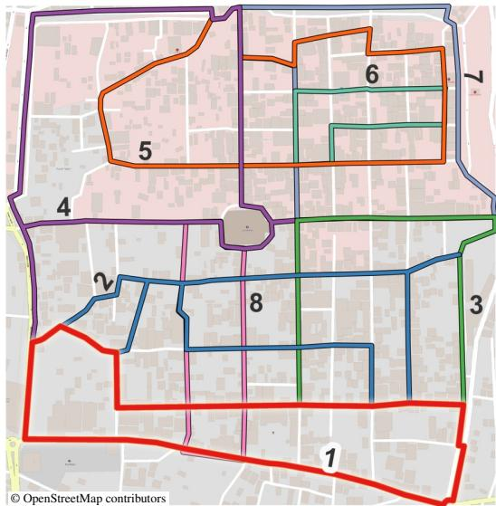  
(a)

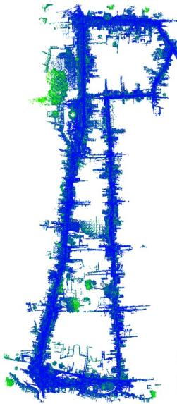  
(b)

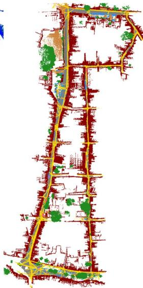  
(c)

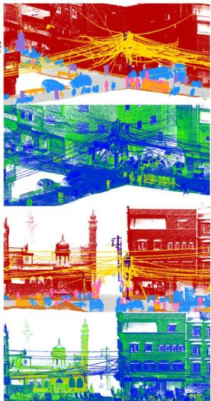  
(d)  
Figure 1. BhopalMLS LiDAR dataset study area and Path 1 visualization. (a) Road network segmentation showing 8 distinct path segments with Path 1 highlighted in red. (b) Top view of Path 1 raw point cloud with intensity. (c) Top view of Path 1 annotated point cloud with semantic classification. (d) Multi-scale zoom instances with raw point cloud intensity and corresponding annotations (12 major classes with color code), demonstrating annotation quality and point density across diverse urban features.

## 3. Dataset Overview

## 3.1. Data Acquisition Setup

Data were collected in the Azad Market region, located within the Peer Gate area of Bhopal, Madhya Pradesh, India. Azad Market is a dense commercial hub with residential and recreational spaces, characterized by narrow streets, mixed building types, heavy pedestrian and vehicular movement, and a complex arrangement of roadside establishments (see Fig. 1 and Fig. S5). The compact urban fabric, irregular geometry, and high levels of activity make it a challenging site for benchmarking 3D scene understanding in dense, unstructured urban environments. A Velodyne VLP-16 LiDAR sensor integrated with a GeoSLAM ZEB Horizon handheld mapping system was employed for data acquisition. Although the sensor has only 16 channels, the GeoSLAM unit mounts it on a continuously rotating head that scans along all three axes, effectively multiplying the angular coverage. Combined with a low acquisition speed (on foot at approximately 3 km/h, and on a slow-moving two-wheeler at comparable speed on longer stretches), this configuration produces dense urban point clouds with a mean point spacing of 4.9 cm. Returns stream continuously and are SLAM-registered into one accumulated cloud, so there are no discrete frames: scenes are 5 m spatial segments and the point count measures surface sampling, not frame overlap. Our scale thus comes from sampling density and class diversity, not spatial extent or instance count. The handheld form factor also enabled flexible data collection through narrow and congested streets inaccessible to vehicle-mounted scanners. A 360° panoramic camera was co-mounted for colorization. GPS multipath in narrow lanes degrades the projection pose, so rather than assign uncertain color we apply a reprojection-consistency check and write per-point RGB only where it agrees with geometry (null elsewhere), giving validated registration for \~40% of points and trading coverage for correctness.

## 3.2. Data Collection and Processing

The study area was systematically divided into eight traversable paths (Path 01 to Path 08) covering both major and minor roads to achieve complete spatial coverage (see Fig. 1). Data were collected over three days between 12:00 p.m. and 3:00 p.m.; the survey spanned a total length of approximately 10 kilometers. Individual paths ranged from 0.66 km to 1.85 km in length (Table S2).

A consistent low speed was maintained to ensure uniform point density and minimize motion artifacts. Overlapping coverage between adjacent paths was planned to reduce occlusions caused by buildings, vehicles, and other obstacles common in dense urban settings.

A DGPS-based survey was conducted to minimize positional errors and obtain accurately georeferenced data. Following acquisition, the raw point clouds were aligned using DGPS timestamps, and noise and artifacts were removed to refine spatial accuracy.

## 3.3. Annotation Process

The dataset was annotated with 62 fine-grained static semantic categories, selected to balance three criteria. Comparability: the 12 major classes match those common to existing MLS benchmarks (Building, Road, Ground, Vegetation, Pole, Vehicle, Fencing), so standard mIoU and cross-dataset transfer apply directly. Region-specific coverage: dedicated classes for objects absent from those benchmarks but pervasive in dense Indian corridors (auto-/cyclerickshaws, hand carts, shop shades, mannequins, wirestructure connectors). Instance support: the distribution is extremely long-tailed (Table S1), with Building and Road alone holding 80.5% of static-class points, while twelve of the 62 classes carry ≤5 instances (six just one) and are merged into their nearest parent rather than kept as standalone categories. A further 6 moving-class subclasses extend the taxonomy to 68 classes (detailed below). The 62 static classes form two taxonomies (Fig. 3): a coarse 12- class setting (main; Fig. 2, Table 2) and a finer 21-class setting (supplementary) that refines only the well-populated categories (Building, Pole & Tower, Vehicle, Road Side Object, Ground; e.g., 2-/3-/4-Wheeler and Hand Cart, each with hundreds of instances) while the sparse tail stays grouped.

The primary benchmark uses the 62 static classes (19,518 instances, 1,205.2M points). An additional 3 categories (unlabeled, High Noise, Low Noise; 5,124 instances) are excluded entirely from benchmarking. The 6 movingclass subclasses (dynamic humans, vehicles, riders, and animals; 7,181 instances, 26.2M points) capture dynamic objects whose LiDAR points form motion-induced tails during scanning (examples in Fig. S2). Because this tail geometry is inconsistent with that of their static counterparts, these subclasses are folded into their static parents (Vehicle, Human & Animal) at evaluation; they are retained as separate fine-grained labels (68-class taxonomy) for use as additional supervision during training and for future work on dynamic-object detection.

## 3.3.1. Annotation Methodology

To manage complexity, each path was divided into smaller segments, with two independent annotators labeling each segment. As a measure of annotation reliability, we computed the point-level inter-annotator disagreement rate between the two annotators for each path; mismatched points were then jointly reviewed and corrected until this rate fell below 0.5% per path. Paths exceeding this threshold were relabeled by a third annotator, and a reviewer manually verified all labeled paths, resolving any remaining discrepancies through discussion with the annotators.

Table 2. BhopalMLS class distribution (12 major classes). The primary benchmark uses 62 static semantic classes (19,518 instances, 1,205.2M points) grouped into the 12 major categories below; 6 moving-class subclasses (7,181 instances, 26.2M points) extend the taxonomy to 68 classes and are folded into their static parents (Vehicle, Human & Animal) at evaluation. Percentages are over all 68 classes (1,231.4M points).ShadedBuilding/Road hold 78.8% of points. The full 62-subclass breakdown is given in Table S1.
<table><tr><td>Major Class</td><td>Inst.</td><td>Pts (M)</td><td>Pts (%)</td></tr><tr><td>Building</td><td>1,326</td><td>813.0</td><td>66.0</td></tr><tr><td>Road</td><td>289</td><td>157.0</td><td>12.8</td></tr><tr><td>Vehicle</td><td>9,888</td><td>77.2</td><td>6.3</td></tr><tr><td>Wire</td><td>522</td><td>39.0</td><td>3.2</td></tr><tr><td>Vegetation (Veg.)</td><td>374</td><td>33.6</td><td>2.7</td></tr><tr><td>Road Side Object (RSO)</td><td>2,294</td><td>30.4</td><td>2.5</td></tr><tr><td>Ground</td><td>968</td><td>29.4</td><td>2.4</td></tr><tr><td>Human &amp; Animal (H&amp;A)</td><td>8,864</td><td>22.5</td><td>1.8</td></tr><tr><td>Pole &amp; Tower (P&amp;T)</td><td>1,096</td><td>11.5</td><td>0.9</td></tr><tr><td>Board</td><td>871</td><td>7.9</td><td>0.6</td></tr><tr><td>Wire-Structure Connector (WSC)</td><td>80</td><td>6.9</td><td>0.6</td></tr><tr><td>Fencing</td><td>127</td><td>3.0</td><td>0.2</td></tr><tr><td>Combined (68 classes)</td><td>26,699</td><td>1,231.4</td><td>100.0</td></tr></table>

A Standard Operating Procedure (SOP) was developed to ensure consistency and quality, as no established guidelines existed for LiDAR annotation of this complexity. Annotators also used 360°RGB images to assist with difficult cases, particularly for distinguishing between similar object types or handling occlusions.

## 3.3.2. Point Cloud Attributes and Data Formats

The dataset is released in LAS, PLY, HDF5, CSV, NPZ and BIN formats. Each point carries georeferenced XYZ (stored as float64), per-point RGB from co-registered 360° panoramas (valid for \~40% of points, zero elsewhere), return intensity, GPS time, a semantic label (62 static classes; 68 including the moving subclasses), and a 9-digit instance identifier encoding path, class hierarchy and instance number. Field-level specifications are given in the supplementary.

## 4. Benchmarks

## 4.1. Data Partitioning

Data from paths 1–4 are used for training, 5–6 for validation, and 7-8 for testing, following an approximate 60/21/19 point ratio (Fig. S6). This path-based partitioning strategy, similar to S3DIS [1] and Waymo [23], ensures that each subset represents different yet comparable urban areas while preserving spatial consistency.

(a) Instance Distribution by Class  
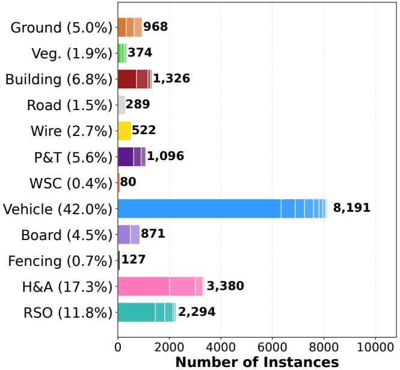

(b) Point Distribution by Class  
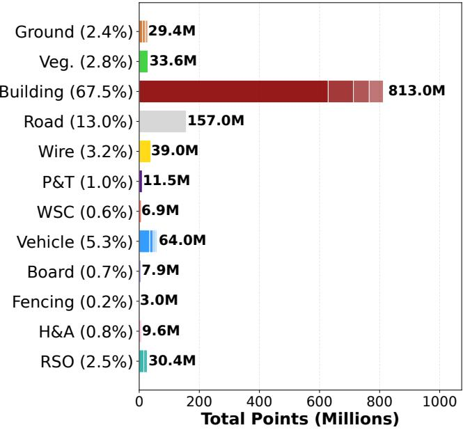  
Figure 2. BhopalMLS class distribution. (a) Instance count: Vehicle (42.0%), Human and Animal (17.3%), and Road Side Object (11.8%) are the most frequent categories. (b) Point count: Building (67.5%) and Road (13.0%) dominate spatial coverage (both panels over the 62 static classes; 66.0% / 12.8% over all 68 classes, Table 2). Stacked segments represent subclass diversity within each major class (major-class totals in Table 2; full 62-subclass breakdown in Table S1). Class abbreviations (P&T, WSC, H&A, RSO, Veg.) are defined in Table 2.

Table 3. Quantitative comparison of BhopalMLS (BM) against four MLS/AD-LiDAR datasets: Ke-MLS (KM) [10], Paris-Lille-3D (PL) [20], Toronto-3D (TR) [24], and SemanticKITTI (SK) [3], under a fair voxel-normalized protocol (5 m×5 m XY tiles, 25 cm voxel). Mann–Whitney $p < 1 0 ^ { - 1 7 0 }$ for every Indian-vs-Western comparison; Cohen's $d \in [ 0 . 4 6 , 2 . 5 9 ] ,$ Tintedcolumns: Indian (BM, KM); bold: Indian > all Western.
<table><tr><td></td><td colspan="2">Indian MLS</td><td colspan="3">Western</td></tr><tr><td>Metric Sensor</td><td>BM (Ours) handheld</td><td>KM vehicle</td><td>PL vehicle vehicle spinning</td><td>TR</td><td>SK</td></tr><tr><td>Region</td><td>ZEB India</td><td>Riegl VQ-450 India</td><td>Velo-32 France</td><td>MLS Canada</td><td>64-ch Germany</td></tr><tr><td colspan="8">Density</td></tr><tr><td>Point spacing (mean, cm)</td><td>4.9</td><td>4.9</td><td>3.8</td><td>9.1</td><td>10.6</td></tr><tr><td>Point density (pts/m²) Voxel density</td><td>2,829 28.9</td><td>1,787 33.3</td><td>1,519 39.9</td><td>466 14.4</td><td>63.6 4.2</td></tr><tr><td colspan="6">(pts/voxel) Heterogeneity (↑)</td></tr><tr><td>Density CoV</td><td>1.15 0.53</td><td>1.33</td><td>0.97</td><td>0.83</td><td>0.58</td></tr><tr><td>Density Gini Density variance</td><td>3,927</td><td>0.55 6,589</td><td>0.47 1,988</td><td>0.37 1,804</td><td>0.29 36.6</td></tr><tr><td colspan="4">Complexity (↑)</td><td></td><td></td></tr><tr><td>Z-height extent (m)</td><td>10.1</td><td>11.6</td><td>8.4</td><td>7.7</td><td>2.2</td></tr><tr><td>Tiles sampled (n)</td><td>29.1k</td><td>55.7k</td><td>3.2k</td><td>4.4k</td><td>74.4k</td></tr></table>

68 annotated = 62 static + 6 moving†
<table><tr><td rowspan=1 colspan=1>TaskGranularity</td><td rowspan=1 colspan=1>Semantic seg.(all classes)</td><td rowspan=1 colspan=1>Instance seg.(thing only)</td></tr><tr><td rowspan=1 colspan=1>12-class</td><td rowspan=1 colspan=1>12 classes</td><td rowspan=1 colspan=1>8 thing</td></tr><tr><td rowspan=1 colspan=1>21-class</td><td rowspan=1 colspan=1>21 classes</td><td rowspan=1 colspan=1>17 thing</td></tr></table>

Figure 3. Taxonomy and tasks. The benchmark comprises 68 annotated classes (= 62 static + 6 moving †). The dataset supports semantic segmentation (all classes) and instance segmentation (thing classes; the 4 stuff classes are excluded from instance grouping), each at 12-class (main) and 21-class (supplementary) granularity; instance results are in supplementary Tables S8-S9. The † variants train jointly on the 6 moving subclasses, folded into their static parents (Vehicle, Human & Animal) at evaluation. The 21-class taxonomy refines Building, Pole & Tower, Vehicle, Road Side Object, and Ground, and merges the rare Wire-Structure Connector into Pole (other).

The dataset follows a long-tailed class distribution: Building (66.0% of points) and Road (12.8%) dominate, while rare classes such as Fencing (0.2%) and Wire-Structure Connector (0.6%) are underrepresented. This imbalance reflects real urban conditions and provides a realistic benchmark. To mitigate class imbalance during training, we apply two strategies: (1) at the data level, the dominant Building class is downsampled by 10% during scene construction, and (2) at the loss level, we use square-root scaled inverse-frequency class weights in the cross-entropy loss combined with a Lovász loss, ensuring that rare classes receive higher gradient contributions without destabilizing training.

## 4.2. Evaluation Metrics

To ensure comparability with established 3D benchmarks, we adopt the mean Intersection-over-Union (mIoU) as our primary evaluation metric, consistent with protocols used in SemanticKITTI [3], S3DIS [1], and SensatUrban [8]. For each class i, $\begin{array} { r } { \mathrm { I o U } _ { i } = c _ { i i } / ( c _ { i i } + \sum _ { j \neq i } c _ { i j } + \sum _ { k \neq i } c _ { k i } ) } \end{array}$ (true positives over the union of predicted and ground-truth points), and the mean IoU is $\begin{array} { r } { \overline { { \mathrm { I o U } } } = \frac { 1 } { N } \sum _ { i = 1 } ^ { N } } \end{array}$ IoUi over the N classes.

We also report Overall Accuracy (OA) and mean class Accuracy (mAcc) for completeness, though OA can overestimate performance on imbalanced datasets [6, 24]. mIoU serves as the primary metric for all comparisons.

## 4.3. Semantic Segmentation Benchmark

Table 4 reports the 12-class semantic segmentation benchmark, from which two findings emerge: per-class accuracy is governed more by geometric distinctiveness than by class frequency, and pretrained foundation models with finetuning surpass supervised baselines trained from scratch.

Per-class, the highest IoU scores are achieved either by abundant classes (Vegetation, Building, Vehicle, Road) or by classes with strong, spatially continuous geometric signatures despite lower frequency (Wire). Notably, Wire-Structure Connector achieves 85.26% IoU despite its rarity (0.6% of points), indicating that distinctive geometric cues can compensate for low frequency. In contrast, Fencing and Ground remain the most challenging classes, as discussed in Section 5.

Among the benchmarked approaches, pretrained foundation models outperform fully supervised baselines: Utonia(L) with fine-tuning (trained jointly with the 6 movingclass subclasses, marked †) achieves the best mIoU of 72.12% under our standard training recipe, with Concerto(L) close behind at 71.06%, both surpassing PTv3 (68.04%) trained from scratch. This indicates that largescale pretraining transfers effectively to these complex urban scenes. However, this recipe is not optimal for every architecture: an ablation (Table S7) shows that removing the Lovász term raises Utonia(L) by 1.92 mIoU while slightly lowering Concerto(L), an architecture-dependent interaction with the loss.

Despite only approximately 40% of points having valid RGB values, switching from geometry-only inputs (3ch/4ch) to 9ch (XYZ + partial RGB + normals) improves performance in 5 of 7 model comparisons (supervised 4ch→9ch and linear-probe 3ch→9ch), with Sonata(L) LP gaining +11.14 mIoU. Even incomplete color therefore provides useful discriminative cues, especially for foundation models pretrained with color.

Comparing pretraining strategies, Concerto(L) (generalpurpose) consistently outperforms Concerto(O) (outdoor) across all adaptation methods (e.g., 71.06% vs 68.10% FT-9ch), indicating that general-purpose pretraining transfers better to MLS data than outdoor-specific pretraining. Utonia(L) also achieves the best mAcc (83.89%), while Concerto(L) FT attains the best per-class IoU on several structural categories (Building 93.71%, Wire 87.91%, and Wire-Structure Connector 85.26%; Table 4). Fine-grained 21- class results, covering India-specific categories such as 3- Wheeler, Hand Cart, Shop Shade, and Mannequin, are reported in Table S6, along with qualitative predictions and instance segmentation results.

## 4.4. Instance Segmentation Benchmark

BhopalMLS provides unique instance IDs for all 19,518 annotated objects, enabling instance segmentation without additional labeling. Following the standard thing/stuff convention, only thing classes (countable objects, e.g. vehicles, poles, humans) are clustered and scored, while the four stuff classes (Ground, Vegetation, Road, Wire) are predicted semantically but excluded from instance grouping; this leaves 8 thing classes in the 12-class setting and 17 in the 21- class setting. Using a PointGroup [9] head with 9ch input on the same test split, fine-tuning again dominates: Utonia(L) FT attains the best 44.07% mAP50 (12-class, 2.9× the best linear probe) and 39.83% mAP50 (21-class), ahead of Sonata(L) and Concerto(L), while supervised PTv3 stays competitive. Thin Fencing and small India-specific objects (Shop Shade, Mannequin) remain the hardest, mirroring the semantic-segmentation trends. Full per-class results and qualitative predictions are reported in supplementary Tables S8–S9 and Figs. S9–S10.

## 5. Analysis and Open Challenges

## 5.1. Boundary-Sensitive Semantic Segmentation

Semantic segmentation of LiDAR point clouds is particularly sensitive to object boundaries where geometric and radiometric cues become indistinct [8]. In dense urban scenes, overhead Wires often overlap with nearby Wire-Structure Connectors, and adjacent Buildings frequently share walls or narrow gaps (see Fig. S5).

While well-represented classes like Vehicle (92.87%) and Road (87.94%) achieve strong IoU even near cluttered boundaries, thin and geometrically ambiguous structures remain challenging. Fencing achieves only 38.79% IoU at best, as its narrow planar geometry is easily confused with nearby walls, Boards, and Buildings (47–65% of Fencing points are predicted as Building; Fig. S13). Similarly, Ground peaks at 27.02% IoU due to gradual elevation transitions that blur boundaries with Road and Vegetation. Fine-scale structural boundaries thus remain open, and this dataset's dense overlap patterns offer a testbed for

Table 4. Semantic segmentation benchmark on the BhopalMLS dataset (12-class). LP = Linear Probe, DP = Decoder Probe, LoRA = Low-Rank Adaptation, FT = Fine-Tuning. 3ch = XYZ; 4ch = XYZ + intensity; 9ch = XYZ + Partial RGB + normals. Sonata(L), Concerto(L) and Utonia(L) = Large (general-purpose pretrained), Concerto(O) = outdoor-pretrained. †=trained jointly with the 6 movingclass subclasses (Moving Vehicle, Moving Humans, Moving Female, Moving Male, Moving Animal, Mobike Rider Moving) as additional fine-grained supervision; folded into their static parents at evaluation. Bold green = overall best per column; underline = best within category; red = overall lowest.
<table><tr><td></td><td rowspan="2">(%) V%O</td><td rowspan="2"></td><td rowspan="2"></td><td rowspan="2"></td><td colspan="8"></td><td rowspan="2"></td><td rowspan="2"></td></tr><tr><td>%) (%) </td><td>Board</td><td>Buiing</td><td>Fencing</td><td>rund</td><td>Humal Polwer</td><td>Road</td><td>Road d b.</td><td>Veetaton</td></tr><tr><td>Model Supervised Learning</td><td>- 4ch (XYZ + intensity)</td><td></td><td></td><td></td><td></td><td></td><td></td><td></td><td></td><td></td><td></td><td>Vehide</td><td>Wire</td><td>Wre rttt-onn</td></tr><tr><td>PTv3 [30]</td><td>92.60</td><td>78.75</td><td>67.88</td><td>57.05</td><td>92.75</td><td>13.87</td><td>22.24 66.09</td><td>69.41</td><td>87.39</td><td>51.03</td><td>97.11</td><td>91.19</td><td>87.74</td><td>78.75</td></tr><tr><td>LitePT-L [33]</td><td>91.13</td><td>80.45</td><td>67.53</td><td>57.19</td><td>91.47</td><td>20.24</td><td>22.10</td><td>63.88 66.69</td><td>85.07</td><td>48.76</td><td>97.18</td><td>88.23</td><td>86.06</td><td></td></tr><tr><td>KpConvX-L [26] 92.00</td><td></td><td>80.10</td><td>66.78</td><td>55.82</td><td>92.31</td><td>20.74</td><td>24.28 60.30</td><td>62.87</td><td>86.20</td><td>49.12</td><td>97.24</td><td>89.40</td><td>86.25</td><td>83.47 76.80</td></tr><tr><td colspan="9">Supervised Learning – 9ch (XYZ + Partial RGB + normals)</td><td></td><td></td><td></td><td></td></tr><tr><td>PTv3</td><td>92.17</td><td>79.57</td><td>68.04</td><td>59.37</td><td>92.42</td><td>18.18</td><td>22.69 62.22</td><td>68.23</td><td>86.65</td><td>49.37</td><td>97.25</td><td>90.78</td><td>86.61</td><td>82.71</td></tr><tr><td>LitePT-L</td><td>91.16</td><td>77.54</td><td>65.18</td><td>48.18</td><td>91.95</td><td>21.39</td><td>24.47 61.46</td><td>62.40</td><td>85.13</td><td>43.10</td><td>96.25</td><td>85.83</td><td>82.22</td><td>79.78</td></tr><tr><td>KpConvX-L</td><td>92.02</td><td>79.14</td><td>66.97</td><td>56.82</td><td>92.43</td><td>20.90 24.70</td><td>62.90</td><td>63.23</td><td>86.69</td><td>47.99</td><td>96.76</td><td>89.30</td><td>86.07</td><td>75.79</td></tr><tr><td colspan="9">Linear Probe (3ch: XYZ)</td><td></td><td>78.43</td><td>63.95</td><td></td><td></td></tr><tr><td>Sonata(L) [31]</td><td>84.38</td><td>62.25</td><td>44.60</td><td>27.93</td><td>84.90</td><td>6.58</td><td>19.28</td><td>28.34</td><td>36.00</td><td>82.94</td><td>29.38</td><td></td><td>57.40</td><td>20.11</td></tr><tr><td>Concerto(O)</td><td>87.32</td><td>69.90</td><td>52.18</td><td>33.74</td><td>88.21</td><td>16.78</td><td>21.92</td><td>35.24 41.76</td><td></td><td>83.92</td><td>34.43 91.80</td><td>72.67</td><td>65.87</td><td>39.85</td></tr><tr><td>Concerto(L) [34] Utonia(L) [35]</td><td>90.64</td><td>77.06</td><td>61.29 63.16</td><td>53.06 55.51</td><td>91.18 91.50</td><td>21.57 21.95</td><td>23.04 48.59 24.70 46.35</td><td>54.92 58.96</td><td>86.49 85.86</td><td>42.87 45.32</td><td>95.45</td><td>81.49</td><td>80.70</td><td>56.07</td></tr><tr><td colspan="9">90.90 77.10</td><td>96.55</td><td>86.45</td><td>81.46</td><td>63.28</td></tr><tr><td>Linear Probe (9ch: XYZ + Partial RGB + normals) Sonata(L)</td><td>88.68</td><td>74.59</td><td>55.74</td><td>41.87 35.69</td><td>89.51</td><td>22.88</td><td>23.13</td><td>37.76 48.10</td><td>85.54</td><td>38.68</td><td>92.75</td><td>74.23</td><td>75.36</td><td>39.04</td></tr><tr><td>Concerto(O)</td><td>88.70</td><td>68.01</td><td>52.41</td><td></td><td>89.54</td><td>15.17</td><td>22.54 36.72</td><td>40.83</td><td>85.58</td><td>34.44</td><td>92.80</td><td>75.11</td><td>70.78</td><td>29.74</td></tr><tr><td>Concerto(O)†</td><td>88.51</td><td>69.39</td><td>54.19</td><td>36.03</td><td>89.40</td><td>15.96</td><td>22.25</td><td>53.69 41.55</td><td>85.79</td><td>35.22</td><td>93.45</td><td>72.43</td><td>71.69</td><td>32.86</td></tr><tr><td>Concerto(L)</td><td>89.81</td><td>78.11</td><td>60.34</td><td>52.32</td><td>90.08</td><td>24.61</td><td>22.56</td><td>45.30 54.24</td><td>86.33</td><td>41.91</td><td>95.39</td><td>81.00</td><td>78.66</td><td>51.67</td></tr><tr><td>Utonia(L)</td><td>91.32</td><td>79.55</td><td>64.18 65.74</td><td>56.74 56.04</td><td>91.72 91.51</td><td>34.49 37.63</td><td>25.02 47.40 25.00</td><td>58.64 62.95 58.95</td><td>87.43 87.42</td><td>44.77 43.57</td><td>96.76 96.61</td><td>86.25</td><td>81.47</td><td>59.44</td></tr><tr><td colspan="9">Utonia(L)† 91.14 80.04</td><td></td><td></td><td>84.05</td><td>81.73</td><td>63.40</td></tr><tr><td>Decoder Probe (9ch: XYZ + Partial RGB + normals)</td><td></td><td>79.05</td><td>67.52</td><td>61.80</td><td>92.79</td><td>19.81</td><td>25.04</td><td>60.16</td><td>64.19</td><td>86.80</td><td>49.82 96.91</td><td>89.32</td><td></td><td></td></tr><tr><td>Sonata(L)</td><td>92.31 91.47</td><td>76.31</td><td>63.37</td><td>54.85</td><td>92.10</td><td>9.32</td><td>23.87</td><td>55.94 58.94</td><td>86.15</td><td>47.24</td><td>96.28</td><td>87.85</td><td>85.31 82.44</td><td>78.27 65.53</td></tr><tr><td>Concerto(O)</td><td>91.83</td><td>74.46</td><td>64.19</td><td>51.18</td><td>92.31</td><td>13.32</td><td>23.03</td><td>73.24 58.69</td><td></td><td>86.50</td><td>45.56 95.84</td><td>87.83</td><td>82.89</td><td>59.86</td></tr><tr><td>Concerto(O)† Concerto(L)</td><td>92.23</td><td>78.74</td><td>67.05</td><td>61.75</td><td>92.64</td><td>11.33</td><td>24.25</td><td>62.20 66.03</td><td>86.81</td><td>48.32</td><td>97.21</td><td>89.78</td><td>85.02</td><td>79.25</td></tr><tr><td>Utonia(L)</td><td>91.89</td><td>79.53</td><td>67.03</td><td>58.76</td><td>92.48</td><td>21.41</td><td>25.74</td><td>65.76 60.52</td><td>85.84</td><td>47.72</td><td>97.17</td><td>91.35</td><td>84.50</td><td>73.10</td></tr><tr><td>Utonia(L)†</td><td>92.84</td><td>77.11</td><td>68.22</td><td>56.46</td><td>93.18</td><td>10.56</td><td>26.25</td><td>79.63</td><td>65.16</td><td>87.21</td><td>47.41 97.48</td><td>90.91</td><td>87.12</td><td>77.29</td></tr><tr><td colspan="9">LoRA (9ch: XYZ + Partial RGB + normals)</td><td>86.37</td><td>44.18</td><td>95.68</td><td>84.65</td><td>81.48</td><td></td></tr><tr><td>Sonata(L) Concerto(O)</td><td>90.76</td><td>79.48</td><td>64.07 65.29</td><td>56.20 57.71</td><td>91.16 91.97</td><td>24.44 26.00</td><td>24.65 25.08</td><td>47.86 49.50</td><td>58.65 59.79</td><td>85.24</td><td></td><td></td><td></td><td>73.51</td></tr><tr><td>Concerto(L)</td><td>91.27</td><td>80.07</td><td>66.57</td><td>59.99</td><td>92.01</td><td>26.42</td><td>24.85</td><td>54.16</td><td></td><td></td><td>48.78</td><td>96.87 87.64</td><td>87.54 81.42 83.36</td><td>73.57 76.91</td></tr><tr><td>Utonia(L)</td><td>91.69 92.60</td><td>80.64 81.76</td><td>69.77</td><td>63.84</td><td>92.76</td><td>38.12</td><td>27.02 59.85</td><td>61.98 66.77</td><td>87.09 87.94</td><td>47.63 48.33</td><td>96.78 97.82</td></table>

Table 5. Cross-region generalization of Utonia(L) and Concerto(L) (FT-9ch, native resolution). nc = number of classes shared by the BM-12 taxonomy and the target dataset. Ke-MLS (KM) provides no RGB, so KM rows are geometry-only (9ch with zero RGB). Per-class IoU, and Concerto(O) on the SK pairs and BM→PL, are in Table S10.Green rows: BM-source (BM→target).Red rows: target-source (target→BM). Bold: the higher mIoU of each BM↔target pair.
<table><tr><td rowspan=2 colspan=3>Category</td><td rowspan=1 colspan=1>Source →</td><td rowspan=2 colspan=1>nc</td><td rowspan=2 colspan=1>Utonia(L)mAccmIoU</td><td rowspan=2 colspan=1>Concerto(L)mAccmIoU</td></tr><tr><td rowspan=1 colspan=1>Target</td></tr><tr><td rowspan=4 colspan=3>Within-domain</td><td rowspan=1 colspan=1>BM → BM</td><td rowspan=1 colspan=1>12</td><td rowspan=1 colspan=1>83.89 71.28</td><td rowspan=1 colspan=1>80.44 71.06</td></tr><tr><td rowspan=3 colspan=1>KM → KMTR → TRPL → PLSK → SK</td><td rowspan=1 colspan=1>12</td><td rowspan=1 colspan=1>77.05 66.66</td><td rowspan=1 colspan=1>74.79 67.58</td></tr><tr><td rowspan=2 colspan=1>7119</td><td rowspan=1 colspan=1>93.25 88.38</td><td rowspan=1 colspan=1>93.25 86.96</td></tr><tr><td rowspan=1 colspan=1>92.11 84.7784.86 77.14</td><td rowspan=1 colspan=1>92.03 83.4383.67 75.09</td></tr><tr><td rowspan=1 colspan=3>Intra-</td><td rowspan=1 colspan=1>BM → KM</td><td rowspan=1 colspan=1>12</td><td rowspan=1 colspan=1>74.9456.78</td><td rowspan=1 colspan=1>66.4349.23</td></tr><tr><td rowspan=1 colspan=2>Indian</td><td rowspan=1 colspan=1>n</td><td rowspan=1 colspan=1>KM → BM</td><td rowspan=1 colspan=1>12</td><td rowspan=1 colspan=1>53.9033.96</td><td rowspan=1 colspan=1>51.29 32.70</td></tr><tr><td rowspan=2 colspan=3></td><td rowspan=1 colspan=1>BM → TR</td><td rowspan=1 colspan=1>7</td><td rowspan=1 colspan=1>90.3677.27</td><td rowspan=1 colspan=1>84.6775.20</td></tr><tr><td rowspan=1 colspan=1>TR → BM</td><td rowspan=1 colspan=1>7</td><td rowspan=1 colspan=1>60.6651.65</td><td rowspan=1 colspan=1>49.52 39.11</td></tr><tr><td rowspan=1 colspan=3>Inter-</td><td rowspan=1 colspan=1>BM → PL</td><td rowspan=1 colspan=1>11</td><td rowspan=1 colspan=1>76.9555.68</td><td rowspan=1 colspan=1>67.5548.84</td></tr><tr><td rowspan=1 colspan=3>region</td><td rowspan=1 colspan=1>PL → BM</td><td rowspan=1 colspan=1>11</td><td rowspan=1 colspan=1>40.42 27.06</td><td rowspan=1 colspan=1>45.8531.07</td></tr><tr><td rowspan=1 colspan=3></td><td rowspan=1 colspan=1>BM → SK</td><td rowspan=1 colspan=1>9</td><td rowspan=1 colspan=1>57.8840.05</td><td rowspan=1 colspan=1>47.2332.07</td></tr><tr><td rowspan=1 colspan=3></td><td rowspan=1 colspan=1>SK → BM</td><td rowspan=1 colspan=1>9</td><td rowspan=1 colspan=1>55.2835.54</td><td rowspan=1 colspan=1>27.89 12.29</td></tr></table>

boundary-aware architectures.

## 5.2. Asymmetric Cross-Region Transferability

Models trained on BhopalMLS transfer to structured benchmarks substantially better than the reverse. To quantify it, we fine-tune Utonia(L) [35] and Concerto(L) [34] under FT-9ch and evaluate transfer between BhopalMLS and the four datasets of Table 5 at native resolution.

The most severe drop is on SK↔BM, which differs most in acquisition (SK: vehicle spinning 64-beam, 10.6 cm spacing vs. 4.9 cm): both Concerto variants fall from above 74% mIoU on their own domain to 12.3% and 3.9% on BhopalMLS, with safety-critical classes near zero (Table S10). Because this single pair conflates sensor, fieldof-view, and density, we do not rest the asymmetry claim on it.

Conversely, BhopalMLS-trained models transfer out well: the BM-source direction wins on all four BM↔target pairs for both architectures (+4.5 to +36.1 mIoU). This resists both confounds: it holds intra-Indian against a different sensor (KM uses a vehicle Riegl VQ-450), ruling out the ZEB pattern; and for BM↔PL, where Paris-Lille-3D is denser than BhopalMLS (3.8 vs. 4.9 cm, Table 3), BMsource still wins by +28.6/+17.8 mIoU, the opposite of what density-driven degradation predicts. A uniform asymmetry across targets differing in sensor, density and region therefore indicates complementary scene geometry, not an acquisition artifact. A post-hoc CORAL [22] domainadaptation baseline (Table S14) reinforces this: closed-form second-order feature alignment fails to close the BM↔PL gap and even degrades transfer, indicating the gap is structural rather than a global covariance shift.

What drives the asymmetry. We retrain Utonia(L) on four subsets of the training split that share an identical labelled-point budget and each destroy one candidate factor: a random subsample (size), every class collapsed to its dominant fine subclass (variety), only regular corridors retained (geometry), and that same collapse with Vehicle keeping Car instead of the dominant two-wheeler (subtype). Against the size control, mean BM→X falls 13.0 mIoU points under variety and is unchanged under geometry; changing only which subtype survives then recovers +7.5 of that deficit and restores Vehicle IoU from 4–14% to 70–95%. The advantage is therefore one of coverage: BhopalMLS's 15 vehicle subtypes contain the car these benchmarks are built from, alongside the auto-rickshaws and hand-carts they lack. Repeating all four arms for Concerto(L) reproduces both the ranking and this coverage signature, and both contrasts hold on SemanticKITTI too. Protocol, per-arm results and controls are in Sec. S10.

## 6. Conclusion

BhopalMLS is a 1.2-billion-point MLS dataset of a dense, unstructured Indian urban environment. Pretrained foundation models outperform fully supervised baselines, and a cross-region study exposes a consistent asymmetric transferability: transfer from BhopalMLS beats the reverse on every pair, holding even where the target is denser. Controlled retraining attributes this to the coverage of BhopalMLS's fine-grained subtype inventory rather than to scale, so models trained solely on conventional benchmarks miss safety-critical features in dense, unstructured scenes. BhopalMLS provides a testbed for more geographically diverse 3D perception.

Data, Code, and Access. Data, protocols, splits, code and configs are on the project page given in the abstract. The cloud is open in India under the National Geospatial Policy; researchers abroad obtain a derivative withholding only the absolute geographic offset; metrics are unaffected (supp.).

Acknowledgements. We thank our annotators, Arjun, Meena and Kavita Meena. We also thank Rownak Tiwari for contributions to an early draft of this work. This work is funded by iHub-Data, IIIT Hyderabad (P. No. IIIT-H/IHub/Project/Data Foundation [2024-25|DF-001) and IISER Bhopal. The work is also supported by Madhya Pradesh State Electronics Development Corporation Ltd. (MPSeDC), Department of Science and Technology (DST), Government of Madhya Pradesh (P. No. F 6-1/2022/41-2).

## References

[1] Iro Armeni, Ozan Sener, Amir R Zamir, Helen Jiang, Ioannis Brilakis, Martin Fischer, and Silvio Savarese. 3D semantic parsing of large-scale indoor spaces. In Proceedings of the IEEE Conference on Computer Vision and Pattern Recognition (CVPR), pages 1534–1543, 2016. 4, 6

[2] Michael Batty and Richard Milton. A new framework for very large-scale urban modelling. Urban Studies, 58(15): 3071–3094, 2021. 1

[3] Jens Behley, Martin Garbade, Andres Milioto, Jan Quenzel, Sven Behnke, Cyrill Stachniss, and Jurgen Gall. SemanticKITTI: A dataset for semantic scene understanding of LiDAR sequences. In Proceedings of the IEEE/CVF International Conference on Computer Vision (ICCV), pages 9297– 9307, 2019.1, 2, 5, 6, 27, 32, 35, 36

[4] Holger Caesar, Varun Bankiti, Alex H Lang, Sourabh Vora, Venice Erin Liong, Qiang Xu, Anush Krishnan, Yu Pan, Giancarlo Baldan, and Oscar Beijbom. nuScenes: A multimodal dataset for autonomous driving. In Proceedings of the IEEE/CVF Conference on Computer Vision and Pattern Recognition (CVPR), pages 11621–11631, 2020. 1, 35, 36

[5] Junyi Gu, Mauro Bellone, Tomáš Pivoňka, and Raivo Sell. CLFT: Camera-LiDAR fusion transformer for semantic segmentation in autonomous driving. IEEE Transactions on Intelligent Vehicles, 2024. 1

[6] Timo Hackel, Nikolay Savinov, Lubor Ladicky, Jan D Wegner, Konrad Schindler, and Marc Pollefeys. Semantic3D.net: A new large-scale point cloud classification benchmark. IS-PRS Annals of the Photogrammetry, Remote Sensing and Spatial Information Sciences, IV-1/W1:91–98, 2017. 1, 2, 6

[7] Xu Han, Chong Liu, Yuzhou Zhou, Kai Tan, Zhen Dong, and Bisheng Yang. WHU-Urban3D: An urban scene LiDAR point cloud dataset for semantic instance segmentation. IS-PRS Journal of Photogrammetry and Remote Sensing, 209: 500–513, 2024. 2

[8] Qingyong Hu, Bo Yang, Sheikh Khalid, Wen Xiao, Niki Trigoni, and Andrew Markham. Towards semantic segmentation of urban-scale 3D point clouds: A dataset, benchmarks and challenges. In Proceedings of the IEEE/CVF Conference on Computer Vision and Pattern Recognition (CVPR), pages 4977–4987, 2021. 6

[9] Li Jiang, Hengshuang Zhao, Shaoshuai Shi, Shu Liu, Chi-Wing Fu, and Jiaya Jia. PointGroup: Dual-set point grouping for 3D instance segmentation. In Proceedings of the IEEE/CVF Conference on Computer Vision and Pattern Recognition (CVPR), pages 4867–4876, 2020. 6, 23

[10] Vaibhav Kumar, Bharat Lohani, Pyare Lal, Aakash Singh Bais, and Aditya Aditya. Ke-MLS: A large-scale labeled mobile Lidar data set from Indian urban region. Environment and Planning B: Urban Analytics and City Science, 53 (8):1897–1905, 2026. 2, 5, 27, 32

[11] Xin Lai, Jianhui Liu, Li Jiang, Liwei Wang, Hengshuang Zhao, Shu Liu, Xiaojuan Qi, and Jiaya Jia. Stratified transformer for 3D point cloud segmentation. In Proceedings of the IEEE/CVF Conference on Computer Vision and Pattern Recognition (CVPR), pages 8500–8509, 2022. 2

[12] Xinke Li, Chongshou Li, Zekun Tong, Andrew Lim, Junsong Yuan, Yuwei Wu, Jing Tang, and Raymond Huang. Campus3D: A photogrammetry point cloud benchmark for hierarchical understanding of outdoor scene. In Proceedings of the 28th ACM International Conference on Multimedia (MM), pages 238–246, 2020. 2

[13] Yangyan Li, Rui Bu, Mingchao Sun, Wei Wu, Xinhan Di, and Baoquan Chen. PointCNN: Convolution on Xtransformed points. Advances in Neural Information Processing Systems, 31, 2018. 2

[14] Yiyi Liao, Jun Xie, and Andreas Geiger. KITTI-360: A novel dataset and benchmarks for urban scene understanding in 2D and 3D. IEEE Transactions on Pattern Analysis and Machine Intelligence, 45(3):3292–3310, 2023. 1, 2, 35, 36

[15] Adam Lilja, Junsheng Fu, Erik Stenborg, and Lars Hammarstrand. Localization is all you evaluate: Data leakage in online mapping datasets and how to fix it. In Proceedings of the IEEE/CVF Conference on Computer Vision and Pattern Recognition (CVPR), pages 22150–22159, 2024. 18

[16] Silvia Mazzetto. A review of urban digital twins integration, challenges, and future directions in smart city development Sustainability, 16(19):8337, 2024. 1

[17] Daniel Munoz, J Andrew Bagnell, Nicolas Vandapel, and Martial Hebert. Contextual classification with functional max-margin Markov networks. In Proceedings of the IEEE Conference on Computer Vision and Pattern Recognition (CVPR), pages 975–982, 2009. 2

[18] Charles R Qi, Hao Su, Kaichun Mo, and Leonidas J Guibas. PointNet: Deep learning on point sets for 3D classification and segmentation. In Proceedings of the IEEE Conference on Computer Vision and Pattern Recognition (CVPR), pages 652–660, 2017. 2

[19] Charles Ruizhongtai Qi, Li Yi, Hao Su, and Leonidas J Guibas. PointNet++: Deep hierarchical feature learning on point sets in a metric space. Advances in Neural Information Processing Systems, 30, 2017. 2

[20] Xavier Roynard, Jean-Emmanuel Deschaud, and François Goulette. Paris-Lille-3D: A large and high-quality groundtruth urban point cloud dataset for automatic segmentation and classification. The International Journal of Robotics Research, 37(6):545–557, 2018. 2, 5, 27, 32

[21] Andrés Serna, Beatriz Marcotegui, François Goulette, and Jean-Emmanuel Deschaud. Paris-rue-Madame database: A 3D mobile laser scanner dataset for benchmarking urban detection, segmentation and classification methods. In Proceedings of the 3rd International Conference on Pattern Recognition Applications and Methods (ICPRAM), pages 819–824, 2014. 2

[22] Baochen Sun, Jiashi Feng, and Kate Saenko. Return of frustratingly easy domain adaptation. In Proceedings of the AAAI Conference on Artificial Intelligence (AAAI), 2016. 8, 35

[23] Pei Sun, Henrik Kretzschmar, Xerxes Dotiwalla, Aurelien Chouard, Vijaysai Patnaik, Paul Tsui, James Guo, et al. Scalability in perception for autonomous driving: Waymo open dataset. In Proceedings of the IEEE/CVF Conference on Computer Vision and Pattern Recognition (CVPR), pages 2446–2454, 2020. 4

[24] Weikai Tan, Nannan Qin, Lingfei Ma, Ying Li, Jing Du, Guorong Cai, Ke Yang, and Jonathan Li. Toronto-3D: A large-scale mobile LiDAR dataset for semantic segmentation of urban roadways. In Proceedings of the IEEE/CVF Conference on Computer Vision and Pattern Recognition Workshops (CVPRW), pages 797–806, 2020. 1, 2, 5, 6, 27, 32

[25] Hugues Thomas, Charles R Qi, Jean-Emmanuel Deschaud, Beatriz Marcotegui, François Goulette, and Leonidas J Guibas. KPConv: Flexible and deformable convolution for point clouds. In Proceedings of the IEEE/CVF International Conference on Computer Vision (ICCV), pages 6411–6420, 2019.2

[26] Hugues Thomas, Yao-Hung Hubert Tsai, Timothy D Barfoot, and Jian Zhang. KPConvX: Modernizing kernel point convolution with kernel attention. In Proceedings of the IEEE/CVF Conference on Computer Vision and Pattern Recognition (CVPR), pages 5525–5535, 2024. 2, 7, 22

[27] Nina Varney, Vijayan K Asari, and Quinn Graehling, DALES: A large-scale aerial LiDAR data set for semantic segmentation. In Proceedings of the IEEE/CVF Conference on Computer Vision and Pattern Recognition Workshops (CVPRW), pages 717–726, 2020. 2

[28] Yue Wang, Yongbin Sun, Ziwei Liu, Sanjay E Sarma, Michael M Bronstein, and Justin M Solomon. Dynamic graph CNN for learning on point clouds. ACM Transactions on Graphics, 38(5):1–12, 2019. 2

[29] Xiaoyang Wu, Yixing Lao, Li Jiang, Xihui Liu, and Hengshuang Zhao. Point Transformer V2: Grouped vector attention and partition-based pooling. Advances in Neural Information Processing Systems, 35:33330–33342, 2022. 2

[30] Xiaoyang Wu, Li Jiang, Peng-Shuai Wang, Zhijian Liu, Xihui Liu, Yu Qiao, Wanli Ouyang, Tong He, and Hengshuang Zhao. Point Transformer V3: Simpler faster stronger. In Proceedings of the IEEE/CVF Conference on Computer Vision and Pattern Recognition (CVPR), pages 4840–4851, 2024. 2, 7, 22, 23, 25, 26

[31] Xiaoyang Wu, Daniel DeTone, Duncan Frost, Tianwei Shen, Chris Xie, Nan Yang, Jakob Engel, Richard Newcombe, Hengshuang Zhao, and Julian Straub. Sonata: Selfsupervised learning of reliable point representations. In Proceedings of the IEEE/CVF Conference on Computer Vision and Pattern Recognition (CVPR), pages 22193–22204, 2025. 2, 7, 22, 23, 25, 26

[32] Zhen Ye, Yusheng Xu, Rong Huang, Xiaohua Tong, Xin Li, Xiangfeng Liu, Kuifeng Luan, Ludwig Hoegner, and Uwe Stilla. LASDU: A large-scale aerial LiDAR dataset for semantic labeling in dense urban areas. ISPRS International Journal of Geo-Information, 9(7):450, 2020. 2

[33] Yuanwen Yue, Damien Robert, Jianyuan Wang, Sunghwan Hong, Jan Dirk Wegner, Christian Rupprecht, and Konrad Schindler. LitePT: Lighter yet stronger point transformer. In Proceedings of the IEEE/CVF Conference on Computer Vision and Pattern Recognition (CVPR), pages 24173–24184, 2026. 2, 7, 22, 23, 25, 26

[34] Yujia Zhang, Xiaoyang Wu, Yixing Lao, Chengyao Wang, Zhuotao Tian, Naiyan Wang, and Hengshuang Zhao. Concerto: Joint 2D-3D self-supervised learning emerges spatial

representations. Advances in Neural Information Processing Systems, 38:77509–77533, 2025. 2, 7, 8, 20, 22, 23, 25, 26, 27

[35] Yujia Zhang, Xiaoyang Wu, Yunhan Yang, Xianzhe Fan, Han Li, Yuechen Zhang, Zehao Huang, Naiyan Wang, and Hengshuang Zhao. Utonia: Toward one encoder for all point clouds. In Proceedings of the International Conference on Machine Learning (ICML), 2026. 3, 7, 8, 20, 22, 23, 25, 26, 27

[36] Jingwei Zhu, Joachim Gehrung, Rong Huang, Björn Borgmann, Zhenghao Sun, Ludwig Hoegner, Marcus Hebel, Yusheng Xu, and Uwe Stilla. TUM-MLS-2016: An annotated mobile LiDAR dataset of the TUM city campus for semantic point cloud interpretation in urban areas. Remote Sensing, 12(11):1875, 2020. 2

# Supplementary Material

This supplementary material is organised in four parts. The dataset (§S1-§S4): visual characterization of the 62 semantic classes, class and split statistics, survey-path diversity, the per-point data format, annotation consistency measured across repeated survey passes, and a quantitative analysis of spatial overlap between the benchmark splits. The benchmark (§S5-§S8): extended fine-grained (21-class) semantic segmentation results, a class-imbalance ablation, instance segmentation baselines with qualitative visualizations, and foundation-model feature visualizations, prediction error maps and confusion-matrix analysis. Cross-region transfer (§S9–§S11): per-class breakdowns behind Table 5, a factor-attribution study that identifies what drives the asymmetric transferability, and a posthoc CORAL domain-adaptation analysis. Ethics (§S12): the collection context, consent and institutional review, and the privacy and release protocol.

## S1. Dataset Visualizations and Statistics

This section provides a visual characterization of the BhopalMLS dataset: the acquisition setup, class-wise point cloud and RGB samples, annotation examples, and the full class and train/validation/test split distribution statistics.

## S1.1. Acquisition Setup

BhopalMLS was captured with a handheld GeoSLAM ZEB Horizon LiDAR scanner (a Velodyne VLP-16 mounted on a continuously rotating head), with a 360° panoramic camera co-mounted for colorization. Figure S1 shows (a) the scanner schematic and (b) the system in use along a dense Bhopal corridor. The handheld form factor enables coverage of narrow, congested streets that are inaccessible to vehicle-mounted platforms.

## S1.2. Class-wise Point Cloud Samples

Figure S2 presents intensity-encoded point cloud samples for all 62 semantic categories, together with two movingclass examples (Moving Humans and Mobike Rider Moving) that show the motion-induced point tails of dynamic objects. These samples illustrate the geometric diversity, scale variation, and structural complexity present across the dataset. Classes that are visually ambiguous or difficult to distinguish in isolation are grouped under broader general categories (e.g., general Building, general Board, general Vehicle) for clarity.

## S1.3. Class-wise RGB Samples

Figure S3 provides the corresponding RGB images for all 62 semantic classes and the two moving-class examples (Moving Humans and Mobike Rider Moving), complementing the LiDAR point cloud views in Fig. S2. These samples demonstrate appearance-level variations across urban, roadside, vegetation, and object-level categories, offering visual context to the LiDAR-only views.

## S1.4. LiDAR Annotation Examples

Figure S4 presents BhopalMLS LiDAR annotation examples that illustrate the spatial richness and annotation density of the survey area. Panel (a) shows multiple views of annotated scenes to highlight the complexity of dense urban environments, occlusions, and fine-grained object boundaries. Panel (b) presents an overview of a larger portion of the study region with annotations rendered excluding buildings, enabling clearer visualization of smaller structures, linear objects, road furniture, and other subtle features.

Figure S5 further pairs annotated point clouds with their corresponding 360° RGB imagery, illustrating varied architectural styles and dense urban features (RGB views are approximate, not exact point-cloud perspectives).

## S1.5. Dataset Statistics

Table S1 gives the complete 62-subclass breakdown summarized by the 12 major classes in Table 2, including the 6 moving-class subclasses (marked †, shadedlight red). Figure S6 shows the class-wise train/validation/test split distribution (Sec. 4.1).

## S1.6. Survey Path Characteristics and Diversity

The eight survey paths are separate passes over the district's road network, not repeated traversals of one route. Table S2 summarizes their geometry and composition: lengths range from 657 to 1,846 m, mean carriageway widths from 2.6 to 3.5 m, cumulative turn rates from 46 to 83° per 100 m, and building point shares from 57.5% to 74.3%. The validation paths (5 and 6) traverse the narrowest, most buildingenclosed lanes of the old market core (widths 2.6–2.7 m building share above 72%), whereas the training and test paths cover wider mixed corridors with up to 6.5% vegetation. Figure S7 shows the spatial layout of all paths with their split assignment, including where test paths pass near training coverage. That overlap is quantified, and its effect on the benchmark measured, in §S4.

## S2. Per-Point Data Format

The dataset is provided in multiple formats: LAS for GIS compatibility, PLY for 3D visualization, HDF5 for deep learning with optimized batched loading, and CSV, NPZ, BIN for general-purpose access. Each point includes the following attributes:

Primary benchmark (62 static classes): 19,518 instances, 1,205.2M points

Table S1. BhopalMLS full semantic class distribution. The primary benchmark uses 62 static semantic classes (19,518 instances, 1,205.2M points) in 12 major categories. 6 moving-class subclasses (marked †, shadedlight red; 7,181 instances, 26.2M points) extend the taxonomy to 68 classes; at evaluation they fold into their static parents (Vehicle, Human & Animal). Subclasses are sorted by point contribution within each major class
<table><tr><td colspan="5">Major Classes (Part 1)</td><td colspan="4">Major Classes (Part 2)</td></tr><tr><td>Major Class</td><td>Subclass</td><td>Inst. Pts(M) Pts(%) Major Class</td><td></td><td></td><td></td><td>Subclass</td><td>Inst. Pts(M) Pts(%)</td><td></td></tr><tr><td>Building</td><td>Total</td><td>1,326</td><td>813.0</td><td>66.0 Human &amp; Animal</td><td>Total</td><td></td><td>8,864 22.5</td><td>1.8</td></tr><tr><td></td><td>Commercial -Residential</td><td>724</td><td>628.8</td><td>51.1</td><td>– Moving Humans †</td><td>5,386</td><td>12.6</td><td>1.0</td></tr><tr><td></td><td></td><td>106</td><td>84.0</td><td>6.8 4.3</td><td>- Human &amp; Animal</td><td>2,005</td><td>4.9</td><td>0.4</td></tr><tr><td></td><td>Building (gen.)</td><td>439</td><td>52.6</td><td></td><td>- Male</td><td>996</td><td>3.2</td><td>0.3</td></tr><tr><td></td><td>Special</td><td>56</td><td>47.2</td><td>3.8 0.0</td><td>- Female</td><td>294</td><td>1.1</td><td>0.1</td></tr><tr><td></td><td>– Industrial</td><td>1</td><td>0.5</td><td></td><td>-Cow</td><td>32</td><td>0.2</td><td>0.0</td></tr><tr><td rowspan="9">Road</td><td></td><td></td><td></td><td></td><td>- Moving Female†</td><td>40</td><td>0.2</td><td>0.0</td></tr><tr><td></td><td></td><td></td><td></td><td>- Moving Male†</td><td>57</td><td>0.2</td><td>0.0</td></tr><tr><td></td><td></td><td></td><td></td><td>Child</td><td>49</td><td>0.1</td><td>0.0</td></tr><tr><td></td><td></td><td></td><td></td><td>Animal</td><td>1</td><td>0.0</td><td>0.0</td></tr><tr><td></td><td></td><td></td><td></td><td>- Moving Animal†</td><td>1</td><td>0.0</td><td>0.0</td></tr><tr><td>Single</td><td>289</td><td>157.0</td><td>12.8 Pole &amp; Tower</td><td>-Dog</td><td>3</td><td>0.0</td><td>0.0</td></tr><tr><td></td><td></td><td></td><td></td><td>Total</td><td>1,096</td><td>11.5</td><td>0.9</td></tr><tr><td></td><td></td><td></td><td></td><td>-Electric Pole -Pole &amp; Tower</td><td>615 178</td><td>10.3</td><td>0.8</td></tr><tr><td></td><td></td><td></td><td></td><td>- Street Light</td><td>289</td><td>0.6 0.4</td><td>0.0 0.0</td></tr><tr><td rowspan="10">Vehicle</td><td></td><td></td><td></td><td></td><td>- Mobile Tower</td><td>14</td><td>0.2</td><td>0.0</td></tr><tr><td></td><td>9,888</td><td>77.2</td><td>6.3 Board</td><td>Total</td><td></td><td></td><td></td></tr><tr><td>Total</td><td>6,335</td><td>35.0</td><td>2.8</td><td>- Advt Board</td><td>871 484</td><td>7.9</td><td>0.6</td></tr><tr><td>- Mobike (Two-Wheeler)</td><td>544</td><td>11.5 0.9</td><td></td><td>- Board (gen.)</td><td>370</td><td>5.4 2.4</td><td>0.4</td></tr><tr><td>Car - Mobike Rider Moving† 1,544</td><td></td><td>10.7</td><td>0.9</td><td>-Sign Board</td><td>17</td><td></td><td>0.2</td></tr><tr><td></td><td>347</td><td>4.2</td><td>0.3Vehicle (cont.)</td><td></td><td>14</td><td>0.1</td><td>0.0</td></tr><tr><td>- Hand Cart</td><td>214</td><td>4.0</td><td>0.3</td><td>- Dynamic Car</td><td></td><td>0.3</td><td>0.0</td></tr><tr><td>-Tuktuk (Three-Wheeler)</td><td>366</td><td>3.6</td><td>0.3</td><td>- Rickshaw</td><td>15</td><td>0.3</td><td>0.0</td></tr><tr><td>-Mobike Rider</td><td>153</td><td>2.6</td><td>0.2</td><td>-Rider on Vehicle</td><td>16</td><td>0.3</td><td>0.0</td></tr><tr><td>- Moving Vehicle†</td><td>151</td><td>1.7 0.1</td><td></td><td>-Cycle</td><td>102</td><td>0.2</td><td>0.0</td></tr><tr><td></td><td>Vehicle (gen.)</td><td>31</td><td>1.4 0.1</td><td></td><td>Dynamic Truck</td><td>1 9</td><td>0.1</td><td>0.0</td></tr><tr><td></td><td>- Truck - Dynamic Tuktuk</td><td>44</td><td>1.2 0.1</td><td></td><td>- Cycle Rider -E-Rickshaw</td><td>2</td><td>0.1 0.0</td><td>0.0</td></tr><tr><td>Wire</td><td>Single</td><td>522 39.0</td><td></td><td>3.2 Wire-Structure Conn. Single</td><td></td><td>80</td><td></td><td>0.0</td></tr><tr><td>Vegetation</td><td>Total</td><td>374</td><td>33.6</td><td>2.7 Fencing</td><td>Total</td><td>127</td><td>6.9 3.0</td><td>0.6</td></tr><tr><td></td><td>-High Vegetation</td><td>120</td><td>29.1</td><td>2.4</td><td>- Masonry Wall</td><td>18</td><td>1.1</td><td>0.2 0.1</td></tr><tr><td></td><td>Vegetation (gen.)</td><td>91</td><td>2.1</td><td>0.2</td><td>- Fencing (gen.)</td><td>84</td><td>1.1</td><td>0.1</td></tr><tr><td></td><td>- Medium Vegetation</td><td>36 127</td><td>1.6</td><td>0.1</td><td>-Gate of Boundary</td><td>21</td><td>0.7</td><td>0.1</td></tr><tr><td>- Low Vegetation</td><td></td><td>0.8</td><td>0.1</td><td></td><td>- Wired Boundary Fencing</td><td>3</td><td>0.0</td><td>0.0</td></tr><tr><td></td><td></td><td></td><td></td><td></td><td>- Road Fencing</td><td>1</td><td>0.0</td><td>0.0</td></tr><tr><td colspan="2">Road Side Object Total Shop Shade</td><td>2,294 315</td><td>30.4</td><td>2.5 Ground</td><td>Total</td><td>968</td><td>29.4</td><td>2.4</td></tr><tr><td colspan="2"></td><td></td><td>15.1</td><td>1.2</td><td>- Stairs</td><td>310</td><td>10.5</td><td>0.8</td></tr><tr><td></td><td>- Road Side Furniture</td><td>1,455</td><td>11.8</td><td>1.0</td><td>- Flat Ground</td><td>322</td><td>9.9</td><td>0.8</td></tr><tr><td></td><td>- Mannequin</td><td>365</td><td>1.6</td><td>0.1</td><td>-Ground (gen.)</td><td>310</td><td>8.1</td><td>0.7</td></tr><tr><td></td><td></td><td>4</td><td>0.8</td><td>0.1</td><td></td><td>26</td><td>0.9</td><td>0.1</td></tr><tr><td></td><td>-Overhead Structure</td><td></td><td></td><td></td><td>- Gently Sloping</td><td></td><td></td><td></td></tr><tr><td></td><td>- Road Side Object (gen.)</td><td>54</td><td>0.4</td><td>0.0 R.S. Object (cont.)</td><td>- Handpump</td><td>17</td><td>0.0</td><td>0.0</td></tr><tr><td>- Road Median</td><td>- Barricade</td><td>68</td><td>0.4 0.0</td><td></td><td>- Dustbin</td><td>5</td><td>0.0</td><td>0.0</td></tr><tr><td></td><td></td><td>6</td><td>0.2 0.0</td><td></td><td>-Statue</td><td>1</td><td>0.0</td><td>0.0</td></tr><tr><td></td><td>-Public Structure</td><td>3</td><td>0.1 0.0</td><td></td><td>- Bus Stand</td><td>1</td><td>0.0</td><td>0.0</td></tr></table>

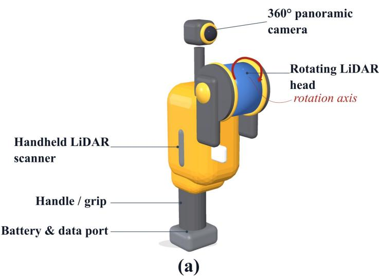

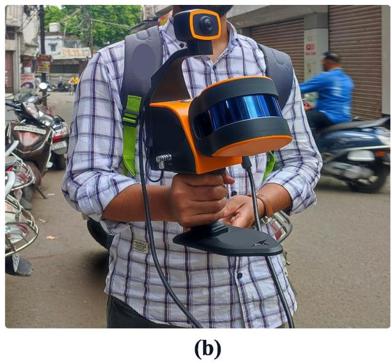  
Figure S1. Handheld scanning acquisition. (a) Schematic of the handheld LiDAR scanner, showing the rotating LiDAR head (with its rotation axis), the co-mounted 360° panoramic camera used for colorization, the handle/grip, and the battery and data port. (b) The system in use along a dense Bhopal street corridor; the handheld form factor enables data collection in narrow, congested lanes that are inaccessible to vehicle-mounted scanners.

Table S2. Survey path characteristics. Length, benchmark scenes and points, cumulative turn rate, mean carriageway width (5th–95th percentile extent of road points per scene), and dominant class shares per path.
<table><tr><td>Path</td><td>Split</td><td>Len. (m)</td><td>Scenes</td><td>Pts (M)</td><td>Turn (°/100m)</td><td>Width (m)</td><td>Bld. %</td><td>Road %</td><td>Veg. %</td><td>Veh. %</td></tr><tr><td>1</td><td>train</td><td>1,663</td><td>418</td><td>137.2</td><td>56.1</td><td>3.39</td><td>57.5</td><td>16.6</td><td>5.1</td><td>5.9</td></tr><tr><td>2</td><td>train</td><td>1,846</td><td>270</td><td>147.4</td><td>82.5</td><td>3.47</td><td>68.8</td><td>13.9</td><td>1.0</td><td>6.9</td></tr><tr><td>3</td><td>train</td><td>1,110</td><td>331</td><td>98.9</td><td>46.2</td><td>3.20</td><td>61.8</td><td>14.9</td><td>5.2</td><td>7.4</td></tr><tr><td>4</td><td>train</td><td>1,845</td><td>334</td><td>156.8</td><td>82.3</td><td>3.32</td><td>60.6</td><td>15.2</td><td>3.9</td><td>6.2</td></tr><tr><td>5</td><td>val</td><td>1,452</td><td>380</td><td>143.2</td><td>74.4</td><td>2.69</td><td>72.9</td><td>11.2</td><td>1.0</td><td>3.2</td></tr><tr><td>6</td><td>val</td><td>657</td><td>188</td><td>83.4</td><td>77.5</td><td>2.59</td><td>74.3</td><td>10.6</td><td>0.1</td><td>4.2</td></tr><tr><td>7</td><td>test</td><td>1,318</td><td>285</td><td>111.4</td><td>55.1</td><td>3.53</td><td>58.5</td><td>14.7</td><td>6.5</td><td>7.0</td></tr><tr><td>8</td><td>test</td><td>865</td><td>204</td><td>90.4</td><td>68.9</td><td>3.30</td><td>69.6</td><td>12.5</td><td>0.8</td><td>4.0</td></tr></table>

1. X, Y, Z: 3D coordinates in the georeferenced coordinate system (float64 storage precision; positional accuracy is set by the SLAM survey and its DGPS alignment, Sec. 3.2, not by the storage format).

2. RGB: Per-point color from co-registered 360° panoramic images (uint8 per channel); valid for approximately 40% of points (limited by image registration in poor-GPS lanes), zero elsewhere.

3. Intensity: LiDAR return intensity (uint16, range 0— 65535).

4. GPS Time: Timestamp for temporal referencing (float64, seconds).

5. Semantic Labels: 62 static semantic classes (uint16); 6 additional moving-class subclasses provide an optional fine-grained dynamic-object labeling (68 classes total).

6. Instance or Global ID: Unique 9-digit identifier encoding path, class hierarchy, and instance number (NXXZZYYYY format: N=path 1-8, XX=major class 01–12, ZZ=subclass, YYYY=instance number).

## S3. Annotation Consistency Across Survey Passes

The main paper reports that annotators iterated until pointlevel disagreement fell below 0.5% per path. That figure is an aggregate, and aggregates over a long-tailed dataset are dominated by the largest classes. This section reports consistency per class.

Method. Where two survey paths cover the same street, the same physical surfaces were annotated twice, in independent work units; comparing the labels assigned at the same location measures annotation consistency. The two passes are separate SLAM trajectories and register to within 8–25 cm, so a naive nearest-neighbour comparison would report misalignment as disagreement. We therefore (i) estimate and remove a per-pair rigid translation, (ii) compare only core points, whose k=8 nearest neighbours in their own pass share their label, and require the matched neighbourhood in the other pass to be homogeneous as well, and (iii) report movable classes separately, since vehicles and people genuinely move between passes. Agreement is accumulated over the 62 fine classes and folded into the coarser taxonomies, so within-parent disagreements are counted correctly. Over 200 co-located scene pairs this compares 2.1M points.

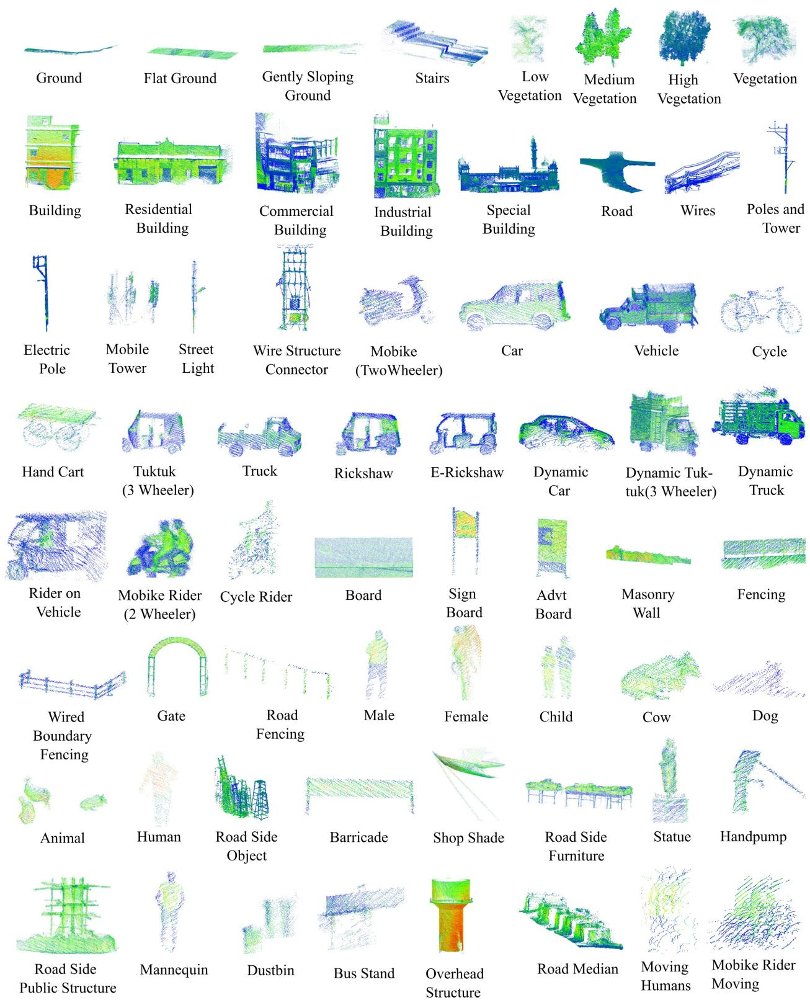  
Figure S2. Intensity-encoded point cloud samples (blue = low intensity, red = high intensity) for each of the 62 static classes, plus two moving-class examples (Moving Humans and Mobike Rider Moving) showing the motion-induced point geometry of dynamic objects. Visually ambiguous classes are grouped under broader general categories for clarity. Corresponding RGB imagery is shown in Fig. S3

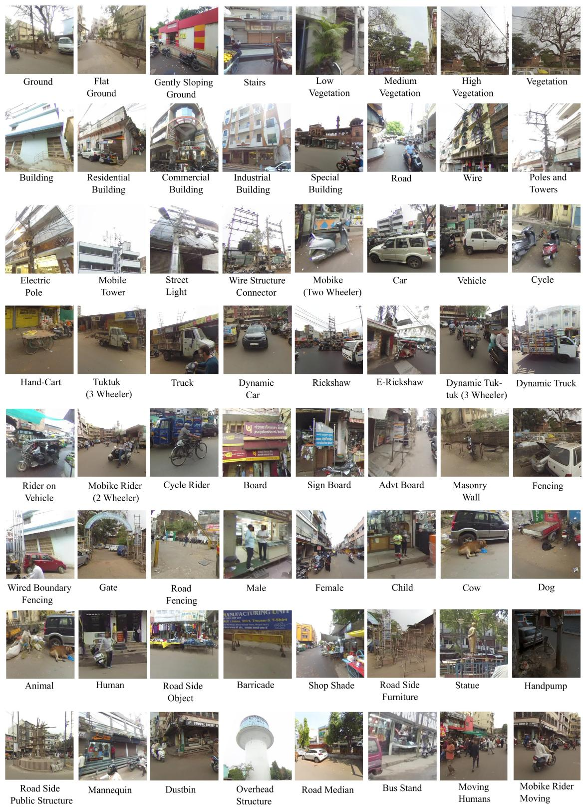  
Figure S3. Class-wise RGB images corresponding to Fig. S2, illustrating the 62 static semantic classes plus two moving-class examples (Moving Humans and Mobike Rider Moving) in the dataset.

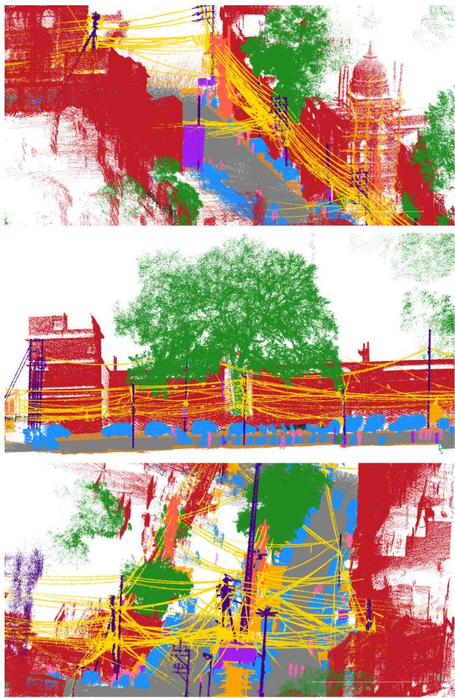  
(a)

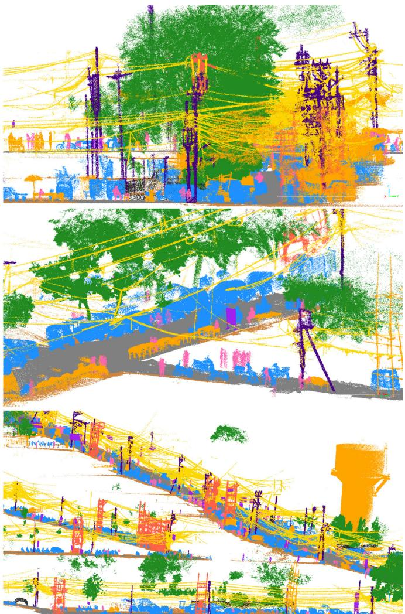  
(b)  
Figure S4. BhopalMLS LiDAR annotation examples. (a) Different views of annotations showing the complexity of the dense urban environment. (b) Overview of the larger study area with annotations excluding buildings for better visualization of multiple features present.

Results. Overall agreement is 93.4% in the 12-class taxonomy (94.3% excluding movable classes), 82.2% at 21 classes and 76.8% over the 62 fine classes. It is far from uniform (Table S3): Building and Road carry 85% of the compared points and both exceed 94%, so an aggregate threshold is effectively a statement about those two classes and can be met while rarer classes are labelled far less consistently. Two classes are genuinely ambiguous rather than mislabelled: Ground (38.0%, confused with Road where unpaved surfaces grade into the carriageway) and Fencing (64.3%, confused with Building on boundary walls that are functionally both). These are the same confusions our models make (Fig. S13).

Implication for the benchmark. Per-class agreement correlates strongly with per-class model IoU (Spearman $\rho { = } 0 . 7 7 , \ p { = } 0 . 0 0 9$ , over the 10 static classes): the classes on which humans agree least are those on which models score lowest. A substantial part of the residual error on Ground and Fencing is therefore label ambiguity intrinsic to unstructured streets rather than model failure, and these classes should be read as having a lower attainable ceiling. The same effect explains why agreement drops at finer granularity: the 21-class taxonomy splits Building into Commercial and Building (other), a distinction on which the two passes frequently disagree.

Limitations. This is a proxy for inter-annotator agreement, not a direct measurement: it cannot detect an error both annotators made identically, it measures object interiors rather than boundary delineation (boundaries are excluded to survive registration drift), and movable classes are not interpretable as annotation error.

(c)  
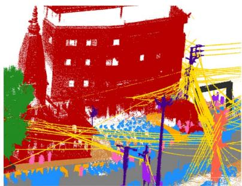

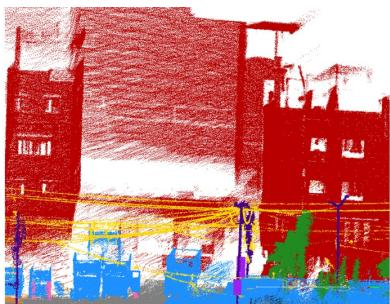

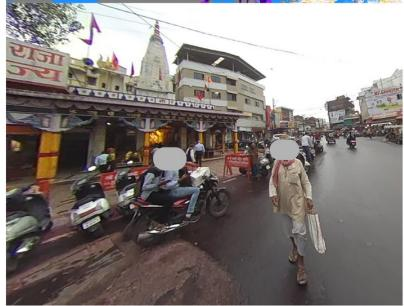  
(a)

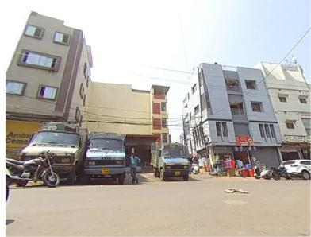  
(b)

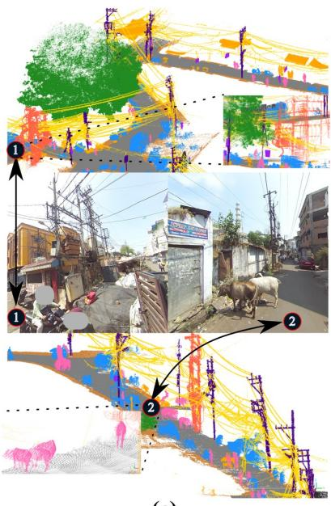  
Figure S5. Annotation examples with corresponding RGB images. (a) and (b) show annotated point clouds (top row) and corresponding RGB images (bottom row), illustrating varied architectural styles and dense urban features. RGB images show approximate viewpoints, not exact point cloud perspectives. (c) Top view of annotations with buildings removed for clarity; viewpoints (1) and (2) show zoomed RGB images and corresponding point clouds.

(a) Train/Val/Test Split Distribution  
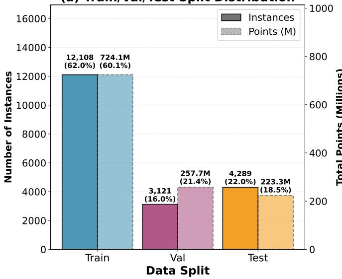

(b) Geographic Path Distribution  
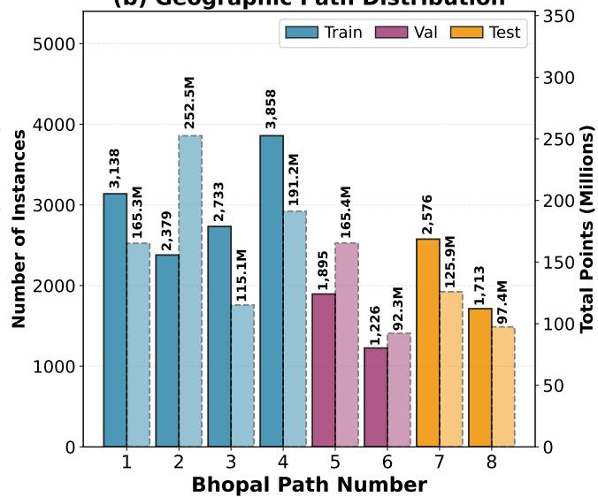  
Figure S6. Dataset split and geographic path distribution. (a) Train/Val/Test split by instance count and point count (Millions), with percentages; the split follows an approximate 60/21/19 point ratio (Sec. 4.1). (b) Per-path distribution (Paths 1–8) of instances and points, colored by split (Train: Paths 1–4; Val: 5–6; Test: 7–8). In both panels, solid bars are instance counts and dashed bars are point counts (Millions); colors denote the split. This path-based partitioning assigns entire geographic paths to splits, preserving spatial coherence while keeping the split ratio balanced.

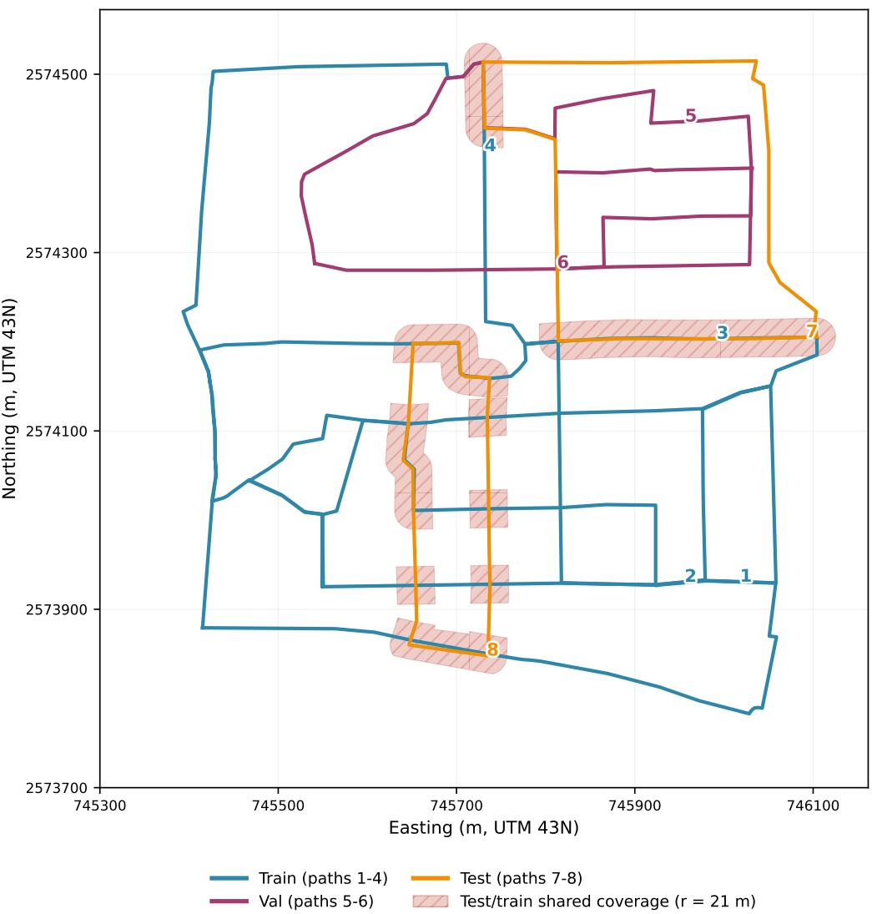  
Figure S7. Survey path layout and split assignment. The eight handheld survey paths in UTM 43N, colored by benchmark split, with shaded zones marking where test coverage overlaps training coverage at the sensor's effective reach (21 m).

## S4. Spatial Overlap Between Splits

BhopalMLS is split by survey path (paths 1–4 train, 5–6 val, 7–8 test), but paths in a compact 10 km district inevitably run near one another. Lilja et al. [15] show that when splits of online-mapping datasets overlap geographically, evaluation of static classes such as buildings and road topology degenerates towards localisation. We therefore quantify the overlap in our splits and, more importantly, measure whether it inflates the benchmark.

## S4.1. How much overlap there is

Table S4 reports proximity between split trajectories and the share of each split's observed area that is also observed in training. The overlap is real and concentrated in the test split: 35.0% of the test trajectory lies within 5 m of a training trajectory against 6.7% for val, and median testto-train distance is 22.7 m against 89.7 m for val. Measured by area rather than trajectory, 49.8% of the region the test set observes is also observed during training (val 15.7%) where “observes" uses the sensor's median effective halfextent of 21.2 m. Figure S7 shows where.

Table S3. Cross-pass label agreement per class (12-class taxonomy, 200 co-located scene pairs, 2.1M points compared). Share is the fraction of compared points. Movable classes (†) differ between passes for physical reasons and are excluded from the aggregate. Model IoU is Utonia(L) FT from Table 4.
<table><tr><td>Class</td><td>Share (%)</td><td>Agreement (%)</td><td>Model IoU</td></tr><tr><td>Wire-Structure Conn.</td><td>2.8</td><td>99.8</td><td>83.0</td></tr><tr><td>Building</td><td>64.0</td><td>96.4</td><td>93.4</td></tr><tr><td>Vegetation</td><td>1.3</td><td>94.6</td><td>97.4</td></tr><tr><td>Road</td><td>21.3</td><td>94.1</td><td>85.7</td></tr><tr><td>Wire</td><td>2.1</td><td>92.2</td><td>87.5</td></tr><tr><td>Road Side Object</td><td>2.1</td><td>88.1</td><td>51.5</td></tr><tr><td>Board</td><td>0.5</td><td>77.6</td><td>67.4</td></tr><tr><td>Fencing</td><td>0.2</td><td>64.3</td><td>38.8</td></tr><tr><td>Pole and Tower</td><td>0.5</td><td>54.5</td><td>68.6</td></tr><tr><td>Ground</td><td>2.2</td><td>38.0</td><td>26.3</td></tr><tr><td>Vehicle†</td><td>2.6</td><td>83.6</td><td>91.5</td></tr><tr><td>Human &amp; Animal†</td><td>0.3</td><td>4.7</td><td>64.2</td></tr></table>

Table S4. Spatial overlap of the benchmark splits. Trajectory proximity is the share of a split's trajectory samples within the stated distance of any training trajectory; area overlap is the share of the split's observed footprint (sensor half-extent 21.2 m) intersecting the training footprint. The test split overlaps training substantially more than val does.
<table><tr><td></td><td>val</td><td>test</td></tr><tr><td>within 5 m of train</td><td>6.7%</td><td>35.0%</td></tr><tr><td>within 10 m of train</td><td>7.6%</td><td>39.7%</td></tr><tr><td>within 25 m of train</td><td>10.4%</td><td>51.8%</td></tr><tr><td>median distance to train</td><td>89.7m</td><td>22.7m</td></tr><tr><td>observed-area overlap</td><td>15.7%</td><td>49.8%</td></tr></table>

## S4.2. Whether it inflates the benchmark

Overlap matters only if it changes what the benchmark measures. We partition the test split by whether a scene's axisaligned bounding box intersects the union of training-scene boxes, giving a leakage-free subset of 180 scenes and 75.7M points that retains all 12 classes, and an overlapping remainder of 306. Three path-7 scenes are empty (zero points, hence no bounding box) and fall in neither subset, which is why the two sum to 486 rather than the split's 489. Every cached evaluation in our model zoo is then re-scored on both subsets: 36 evaluations in total, 10 at 12 classes and 26 at 21 classes, spanning supervised baselines and all four adaptation regimes (Table S5). As a correctness check, every recomputed full-test mIoU reproduces its logged value exactly.

The benchmark is not inflated. The mean leakagefree — overlapping difference is +0.33 pp at 12 classes and —0.08 pp at 21 classes, i.e. models score marginally higher on the leakage-free subset at 12 classes, the opposite of what inflation predicts. Individual differences scatter in both directions (—3.16 to +4.13) without a systematic sign. Most importantly the ranking is preserved: Spearman correlation between full-test and leakage-free mIoU is 0.891 (12-class) and 0.997 (21-class), and mean |full – leakage-free| is 0.62 and 0.65 pp. Utonia(L) FT, the top model, scores 71.29 leakage-free against 71.28 on the full test split.

One caveat qualifies this. The leakage-free subset draws 162 scenes from path 7 and 18 from path 8, while the overlapping remainder draws 120 and 186 respectively, so the difference between subsets partly measures path-7-versus-8 character rather than overlap alone. The near-zero result argues against inflation regardless, since a genuine localisation effect would have to be cancelled by an equal and opposite path effect to produce it.

The leakage-free subset can be rebuilt from the scene bounds stored in the released benchmark file, so future work can report both numbers.

## S5. Extended Semantic Segmentation Results (21-class)

Table S6 reports fine-grained 21-class semantic segmentation results on BhopalMLS, complementing the 12-class benchmark in the main paper (Table 4). The 21-class taxonomy is a finer grouping of the same 62 static classes. It refines five of the 12 major categories: Building (into Commercial and Building-other), Pole & Tower (into Electric Pole, Street Light, and Pole-other, the last absorbing the rare Wire-Structure Connector), Vehicle (into 2-/3-/4- Wheeler and Hand Cart), Road Side Object (into Road Side Furniture, Shop Shade, Mannequin, and other), and Ground (into Ground and Stairs); Vegetation, Road, Wire, Board, and Fencing are unchanged, and Human & Animal is reduced to Human (the rare Animal/Dog/Cow subclasses are excluded). We report all metrics and per-class IoU under the same supervised and transfer-learning protocols as the 12-class benchmark. These results should be read with one caveat. The cross-pass agreement analysis (Sec. S3) shows that label consistency is markedly lower at this granularity than at 12 classes (82.2% vs. 93.4% overall), because the 21-class taxonomy splits precisely the categories on which independent annotation passes agree least, most notably Commercial vs. Building (other). The 21-class benchmark therefore carries more label noise than the 12-class one, and small differences between methods on it should not be over-interpreted; we regard the 12-class benchmark as the primary comparison and the 21-class one as a harder, finer-grained secondary task.

Consistent with the 12-class benchmark, Utonia(L) with fine-tuning (trained jointly with the 6 moving-class subclasses, †) achieves the best overall mIoU (61.95%), followed by Utonia(L) FT (61.73%) and Concerto(L) FT (60.83%). Fine-grained Indian-urban classes such as 2- Wheeler (95.84% IoU at best), 3-Wheeler (92.81%), and

Table S5. Every cached evaluation re-scored on the leakage-free and overlapping halves of the test split: 36 evaluations, 10 at 12 classes and 26 at 21 classes, spanning supervised baselines and all four adaptation regimes. full is the published full-test mIoU, which every rerun reproduces exactly; free is the 180-scene leakage-free subset; ovl is the overlapping remainder. If geographic overlap inflated the benchmark, free would sit systematically below ovl. It does not: mean ∆ is +0.33 pp at 12 classes and —0.08 pp at 21, individual values scatter in both directions, and the full-vs.-leakage-free rank correlation is 0.891 and 0.997. Coverage is every model whose cached precise-test predictions reproduce its published number; cells without such a cache (e.g. Concerto DP and Concerto(L) LP at 12 classes) are absent. Concerto(O) denotes the outdoor-pretrained variant.  
12-class (10 evaluations)
<table><tr><td>model</td><td>full</td><td>free</td><td>ovl</td><td>∆</td></tr><tr><td>Utonia(L) FT</td><td>71.28</td><td>71.29</td><td>69.64</td><td>+1.65</td></tr><tr><td>Utonia(L) LoRA</td><td>69.77</td><td>69.85</td><td>68.21</td><td>+1.64</td></tr><tr><td>Concerto(O) FT</td><td>68.10</td><td>66.59</td><td>69.21</td><td>-2.62</td></tr><tr><td>PTv3 sup.</td><td>67.88</td><td>66.81</td><td>68.52</td><td>-1.71</td></tr><tr><td>LitePT-L sup.</td><td>67.53</td><td>66.96</td><td>67.51</td><td>-0.55</td></tr><tr><td>Utonia(L) DP</td><td>67.03</td><td>66.55</td><td>67.13</td><td>-0.58</td></tr><tr><td>KPConvX sup.</td><td>66.78</td><td>66.67</td><td>65.62</td><td>+1.05</td></tr><tr><td>Utonia(L) LP</td><td>64.18</td><td>64.84</td><td>62.18</td><td>+2.66</td></tr><tr><td>Utonia(L) LP 3ch</td><td>63.16</td><td>62.12</td><td>62.76</td><td>-0.64</td></tr><tr><td>Concerto(O) LP</td><td>52.41</td><td>53.07</td><td>50.63</td><td>+2.44</td></tr><tr><td colspan="3">mean ∆ Spearman full vs. free</td><td></td><td>+0.33 0.891</td></tr></table>

21-class (26 evaluations)
<table><tr><td>model</td><td>full</td><td>free</td><td>ovl</td><td>∆</td></tr><tr><td>Utonia(L) FT</td><td>61.73</td><td>60.96</td><td>62.76</td><td>-1.80</td></tr><tr><td>Concerto(L) FT</td><td>60.83</td><td>60.37</td><td>61.48</td><td>-1.11</td></tr><tr><td>Sonata(L) FT</td><td>59.68</td><td>58.63</td><td>61.07</td><td>-2.44</td></tr><tr><td>Utonia(L) LoRA</td><td>58.97</td><td>58.16</td><td>59.30</td><td>-1.14</td></tr><tr><td>Concerto(O) FT</td><td>58.97</td><td>58.10</td><td>60.19</td><td>-2.09</td></tr><tr><td>PTv3 9ch</td><td>58.51</td><td>57.28</td><td>60.27</td><td>-2.99</td></tr><tr><td>PTv3 4ch</td><td>58.35</td><td>56.87</td><td>60.03</td><td>-3.16</td></tr><tr><td>Utonia(L) DP</td><td>57.77</td><td>56.84</td><td>58.99</td><td>-2.15</td></tr><tr><td>Concerto(L) DP</td><td>56.40</td><td>56.29</td><td>55.09</td><td>+1.20</td></tr><tr><td>Concerto(L) LoRA</td><td>56.01</td><td>55.87</td><td>54.82</td><td>+1.05</td></tr><tr><td>Sonata(L) DP</td><td>55.90</td><td>56.23</td><td>54.75</td><td>+1.48</td></tr><tr><td>LitePT-L 9ch</td><td>55.87</td><td>55.09</td><td>56.95</td><td>-1.86</td></tr><tr><td>Concerto(O) LoRA</td><td>55.16</td><td>54.82</td><td>55.54</td><td>-0.72</td></tr><tr><td>LitePT-L 4ch</td><td>55.09</td><td>54.08</td><td>55.99</td><td>-1.91</td></tr><tr><td>KPConvX 4ch</td><td>54.47</td><td>54.14</td><td>53.55</td><td>+0.59</td></tr><tr><td>KPConvX 9ch</td><td>53.96</td><td>53.63</td><td>53.94</td><td>-0.31</td></tr><tr><td>Utonia(L) LP</td><td>53.72</td><td>53.95</td><td>53.56</td><td>+0.39</td></tr><tr><td>Utonia(L) LP 3ch</td><td>53.09</td><td>52.57</td><td>52.69</td><td>-0.12</td></tr><tr><td>Concerto(O) DP</td><td>52.30</td><td>52.05</td><td>52.56</td><td>-0.51</td></tr><tr><td>Sonata(L) LoRA</td><td>52.13</td><td>52.55</td><td>50.47</td><td>+2.08</td></tr><tr><td>Concerto(L) LP 3ch</td><td>50.23</td><td>49.81</td><td>49.75</td><td>+0.06</td></tr><tr><td>Concerto(L) LP</td><td>50.23</td><td>50.44</td><td>49.41</td><td>+1.03</td></tr><tr><td>Sonata(L) LP</td><td>46.39</td><td>47.64</td><td>43.51</td><td>+4.13</td></tr><tr><td>Concerto(O) LP</td><td>44.61</td><td>45.32</td><td>42.84</td><td>+2.48</td></tr><tr><td>Concerto(O) LP 3ch</td><td>43.20</td><td>44.02</td><td>41.22</td><td>+2.80</td></tr><tr><td>Sonata(L) LP 3ch</td><td>34.30</td><td>35.26</td><td>32.23</td><td>+3.03</td></tr><tr><td>mean ∆</td><td></td><td></td><td></td><td>-0.08</td></tr><tr><td>Spearman full vs. free</td><td></td><td></td><td></td><td>0.997</td></tr></table>

Commercial Building (86.17%) reach high performance under fine-tuning, while structurally ambiguous categories (Fencing, Stairs, Road Side Object) remain the hardest classes in the dataset.

Figure S8 presents the per-class IoU of the strongest configurations as a heatmap: the three supervised 9ch baselines (PTv3, LitePT-L, KpConvX-L) and the fine-tuned foundation models (Sonata(L), Concerto(O), Concerto(L), Utonia(L), and the joint moving-class † variants of Concerto(O) and Utonia(L)), plus the best class-imbalance recipe Utonia(L) C2 (Sec. S6; 12-class only). The color encodes IoU and each column's best method is boxed, making the perclass spread explicit: vegetation, building, road, and vehicle are handled well across all models, whereas Fencing, Ground, Stairs, and Road Side Object remain low; the rightmost column reports each method's overall mIoU.

## S6. Class-Imbalance Ablation

To understand the contribution of each component of our class-imbalance handling recipe (Section 4.1 of the main paper), Table S7 reports a controlled ablation of the three ingredients (square-root inverse-frequency class weights, Lovász loss, and 10% Building downsampling) across two architectures (Concerto(L) [34] and Utonia(L) [35]). The five settings are:

• (C0) full recipe: class-weights + Lovász + Building DS (baseline; matches Table 4 FT-9ch).

• (C1) no class-weights: Lovász + Building DS only.

• (C2) no Lovász: class-weights + Building DS only.

• (C3) CE only (≡ C1+C2): plain cross-entropy + Building DS, no class-weights, no Lovász.

• (C4) no Building DS: class-weights + Lovász, no Building downsampling.

The full per-class results reveal a sharp architecture-

(A) Per-class IoU (%), 12 classes  
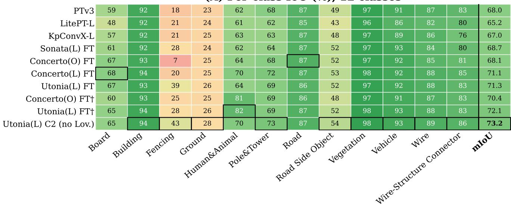

(B) Per-class IoU (%), 21 classes  
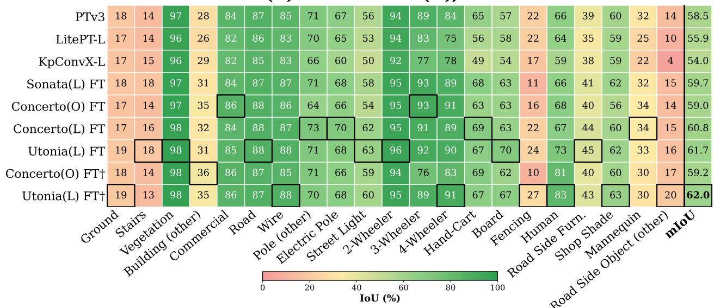  
Figure S8. Per-class IoU heatmaps for (A) the 12-class benchmark (Table 4) and (B) the 21-class benchmark (Table S6). Each cell is the per-class IoU (%) of a method (row) on a class (column), shaded light-to-dark with IoU; the best method in each column is outlined in black. Rows cover the supervised 9ch baselines (PTv3, LitePT-L, KpConvX-L), the fine-tuned foundation models (Sonata(L), Concerto(O). Concerto(L), Utonia(L)), their joint moving-class † variants (Concerto(O), Utonia(L)), and the best class-imbalance recipe Utonia(L) C2 (no Lovász; 12-class only). The separated rightmost column reports each method's overall mIoU (%), again with the best boxed.

Table S6. Semantic segmentation (21-class) on BhopalMLS. Per-class IoU (%). LP = Linear Probe, DP = Decoder Probe, LoRA = Low-Rank Adaptation, FT = Fine-Tuning. 3ch = XYZ; 4ch = XYZ + intensity; 9ch = XYZ + Partial RGB + normals. Sonata(L), Concerto(L) and Utonia(L) = Large (general-purpose pretrained), Concerto(O) = outdoor-pretrained. †=trained jointly with the 6 moving-class subclasses (Moving Vehicle, Moving Humans, Moving Female, Moving Male, Moving Animal, Mobike Rider Moving) as additional fine-grained supervision; folded into their static parents at evaluation. Bold green = overall best per column; underline = best within category; red = overall lowest.
<table><tr><td rowspan=1 colspan=1>Model</td><td rowspan=1 colspan=2>(%) V%O   ()  (%)</td><td rowspan=1 colspan=19>Roie uide ure             Roa  s r)Bui her)VegetattonCoamcialPole (hr)Ele PeoeSteet iight2-eer3-er4-eerHand CartSh pp ShdeManngunrundStairsWireBoardFeningRoadHuman</td></tr><tr><td rowspan=1 colspan=1>Supervised Learn</td><td rowspan=1 colspan=2>ing – 4ch (XYZ + intens</td><td rowspan=1 colspan=19>ity)</td></tr><tr><td rowspan=1 colspan=1>PTv3 [30]LitePT-L [33]KpConvX-L [26]</td><td rowspan=1 colspan=2>86.4771.1358.3584.7371.7055.0984.0971.2354.47</td><td rowspan=1 colspan=19>16.8014.2597.0430.4484.0287.0886.6170.4766.0358.0395.0986.2883.0062.6660.8221.0665.0838.4358.9028.5614.7816.6713.5196.5229.5782.2586.5385.0865.9564.6152.3893.5785.7973.3347.6351.3922.4863.3234.2657.1025.189.8315.9613.5997.0332.1381.2185.3485.6668.7462.4947.1592.2474.8477.1351.6955.4220.3660.7536.7461.0819.824.47</td></tr><tr><td rowspan=1 colspan=1>Supervised Lear</td><td rowspan=1 colspan=2>ning – 9ch (XYZ + Part</td><td rowspan=1 colspan=19>ial RGB + normals)</td></tr><tr><td rowspan=1 colspan=1>PTv3</td><td rowspan=1 colspan=2>86.6170.7058.51</td><td rowspan=1 colspan=19>18.4013.5196.7928.1584.1987.0684.7671.1466.8956.1594.1688.9284.1764.7457.2722.2465.8938.8359.6831.5514.20</td></tr><tr><td rowspan=1 colspan=1>LitePT-L</td><td rowspan=1 colspan=2>84.4871.9955.87</td><td rowspan=1 colspan=19>16.8213.5796.3926.4981.9685.9983.2169.8064.9553.1693.6882.7374.8056.2958.0322.1864.1734.7859.0025.489.72</td></tr><tr><td rowspan=1 colspan=1>KpConvX-L</td><td rowspan=1 colspan=2>84.3071.2453.96</td><td rowspan=1 colspan=19>17.2914.5296.4629.4182.0185.2382.6165.8060.4349.5991.9477.2078.3549.3254.4517.2058.6238.2558.9921.683.82</td></tr><tr><td rowspan=1 colspan=1>Linear Probe (3c</td><td rowspan=1 colspan=2>h: XYZ)</td><td rowspan=1 colspan=19></td></tr><tr><td rowspan=1 colspan=1>Sonata(L) [31]</td><td rowspan=1 colspan=2>77.4052.3134.30</td><td rowspan=1 colspan=19>15.3110.2475.5226.1875.8482.4256.8118.8734.5524.6570.9139.1234.5114.3029.7810.1332.1614.9743.008.61 2.44</td></tr><tr><td rowspan=1 colspan=1>Concerto(O)</td><td rowspan=1 colspan=2>80.3862.0143.20</td><td rowspan=1 colspan=19>17.0112.3991.8230.3378.4983.3165.9238.0642.6131.7875.5563.9262.7137.0534.4315.2438.5321.1351.3912.463.03</td></tr><tr><td rowspan=1 colspan=1>Concerto(L) [34]</td><td rowspan=1 colspan=2>84.6269.3550.23</td><td rowspan=1 colspan=19>18.0614.2095.1434.6582.7286.2980.7351.1554.3046.4087.8760.6561.2949.2051.4720.4650.4032.7156.5217.053.58</td></tr><tr><td rowspan=1 colspan=1>Utonia(L) [35]</td><td rowspan=1 colspan=2>84.7271.5353.09</td><td rowspan=1 colspan=19>18.2113.9896.4635.3382.5685.8682.3554.0958.9647.6389.9673.4581.6650.0852.0324.1050.6733.6656.1419.957.68</td></tr><tr><td rowspan=1 colspan=1>Linear Probe (9c</td><td rowspan=1 colspan=2>h: XYZ + Partial RGB</td><td rowspan=1 colspan=19>+ normals)</td></tr><tr><td rowspan=2 colspan=1>Sonata(L)Concerto(O)</td><td rowspan=2 colspan=2>82.9964.5246.3982.7861.7144.61</td><td rowspan=2 colspan=19>17.1713.1692.5828.2481.0386.0175.4035.2449.2045.7681.9961.6156.0941.0641.1327.3144.4024.0052.4617.412.8815.8414.3592.8131.8281.1085.7172.1929.9142.7333.6877.72</td></tr><tr><td rowspan=1 colspan=3>67.78 72.32 35.15</td><td rowspan=1 colspan=6>36.11 15,60 41.83 20.62 53.40 13.99 2.04</td></tr><tr><td rowspan=1 colspan=1>Concerto(O)†</td><td rowspan=1 colspan=2>82.3161.2143.98</td><td rowspan=1 colspan=3>15.5113.8292.75</td><td rowspan=1 colspan=1>32.1980.65</td><td rowspan=1 colspan=1>85.49</td><td rowspan=1 colspan=1>72.22</td><td rowspan=1 colspan=4>29.4141.9034.9773.87</td><td rowspan=1 colspan=1>57.69</td><td rowspan=1 colspan=2>65.2432.98</td><td rowspan=1 colspan=2>35.1616.49</td><td rowspan=1 colspan=4>56.4419.4252.8612.651.85</td></tr><tr><td rowspan=1 colspan=1>Concerto(L)</td><td rowspan=1 colspan=2>84.6069.3950.23</td><td rowspan=1 colspan=3>17.9815.6295.20</td><td rowspan=1 colspan=1>34.3282.51</td><td rowspan=1 colspan=1>86.33</td><td rowspan=1 colspan=1>80.20</td><td rowspan=1 colspan=2>46.5255.40</td><td rowspan=1 colspan=2>44.7788.51</td><td rowspan=1 colspan=1>63.78</td><td rowspan=1 colspan=2>65.4046.67</td><td rowspan=1 colspan=1>50.46</td><td rowspan=1 colspan=1>22.55</td><td rowspan=1 colspan=3>52.7130.6955.20</td><td rowspan=1 colspan=1>17.902.06</td></tr><tr><td rowspan=1 colspan=1>Utonia(L)</td><td rowspan=1 colspan=2>84.7772.9253.72</td><td rowspan=1 colspan=3>18.2615.8896.68</td><td rowspan=1 colspan=1>36.0582.09</td><td rowspan=1 colspan=1>87.23</td><td rowspan=1 colspan=1>82.04</td><td rowspan=1 colspan=2>54.4459.01</td><td rowspan=1 colspan=2>50.3889.90</td><td rowspan=1 colspan=1>73.63</td><td rowspan=1 colspan=2>79.9647.17</td><td rowspan=1 colspan=1>54.15</td><td rowspan=1 colspan=1>34.42</td><td rowspan=1 colspan=3>52.5830.9254.19</td><td rowspan=1 colspan=1>19.339.90</td></tr><tr><td rowspan=1 colspan=1>Utonia(L)†</td><td rowspan=1 colspan=2>84.7671.3653.44</td><td rowspan=1 colspan=3>18.5015.3896.69</td><td rowspan=1 colspan=1>36.5082.29</td><td rowspan=1 colspan=1>86.94</td><td rowspan=1 colspan=1>81.98</td><td rowspan=1 colspan=2>55.1058.56</td><td rowspan=1 colspan=2>49.7886.12</td><td rowspan=1 colspan=1>71.54</td><td rowspan=1 colspan=2>79.5947.16</td><td rowspan=1 colspan=2>54.6228.19</td><td rowspan=1 colspan=3>64.0429.4254.12</td><td rowspan=1 colspan=1>16.489.19</td></tr><tr><td rowspan=1 colspan=1>Decoder Probe (9</td><td rowspan=1 colspan=2>ch: XYZ + Partial RG</td><td rowspan=1 colspan=3>B + normals)</td><td rowspan=1 colspan=3></td><td rowspan=1 colspan=4></td><td rowspan=1 colspan=1></td><td rowspan=1 colspan=2></td><td rowspan=1 colspan=2></td><td rowspan=1 colspan=4></td></tr><tr><td rowspan=2 colspan=1>Sonata(L)Concerto(O)</td><td rowspan=2 colspan=2>86.4269.6755.9084.6267.1652.30</td><td rowspan=1 colspan=1>18.08</td><td rowspan=1 colspan=2>15.4096.15</td><td rowspan=1 colspan=1>33.0084.58</td><td rowspan=1 colspan=2>86.8684.45</td><td rowspan=1 colspan=2>66.1362.31</td><td rowspan=1 colspan=2>59.8892.97</td><td rowspan=1 colspan=1>78.55</td><td rowspan=1 colspan=2>79.8650.89</td><td rowspan=1 colspan=2>56.9820.42</td><td rowspan=1 colspan=1>61.60</td><td rowspan=1 colspan=2>35.5455.29</td><td rowspan=1 colspan=1>29.345.65</td></tr><tr><td rowspan=1 colspan=1>16.02</td><td rowspan=1 colspan=1>15.08</td><td rowspan=1 colspan=1>96.00</td><td rowspan=1 colspan=1>29.7282.41</td><td rowspan=1 colspan=1>86.38</td><td rowspan=1 colspan=1>81.49</td><td rowspan=1 colspan=1>52.07</td><td rowspan=1 colspan=1>56.51</td><td rowspan=1 colspan=1>50.60</td><td rowspan=1 colspan=1>91.35</td><td rowspan=1 colspan=1>70.32</td><td rowspan=1 colspan=1>73.34</td><td rowspan=1 colspan=1>49.89</td><td rowspan=1 colspan=1>46.62</td><td rowspan=1 colspan=1>18.51</td><td rowspan=1 colspan=1>57.96</td><td rowspan=1 colspan=2>33.1255.81</td><td rowspan=1 colspan=1>26.868.30</td></tr><tr><td rowspan=1 colspan=1>Concerto(O)†</td><td rowspan=1 colspan=1>82.52</td><td rowspan=1 colspan=1>66.4351.20</td><td rowspan=1 colspan=1>15.57</td><td rowspan=1 colspan=1>14.05</td><td rowspan=1 colspan=1>94.37</td><td rowspan=1 colspan=1>27.3779.18</td><td rowspan=1 colspan=1>85.86</td><td rowspan=1 colspan=1>79.39</td><td rowspan=1 colspan=1>50.92</td><td rowspan=1 colspan=1>53.91</td><td rowspan=1 colspan=1>44.04</td><td rowspan=1 colspan=1>88.27</td><td rowspan=1 colspan=1>70.85</td><td rowspan=1 colspan=1>74.22</td><td rowspan=1 colspan=1>44.75</td><td rowspan=1 colspan=1>51.38</td><td rowspan=1 colspan=1>18.95</td><td rowspan=1 colspan=1>70.16</td><td rowspan=1 colspan=2>31.2555.36</td><td rowspan=1 colspan=1>21.513.89</td></tr><tr><td rowspan=1 colspan=1>Concerto(L)</td><td rowspan=1 colspan=1>85.45</td><td rowspan=1 colspan=1>70.9856.40</td><td rowspan=1 colspan=1>18.18</td><td rowspan=1 colspan=1>16.16</td><td rowspan=1 colspan=1>96.90</td><td rowspan=1 colspan=1>30.1482.72</td><td rowspan=1 colspan=1>86.82</td><td rowspan=1 colspan=1>85.07</td><td rowspan=1 colspan=1>67.27</td><td rowspan=1 colspan=1>64.66</td><td rowspan=1 colspan=1>60.87</td><td rowspan=1 colspan=1>94.08</td><td rowspan=1 colspan=1>81.24</td><td rowspan=1 colspan=1>80.03</td><td rowspan=1 colspan=1>57.49</td><td rowspan=1 colspan=2>59.1316.98</td><td rowspan=1 colspan=3>63.2837.1355.30</td><td rowspan=1 colspan=1>26.384.63</td></tr><tr><td rowspan=1 colspan=1>Utonia(L)</td><td rowspan=1 colspan=1>87.44</td><td rowspan=1 colspan=1>71.9757.77</td><td rowspan=1 colspan=1>18.37</td><td rowspan=1 colspan=2>16.0597.19</td><td rowspan=1 colspan=1>36.0185.65</td><td rowspan=1 colspan=1>87.46</td><td rowspan=1 colspan=1>86.20</td><td rowspan=1 colspan=2>68.1664.04</td><td rowspan=1 colspan=2>60.2494.61</td><td rowspan=1 colspan=1>81.41</td><td rowspan=1 colspan=2>85.9858.40</td><td rowspan=1 colspan=2>57.9913.20</td><td rowspan=1 colspan=3>64.7937.0157.88</td><td rowspan=1 colspan=1>28.72</td></tr><tr><td rowspan=1 colspan=1>Utonia(L)†</td><td rowspan=1 colspan=2>87.2372.6758.94</td><td rowspan=1 colspan=3>18.1415.7897.55</td><td rowspan=1 colspan=2>30.9985.1387.34</td><td rowspan=1 colspan=1>86.38</td><td rowspan=1 colspan=2>69.0464.41</td><td rowspan=1 colspan=2>57.8093.45</td><td rowspan=1 colspan=1>81.04</td><td rowspan=1 colspan=2>87.7060.20</td><td rowspan=1 colspan=2>59.1318.74</td><td rowspan=1 colspan=3>79.7438.2257.83</td><td rowspan=1 colspan=1>31.54</td></tr><tr><td rowspan=1 colspan=1>LoRA (9ch: XYZ +</td><td rowspan=1 colspan=2>Partial RGB3 + norm</td><td rowspan=1 colspan=6>als)</td><td rowspan=1 colspan=2></td><td rowspan=1 colspan=2></td><td rowspan=1 colspan=1></td><td rowspan=1 colspan=2></td><td rowspan=1 colspan=2></td><td rowspan=1 colspan=3></td><td rowspan=1 colspan=1></td></tr><tr><td rowspan=1 colspan=1>Sonata(L)</td><td rowspan=1 colspan=2>84.3671.2152.13</td><td rowspan=1 colspan=6>18.3015.0495.6329.7582.0186.5582.38</td><td rowspan=1 colspan=2>57.1457.76</td><td rowspan=1 colspan=2>46.7188.95</td><td rowspan=1 colspan=1>71.90</td><td rowspan=1 colspan=2>73.4344.43</td><td rowspan=1 colspan=2>52.4725.88</td><td rowspan=1 colspan=3>52.3931.4055.8318.67</td><td rowspan=1 colspan=1>8.15</td></tr><tr><td rowspan=2 colspan=1>Concerto(O)Concerto(L)</td><td rowspan=1 colspan=2>85.4971.8655.16</td><td rowspan=1 colspan=3>17.6316.6196.86</td><td rowspan=1 colspan=1>36.2383.24</td><td rowspan=1 colspan=1>86.57</td><td rowspan=1 colspan=1>80.80</td><td rowspan=1 colspan=2>62.1159.63</td><td rowspan=1 colspan=2>54.1689.95</td><td rowspan=1 colspan=1>79.32</td><td rowspan=1 colspan=2>83.9952.76</td><td rowspan=1 colspan=1>53.50</td><td rowspan=1 colspan=1>22.03</td><td rowspan=1 colspan=1>54.20</td><td rowspan=1 colspan=1>34.30</td><td rowspan=1 colspan=1>55.58</td><td rowspan=1 colspan=1>24.82</td></tr><tr><td rowspan=1 colspan=2>85.4672.4556.01</td><td rowspan=1 colspan=3>20.0516.3096.88</td><td rowspan=1 colspan=1>35.4882.63</td><td rowspan=1 colspan=1>87.25</td><td rowspan=1 colspan=1>82.21</td><td rowspan=1 colspan=2>62.3858.69</td><td rowspan=1 colspan=2>55.7592.57</td><td rowspan=1 colspan=1>79.95</td><td rowspan=1 colspan=2>80.4258.95</td><td rowspan=1 colspan=1>57.86</td><td rowspan=1 colspan=1>28.04</td><td rowspan=1 colspan=1>57.97</td><td rowspan=1 colspan=1>36.59</td><td rowspan=1 colspan=1>58.77</td><td rowspan=1 colspan=1>5.98</td></tr><tr><td rowspan=1 colspan=1>Utonia(L)</td><td rowspan=1 colspan=2>85.8875.2258.97</td><td rowspan=1 colspan=3>19.1615.6097.61</td><td rowspan=1 colspan=2>36.7582.9987.08</td><td rowspan=1 colspan=1>84.25</td><td rowspan=1 colspan=2>68.1064.65</td><td rowspan=1 colspan=2>58.9893.34</td><td rowspan=1 colspan=1>88.02</td><td rowspan=1 colspan=2>91.5154.03</td><td rowspan=1 colspan=1>61.07</td><td rowspan=1 colspan=1>34.88</td><td rowspan=1 colspan=1>60.68</td><td rowspan=1 colspan=2>37.0155.90</td><td rowspan=1 colspan=1>24.56</td></tr><tr><td rowspan=1 colspan=1>Fine-Tuning (9ch</td><td rowspan=1 colspan=2>: XYZ + Partial RGB +</td><td rowspan=1 colspan=6>normals)</td><td rowspan=1 colspan=2></td><td rowspan=1 colspan=2></td><td rowspan=1 colspan=1></td><td rowspan=1 colspan=2></td><td rowspan=1 colspan=2></td><td rowspan=1 colspan=3></td><td rowspan=1 colspan=1></td></tr><tr><td rowspan=2 colspan=1>Sonata(L)Concerto(O)</td><td rowspan=2 colspan=2>86.5472.9359.6888.0771.6258.97</td><td rowspan=1 colspan=6>18.4017.6697.4331.0783.9687.2186.69</td><td rowspan=1 colspan=2>70.7667.87</td><td rowspan=1 colspan=2>57.8195.07</td><td rowspan=1 colspan=1>92.69</td><td rowspan=1 colspan=2>89.0867.75</td><td rowspan=1 colspan=2>62.8410.85</td><td rowspan=1 colspan=3>65.7041.4861.81</td><td rowspan=1 colspan=1>32.24</td></tr><tr><td rowspan=1 colspan=3>17.0614.5097.36</td><td rowspan=1 colspan=2>34.9986.1787.59</td><td rowspan=1 colspan=1>86.49</td><td rowspan=1 colspan=2>63.6365.59</td><td rowspan=1 colspan=2>53.8294.67</td><td rowspan=1 colspan=1>92.81</td><td rowspan=1 colspan=2>90.6062.55</td><td rowspan=1 colspan=1>62.87</td><td rowspan=1 colspan=1>15.86</td><td rowspan=1 colspan=3>67.8439.9956.07</td><td rowspan=1 colspan=1>14.34</td></tr><tr><td rowspan=1 colspan=1>Concerto(O)†</td><td rowspan=1 colspan=2>87.7472.6559.24</td><td rowspan=1 colspan=3>18.1714.1897.65</td><td rowspan=1 colspan=1>36.3385.81</td><td rowspan=1 colspan=1>86.70</td><td rowspan=1 colspan=1>85.36</td><td rowspan=1 colspan=2>71.0766.43</td><td rowspan=1 colspan=2>59.1394.25</td><td rowspan=1 colspan=1>76.37</td><td rowspan=1 colspan=2>82.7768.76</td><td rowspan=1 colspan=1>62.00</td><td rowspan=1 colspan=1>9.93</td><td rowspan=1 colspan=3>81.2040.3060.49</td><td rowspan=1 colspan=1>30.08</td></tr><tr><td rowspan=3 colspan=1>Concerto(L)Utonia(L)Utonia(L)†</td><td rowspan=1 colspan=2>86.6374.6060.83</td><td rowspan=1 colspan=3>17.2916.3497.53</td><td rowspan=1 colspan=1>31.5383.80</td><td rowspan=1 colspan=1>87.60</td><td rowspan=1 colspan=1>87.26</td><td rowspan=1 colspan=2>72.5370.22</td><td rowspan=1 colspan=2>62.4095.23</td><td rowspan=1 colspan=1>91.15</td><td rowspan=1 colspan=2>89.2469.12</td><td rowspan=1 colspan=1>63.38</td><td rowspan=1 colspan=1>21.90</td><td rowspan=1 colspan=1>67.38</td><td rowspan=1 colspan=2>44.5060.11</td><td rowspan=1 colspan=1>33.79</td></tr><tr><td rowspan=1 colspan=2>87.4374.1761.73</td><td rowspan=1 colspan=3>18.9018.5097.94</td><td rowspan=1 colspan=1>30.7584.83</td><td rowspan=1 colspan=1>88.09</td><td rowspan=1 colspan=1>87.69</td><td rowspan=1 colspan=2>70.7668.44</td><td rowspan=1 colspan=2>63.0795.84</td><td rowspan=1 colspan=1>92.12</td><td rowspan=1 colspan=2>90.4366.85</td><td rowspan=1 colspan=1>70.03</td><td rowspan=1 colspan=1>23.94</td><td rowspan=1 colspan=1>72.60</td><td rowspan=1 colspan=2>44.5462.23</td><td rowspan=1 colspan=1>15.91</td></tr><tr><td rowspan=1 colspan=2>87.9274.4161.95</td><td rowspan=1 colspan=3>19.2713.2797.73</td><td rowspan=1 colspan=1>35.4085.50</td><td rowspan=1 colspan=1>87.30</td><td rowspan=1 colspan=1>88.08</td><td rowspan=1 colspan=2>70.3567.89</td><td rowspan=1 colspan=2>59.5295.47</td><td rowspan=1 colspan=1>89.11</td><td rowspan=1 colspan=2>90.9967.03</td><td rowspan=1 colspan=1>67.10</td><td rowspan=1 colspan=1>26.98</td><td rowspan=1 colspan=1>83.41</td><td rowspan=1 colspan=2>42.9463.24</td><td rowspan=1 colspan=1>19.88</td></tr></table>

## dependent picture:

Concerto(L) loses mIoU under every ablation (max drop: C1 —1.62), confirming that class-weights, Lovász loss, and Building DS all contribute. The cost concentrates on the rarest class: Fencing drops by -11.94 (C1), -5.51 (C3) when class-weights are removed; class-weights are decisive for Fencing.

Utonia(L) responds very differently. (C2) “no Lovász" is the best setting at 73.20% mIoU (+1.92 vs C0), and 11 of 12 classes improve simultaneously, including a notable Fencing gain from 38.79 to 43.08 (+4.29). Lovász appears to over-regularize Utonia's representations on minorityclass boundaries. However, removing class-weights (C1) still collapses Fencing for Utonia (—22.49, the largest single per-class loss in the entire table), and the combined CE-only setting (C3) is even worse on Fencing (—25.25), confirming super-additive interaction: dropping both ingredients is more harmful than the sum of dropping each.

Building downsampling (C4) has the mildest effect on both architectures (-0.62 / —0.76 mIoU). It slightly helps Building IoU as expected (+0.10 Co / +0.67 Ut), but the cost falls on small, cluttered classes that share spatial context with buildings: Road Side Object loses —4.24 (Co) and Board loses -2.98 (Co), -3.11 (Ut). Across all 10 rows,

Table S7. Class-imbalance ablation on BhopalMLS (12-class, FT-9ch) across two architectures. (C0) is the full recipe (matches Table 4); (C1-C4) remove or change one ingredient at a time. All per-class values are IoU (%); mIoU column shows ∆ vs (C0) in parentheses Bold green = overall best across all 10 rows for that column,
<table><tr><td></td><td></td><td colspan="3"></td><td colspan="3"></td><td></td><td>Hunnmal</td><td>Poler</td><td></td><td>Road Sid db&#x27;.</td><td></td><td></td><td></td><td></td></tr><tr><td>Model</td><td>Setting</td><td>(%) V%O</td><td> (((%)</td><td>(%)</td><td>Board</td><td>Buiding</td><td>Fancing</td><td>round</td><td></td><td></td><td>Road</td><td></td><td>Vetaton</td><td>VWeiele</td><td>Wirre</td><td>Wirne Cirtt-onn.</td></tr><tr><td rowspan="5">Concerto(L)</td><td>(CO) full recipe</td><td>93.42</td><td>80.44</td><td>71.06</td><td>67.72</td><td>93.71</td><td>20.14</td><td>25.41</td><td>69.88</td><td>72.48</td><td>87.11</td><td>53.07</td><td>97.67</td><td>92.34</td><td>87.91</td><td>85.26</td></tr><tr><td>(C1) no class-weights</td><td>93.46</td><td>77.84</td><td>69.44(−1.62)</td><td>62.52</td><td>93.63</td><td>8.20</td><td>23.52</td><td>71.07</td><td>71.98</td><td>87.29</td><td>50.74</td><td>97.64</td><td>91.80</td><td>88.62</td><td>86.29</td></tr><tr><td>(C2) no Lovász</td><td>93.03</td><td>81.22</td><td>70.67(-0.39)</td><td>66.45</td><td>93.26</td><td>22.50</td><td>25.04</td><td>69.08</td><td>71.93</td><td>86.62</td><td>50.74</td><td>97.69</td><td>92.69</td><td>87.39</td><td>84.64</td></tr><tr><td>(C3) CE only (C1+C2)</td><td>93.52</td><td>78.16</td><td>70.21 (−0.85)</td><td>68.09</td><td>93.79</td><td>14.63</td><td>24.52</td><td>68.66</td><td>71.76</td><td>87.42</td><td>50.17</td><td>97.62</td><td>92.20</td><td>88.81</td><td>84.80</td></tr><tr><td>(C4) no Building downsampling</td><td>93.48</td><td>79.64</td><td>70.44(−0.62)</td><td>64.74</td><td>93.81</td><td>21.27</td><td>23.51</td><td>69.63</td><td>72.85</td><td>86.48</td><td>48.83</td><td>97.76</td><td>92.84</td><td>88.11</td><td>85.44</td></tr><tr><td rowspan="5">Utonia(L)</td><td>(CO) full recipe</td><td>92.69</td><td>83.89</td><td>71.28</td><td>67.36</td><td>93.38</td><td>38.79</td><td>26.27</td><td>64.24</td><td>68.61</td><td>85.66</td><td>51.51</td><td>97.41</td><td>91.54</td><td>87.53</td><td>83.03</td></tr><tr><td>(C1) no class-weights</td><td>93.83</td><td>79.60</td><td>71.65(+0.37)</td><td>69.93</td><td>94.08</td><td>16.30</td><td>26.30</td><td>71.78</td><td>73.45</td><td>87.54</td><td>55.20</td><td>97.83</td><td>93.13 92.90</td><td>88.86</td><td>85.36</td></tr><tr><td>(C2) no Lovász</td><td>93.43</td><td>83.90</td><td>73.20 (+1.92)</td><td>64.55</td><td>93.74</td><td>43.08</td><td>27.70</td><td>70.16 71.54</td><td>73.12 72.75</td><td>86.88 87.65</td><td>53.62 53.34</td><td>97.82 97.73</td><td>93.19</td><td>88.77 89.06</td><td>86.02 86.05</td></tr><tr><td>(C3) CE only (C1+C2)</td><td>93.78</td><td>78.90</td><td>70.97(-0.31)</td><td>66.65</td><td>94.08</td><td>13.54 18.42</td><td>26.03 25.74</td><td>69.43</td><td>71.90</td><td>86.99</td><td>53.96</td><td>97.88</td><td>92.44</td><td>88.82</td><td>82.43</td></tr><tr><td>(C4) no Building downsampling</td><td>93.71</td><td>80.49</td><td>70.52(–0.76)</td><td>64.25</td><td>94.05</td><td></td><td></td><td></td><td></td><td></td><td></td><td></td><td></td><td></td><td></td></tr></table>

Utonia variants hold the column-best on 14 of 15 columns; only Wire-Structure Connector is won by Concerto(L) C1 (86.29).

## S7. Instance Segmentation Baselines

To demonstrate the dataset's utility beyond semantic segmentation, we evaluate instance segmentation with two supervised baselines trained from scratch (PTv3 [30] and LitePT-L [33]) and the pretrained foundation models Sonata(L) [31], Concerto [34] (general-purpose Concerto(L) and outdoor Concerto(O) variants), and Utonia(L) [35] under three adaptation strategies: Linear Probe (LP), Decoder Probe (DP), and Fine-Tuning (FT). The supervised baselines let us compare foundation-model finetuning against training from scratch. All architectures natively support the PointGroup instance head within the Pointcept framework. The instance-segmentation task setup (thing/stuff split, instance IDs, and the 12- and 21-class granularities) is introduced in the main paper; here we provide the full per-class results.

## S7.1. Thing vs Stuff Classes

The four stuff classes are predicted semantically but excluded from instance clustering and mAP; the remaining thing classes are grouped into instances. The exact membership in each setting is:

12-class setting (Table S8): 4 stuff classes (Ground, Vegetation, Road, Wire) and 8 thing classes (Building, Pole&Tower, Wire-Structure Conn., Vehicle, Board, Fencing, Human&Animal, Road Side Object).

21-class setting (Table S9): The same 4 stuff classes (Ground, Vegetation, Road, Wire), with 17 fine-grained thing classes obtained by splitting Building, Pole & Tower, Vehicle, and Road Side Object into finer categories, carving Stairs out of Ground, and merging the rare Wire-Structure Connector into Pole (other). Specifically: Stairs, Building (other), Commercial Building, Pole (other), Electric Pole, Street Light, 2-Wheeler, 3-Wheeler, 4-Wheeler, Hand Cart Board, Fencing, Human, Road Side Furniture, Shop Shade Mannequin, and Road Side Object (other).

## S7.2. Experimental Setup

All models use the PointGroup [9] (PG-v1m2) instance segmentation head built on Pointcept, which jointly predicts semantic labels and instance offsets, with 9-channel input (XYZ + partial RGB + normals). Models are evaluated on the same test split (Path 07–08) as the semantic segmentation benchmarks.

## S7.3. Results

Beyond the headline mAP50 reported in the main paper, the per-class breakdown shows that fine-tuning yields the largest gains on object classes that linear probing handles poorly: for Utonia(L), Board AP50 rises from 8.22% (LP) to 55.67% (FT), Wire-Structure Connector from 7.21% to 59.47%, and Building from 17.06% to 53.70%, while structurally ambiguous Fencing remains the hardest class (0.31%→5.43%). The 21-class evaluation further tests whether models can delineate fine-grained categories such as 2-wheelers (6,335 instances), 3-wheelers, and hand carts that are unique to dense, unstructured urban scenes and absent from existing benchmarks.

In the 12-class setting (Table S8), Utonia(L) FT is the overall best on mAP25/mAP50/mAP and on per-class Building (53.70), Wire-Structure Conn. (59.47), and Board (55.67), while Concerto(L) FT remains overall best on Vehicle (73.68), Fencing (6.32), and Road Side Object (19.00); supervised LitePT-L wins Pole & Tower (39.15) and Human & Animal (54.84). In the 21-class setting (Table S9), Utonia(L) FT again leads (39.83% mAP50, 30.63% mAP), outperforming Concerto(L) FT (36.71%) and Concerto(O) FT (35.47%), with the largest margins on India-specific finegrained classes: Commercial Building (62.44 vs. 40.73), Building (other) (31.11 vs. 11.12), Road Side Object (other) (6.12 vs. 3.94), and Board (55.76 vs. 52.83). Supervised baselines remain competitive: PTv3 9ch (33.07% mAP50) outperforms all LP/DP foundation-model variants, and LitePT-L still holds the best Human AP50 (55.02) and Street Light AP50 (39.06) overall, demonstrating that training from scratch can still excel on specific categories. Comparing pretraining strategies, Concerto(L) consistently outperforms Concerto(O) across all adaptation methods (36.71 vs. 35.47 mAP50 for FT in 21-class), mirroring the semantic segmentation trends. Concerto(O) LP is particularly weak (4.07% mAP50 in 12-class and 4.44% in 21-class, both the overall lowest), indicating that outdoor-specific pretraining alone provides insufficient inductive bias for instance-level grouping in complex urban scenes.

Across both granularities, Fencing remains the hardest class in the 12-class setting (best AP50: 6.32%), reflecting its thin planar geometry and frequent confusion with adjacent structures. In the 21-class setting, Stairs (best AP50: 2.60%) and Fencing (7.80%) are the most challenging classes, while fine-grained building distinction also proves difficult: Building (other) peaks at 31.11% AP50 despite Commercial Building reaching 62.44%, suggesting that generic building instances lack discriminative geometric cues. India-specific classes such as Shop Shade (best 31.41%) and Mannequin (best 11.93%) highlight the unique challenges of dense, unstructured urban scenes that are absent from existing instance segmentation benchmarks.

## S7.4. Qualitative Instance Segmentation Results

Figure S9 presents qualitative instance segmentation results under the 12-class taxonomy for the same three representative test scenes used in the semantic segmentation evaluation (Fig. S12). For each scene, we show: (i) ground truth instance labels and partial RGB point cloud (left column, separated by a vertical divider); (ii) predicted instance masks from LitePT-L (trained from scratch), Concerto(L) LP, and Concerto(L) FT (top row); and (iii) corresponding error maps with per-scene mAP50 annotations (bottom row). The inclusion of Concerto(L) LP alongside FT directly visualizes the LP→FT improvement reported in Table S8. Instance colors are consistent across ground truth and predictions: matched instances $\mathrm { ( I o U \ge 0 . 5 ) }$ share the same color, enabling direct visual comparison of segmentation quality. Stuff classes (Ground, Vegetation, Road, Wire)

are rendered in gray and excluded from instance evaluation.

The error maps use the following color coding: green = correctly matched instance (IoU ≥ 0.5), red = missed GT instance (no prediction match), blue = false positive prediction (no GT match), orange = under-segmented (multiple GT instances merged into one prediction), yellow = wrong semantic class, and gray = stuff classes (not evaluated). Note that this instance-level error map differs from the binary semantic segmentation error map in Fig. S12, which uses only two categories (gray = correct, red = misclassified). The richer six-category coding here reflects the additional failure modes specific to instance segmentation, such as under-segmentation and false positive detections. All three models successfully segment large, geometrically distinct objects such as vehicles and buildings, while thin structures (poles, wire-structure connectors, fencing) and small objects (boards, road side objects) remain challenging, consistent with the quantitative trends in Table S8. The LP→FT improvement is particularly visible in the error maps, where LP shows substantially more missed instances (red) and false positives (blue).

Figure S10 presents the same three test scenes evaluated under the 21-class fine-grained taxonomy, which expands the 8 thing classes to 17 fine-grained categories including India-specific classes such as 2-Wheeler, 3-Wheeler, Hand Cart, Shop Shade, and Mannequin. The finer class granularity introduces additional challenges: vehicles that were grouped as a single class in the 12-class setting must now be distinguished into 2-Wheeler, 3-Wheeler, 4-Wheeler, and Hand Cart, leading to increased wrong-class errors (yellow) at vehicle boundaries. Similarly, the Building class is split into Commercial Building and Building (other), requiring models to distinguish structural subtypes. Despite these challenges, Utonia(L) FT maintains the strongest instance delineation (39.83% mAP50, Table S9), while the supervised PTv3 baseline remains competitive on well-separated objects and Utonia(L) LP exhibits more missed and merged instances, consistent with the per-class AP50 trends in Table S9.

## S8. Feature Visualization and Prediction Analysis

We examine the learned representations and prediction behavior of the fine-tuned foundation models: first through PCA feature visualizations at the instance and scene levels, then through a confusion-matrix analysis of their systematic misclassifications.

## S8.1. Instance-Level Feature Visualization

To qualitatively assess the learned representations of pretrained foundation models, we visualize their intermediate features on individual object instances using PCA. Figure S11 shows five selected classes: 3-Wheeler (Tuktuk),

Table S8. Instance segmentation results (12-class) on BhopalMLS using PTv3 and LitePT-L (trained from scratch) and the pretrained foundation models Sonata, Concerto, and Utonia with LP, DP, and FT. All models use 9ch input. mAP, mAP50, and mAP25 are computed over 8 thing classes at IoU thresholds averaged over 50:5:95, 50%, and 25%, respectively; 4 stuff classes (Ground, Vegetation, Road, Wire) are excluded from instance evaluation. Per-class values are AP50 (%). Sonata(L), Concerto(L) and Utonia(L) = Large (general-purpose pretrained), Concerto(O) = outdoor-pretrained. Bold green = overall best per column; underline = best within category; red = overall lowest.
<table><tr><td>Model</td><td>%)</td><td>%)</td><td>(%) Buiding</td><td>Toer &amp; pole</td><td>Wirne Cirtue-enn.</td><td>Veide</td><td>Board</td><td>Fnciing</td><td>Anmmal n Hn</td><td>Roade Se et</td></tr><tr><td colspan="9">Supervised Learning – 9ch (XYZ + Partial RGB + normals)</td></tr><tr><td>PTv3 [30]</td><td>42.07 35.13</td><td>25.78</td><td>23.71</td><td>28.57</td><td>46.14</td><td>70.62</td><td>41.98</td><td>0.13</td><td>54.04</td><td>15.87</td></tr><tr><td>LitePT-L [33]</td><td>43.73</td><td>36.76 26.90</td><td>34.03</td><td>39.15</td><td>30.54</td><td>69.43</td><td>45.87</td><td>3.86</td><td>54.84</td><td>16.33</td></tr><tr><td colspan="9">Linear Probe (9ch: XYZ + Partial RGB + normals)</td></tr><tr><td>Sonata(L) [31]</td><td>23.28</td><td>14.66 7.72</td><td>20.41</td><td>2.33</td><td>13.04</td><td>49.87</td><td>6.72</td><td>2.96</td><td>19.27</td><td>2.63</td></tr><tr><td>Concerto(O)</td><td>11.86</td><td>4.07 1.66</td><td>4.41</td><td>1.83</td><td>0.00</td><td>2.35</td><td>8.39</td><td>0.01</td><td>14.86</td><td>0.75</td></tr><tr><td>Concerto(L) [34]</td><td>23.91</td><td>14.22 7.80</td><td>16.25</td><td>8.12</td><td>9.34</td><td>48.29</td><td>3.42</td><td>0.11</td><td>26.68</td><td>1.52</td></tr><tr><td>Utonia(L) [35]</td><td>26.25 15.27</td><td>8.15</td><td>17.06</td><td>9.80</td><td>7.21</td><td>49.98</td><td>8.22</td><td>0.31</td><td>25.75</td><td>3.86</td></tr><tr><td colspan="9">Decoder Probe (9ch: XYZ + Partial RGB + normals)</td></tr><tr><td>Sonata(L)</td><td>37.90</td><td>29.59 20.62</td><td>18.25</td><td>19.17</td><td>26.08</td><td>66.22</td><td>45.08</td><td>1.40</td><td>46.88</td><td>13.66</td></tr><tr><td>Concerto(O)</td><td>36.79 27.46</td><td>19.02</td><td>22.42</td><td>20.92</td><td>15.36</td><td>64.51</td><td>40.35</td><td>2.39</td><td>42.41</td><td>11.33</td></tr><tr><td>Concerto(L)</td><td>39.85 31.88</td><td>22.75</td><td>20.06</td><td>22.99</td><td>32.77</td><td>67.24</td><td>46.09</td><td>2.71</td><td>49.12</td><td>14.07</td></tr><tr><td>Utonia(L)</td><td>43.87 35.75</td><td>25.48</td><td>41.72</td><td>26.39</td><td>28.86</td><td>69.55</td><td>47.87</td><td>5.16</td><td>51.55</td><td>14.89</td></tr><tr><td colspan="9">Fine-Tuning (9ch: XYZ + Partial RGB + normals)</td></tr><tr><td></td><td></td><td>28.47</td><td>28.14</td><td>35.22</td><td>43.97</td><td>71.92</td><td>50.58</td><td>3.68</td><td>53.48</td><td>18.74</td></tr><tr><td>Sonata(L) Concerto(O)</td><td>44.73 38.22 42.30 36.21</td><td>26.39</td><td>34.82</td><td>31.90</td><td>38.96</td><td>72.32</td><td>46.66</td><td>0.09</td><td>47.89</td><td>17.08</td></tr><tr><td>Concerto(L)</td><td>44.37 37.06</td><td>26.68</td><td>24.73</td><td>30.96</td><td>37.30</td><td>73.68</td><td>51.35</td><td>6.32</td><td>53.12</td><td>19.00</td></tr><tr><td>Utonia(L)</td><td>50.56 44.07</td><td>33.09</td><td>53.70</td><td>33.46</td><td>59.47</td><td>72.77</td><td>55.67</td><td>5.43</td><td>53.27</td><td>18.75</td></tr></table>

Hand Cart, Cow, Wire-Structure Connector (India-specific), and Car (a universal class present in most LiDAR datasets) rendered with raw intensity, raw RGB, and PCA projections from Sonata(L) [31] (Large), Concerto(O) [34] (outdoorpretrained), Concerto(L) (general-purpose pretrained), and Utonia(L) (general-purpose pretrained). Features are extracted from the frozen encoder and projected from highdimensional space (1232D for Sonata, 1728D for Concerto, 1224D for Utonia) to RGB via PCA (q=6, q=9, or q=12). Points with similar colors share similar learned features, revealing how each model groups geometric and semantic structure. The inclusion of Car enables direct comparison of foundation model representations on familiar vs. novel

object categories.

## S8.2. Scene-Level Predictions and Features

Figure S12 presents qualitative results for three representative test scenes from the BhopalMLS dataset. For each scene, we show: (i) the raw LiDAR intensity, ground truth semantic labels, and partial RGB point cloud where available (left column); (ii) PCA projections of frozen encoder features from Sonata(L) [31], Concerto(O) [34], Concerto(L), and Utonia(L) (top row); (iii) the corresponding 12-class semantic segmentation predictions from the finetuned (FT) models (middle row); and (iv) binary error maps highlighting misclassified points in red (bottom row).

Table S9. Instance segmentation results (21-class) on BhopalMLS using PTv3 and LitePT-L (trained from scratch) and the pretrained foundation models Sonata, Concerto, and Utonia with LP, DP, and FT. All models use 9ch input. mAP, mAP50, and mAP25 are computed over 17 thing classes at IoU thresholds averaged over 50:5:95, 50%, and 25%, respectively; 4 stuff classes (Ground, Vegetation, Road, Wire) are excluded from instance evaluation. Per-class values are AP50 (%). Sonata(L), Concerto(L) and Utonia(L) = Large (generalpurpose pretrained), Concerto(O) = outdoor-pretrained. Bold green = overall best per column; underline = best within category; red = overall lowest.
<table><tr><td></td><td rowspan="2"></td><td rowspan="2"></td><td colspan="8"></td><td colspan="8"></td><td></td><td></td><td></td><td></td><td></td><td></td><td></td><td></td><td>Roet ot oe r</td></tr><tr><td></td><td>%) %)</td><td>(°%)</td><td>2-eer 3-eer</td><td></td><td>4-eler</td><td>Hand Cart</td><td>Hman</td><td>Coa Buiding</td><td>Buil Sher)</td><td></td><td>Ele PPoe</td><td>Stet ight</td><td>Pol (hr)</td><td></td><td>Board</td><td>Fning</td><td>Rome de ruure</td><td></td><td>Sh  hde</td><td></td><td>Mangun</td><td></td><td>Stairs</td><td></td><td></td><td></td></tr><tr><td>Supervised Learning – 9ch (XYZ + Partial RGB + normals)</td></tr><tr><td>Model</td><td></td><td></td><td></td><td></td><td></td><td></td><td></td><td></td><td></td><td></td><td></td><td></td><td></td><td></td><td></td><td></td><td></td><td></td><td></td><td></td><td></td><td></td><td></td><td></td><td></td><td></td><td></td><td></td></tr><tr><td>PTv3 [30]</td><td></td><td>33.07</td><td>24.31</td><td>68.43</td><td>85.20</td><td>59.22</td><td>55.28</td><td></td><td>52.55</td><td>34.00</td><td>6.69</td><td>50.79</td><td></td><td>25.78</td><td>18.92</td><td>43.58</td><td></td><td>1.57</td><td>19.22</td><td></td><td>24.43</td><td></td><td>11.93</td><td>2.08</td><td></td><td>2.43</td></tr><tr><td>LitePT-L [33]</td><td>39.06 33.26</td><td>25.81</td><td>18.58</td><td>70.65</td><td>73.15</td><td>42.54</td><td></td><td>50.67</td><td>55.02</td><td>0.00</td><td>0.15</td><td>20.94</td><td></td><td>39.06</td><td>2.32</td><td>28.94</td><td></td><td>1.33</td><td>15.00</td><td></td><td>24.92</td><td></td><td>7.25</td><td>1.72</td><td></td><td>5.17</td></tr><tr><td>Linear Probe (9ch: XYZ + Partial RGB + normals)</td><td></td><td></td><td></td><td></td><td></td><td></td><td></td><td></td><td></td><td></td><td></td><td></td><td></td><td></td><td></td><td></td><td></td><td></td><td></td><td></td><td></td><td></td><td></td><td></td><td></td><td></td></tr><tr><td>Sonata(L) [31]</td><td>24.37</td><td>16.07</td><td>9.46</td><td>52.38</td><td>52.75</td><td>46.74</td><td></td><td>32.08</td><td>19.80</td><td>40.76</td><td>1.41 0.75</td><td>3.88 2.23</td><td></td><td>2.40 4.70</td><td>3.35 0.94</td><td>2.83 11.22</td><td></td><td>2.87 0.30</td><td>2.52 0.07</td><td></td><td>7.99 5.56</td><td></td><td>0.40 0.02</td><td>1.09 0.00</td><td></td><td>0.00 0.00</td></tr><tr><td>Concerto(O)</td><td>11.44</td><td>4.44</td><td>1.73</td><td>1.03</td><td>13.00</td><td>7.57 44.05</td><td></td><td>11.12 32.46</td><td>1.08 27.91</td><td>15.87 32.92</td><td>0.44</td><td>11.64</td><td></td><td>7.32</td><td>3.02</td><td>2.65</td><td></td><td>0.00</td><td>4.06</td><td></td><td>0.54</td><td></td><td>2.22</td><td>0.00</td><td></td><td>0.00</td></tr><tr><td>Concerto(L) [34] Utonia(L) [35]</td><td>23.74</td><td>15.93</td><td>9.29 10.46</td><td>44.96 53.71</td><td>56.66 63.78</td><td>46.03</td><td></td><td>34.35</td><td>27.74</td><td>37.59</td><td>0.55</td><td>13.09</td><td></td><td>3.76</td><td>5.17</td><td>7.61</td><td></td><td>0.00</td><td>3.41</td><td></td><td>6.71</td><td></td><td>0.49</td><td>0.00</td><td>0.07</td><td></td></tr><tr><td>Decoder Probe (9ch: XYZ + Partial RGB + normals)</td><td>25.89</td><td>17.88</td><td></td><td></td><td></td><td></td><td></td><td></td><td></td><td></td><td></td><td></td><td></td><td></td><td></td><td></td><td></td><td></td><td></td><td></td><td></td><td></td><td></td><td></td><td></td><td></td></tr><tr><td>Sonata(L)</td><td></td><td>27.40</td><td>19.01</td><td>63.20</td><td>67.26</td><td>59.58</td><td></td><td>46.04</td><td>44.61</td><td>27.43</td><td>3.39</td><td>33.66</td><td></td><td>23.68</td><td>5.33</td><td>42.46</td><td></td><td>7.80</td><td>12.64</td><td></td><td>21.81</td><td></td><td>5.65</td><td>1.21</td><td></td><td>0.00</td></tr><tr><td>Concerto(O)</td><td>36.79 34.58</td><td>27.12</td><td>18.50</td><td>64.43</td><td>64.56</td><td>60.60</td><td></td><td>44.65</td><td>40.82</td><td>34.31</td><td>2.94</td><td></td><td>32.66</td><td>29.16</td><td>13.15 11.15</td><td>36.02 43.15</td><td></td><td>1.74 4.22</td><td>9.33</td><td></td><td>15.30</td><td></td><td>6.58</td><td>0.31</td><td></td><td>4.40</td></tr><tr><td>Concerto(L)</td><td>35.40</td><td>28.19</td><td>20.59</td><td>65.51</td><td>71.69</td><td>61.92</td><td></td><td>47.64</td><td>45.71</td><td>35.18</td><td>1.98</td><td></td><td>34.22 35.24</td><td>22.66 27.87</td><td>10.52</td><td>46.49</td><td></td><td>1.79</td><td>12.10 14.84</td><td></td><td>18.47 28.16</td><td>1.32</td><td></td><td>1.01</td><td>1.31</td><td></td></tr><tr><td>Utonia(L)</td><td>40.13</td><td>32.67</td><td>24.14</td><td>67.64</td><td>78.48</td><td>65.72</td><td></td><td>51.32</td><td>51.75</td><td>54.35</td><td>19.39</td><td></td><td></td><td></td><td></td><td></td><td></td><td></td><td></td><td></td><td></td><td>1.04</td><td></td><td>0.33</td><td>0.50</td><td></td></tr><tr><td>Fine-Tuning (9ch: XYZ + Partial RGB + normals)</td><td></td><td></td><td></td><td></td><td></td><td></td><td></td><td>56.64</td><td>50.36</td><td>38.33</td><td>7.75</td><td>53.35</td><td></td><td>23.82</td><td>21.73</td><td>49.24</td><td>3.32</td><td></td><td>19.67</td><td></td><td>28.43</td><td>7.92</td><td></td><td></td><td></td><td>0.81</td></tr><tr><td>Sonata(L)</td><td>40.28</td><td>34.41 35.47</td><td>26.21 26.89</td><td>71.14 72.10</td><td>83.24 81.33</td><td>66.69 72.22</td><td></td><td>57.42</td><td>50.27</td><td>43.06</td><td>10.50</td><td>42.43</td><td></td><td>31.10</td><td>25.00</td><td>49.82</td><td></td><td>0.36</td><td>21.84</td><td></td><td>31.41</td><td></td><td>8.17</td><td>2.60 2.41</td><td></td><td>3.46</td></tr><tr><td>Concerto(O)</td><td>40.97</td><td>36.71</td><td>28.43</td><td>71.20</td><td>89.46</td><td>71.11</td><td>73.57</td><td>61.24 62.55</td><td>52.85 53.56</td><td>40.73 62.44</td><td>11.12 31.11</td><td></td><td>50.41 43.79</td><td>33.60 30.36</td><td>24.53 31.38</td><td>52.83</td><td>55.76</td><td>2.53 7.52</td><td>22.99 24.43</td><td></td><td>25.74 31.38</td><td></td><td>8.31 5.84</td><td>1.51 0.97</td><td></td><td>3.94 6.12</td></tr><tr><td>Concerto(L) Utonia(L)</td><td>42.13 46.52</td></table>

PCA features are extracted from the frozen foundation model encoders and projected to RGB as above; points with similar colors share similar learned representations, revealing how each model groups geometric and semantic structure at the scene level.

The three test scenes are: Test Scene 1 (2.56M points, 9 of 12 classes present, 44% RGB coverage, oblique aerial view), Test Scene 2 (1.39M points, 8 of 12 classes present, 41% RGB coverage, street-level view), and Test Scene 3 (1.06M points, 10 of 12 classes present, no RGB coverage). Among the four fine-tuned models, Concerto(O) FT achieves the lowest error rate on Test Scene 1 (4.5%), Sonata(L) FT on Test Scene 2 (4.7%), and Utonia(L) FT on Test Scene 3 (7.1%). Test Scene 3 (no RGB coverage) proves the most challenging, with error rates of 7–9% across models.

## S8.3. Confusion Matrix Analysis

Figure S13 presents row-normalized confusion matrices for the four fine-tuned foundation models on the BhopalMLS test set (Path 07–08, 486 scenes, 201M+ points). Each cell shows the percentage of ground truth points (row) predicted as a given class (column), revealing systematic misclassification patterns.

Across all four models, the dominant confusions occur at semantically and geometrically ambiguous boundaries:

Fencing→Building (47–65% of Fencing points misclassified as Building), Ground→Road (37–51%), and Road Side Object→Building (16–25%). These patterns are consistent with the qualitative error maps in Fig. S12 and confirm that boundary confusion between adjacent structures is the primary failure mode.

Notably, Utonia(L) FT achieves the highest Fencing recall (49.2%), followed by Sonata(L) FT (45.9%), Concerto(L) FT (23.0%), and Concerto(O) FT (6.9%). Concerto(O) FT additionally exhibits a notable Fencing→Road Side Object confusion (23.6%), far exceeding Concerto(L) (5.8%), Utonia(L) (1.1%), and Sonata(L) (0.5%). Across all models, Ground recall (41–58%) is limited by its dominant misclassification as Road (37–51%), highlighting the geometric similarity between unpaved ground surfaces and road boundaries in dense Indian urban settings.

## S9. Cross-Region Generalization: Per-Class Breakdowns

This section reports the full per-class IoU breakdown behind the cross-region summary metrics in Table 5, across SK, BM, KM, TR, and PL. It also adds the outdoorpretrained Concerto(O) variant on the SK-involved pairs and BM→PL, so the Concerto(L) vs. Concerto(O) contrast isolates the effect of pretraining strategy on the structured↔unstructured domain gap.

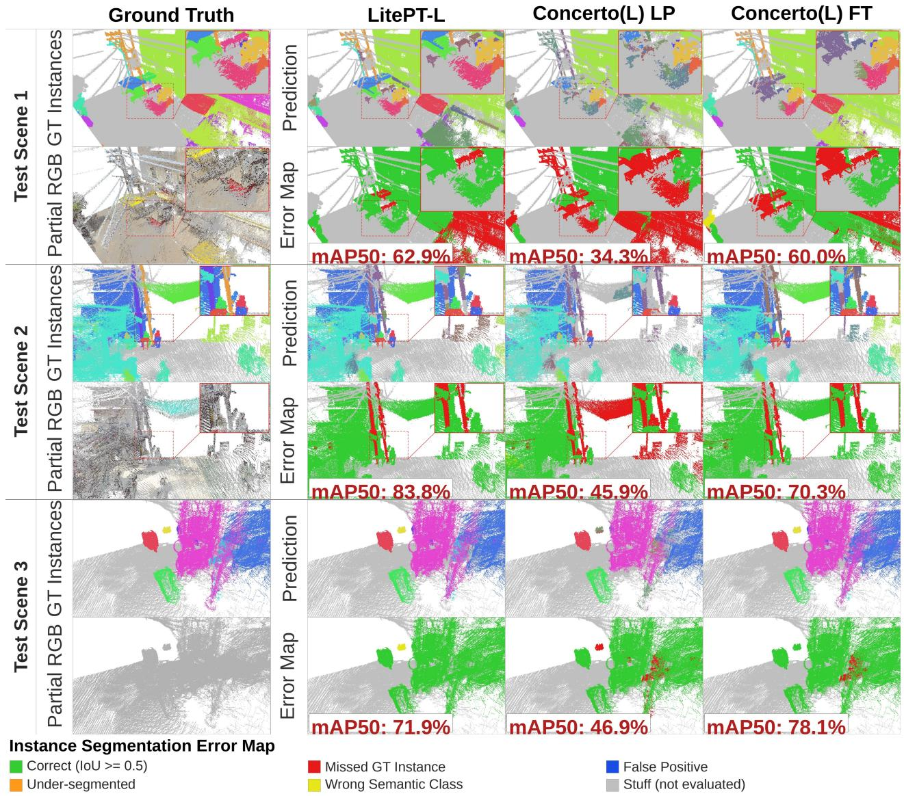  
Figure S9. Qualitative instance segmentation results (12-class) on three BhopalMLS test scenes (same scenes as Fig. S12). Left column: ground truth instances and partial RGB (gray = no RGB coverage). Right columns: predicted instances and error maps for LitePT-L, Concerto(L) LP, and Concerto(L) FT, with per-scene mAP50 annotated on each error map cell. Instance colors are matched across GT and predictions via IoU (> 0.5). Error map legend: green = correct (IoU > 0.5), red = missed GT, blue = false positive, orange = under-segmented, yellow = wrong class, gray = stuff.

Table S10 reports all values at native resolution (FT-9ch) for Concerto(L) [34] (Large, general-purpose pretrained), Concerto(O) (outdoor-pretrained), and Utonia(L) [35] across five MLS datasets: SemanticKITTI (SK) [3], BhopalMLS (BM), Ke-MLS (KM) [10], Toronto-3D (TR) [24], and Paris-Lille-3D (PL) [20]. Each model is fine-tuned on a source dataset (FT-9ch) and evaluated on the target at native resolution, with all labels mapped to the unified 12-class BhopalMLS taxonomy. Values marked 0.00\* indicate classes absent in the source or target dataset and are excluded from metric computation. Concerto(L) and Utonia(L) are reported on all 13 pairs (5 within-domain, 2 intra-Indian, 6 inter-region); Concerto(O) on SK→SK / SK→BM / BM→SK / BM→PL.

This table adds the outdoor-pretrained Concerto(O) variant (absent from Table 5, which reports only Concerto(L) and Utonia(L)), enabling a direct Concerto(L) vs. Concerto(O) comparison:

1. Within-domain (SK→SK): Utonia(L) achieves the strongest within-domain SK transfer (77.14% mIoU), ahead of Concerto(L) (75.09%) and Concerto(O)

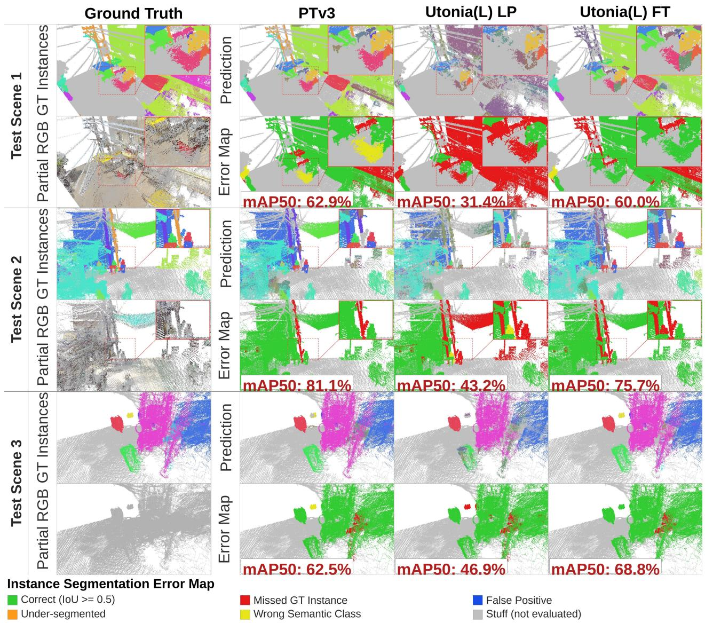  
Figure S10. Qualitative instance segmentation results (21-class) on three BhopalMLS test scenes. Same 2-row layout as Fig. S9, but for the 21-class fine-grained taxonomy (17 thing classes) with the supervised PTv3 baseline and Utonia(L) LP / Utonia(L) FT (per-scene mAP50 annotated on each error map). The finer granularity introduces additional wrong-class errors (yellow) at vehicle and building boundaries where sub-type distinction is required.

(74.65%); the Concerto(L) > Concerto(O) ordering is consistent with the within-dataset advantage of generalpurpose pretraining observed in the main paper (Table 4).

2. SK→BM: this is the pair on which the pretraining corpus separates the two Concerto variants most sharply, Concerto(L) reaching 12.29% mIoU against Concerto(O)'s 3.89%. Both nonetheless collapse from above 74% on their own domain, so the domain gap between structured and unstructured urban environments is not resolved by pretraining strategy alone. Architecture matters more still: Utonia(L) reaches 35.54% mIoU,

2.9× Concerto(L) and 9.1× Concerto(O), driven by far stronger Building (81.51% vs. 64.29%), Vehicle (70.58% vs. 9.15%), and Vegetation (51.37% vs. 9.99%) transfer, indicating that the structured→unstructured gap is narrowed more by the backbone than by the pretraining corpus.

3. BM→SK: Here the trend reverses: Concerto(O) (38.65% mIoU) substantially outperforms Concerto(L) (32.07%). Outdoor-specific pretraining provides a stronger inductive bias for transferring from complex BhopalMLS scenes to the structured SemanticKITTI domain, particularly for Vehicle (81.22% vs. 72.20%),

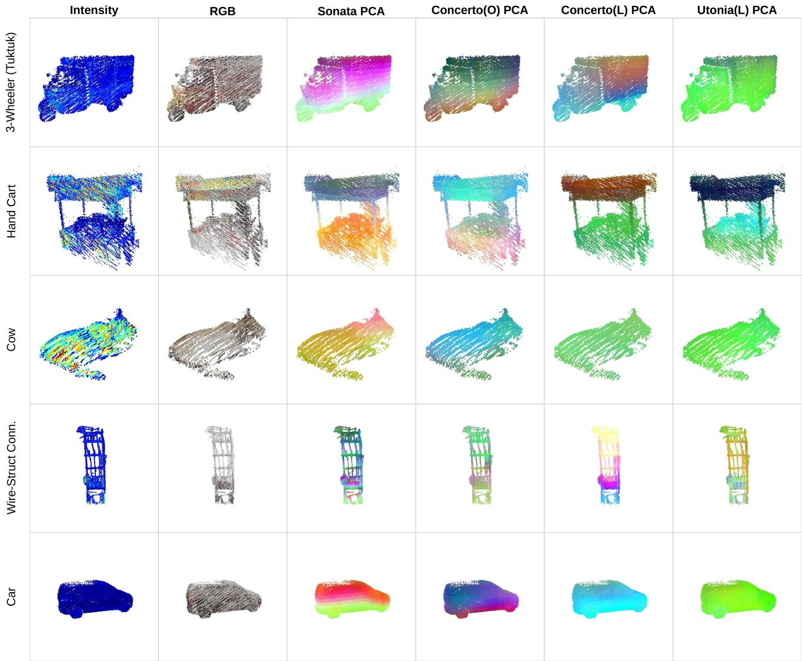  
Figure S11. Instance-level PCA feature visualization. Rows: 3-Wheeler (Tuktuk), Hand Cart, Cow, Wire-Structure Connector (Indiaspecific), and Car (universal). Columns: raw intensity, raw RGB (gray = missing coverage), and PCA projections from Sonata(L), Concerto(O), Concerto(L), and Utonia(L). Similar colors indicate similar learned features.

Building (52.02% vs. 37.10%), and Vegetation (44.53% vs. 25.58%), suggesting that outdoor-specific geometric priors transfer more effectively to structured driving scenes.

4. Within-domain (BM→BM): Concerto(L) achieves 71.06% mIoU over all 12 BhopalMLS classes (nc=12; Table 4), versus 75.09% mIoU on SemanticKITTI (nc=9). The lower within-domain score on BhopalMLS reflects the greater scene complexity and class diversity of dense, unstructured urban environments.

## S10. Factor Attribution for the Transfer Asymmetry

Table S10 establishes that BhopalMLS-trained models transfer outward better than the reverse. This section isolates which property of the dataset produces that advantage, by retraining under controlled ablations rather than by correlating with per-class outcomes.

## S10.1. Design

We build four training subsets of the BhopalMLS training split. All four carry an identical labelled-point budget of approximately 135M points (25% of the split's 540M labelled points, comparable in scale to Paris-Lille-3D), so they differ only in what kind of data is retained (Table S11):

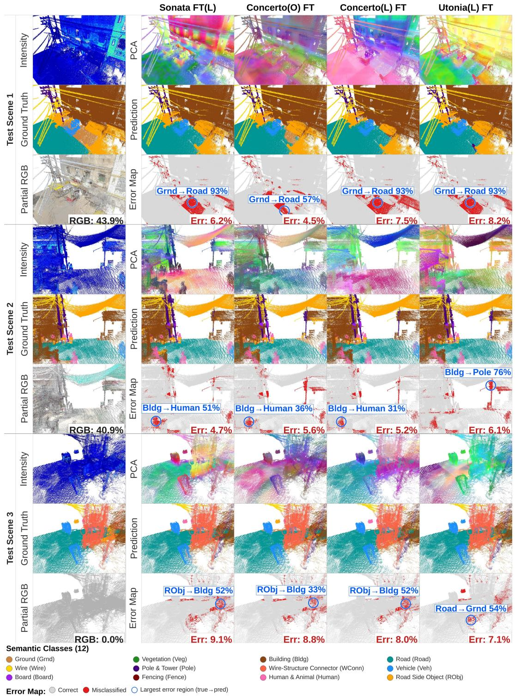  
Figure S12. Scene-level predictions, PCA features, and error maps on three BhopalMLS test scenes. Left column: inputs (intensity, ground truth, partial RGB). Right columns: per-model PCA features, predictions, and error maps (gray = correct, red = misclassified). On each error map a blue circle marks the largest error region (most misclassified points), labeled with that region's majority true→predicted class and local error rate; here the percentage is the fraction of that region's points that are misclassified (e.g., “Veh→Road 93%" = 93% of the region's points are truly Vehicle but predicted as Road; class abbreviations in the legend). The overall per-model error rate (%) is shown at the bottom-right of each cell

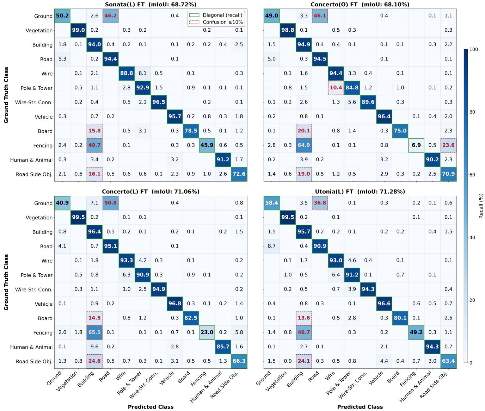  
Figure S13. Row-normalized confusion matrices (12-class) for four fine-tuned foundation models on BhopalMLS test set (486 scenes. 201M+ points). Each row sums to 100%. Diagonal entries (green border) show per-class recall (%); off-diagonal entries ≥10% (red dashed border) highlight significant confusions. mIoU computed over all 12 classes.

• (B1) size. A uniformly random scene subsample. This is the control: it removes data volume and nothing else. B2 and B3 are read against B1, not against the full model, so that the budget reduction they share is already accounted for.

• (B2) variety. Each of the 12 parent classes is collapsed to its single dominant fine subclass by point count; the remaining subclasses become unlabelled and are ignored by the loss. Scene geometry is untouched, and scenes are added until the dominant-subclass labelled budget matches B1. This removes intra-class variety at constant supervision volume.

• (B3) geometry. Scenes are ranked by corridor regularity (wide carriageway, low trajectory curvature) and only the most regular are kept. This removes irregular street geometry.

• (B4) subtype. Identical to B2 except that Vehicle retains Car instead of its dominant subtype. B2 alone cannot distinguish "intra-class variety transfers"from the much weaker "we happened to retain the one subtype the targets lack", because the dominant Vehicle subtype in the training split is the two-wheeler (52% of its Vehicle points) while every target benchmark is car-dominated. B4 retains Car (23% of the same) and changes nothing else, walking B2's scene ordering so the two differ only in which subtype's points count toward the budget

Table S10. Cross-region generalization (FT-9ch, native resolution) of Concerto(L)/(O) and Utonia(L) across SK [3], BM, KM [10]. TR [24], PL [20]. 0.00\*: class absent in source or target (excluded from metrics). mIoU/mAcc are over the common-class intersection of the source and target BM-12 taxonomies, with nc classes per target dataset: BM: 12, KM: 12, PL: 11 (drops Wire-Structure Connector). SK: 9 (drops Wire, Wire-Structure Connector, Road Side Object), TR: 7. When the source has fewer BM-12 classes than the target, nc is bounded by the source (e.g. SK→BM uses $n _ { c } { = } 9 )$ . Per-class IoU (%) is reported in BM-12 taxonomy for all rows. BM→BM rows match Table 4.
<table><tr><td rowspan=1 colspan=1>Model (train → test)</td><td rowspan=1 colspan=3> ((%)   (%) (%) VO</td><td rowspan=1 colspan=12>Wiree .t-sonnHunmmalRodd Si .PoloerBuidingVetatonBoardFencingrndVehideRoadWie</td></tr><tr><td rowspan=1 colspan=1>Within-domain (source t</td><td rowspan=1 colspan=3>arget)</td><td rowspan=1 colspan=12></td></tr><tr><td rowspan=3 colspan=1>Concerto(L) (BM → BM)Utonia(L) (BM → BM)Concerto(L) (KM → KM)</td><td rowspan=1 colspan=3>93.4280.4471.06</td><td rowspan=1 colspan=3>67.7293.7120.14</td><td rowspan=1 colspan=2>25.4169.88</td><td rowspan=1 colspan=1>72.48</td><td rowspan=1 colspan=2>87.1153.07</td><td rowspan=1 colspan=4>97.6792.3487.9185.26</td></tr><tr><td rowspan=1 colspan=3>92.6983.8971.28</td><td rowspan=1 colspan=2>67.3693.38</td><td rowspan=1 colspan=1>38.79</td><td rowspan=1 colspan=1>26.27</td><td rowspan=1 colspan=1>64.24</td><td rowspan=1 colspan=1>68.61</td><td rowspan=1 colspan=2>85.6651.51</td><td rowspan=1 colspan=1>97.41</td><td rowspan=1 colspan=1>91.54</td><td rowspan=1 colspan=1>87.53</td><td rowspan=1 colspan=1>83.03</td></tr><tr><td rowspan=1 colspan=3>92.4074.7967.58</td><td rowspan=1 colspan=3>13.8383.4783.66</td><td rowspan=1 colspan=1>68.43</td><td rowspan=1 colspan=1>76.87</td><td rowspan=1 colspan=1>76.15</td><td rowspan=1 colspan=2>86.040.00</td><td rowspan=1 colspan=1>96.59</td><td rowspan=1 colspan=1>90.15</td><td rowspan=1 colspan=1>86.69</td><td rowspan=1 colspan=1>49.05</td></tr><tr><td rowspan=1 colspan=1>Utonia(L) (KM → KM)</td><td rowspan=1 colspan=3>92.8277.0566.66</td><td rowspan=1 colspan=3>13.5484.2786.85</td><td rowspan=1 colspan=2>69.2683.28</td><td rowspan=1 colspan=1>72.43</td><td rowspan=1 colspan=1>87.33</td><td rowspan=1 colspan=1>0.00</td><td rowspan=1 colspan=1>96.48</td><td rowspan=1 colspan=1>94.47</td><td rowspan=1 colspan=2>87.5524.43</td></tr><tr><td rowspan=2 colspan=1>Concerto(L) (TR → TR)Utonia(L) (TR → TR)</td><td rowspan=1 colspan=3>99.0393.2586.96</td><td rowspan=1 colspan=2>0.00*93.71</td><td rowspan=1 colspan=1>50.18</td><td rowspan=1 colspan=2>0.00*0.00*</td><td rowspan=1 colspan=1>85.41</td><td rowspan=1 colspan=2>99.410.00*</td><td rowspan=1 colspan=1>97.45</td><td rowspan=1 colspan=1>95.61</td><td rowspan=1 colspan=2>86.940.00*</td></tr><tr><td rowspan=1 colspan=3>99.1293.2588.38</td><td rowspan=1 colspan=2>0.00*95.09</td><td rowspan=1 colspan=1>59.90</td><td rowspan=1 colspan=1>0.00*</td><td rowspan=1 colspan=1>0.00*</td><td rowspan=1 colspan=1>84.56</td><td rowspan=1 colspan=2>99.430.00*</td><td rowspan=1 colspan=1>97.83</td><td rowspan=1 colspan=1>95.10</td><td rowspan=1 colspan=2>86.780.00*</td></tr><tr><td rowspan=1 colspan=1>Concerto(L) (PL → PL)</td><td rowspan=1 colspan=3>94.1492.0383.43</td><td rowspan=1 colspan=2>67.1499.07</td><td rowspan=1 colspan=1>55.12</td><td rowspan=1 colspan=1>71.69</td><td rowspan=1 colspan=1>96.79</td><td rowspan=1 colspan=1>90.37</td><td rowspan=1 colspan=1>89.71</td><td rowspan=1 colspan=1>77.50</td><td rowspan=1 colspan=1>82.32</td><td rowspan=1 colspan=1>98.94</td><td rowspan=1 colspan=2>89.110.00*</td></tr><tr><td rowspan=1 colspan=1>Utonia(L) (PL → PL)</td><td rowspan=1 colspan=3>94.8992.1184.77</td><td rowspan=1 colspan=1>67.70</td><td rowspan=1 colspan=1>98.86</td><td rowspan=1 colspan=1>66.38</td><td rowspan=1 colspan=1>74.90</td><td rowspan=1 colspan=1>90.60</td><td rowspan=1 colspan=1>90.45</td><td rowspan=1 colspan=1>91.32</td><td rowspan=1 colspan=1>79.03</td><td rowspan=1 colspan=1>80.85</td><td rowspan=1 colspan=1>99.48</td><td rowspan=1 colspan=2>92.890.00*</td></tr><tr><td rowspan=1 colspan=1>Concerto(L) (SK → SK)</td><td rowspan=1 colspan=3>92.4783.6775.09</td><td rowspan=1 colspan=1>39.19</td><td rowspan=1 colspan=1>78.67</td><td rowspan=1 colspan=1>52.14</td><td rowspan=1 colspan=1>86.43</td><td rowspan=1 colspan=1>83.35</td><td rowspan=1 colspan=1>59.85</td><td rowspan=1 colspan=1>92.98</td><td rowspan=1 colspan=1>0.00*</td><td rowspan=1 colspan=1>86.88</td><td rowspan=1 colspan=1>96.33</td><td rowspan=1 colspan=2>0.00*0.00*</td></tr><tr><td rowspan=1 colspan=1>Concerto(O) (SK → SK)</td><td rowspan=1 colspan=3>91.7982.6274.65</td><td rowspan=1 colspan=1>41.83</td><td rowspan=1 colspan=1>74.83</td><td rowspan=1 colspan=1>51.95</td><td rowspan=1 colspan=1>85.28</td><td rowspan=1 colspan=1>83.72</td><td rowspan=1 colspan=1>59.90</td><td rowspan=1 colspan=1>92.76</td><td rowspan=1 colspan=1>0.00*</td><td rowspan=1 colspan=1>85.54</td><td rowspan=1 colspan=1>96.04</td><td rowspan=1 colspan=2>0.00*0.00*</td></tr><tr><td rowspan=1 colspan=1>Utonia(L) (SK → SK)</td><td rowspan=1 colspan=3>92.6984.8677.14</td><td rowspan=1 colspan=2>43.9681.52</td><td rowspan=1 colspan=1>61.83</td><td rowspan=1 colspan=2>85.0083.63</td><td rowspan=1 colspan=1>62.10</td><td rowspan=1 colspan=2>93.260.00*</td><td rowspan=1 colspan=2>86.1396.85</td><td rowspan=1 colspan=2>0.00*0.00*</td></tr><tr><td rowspan=1 colspan=1>Intra-Indian (BM ↔ KM)</td><td rowspan=1 colspan=3></td><td rowspan=1 colspan=2></td><td rowspan=1 colspan=1></td><td rowspan=1 colspan=2></td><td rowspan=1 colspan=1></td><td rowspan=1 colspan=2></td><td rowspan=1 colspan=4></td></tr><tr><td rowspan=1 colspan=1>Concerto(L) (BM → KM)</td><td rowspan=1 colspan=3>75.4066.4349.23</td><td rowspan=1 colspan=1>7.69</td><td rowspan=1 colspan=1>65.86</td><td rowspan=1 colspan=1>24.86</td><td rowspan=1 colspan=1>12.07</td><td rowspan=1 colspan=1>76.03</td><td rowspan=1 colspan=1>60.92</td><td rowspan=1 colspan=1>71.75</td><td rowspan=1 colspan=1>3.83</td><td rowspan=1 colspan=1>75.22</td><td rowspan=1 colspan=1>85.16</td><td rowspan=1 colspan=1>78.61</td><td rowspan=1 colspan=1>28.72</td></tr><tr><td rowspan=1 colspan=1>Utonia(L) (BM → KM)</td><td rowspan=1 colspan=1>80.99</td><td rowspan=1 colspan=1>74.94</td><td rowspan=1 colspan=1>56.78</td><td rowspan=1 colspan=1>13.44</td><td rowspan=1 colspan=1>76.63</td><td rowspan=1 colspan=1>48.29</td><td rowspan=1 colspan=1>33.49</td><td rowspan=1 colspan=1>80.09</td><td rowspan=1 colspan=1>61.05</td><td rowspan=1 colspan=1>82.09</td><td rowspan=1 colspan=1>6.68</td><td rowspan=1 colspan=1>75.18</td><td rowspan=1 colspan=1>84.23</td><td rowspan=1 colspan=1>79.12</td><td rowspan=1 colspan=1>41.12</td></tr><tr><td rowspan=1 colspan=1>Concerto(L) (KM → BM)</td><td rowspan=1 colspan=1>76.11</td><td rowspan=1 colspan=1>51.29</td><td rowspan=1 colspan=1>32.70</td><td rowspan=1 colspan=1>5.23</td><td rowspan=1 colspan=1>84.39</td><td rowspan=1 colspan=1>23.50</td><td rowspan=1 colspan=1>11.83</td><td rowspan=1 colspan=1>20.33</td><td rowspan=1 colspan=1>28.38</td><td rowspan=1 colspan=1>34.86</td><td rowspan=1 colspan=1>0.14</td><td rowspan=1 colspan=1>56.96</td><td rowspan=1 colspan=1>61.96</td><td rowspan=1 colspan=1>47.06</td><td rowspan=1 colspan=1>17.79</td></tr><tr><td rowspan=1 colspan=1>Utonia(L) (KM → BM)</td><td rowspan=1 colspan=3>78.7753.9033.96</td><td rowspan=1 colspan=2>3.44 87.21</td><td rowspan=1 colspan=1>21.18</td><td rowspan=1 colspan=1>12.81</td><td rowspan=1 colspan=1>21.91</td><td rowspan=1 colspan=1>18.75</td><td rowspan=1 colspan=1>40.59</td><td rowspan=1 colspan=1>1.08</td><td rowspan=1 colspan=1>58.72</td><td rowspan=1 colspan=1>73.11</td><td rowspan=1 colspan=1>55.23</td><td rowspan=1 colspan=1>13.51</td></tr><tr><td rowspan=1 colspan=1>Inter-region (BM ↔ {TR</td><td rowspan=1 colspan=3>, PL, SK})</td><td rowspan=1 colspan=2></td><td rowspan=1 colspan=1></td><td rowspan=1 colspan=1></td><td rowspan=1 colspan=1></td><td rowspan=1 colspan=1></td><td rowspan=1 colspan=1></td><td rowspan=1 colspan=1></td><td rowspan=1 colspan=1></td><td rowspan=1 colspan=1></td><td rowspan=1 colspan=1></td><td rowspan=1 colspan=1></td></tr><tr><td rowspan=1 colspan=1>Concerto(L) (BM → TR)</td><td rowspan=1 colspan=3>94.9984.6775.20</td><td rowspan=1 colspan=1>0.00*</td><td rowspan=1 colspan=1>89.62</td><td rowspan=1 colspan=1>16.06</td><td rowspan=1 colspan=1>0.00*</td><td rowspan=1 colspan=1>0.00*</td><td rowspan=1 colspan=1>66.05</td><td rowspan=1 colspan=1>95.39</td><td rowspan=1 colspan=1>0.00*</td><td rowspan=1 colspan=1>93.98</td><td rowspan=1 colspan=1>85.86</td><td rowspan=1 colspan=1>79.44</td><td rowspan=1 colspan=1>0.00*</td></tr><tr><td rowspan=1 colspan=1>Utonia(L) (BM → TR)</td><td rowspan=1 colspan=1>92.95</td><td rowspan=1 colspan=1>90.36</td><td rowspan=1 colspan=1>77.27</td><td rowspan=1 colspan=1>0.00*</td><td rowspan=1 colspan=1>91.98</td><td rowspan=1 colspan=1>11.23</td><td rowspan=1 colspan=1>0.00*</td><td rowspan=1 colspan=1>0.00*</td><td rowspan=1 colspan=1>74.16</td><td rowspan=1 colspan=1>92.25</td><td rowspan=1 colspan=1>0.00*</td><td rowspan=1 colspan=1>94.42</td><td rowspan=1 colspan=1>94.17</td><td rowspan=1 colspan=1>82.69</td><td rowspan=1 colspan=1>0.00*</td></tr><tr><td rowspan=1 colspan=1>Concerto(L) (TR → BM)</td><td rowspan=1 colspan=1>77.04</td><td rowspan=1 colspan=1>49.52</td><td rowspan=1 colspan=1>39.11</td><td rowspan=1 colspan=1>0.00*</td><td rowspan=1 colspan=1>76.22</td><td rowspan=1 colspan=1>0.81</td><td rowspan=1 colspan=1>0.00*</td><td rowspan=1 colspan=1>0.00*</td><td rowspan=1 colspan=1>18.83</td><td rowspan=1 colspan=1>52.34</td><td rowspan=1 colspan=1>0.00*</td><td rowspan=1 colspan=1>61.73</td><td rowspan=1 colspan=1>17.77</td><td rowspan=1 colspan=1>46.04</td><td rowspan=1 colspan=1>0.00*</td></tr><tr><td rowspan=1 colspan=1>Utonia(L) (TR → BM)</td><td rowspan=1 colspan=1>83.72</td><td rowspan=1 colspan=1>60.66</td><td rowspan=1 colspan=1>51.65</td><td rowspan=1 colspan=1>0.00*</td><td rowspan=1 colspan=1>82.94</td><td rowspan=1 colspan=1>0.00</td><td rowspan=1 colspan=1>0.00*</td><td rowspan=1 colspan=1>0.00*</td><td rowspan=1 colspan=1>22.48</td><td rowspan=1 colspan=1>78.10</td><td rowspan=1 colspan=1>0.00*</td><td rowspan=1 colspan=1>80.94</td><td rowspan=1 colspan=1>30.38</td><td rowspan=1 colspan=1>66.71</td><td rowspan=1 colspan=1>0.00*</td></tr><tr><td rowspan=1 colspan=1>Concerto(L) (BM → PL)</td><td rowspan=1 colspan=1>82.61</td><td rowspan=1 colspan=1>67.55</td><td rowspan=1 colspan=1>48.84</td><td rowspan=1 colspan=1>20.30</td><td rowspan=1 colspan=1>95.82</td><td rowspan=1 colspan=1>21.37</td><td rowspan=1 colspan=1>12.39</td><td rowspan=1 colspan=1>19.86</td><td rowspan=1 colspan=1>25.23</td><td rowspan=1 colspan=1>75.02</td><td rowspan=1 colspan=1>59.76</td><td rowspan=1 colspan=1>60.33</td><td rowspan=1 colspan=1>96.39</td><td rowspan=1 colspan=2>50.720.00*</td></tr><tr><td rowspan=1 colspan=1>Concerto(O) (BM → PL)</td><td rowspan=1 colspan=1>84.87</td><td rowspan=1 colspan=1>73.22</td><td rowspan=1 colspan=1>56.35</td><td rowspan=1 colspan=1>31.50</td><td rowspan=1 colspan=1>97.06</td><td rowspan=1 colspan=1>35.93</td><td rowspan=1 colspan=1>26.01</td><td rowspan=1 colspan=1>75.28</td><td rowspan=1 colspan=1>33.15</td><td rowspan=1 colspan=1>77.49</td><td rowspan=1 colspan=1>40.02</td><td rowspan=1 colspan=1>64.14</td><td rowspan=1 colspan=1>98.25</td><td rowspan=1 colspan=2>41.030.00*</td></tr><tr><td rowspan=1 colspan=1>Utonia(L) (BM → PL)</td><td rowspan=1 colspan=1>85.54</td><td rowspan=1 colspan=1>76.95</td><td rowspan=1 colspan=1>55.68</td><td rowspan=1 colspan=1>24.36</td><td rowspan=1 colspan=1>98.04</td><td rowspan=1 colspan=1>30.82</td><td rowspan=1 colspan=1>28.07</td><td rowspan=1 colspan=1>52.87</td><td rowspan=1 colspan=1>41.00</td><td rowspan=1 colspan=1>78.26</td><td rowspan=1 colspan=1>47.28</td><td rowspan=1 colspan=1>65.48</td><td rowspan=1 colspan=1>97.76</td><td rowspan=1 colspan=1>48.53</td><td rowspan=1 colspan=1>0.00*</td></tr><tr><td rowspan=1 colspan=1>Concerto(L) (PL → BM)</td><td rowspan=1 colspan=1>73.52</td><td rowspan=1 colspan=1>45.85</td><td rowspan=1 colspan=1>31.07</td><td rowspan=1 colspan=1>0.38</td><td rowspan=1 colspan=1>84.74</td><td rowspan=1 colspan=1>20.70</td><td rowspan=1 colspan=1>9.06</td><td rowspan=1 colspan=1>38.23</td><td rowspan=1 colspan=1>14.48</td><td rowspan=1 colspan=1>17.57</td><td rowspan=1 colspan=1>12.49</td><td rowspan=1 colspan=1>58.15</td><td rowspan=1 colspan=1>67.25</td><td rowspan=1 colspan=1>18.76</td><td rowspan=1 colspan=1>0.00*</td></tr><tr><td rowspan=1 colspan=1>Utonia(L) (PL → BM)</td><td rowspan=1 colspan=1>72.38</td><td rowspan=1 colspan=1>40.42</td><td rowspan=1 colspan=1>27.06</td><td rowspan=1 colspan=1>1.34</td><td rowspan=1 colspan=1>80.95</td><td rowspan=1 colspan=1>15.90</td><td rowspan=1 colspan=1>9.11</td><td rowspan=1 colspan=1>31.24</td><td rowspan=1 colspan=1>10.67</td><td rowspan=1 colspan=1>23.22</td><td rowspan=1 colspan=1>8.00</td><td rowspan=1 colspan=1>65.21</td><td rowspan=1 colspan=1>46.33</td><td rowspan=1 colspan=1>5.66</td><td rowspan=1 colspan=1>0.00*</td></tr><tr><td rowspan=1 colspan=1>Concerto(L) (BM → SK)</td><td rowspan=1 colspan=1>53.61</td><td rowspan=1 colspan=1>47.23</td><td rowspan=1 colspan=1>32.07</td><td rowspan=1 colspan=1>0.69</td><td rowspan=1 colspan=1>37.10</td><td rowspan=1 colspan=1>14.12</td><td rowspan=1 colspan=1>45.07</td><td rowspan=1 colspan=1>27.96</td><td rowspan=1 colspan=1>30.82</td><td rowspan=1 colspan=1>35.11</td><td rowspan=1 colspan=1>0.00*</td><td rowspan=1 colspan=1>25.58</td><td rowspan=1 colspan=1>72.20</td><td rowspan=1 colspan=1>0.00*</td><td rowspan=1 colspan=1>0.00*</td></tr><tr><td rowspan=1 colspan=1>Concerto(O) (BM → SK)</td><td rowspan=1 colspan=1>62.56</td><td rowspan=1 colspan=1>50.99</td><td rowspan=1 colspan=1>38.65</td><td rowspan=1 colspan=1>1.87</td><td rowspan=1 colspan=1>52.02</td><td rowspan=1 colspan=1>8.68</td><td rowspan=1 colspan=1>53.32</td><td rowspan=1 colspan=1>38.05</td><td rowspan=1 colspan=1>35.56</td><td rowspan=1 colspan=1>32.56</td><td rowspan=1 colspan=1>0.00*</td><td rowspan=1 colspan=1>44.53</td><td rowspan=1 colspan=1>81.22</td><td rowspan=1 colspan=1>0.00*</td><td rowspan=1 colspan=1>0.00*</td></tr><tr><td rowspan=1 colspan=1>Utonia(L) (BM → SK)</td><td rowspan=1 colspan=2>64.0157.88</td><td rowspan=1 colspan=1>40.05</td><td rowspan=1 colspan=2>16.5448.73</td><td rowspan=1 colspan=1>12.68</td><td rowspan=1 colspan=1>60.91</td><td rowspan=1 colspan=1>40.93</td><td rowspan=1 colspan=1>21.11</td><td rowspan=1 colspan=1>50.41</td><td rowspan=1 colspan=1>0.00*</td><td rowspan=1 colspan=1>37.49</td><td rowspan=1 colspan=1>71.63</td><td rowspan=1 colspan=1>0.00*</td><td rowspan=1 colspan=1>0.00*</td></tr><tr><td rowspan=1 colspan=1>Concerto(L) (SK → BM)</td><td rowspan=1 colspan=3>50.1827.8912.29</td><td rowspan=1 colspan=1>1.07</td><td rowspan=1 colspan=1>64.29</td><td rowspan=1 colspan=1>4.12</td><td rowspan=1 colspan=1>4.44</td><td rowspan=1 colspan=1>0.80</td><td rowspan=1 colspan=1>2.27</td><td rowspan=1 colspan=1>14.49</td><td rowspan=1 colspan=1>0.00*</td><td rowspan=1 colspan=1>9.99</td><td rowspan=1 colspan=1>9.15</td><td rowspan=1 colspan=1>0.00*</td><td rowspan=1 colspan=1>0.00*</td></tr><tr><td rowspan=1 colspan=1>Concerto(O) (SK → BM)</td><td rowspan=1 colspan=3>16.0819.57 3.89</td><td rowspan=1 colspan=1>0.15</td><td rowspan=1 colspan=1>17.17</td><td rowspan=1 colspan=1>0.28</td><td rowspan=1 colspan=1>5.99</td><td rowspan=1 colspan=1>0.00</td><td rowspan=1 colspan=1>4.20</td><td rowspan=1 colspan=1>0.14</td><td rowspan=1 colspan=1>0.00*</td><td rowspan=1 colspan=1>6.83</td><td rowspan=1 colspan=1>0.24</td><td rowspan=1 colspan=1>0.00*</td><td rowspan=1 colspan=1>0.00*</td></tr><tr><td rowspan=1 colspan=1>Utonia(L) (SK → BM)</td><td rowspan=1 colspan=3>77.0455.2835.54</td><td rowspan=1 colspan=8>0.25 81.5123.87 8.73 22.44 1.81 59.330.00*</td><td rowspan=1 colspan=4>51.3770.580.00* 0.00*</td></tr></table>

Each subset is fine-tuned with the recipe, schedule and batch configuration used for the full model in Table 4, then evaluated on KM, TR, PL and SK with the protocol used for Table S10. A factor is judged to matter if destroying it costs markedly more transfer than removing an equal quantity of data does.

The full-model row of Table S12 is carried over from Table S10 rather than recomputed, so to establish that the two are directly comparable we also re-evaluated the unablated model on the ablation hardware through the same wrapper. It reproduces Table S10 to within 0.08 mIoU points on all three of KM, TR and PL (56.78/56.71, 77.27/77.25, 55.68/55.63; largest single-class deviation 0.80). Differences between the full model and the ablated arms are therefore not an artifact of when or where each model was evaluated.

Table S11. Factor-controlled training subsets. All four arms hold the same labelled-point budget, so they are distinguished only by what kind of data survives. B2 holds more scenes and more total points than B1 because ignoring non-dominant subclasses removes supervision without removing geometry, so more scenes are needed to reach the same labelled budget. In-domain mIoU is on the BhopalMLS 12-class test split (FT-9ch, same evaluation as Table 4).
<table><tr><td>Arm</td><td>Removes</td><td>Scenes</td><td>Lab. pts</td><td>In-dom.</td></tr><tr><td>full</td><td>nothing</td><td>1,353</td><td>540.4M</td><td>71.28</td></tr><tr><td>(B1) size</td><td>75% of scenes, at random</td><td>360</td><td>136.1M</td><td>67.99</td></tr><tr><td>(B2) variety</td><td>non-dominant subclass labels</td><td>431</td><td>135.2M</td><td>61.18</td></tr><tr><td>(B3) geometry</td><td>all but regular corridors</td><td>295</td><td>135.5M</td><td>68.61</td></tr><tr><td>(B4) subtype</td><td>as B2, Vehicle keeps Car</td><td>447</td><td>135.2M</td><td>56.34</td></tr></table>

## S10.2. Results

Table S12 reports BM→X mIoU for each arm. Means below are over KM/TR/PL; SK is excluded from them and discussed separately in §S10, Scope.

Supervision, not size or geometry. Read against the size control, mean BM→X falls by 13.0 points under B2 and is unchanged under B3 (+1.0), while B1 itself gives up only 4.0 points against the full model. Dataset size accounts for a small part of the advantage and corridor geometry for none of it.

But it is subtype coverage, not variety in the abstract. B4 retains a single subtype per class exactly as B2 does, and differs only in retaining Car rather than the dominant twowheeler. That one change recovers +7.5 of B2's 13.0-point deficit, i.e. 58% of the collapse is attributable to which subtype survived rather than to how many. The remaining —5.5 against B1 is the genuine cost of collapsing to one subtype at all. Both effects are real, and the larger is coverage.

The mechanism is legible in one class. Vehicle IoU under B2 falls to 13.5 (KM), 4.4 (TR) and 9.7 (PL) against 84.5, 87.4 and 96.5 for the size control at the same budget. Under B4 it returns to 78.0, 70.3 and 95.0, a near-complete recovery achieved with 2.4× fewer Vehicle points than B2 (2.3M against 5.6M). The quantity of supervision is therefore not what matters; its overlap with the target is. B4 even carries more Car supervision than B1 does (2.3M against 1.7M), so B1's success on this class is not a data-volume effect either.

The reading this forces is narrower than "diversity helps", and more useful: BhopalMLS transfers outward because its subtype inventory contains the targets’ subtypes as a subset. Its 15 vehicle subtypes span the car that Toronto-3D, Paris-Lille-3D and SemanticKITTI are built from, plus auto-rickshaws, hand-carts and two-wheelers that they lack. A benchmark holding only the latter would not transfer well outward; a benchmark holding only cars would not exhibit the asymmetry at all.

Table S12. Factor attribution for the transfer asymmetry, Utonia(L) FT-9ch. Values are mIoU (%) on each pair's intersection class set, the same masks as Table S10 $( n _ { c } \colon$ KM 12, TR 7, PL 11, SK 9). The first three rows restate the asymmetry to be explained; the next four are the ablated models; the last four are arm-againstarm contrasts at an equal labelled budget: three give what each factor costs relative to the size control, and the final row, B4 — B2, is the one that narrows the claim: it isolates the effect of which subtype survives, holding the number retained per class fixed at one. The SK column is complete. Bold greenmarks the arm that destroys the most transfer. The contrast rows compare arms at equal budget and so include SK; readings taken against the full model exclude SK, where both control arms exceed it (see §S10, Scope).
<table><tr><td></td><td>In-dom.</td><td>KM</td><td>TR</td><td>PL</td><td>SK</td></tr><tr><td>full model, BM→X</td><td>71.28</td><td>56.78</td><td>77.27</td><td>55.68</td><td>40.05</td></tr><tr><td>reverse, X→BM</td><td>一</td><td>33.96</td><td>51.65</td><td>27.06</td><td>35.54</td></tr><tr><td>asymmetry gap</td><td>一</td><td>22.82</td><td>25.62</td><td>28.62</td><td>4.50</td></tr><tr><td>(B1) size</td><td>67.99</td><td>52.56</td><td>76.17</td><td>48.87</td><td>47.94</td></tr><tr><td>(B2) variety</td><td>61.18</td><td>42.22</td><td>61.63</td><td>34.90</td><td>26.28</td></tr><tr><td>(B3) geometry</td><td>68.61</td><td>49.30</td><td>78.70</td><td>52.56</td><td>46.01</td></tr><tr><td>(B4) subtype</td><td>56.34</td><td>44.12</td><td>71.66</td><td>45.37</td><td>37.88</td></tr><tr><td>B2- B1</td><td>-6.81</td><td>-10.34</td><td>-14.54</td><td>-13.97</td><td>-21.66</td></tr><tr><td>B3- B1</td><td>+0.62</td><td>-3.26</td><td>+2.53</td><td>+3.69</td><td>-1.93</td></tr><tr><td>B4- B1</td><td>-11.65</td><td>-8.44</td><td>-4.51</td><td>-3.50</td><td>-10.06</td></tr><tr><td>B4 - B2</td><td>-4.84</td><td>+1.90</td><td>+10.03</td><td>+10.47</td><td>+11.60</td></tr></table>

## S10.3. The same ranking on a second architecture

The ablations above use Utonia(L). Because the asymmetry itself is claimed across two architectures, we repeated B1–B4 for Concerto(L), reusing the same four training subsets and matching that model's own published fine-tuning settings (micro-batch 4, gradient accumulation 16, its FT seed). Table S13 reports the result. The ordering reproduces:

<table><tr><td>mean over KM/TR/PL</td><td>B2-B1 (variety)</td><td>B3 - B1 (geometry)</td><td>B1 - full (size)</td></tr><tr><td>Utonia(L)</td><td>-12.95</td><td>+0.99</td><td>-4.05</td></tr><tr><td>Concerto(L)</td><td>-13.35</td><td>-0.01</td><td>-0.22</td></tr></table>

Two backbones with different pretraining corpora and different batch configurations agree to within half a point on the cost of collapsing variety, and both put corridor geometry at zero. Concerto(L) makes the size result sharper still: two of its three pairs improve on a quarter of the labelled budget, so at this scale more BhopalMLS data does not buy more outward transfer.

The subtype control replicates as well. Concerto's B4 recovers +5.91 of B2's 13.35-point deficit, i.e. 44% of the collapse is attributable to which subtype survived (Utonia: 58%), and its Vehicle IoU recovers on every pair.

Table S13. The same four ablations on Concerto(L), reusing the identical training subsets and matching that model's own published fine-tuning settings. Values are mIoU (%) on each pair's intersection class set. The ranking reproduces Utonia(L)'s: variety costs ≈13 points against the size control, geometry costs nothing, and size costs nothing measurable, with KM and PL both improving on a quarter of the labelled budget. B4 again recovers a large part of B2's deficit by changing only which subtype survives. Masks are the same as Table S10 (nc: KM 12, TR 7, PL 11, SK 9). The SK column is complete; means quoted in the text remain over KM/TR/PL throughout, so that they stay comparable with Utonia(L), whose SK column is read only as arm-against-arm contrasts at equal budget. Unlike Utonia(L), whose SK control arms exceed the full model, SK behaves here as this architecture's other three pairs do, B1 costing 1.6 points against a 19.78-point gap, so it is a usable fourth pair for Concerto(L).
<table><tr><td></td><td>In-dom.</td><td>KM</td><td>TR</td><td>PL</td><td>SK</td></tr><tr><td>full model, BM→X</td><td>71.06</td><td>49.23</td><td>75.20</td><td>48.84</td><td>32.07</td></tr><tr><td>reverse, X→BM</td><td>一</td><td>32.70</td><td>39.11</td><td>31.07</td><td>12.29</td></tr><tr><td>asymmetry gap</td><td>一</td><td>16.52</td><td>36.09</td><td>17.76</td><td>19.78</td></tr><tr><td>(B1) size</td><td>68.52</td><td>50.50</td><td>72.34</td><td>49.75</td><td>30.45</td></tr><tr><td>(B2) variety</td><td>59.38</td><td>39.74</td><td>60.10</td><td>32.71</td><td>16.82</td></tr><tr><td>(B3) geometry</td><td>68.12</td><td>50.44</td><td>72.63</td><td>49.48</td><td>33.07</td></tr><tr><td>(B4) subtype</td><td>52.96</td><td>40.32</td><td>67.83</td><td>42.13</td><td>25.28</td></tr><tr><td>B2- B1</td><td>-9.14</td><td>-10.76</td><td>-12.24</td><td>-17.04</td><td>-13.63</td></tr><tr><td>B3- B1</td><td>-0.40</td><td>-0.06</td><td>+0.29</td><td>-0.27</td><td>+2.62</td></tr><tr><td>B4- B1</td><td>-15.56</td><td>-10.18</td><td>-4.51</td><td>-7.62</td><td>-5.17</td></tr><tr><td>B4 - B2</td><td>-6.42</td><td>+0.58</td><td>+7.73</td><td>+9.42</td><td>+8.46</td></tr></table>

## S10.4. Two controls

Capability. The ablated arms are also weaker models indomain (61.18 for B2 and 56.34 for B4, against 67.99 for B1 and 71.28 for the full model), and a weaker model loses transfer for free. We therefore normalise each arm's mean transfer loss by its own in-domain loss, both measured against the full model, over KM/TR/PL:
<table><tr><td></td><td>in-domain ∆</td><td>transfer ∆</td><td>ratio</td></tr><tr><td>(B1) size</td><td>-3.29</td><td>-4.05</td><td>1.23×</td></tr><tr><td>(B2) variety</td><td>-10.10</td><td>-17.00</td><td>1.68×</td></tr><tr><td>(B3) geometry</td><td>-2.67</td><td>-3.06</td><td>1.15×</td></tr><tr><td>(B4) subtype</td><td>-14.94</td><td>-9.53</td><td>0.64×</td></tr></table>

B2 gives up 1.68× more out-of-domain than in-domain, so roughly 6.9 points of its transfer loss are not explained by capability. B4 is the only arm below 1.0: it is the weakest model of the four at home yet loses the least transfer relative to that weakness. A model supervised on cars alone underperforms on a two-wheeler-dominated city and outperforms its own capability on car-dominated targets. This is the cleanest single piece of evidence for coverage over diversity, and no other arm exhibits it.

The same signature appears on Concerto(L), computed identically: B1 0.09, B2 1.16, B3 0.08, B4 0.42. On both architectures the variety arm sits above 1.0 and the subtype arm well below it, and on both the subtype arm is the weakest model in-domain (Concerto 52.96, the lowest of any arm) while surrendering the least transfer relative to that weakness. The coverage reading therefore does not depend on the backbone.

One class. Because the effect concentrates on Vehicle, we recompute every arm with Vehicle removed from each pair's intersection mask. The B2 deficit against B1 halves but survives: −4.8 (KM), −3.1 (TR), −6.7 (PL), −14.9 (SK); the KM/TR/PL mean is -4.9 points, -7.4 over all four pairs. It is spread over Ground, Road, Pole and Tower, Wire-Structure Connector and Human and Animal, which are the classes the per-class decomposition behind Table S10 independently identifies as carrying the asymmetry. The correlational and controlled analyses agree. Read alongside B4, this control does the useful work of showing that the collapse is not only a Vehicle story: coverage explains most of B2's loss, but a residue is spread across the thin and unstructured classes where BhopalMLS's subtype inventory is also wider than the targets'.

## S10.5. Scope

Four limits are worth stating. First, on SK both control arms exceed the full model (B1 +7.9, B3 +6.0), and SK's own asymmetry gap is 4.5 points against 22.8–28.6 for the other three pairs, so the SK column is read only as armagainst-arm contrasts at equal budget and is excluded from gap-normalised statements. The evaluation configuration is identical to the full model's, and the full model reproduces to within 0.08 points on the three pairs re-run above, so a 7.9 point gap cannot be an evaluation artifact; the likeliest reading is that part of the full model's SK deficit is BhopalMLS-specific overfitting that a smaller training set avoids. B4 scores 37.88 on SK and is the one arm that does not exceed the full model there; read against the size control it costs —10.06, and against B2 it recovers +11.60, i.e. 54% of that arm's collapse, close to the 58% we quote over KM/TR/PL. The whole SK column is nonetheless omitted from every mean above. Second, B2 and B4 hold 431 and 447 scenes against B1's 360 at matched labelled budget, so they observe more geometry and still transfer worse, which strengthens rather than weakens the conclusion. Third, B4 is a substantially weaker model in-domain than any other arm (—14.94 against the full model), which is expected given that the training split's Vehicle points are 52% two-wheeler and only 23% car; its raw transfer number should therefore not be read on its own, and we quote the capability- normalised ratio instead. Fourth, every arm selects its evaluated checkpoint by best validation mIoU, as the published models do, and on Concerto(L) that selection lands at very different epochs: B1 at 100, B2 at 45, B3 at 84 and B4 at 24. All four trained the full 100 epochs; B4's validation score simply never improved after epoch 24, which is itself consistent with car-only supervision saturating early in a two-wheeler-dominated city. The arms are therefore selected identically, not truncated differently.

Finally, a scope note on what B4 does not establish. It shows that coverage of the target's subtypes dominates within a single manipulated class, Vehicle, which is the class where BhopalMLS's inventory differs most sharply from the targets'. Whether the same balance of coverage and diversity holds for classes with subtler subtype structure is not settled by this experiment. On all four SemanticKITTI cells of the Concerto(L) replication the pair behaves throughout as the other three do. The size control costs 1.6 points against SK's 19.78-point gap, in line with its KM, TR and PL values, and unlike Utonia(L), whose SK controls exceed the full model on a gap of only 4.50. The variety arm costs —13.63 against that control, which sits with this architecture's —13.35 mean over KM, TR and PL and with Utonia(L)'s —12.95. The geometry arm costs nothing at all, at +2.62 against the control, matching the ≈ 0 it returns on the other three pairs. The subtype control recovers +8.46 of the variety arm's deficit, i.e. 62% of the collapse, against 44% on the KM/TR/PL mean. SK therefore reproduces the whole ranking, variety dominant with geometry and size free and coverage explaining most of the variety loss, on a fourth pair. It is nonetheless kept out of the means quoted above, so that those numbers stay comparable with Utonia(L)'s.

## S11. Post-hoc CORAL Domain Adaptation

We add a post-hoc CORAL Domain Adaptation [22] baseline on BM→PL with both Concerto and Utonia frozen FT-9ch encoders. Source features $F _ { S }$ (BM-train) and target features $F _ { T }$ (PL-train) are extracted with the frozen 9-channel backbone (2K points/scene; \~2.59 M source, \~4.22 M target feature vectors per architecture). We compute the closed-form alignment $A = C _ { S } ^ { - 1 / 2 } C _ { T } ^ { 1 / 2 }$ via eigendecomposition (residual ∥cov $( F _ { S } A ) \stackrel { - } { - } \mathrm { c o v } ( \stackrel { - } { F } _ { T } ) \Vert _ { F } = 8 . 3 { \times } 1 0 ^ { - 5 }$ Concerto $/ \ 1 . 4 \times 1 0 ^ { - 4 }$ Utonia, indicating good alignment). A multinomial logistic-regression head is then trained on the CORAL-aligned source features (BM-12 remapped to PL's nc=11; class 6“Wire-Structure Connector"is absent in PL and dropped). For a fair attribution we also train an identity-retrained head (A = I, same features, same subsample, same hyper-parameters) which isolates the headretrain effect from the CORAL effect.

As Table S14 reports, the decomposition is informative: head retraining alone costs —2.6 to —6.1 percentage points (pp) vs. the full-FT seg head (a known artifact of subsampled re-training), but CORAL specifically costs an additional -3.0 to -5.9 pp on nc=11 mIoU and -3.4 to —3.8 pp on common-7 mIoU over the identity-retrained baseline. Closed-form 2nd-order alignment therefore not only fails to close the BM↔PL gap but actively degrades transfer, indicating the gap is structural. It is driven by class-conditional density mismatches between BM (handheld walkway capture, dense Wire / Pole-and-Tower infrastructure, narrow Fencing geometries, Wire-Structure Connector) and PL Lille2 (vehicle-MLS street capture dominated by Ground / Road / Vegetation / Building), rather than a global covariance shift.

## S12. Ethics, Privacy, and Responsible Release S12.1. Collection Context

All data were acquired in public commercial streets of the surveyed district, with the scanner carried on foot and, on longer stretches, mounted on a slow-moving two-wheeler. The operator was openly visible throughout daytime hours; no private interiors, courtyards, or residential compounds were scanned. Each location was traversed once or twice, so any individual appears only transiently.

## S12.2. Consent and Institutional Review

We state both plainly. No individual informed consent was obtained, and no ethics-committee approval was in place at the time of collection; the collection has since been reviewed and approved by the Department Level Ethics Committee of IISER Bhopal (ref. IISERB/DLEC/2026-27/06, approved 15 September 2026). Data collection of this kind is generally not classified as human-subjects research: it involves no interaction or intervention with individuals and gathers no private identifiable information about them. The scanner records public-space geometry along a street, in which passersby appear incidentally; no person is recruited, approached, or asked for information, and no attribute is recorded that could identify one. The safeguards described below are therefore the appropriate mechanism for this setting, rather than a substitute for a review that would not ordinarily apply.

Individual consent is not obtainable for this modality: the scanner records whatever is within line of sight while the operator walks a public street, and the people who appear are passers-by who are present for a few seconds and never interacted with. Seeking consent would require identifying and contacting each of them, which would demand collecting far more personal information than the dataset itself contains. This is the same position occupied by every street-level driving and mapping dataset [3, 4, 14], none of which obtains consent from bystanders.

Absent consent and formal review, the ethical burden shifts entirely to minimisation and to what is actually distributed. The measures below are therefore not a supplement to consent but the substitute for it: imagery is released only with faces and license plates blurred, colour is stripped from every person point, absolute georeferencing is withheld, and a removal channel is provided. We note that the research and statistical purposes provisions of India's Digital Personal Data Protection Act (2023) apply to processing of this kind.

Table S14. Post-hoc CORAL Domain Adaptation on BM→PL with frozen FT-9ch encoder; per-class IoU (%) on PL Lille2 val. vanilla: full-FT seg head. retrain: post-hoc linear head on raw source features (A=I, isolates head-retrain effect). +CORAL: post-hoc linear head on CORAL-aligned source features. nc=11 = PL native taxonomy (drops Wire-Structure Connector, absent in PL). common-7 = {Vegetation, Building, Road, Wire, Pole&Tower, Vehicle, Fencing}. CORAL hurts —3 to —6pp over the identity-retrained baseline; covariance alignment alone cannot close the BM↔PL gap, indicating it is structural rather than a 2nd-order distribution shift.
<table><tr><td>Arch.</td><td>Method</td><td>rund</td><td>Vegtton</td><td>Buidng</td><td>Road</td><td>Wire</td><td>Polwer</td><td>VWeiie</td><td>Board</td><td>Fning</td><td>Hummal</td><td>Road-S-obı</td><td>mIoU11</td><td>mIoU7</td></tr><tr><td rowspan="3">Concerto</td><td>vanilla</td><td>12.39</td><td>60.33</td><td>95.82</td><td>75.02</td><td>50.72</td><td>25.23</td><td>96.39</td><td>20.30</td><td>21.37</td><td>19.86</td><td>59.76</td><td>48.84</td><td>60.70</td></tr><tr><td>retrain</td><td>25.92</td><td>73.61</td><td>91.29</td><td>64.36</td><td>17.74</td><td>29.17</td><td>90.04</td><td>13.31</td><td>15.98</td><td>34.63</td><td>30.98</td><td>44.28</td><td>54.60</td></tr><tr><td>+ CORAL</td><td>25.12</td><td>70.57</td><td>87.39</td><td>64.99</td><td>6.90</td><td>26.96</td><td>87.86</td><td>12.96</td><td>11.04</td><td>24.63</td><td>35.14</td><td>41.23</td><td>50.81</td></tr><tr><td rowspan="3">Utonia</td><td></td><td></td><td>65.48</td><td>98.04</td><td>78.26</td><td>48.53</td><td>41.00</td><td>97.76</td><td>24.36</td><td>30.82</td><td>52.87</td><td>47.28</td><td>55.68</td><td>65.70</td></tr><tr><td>vanilla</td><td>28.07 38.27</td><td>75.08</td><td>94.37</td><td>68.74</td><td>24.39</td><td>36.46</td><td>90.48</td><td>28.28</td><td>41.79</td><td>59.43</td><td>26.31</td><td>53.06</td><td>61.62</td></tr><tr><td>retrain + CORAL</td><td>31.23</td><td>74.32</td><td>90.52</td><td>66.69</td><td>14.60</td><td>33.55</td><td>88.22</td><td>25.69</td><td>39.87</td><td>32.51</td><td>21.74</td><td>47.18</td><td>58.25</td></tr></table>

## S12.3. Personally Identifiable Information and Mitigation

The release comprises point clouds and annotations; blurred 360° imagery follows in a later release.

Imagery is released blurred. A co-mounted 360° panoramic camera was used to colorize the point cloud. This imagery will be distributed under the same access tier as the point cloud, with faces and license plates blurred before release, following the convention established for streetlevel capture by nuScenes [4] and KITTI-360 [14]. Blurring is applied to the released copy itself, so no unblurred imagery leaves our control under any tier. It is one of four independent layers rather than a single safeguard: per-point RGB is additionally removed on every person point, absolute georeferencing is withheld, and the removal channel of Sec. S12.5 covers imagery as well as points.

Point cloud. The point cloud is distributed at its native 4.9 cm spacing. At this resolution a human face subtends roughly a 3×3 patch of points and a license plate roughly 10×2 points, below photographic identifiability; nevertheless, per-point RGB is removed on all points labeled with person classes before release. Person classes are taken from the fine taxonomy and include riders on two- and threewheelers, who fall under Vehicle in the coarse taxonomy; taken together, people account for 2.9% of the points. The dataset already uses a zeros-as-missing RGB convention (RGB covers roughly 40% of points), so this removal is format-transparent and the released benchmarks are unaffected. The same removal is applied to every derived artifact we publish, including the sample clouds shown on the project page. Geometry is not modified: consistent with Li-DAR benchmarks that release unmodified geometry [3, 4], the sparse surface geometry of a transient pedestrian is not considered identifying.

Georeferencing. The release for users outside India withholds the absolute geographic offset (main paper, Data, Code, and Access). Beyond regulatory compliance, this limits linking any person or premise to a precise location. Geometry, density, intensity, and annotations are unchanged, and because models operate on relative coordinates, all reported metrics are identical in both forms.

## S12.4. Demographic Annotation Categories

The fine taxonomy includes Male, Female, and Child person subclasses. These are annotator-perceived visual categories, not identity attributes: they support aggregate analyses of street use and accessibility (for example, pedestrian exposure by demographic group in unstructured corridors) that motivated the dataset. They are folded into the Human & Animal category in the released 12-class benchmark and into Human in the 21-class benchmark, so no benchmark task depends on them. No name, face, or other identifier is associated with any instance, and the anonymization above applies to all person points regardless of subclass.

## S12.5. Content Removal

A contact address is published with the dataset. Any person who believes they or their property are identifiable in the released data may request removal; verified requests are honored by masking the affected points and imagery in a versioned re-release.

## S12.6. Regulatory Basis

Collection and release are consistent with the research and statistical purposes provisions of India's Digital Personal Data Protection Act (2023) and with the National Geospatial Policy (2022) governing geospatial data distribution, which is why the release for users outside India withholds the absolute offset.