# Bridging CLIP with DINO: Cross-Modal Information Maximization for Online Test-Time Adaptation

Taehoon Kim1 Wonjun Hwang1∗ Hyunsouk Cho2∗

1Korea University, 2Ajou University

{th951113, wjhwang}@korea.ac.kr, hyunsouk@ajou.ac.kr

## Abstract

Vision-language models such as CLIP enable zero-shot classification from arbitrary class names, but under test-time corruptions, their visual encoder projects distorted features onto incorrect textual anchors with high confidence: a phenomenon we term modality bias. Standard entropy minimization reinforces these overconfident errors, which creates a confirmation-bias loop and collapses the predicted label distribution. We propose an online test-time adaptation (TTA) method that breaks this loop at three levels. At the representation level, a frozen self-supervised backbone (e.g., DINO v2) is combined with CLIP through a cross-covariance logit ensemble. CLIP text prototypes are projected into the feature space of this text-free backbone, so the self-supervised branch classifies native image features and is less affected by the text bias of CLIP. At the optimization level, a gated test-time information-maximization objective pairs per-sample sharpening with batch-level diversity, while an adaptive gate excludes unreliable samples from the gradient. At the prediction level, an online logit adjustment corrects the residual class-distribution skew. CDIM outperforms the compared CLIP-based online TTA baselines on ImageNet-C, CIFAR10-C, and CIFAR100-C, and remains competitive in continual and mixed-domain TTA. Extensive analyses and ablation studies verify the contribution of each of its components. Our code is available at https://github.com/B1ueC1oud/CDIM.

## 1 Introduction

The exceptional performance of modern deep learning heavily relies on the premise of identical training and test distributions [32, 51, 23]. This premise is routinely violated in practical applications. When deployed in the wild, models often face dynamic environmental changes such as sensor artifacts or weather fluctuations, which lead to severe performance deterioration [24, 48, 17, 18, 16]. Fully retraining the model to handle these shifts is often infeasible due to computational constraints or privacy concerns regarding the original source data. Test-time adaptation (TTA) addresses this gap by adapting a source-pretrained model during inference, using only a stream of unlabeled target data [53, 54]. Because TTA requires neither source data nor a supervised loss, it can be applied in safety-critical settings such as autonomous driving and industrial anomaly detection. A recent line of work replaces the source-trained backbone with a vision–language model such as CLIP [47], removing the cost of task-specific pre-training and providing a zero-shot classifier for any list of class names [38, 33, 4, 59]. However, the open-vocabulary prior of CLIP does not protect the model against the low-level shifts that TTA has to handle: zero-shot accuracy on corrupted inputs [24] drops sharply with corruption severity. Recent analyses suggest that this drop is related to the language supervision of CLIP. The visual encoder of CLIP is strongly aligned with text semantics and projects visual features onto text-interpretable directions [15]. As a result, it retains less of the low-level visual structure required for recognition under corruption than text-free selfsupervised models do [42, 36]. When this structure is corrupted, the model tends to project the distorted image onto the nearest, and often incorrect, textual anchor with high confidence [10]. We refer to this tendency as modality bias. Because the model relies on its text bias rather than the corrupted visual evidence, it produces false positives with very high confidence [10]. Entropy-style adapters [54] use the prediction of the model as the learning target, so a confident error is reinforced instead of corrected [3]. Modality bias therefore contributes to confirmation bias in CLIP-based TTA. The predicted class distribution then drifts away from a balanced one and concentrates on a small subset of anchor classes [33]. This is a compound failure: modality bias feeds confirmation bias, which in turn amplifies the class-distribution skew on the next batch. Figure 1 visualizes the confidence distribution of incorrect predictions on ImageNet-C (all corruptions, severity 5).

CLIP optimized with entropy minimization (TENT, red) concentrates its errors at nearperfect confidence (> 0.95) during TTA. This pattern is consistent with confirmation bias driven by modality bias: entropy minimization sharpens the class that the model already predicts, so a confident error is reinforced rather than corrected. CLIP+TENT reaches only 25.2% mean accuracy.

To address this, we propose CDIM (Crossmodal DINO-anchored Information Maximization), which addresses modality bias across three distinct levels of the adaptation pipeline. First, at the representation level, we augment CLIP with a frozen selfsupervised backbone (DINO v2 [42]) that serves as a complementary anchor, since its training is independent of text supervision. Recent analyses indicate that CLIP, owing to language supervision, emphasizes high-level semantics, whereas text-free self-supervised models such as DINO are more sensitive to low-level visual structure [36, 27]. By pro-

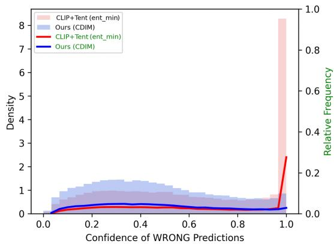  
Figure 1: Confidence of incorrect predictions on ImageNet-C (all corruptions, severity 5). CLIP-based entropy minimization (red) assigns high confidence even to incorrect predictions under corruption. CDIM (blue) shifts the confidence of incorrect predictions toward moderate values, which yields a flatter distribution. The corresponding reliability diagram and ECE with 10 equal-width bins are shown in Figure 2b.

jecting CLIP’s text prototypes into the DINO feature space via a cross-covariance logit ensemble, we stabilize the per-batch prediction against the text-biased drift. Second, at the optimization level, we replace standard entropy minimization with gated information maximization. This objective, which we call GT-IM, pairs per-sample sharpening with a batch-level diversity term [30, 35]. An adaptive confidence gate excludes the most unreliable samples from the sharpening gradient to prevent noisy updates from corrupting the adaptation [40]. Third, at the prediction level, we correct the residual class-distribution skew at inference time. An online logit adjustment (OLA) tracks the predicted class frequencies with an exponential moving average and counteracts the label-distribution drift that modality bias induces even after the representation has been corrected. OLA follows the logit-adjustment rule of [39] and is used here as a uniform-target prior-balancing correction. Figure 1 (blue) shows that, under CDIM, the confidence of incorrect predictions shifts toward moderate values (0.1 to 0.4). Incorrect predictions therefore no longer act as near-one-hot targets that entropy-style updates reinforce, which breaks the confirmation-bias loop described above.

• We identify modality bias, the tendency of the CLIP visual encoder to project corrupted features onto incorrect textual anchors with high confidence, as a contributor to confirmation bias in CLIP-based TTA. Figure 1 shows its effect on the confidence distribution.

• We propose CDIM, which combines a frozen DINO v2-anchored logit ensemble, a gated test-time information-maximization objective (GT-IM), and an online logit adjustment to address modality bias at three complementary levels of the adaptation pipeline.

• Under the online protocol, CDIM outperforms the strongest CLIP-based online TTA baseline by +4.8%, +3.5%, and +3.7% on ImageNet-C, CIFAR10-C, and CIFAR100-C, respectively. It remains competitive under the continual and mixed-domain protocols. These gains require one additional frozen DINO v2 forward pass per batch (Appendix A.4).

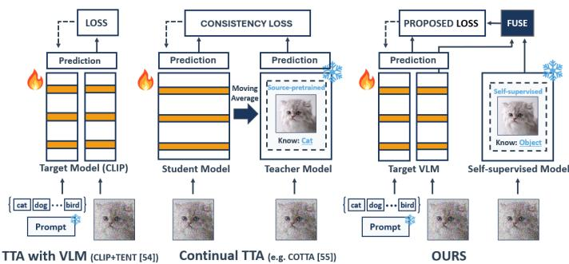  
(a) Comparison of CDIM with standard TTA paradigms

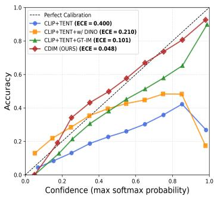  
(b) Reliability diagram.

Figure 2: (a) Left: standard TTA uses a vision-language model (e.g., CLIP) that adapts through entropy minimization on its own predictions. Middle: continual TTA (CTTA) uses a source-pretrained backbone and a moving-average teacher to enforce teacher-student consistency. Right: CDIM adds a frozen self-supervised backbone, in a role similar to that of the teacher in the middle, to support the target CLIP. (b) Reliability diagram with 10 equal-width bins. CLIP+TENT (blue) is severely over-confident (below the y = x line, $\mathrm { E C E } = 0 . 4 0 0 )$ ). Adding the DINO v2 ensemble (orange) or GT-IM (green) alone lowers the ECE to 0.210 and 0.101, respectively, and the full CDIM (red) reaches the lowest ECE (0.048).

## 2 Related Work

TTA with vision–language models. Test-time adaptation (TTA) updates pre-trained models on unlabeled target streams without source data, typically via entropy minimization [54] or teacherstudent consistency for continual shifts [55]. Recently, TTA has increasingly adopted vision-language models like CLIP [47]. Although early work adapted only the text modality [50, 14, 52, 37, 46, 2], recent methods update the visual or joint encoders using multimodal alignment objectives, such as matching class means or principal directions [38, 33, 4, 59]. Alternatively, [22] adapts self-supervised backbones with mean-feature classifiers to avoid costly supervised pre-training. CDIM instead retains CLIP as the primary backbone and adds a frozen self-supervised model as an auxiliary branch. The representations of both backbones are combined for online adaptation on each test batch.

Self-supervised visual backbones next to CLIP. Recent studies show that self-supervised models such as DINO [6, 42] extract fine-grained, low-level visual features that complement the highlevel semantic representations of CLIP [27, 36]. Several recent works combine the two models for other tasks: NoLA [26] uses DINO to prompt-tune CLIP for label-free classification, while others inject DINO’s localization priors to enhance open-vocabulary segmentation [57, 5]. Most notably, COSMIC [25] integrates CLIP and DINO features in a training-free cache-based protocol with multi-view augmentation. These works share our intuition that a self-supervised view can recover information lost by the image-text view under shifted or fine-grained conditions. Prior analyses indicate that CLIP mainly encodes high-level semantics, whereas self-supervised models, exemplified by DINO [42, 6], retain more low-level information such as color, style, and fine-grained localization [27, 36]. CDIM combines the two representations to handle the unsupervised domain shifts encountered during TTA.

## 3 Proposed Method

We propose CDIM (Cross-modal DINO-anchored Information Maximization), an online test-time adaptation method for CLIP-based classifiers. CDIM consists of three core components, each designed to mitigate modality bias at a distinct level of the adaptation pipeline:

1. Representation-level (Section 3.2): a cross-modal logit ensemble with a frozen DINO v2 backbone stabilizes the prediction by projecting text prototypes into the DINO feature space, reducing the text-biased drift of CLIP alone.

2. Optimization-level (Section 3.3): a gated test-time information-maximization objective (GT-IM) pairs per-sample sharpening with batch-level diversity, while an adaptive confidence gate excludes unreliable samples from the gradient.

3. Prediction-level (Section 3.4): an online logit adjustment corrects the residual class-distribution skew using an EMA estimate of the class prior.

Figure 2a compares CDIM with standard TTA paradigms. Standard TTA with CLIP (left) relies solely on the predictions of the target model through entropy minimization. CTTA (middle) enforces consistency with a moving-average teacher. CDIM (right) uses a frozen self-supervised backbone to anchor the adaptation of the target vision-language model, in a role similar to that of the teacher in CTTA.

## 3.1 Problem Setup and Notation

Online TTA with CLIP. Following [38], we apply the standard online TTA setting [54] specialized to a CLIP-based classifier. A pre-trained CLIP model $f _ { \theta } = ( f _ { \theta } ^ { \mathrm { i m g } } , f _ { \theta } ^ { \mathrm { t x t } } )$ is deployed on a sequence of unlabeled test batches $\{ \mathbf { X } _ { t } \} _ { t = 1 } ^ { T }$ , each of size $B ,$ drawn from a target distribution that may itself drift across t. The model returns its predictions online, and its parameters are updated once per batch by an unsupervised objective. No source data, no target labels, and no second pass over a batch are available [54, 55]. The adapter returns at every step a probability vector $p _ { t } ( y \vert \mathbf { \dot { x } } ) \in \Delta ^ { K - 1 }$ over the K classes named in the prompt template “a photo of a <class>”.

Backbones. CDIM pairs CLIP with a frozen self-supervised image backbone g from the DINO family [6, 42]; we use DINO v2 with ViT-B/14 as the default. The auxiliary backbone g is frozen throughout the stream and, unlike the weight-averaged teacher of CoTTA [55], is never updated. It provides text-free self-supervised visual features that the contrastive image-text training of CLIP does not directly preserve [36, 27]. Following [54] and [38], the learnable parameters are restricted to the channel-wise affine parameters $\{ \gamma _ { l , k } , \bar { \beta _ { l , k } } \}$ of the normalization layers in the CLIP image and text encoders. All other parameters of CLIP, together with all parameters of g, are frozen.

Notation. For a batch of B test images, let $\mathbf { C } \in \mathbb { R } ^ { B \times d _ { c } }$ and $\mathbf { D } \in \mathbb { R } ^ { B \times d _ { d } }$ denote the $\ell _ { 2 }$ -normalized image features from CLIP and DINO, respectively. Let $\mathbf { T } \in \mathbb { R } ^ { K \times d _ { c } }$ denote the $\ell _ { 2 } \cdot$ -normalized text features for the K class prompts. Throughout, $\begin{array} { r } { H ( p ) = - \sum _ { c } p _ { c } \log p _ { c } } \end{array}$ is the Shannon entropy in nats. The inverse temperatures of the CLIP and DINO branches are denoted $\tau _ { C } ^ { - 1 }$ and $\tau _ { D } ^ { - 1 }$ , respectively.

## 3.2 Representation-level: Cross-Modal Logit Ensemble

Modality bias drives the failure of CLIP under corruption by projecting distorted features toward incorrect textual anchors [38, 4, 59, 33]. An adapter that relies only on CLIP is therefore limited by its own training signal, because the image-text similarity on which it depends has already been distorted by modality bias. To address this, we introduce a frozen, non-contrastive image backbone (DINO v2) and combine it with CLIP at the logit level. The resulting ensembled zero-shot classifier is expected to be more robust to the text-biased drift of CLIP alone. The projection goesfrom text to DINO space and not the reverse. The DINO image features D remain in their native feature space and are never projected toward text-interpretable directions, which avoids replicating the text-biased projection that causes modality bias in CLIP (Section 1).

DINO-space text prototypes. To enable the frozen DINO v2 backbone to act as a zero-shot classifier over the same K classes, we project the CLIP text prototypes into the DINO feature space through the cross-covariance between the image features of the two backbones, computed over the current batch:

$$
\begin{array} { r } { \bar { \bf M } = \frac { 1 } { B } { \bf C } ^ { \top } { \bf D } , \qquad \widetilde { \bf T } ^ { \mathrm { D } } = \mathrm { n o r m } \big ( \bar { \bf M } ^ { \top } { \bf T } ^ { \top } \big ) \in \mathbb { R } ^ { d _ { d } \times K } , } \end{array}\tag{1}
$$

where norm $( \cdot )$ denotes column-wise $\ell _ { 2 }$ -normalization. The factor $1 / B$ makes $\bar { M }$ an empirical average whose expectation does not depend on the batch size. The construction is parameter-free and batch-local. It adapts the text prototypes to each test batch without any learned mapping between the two backbones.

Unlike a prior method [9] that builds prototypes from source data before deployment, these prototypes are obtained from the CLIP text features and the current batch alone.

Logit ensemble. We form the per-backbone logits and their ensemble:

$$
\begin{array} { r } { \mathbf { Z } ^ { \mathrm { C } } = \tau _ { C } ^ { - 1 } \mathbf { C } \mathbf { T } ^ { \top } , \qquad \mathbf { Z } ^ { \mathrm { D } } = \tau _ { D } ^ { - 1 } \mathbf { D } \tilde { \mathbf { T } } ^ { \mathrm { D } } , } \end{array}\tag{2}
$$

$$
\begin{array} { r } { \mathbf { Z } ^ { \mathrm { e n s } } = \frac { 1 } { 2 } \big ( \mathbf { Z } ^ { \mathrm { C } } + \mathbf { Z } ^ { \mathrm { D } } \big ) , \qquad p _ { i c } = \mathrm { s o f t m a x } _ { c } \big ( \mathbf { Z } _ { i , : } ^ { \mathrm { e n s } } \big ) . } \end{array}\tag{3}
$$

Here $\tau _ { C } ^ { - 1 }$ is the pretrained logit scale of CLIP, and $\tau _ { D } ^ { - 1 }$ is a fixed scale of the DINO branch. The ensembled logits ${ \bf Z } ^ { \mathrm { e n s } }$ are the quantity on which both the GT-IM objective (Section 3.3) and the online logit adjustment (Section 3.4) operate. By averaging the predictions of a text-aligned backbone (CLIP) and a text-free backbone (DINO v2), the ensemble is partially robust to the modality bias that affects CLIP alone. On corrupted batches, the DINO-projected classifier classifies native DINO image features and is therefore less directly tied to the text-biased drift of CLIP [36, 27]. In Figure 2b, the cross-modal ensemble (orange line) lowers the Expected Calibration Error (ECE) of the CLIP+TENT baseline (blue line) from 0.400 to 0.210. Because the underlying objective is unchanged, confirmation bias still persists. The next section therefore introduces an objective that alleviates it.

## 3.3 Optimization-level: Gated Test-time Information Maximization

The canonical TTA objective is per-sample entropy minimization [54], which sharpens each prediction toward a single anchor. When applied alone to a contrastively pre-trained classifier such as CLIP, this objective tends to collapse the predicted label distribution onto a reduced subset of the anchors as the stream progresses [33]. This collapse is the test-time form of the confirmation bias identified in pseudo-label training [3, 45]. The standard mitigation in unsupervised classification pairs the per-sample sharpening with a batch-level diversity term, which yields the information-maximization decomposition [30, 35]. This decomposition operationalizes the cluster assumption [19, 7]. We adopt it and add an adaptive confidence gate that filters unreliable samples out of the sharpening term to suit online TTA. The resulting objective is called Gated Test-time Information Maximization (GT-IM) and consists of two parts.

Adaptive confidence gating. Not all samples in a corrupted batch contribute equally to the adaptation signal. On severely corrupted inputs, modality bias can distort the ensembled posterior so strongly that the per-sample entropy gradient becomes noise-dominated rather than class-informative. Including such samples in the sharpening term risks propagating noisy gradients into the normalization-layer update [40]. Because these samples cannot be identified without test labels, the least confident samples in each batch are excluded from the sharpening term instead. Each sample is scored by the negative log-sum-exp of its ensembled logits, which serves as an uncertainty score:

$$
E _ { i } = - \log \sum _ { c = 1 } ^ { K } \exp \bigl ( z _ { i c } ^ { \mathrm { e n s } } \bigr ) .\tag{4}
$$

$E _ { i }$ is low when the largest ensembled logits are large, which we interpret as high confidence. Because it is computed from the logits rather than from the softmax output, it reflects the magnitude of the logits and is not invariant to a constant shift of $z _ { i } .$ . In each batch, the $k = \operatorname* { m a x } ( 1 , \lfloor \rho B \rfloor )$ samples with the largest $E _ { i }$ are discarded from the sharpening term:

$$
\mathcal { G } _ { i } = \mathbb { M } \{ E _ { i } < E _ { ( B - k + 1 ) } \} ,\tag{5}
$$

where $E _ { ( j ) }$ is the $j \mathrm { - t h }$ smallest value in the batch $\{ E _ { 1 } , \dots , E _ { B } \}$ . For $B \geq 1 / \rho ,$ , this retains $\lceil ( 1 - \rho ) B \rceil$ samples. The number of discarded samples is fixed by $\rho ,$ but the threshold adapts to the score distribution of each batch. This contrasts with the absolute entropy threshold of [40], which can reject an entire “hard” batch. The quantile-based selection consistently retains the most informative (1−ρ) fraction, ensuring a stable adaptation signal regardless of the batch difficulty.

GT-IM objective. Let $\mathbf { p } _ { i } = \mathrm { s o f t m a x } ( \mathbf { Z } _ { i , : } ^ { \mathrm { e n s } } ) \in \Delta ^ { K - 1 }$ be the ensemble posterior on sample $i ,$ and let $\bar { \mathbf p } = ( 1 / B ) \sum _ { i = 1 } ^ { B } \mathbf p _ { i }$ be the batch-mean prediction. The GT-IM loss applies the gating mask to the conditional-entropy term while computing the marginal-entropy term from thefull batch:

$$
{ \mathcal { L } } _ { \mathrm { G T - I M } } = \underbrace { { \frac { \sum _ { i = 1 } ^ { B } \mathcal { G } _ { i } H ( \mathbf { p } _ { i } ) } { \sum _ { i = 1 } ^ { B } \mathcal { G } _ { i } } } } _ { \mathrm { g a t e d ~ c o n d i t i o n a l ~ e n t r o p y } } - \underbrace { H ( \bar { \mathbf { p } } ) } _ { \mathrm { m a r g i n a l ~ e n t r o p y } } .\tag{6}
$$

The gradient of the conditional term sharpens each retained $\mathbf { p } _ { i }$ toward its dominant anchor. The gradient of the marginal term pushes p¯ toward the uniform distribution over the K text anchors, which prevents the label-set collapse observed in [33]. The gate is applied asymmetrically. It excludes the least reliable samples, whose per-sample entropy gradients are noise-dominated, from the sharpening term. The marginal term is computed from the full batch, so that p¯ is not biased by the gate and keeps the retained samples from collapsing onto a few anchors. Eq. (6) therefore combines two different sample sets, and it is an information-maximization objective rather than the mutual information of a single distribution. The two terms are weighted equally and require no balancing hyperparameter. In Figure 1, CDIM moves the confidence of incorrect predictions from high values (> 0.95) to a moderate range (0.1–0.4), so these predictions no longer serve as near-one-hot targets that the update reinforces. The marginal term additionally penalizes the collapse of the batch-level prediction onto a few classes. With GT-IM the ECE of CLIP+TENT drops from 0.400 to 0.101 (Figure 2b).

Why GT-IM fits the ensembled-logit setting. Two properties of the ensembled CLIP/DINO logits ${ \bf Z } ^ { \mathrm { e n s } }$ make GT-IM suitable for this setting. First, the ensembled logits combine two zero-shot classifiers that share the same text-anchor set but read images through two different backbones [47, 42]. Their average has a lower ECE than the CLIP-based baseline on corrupted batches (Figure 2b). The marginal-entropy term of GT-IM acts directly on this averaged posterior, whereas a per-sample entropy update [54] ignores cross-sample information. Second, the ensembled posterior mixes a trainable backbone (CLIP) with a branch whose image features are frozen (DINO v2). The batchmean p¯ is therefore partially anchored by a component whose image features are never updated. The prototypes $\widetilde { \mathbf { T } } ^ { \mathrm { { D } } }$ are recomputed for every batch from the current CLIP features and receive no gradient, so the anchor is only partial. The GT-IM diversity term thus operates on a quantity that is expected to be more stable than the previous CLIP-based prediction on which the label-set collapse of [33] was observed (Figure 3c).

Distinctions from prior work. A prior method [60] minimizes the entropy of the marginal prediction over augmentations of one test sample. In contrast, the marginal term $H ( \bar { p } )$ in Eq. (6) is maximized over samples in a batch to prevent label collapse. The information-maximization decomposition follows [30, 35], and [9] uses the same decomposition with source prototypes, which CDIM does not require. GT-IM differs in the asymmetric gate, the marginal term applied to the cross-modal ensembled posterior, and the partial anchoring of p¯ by the frozen DINO v2 image features.

## 3.4 Prediction-level: Online Logit Adjustment

Our objective in Eq. (6) addresses the propagation of modality bias at the optimization level: its marginal-entropy term pushes the batch-mean prediction p¯ toward the uniform distribution, preventing the predicted label distribution from collapsing onto a biased subset of text anchors. However, GT-IM operates at the gradient level and acts only on the current batch. It does not correct the residual class-distribution skew that has already accumulated in the ensembled logits ${ \bf Z } ^ { \mathrm { e n s } }$ by the time of the final prediction, which is irreversible in the online TTA setting. Residual skew may persist after GT-IM for two reasons. First, the cross-modal ensemble retains a residual dependence on CLIP, which can cause the model to still favor dominant text anchors [10, 8]. Second, as the model adapts to the online stream [55], skew inherited from past updates accumulates, and batch-local GT-IM gradients cannot instantaneously correct this prolonged bias.

Both challenges resemble test-time label shift [44]. Since the residual class skew behaves like a label shift, it can be corrected by a single training-free adjustment of the logits, which we call online logit adjustment (OLA). OLA is a prior-balancing correction in the spirit of the logit-adjustment rule of [39] and the prior-shift correction of [49]. If the posterior of a classifier was formed under a class prior $\pi ^ { S }$ , moving it to a target prior $\pi ^ { T }$ shifts the logits by

$$
f _ { c } ^ { \mathrm { a d j } } ( x ) = f _ { c } ( x ) + \log \frac { \pi _ { c } ^ { T } } { \pi _ { c } ^ { S } } .\tag{7}
$$

We use Eq. (7) with two choices. First, the target is uniform, $\pi _ { c } ^ { T } = 1 / K$ . Second, because the class prior implicitly encoded in the ensembled logits under corruption is unknown, $\pi ^ { S }$ is replaced by the model-induced prior $\bar { \pi } ^ { ( t ) }$ , a running average of the model’s own predicted class frequencies. As log $\pi _ { c } ^ { T } = - \log K$ does not change the arg max, Eq. (7) reduces to

$$
z _ { i c } ^ { \mathrm { a d j } } = z _ { i c } ^ { \mathrm { e n s } } - \log \bar { \pi } _ { c } ^ { ( t ) } ,\tag{8}
$$

where $\bar { \pi } _ { c } ^ { ( t ) }$ estimates the model-induced (effective source) prior of class c at batch step $t ,$ not the true target prior. Eq. (8) is an anti-frequency penalty. It follows the balanced-error-optimal rule of [39] under a uniform target, but it is not a Bayes-optimal estimate of the true label distribution. It presumes that the target class marginal is close to uniform. Figure 3b illustrates the predicted class frequencies that this correction acts on. The prior is estimated from the model’s own predictions via an exponential moving average (EMA) of the per-batch softmax frequencies:

$$
\hat { \pi } _ { c } ^ { ( t ) } = \frac { 1 } { B } \sum _ { i = 1 } ^ { B } p _ { i c } , \qquad \bar { \pi } _ { c } ^ { ( t ) } = \alpha \bar { \pi } _ { c } ^ { ( t - 1 ) } + ( 1 - \alpha ) \hat { \pi } _ { c } ^ { ( t ) } ,\tag{9}
$$

with α as a hyperparameter and $\bar { \pi } _ { c } ^ { ( 0 ) } = { 1 } / { K }$ (uniform initialization). The EMA smooths out batch-tobatch noise while tracking the class-distribution drift induced by modality bias. The final prediction is $\hat { y } _ { i } = \arg \operatorname* { m a x } _ { c } z _ { i c } ^ { \mathrm { a d j } }$ . Consequently, the logit adjustment of Eq. (8) acts as a direct countermeasure to the class-distribution skew that modality bias produces. When the text bias of CLIP causes the model to over-predict an anchor class $c ^ { * }$ , the EMA prior $\bar { \pi } _ { c ^ { * } } ^ { ( t ) }$ rises above $1 / K$ , and the correction $- \log \bar { \pi } _ { c ^ { * } } ^ { ( t ) }$ lowers the logit of that class. Under-predicted classes receive a positive boost. The correction has no learnable parameters, requires no gradient, and adds negligible computation and memory (a single K-dimensional state vector).

Distinctions from prior work. Standard logit adjustment addresses class-imbalanced training with known label frequencies [39] or extends it to TTA under covariate and label shifts [44]. Our method differs from both because the class-distribution skew does not come from a genuine imbalance in the test data. It comes from the modality bias of the visual encoder: even on a balanced test set, CLIP under corruption over-predicts certain anchors because its features drift toward the text directions of those anchors [10]. OLA corrects this artifact at the prediction level and completes the three-level pipeline with the representation-level (Section 3.2) and optimization-level (Section 3.3) components.

Calibration (Figure 2b). ECE [21] is computed with 10 equal-width confidence bins on the maximum softmax probability of $z ^ { \mathrm { e n s } }$ , aggregated over all 15 corruptions at severity 5 from a single run. Starting from CLIP+TENT (ECE 0.400), adding the DINO v2 ensemble or GT-IM alone lowers ECE to 0.210 and 0.101, respectively, and the full CDIM reaches 0.048. Adding OLA alone to CLIP+TENT yields 0.281 (Figure 6b), and this reduction partly coincides with an accuracy gain of +5.2% on ImageNet-C (Table 6). Above a confidence of $0 . { \dot { 7 } } .$ , where most predictions fall, the CDIM curve stays close to the diagonal (perfect calibration). It deviates only mildly toward under-confidence between 0.25 and 0.65, and it does not reproduce the over-confidence of CLIP+TENT.

## 3.5 Adaptation Pipeline

On each test batch $\mathbf { X } _ { t } ,$ CDIM executes four steps. (1) Forward pass: a single pass through CLIP and DINO v2 produces C, D, T; the cross-modal logit ensemble of Eq. (3) yields ${ \bf Z } ^ { \mathrm { e n s } }$ and p . (2) Adaptive confidence gating: the uncertainty score $E _ { i } ~ ( \mathrm { E q . ~ } ( 4 ) )$ is computed, and the $\bar { k } = \operatorname* { m a x } ( 1 , \mathbf { \hat { \mu } } _ { 0 } B ] )$ samples with the largest $E _ { i }$ are masked out via Eq. (5). (3) Gradient step: a single gradient step on ${ \mathcal { L } } _ { \mathrm { G T - I M } }$ (Eq. (6)) updates only the channel-wise affine parameters of the normalization layers in the image and text encoders of CLIP, with $\tilde { T } _ { D }$ (and hence $Z ^ { D } )$ treated as a constant; DINO v2 is never updated. (4) Online logit adjustment: the EMA class prior $\bar { \pi } _ { c } ^ { ( t ) }$ is updated via Eq. (9), the logits are adjusted via Eq. (8), and the prediction $\hat { y } _ { i } = \arg \operatorname* { m a x } _ { c } z _ { i c } ^ { \mathrm { a d j } }$ is returned.

## 4 Experiments

We first report accuracy under the three standard TTA protocols on three corruption benchmarks (Section 4.1), and then examine the contribution of each component (Section 4.2).

Dataset and Setup. We evaluate CDIM on three standard corruption benchmarks, CIFAR10-C, CIFAR100-C, and ImageNet-C [24], which are built on CIFAR [31] and ImageNet [11]. Following [54], we report top-1 accuracy at the highest corruption severity (level 5). The model is reset before each of the 15 corruption types (online setting). We use ViT-B/16 as the default CLIP backbone.

Table 1: Online TTA accuracy (%) with ViT-B/16 at severity 5. Top-1 and Top-2 are shown in bold and underline, respectively.
<table><tr><td>Method</td><td></td><td>Gauss.</td><td>Shot</td><td>Impul.</td><td>Defoc.</td><td>Glass</td><td>Motion</td><td>Zoom</td><td>Snow</td><td>Frost</td><td>Fog</td><td>Brit.</td><td>Contr.</td><td>Elast.</td><td>Pixel.</td><td>JPEG</td><td>Mean ↑</td></tr><tr><td></td><td>Zero Shot TDA [28]</td><td>11.1 12.4</td><td>12.5 14.8</td><td>12.1 14.8</td><td>23.3 23.7</td><td>15.3 16.7</td><td>24.4 26.1</td><td>22.7 24.0</td><td>32.4 33.5</td><td>29.9 32.1</td><td>35.9 38.0</td><td>54.1 55.3</td><td>17.3 19.3</td><td>12.7 14.2</td><td>31.0 33.5</td><td>33.3 35.0</td><td>24.5 26.2</td></tr><tr><td rowspan="8">Imae-C</td><td>TENT [54] TPT [50]</td><td>5.2</td><td>5.7</td><td>7.4</td><td>25.3</td><td>19.3</td><td>26.9</td><td>24.2</td><td>33.5</td><td>30.5</td><td>37.8</td><td>54.3</td><td>22.5</td><td>13.9</td><td>35.1</td><td>36.0</td><td>25.2</td></tr><tr><td></td><td>8.5</td><td>9.4</td><td>10.2</td><td>24.1</td><td>15.1</td><td>25.0</td><td>24.0</td><td>34.0</td><td>32.2</td><td>37.1</td><td>55.5</td><td>16.5</td><td>13.7</td><td>33.9</td><td>33.6</td><td>24.9</td></tr><tr><td>WATT [43]</td><td>11.2</td><td>12.8</td><td>13.0</td><td>25.1</td><td>18.1</td><td>26.9</td><td>25.2</td><td>33.4</td><td>30.2</td><td>37.4</td><td>54.0</td><td>21.8</td><td>15.2</td><td>33.5</td><td>34.9</td><td>26.2</td></tr><tr><td>Mint [4]</td><td>19.7</td><td>20.4</td><td>19.4</td><td>26.9</td><td>21.5</td><td>29.9</td><td>26.0</td><td>32.7</td><td>29.4</td><td>38.8</td><td>55.1</td><td>24.3</td><td>19.1</td><td>36.4</td><td>38.2</td><td>29.2</td></tr><tr><td>BATČLIP [38]</td><td>19.5</td><td>21.0</td><td>19.3</td><td>25.9</td><td>21.3</td><td>30.0</td><td>28.5</td><td>35.2</td><td>31.4</td><td>40.2</td><td>55.2</td><td>25.7</td><td>23.7</td><td>36.8</td><td>37.2</td><td>30.1</td></tr><tr><td>SubTTA [59]</td><td>21.2</td><td>22.9</td><td>21.4</td><td>25.3</td><td>24.8</td><td>30.7</td><td>29.6</td><td>37.2</td><td>35.9</td><td>41.3</td><td>57.0</td><td>29.7</td><td>29.4</td><td>37.6</td><td>38.2</td><td>32.1</td></tr><tr><td>CDIM (Ours)</td><td>26.0</td><td>27.9</td><td>26.7</td><td>31.1</td><td>30.1</td><td>35.9</td><td>34.4</td><td>42.2</td><td>38.3</td><td>45.6</td><td>59.6</td><td>34.1</td><td>33.1</td><td>45.1</td><td>43.8</td><td>36.9</td></tr><tr><td>Zero Shot</td><td>37.9</td><td>41.7</td><td>54.4</td><td>71.7</td><td>40.9</td><td>67.9</td><td>73.7</td><td>73.9</td><td>77.3</td><td>70.2</td><td>84.4</td><td>62.4</td><td>53.8</td><td></td><td>59.5</td><td>61.2</td></tr><tr><td rowspan="10">TDA [28] CIAAR10C TPT [50]</td><td></td><td>40.9</td><td>44.3</td><td>50.5</td><td>72.8</td><td>44.4</td><td>71.6</td><td>76.0</td><td>75.3</td><td>77.8</td><td>71.8</td><td>86.1</td><td>62.3</td><td>56.3</td><td>47.7 47.8</td><td>57.7</td><td>62.4</td></tr><tr><td>TENT [54]</td><td>15.4</td><td>18.3</td><td>38.2</td><td>81.4</td><td>21.5</td><td>76.3</td><td>82.2</td><td>83.6</td><td>82.2</td><td>80.6</td><td>89.8</td><td>80.7</td><td>63.5</td><td>58.8</td><td>56.3</td><td>61.9</td></tr><tr><td></td><td>37.8</td><td>42.2</td><td>60.7</td><td>72.8</td><td>44.8</td><td>69.7</td><td>75.4</td><td>76.0</td><td>78.9</td><td>72.2</td><td>85.7</td><td>62.0</td><td>58.9</td><td>55.2</td><td>62.6</td><td>63.6</td></tr><tr><td>WATT [43]</td><td>46.0</td><td>53.2</td><td>60.3</td><td>75.0</td><td>38.6</td><td>71.5</td><td>75.9</td><td>77.7</td><td>80.2</td><td>76.3</td><td>87.6</td><td>75.6</td><td>55.4</td><td>62.0</td><td>63.2</td><td>66.6</td></tr><tr><td>Mint [4]</td><td>54.4</td><td>58.7</td><td>64.5</td><td>76.5</td><td>48.9</td><td>77.9</td><td>79.3</td><td>81.6</td><td>81.5</td><td>77.2</td><td>89.9</td><td>74.5</td><td>62.1</td><td>61.4</td><td>64.5</td><td>70.2</td></tr><tr><td>BATČLIP [38]</td><td>61.9</td><td>65.4</td><td>67.1</td><td>80.1</td><td>55.5</td><td>80.0</td><td>81.6</td><td>82.5</td><td>83.7</td><td>80.4</td><td>88.5</td><td>81.2</td><td>69.1</td><td>62.7</td><td>67.3</td><td>73.8</td></tr><tr><td>SubTTA [59]</td><td>60.2</td><td>66.6</td><td>69.7</td><td>81.5</td><td>59.9</td><td>81.2</td><td>82.4</td><td>83.7</td><td>83.8</td><td>83.5</td><td>91.4</td><td>86.3</td><td>70.9</td><td>74.4</td><td>69.4</td><td>76.3</td></tr><tr><td>CDIM (Ours)</td><td>67.8</td><td>70.9</td><td>76.3</td><td>83.2</td><td>67.1</td><td>83.0</td><td>85.2</td><td>86.2</td><td>87.0</td><td>84.8</td><td>92.5</td><td>87.0</td><td>74.9</td><td>77.5</td><td>73.4</td><td>79.8</td></tr><tr><td>Zero Shot</td><td>19.6</td><td>21.4</td><td>25.3</td><td>42.5</td><td>20.1</td><td>43.1</td><td>47.9</td><td>48.4</td><td>49.7</td><td>41.6</td><td>57.0</td><td>34.5</td><td>29.2</td><td>23.9</td><td>32.5</td><td>35.8</td></tr><tr><td></td><td></td><td>25.1</td><td></td><td></td><td></td><td></td><td></td><td></td><td></td><td>41.5</td><td>58.0</td><td>35.0</td><td></td><td></td><td>32.5</td><td></td></tr><tr><td rowspan="10">CIR0C</td><td>TDA [28]</td><td>22.6</td><td></td><td>29.2</td><td>43.1</td><td>19.4</td><td>43.5</td><td>49.3</td><td>48.5</td><td>50.4</td><td></td><td></td><td></td><td>28.7</td><td>24.2</td><td></td><td>36.7</td></tr><tr><td>TENT [54]</td><td>7.6</td><td>8.2</td><td>8.3</td><td>51.7</td><td>8.2</td><td>52.5</td><td>53.3</td><td>52.2</td><td>36.3</td><td>47.9</td><td>62.6</td><td>52.5</td><td>36.4</td><td>40.0</td><td>38.1</td><td>37.0</td></tr><tr><td>TPT [50]</td><td>17.9</td><td>19.5</td><td>27.1</td><td>43.5</td><td>20.0</td><td>42.6</td><td>48.7</td><td>49.1</td><td>49.5</td><td>42.2</td><td>57.3</td><td>33.4</td><td>31.1</td><td>27.6</td><td>32.8</td><td>36.1</td></tr><tr><td>WATT [43]</td><td>25.6</td><td>27.3</td><td>31.5</td><td>48.5</td><td>23.3</td><td>48.4</td><td>53.1</td><td>52.9</td><td>52.3</td><td>48.1</td><td>62.5</td><td>45.1</td><td>35.5</td><td>36.7</td><td>37.8</td><td>41.9</td></tr><tr><td>Mint [4]</td><td>27.5</td><td>30.5</td><td>36.0</td><td>49.3</td><td>26.5</td><td>47.4</td><td>53.4</td><td>52.6</td><td>52.1</td><td>48.5</td><td>64.7</td><td>44.1</td><td>35.2</td><td>33.0</td><td>35.4</td><td>42.4 42.2</td></tr><tr><td>BATČLIP [38]</td><td>25.5</td><td>28.4 34.2</td><td>34.6</td><td>49.7</td><td>26.5</td><td>48.8</td><td>54.8</td></table>

Table 2: Accuracy (%) under (a) continual and (b) mixed-domain protocols. Continual: CLIP ViT-B/16. Mixed-domain: backbones follow [4]. CDIM uses DINO v2-base.
<table><tr><td>Method</td><td>CIFAR10-C</td><td>CIFAR100-C</td><td>ImageNet-C</td></tr><tr><td>TENT [54]</td><td>61.4</td><td>31.7</td><td>23.5</td></tr><tr><td>EATA [40]</td><td>63.5</td><td>45.8</td><td>34.1</td></tr><tr><td>SAR [41]</td><td>62.7</td><td>37.7</td><td>28.8</td></tr><tr><td>COME [61]</td><td>63.4</td><td>42.4</td><td>33.9</td></tr><tr><td>BATCLIP [38]</td><td>57.1</td><td>27.0</td><td>18.4</td></tr><tr><td>Mint [4]</td><td>67.4</td><td>34.5</td><td>25.3</td></tr><tr><td>CDIM (Ours)</td><td>80.4</td><td>46.3</td><td>34.6</td></tr></table>

(a) Continual

<table><tr><td>Method</td><td>CIFAR10-C</td><td>CIFAR100-C</td><td>ImageNet-C</td></tr><tr><td>CLIP [47]</td><td>59.0</td><td>35.8</td><td>39.6</td></tr><tr><td>TDA [28]</td><td>62.1</td><td>38.3</td><td>42.3</td></tr><tr><td>DMN-ZS [62]</td><td>60.2</td><td>36.0</td><td>39.9</td></tr><tr><td>WATT-S [43]</td><td>63.6</td><td>39.0</td><td>43.9</td></tr><tr><td>CLIPArTT [1]</td><td>56.9</td><td>38.7</td><td>40.5</td></tr><tr><td>Mint [4]</td><td>65.9</td><td>39.8</td><td>45.2</td></tr><tr><td>CDIM (Ours)</td><td>71.2</td><td>40.1</td><td>46.9</td></tr></table>

(b) Mixed-domain

We use an SSL model that was not fine-tuned on ImageNet or on any other evaluated dataset, so that no label information of the evaluated datasets enters the auxiliary backbone. Further details are provided in Appendix A.3.

Implementation Details. We follow the optimizer setup of [38]: AdamW with a learning rate of $1 0 ^ { - 3 }$ (CIFAR10-C), Adam with $5 \times 1 0 ^ { - 4 }$ (CIFAR100-C), and AdamW with $5 \times 1 0 ^ { - 4 }$ (ImageNet-C), with batch sizes of 200, 200, and 64, respectively. The hyperparameters of CDIM are fixed across benchmarks: $\tau _ { D } ^ { - 1 } = 2 0 ( \mathrm { E q . } ( 2 ) ) , \rho = 0 . 0 5 ( \mathrm { E q . } ( 5 ) )$ , and α = 0.9 (Eq. (9)). Baselines are run with their original settings, and no target labels are used for any selection (details in Appendix A.3).

## 4.1 Results on Test-Time Adaptation

Online TTA. Table 1 reports the online TTA results on the three benchmarks. CDIM improves over the previous state-of-the-art baseline [59] by +4.8% on ImageNet-C, +3.5% on CIFAR10-C, and +3.7% on CIFAR100-C. The gains are attributable to three components, which are examined in Tables 4 and 8. First, the cross-modal logit ensemble of Eq. (3) yields a better-calibrated posterior than the CLIP+TENT baseline (Figure 2b). Second, the adaptive confidence gate of Section 3.3 excludes the most uncertain samples from the conditional-entropy gradient. Third, the marginalentropy term of GT-IM keeps the predicted label distribution from collapsing onto a biased subset of text anchors. With a batch size of 50 to 100, the CIFAR10-C accuracy of CDIM exceeds 81% (Table 7, Appendix B.4). Table 1 nevertheless reports B = 200 to follow the protocol of [38]. The baselines are not re-tuned for batch size.

Table 3: Accuracy (%) under various settings. Default: CLIP ViT-B/16 with DINO v2-base. (a) Auxiliary self-supervised model and (b) DINO v2 scale for each CLIP backbone, on CIFAR10-C. (c) TinyCLIP (ViT-61M/32) on CIFAR10-C. (d) ImageNet variants with CLIP ViT-B/16.
<table><tr><td colspan="3">(a) Self-supervised model</td></tr><tr><td>DINOv1</td><td>DINO v3</td><td>MoCo v3 MAE</td></tr><tr><td>78.8</td><td>79.7</td><td>79.1 79.3</td></tr><tr><td colspan="3">(b) Model scale</td></tr><tr><td>DINO v2</td><td>small</td><td>large</td></tr><tr><td>ViT-B/32</td><td>76.6</td><td>77.1 77.4</td></tr><tr><td>ViT-B/16</td><td>79.1</td><td>79.8</td></tr><tr><td>ViT-L/14</td><td>87.1</td><td>80.3 87.7 88.7</td></tr></table>

<table><tr><td colspan="5">(c) TinyCLIP (ViT-61M/32)</td></tr><tr><td>Model</td><td>CLIP</td><td>TENT</td><td>BATCLIP</td><td>CDIM</td></tr><tr><td>ViT-61M/32</td><td>63.9</td><td>65.7</td><td>72.8</td><td>78.8</td></tr><tr><td colspan="5">(d) ImageNet variants (ViT-B/16)</td></tr><tr><td>Method</td><td>IN-A</td><td>IN-V2</td><td>IN-R</td><td>IN-S</td></tr><tr><td>Mint [4]</td><td>54.7</td><td>62.6</td><td>78.1</td><td>48.4</td></tr><tr><td>BATCLIP [38]</td><td>48.7</td><td>60.5</td><td>72.6</td><td>39.9</td></tr><tr><td>CDIM (Ours)</td><td>55.5</td><td>63.3</td><td>79.2</td><td>50.1</td></tr></table>

Continual TTA. In the continual setting [55], the 15 corruptions are applied sequentially without parameter resets. All methods use CLIP ViT-B/16 (Table 2a). CDIM is not designed as a continual TTA method, yet it performs stably in this setting compared with the other approaches. It outperforms the strongest baseline by 13.0% on CIFAR10-C and by 0.5% on both CIFAR100-C and ImageNet-C. This stability may be explained by the frozen DINOv2 anchor and by the online logit adjustment of Section 3.4, which corrects the residual skew accumulated over long streams.

Mixed-domain. Following the mixed-domain setup of [41, 4], we mix all 15 corruption types into a single evaluation stream and use three different CLIP backbones, as in [4]. As shown in Table 2b, CDIM outperforms Mint [4] by +5.3% on CIFAR10-C (ViT-B/32), +0.3% on CIFAR100-C (ViT-B/16), and +1.7% on ImageNet-C (ViT-L/14). The margin is largest on CIFAR10-C (K = 10), which we attribute to the marginal entropy H(p¯) penalizing prediction skew more strongly when K is small. For larger K, the online logit adjustment may play the main stabilizing role by correcting the skew accumulated over the mixed stream.

## 4.2 Empirical Studies

Ablation of each component. Table 4 evaluates the components of CDIM with CLIP+TENT as the baseline. Adding the DINO v2 ensemble alone gives a consistent improvement, whereas GT-IM yields the largest single gain (e.g., +15.0% on CIFAR10-C). Combining GT-IM with either the cross-modal ensemble or the online logit adjustment (OLA) further raises accuracy, and the full CDIM achieves the highest accuracy on all three benchmarks. These results indicate that the three components contribute complementary gains. Appendix B decomposes GT-IM and compares CDIM with baselines that use the same DINO v2 ensemble.

Table 4: Ablation study on the contributions of CDIM. The first row is the CLIP+TENT.
<table><tr><td></td><td>ENS GT-IM OLA ImageNet-C CIFAR10-C CIFAR100-C</td><td></td><td></td></tr><tr><td rowspan="5">√</td><td></td><td>25.2</td><td>61.9</td><td>37.0</td></tr><tr><td></td><td>28.7</td><td>63.1</td><td>40.0</td></tr><tr><td>√</td><td>33.8</td><td>76.9</td><td>45.2</td></tr><tr><td>√</td><td>35.0 V</td><td>78.3</td><td>46.2</td></tr><tr><td>√</td><td>36.3</td><td>79.2</td><td>47.5</td></tr><tr><td>√ √</td><td>√ √</td><td>36.9</td><td>79.8</td><td>48.2</td></tr></table>

Variation of experiments. Table 3(a) examines the dependence of CDIM on the auxiliary selfsupervised model. Replacing DINO v2 with DINO v1, DINO v3, MoCo v3, or MAE changes the CIFAR10-C accuracy by at most 1.0%, which indicates that the improvement does not rely on one auxiliary model. In Table 3(b), the accuracy increases monotonically with the scale of the CLIP encoder (by 10.6% from ViT-B/32 to ViT-L/14 with DINO v2-base) and with the scale of the auxiliary DINO v2 (by up to 1.6% from small to large). CDIM benefits from larger backbones without accuracy degradation. On ImageNet (IN) variations, CDIM improves over Mint by up to 1.7% and over BATCLIP by up to 10.2% (Table 3(d)), which indicates that the improvement extends beyond synthetic corruptions to natural distribution shifts, including natural adversarial examples. With the lightweight TinyCLIP ViT-61M/32 encoder [56] on CIFAR10-C, CDIM exceeds the BATCLIP baseline by 6.0% (Table 3(c)), which indicates that the gain is retained with a smaller encoder.

Changes in cross-modal alignment over TTA training. Figure 3a tracks the cosine alignment $\langle f _ { \mathrm { i m g } } , \mathit { t } _ { \mathrm { t r u e } } \rangle$ , which measures how well the adapted image features $( f _ { \mathrm { i m g } } )$ align with the correct text anchor $\left( { { t } _ { \mathrm { t r u e } } } \right)$ during adaptation on CIFAR10-C. Under CLIP+TENT [54], the alignment drifts downward and recovers slowly after each corruption transition, which is the empirical counterpart of the image-text alignment erosion reported in [38, 59]. Under CDIM, the alignment is higher throughout and recovers within a small number of batches, which is consistent with the stabilizing effect of the frozen DINO v2 anchor.

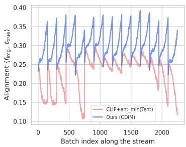  
(a) Image-Text Alignment over time

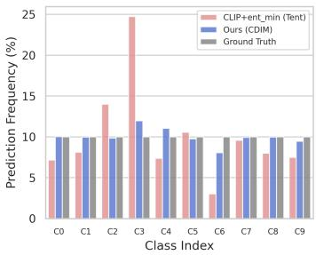  
(b) Prediction Skewness

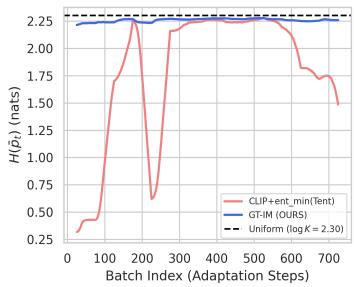  
(c) Marginal Entropy Drift  
Figure 3: Three analyses during the CIFAR10-C TTA process, comparing CLIP+TENT and CDIM. (a) Image-text alignment of CLIP, measured as $\langle \mathbf { f } _ { \mathrm { i m g } } , \mathbf { t } _ { \mathrm { t r u e } } \rangle$ per batch during TTA. (b) Cumulative prediction frequency per class, with the ground-truth frequency for reference. (c) Marginal entropy ${ \cal H } ( \bar { \bf p } _ { t } )$ per batch; the dashed line marks log K.

Detailed Analysis of CDIM. We analyze the adaptation dynamics of CDIM on CIFAR10-C. Figure 3b shows that CLIP+TENT suffers from a severe class-distribution skew, with about 25% of its predictions falling on class C3, whereas CDIM maintains a near-uniform distribution. This is consistent with OLA and GT-IM jointly preventing label-set collapse. The marginal entropy H(¯pt) in Figure 3c supports this observation: it drops sharply and drifts under CLIP with entropy minimization, but stays close to the uniform reference (log K = 2.30) under CDIM. The t-SNE projections of one representative case per corruption category (Figure 4) show a similar picture. Under severe corruptions, the baseline embeddings collapse into a mixed cluster, whereas CDIM preserves clear class separation. These analyses compare the full CDIM with CLIP+TENT, and Table 4 reports the effect of each component.

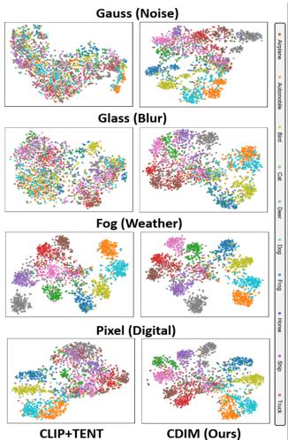

Additional experiments. We further evaluate CDIM on domain generalization benchmarks [20] (Appendix D.1) and on ImageNet variants with natural distribution shifts and natural adversarial exam-

Figure 4: Comparison t-SNE visualization (CIFAR10-C).

ples (Appendix D.2). Detailed ablation studies and analyses are provided in Appendices B and C, and the computational overhead, including GPU memory and latency, is analyzed in Appendix A.4.

## 5 Conclusion

We present CDIM, an online TTA method that mitigates modality bias, a contributor to confirmation bias in CLIP-based TTA, at three complementary levels. First, a cross-modal logit ensemble with a frozen DINO v2 backbone stabilizes the representation. Second, a gated information-maximization objective prevents label collapse and excludes unreliable samples from the gradient updates. Third, an online logit adjustment corrects the residual prediction skew. When all methods are evaluated with CLIP, CDIM outperforms the compared baselines on the three corruption benchmarks in the online TTA setting and achieves competitive performance in the continual and mixed-domain settings. These gains require one additional frozen DINOv2 forward pass per batch and gradient-free corrections.

## Acknowledgments

This work was supported by the IITP grant funded by the Korea government (MSIT) (RS-2025- 02283048, Developing the Next-Generation General AI with Reliability, Ethics, and Adaptability and RS-2023-00236245, Development of Perception/Planning AI SW for Seamless Autonomous Driving in Adverse Weather/Unstructured Environment), National Research Foundation of Korea (NRF) (RS-2026-25475721 and RS-2025-22712971) and the Technology Innovation Program (RS-2025-02220839) funded by the Ministry of Trade, Industry and Energy (MOTIE, Korea).

## References

[1] Gustavo A Vargas Hakim, David Osowiechi, Mehrdad Noori, Milad Cheraghalikhani, Ali Bahri, Moslem Yazdanpanah, Ismail Ben Ayed, and Christian Desrosiers. Clipartt: Adaptation of clip to new domains at test time. In Proceedings of the Winter Conference on Applications of Computer Vision, pages 7092–7101, 2025.

[2] James Urquhart Allingham, Jie Ren, Michael W Dusenberry, Xiuye Gu, Yin Cui, Dustin Tran, Jeremiah Zhe Liu, and Balaji Lakshminarayanan. A simple zero-shot prompt weighting technique to improve prompt ensembling in text-image models. In International Conference on Machine Learning, pages 547–568. PMLR, 2023.

[3] Eric Arazo, Diego Ortego, Paul Albert, Noel E O’Connor, and Kevin McGuinness. Pseudolabeling and confirmation bias in deep semi-supervised learning. In 2020 International joint conference on neural networks (IJCNN), pages 1–8. IEEE, 2020.

[4] Wenxuan Bao, Ruxi Deng, and Jingrui He. Mint: A simple test-time adaptation of visionlanguage models against common corruptions. Advances in Neural Information Processing Systems, 38:58666–58700, 2025.

[5] Luca Barsellotti, Lorenzo Bianchi, Nicola Messina, Fabio Carrara, Marcella Cornia, Lorenzo Baraldi, Fabrizio Falchi, and Rita Cucchiara. Talking to dino: Bridging self-supervised vision backbones with language for open-vocabulary segmentation. In 2025 IEEE/CVF International Conference on Computer Vision (ICCV), pages 22025–22035. IEEE, 2025.

[6] Mathilde Caron, Hugo Touvron, Ishan Misra, Hervé Jégou, Julien Mairal, Piotr Bojanowski, and Armand Joulin. Emerging properties in self-supervised vision transformers. In 2021 IEEE/CVF international conference on computer vision (ICCV), pages 9630–9640. IEEE, 2021.

[7] Olivier Chapelle, Bernhard Scholkopf, and Alexander Zien. Semi-supervised learning (chapelle, o. et al., eds.; 2006)[book reviews]. IEEE Transactions on Neural Networks, 20(3):542–542, 2009.

[8] Meiqi Chen, Yixin Cao, Yan Zhang, and Chaochao Lu. Quantifying and mitigating unimodal biases in multimodal large language models: A causal perspective. In Findings of the Association for Computational Linguistics: EMNLP 2024, pages 16449–16469, 2024.

[9] Sungha Choi, Seunghan Yang, Seokeon Choi, and Sungrack Yun. Improving test-time adaptation via shift-agnostic weight regularization and nearest source prototypes. In European Conference on Computer Vision, pages 440–458. Springer, 2022.

[10] Ailin Deng, Tri Cao, Zhirui Chen, and Bryan Hooi. Words or vision: Do vision-language models have blind faith in text? In 2025 IEEE/CVF Conference on Computer Vision and Pattern Recognition (CVPR), pages 3867–3876. IEEE, 2025.

[11] Jia Deng, Wei Dong, Richard Socher, Li-Jia Li, Kai Li, and Li Fei-Fei. Imagenet: A largescale hierarchical image database. In 2009 IEEE conference on computer vision and pattern recognition, pages 248–255. Ieee, 2009.

[12] Mario Döbler, Robert A Marsden, Tobias Raichle, and Bin Yang. A lost opportunity for vision-language models: A comparative study of online test-time adaptation for vision-language models. In European Conference on Computer Vision, pages 117–133. Springer, 2024.

[13] Matteo Farina, Gianni Franchi, Giovanni Iacca, Massimiliano Mancini, and Elisa Ricci. Frustratingly easy test-time adaptation of vision-language models. Advances in Neural Information Processing Systems, 37:129062–129093, 2024.

[14] Chun-Mei Feng, Kai Yu, Yong Liu, Salman Khan, and Wangmeng Zuo. Diverse data augmentation with diffusions for effective test-time prompt tuning. In 2023 IEEE/CVF International Conference on Computer Vision (ICCV), pages 2704–2714. IEEE, 2023.

[15] Yossi Gandelsman, Alexei Efros, and Jacob Steinhardt. Interpreting clip’s image representation via text-based decomposition. In International conference on learning representations, volume 2024, pages 18395–18416, 2024.

[16] Yaroslav Ganin and Victor Lempitsky. Unsupervised domain adaptation by backpropagation. In International conference on machine learning, pages 1180–1189. PMLR, 2015.

[17] Robert Geirhos, Carlos RM Temme, Jonas Rauber, Heiko H Schütt, Matthias Bethge, and Felix A Wichmann. Generalisation in humans and deep neural networks. Advances in neural information processing systems, 31, 2018.

[18] Raghuraman Gopalan, Ruonan Li, and Rama Chellappa. Domain adaptation for object recognition: An unsupervised approach. In 2011 international conference on computer vision, pages 999–1006. IEEE, 2011.

[19] Yves Grandvalet and Yoshua Bengio. Semi-supervised learning by entropy minimization. Advances in neural information processing systems, 17, 2004.

[20] Ishaan Gulrajani and David Lopez-Paz. In search of lost domain generalization. arXiv preprint arXiv:2007.01434, 2020.

[21] Chuan Guo, Geoff Pleiss, Yu Sun, and Kilian Q Weinberger. On calibration of modern neural networks. In International conference on machine learning, pages 1321–1330. PMLR, 2017.

[22] Jisu Han, Jihee Park, Dongyoon Han, and Wonjun Hwang. When test-time adaptation meets self-supervised models. arXiv preprint arXiv:2506.23529, 2025.

[23] Kaiming He, Xiangyu Zhang, Shaoqing Ren, and Jian Sun. Deep residual learning for image recognition. In Proceedings of the IEEE conference on computer vision and pattern recognition, pages 770–778, 2016.

[24] Dan Hendrycks and Thomas Dietterich. Benchmarking neural network robustness to common corruptions and perturbations. arXiv preprint arXiv:1903.12261, 2019.

[25] Fanding Huang, Jingyan Jiang, Qinting Jiang, Hebei Li, Faisal Nadeem Khan, and Zhi Wang. Cosmic: Clique-oriented semantic multi-space integration for robust clip test-time adaptation. In 2025 IEEE/CVF Conference on Computer Vision and Pattern Recognition (CVPR), pages 9772–9781. IEEE, 2025.

[26] Mohamed Fazli Imam, Rufael Fedaku Marew, Jameel Hassan, Mustansar Fiaz, Alham Fikri Aji, and Hisham Cholakkal. Clip meets dino for tuning zero-shot classifier using unlabeled image collections. arXiv preprint arXiv:2411.19346, 2024.

[27] Dongsheng Jiang, Yuchen Liu, Songlin Liu, Jin’e Zhao, Hao Zhang, Zhen Gao, Xiaopeng Zhang, Jin Li, and Hongkai Xiong. From clip to dino: Visual encoders shout in multi-modal large language models. arXiv preprint arXiv:2310.08825, 2023.

[28] Adilbek Karmanov, Dayan Guan, Shijian Lu, Abdulmotaleb El Saddik, and Eric Xing. Efficient test-time adaptation of vision-language models. In 2024 IEEE/CVF Conference on Computer Vision and Pattern Recognition (CVPR), pages 14162–14171. IEEE, 2024.

[29] Diederik P Kingma and Jimmy Ba. Adam: A method for stochastic optimization. arXiv preprint arXiv:1412.6980, 2014.

[30] Andreas Krause, Pietro Perona, and Ryan Gomes. Discriminative clustering by regularized information maximization. Advances in neural information processing systems, 23, 2010.

[31] Alex Krizhevsky, Geoffrey Hinton, et al. Learning multiple layers of features from tiny images. 2009.

[32] Alex Krizhevsky, Ilya Sutskever, and Geoffrey E Hinton. Imagenet classification with deep convolutional neural networks. Advances in neural information processing systems, 25, 2012.

[33] Marc Lafon, Gustavo Vargas Hakim, Clément Rambour, Christian Desrosiers, and Nicolas Thome. Cliptta: Robust contrastive vision-language test-time adaptation. Advances in Neural Information Processing Systems, 38:71849–71883, 2025.

[34] Yushu Li, Yongyi Su, Adam Goodge, Kui Jia, and Xun Xu. Efficient and context-aware label propagation for zero-/few-shot training-free adaptation of vision-language model. In International Conference on Learning Representations, volume 2025, pages 57322–57342, 2025.

[35] Jian Liang, Dapeng Hu, and Jiashi Feng. Do we really need to access the source data? source hypothesis transfer for unsupervised domain adaptation. In International conference on machine learning, pages 6028–6039. PMLR, 2020.

[36] Yiming Liu, Yuhui Zhang, Dhruba Ghosh, Ludwig Schmidt, and Serena Yeung-Levy. Data or language supervision: What makes clip better than dino? arXiv preprint arXiv:2510.11835, 2025.

[37] Xiaosong Ma, Jie Zhang, Song Guo, and Wenchao Xu. Swapprompt: Test-time prompt adaptation for vision-language models. Advances in Neural Information Processing Systems, 36:65252–65264, 2023.

[38] Sarthak Maharana, Baoming Zhang, Leonid Karlinsky, Rogerio Feris, and Yunhui Guo. Batclip: Bimodal online test-time adaptation for clip. In Proceedings ofthe IEEE/CVF International Conference on Computer Vision, pages 1569–1579, 2025.

[39] Aditya Krishna Menon, Sadeep Jayasumana, Ankit Singh Rawat, Himanshu Jain, Andreas Veit, and Sanjiv Kumar. Long-tail learning via logit adjustment. arXiv preprint arXiv:2007.07314, 2020.

[40] Shuaicheng Niu, Jiaxiang Wu, Yifan Zhang, Yaofo Chen, Shijian Zheng, Peilin Zhao, and Mingkui Tan. Efficient test-time model adaptation without forgetting. In International conference on machine learning, pages 16888–16905. PMLR, 2022.

[41] Shuaicheng Niu, Jiaxiang Wu, Yifan Zhang, Zhiquan Wen, Yaofo Chen, Peilin Zhao, and Mingkui Tan. Towards stable test-time adaptation in dynamic wild world. arXiv preprint arXiv:2302.12400, 2023.

[42] Maxime Oquab, Timothée Darcet, Théo Moutakanni, Huy Vo, Marc Szafraniec, Vasil Khalidov, Pierre Fernandez, Daniel Haziza, Francisco Massa, Alaaeldin El-Nouby, et al. Dinov2: Learning robust visual features without supervision. arXiv preprint arXiv:2304.07193, 2023.

[43] David Osowiechi, Mehrdad Noori, Gustavo A Hakim, Moslem Yazdanpanah, Ali Bahri, Milad Cheraghalikhani, Sahar Dastani, Farzad Beizaee, Ismail B Ayed, and Christian Desrosiers. Watt: Weight average test time adaptation of clip. Advances in neural information processing systems, 37:48015–48044, 2024.

[44] Sunghyun Park, Seunghan Yang, Jaegul Choo, and Sungrack Yun. Label shift adapter for testtime adaptation under covariate and label shifts. In 2023 IEEE/CVF International Conference on Computer Vision (ICCV), pages 16375–16385. IEEE, 2023.

[45] Hieu Pham, Zihang Dai, Qizhe Xie, and Quoc V Le. Meta pseudo labels. In 2021 IEEE/CVF Conference on Computer Vision and Pattern Recognition (CVPR), pages 11552–11563. IEEE, 2021.

[46] Sarah Pratt, Ian Covert, Rosanne Liu, and Ali Farhadi. What does a platypus look like? generating customized prompts for zero-shot image classification. In 2023 IEEE/CVF International Conference on Computer Vision (ICCV), pages 15645–15655. IEEE, 2023.

[47] Alec Radford, Jong Wook Kim, Chris Hallacy, Aditya Ramesh, Gabriel Goh, Sandhini Agarwal, Girish Sastry, Amanda Askell, Pamela Mishkin, Jack Clark, et al. Learning transferable visual models from natural language supervision. In International conference on machine learning, pages 8748–8763. PMLR, 2021.

[48] Benjamin Recht, Rebecca Roelofs, Ludwig Schmidt, and Vaishaal Shankar. Do imagenet classifiers generalize to imagenet? In International conference on machine learning, pages 5389–5400. PMLR, 2019.

[49] Marco Saerens, Patrice Latinne, and Christine Decaestecker. Adjusting the outputs of a classifier to new a priori probabilities: a simple procedure. Neural computation, 14(1):21–41, 2002.

[50] Manli Shu, Weili Nie, De-An Huang, Zhiding Yu, Tom Goldstein, Anima Anandkumar, and Chaowei Xiao. Test-time prompt tuning for zero-shot generalization in vision-language models. Advances in Neural Information Processing Systems, 35:14274–14289, 2022.

[51] Karen Simonyan and Andrew Zisserman. Very deep convolutional networks for large-scale image recognition. arXiv preprint arXiv:1409.1556, 2014.

[52] Elaine Sui, Xiaohan Wang, and Serena Yeung-Levy. Just shift it: Test-time prototype shifting for zero-shot generalization with vision-language models. In 2025 IEEE/CVF Winter Conference on Applications of Computer Vision (WACV), pages 825–835. IEEE, 2025.

[53] Yu Sun, Xiaolong Wang, Zhuang Liu, John Miller, Alexei Efros, and Moritz Hardt. Test-time training with self-supervision for generalization under distribution shifts. In International conference on machine learning, pages 9229–9248. PMLR, 2020.

[54] Dequan Wang, Evan Shelhamer, Shaoteng Liu, Bruno Olshausen, and Trevor Darrell. Tent: Fully test-time adaptation by entropy minimization. arXiv preprint arXiv:2006.10726, 2020.

[55] Qin Wang, Olga Fink, Luc Van Gool, and Dengxin Dai. Continual test-time domain adaptation. In 2022 IEEE/CVF Conference on Computer Vision and Pattern Recognition (CVPR), pages 7191–7201. IEEE, 2022.

[56] Kan Wu, Houwen Peng, Zhenghong Zhou, Bin Xiao, Mengchen Liu, Lu Yuan, Hong Xuan, Michael Valenzuela, Xi Stephen Chen, Xinggang Wang, et al. Tinyclip: Clip distillation via affinity mimicking and weight inheritance. In 2023 IEEE/CVF International Conference on Computer Vision (ICCV), pages 21913–21923. IEEE, 2023.

[57] Monika Wysoczanska, Oriane Siméoni, Michaël Ramamonjisoa, Andrei Bursuc, Tomasz´ Trzcinski, and Patrick Pérez. Clip-dinoiser: Teaching clip a few dino tricks for open-vocabulary´ semantic segmentation. In European Conference on Computer Vision, pages 320–337. Springer, 2024.

[58] Longhui Yuan, Binhui Xie, and Shuang Li. Robust test-time adaptation in dynamic scenarios. In 2023 IEEE/CVF Conference on Computer Vision and Pattern Recognition (CVPR), pages 15922–15932. IEEE, 2023.

[59] Zhichen Zeng, Wenxuan Bao, Xiao Lin, Ruizhong Qiu, Tianxin Wei, Xuying Ning, Yuchen Yan, Chen Luo, Monica Xiao Cheng, Jingrui He, et al. Subspace alignment for vision-language model test-time adaptation. arXiv preprint arXiv:2601.08139, 2026.

[60] Marvin Zhang, Sergey Levine, and Chelsea Finn. Memo: Test time robustness via adaptation and augmentation. Advances in neural information processing systems, 35:38629–38642, 2022.

[61] Qingyang Zhang, Yatao Bian, Xinke Kong, Peilin Zhao, and Changqing Zhang. Come: Test-time adaption by conservatively minimizing entropy. arXiv preprint arXiv:2410.10894, 2024.

[62] Yabin Zhang, Wenjie Zhu, Hui Tang, Zhiyuan Ma, Kaiyang Zhou, and Lei Zhang. Dual memory networks: A versatile adaptation approach for vision-language models. In 2024 IEEE/CVF Conference on Computer Vision and Pattern Recognition (CVPR), pages 28718–28728. IEEE, 2024.

## NeurIPS Paper Checklist

## 1. Claims

Question: Do the main claims made in the abstract and introduction accurately reflect the paper’s contributions and scope?

Answer: [Yes]

Justification: In the abstract and introduction, we claim that this paper focuses on test-time adaptation of vision-language models. Contributions are clearly listed at the end of the introduction, at the beginning of the proposed method and in the abstract.

Guidelines:

• The answer [N/A] means that the abstract and introduction do not include the claims made in the paper.

• The abstract and/or introduction should clearly state the claims made, including the contributions made in the paper and important assumptions and limitations. A [No] or [N/A] answer to this question will not be perceived well by the reviewers.

• The claims made should match theoretical and experimental results, and reflect how much the results can be expected to generalize to other settings.

• It is fine to include aspirational goals as motivation as long as it is clear that these goals are not attained by the paper.

## 2. Limitations

Question: Does the paper discuss the limitations of the work performed by the authors?

Answer: [Yes]

Justification: Please refer to Appendix A.1.

Guidelines:

• The answer [N/A] means that the paper has no limitation while the answer [No] means that the paper has limitations, but those are not discussed in the paper.

• The authors are encouraged to create a separate “Limitations” section in their paper.

• The paper should point out any strong assumptions and how robust the results are to violations of these assumptions (e.g., independence assumptions, noiseless settings, model well-specification, asymptotic approximations only holding locally). The authors should reflect on how these assumptions might be violated in practice and what the implications would be.

• The authors should reflect on the scope of the claims made, e.g., if the approach was only tested on a few datasets or with a few runs. In general, empirical results often depend on implicit assumptions, which should be articulated.

• The authors should reflect on the factors that influence the performance of the approach. For example, a facial recognition algorithm may perform poorly when image resolution is low or images are taken in low lighting. Or a speech-to-text system might not be used reliably to provide closed captions for online lectures because it fails to handle technical jargon.

• The authors should discuss the computational efficiency of the proposed algorithms and how they scale with dataset size.

• If applicable, the authors should discuss possible limitations of their approach to address problems of privacy and fairness.

• While the authors might fear that complete honesty about limitations might be used by reviewers as grounds for rejection, a worse outcome might be that reviewers discover limitations that aren’t acknowledged in the paper. The authors should use their best judgment and recognize that individual actions in favor of transparency play an important role in developing norms that preserve the integrity of the community. Reviewers will be specifically instructed to not penalize honesty concerning limitations.

## 3. Theory assumptions and proofs

Question: For each theoretical result, does the paper provide the full set of assumptions and a complete (and correct) proof?

## Answer: [N/A]

Justification: The paper does not include formal theoretical results such as theorems or proofs. The assumptions underlying the method, namely a uniform target class prior and a source prior estimated from the predictions of the model itself, are described in Sections 1 and 3 (Eqs. (7) to (9)), and their scope is discussed in Appendix A.1. The effect of the resulting correction is examined empirically in Section 4 and Appendix B.

Guidelines:

• The answer [N/A] means that the paper does not include theoretical results.

• All the theorems, formulas, and proofs in the paper should be numbered and crossreferenced.

• All assumptions should be clearly stated or referenced in the statement of any theorems.

• The proofs can either appear in the main paper or the supplemental material, but if they appear in the supplemental material, the authors are encouraged to provide a short proof sketch to provide intuition.

• Inversely, any informal proof provided in the core of the paper should be complemented by formal proofs provided in appendix or supplemental material.

• Theorems and Lemmas that the proof relies upon should be properly referenced.

## 4. Experimental result reproducibility

Question: Does the paper fully disclose all the information needed to reproduce the main experimental results of the paper to the extent that it affects the main claims and/or conclusions of the paper (regardless of whether the code and data are provided or not)?

Answer: [Yes]

Justification: Section 4 and Appendix A.3 specify the backbones, the optimizers, learning rates and batch sizes, the hyperparameters, and the three evaluation protocols. Algorithm 1 (Appendix E) gives pseudo-code for one update.

Guidelines:

• The answer [N/A] means that the paper does not include experiments.

• If the paper includes experiments, a [No] answer to this question will not be perceived well by the reviewers: Making the paper reproducible is important, regardless of whether the code and data are provided or not.

• If the contribution is a dataset and/or model, the authors should describe the steps taken to make their results reproducible or verifiable.

• Depending on the contribution, reproducibility can be accomplished in various ways. For example, if the contribution is a novel architecture, describing the architecture fully might suffice, or if the contribution is a specific model and empirical evaluation, it may be necessary to either make it possible for others to replicate the model with the same dataset, or provide access to the model. In general. releasing code and data is often one good way to accomplish this, but reproducibility can also be provided via detailed instructions for how to replicate the results, access to a hosted model (e.g., in the case of a large language model), releasing of a model checkpoint, or other means that are appropriate to the research performed.

• While NeurIPS does not require releasing code, the conference does require all submissions to provide some reasonable avenue for reproducibility, which may depend on the nature of the contribution. For example

(a) If the contribution is primarily a new algorithm, the paper should make it clear how to reproduce that algorithm.

(b) If the contribution is primarily a new model architecture, the paper should describe the architecture clearly and fully.

(c) If the contribution is a new model (e.g., a large language model), then there should either be a way to access this model for reproducing the results or a way to reproduce the model (e.g., with an open-source dataset or instructions for how to construct the dataset).

(d) We recognize that reproducibility may be tricky in some cases, in which case authors are welcome to describe the particular way they provide for reproducibility.

In the case of closed-source models, it may be that access to the model is limited in some way (e.g., to registered users), but it should be possible for other researchers to have some path to reproducing or verifying the results.

## 5. Open access to data and code

Question: Does the paper provide open access to the data and code, with sufficient instructions to faithfully reproduce the main experimental results, as described in supplemental material?

Answer: [Yes]

Justification: We use public datasets (CIFAR10-C, CIFAR100-C, ImageNet-C, ImageNet variants, VisDA-C, OfficeHome, PACS, and VLCS) and provide pseudocode (Algorithm 1 in Appendix E) and a GitHub repository.

Guidelines:

• The answer [N/A] means that paper does not include experiments requiring code.

• Please see the NeurIPS code and data submission guidelines (https://neurips.cc/ public/guides/CodeSubmissionPolicy) for more details.

• While we encourage the release of code and data, we understand that this might not be possible, so [No] is an acceptable answer. Papers cannot be rejected simply for not including code, unless this is central to the contribution (e.g., for a new open-source benchmark).

• The instructions should contain the exact command and environment needed to run to reproduce the results. See the NeurIPS code and data submission guidelines (https: //neurips.cc/public/guides/CodeSubmissionPolicy) for more details.

• The authors should provide instructions on data access and preparation, including how to access the raw data, preprocessed data, intermediate data, and generated data, etc.

• The authors should provide scripts to reproduce all experimental results for the new proposed method and baselines. If only a subset of experiments are reproducible, they should state which ones are omitted from the script and why.

• At submission time, to preserve anonymity, the authors should release anonymized versions (if applicable).

• Providing as much information as possible in supplemental material (appended to the paper) is recommended, but including URLs to data and code is permitted.

## 6. Experimental setting/details

Question: Does the paper specify all the training and test details (e.g., data splits, hyperparameters, how they were chosen, type of optimizer) necessary to understand the results?

Answer: [Yes]

Justification: Section 4 and Appendix A.3 specify the datasets, corruption severity, optimizers, learning rates, batch sizes, and the hyperparameters of CDIM together with how they were set. Appendices B.6 and B.7 report post-hoc sensitivity sweeps that were not used for selection.

Guidelines:

• The answer [N/A] means that the paper does not include experiments.

• The experimental setting should be presented in the core of the paper to a level of detail that is necessary to appreciate the results and make sense of them.

• The full details can be provided either with the code, in appendix, or as supplemental material.

## 7. Experiment statistical significance

Question: Does the paper report error bars suitably and correctly defined or other appropriate information about the statistical significance of the experiments?

Answer: [Yes]

Justification: The main results in Tables 1, 2a and 2b use a single fixed seed, following prior work. For CDIM, Appendix B.4 (Table 7) reports the mean and standard deviation over five random seeds for each corruption type and batch size. At the default batch size, the

five-seed means match the fixed-seed results within 0.2 points. We also include a statistical significance analysis in Section 4 and in Appendix C.

## Guidelines:

• The answer [N/A] means that the paper does not include experiments.

• The authors should answer [Yes] if the results are accompanied by error bars, confidence intervals, or statistical significance tests, at least for the experiments that support the main claims of the paper.

• The factors of variability that the error bars are capturing should be clearly stated (for example, train/test split, initialization, random drawing of some parameter, or overall run with given experimental conditions).

• The method for calculating the error bars should be explained (closed form formula, call to a library function, bootstrap, etc.)

• The assumptions made should be given (e.g., Normally distributed errors).

• It should be clear whether the error bar is the standard deviation or the standard error of the mean.

• It is OK to report 1-sigma error bars, but one should state it. The authors should preferably report a 2-sigma error bar than state that they have a 96% CI, if the hypothesis of Normality of errors is not verified.

• For asymmetric distributions, the authors should be careful not to show in tables or figures symmetric error bars that would yield results that are out of range (e.g., negative error rates).

• If error bars are reported in tables or plots, the authors should explain in the text how they were calculated and reference the corresponding figures or tables in the text.

## 8. Experiments compute resources

Question: For each experiment, does the paper provide sufficient information on the computer resources (type of compute workers, memory, time of execution) needed to reproduce the experiments?

Answer: [Yes]

Justification: All experiments were run on a single NVIDIA V100 GPU. Appendix A.4 and Table 5 report per-batch latency, peak GPU memory, and throughput for CDIM, TENT, and BATCLIP on CIFAR100-C.

Guidelines:

• The answer [N/A] means that the paper does not include experiments.

• The paper should indicate the type of compute workers CPU or GPU, internal cluster, or cloud provider, including relevant memory and storage.

• The paper should provide the amount of compute required for each of the individual experimental runs as well as estimate the total compute.

• The paper should disclose whether the full research project required more compute than the experiments reported in the paper (e.g., preliminary or failed experiments that didn’t make it into the paper).

## 9. Code of ethics

Question: Does the research conducted in the paper conform, in every respect, with the NeurIPS Code of Ethics https://neurips.cc/public/EthicsGuidelines?

Answer: [Yes]

Justification: We strictly adhere to the NeurIPS Code of Ethics.

Guidelines:

• The answer [N/A] means that the authors have not reviewed the NeurIPS Code of Ethics.

• If the authors answer [No], they should explain the special circumstances that require a deviation from the Code of Ethics.

• The authors should make sure to preserve anonymity (e.g., if there is a special consideration due to laws or regulations in their jurisdiction).

## 10. Broader impacts

Question: Does the paper discuss both potential positive societal impacts and negative societal impacts of the work performed?

Answer: [Yes]

Justification: Please refer to Appendix A.2.

Guidelines:

• The answer [N/A] means that there is no societal impact of the work performed.

• If the authors answer [N/A] or [No], they should explain why their work has no societal impact or why the paper does not address societal impact.

• Examples of negative societal impacts include potential malicious or unintended uses (e.g., disinformation, generating fake profiles, surveillance), fairness considerations (e.g., deployment of technologies that could make decisions that unfairly impact specific groups), privacy considerations, and security considerations.

• The conference expects that many papers will be foundational research and not tied to particular applications, let alone deployments. However, if there is a direct path to any negative applications, the authors should point it out. For example, it is legitimate to point out that an improvement in the quality of generative models could be used to generate Deepfakes for disinformation. On the other hand, it is not needed to point out that a generic algorithm for optimizing neural networks could enable people to train models that generate Deepfakes faster.

• The authors should consider possible harms that could arise when the technology is being used as intended and functioning correctly, harms that could arise when the technology is being used as intended but gives incorrect results, and harms following from (intentional or unintentional) misuse of the technology.

• If there are negative societal impacts, the authors could also discuss possible mitigation strategies (e.g., gated release of models, providing defenses in addition to attacks, mechanisms for monitoring misuse, mechanisms to monitor how a system learns from feedback over time, improving the efficiency and accessibility of ML).

## 11. Safeguards

Question: Does the paper describe safeguards that have been put in place for responsible release of data or models that have a high risk for misuse (e.g., pre-trained language models, image generators, or scraped datasets)?

Answer: [N/A]

Justification: Our paper does not release new data or models.

Guidelines:

• The answer [N/A] means that the paper poses no such risks.

• Released models that have a high risk for misuse or dual-use should be released with necessary safeguards to allow for controlled use of the model, for example by requiring that users adhere to usage guidelines or restrictions to access the model or implementing safety filters.

• Datasets that have been scraped from the Internet could pose safety risks. The authors should describe how they avoided releasing unsafe images.

• We recognize that providing effective safeguards is challenging, and many papers do not require this, but we encourage authors to take this into account and make a best faith effort.

## 12. Licenses for existing assets

Question: Are the creators or original owners of assets (e.g., code, data, models), used in the paper, properly credited and are the license and terms of use explicitly mentioned and properly respected?

Answer: [Yes]

Justification: All assets used in this work are properly credited, and their respective licenses and terms of use are observed.

## Guidelines:

• The answer [N/A] means that the paper does not use existing assets.

• The authors should cite the original paper that produced the code package or dataset.

• The authors should state which version of the asset is used and, if possible, include a URL.

• The name of the license (e.g., CC-BY 4.0) should be included for each asset.

• For scraped data from a particular source (e.g., website), the copyright and terms of service of that source should be provided.

• If assets are released, the license, copyright information, and terms of use in the package should be provided. For popular datasets, paperswithcode.com/datasets has curated licenses for some datasets. Their licensing guide can help determine the license of a dataset.

• For existing datasets that are re-packaged, both the original license and the license of the derived asset (if it has changed) should be provided.

• If this information is not available online, the authors are encouraged to reach out to the asset’s creators.

## 13. New assets

Question: Are new assets introduced in the paper well documented and is the documentation provided alongside the assets?

Answer: [N/A]

Justification: The paper releases no new datasets or pretrained models.

Guidelines:

• The answer [N/A] means that the paper does not release new assets.

• Researchers should communicate the details of the dataset/code/model as part of their submissions via structured templates. This includes details about training, license, limitations, etc.

• The paper should discuss whether and how consent was obtained from people whose asset is used.

• At submission time, remember to anonymize your assets (if applicable). You can either create an anonymized URL or include an anonymized zip file.

## 14. Crowdsourcing and research with human subjects

Question: For crowdsourcing experiments and research with human subjects, does the paper include the full text of instructions given to participants and screenshots, if applicable, as well as details about compensation (if any)?

Answer: [N/A]

Justification: Our paper does not involve crowdsourcing nor research with human subjects. Guidelines:

• The answer [N/A] means that the paper does not involve crowdsourcing nor research with human subjects.

• Including this information in the supplemental material is fine, but if the main contribution of the paper involves human subjects, then as much detail as possible should be included in the main paper.

• According to the NeurIPS Code of Ethics, workers involved in data collection, curation, or other labor should be paid at least the minimum wage in the country of the data collector.

## 15. Institutional review board (IRB) approvals or equivalent for research with human subjects

Question: Does the paper describe potential risks incurred by study participants, whether such risks were disclosed to the subjects, and whether Institutional Review Board (IRB) approvals (or an equivalent approval/review based on the requirements of your country or institution) were obtained?

Answer: [N/A]

Justification: Our paper does not involve crowdsourcing nor research with human subjects. Guidelines:

• The answer [N/A] means that the paper does not involve crowdsourcing nor research with human subjects.

• Depending on the country in which research is conducted, IRB approval (or equivalent) may be required for any human subjects research. If you obtained IRB approval, you should clearly state this in the paper.

• We recognize that the procedures for this may vary significantly between institutions and locations, and we expect authors to adhere to the NeurIPS Code of Ethics and the guidelines for their institution.

• For initial submissions, do not include any information that would break anonymity (if applicable), such as the institution conducting the review.

## 16. Declaration of LLM usage

Question: Does the paper describe the usage of LLMs if it is an important, original, or non-standard component of the core methods in this research? Note that if the LLM is used only for writing, editing, or formatting purposes and does not impact the core methodology, scientific rigor, or originality of the research, declaration is not required.

Answer: [N/A]

Justification: LLMs were used only for writing, editing, and formatting, and were not used for the core methodology, scientific rigor, or originality of the research.

Guidelines:

• The answer [N/A] means that the core method development in this research does not involve LLMs as any important, original, or non-standard components.

• Please refer to our LLM policy in the NeurIPS handbook for what should or should not be described.

## Appendix

## A Additional Discussion

## A.1 Limitations

The discard ratio $\rho$ is fixed across benchmarks, so the quantile gate always discards $\lfloor \rho B \rfloor$ samples per batch (at least one), regardless of how many unreliable samples the batch contains. This can remove correct samples under mild corruption, and it may also exclude samples of unseen classes when the stream contains out-of-distribution classes. A severity- or dispersion-adaptive $\rho$ is left for future work. The DINO-branch inverse temperature $\tau _ { D } ^ { - 1 }$ is likewise a fixed constant and was not tuned. Like $\rho$ and α, it follows common conventions [6, 42, 50, 29] rather than a per-benchmark search, while the optimizer, learning rate, and batch size follow BATCLIP [38] (Appendix A.3). A second limitation concerns the class distribution. Both the marginal term of GT-IM and OLA assume an approximately uniform target class distribution. Accuracy may therefore degrade on class-imbalanced or temporally correlated streams, and a more robust class-prior estimator would be required. Beyond accuracy, the auxiliary DINO v2 branch adds latency and memory overhead compared with single-backbone methods such as TENT (Appendix A.4). Extending the framework beyond image classification, for example to object detection and semantic segmentation, is left for future work.

## A.2 Broader Impacts

Our work addresses modality bias and the resulting confirmation bias in vision-language models under distribution shift. Improving robustness under test-time distribution shift can support the reliability of applications such as autonomous driving, robotics, and video analysis, where the data distribution changes over time. CDIM relies on a frozen self-supervised backbone and training-free corrections, but it adds one DINO v2 forward pass per batch (Appendix A.4). Therefore, CDIM contributes to safer and more dependable AI deployments in the wild, and with a lightweight encoder such as TinyCLIP, it requires 0.41 times the peak GPU memory of TENT with ViT-B/16 (Appendix A.4).

We do not anticipate direct negative societal impacts from the algorithm itself. CDIM operates without labels at test time and does not require access to private user data. Because it builds on large-scale foundation models such as CLIP and DINO v2, it inherits the representational and social biases present in their pre-training data. Improved zero-shot robustness could also be misused in surveillance or profiling applications. Further study of the biases of foundation models is needed as adaptation techniques are applied more widely.

## A.3 Detailed Experiments Settings

For a fair comparison with recent state-of-the-art methods such as BATCLIP [38] and SubTTA [59], CLIP with a ViT-B/16 backbone is used as the default architecture. For the auxiliary self-supervised learning (SSL) model, DINO v2-base (ViT-B/14) is used. The version without ImageNet fine-tuning is used so that only the self-supervised representation is evaluated.

We evaluate our approach on standard benchmarks [24] containing 15 distinct corruption types: Gaussian noise, shot noise, impulse noise, defocus blur, glass blur, motion blur, zoom blur, snow, frost, fog, brightness, contrast, elastic transform, pixelation, and JPEG compression. Unless otherwise stated, all experiments are conducted at the highest corruption severity (level 5). Results for severity levels 1 to 5 are reported in Table 10 (Appendix B.5). We consider three adaptation protocols.

In the standard online TTA protocol [54], the model parameters and optimizer state are reset between independent corruption types but are preserved across batches within the same corruption. Under the continual TTA (CTTA) protocol [55], the model is sequentially adapted to the 15 target domains in a continuous stream. The model parameters and the optimizer state are preserved across all batches, regardless of the corruption type. In the mixed-domain setting [41], the data from all 15 corruptions are shuffled into a single interleaved stream, and adaptation and evaluation are performed on this stream without domain boundaries.

Hyperparameters. CDIM uses the same hyperparameters on all benchmarks: an inverse temperature $\tau _ { D } ^ { - 1 } = 2 0$ for the DINO branch, a discard ratio of $\rho = 0 . 0 5$ , and an EMA momentum of $\alpha = 0 . 9$

Table 5: Efficiency comparison on CIFAR100-C measured on an NVIDIA V100 GPU.
<table><tr><td>CLIP encoder</td><td>SSL model</td><td>Accuracy (%)</td><td>Peak mem (MB)</td><td>Latency (ms/batch)</td><td>Throughput (img/s)</td></tr><tr><td>ViT-B/16</td><td>None (TENT)</td><td>37.0</td><td>13146</td><td>555</td><td>360.6</td></tr><tr><td>ViT-B/16</td><td>None (BATCLIP)</td><td>42.2</td><td>14505</td><td>665</td><td>300.7</td></tr><tr><td>ViT-B/16</td><td>DINO v2-base</td><td>48.2</td><td>16643</td><td>1347</td><td>148.5</td></tr><tr><td>ViT-B/16</td><td>DINO v2-small</td><td>47.9</td><td>15394</td><td>1209</td><td>165.5</td></tr><tr><td>TinyCLIP ViT-61M/32</td><td>DINO v2-base</td><td>46.7</td><td>5837</td><td>1277</td><td>156.7</td></tr><tr><td>TinyCLIP ViT-61M/32</td><td>DINO v2-small</td><td>45.5</td><td>5335</td><td>1139</td><td>175.6</td></tr></table>

Table 6: Ablation study of OLA. The first row is the CLIP+TENT baseline.
<table><tr><td>ENS (w/ DINO)</td><td>GT-IM</td><td>OLA</td><td>ImageNet-C</td><td>CIFAR10-C</td><td>CIFAR100-C</td></tr><tr><td></td><td></td><td></td><td>25.2</td><td>61.9</td><td>37.0</td></tr><tr><td></td><td></td><td> $\checkmark$ </td><td>30.4</td><td>64.0</td><td>41.2</td></tr><tr><td>V</td><td></td><td></td><td>28.7</td><td>63.1</td><td>40.0</td></tr><tr><td>√</td><td></td><td> $\checkmark$ </td><td>33.1</td><td>66.5</td><td>44.5</td></tr><tr><td></td><td>√</td><td></td><td>33.8</td><td>76.9</td><td>45.2</td></tr><tr><td></td><td>√</td><td> $\checkmark$ </td><td>35.0</td><td>78.3</td><td>46.2</td></tr><tr><td>√</td><td> $\widecheck { \widecheck { \widecheck { \mathbf { v } } } }$ </td><td></td><td>36.3</td><td>79.2</td><td>47.5</td></tr><tr><td> $\checkmark$ </td><td> $\checkmark$ </td><td> $\checkmark$ </td><td>36.9</td><td>79.8</td><td>48.2</td></tr></table>

The CLIP branch keeps its pretrained logit scale $\tau _ { C } ^ { - 1 } = 1 0 0$ , and neither scale is tuned. These values were set from common conventions before any benchmark evaluation. The inverse temperature of 20 corresponds to a temperature of 0.05, which lies within the teacher-temperature range of 0.04 to 0.07 used by DINO [6] and DINO v2 [42]. The discard ratio $\rho$ is a small fixed fraction, as in the quantile-based confidence selection of [50], and α = 0.9 equals the default first-moment decay rate of Adam [29]. The sweeps in Table 11 (Appendices B.6 and B.7) are post-hoc sensitivity analyses and were not used for selection. The optimizer, the learning rate, and the batch size follow BATCLIP [38]. BATCLIP [38] and Mint [4] are CLIP-specific methods, whereas the remaining baselines (TENT [54], CoTTA [55], EATA [40], SAR [41], and COME [61]) are general TTA methods that we re-run with CLIP ViT-B/16. The baselines use the default hyperparameters of their authors where available, and no target labels are used for any selection.

## A.4 Resource and Computational cost

All experiments are conducted on a single NVIDIA V100 GPU. Table 5 compares the per-batch latency, peak GPU memory, and throughput of CDIM with those of TENT and BATCLIP on CIFAR100-C. ViT-B/16 is used with a batch size of 200, following the protocol of [4]. CDIM with DINO v2-small adds one frozen DINO v2 forward pass and the cross-covariance projection, which increases the latency by 654 ms per batch (117.8% over TENT). The peak GPU memory increases by 2248 MB over TENT because of the additional DINO v2 model, while the logit adjustment step adds negligible overhead (<0.1 ms). With the default DINO v2-base, the latency increases by 792 ms (142.7%) and the peak memory by 3497 MB over TENT. When the lighter TinyCLIP ViT-61M/32 [56] is combined with DINO v2-small, CDIM reduces the peak GPU memory to 5335 MB, which is 0.41 times that of TENT with ViT-B/16, while the latency is 2.05 times that of TENT. This configuration reaches 45.5% accuracy, which is 3.3% higher than BATCLIP (42.2%) and 8.5% higher than TENT (37.0%), both with ViT-B/16.

## B Additional Ablation Studies

## B.1 Online Logit Adjustment (OLA) ablation

Table 6 isolates the contribution of the online logit adjustment (OLA) described in Section 3.4. Removing OLA from the full CDIM pipeline, that is, returning arg ma $\mathrm { \Sigma } _ { \mathrm { { c } } } Z _ { i c } ^ { \mathrm { { e n s } } }$ instead of applying the adjustment of Eq. (8), lowers the accuracy by 0.6% on ImageNet-C, 0.6% on CIFAR10-C, and 0.7% on CIFAR100-C. This suggests that a measurable class-distribution skew remains after GT-IM. Applying OLA to the CLIP+TENT baseline, which suffers from stronger modality bias, yields larger gains of +5.2%, +2.1%, and +4.2% on the three benchmarks. The reliability diagram in Figure 6b points in the same direction: adding OLA to CLIP+TENT lowers the Expected Calibration Error (ECE) from 0.400 to 0.281, although some overconfidence on false positives remains. These results are consistent with OLA reducing the prediction skew induced by modality bias.

Table 7: Accuracy (mean (std) %) on OTTA corruption benchmarks with different batch sizes in ViT-B/16.
<table><tr><td rowspan="3">Batch Size</td><td></td><td colspan="10">CIFAR10-C (fixed seed: 79.8)</td><td colspan="5"></td></tr><tr><td colspan="3"></td><td colspan="4">Blur</td><td colspan="4">Weather</td><td colspan="4">Digital</td><td rowspan="2">Avg.</td></tr><tr><td>Gauss.</td><td>Shot</td><td>Impul.</td><td>Defoc.</td><td>Glass</td><td>Motion</td><td>Zoom</td><td>Snow</td><td>Frost</td><td>Fog</td><td>Brit. Contr.</td><td>Elastic</td><td>Pixel</td><td></td><td>JPEG</td></tr><tr><td>20</td><td>67.3 (0.6)</td><td>70.2 (0.6)</td><td>75.5 (0.8)</td><td>82.5 (0.4)</td><td>68.2 (0.7)</td><td>82.7 (0.3)</td><td>84.6 (0.7)</td><td>85.0 (0.7)</td><td>85.1 (0.6)</td><td>85.5 (0.8)</td><td>91.5 (0.3)</td><td>88.1 (0.5)</td><td>74.4 (0.5)</td><td>79.8 (0.4)</td><td>72.1 (1.2)</td><td>79.5 (0.2)</td></tr><tr><td>50</td><td>69.5 (0.6)</td><td>71.9 (0.8)</td><td>78.1 (0.6)</td><td>84.7 (0.5)</td><td>70.0 (0.6)</td><td>84.2 (0.2)</td><td>86.3 (0.1)</td><td>87.1 (0.2)</td><td>87.3 (0.3)</td><td>86.7 (0.4)</td><td>93.3 (0.2)</td><td>90.0 (0.2)</td><td>76.9 (0.5)</td><td>81.0 (0.4)</td><td>74.2 (0.4)</td><td>81.4 (0.1)</td></tr><tr><td>100</td><td>69.3 (0.4)</td><td>72.4 (0.4)</td><td>77.9 (0.4)</td><td>84.5 (0.2)</td><td>69.1 (0.4)</td><td>84.2 (0.2)</td><td>86.5 (0.2)</td><td>87.7 (0.1)</td><td>87.5 (0.3)</td><td>86.4 (0.4)</td><td>93.3 (0.1)</td><td>89.2 (0.2)</td><td>76.6 (0.3)</td><td>80.4 (0.4)</td><td>74.7 (0.4)</td><td>81.3 (0.2)</td></tr><tr><td>200</td><td>67.0 (0.3)</td><td>70.9 (0.2)</td><td>76.4 (0.4)</td><td>83.1 (0.2)</td><td>66.9 (0.5)</td><td>83.0 (0.3)</td><td>85.1 (0.1)</td><td>86.5 (0.1)</td><td>86.7 (0.2)</td><td>85.2 (0.2)</td><td>92.5 (0.1)</td><td>87.0 (0.3)</td><td>74.8 (0.1)</td><td>78.0 (0.4)</td><td>73.3 (0.1)</td><td>79.8 (0.1)</td></tr><tr><td>400</td><td>63.3 (0.3)</td><td>67.9 (0.2)</td><td>72.9 (0.4)</td><td>81.8 (0.2)</td><td>61.9 (0.2)</td><td>81.7 (0.2)</td><td>83.6 (0.1)</td><td>84.9 (0.2) 85.7 (0.1)</td><td></td><td>82.9 (0.2)</td><td>91.5 (0.1)</td><td>83.7 (0.1)</td><td>72.0 (0.2)</td><td>74.4 (0.5)</td><td>71.5 (0.4)</td><td>77.3 (0.1)</td></tr><tr><td></td><td colspan="14"></td><td rowspan="2"></td><td colspan="4"></td></tr><tr><td rowspan="3">Batch Size</td><td rowspan="2"></td><td colspan="9">Noise Blur</td><td colspan="4">Digital</td></tr><tr><td colspan="2">Shot Impul.</td><td colspan="2">Defoc.</td><td>Glass</td><td>Motion Zoom</td><td>Snow</td><td>Frost</td><td>Weather Fog</td><td>Brit.</td><td>Contr.</td><td>Elastic</td><td>Pixel</td><td>JPEG</td><td>Avg.</td></tr><tr><td>Gauss. 35.9 (0.1)</td><td>37.8 (0.6)</td><td>42.3 (0.3)</td><td>52.6 (0.2)</td><td>36.8 (0.2)</td><td>51.6(0.4)</td><td>55.7 (0.2)</td><td>54.5 (0.2)</td><td>54.6(0.2)</td><td>51.9 (0.4)</td><td>64.0 (0.0)</td><td>54.6 (0.3)</td><td>43.3 (0.3)</td><td></td><td>48.6(0.3)</td><td>41.9 (0.2)</td><td>48.4 (0.1)</td></tr><tr><td>20 50</td><td>38.5 (0.2)</td><td>40.9 (0.2)</td><td>46.3 (0.3)</td><td>55.9 (0.3)</td><td>38.7 (0.5)</td><td>55.4 (0.2)</td><td>60.0 (0.2)</td><td>58.7 (0.2)</td><td>58.7 (0.2)</td><td>56.0 (0.3)</td><td>69.0 (0.1)</td><td>58.9 (0.5)</td><td>45.5 (0.3)</td><td>50.6(0.2)</td><td>44.5 (0.2)</td><td>51.8 (0.1)</td></tr><tr><td>100</td><td>37.2 (0.2)</td><td>39.1 (0.2)</td><td>45.3 (0.4)</td><td>55.2 (0.2)</td><td>35.9 (0.2)</td><td>54.6 (0.1)</td><td>59.5 (0.2)</td><td>58.3 (0.2)</td><td>58.1 (0.1)</td><td>55.2 (0.1)</td><td>69.0 (0.0)</td><td>57.1 (0.3)</td><td>43.7 (0.1)</td><td>48.3 (0.5)</td><td>43.6 (0.1)</td><td></td><td>50.7 (0.1)</td></tr><tr><td>200</td><td>33.8 (0.3)</td><td>36.4 (0.1)</td><td>43.1 (0.2)</td><td>53.2 (0.1)</td><td>32.2 (0.1)</td><td>52.8 (0.2)</td><td>58.0 (0.1)</td><td>56.8 (0.3)</td><td>56.6 (0.2)</td><td>53.1 (0.1)</td><td>67.6 (0.1)</td><td>52.4 (0.1)</td><td>40.9 (0.0)</td><td></td><td>43.6 (0.2)</td><td>41.8 (0.1)</td><td>48.2 (0.1) 45.4 (0.2)</td></tr><tr><td>400</td><td>29.9 (0.3)</td><td>33.6 (0.1)</td><td>40.4 (0.2)</td><td>51.3 (0.2)</td><td>28.7 (0.1)</td><td>50.5 (0.2)</td><td>56.2 (0.0)</td><td>ImageNet-C (fixed seed: 36.9)</td><td>54.6 (0.3) 55.1 (0.1)</td><td>51.0 (0.1)</td><td>65.8 (0.0)</td><td>47.5 (0.1)</td><td>37.7 (0.1)</td><td></td><td>38.1 (0.1)</td><td>39.9 (0.1)</td><td></td></tr><tr><td rowspan="3">Batch Size</td><td colspan="10"></td><td colspan="5"></td><td rowspan="3"></td></tr><tr><td rowspan="2"></td><td rowspan="2">Noise</td><td rowspan="2"></td><td colspan="4">Blur</td><td colspan="4">Weather</td><td colspan="4">Digital</td></tr><tr><td>Impul.</td><td>Defoc.</td><td>Glass</td><td>Motion</td><td>Zoom</td><td>Snow</td><td></td><td>Fog</td><td>Contr.</td><td>Elastic</td><td>Pixel</td><td>JPEG</td></tr><tr><td>Gauss.</td><td colspan="2">Shot</td><td colspan="2"></td><td colspan="2">25.6 (0.4)</td><td colspan="2">39.1 (0.5)</td><td colspan="2">Frost 31.5 (0.7)</td><td colspan="2">Brit.</td><td colspan="2">34.3 (0.4)</td><td colspan="2"></td><td></td></tr><tr><td></td><td>22.0 (0.3)</td><td>23.6 (0.3)</td><td>21.2 (0.2)</td><td>36.9 (0.4)</td><td></td><td>36.7 (0.3)</td><td>41.2 (0.6)</td><td>33.2 (0.1) 34.8 (0.3)</td><td></td><td>42.6(0.1)</td><td>56.6 (0.2) 58.1 (0.2)</td><td>50.2 (0.8) 50.1 (1.1)</td><td>37.3 (0.1)</td><td>35.6(0.2) 37.1 (0.3)</td><td>30.2 (0.7) 32.2 (0.6)</td><td></td><td>34.6 (0.2) 36.5 (0.1)</td></tr><tr><td>16 32</td><td>24.0 (0.4) 25.3 (0.5)</td><td>26.2 (0.2) 26.7 (0.3)</td><td>23.3 (0.5)</td><td>37.9 (0.3)</td><td>27.1 (0.4)</td><td>39.0 (0.2)</td><td>42.2 (0.4)</td><td>35.5 (0.3)</td><td>35.0 (0.7) 36.3 (0.2)</td><td>44.4 (0.2)</td><td>58.6 (0.2)</td><td>48.0(1.4)</td><td></td><td></td><td></td><td></td><td></td></tr><tr><td>64 128</td><td>25.3 (0.2)</td><td>26.4 (0.5)</td><td>24.0 (0.2) 24.0 (0.1)</td><td>38.4 (0.4) 38.4 (0.1)</td><td>28.1 (0.5) 28.0 (0.5)</td><td>40.0 (0.5) 39.7 (0.4) 41.7 (0.5)</td><td></td><td></td><td></td><td>45.1 (0.4)</td><td>35.1 (0.3) 36.4 (0.2) 45.0 (0.3) 58.6 (0.2)</td><td>45.7 (1.9)</td><td>38.9 (0.3) 39.1 (0.5)</td><td></td><td>37.3 (0.2) 36.8 (0.3)</td><td>32.1 (0.4) 31.8 (0.7)</td><td>37.1 (0.2) 36.8 (0.1)</td></tr></table>

Table 8: Decomposition of GT-IM on CLIP+TENT. Cond.: conditional-entropy term, Marg.: marginal-entropy term, Gate: adaptive confidence gate, Ens.: DINO v2 logit ensemble. OLA is not used in any row.
<table><tr><td>Variant</td><td>Cond.</td><td>Marg.</td><td>Gate</td><td>Ens.</td><td>CIFAR10-C</td><td>CIFAR100-C</td></tr><tr><td>(a) conditional only (= TENT)</td><td>√</td><td></td><td></td><td></td><td>61.9</td><td>37.0</td></tr><tr><td>(b) marginal only</td><td></td><td>√</td><td></td><td></td><td>67.9</td><td>35.6</td></tr><tr><td>(c) both, no gate</td><td>√</td><td>√</td><td></td><td></td><td>74.4</td><td>44.0</td></tr><tr><td>(d) + gate (full GT-IM)</td><td>√</td><td>√</td><td>√</td><td></td><td>76.9</td><td>45.2</td></tr><tr><td>(e) + ensemble</td><td>√</td><td>√</td><td>√</td><td>5</td><td>79.2</td><td>47.5</td></tr></table>

## B.2 Decomposition of GT-IM

Table 8 decomposes the GT-IM objective of Eq. (6) on CIFAR10-C and CIFAR100-C. Variants (a) to (d) use CLIP only, and variant (e) adds the DINO v2 logit ensemble. OLA is disabled in all rows. The marginal term alone raises the accuracy on CIFAR10-C from 61.9 to 67.9 but lowers it on CIFAR100-C from 37.0 to 35.6, so it cannot replace per-sample sharpening. Combining the two terms gives 74.4 and 44.0, which exceeds either term alone on both datasets. The adaptive gate adds 2.5% on CIFAR10-C and 1.2% on CIFAR100-C, and the ensemble adds a further 2.3% on both datasets. These results show that the conditional and marginal terms are complementary and that the gate and the ensemble each contribute on top of them. ImageNet-C is not included in this decomposition.

## B.3 Comparison with baselines using the same auxiliary backbone

A natural question is whether the gain of CDIM comes only from the additional DINO v2 backbone. Table 9 therefore adds the DINO v2 logit ensemble of Eq. (3) to TENT and BATCLIP on CIFAR100-C and ImageNet-C. The ensemble improves TENT by 3.0 and 3.5% and BATCLIP by 2.4 and 2.5% on the two datasets. CDIM still exceeds the strongest of these variants, BATCLIP with the DINO v2 ensemble, by 3.6% on CIFAR100-C and 4.3% on ImageNet-C. These results suggest that the DINO v2 backbone alone does not account for the improvement of CDIM.

## B.4 Sensitivity to Batch Size and Random Seed

Table 7 reports the mean (std) over five random seeds for $B \in \{ 2 0 , 5 0 , 1 0 0 , 2 0 0 , 4 0 0 \}$ on CIFAR10-C and CIFAR100-C and for $B \in \{ 1 6 , 3 2 , 6 4 , 1 2 8 \}$ on ImageNet-C. At the default batch size (200 for

Table 9: Accuracy (%) of TENT and BATCLIP with and without the DINO v2 logit ensemble (default setting: CLIP ViT-B/16 and DINO v2-base).
<table><tr><td>Method</td><td>CIFAR100-C</td><td>ImageNet-C</td></tr><tr><td>TENT (CLIP only)</td><td>37.0</td><td>25.2</td></tr><tr><td>TENT + DINO v2 ensemble</td><td>40.0</td><td>28.7</td></tr><tr><td>BATCLIP (CLIP only)</td><td>42.2</td><td>30.1</td></tr><tr><td>BATCLIP + DINO v2 ensemble</td><td>44.6</td><td>32.6</td></tr><tr><td>CDIM (Ours)</td><td>48.2</td><td>36.9</td></tr></table>

Table 10: CDIM accuracy (%) across corruption severity levels 1–5 on ImageNet-C, CIFAR10-C, and CIFAR100-C.
<table><tr><td rowspan="2">Dataset</td><td rowspan="2">Severity</td><td colspan="3">Noise</td><td colspan="4">Blur</td><td colspan="4">Weather</td><td colspan="4">Digital</td><td rowspan="2">Mean↑</td></tr><tr><td>Gauss.</td><td>Shot Impul.</td><td></td><td>Defoc.</td><td>Glass</td><td>Motion</td><td>Zoom</td><td>Snow</td><td>Frost Fog</td><td>Brit.</td><td>Contr.</td><td></td><td>Elast. Pixel. JPEG</td><td></td><td></td></tr><tr><td rowspan="5">ImageNet-C</td><td>Level 1</td><td>60.5</td><td>60.0</td><td>56.9</td><td>58.3</td><td>58.3</td><td>62.2</td><td>54.4</td><td>57.7</td><td>58.7</td><td>60.8</td><td>66.0</td><td>63.4</td><td>60.6</td><td>62.1</td><td>61.3</td><td>60.1</td></tr><tr><td>Level 2</td><td>56.2</td><td>55.1</td><td>51.8</td><td>54.1</td><td>53.9</td><td>58.0</td><td>48.5</td><td>49.1</td><td>51.0</td><td>58.9</td><td>65.4</td><td>62.5</td><td>44.6</td><td>60.5</td><td>59.1</td><td>55.2</td></tr><tr><td>Level 3</td><td>48.2</td><td>47.7</td><td>46.9</td><td>46.7</td><td>41.7</td><td>51.2</td><td>44.4</td><td>50.3</td><td>44.8</td><td>56.3</td><td>63.8</td><td>58.9</td><td>57.1</td><td>56.9</td><td>57.1</td><td>51.5</td></tr><tr><td>Level 4</td><td>38.3</td><td>35.7</td><td>36.9</td><td>39.0</td><td>35.2</td><td>41.9</td><td>40.2</td><td>44.9</td><td>42.8</td><td>52.9</td><td>61.8</td><td>49.9</td><td>50.8</td><td>49.7</td><td>51.5</td><td>44.8</td></tr><tr><td>Level 5</td><td>26.0</td><td>27.9</td><td>26.7</td><td>31.1</td><td>30.1</td><td>35.9</td><td>34.4</td><td>42.2</td><td>38.3</td><td>45.6</td><td>59.6</td><td>34.1</td><td>33.1</td><td>45.1</td><td>43.8</td><td>36.9</td></tr><tr><td rowspan="5">CIFAR10-C</td><td>Level 1</td><td>88.0</td><td>90.3</td><td>92.9</td><td>94.4</td><td>78.0</td><td>92.0</td><td>90.8</td><td>92.7</td><td>93.5</td><td>94.6</td><td>94.8</td><td>94.7</td><td>90.0</td><td>93.5</td><td>87.1</td><td>91.1</td></tr><tr><td>Level 2</td><td>82.1</td><td>87.7</td><td>91.0</td><td>93.4</td><td>77.5</td><td>89.7</td><td>90.5</td><td>89.5</td><td>91.5</td><td>93.2</td><td>94.6</td><td>93.9</td><td>89.7</td><td>90.9</td><td>82.3</td><td>89.2</td></tr><tr><td>Level 3</td><td>74.1</td><td>80.3</td><td>88.2</td><td>91.7</td><td>76.7</td><td>85.6</td><td>89.1</td><td>89.4</td><td>89.1</td><td>92.5</td><td>94.3</td><td>93.4</td><td>87.9</td><td>90.3</td><td>79.8</td><td>86.8</td></tr><tr><td>Level 4</td><td>70.5</td><td>75.8</td><td>82.5</td><td>88.8</td><td>68.0</td><td>86.1</td><td>87.8</td><td>86.8</td><td>88.9</td><td>90.3</td><td>93.8</td><td>92.2</td><td>81.6</td><td>85.3</td><td>77.3</td><td>83.7</td></tr><tr><td>Level 5</td><td>67.8</td><td>70.9</td><td>76.3</td><td>83.2</td><td>67.1</td><td>83.0</td><td>85.2</td><td>86.2</td><td>87.0</td><td>84.8</td><td>92.5</td><td>87.0</td><td>74.9</td><td>77.5</td><td>73.4</td><td>79.8</td></tr><tr><td rowspan="5">CIFAR100-C</td><td>Level 1</td><td>59.2</td><td>64.2</td><td>69.2</td><td>73.6</td><td>44.5</td><td>68.7</td><td>67.1</td><td>69.2</td><td>69.7</td><td>73.8</td><td>74.1</td><td>74.1</td><td>64.6</td><td>70.0</td><td>59.3</td><td>66.8</td></tr><tr><td>Level 2</td><td>49.6</td><td>58.8</td><td>64.4</td><td>71.7</td><td>44.1</td><td>63.5</td><td>66.6</td><td>63.1</td><td>65.9</td><td>71.2</td><td>73.7</td><td>71.5</td><td>64.2</td><td>65.9</td><td>51.3</td><td>63.0</td></tr><tr><td>Level 3</td><td>41.3</td><td>47.2</td><td>60.4</td><td>68.3</td><td>43.6</td><td>58.3</td><td>64.5</td><td>62.3</td><td>60.8</td><td>68.6</td><td>72.8</td><td>69.3</td><td>61.0</td><td>63.6</td><td>48.5</td><td>59.4</td></tr><tr><td>Level 4</td><td>37.2</td><td>42.6</td><td>51.0</td><td>62.7</td><td>32.6</td><td>58.2</td><td>62.3</td><td>59.9</td><td>60.6</td><td>64.3</td><td>71.3</td><td>66.0</td><td>51.5</td><td>57.0</td><td>45.9</td><td>54.9</td></tr><tr><td>Level 5</td><td>33.9</td><td>36.5</td><td>42.8</td><td>53.4</td><td>32.5</td><td>52.7</td><td>58.0</td><td>56.6</td><td>56.5</td><td>53.2</td><td>67.4</td><td>52.2</td><td>41.1</td><td>44.0</td><td>41.7</td><td>48.2</td></tr></table>

CIFAR and 64 for ImageNet-C), the five-seed mean matches the fixed-seed result on CIFAR10-C (79.8 vs. 79.8) and CIFAR100-C (48.2 vs. 48.2) and differs by +0.2 on ImageNet-C (37.1 vs. 36.9). The seed protocol therefore does not change the headline numbers. Accuracy is not monotone in B. For B = 20, 50, 100, 200, 400, it is 79.5, 81.4, 81.3, 79.8, and 77.3 on CIFAR10-C and 48.4, 51.8, 50.7, 48.2, and 45.4 on CIFAR100-C. For $B = 1 6 , 3 2 , 6 4 , 1 2 8 .$ , it is 34.6, 36.5, 37.1, and 36.8 on ImageNet-C. Accuracy is highest at $B \in [ 5 0 , 1 0 0 ]$ on CIFAR10-C and CIFAR100-C and at B = 64 on ImageNet-C. The default batch size of the CIFAR experiments is therefore not the best setting for CDIM: $B = 5 0$ is 1.6% higher on CIFAR10-C and 3.6% higher on CIFAR100-C. The main experiments use a fixed dataset seed and batch sizes of 200, 200, and 64 for CIFAR10-C, CIFAR100-C, and ImageNet-C to follow the protocol of [38]. The baselines are not re-tuned for batch size, so Table 7 should not be read as a comparison with them. Two effects are mixed in this trend. First, B determines the quality of the batch-level estimates, such as the batch-mean prediction p¯ in the marginal-entropy term of GT-IM. Small batches $( B \le 2 0 )$ give noisy estimates, which is a plausible reason for the lower accuracy at small B. Second, for a fixed test set, B also determines the number of parameter updates. The decrease at large B may therefore reflect fewer updates, a more averaged gradient, or a reduced ability to follow instance-specific distribution shifts in the online stream.

## B.5 Robustness Across Corruption Severity Levels

Table 10 reports the full severity-level breakdown (levels 1–5) of CDIM on ImageNet-C, CIFAR10-C, and CIFAR100-C, extending the severity-5 results reported in Table 1 of the main text. The mean accuracy decreases monotonically with severity on all three datasets (ImageNet-C: 60.1, 55.2, 51.5, 44.8, 36.9 for levels 1–5). Per-corruption accuracy is not monotone in every case. For example, elastic transform on ImageNet-C is 44.6 at level 2 and 57.1 at level 3, and snow is 49.1 at level 2 and 50.3 at level 3.

## B.6 Sensitivity to the EMA Momentum α

Table 11(a) presents a post-hoc sensitivity analysis of the EMA momentum α in the online logit adjustment (Eq. (9)) over $\alpha \in \{ 0 . 1 , 0 . 3 , 0 . 5 , 0 . 7 , 0 . 9 , 0 . 9 9 \}$ , with all other hyperparameters fixed. The accuracy on CIFAR10-C varies between 79.4 and 80.3 (a spread of 0.9%) and equals 80.3 for $\alpha \in [ 0 . 3 , 0 . 5 ]$ . On CIFAR100-C, the accuracy varies between 47.1 and 48.2, with 48.0–48.2 for $\alpha \in [ 0 . 3 , 0 . 9 ]$ and 47.1 at $\alpha = 0 . 9 9$ . On ImageNet-C, the accuracy increases from 34.5 at $\alpha = 0 . 1$ to 36.9 at $\alpha = 0 . 9$ and is 36.1 at $\alpha = 0 . 9 9$ . This pattern is consistent with the intuition that a larger label space requires a longer effective memory for the EMA estimate $\bar { \pi } _ { c } ^ { ( t ) } \left( \mathrm { E q . } \left( 9 \right) \right)$ to converge to a low-variance estimate of the predicted-class distribution. An excessively long memory $( \alpha = 0 . 9 9 )$ reacts too slowly to genuine distribution drift, which is the usual bias-variance trade-off of an exponential moving average. We report this sweep only as a sensitivity analysis and did not use it to select α.

Table 11: Sensitivity of CDIM to (a) the EMA momentum α (Eq. (9)) and (b) the discard ratio ρ (Eq. (5)), measured by accuracy (%) on CIFAR10-C, CIFAR100-C, and ImageNet-C. The default values are $\alpha = 0 . 9$ and $\rho = 0 . 0 5$ (rows 0.9 and 0.05). Bold marks the best value in each column.
<table><tr><td>α</td><td>CIFAR10-C</td><td>CIFAR100-C</td><td>ImageNet-C</td></tr><tr><td>0.1</td><td>79.6</td><td>47.8</td><td>34.5</td></tr><tr><td>0.3</td><td>80.3</td><td>48.0</td><td>35.0</td></tr><tr><td>0.5</td><td>80.3</td><td>48.1</td><td>35.4</td></tr><tr><td>0.7</td><td>80.1</td><td>48.1</td><td>36.1</td></tr><tr><td>0.9</td><td>79.8</td><td>48.2</td><td>36.9</td></tr><tr><td>0.99</td><td>79.4</td><td>47.1</td><td>36.1</td></tr></table>

(a) EMA momentum α

<table><tr><td>ρ</td><td>CIFAR10-C</td><td>CIFAR100-C</td><td>ImageNet-C</td></tr><tr><td>0.01</td><td>78.6</td><td>47.1</td><td>36.5</td></tr><tr><td>0.03</td><td>79.4</td><td>47.9</td><td>36.5</td></tr><tr><td>0.05</td><td>79.8</td><td>48.2</td><td>36.9</td></tr><tr><td>0.10</td><td>79.3</td><td>47.8</td><td>36.6</td></tr><tr><td>0.20</td><td>78.8</td><td>47.2</td><td>36.1</td></tr><tr><td>0.30</td><td>78.4</td><td>46.7</td><td>35.7</td></tr></table>

(b) Discard ratio ρ

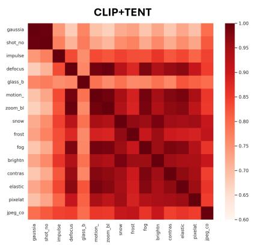

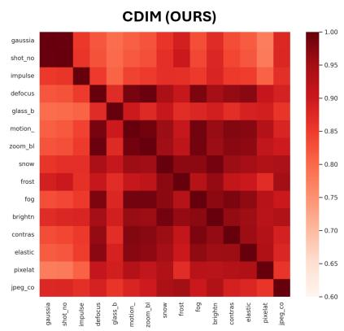  
Figure 5: Visualization of the mean class-wise representation similarity across different corruptions on CIFAR10-C. Darker colors indicate high similarity, meaning that the model extracts consistent features regardless of the corruption type. Lighter colors indicate low similarity, which reveals feature distortion and representation drift caused by the distribution shift.

## B.7 Sensitivity to the Discard Ratio ρ

Table 11(b) sweeps the discard ratio ρ of the gating mask (Eq. (5)) over $\rho \in$ {0.01, 0.03, 0.05, 0.10, 0.20, 0.30}, with all other hyperparameters fixed. The default $\rho = 0 . 0 5$ attains the highest accuracy on all three benchmarks (79.8% on CIFAR10-C, 48.2% on CIFAR100-C, and 36.9% on ImageNet-C). The accuracy at the neighboring values $\rho = 0 . 0 3$ and $\rho = 0 . 1 0$ is lower by at most 0.5% on every benchmark. The extreme value $\rho = 0 . 3 0$ reduces the accuracy by 1.4%, 1.5%, and 1.2% on CIFAR10-C, CIFAR100-C, and ImageNet-C, respectively, and $\rho = 0 . 0 1$ reduces it by 1.2% and 1.1% on CIFAR10-C and CIFAR100-C. On ImageNet-C, $\rho = 0 . 0 1$ and $\rho = 0 . 0 3$ give the same accuracy (0.4% below the default) because both discard a single sample per batch at $B = 6 4$ The total spread over the sweep is therefore 1.4%, 1.5%, and 1.2% on the three benchmarks. A small $\rho$ keeps more samples with noise-dominated entropy gradients in the sharpening term, whereas a large ρ removes samples that still carry a class signal. This explanation is consistent with the observed curve on CIFAR10-C and CIFAR100-C. Note that we report the sweep over $\rho$ as a sensitivity analysis and did not use it to select $\rho .$

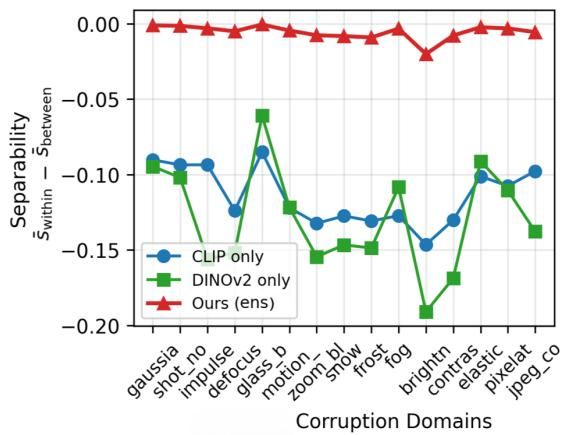  
(a) Class separability.

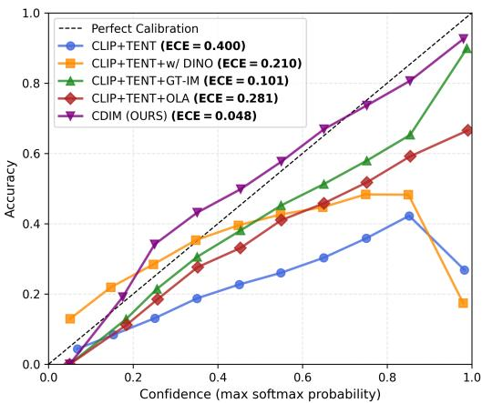  
(b) Additional Reliability diagram.

Figure 6: (a): Class separability $\bar { s } _ { \mathrm { w i t h i n } } - \bar { s } _ { \mathrm { b e t w e e n } }$ of the per-batch feature matrix, measured on each of the fifteen CIFAR10-C corruption types; higher values indicate better-separated classes. (b): Reliability diagram for CLIP+TENT+OLA (red) and CDIM (purple). OLA lowers the ECE from 0.400 (CLIP+TENT) to 0.281, but residual overconfidence remains. CDIM, which adds the DINO v2 ensemble and GT-IM, removes most of it and reaches an ECE of 0.048.  
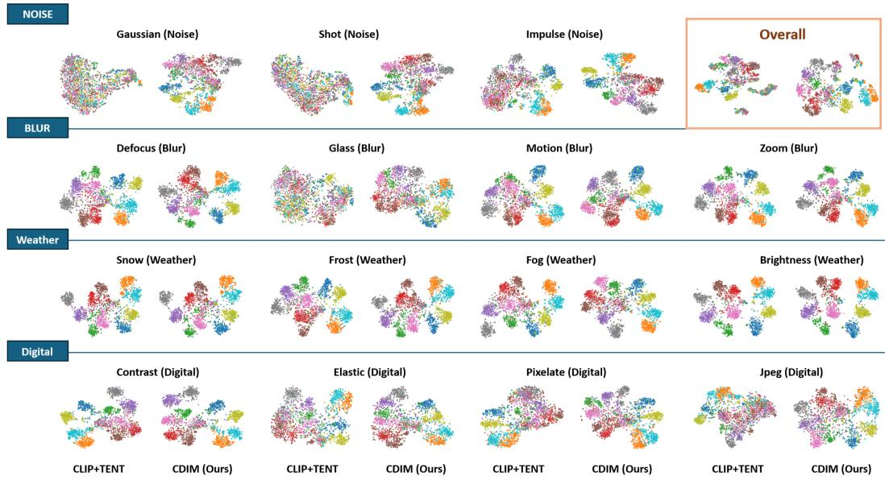  
Figure 7: t-SNE visualization of CLIP+TENT and CDIM features on CIFAR10-C for all 15 corruption types, together with an overall results (top right).

## C Additional Analysis

Per-corruption heatmap. Figure 5 visualizes the cross-corruption representation similarity on CIFAR10-C, computed as the average intra-class similarity between different corruption types. In the CLIP+TENT heatmap, adaptation to severe noise corruptions (Gaussian, shot, and impulse noise) yields representations that deviate strongly from those of the other corruptions, as indicated by lighter regions. In the CDIM heatmap, the intra-class similarity across corruption types is higher than under CLIP+TENT, including between the noise corruptions and the others. This indicates that CDIM reduces representation drift across corruption types.

Stability of the ensembled representation. Figure 6a reports the class separability $\bar { s } _ { \mathrm { w i t h i n } } - \bar { s } _ { \mathrm { b e t w e e n } }$ across the fifteen corruption types of CIFAR10-C, where higher values indicate better-separated classes. Here, $\bar { s } _ { \mathrm { b e t w e e n } }$ and $\bar { s } _ { \mathrm { w i t h i n } }$ are the mean pairwise similarities of the per-batch features for sample pairs from different classes and from the same class, respectively. The ensembled representation of CDIM (red) varies by less than 0.02 across corruption types, whereas the CLIP-only (blue) and DINO v2-only (green) representations vary by about 0.06 and 0.13, respectively. This stability is consistent with the cross-covariance construction of Section 3.2, in which averaging the predictions of the two backbones may reduce sensitivity to corruption-vulnerable directions.

Table 12: Domain generalization results across VisDA-C, OfficeHome, PACS, and VLCS. We denote Top-1/2 by bold and underline, respectively.
<table><tr><td>Dataset</td><td>Domain</td><td>ZS</td><td>TENT</td><td>WATT</td><td>BATCLIP</td><td>CDIM (Ours)</td></tr><tr><td rowspan="2">VisDA-C</td><td>3D (trainset)</td><td>84.4</td><td>84.9</td><td>85.4</td><td>85.3</td><td>86.0</td></tr><tr><td>YT (valset)</td><td>84.5</td><td>84.7</td><td>84.7</td><td>84.9</td><td>85.5</td></tr><tr><td rowspan="4">OfficeHome</td><td>Art</td><td>78.3</td><td>79.4</td><td>80.4</td><td>79.9</td><td>80.7</td></tr><tr><td>Clipart</td><td>64.0</td><td>63.2</td><td>66.9</td><td>66.4</td><td>68.0</td></tr><tr><td>Product</td><td>87.1</td><td>88.4</td><td>87.5</td><td>88.5</td><td>87.7</td></tr><tr><td>Real World</td><td>89.0</td><td>89.6</td><td>90.0</td><td>89.7</td><td>90.1</td></tr><tr><td rowspan="4">PACS</td><td>Art</td><td>97.2</td><td>98.1</td><td>97.8</td><td>97.6</td><td>97.7</td></tr><tr><td>Cartoon</td><td>97.4</td><td>97.7</td><td>97.5</td><td>97.5</td><td>97.7</td></tr><tr><td>Photo</td><td>99.6</td><td>99.6</td><td>99.5</td><td>99.7</td><td>99.7</td></tr><tr><td>Sketch</td><td>86.2</td><td>88.8</td><td>88.7</td><td>87.8</td><td>89.2</td></tr><tr><td rowspan="4">VLCS</td><td>Caltech101</td><td>99.4</td><td>99.4</td><td>99.4</td><td>99.5</td><td>99.5</td></tr><tr><td>LabelMe</td><td>68.2</td><td>68.1</td><td>68.5</td><td>68.9</td><td>68.6</td></tr><tr><td>SUN09</td><td>73.4</td><td>73.4</td><td>74.7</td><td>75.2</td><td>77.1</td></tr><tr><td>VOC2007</td><td>84.8</td><td>84.8</td><td>84.0</td><td>85.6</td><td>85.4</td></tr></table>

Table 13: Comparison on ImageNet distribution-shift variants (ImageNet-A, -V2, -R, and -Sketch) with CLIP ViT-B/16.
<table><tr><td>Method</td><td>ImageNet-A</td><td>ImageNet-V2</td><td>ImageNet-R</td><td>ImageNet-Sketch</td></tr><tr><td>CLIP [47]</td><td>49.2</td><td>60.4</td><td>72.7</td><td>44.9</td></tr><tr><td>CLIPArTT [1]</td><td>49.6</td><td>60.5</td><td>72.8</td><td>45.0</td></tr><tr><td>TDA [28]</td><td>51.0</td><td>61.2</td><td>73.9</td><td>46.4</td></tr><tr><td>TENT [54]</td><td>51.9</td><td>61.0</td><td>77.0</td><td>45.4</td></tr><tr><td>ETA [40]</td><td>52.0</td><td>61.0</td><td>77.4</td><td>46.8</td></tr><tr><td>Mint [4]</td><td>54.7</td><td>62.6</td><td>78.1</td><td>48.4</td></tr><tr><td>BATCLIP [38]</td><td>48.7</td><td>60.5</td><td>72.6</td><td>39.9</td></tr><tr><td>CDIM (Ours)</td><td>55.5</td><td>63.3</td><td>79.2</td><td>50.1</td></tr></table>

Comprehensive t-SNE Visualizations. Due to space constraints, Figure 4 in Section 4 displays only one representative t-SNE visualization per corruption category. Figure 7 provides the t-SNE visualizations for all individual corruption types, comparing CDIM with the CLIP+TENT baseline.

## D Additional Experiments

## D.1 Evaluation on Domain Generalization Benchmarks

In this section, we evaluate CDIM on commonly used domain generalization (DG) datasets: VisDA-C, OfficeHome, PACS, and VLCS. We follow the DG protocol of BATCLIP [38] and take the baseline results from its table for comparison. CDIM is compared with zero-shot CLIP (ZS), TENT [54], WATT [43], and BATCLIP [38]. The full results are given in Table 12. On VisDA-C (simulated and video shifts), CDIM reaches the highest accuracy of 86.0% (3D) and 85.5% (YT), exceeding recent baselines such as WATT and BATCLIP. On OfficeHome, PACS, and VLCS, where vanilla CLIP often struggles under texture and style shifts, CDIM improves over zero-shot CLIP in all 14 domains, with notable gains on Clipart in OfficeHome (68.0%, +4.0 over ZS), SUN09 in VLCS (77.1%, +3.7), and Sketch in PACS (89.2%, +3.0). CDIM is the best or tied for the best in 10 of the 14 domains. It is not the best on Product in OfficeHome (87.7% vs. 88.5% for BATCLIP), Art in PACS (97.7% vs. 98.1% for TENT), LabelMe in VLCS (68.6% vs. 68.9% for BATCLIP), and VOC2007 in VLCS (85.4% vs. 85.6% for BATCLIP).

Table 14: Continual TTA results with ViT-B/16, including per-corruption accuracy. Top-1 and Top-2 are shown in bold and underline, respectively.
<table><tr><td rowspan="2" colspan="2">Method</td><td colspan="3">Noise</td><td colspan="4">Blur</td><td colspan="4">Weather</td><td colspan="4">Digital</td><td rowspan="2">Mean↑</td></tr><tr><td>Gauss.</td><td>Shot</td><td>Impul.</td><td>Defoc.</td><td>Glass</td><td>Motion</td><td>Zoom</td><td>Snow</td><td>Frost</td><td>Fog</td><td>Brit.</td><td>Contr. Elast.</td><td>Pixel.</td><td>JPEG</td><td></td></tr><tr><td rowspan="8">Imae-C</td><td>TENT [54]</td><td>5.1</td><td>0.3</td><td>0.2</td><td>19.5</td><td>16.1</td><td>25.9</td><td>25.5</td><td>32.0</td><td>30.5</td><td>37.6 52.8</td><td></td><td>25.6</td><td>14.6</td><td>35.0</td><td>32.2</td><td>23.5</td></tr><tr><td>CoTTA [55]</td><td>17.6</td><td>18.3</td><td>18.8</td><td>17.9</td><td>19.2</td><td>16.3</td><td>28.7</td><td>19.0</td><td>16.9</td><td>17.5</td><td>41.5</td><td>24.2</td><td>26.4</td><td>20.8</td><td>25.4</td><td>21.9</td></tr><tr><td>EATA [40]</td><td>22.8</td><td>26.9</td><td>27.0</td><td>25.7</td><td>27.0</td><td>30.7</td><td>31.6</td><td>37.1</td><td>37.2</td><td>43.3 54.5</td><td></td><td>33.4</td><td>34.6</td><td>39.9</td><td>39.6</td><td>34.1</td></tr><tr><td>SAR [41]</td><td>19.5</td><td>21.6</td><td>18.2</td><td>25.3</td><td>21.3</td><td>32.9</td><td>22.8</td><td>32.5</td><td>28.8</td><td>42.4</td><td>48.6</td><td>28.6</td><td>12.5</td><td>39.8</td><td>37.8</td><td>28.8</td></tr><tr><td>COME [61]</td><td>22.5</td><td>26.8</td><td>26.7</td><td>24.5</td><td>26.2</td><td>29.9</td><td>31.3</td><td>36.5</td><td>37.3</td><td>43.0</td><td>54.0</td><td>33.7</td><td>35.8</td><td>40.4</td><td>40.1</td><td>33.9</td></tr><tr><td>BATCLIP [38]</td><td>19.4</td><td>20.7</td><td>19.2</td><td>16.7</td><td>16.1</td><td>17.4</td><td>16.2</td><td>19.7</td><td>20.1</td><td>18.8</td><td>31.1</td><td>12.2</td><td>14.2</td><td>17.4</td><td>17.1</td><td>18.4</td></tr><tr><td>Mint [4]</td><td>19.4</td><td>20.6</td><td>21.8</td><td>16.4</td><td>15.1</td><td>23.6</td><td>19.9</td><td>27.7</td><td>26.4</td><td>31.0</td><td>49.3</td><td>20.0</td><td>16.8</td><td>36.4</td><td>35.6</td><td>25.3</td></tr><tr><td>CDIM (Ours)</td><td>25.9</td><td>31.3</td><td>31.6</td><td>28.8</td><td>29.5</td><td>31.6</td><td>32.4</td><td>37.5</td><td>38.7</td><td>39.7</td><td>54.0</td><td>29.8</td><td>34.0</td><td>37.8</td><td>36.0</td><td>34.6</td></tr><tr><td rowspan="8">CIHR10-C</td><td>TENT [54]</td><td>37.3</td><td>36.8</td><td>49.6</td><td>69.5</td><td>43.9</td><td>70.4</td><td>73.9</td><td>73.9</td><td></td><td>76.1 70.6 83.7</td><td></td><td>71.5</td><td>57.7</td><td>46.2</td><td>59.4</td><td>61.4</td></tr><tr><td>CoTTA [55]</td><td>27.4</td><td>32.0</td><td>35.7</td><td>66.4</td><td>49.7</td><td>67.5</td><td>73.2</td><td>76.4</td><td>76.7</td><td></td><td>64.8 87.6</td><td>59.6</td><td>58.4</td><td>44.9</td><td>60.2</td><td>58.7</td></tr><tr><td>EATA [40]</td><td>42.5</td><td>47.0</td><td>57.8</td><td>73.0</td><td>42.7</td><td>70.9</td><td>75.3</td><td>75.8</td><td>79.1</td><td>72.3</td><td>85.6</td><td>64.8</td><td>56.3</td><td>48.7</td><td>60.8</td><td>63.5</td></tr><tr><td>SAR [41]</td><td>32.4</td><td>30.6</td><td>48.5</td><td>77.0</td><td>41.0</td><td>56.9</td><td>76.3</td><td>82.3</td><td>83.5</td><td>81.9</td><td>88.8</td><td>80.0</td><td>62.7</td><td>48.0</td><td>50.8</td><td>62.7</td></tr><tr><td>COME [61]</td><td>42.3</td><td>46.9</td><td>57.5</td><td>72.9</td><td>42.5</td><td>71.0</td><td>75.4</td><td>75.8</td><td>79.0</td><td>72.4</td><td>85.5</td><td>64.8</td><td>56.2</td><td>48.8</td><td>60.5</td><td>63.4</td></tr><tr><td>BATCLIP [38]</td><td>62.6</td><td>62.2</td><td>58.0</td><td>63.0</td><td>52.2</td><td>59.8</td><td>62.6</td><td>60.2</td><td>61.4</td><td>57.1</td><td>60.7</td><td>57.6</td><td>47.0</td><td>48.6</td><td>43.4</td><td>57.1</td></tr><tr><td>Mint [4]</td><td>62.2</td><td>65.8</td><td>62.8</td><td>69.0</td><td>44.3</td><td>73.9</td><td>74.4</td><td>77.9</td><td>78.1</td><td>75.8</td><td>88.2</td><td>71.8</td><td>63.6</td><td>43.9</td><td>59.7</td><td>67.4</td></tr><tr><td>CDIM (Ours)</td><td>67.8</td><td>75.3</td><td>77.1</td><td>81.7</td><td>68.6</td><td>81.1</td><td>86.0</td><td>85.9</td><td>87.6</td><td>85.9</td><td>92.0</td><td>87.7</td><td>76.4</td><td>78.2</td><td>75.4</td><td>80.4</td></tr><tr><td rowspan="8">CI0-C</td><td>TENT [54]</td><td>13.8</td><td>15.8</td><td>15.6</td><td>36.3</td><td>16.5</td><td>39.5</td><td>46.7</td><td>44.6</td><td></td><td>42.5 27.3 60.4</td><td></td><td>31.4</td><td>34.0</td><td>18.6</td><td>32.6</td><td>31.7</td></tr><tr><td>CoTTA [55]</td><td>15.6</td><td>17.4</td><td>19.5</td><td>36.0</td><td>19.2</td><td>36.4</td><td>44.1</td><td>41.4</td><td>39.1</td><td>20.5</td><td>54.9</td><td>24.3</td><td>29.4</td><td>18.0</td><td>28.2</td><td>29.6</td></tr><tr><td>EATA [40]</td><td>26.7</td><td>35.4</td><td>40.6</td><td>49.9</td><td>28.3</td><td>50.0</td><td>57.1</td><td>54.7</td><td>56.1</td><td>51.2</td><td>66.4</td><td>52.7</td><td>37.0</td><td>40.9</td><td>39.7</td><td>45.8</td></tr><tr><td>SAR [41]</td><td>27.2</td><td>36.4</td><td>41.4</td><td>48.1</td><td>28.3</td><td>35.8</td><td>25.8</td><td>54.6</td><td>53.5</td><td>42.4 38.8</td><td></td><td>30.1</td><td>33.6</td><td>37.8</td><td>32.1</td><td>37.7</td></tr><tr><td>COME [61]</td><td>27.6</td><td>32.8</td><td>36.5</td><td>43.8</td><td>22.6</td><td>44.2</td><td>53.3</td><td>51.7</td><td>53.7</td><td>48.6</td><td>63.9</td><td>48.0</td><td>35.5</td><td>36.9</td><td>37.2</td><td>42.4</td></tr><tr><td>BATCLIP [38]</td><td>24.9</td><td>25.9</td><td>23.3</td><td>32.0</td><td>20.2</td><td>30.1</td><td>33.6</td><td>29.8</td><td>30.6</td><td>27.1</td><td>37.6</td><td>29.1</td><td>21.7</td><td>18.8</td><td>19.9</td><td>27.0</td></tr><tr><td>Mint [4]</td><td>21.4</td><td>33.1</td><td>25.8</td><td>35.0 53.8</td><td>15.3 38.7</td><td>37.3 51.2</td><td>43.4 57.7</td><td>46.0 52.5</td><td>45.2 54.7</td><td>41.4 47.0 57.1</td><td>60.2</td><td>36.8</td><td>30.0</td><td>16.9</td><td>29.7</td><td>34.5</td></tr><tr><td>CDIM (Ours)</td><td>35.1</td><td>44.3</td><td>46.7</td></table>

## D.2 Robustness to Natural Distribution Shifts and Natural Adversarial Examples

To assess robustness beyond synthetic corruption benchmarks, we evaluate CDIM on four ImageNet variants that capture natural distribution shifts and natural adversarial examples: ImageNet-A, -V2, -R, and -Sketch (Table 3(d)). For a broader comparison with existing methods, Table 13 follows the setting of Mint [4] and reuses its reported baseline results alongside ours. CDIM achieves the best accuracy among the compared CLIP-based online TTA methods on all four datasets. It outperforms the strongest baseline, Mint [4], by 0.8%, 0.7%, 1.1%, and 1.7% on ImageNet-A, -V2, -R, and -Sketch (-S), respectively. The margins against CLIPArTT [1] and TDA [28] are larger, at least 2.8% and 2.1%, respectively. Against BATCLIP [38], the margins are 6.8%, 2.8%, 6.6%, and 10.2% on the four datasets. These results indicate that the robustness of CDIM extends beyond synthetic corruption benchmarks to natural distribution shifts.

## D.3 Additional Comparison Results on Continual TTA

Due to space constraints, Table 2a in Section 4 reports only the mean accuracy for the continual TTA setting. Table 14 provides the accuracy for each corruption type together with the mean.

Table 15: Online TTA results with ViT-B/16, including additional baselines. Top-1 and Top-2 are shown in bold and underline, respectively.
<table><tr><td rowspan=1 colspan=18>Noise               Blur               Weather             DigitalMethod                                                                                           Mean↑Gauss.ShotImpul.Defoc.GlassMotionZoomSnowFrost FogBrit.Contr.Elast.Pixel.JPEG</td></tr><tr><td rowspan=1 colspan=18>Zero Shot     11.1 12.512.1 23.3 15.3 24.4 22.732.429.935.9 54.117.3 12.731.033.3 24.5</td></tr><tr><td rowspan=1 colspan=4>TDA [28]     12.4 14.8</td><td rowspan=1 colspan=6>14.8 23.7 16.7 26.1 24.033.5</td><td rowspan=1 colspan=3>32.138.055.3</td><td rowspan=1 colspan=1>19.3</td><td rowspan=1 colspan=1>14.2</td><td rowspan=1 colspan=1>33.5</td><td rowspan=1 colspan=2>35.0 26.2</td></tr><tr><td rowspan=1 colspan=4>DMN [62]    11.5 14.1</td><td rowspan=1 colspan=6>14.0 22.3 15.8 24.6 22.5 31.5</td><td rowspan=1 colspan=3>30.435.354.2</td><td rowspan=1 colspan=1>16.3</td><td rowspan=1 colspan=1>12.5</td><td rowspan=1 colspan=1>32.5</td><td rowspan=1 colspan=2>24.8 24.2</td></tr><tr><td rowspan=1 colspan=4>VTE [12]     9.2 10.8</td><td rowspan=1 colspan=6>10.8 24.7 14.4 24.3 25.2 35.4</td><td rowspan=1 colspan=3>32.438.255.5</td><td rowspan=1 colspan=1>16.2</td><td rowspan=1 colspan=1>14.3</td><td rowspan=1 colspan=1>38.7</td><td rowspan=1 colspan=2>34.0 25.6</td></tr><tr><td rowspan=1 colspan=4>ZERO [13]   10.5 11.5</td><td rowspan=1 colspan=1>11.1</td><td rowspan=1 colspan=2>24.8 14.9</td><td rowspan=1 colspan=2>24.4 23.3</td><td rowspan=1 colspan=1>33.0</td><td rowspan=1 colspan=3>30.437.154.5</td><td rowspan=1 colspan=1>16.9</td><td rowspan=1 colspan=1>13.4</td><td rowspan=1 colspan=1>34.9</td><td rowspan=1 colspan=2>32.9 24.9</td></tr><tr><td rowspan=1 colspan=4>ECALP [34]  13.3 15.6</td><td rowspan=1 colspan=1>14.1</td><td rowspan=1 colspan=2>22.6 15.6</td><td rowspan=1 colspan=2>25.5 23.6</td><td rowspan=1 colspan=1>31.0</td><td rowspan=1 colspan=3>30.035.852.1</td><td rowspan=1 colspan=1>18.3</td><td rowspan=1 colspan=1>13.5</td><td rowspan=1 colspan=1>33.1</td><td rowspan=1 colspan=2>33.3 25.2</td></tr><tr><td rowspan=1 colspan=4>TENT [54]   5.2 5.7</td><td rowspan=1 colspan=1>7.4</td><td rowspan=1 colspan=2>25.3 19.3</td><td rowspan=1 colspan=2>26.9 24.2</td><td rowspan=1 colspan=1>33.5</td><td rowspan=1 colspan=3>30.537.854.3</td><td rowspan=1 colspan=1>22.5</td><td rowspan=1 colspan=1>13.9</td><td rowspan=1 colspan=1>35.1</td><td rowspan=1 colspan=2>36.0 25.2</td></tr><tr><td rowspan=1 colspan=4>RoTTA [58]   11.4 13.1</td><td rowspan=1 colspan=1>12.4</td><td rowspan=1 colspan=1>23.5</td><td rowspan=1 colspan=1>15.5</td><td rowspan=1 colspan=2>24.7 22.8</td><td rowspan=1 colspan=1>32.6</td><td rowspan=1 colspan=3>29.935.954.2</td><td rowspan=1 colspan=1>17.3</td><td rowspan=1 colspan=1>12.9</td><td rowspan=1 colspan=1>31.0</td><td rowspan=1 colspan=2>33.5 24.7</td></tr><tr><td rowspan=1 colspan=4>TPT [50]     8.5 9.4</td><td rowspan=1 colspan=1>10.2</td><td rowspan=1 colspan=1>24.1</td><td rowspan=1 colspan=1>15.1</td><td rowspan=1 colspan=2>25.0 24.0</td><td rowspan=1 colspan=1>34.0</td><td rowspan=1 colspan=3>32.237.155.5</td><td rowspan=1 colspan=1>16.5</td><td rowspan=1 colspan=1>13.7</td><td rowspan=1 colspan=1>33.9</td><td rowspan=1 colspan=2>33.6 24.9</td></tr><tr><td rowspan=1 colspan=2>MEMO [60]</td><td rowspan=1 colspan=1>11.1</td><td rowspan=1 colspan=1>12.4</td><td rowspan=1 colspan=1>12.0</td><td rowspan=1 colspan=1>23.5</td><td rowspan=1 colspan=1>15.4</td><td rowspan=1 colspan=1>24.6</td><td rowspan=1 colspan=1>22.9</td><td rowspan=1 colspan=1>32.5</td><td rowspan=1 colspan=3>30.135.954.0</td><td rowspan=1 colspan=1>17.5</td><td rowspan=1 colspan=1>12.8</td><td rowspan=1 colspan=1>31.2</td><td rowspan=1 colspan=2>33.4 24.6</td></tr><tr><td rowspan=1 colspan=2>WATT [43]</td><td rowspan=1 colspan=1>11.2</td><td rowspan=1 colspan=1>12.8</td><td rowspan=1 colspan=1>13.0</td><td rowspan=1 colspan=1>25.1</td><td rowspan=1 colspan=1>18.1</td><td rowspan=1 colspan=1>26.9</td><td rowspan=1 colspan=1>25.2</td><td rowspan=1 colspan=1>33.4</td><td rowspan=1 colspan=1>30.2</td><td rowspan=1 colspan=2>37.454.0</td><td rowspan=1 colspan=1>21.8</td><td rowspan=1 colspan=1>15.2</td><td rowspan=1 colspan=1>33.5</td><td rowspan=1 colspan=2>34.9 26.2</td></tr><tr><td rowspan=1 colspan=2>Mint [4]</td><td rowspan=1 colspan=1>19.7</td><td rowspan=1 colspan=1>20.4</td><td rowspan=1 colspan=1>19.4</td><td rowspan=1 colspan=1>26.9</td><td rowspan=1 colspan=1>21.5</td><td rowspan=1 colspan=1>29.9</td><td rowspan=1 colspan=1>26.0</td><td rowspan=1 colspan=1>32.7</td><td rowspan=1 colspan=1>29.4</td><td rowspan=1 colspan=2>38.855.1</td><td rowspan=1 colspan=1>24.3</td><td rowspan=1 colspan=1>19.1</td><td rowspan=1 colspan=1>36.4</td><td rowspan=1 colspan=2>38.2 29.2</td></tr><tr><td rowspan=1 colspan=2>BATCLIP [38]</td><td rowspan=1 colspan=1>19.5</td><td rowspan=1 colspan=1>21.0</td><td rowspan=1 colspan=2>19.3 25.9</td><td rowspan=1 colspan=1>21.3</td><td rowspan=1 colspan=1>30.0</td><td rowspan=1 colspan=1>28.5</td><td rowspan=1 colspan=1>35.2</td><td rowspan=1 colspan=1>31.4</td><td rowspan=1 colspan=2>40.255.2</td><td rowspan=1 colspan=1>25.7</td><td rowspan=1 colspan=1>23.7</td><td rowspan=1 colspan=1>36.8</td><td rowspan=1 colspan=2>37.2 30.1</td></tr><tr><td rowspan=1 colspan=2>SubTTA [59]</td><td rowspan=1 colspan=1>21.2</td><td rowspan=1 colspan=1>22.9</td><td rowspan=1 colspan=2>21.4 25.3</td><td rowspan=1 colspan=1>24.8</td><td rowspan=1 colspan=2>30.7 29.6</td><td rowspan=1 colspan=1>37.2</td><td rowspan=1 colspan=3>35.941.357.0</td><td rowspan=1 colspan=1>29.7</td><td rowspan=1 colspan=1>29.4</td><td rowspan=1 colspan=1>37.6</td><td rowspan=1 colspan=2>38.2 32.1</td></tr><tr><td rowspan=1 colspan=4>CDIM (Ours) 26.027.9</td><td rowspan=1 colspan=3>26.7 31.1 30.1</td><td rowspan=1 colspan=3>35.9 34.442.2</td><td rowspan=1 colspan=3>38.345.659.6</td><td rowspan=1 colspan=1>34.1</td><td rowspan=1 colspan=1>33.1</td><td rowspan=1 colspan=1>45.1</td><td rowspan=1 colspan=2>43.8 36.9</td></tr><tr><td rowspan=1 colspan=1></td><td rowspan=1 colspan=3>Zero Shot    37.941.7</td><td rowspan=1 colspan=1>54.4</td><td rowspan=1 colspan=2>71.7 40.9</td><td rowspan=1 colspan=2>67.9 73.7</td><td rowspan=1 colspan=1>73.9</td><td rowspan=1 colspan=2>77.370.2</td><td rowspan=1 colspan=1>84.4</td><td rowspan=1 colspan=1>62.4</td><td rowspan=1 colspan=1>53.8</td><td rowspan=1 colspan=1>47.7</td><td rowspan=1 colspan=2>59.5 61.2</td></tr><tr><td rowspan=1 colspan=1></td><td rowspan=1 colspan=1>TDA [28]</td><td rowspan=1 colspan=1>40.9</td><td rowspan=1 colspan=1>44.3</td><td rowspan=1 colspan=1>50.5</td><td rowspan=1 colspan=1>72.8</td><td rowspan=1 colspan=1>44.4</td><td rowspan=1 colspan=2>71.6 76.0</td><td rowspan=1 colspan=1>75.3</td><td rowspan=1 colspan=2>77.871.8</td><td rowspan=1 colspan=1>86.1</td><td rowspan=1 colspan=1>62.3</td><td rowspan=1 colspan=1>56.3</td><td rowspan=1 colspan=1>47.8</td><td rowspan=1 colspan=1>57.7</td><td rowspan=1 colspan=1>62.4</td></tr><tr><td rowspan=1 colspan=1></td><td rowspan=1 colspan=1>DMN [62]</td><td rowspan=1 colspan=1>43.3</td><td rowspan=1 colspan=1>47.5</td><td rowspan=1 colspan=1>54.1</td><td rowspan=1 colspan=1>73.4</td><td rowspan=1 colspan=1>40.0</td><td rowspan=1 colspan=2>72.2 76.0</td><td rowspan=1 colspan=1>74.3</td><td rowspan=1 colspan=2>76.571.2</td><td rowspan=1 colspan=1>84.5</td><td rowspan=1 colspan=1>60.6</td><td rowspan=1 colspan=1>54.1</td><td rowspan=1 colspan=1>47.2</td><td rowspan=1 colspan=1>57.1</td><td rowspan=1 colspan=1>62.1</td></tr><tr><td rowspan=1 colspan=1></td><td rowspan=1 colspan=1>VTE [12]</td><td rowspan=1 colspan=1>42.3</td><td rowspan=1 colspan=1>46.2</td><td rowspan=1 colspan=1>64.2</td><td rowspan=1 colspan=1>71.1</td><td rowspan=1 colspan=1>45.6</td><td rowspan=1 colspan=1>68.5</td><td rowspan=1 colspan=1>73.7</td><td rowspan=1 colspan=1>76.7</td><td rowspan=1 colspan=2>78.371.1</td><td rowspan=1 colspan=1>85.3</td><td rowspan=1 colspan=1>57.2</td><td rowspan=1 colspan=1>59.6</td><td rowspan=1 colspan=1>60.6</td><td rowspan=1 colspan=1>61.9</td><td rowspan=1 colspan=1>64.2</td></tr><tr><td rowspan=1 colspan=1></td><td rowspan=1 colspan=1>ZERO [13]</td><td rowspan=1 colspan=1>39.2</td><td rowspan=1 colspan=1>43.8</td><td rowspan=1 colspan=1>57.2</td><td rowspan=1 colspan=1>71.9</td><td rowspan=1 colspan=1>40.7</td><td rowspan=1 colspan=1>69.2</td><td rowspan=1 colspan=1>74.1</td><td rowspan=1 colspan=1>74.4</td><td rowspan=1 colspan=1>77.2</td><td rowspan=1 colspan=1>72.4</td><td rowspan=1 colspan=1>83.8</td><td rowspan=1 colspan=1>60.7</td><td rowspan=1 colspan=1>55.6</td><td rowspan=1 colspan=1>49.0</td><td rowspan=1 colspan=1>62.3</td><td rowspan=1 colspan=1>62.1</td></tr><tr><td rowspan=1 colspan=1></td><td rowspan=1 colspan=1>ECALP [34]</td><td rowspan=1 colspan=1>46.5</td><td rowspan=1 colspan=1>50.8</td><td rowspan=1 colspan=1>61.0</td><td rowspan=1 colspan=1>71.8</td><td rowspan=1 colspan=1>41.5</td><td rowspan=1 colspan=1>70.5</td><td rowspan=1 colspan=1>75.4</td><td rowspan=1 colspan=1>75.8</td><td rowspan=1 colspan=1>79.0</td><td rowspan=1 colspan=1>71.2</td><td rowspan=1 colspan=1>86.0</td><td rowspan=1 colspan=1>60.7</td><td rowspan=1 colspan=1>58.1</td><td rowspan=1 colspan=1>49.8</td><td rowspan=1 colspan=1>61.2</td><td rowspan=1 colspan=1>64.0</td></tr><tr><td rowspan=1 colspan=1></td><td rowspan=1 colspan=1>TENT [54]</td><td rowspan=1 colspan=1>15.4</td><td rowspan=1 colspan=1>18.3</td><td rowspan=1 colspan=1>38.2</td><td rowspan=1 colspan=1>81.4</td><td rowspan=1 colspan=1>21.5</td><td rowspan=1 colspan=1>76.3</td><td rowspan=1 colspan=1>82.2</td><td rowspan=1 colspan=1>83.6</td><td rowspan=1 colspan=1>82.2</td><td rowspan=1 colspan=1>80.6</td><td rowspan=1 colspan=1>89.8</td><td rowspan=1 colspan=1>80.7</td><td rowspan=1 colspan=1>63.5</td><td rowspan=1 colspan=1>58.8</td><td rowspan=1 colspan=1>56.3</td><td rowspan=1 colspan=1>61.9</td></tr><tr><td rowspan=1 colspan=1>A</td><td rowspan=1 colspan=1>RoTTA [58]</td><td rowspan=1 colspan=1>39.2</td><td rowspan=1 colspan=1>42.6</td><td rowspan=1 colspan=1>55.3</td><td rowspan=1 colspan=1>72.1</td><td rowspan=1 colspan=1>41.2</td><td rowspan=1 colspan=1>68.1</td><td rowspan=1 colspan=1>74.0</td><td rowspan=1 colspan=1>74.4</td><td rowspan=1 colspan=1>78.0</td><td rowspan=1 colspan=1>70.8</td><td rowspan=1 colspan=1>84.8</td><td rowspan=1 colspan=1>63.1</td><td rowspan=1 colspan=1>54.6</td><td rowspan=1 colspan=1>49.4</td><td rowspan=1 colspan=1>60.1</td><td rowspan=1 colspan=1>61.9</td></tr><tr><td rowspan=1 colspan=1></td><td rowspan=1 colspan=1>TPT [50]</td><td rowspan=1 colspan=1>37.8</td><td rowspan=1 colspan=1>42.2</td><td rowspan=1 colspan=1>60.7</td><td rowspan=1 colspan=1>72.8</td><td rowspan=1 colspan=1>44.8</td><td rowspan=1 colspan=1>69.7</td><td rowspan=1 colspan=1>75.4</td><td rowspan=1 colspan=1>76.0</td><td rowspan=1 colspan=1>78.9</td><td rowspan=1 colspan=1>72.2</td><td rowspan=1 colspan=1>85.7</td><td rowspan=1 colspan=1>62.0</td><td rowspan=1 colspan=1>58.9</td><td rowspan=1 colspan=1>55.2</td><td rowspan=1 colspan=1>62.6</td><td rowspan=1 colspan=1>63.6</td></tr><tr><td rowspan=1 colspan=1></td><td rowspan=1 colspan=1>MEMO [60]</td><td rowspan=1 colspan=1>37.6</td><td rowspan=1 colspan=1>41.3</td><td rowspan=1 colspan=1>55.6</td><td rowspan=1 colspan=1>72.1</td><td rowspan=1 colspan=1>41.6</td><td rowspan=1 colspan=1>68.6</td><td rowspan=1 colspan=1>74.0</td><td rowspan=1 colspan=1>75.0</td><td rowspan=1 colspan=1>77.3</td><td rowspan=1 colspan=1>71.5</td><td rowspan=1 colspan=1>84.8</td><td rowspan=1 colspan=1>62.1</td><td rowspan=1 colspan=1>55.5</td><td rowspan=1 colspan=1>49.2</td><td rowspan=1 colspan=1>61.0</td><td rowspan=1 colspan=1>61.8</td></tr><tr><td rowspan=1 colspan=1></td><td rowspan=1 colspan=1>WATT [43]</td><td rowspan=1 colspan=1>46.0</td><td rowspan=1 colspan=1>53.2</td><td rowspan=1 colspan=1>60.3</td><td rowspan=1 colspan=1>75.0</td><td rowspan=1 colspan=1>38.6</td><td rowspan=1 colspan=1>71.5</td><td rowspan=1 colspan=1>75.9</td><td rowspan=1 colspan=1>77.7</td><td rowspan=1 colspan=1>80.2</td><td rowspan=1 colspan=1>76.3</td><td rowspan=1 colspan=1>87.6</td><td rowspan=1 colspan=1>75.6</td><td rowspan=1 colspan=1>55.4</td><td rowspan=1 colspan=1>62.0</td><td rowspan=1 colspan=1>63.2</td><td rowspan=1 colspan=1>66.6</td></tr><tr><td rowspan=1 colspan=1></td><td rowspan=1 colspan=1>Mint [4]</td><td rowspan=1 colspan=1>54.4</td><td rowspan=1 colspan=1>58.7</td><td rowspan=1 colspan=1>64.5</td><td rowspan=1 colspan=1>76.5</td><td rowspan=1 colspan=1>48.9</td><td rowspan=1 colspan=1>77.9</td><td rowspan=1 colspan=1>79.3</td><td rowspan=1 colspan=1>81.6</td><td rowspan=1 colspan=1>81.5</td><td rowspan=1 colspan=1>77.2</td><td rowspan=1 colspan=1>89.9</td><td rowspan=1 colspan=1>74.5</td><td rowspan=1 colspan=1>62.1</td><td rowspan=1 colspan=1>61.4</td><td rowspan=1 colspan=1>64.5</td><td rowspan=1 colspan=1>70.2</td></tr><tr><td rowspan=1 colspan=1></td><td rowspan=1 colspan=1>BATCLIP [38]</td><td rowspan=1 colspan=1>61.9</td><td rowspan=1 colspan=1>65.4</td><td rowspan=1 colspan=1>67.1</td><td rowspan=1 colspan=1>80.1</td><td rowspan=1 colspan=1>55.5</td><td rowspan=1 colspan=1>80.0</td><td rowspan=1 colspan=1>81.6</td><td rowspan=1 colspan=1>82.5</td><td rowspan=1 colspan=1>83.7</td><td rowspan=1 colspan=1>80.4</td><td rowspan=1 colspan=1>88.5</td><td rowspan=1 colspan=1>81.2</td><td rowspan=1 colspan=1>69.1</td><td rowspan=1 colspan=1>62.7</td><td rowspan=1 colspan=1>67.3</td><td rowspan=1 colspan=1>73.8</td></tr><tr><td rowspan=1 colspan=1></td><td rowspan=1 colspan=1>SubTTA [59]</td><td rowspan=1 colspan=1>60.2</td><td rowspan=1 colspan=1>66.6</td><td rowspan=1 colspan=1>69.7</td><td rowspan=1 colspan=1>81.5</td><td rowspan=1 colspan=1>59.9</td><td rowspan=1 colspan=2>81.2 82.4</td><td rowspan=1 colspan=1>83.7</td><td rowspan=1 colspan=1>83.8</td><td rowspan=1 colspan=1>83.5</td><td rowspan=1 colspan=1>91.4</td><td rowspan=1 colspan=1>86.3</td><td rowspan=1 colspan=1>70.9</td><td rowspan=1 colspan=1>74.4</td><td rowspan=1 colspan=1>69.4</td><td rowspan=1 colspan=1>76.3</td></tr><tr><td rowspan=1 colspan=1></td><td rowspan=1 colspan=1>CDIM (Ours)</td><td rowspan=1 colspan=1>67.8</td><td rowspan=1 colspan=1>70.9</td><td rowspan=1 colspan=1>76.3</td><td rowspan=1 colspan=1>83.2</td><td rowspan=1 colspan=1>67.1</td><td rowspan=1 colspan=2>83.0 85.2</td><td rowspan=1 colspan=1>86.2</td><td rowspan=1 colspan=2>87.084.8</td><td rowspan=1 colspan=1>92.5</td><td rowspan=1 colspan=1>87.0</td><td rowspan=1 colspan=1>74.9</td><td rowspan=1 colspan=1>77.5</td><td rowspan=1 colspan=2>73.4 79.8</td></tr><tr><td rowspan=1 colspan=1></td><td rowspan=1 colspan=1>Zero Shot</td><td rowspan=1 colspan=1>19.6</td><td rowspan=1 colspan=1>21.4</td><td rowspan=1 colspan=1>25.3</td><td rowspan=1 colspan=1>42.5</td><td rowspan=1 colspan=1>20.1</td><td rowspan=1 colspan=2>43.1 47.9</td><td rowspan=1 colspan=1>48.4</td><td rowspan=1 colspan=2>49.741.6</td><td rowspan=1 colspan=1>57.0</td><td rowspan=1 colspan=1>34.5</td><td rowspan=1 colspan=1>29.2</td><td rowspan=1 colspan=1>23.9</td><td rowspan=1 colspan=2>32.5 35.8</td></tr><tr><td rowspan=1 colspan=1></td><td rowspan=1 colspan=1>TDA [28]</td><td rowspan=1 colspan=1>22.6</td><td rowspan=1 colspan=1>25.1</td><td rowspan=1 colspan=1>29.2</td><td rowspan=1 colspan=1>43.1</td><td rowspan=1 colspan=1>19.4</td><td rowspan=1 colspan=1>43.5</td><td rowspan=1 colspan=1>49.3</td><td rowspan=1 colspan=1>48.5</td><td rowspan=1 colspan=2>50.441.5</td><td rowspan=1 colspan=1>58.0</td><td rowspan=1 colspan=1>35.0</td><td rowspan=1 colspan=1>28.7</td><td rowspan=1 colspan=1>24.2</td><td rowspan=1 colspan=1>32.5</td><td rowspan=1 colspan=1>36.7</td></tr><tr><td rowspan=1 colspan=1></td><td rowspan=1 colspan=1>DMN [62]</td><td rowspan=1 colspan=1>22.0</td><td rowspan=1 colspan=1>25.1</td><td rowspan=1 colspan=1>25.4</td><td rowspan=1 colspan=1>40.9</td><td rowspan=1 colspan=1>16.1</td><td rowspan=1 colspan=1>43.7</td><td rowspan=1 colspan=1>49.4</td><td rowspan=1 colspan=1>45.7</td><td rowspan=1 colspan=2>47.939.8</td><td rowspan=1 colspan=1>57.6</td><td rowspan=1 colspan=1>32.2</td><td rowspan=1 colspan=1>25.9</td><td rowspan=1 colspan=1>22.9</td><td rowspan=1 colspan=1>31.0</td><td rowspan=1 colspan=1>35.0</td></tr><tr><td rowspan=1 colspan=1></td><td rowspan=1 colspan=1>VTE [12]</td><td rowspan=1 colspan=1>18.0</td><td rowspan=1 colspan=1>18.8</td><td rowspan=1 colspan=1>28.2</td><td rowspan=1 colspan=1>40.4</td><td rowspan=1 colspan=1>19.6</td><td rowspan=1 colspan=1>39.6</td><td rowspan=1 colspan=1>45.4</td><td rowspan=1 colspan=1>48.2</td><td rowspan=1 colspan=2>46.940.7</td><td rowspan=1 colspan=1>55.3</td><td rowspan=1 colspan=1>30.1</td><td rowspan=1 colspan=1>32.5</td><td rowspan=1 colspan=1>30.4</td><td rowspan=1 colspan=1>31.5</td><td rowspan=1 colspan=1>35.0</td></tr><tr><td rowspan=1 colspan=1></td><td rowspan=1 colspan=1>ZERO [13]</td><td rowspan=1 colspan=1>18.9</td><td rowspan=1 colspan=1>21.1</td><td rowspan=1 colspan=1>28.6</td><td rowspan=1 colspan=1>44.0</td><td rowspan=1 colspan=1>19.5</td><td rowspan=1 colspan=1>43.3</td><td rowspan=1 colspan=1>48.7</td><td rowspan=1 colspan=1>49.1</td><td rowspan=1 colspan=2>50.144.0</td><td rowspan=1 colspan=1>57.6</td><td rowspan=1 colspan=1>34.5</td><td rowspan=1 colspan=1>31.1</td><td rowspan=1 colspan=1>24.8</td><td rowspan=1 colspan=1>34.0</td><td rowspan=1 colspan=1>36.6</td></tr><tr><td rowspan=1 colspan=1>0</td><td rowspan=1 colspan=1>ECALP [34]</td><td rowspan=1 colspan=1>23.1</td><td rowspan=1 colspan=1>25.2</td><td rowspan=1 colspan=1>30.1</td><td rowspan=1 colspan=1>43.2</td><td rowspan=1 colspan=1>19.6</td><td rowspan=1 colspan=1>42.8</td><td rowspan=1 colspan=1>49.7</td><td rowspan=1 colspan=1>48.0</td><td rowspan=1 colspan=2>50.042.3</td><td rowspan=1 colspan=1>58.4</td><td rowspan=1 colspan=1>34.6</td><td rowspan=1 colspan=1>30.1</td><td rowspan=1 colspan=1>25.2</td><td rowspan=1 colspan=2>32.3 37.0</td></tr><tr><td rowspan=1 colspan=1></td><td rowspan=1 colspan=1>TENT [54]</td><td rowspan=1 colspan=1>7.6</td><td rowspan=1 colspan=1>8.2</td><td rowspan=1 colspan=1>8.3</td><td rowspan=1 colspan=1>51.7</td><td rowspan=1 colspan=1>8.2</td><td rowspan=1 colspan=1>52.5</td><td rowspan=1 colspan=1>53.3</td><td rowspan=1 colspan=1>52.2</td><td rowspan=1 colspan=2>36.347.9</td><td rowspan=1 colspan=1>62.6</td><td rowspan=1 colspan=1>52.5</td><td rowspan=1 colspan=1>36.4</td><td rowspan=1 colspan=1>40.0</td><td rowspan=1 colspan=2>38.1 37.0</td></tr><tr><td rowspan=1 colspan=1>A</td><td rowspan=1 colspan=1>RoTTA [58]</td><td rowspan=1 colspan=1>20.6</td><td rowspan=1 colspan=1>22.2</td><td rowspan=1 colspan=1>26.3</td><td rowspan=1 colspan=1>42.5</td><td rowspan=1 colspan=1>20.3</td><td rowspan=1 colspan=1>43.2</td><td rowspan=1 colspan=1>48.1</td><td rowspan=1 colspan=1>48.6</td><td rowspan=1 colspan=1>50.0</td><td rowspan=1 colspan=1>41.7</td><td rowspan=1 colspan=1>57.2</td><td rowspan=1 colspan=1>34.5</td><td rowspan=1 colspan=1>29.2</td><td rowspan=1 colspan=1>25.1</td><td rowspan=1 colspan=1>32.9</td><td rowspan=1 colspan=1>36.2</td></tr><tr><td rowspan=1 colspan=1></td><td rowspan=1 colspan=1>TPT [50]</td><td rowspan=1 colspan=1>17.9</td><td rowspan=1 colspan=1>19.5</td><td rowspan=1 colspan=1>27.1</td><td rowspan=1 colspan=1>43.5</td><td rowspan=1 colspan=1>20.0</td><td rowspan=1 colspan=1>42.6</td><td rowspan=1 colspan=1>48.7</td><td rowspan=1 colspan=1>49.1</td><td rowspan=1 colspan=1>49.5</td><td rowspan=1 colspan=1>42.2</td><td rowspan=1 colspan=1>57.3</td><td rowspan=1 colspan=1>33.4</td><td rowspan=1 colspan=1>31.1</td><td rowspan=1 colspan=1>27.6</td><td rowspan=1 colspan=1>32.8</td><td rowspan=1 colspan=1>36.1</td></tr><tr><td rowspan=1 colspan=1></td><td rowspan=1 colspan=1>MEMO [60]</td><td rowspan=1 colspan=1>20.2</td><td rowspan=1 colspan=1>21.9</td><td rowspan=1 colspan=1>27.2</td><td rowspan=1 colspan=1>44.1</td><td rowspan=1 colspan=1>19.6</td><td rowspan=1 colspan=1>43.9</td><td rowspan=1 colspan=1>49.1</td><td rowspan=1 colspan=1>50.6</td><td rowspan=1 colspan=1>50.4</td><td rowspan=1 colspan=1>43.9</td><td rowspan=1 colspan=1>58.5</td><td rowspan=1 colspan=1>34.6</td><td rowspan=1 colspan=1>30.4</td><td rowspan=1 colspan=1>25.2</td><td rowspan=1 colspan=1>34.2</td><td rowspan=1 colspan=1>36.9</td></tr><tr><td rowspan=1 colspan=1></td><td rowspan=1 colspan=1>WATT [43]</td><td rowspan=1 colspan=1>25.6</td><td rowspan=1 colspan=1>27.3</td><td rowspan=1 colspan=1>31.5</td><td rowspan=1 colspan=1>48.5</td><td rowspan=1 colspan=1>23.3</td><td rowspan=1 colspan=1>48.4</td><td rowspan=1 colspan=1>53.1</td><td rowspan=1 colspan=1>52.9</td><td rowspan=1 colspan=1>52.3</td><td rowspan=1 colspan=1>48.1</td><td rowspan=1 colspan=1>62.5</td><td rowspan=1 colspan=1>45.1</td><td rowspan=1 colspan=1>35.5</td><td rowspan=1 colspan=1>36.7</td><td rowspan=1 colspan=2>37.8 41.9</td></tr><tr><td rowspan=1 colspan=1></td><td rowspan=1 colspan=1>Mint [4]</td><td rowspan=1 colspan=1>27.5</td><td rowspan=1 colspan=1>30.5</td><td rowspan=1 colspan=1>36.0</td><td rowspan=1 colspan=1>49.3</td><td rowspan=1 colspan=1>26.5</td><td rowspan=1 colspan=1>47.4</td><td rowspan=1 colspan=1>53.4</td><td rowspan=1 colspan=1>52.6</td><td rowspan=1 colspan=1>52.1</td><td rowspan=1 colspan=1>48.5</td><td rowspan=1 colspan=1>64.7</td><td rowspan=1 colspan=1>44.1</td><td rowspan=1 colspan=1>35.2</td><td rowspan=1 colspan=1>33.0</td><td rowspan=1 colspan=2>35.4 42.4</td></tr><tr><td rowspan=1 colspan=1></td><td rowspan=1 colspan=1>BATCLIP [38]</td><td rowspan=1 colspan=1>25.5</td><td rowspan=1 colspan=1>28.4</td><td rowspan=1 colspan=1>34.6</td><td rowspan=1 colspan=1>49.7</td><td rowspan=1 colspan=1>26.5</td><td rowspan=1 colspan=1>48.8</td><td rowspan=1 colspan=1>54.8</td><td rowspan=1 colspan=1>51.9</td><td rowspan=1 colspan=2>51.648.3</td><td rowspan=1 colspan=1>62.8</td><td rowspan=1 colspan=1>45.7</td><td rowspan=1 colspan=1>34.8</td><td rowspan=1 colspan=1>33.0</td><td rowspan=1 colspan=2>37.2 42.2</td></tr><tr><td rowspan=1 colspan=1></td><td rowspan=1 colspan=1>SubTTA [59]</td><td rowspan=1 colspan=1>31.9</td><td rowspan=1 colspan=1>34.2</td><td rowspan=1 colspan=1>36.3</td><td rowspan=1 colspan=1>49.5</td><td rowspan=1 colspan=1>29.7</td><td rowspan=1 colspan=2>48.9 53.9</td><td rowspan=1 colspan=1>53.6</td><td rowspan=1 colspan=2>54.148.2</td><td rowspan=1 colspan=1>63.2</td><td rowspan=1 colspan=1>46.5</td><td rowspan=1 colspan=1>36.5</td><td rowspan=1 colspan=1>40.2</td><td rowspan=1 colspan=2>40.8 44.5</td></tr><tr><td rowspan=1 colspan=12>CDIM (Ours) 33.936.542.8 53.4 32.5 52.7 58.056.656.553.2</td><td rowspan=1 colspan=1>67.4</td><td rowspan=1 colspan=3>52.2 41.1 44.0</td><td rowspan=1 colspan=2>41.7 48.2</td></tr></table>

## D.4 Additional Comparison Results on Online TTA

Table 15 provides the full evaluation results for the online TTA experiments discussed in Section 4. Table 1 in the main text lists only a subset of the baselines. Table 15 adds DMN [62], VTE [12], ZERO [13], ECALP [34], RoTTA [58], and MEMO [60] to the baselines of Table 1.

Algorithm 1 PyTorch-style pseudo-code of CDIM for one iteration.

1 # clip : CLIP ; the affine parameters of all normalization layers   
2 # ( image and text encoders ) are trainable ( optimizer )   
3 # dino: frozen DINO y2   
4 # prompts : tokenized class prompts   
5 # ema\_prior : running class prior , shape [K]   
6 # rho: discard ratio (0.05) , alpha : EMA momentum (0.9)   
7 # tau\_inv : inverse temperature of the DINO branch (20.0)   
8 # logits\_clip already include the pretrained CLIP logit scale   
9 # ( numerical constants such as 1e -8 and mixed - precision scaling are omitted )   
10   
11 def cdim\_iteration (x, clip , dino , prompts , ema\_prior ):   
12 B = x. size (0)   
13   
14 # 1. Forward and extract features   
15 # ( text prototypes T are recomputed by the current CLIP at every   
iteration )   
16 logits\_clip , C, T = clip (x, prompts )   
17 D = dino (x)   
18   
19 # 2. Cross - modal logit ensemble (no gradient through the DINO branch )   
20 with torch . no\_grad ():   
21 Cn , Dn , Tn = [F. normalize (v, p=2, dim =1) for v in (C, D, T)]   
22 M = Cn.t() @ Dn / B # cross - covariance , [d\_c ,   
d\_d ]   
23 T\_D = F. normalize (M.t() @ Tn.t() , p=2, dim =0) # column - wise L2   
24 logits\_dino = tau\_inv \* (Dn @ T\_D )   
25 Z\_ens = 0.5 \* logits\_clip + 0.5 \* logits\_dino   
26 p = F. softmax (Z\_ens , dim =1)   
27   
28 # 3. Adaptive confidence gating ( discard the rho \*B least confident )   
29 E = -torch . logsumexp (Z\_ens , dim =1)   
30 k = max (1, int( rho \* B))   
31 G = (E < E. topk (k) [0][ -1]) . float ()   
32   
33 # 4. GT -IM objective and parameter update   
34 ent = -(p \* p. log ()). sum (1) # per - sample entropy   
35 cond = ( ent \* G). sum () / G.sum () # gated conditional term   
36 p\_bar = p. mean (0)   
37 marg = ( p\_bar \* p\_bar . log () ). sum () # negative marginal entropy   
38 loss = cond + marg   
39 optimizer . zero\_grad (); loss . backward (); optimizer . step ()   
40   
41 # 5. Online logit adjustment ( OLA ) and prediction   
42 with torch . no\_grad ():   
43 ema\_prior = alpha \* ema\_prior + (1 - alpha ) \* p\_bar   
44 Z\_adj = Z\_ens - ema\_prior .log ()   
45 y\_hat = Z\_adj . argmax (1)   
46 return y\_hat , ema\_prior

## E Pseudocode

Algorithm 1 summarizes one CDIM update on a test batch of B images. The inputs are the frozen DINO v2 backbone, CLIP with its class prompts, and the running class prior of the online logit adjustment. Only θ, the set of channel-wise affine parameters of the normalization layers of CLIP, is adapted, following [54] and [38]. The DINO v2 backbone is frozen, requires one forward pass per batch, and receives no gradient. The update returns the adjusted predictions yˆi and the updated EMA prior, and it updates θ in place.