# COSMIO: A Benchmark for Cross-Survey Modality Imputation

Dichang Zhang1∗ Yixuan Shao2 Jiaqi Deng3 Jiali Cui4 Haotian Yin5,∗ Yuanpeng Liu1,∗ Xiang Gao1,∗ Zhiqiang Lao4 Heather Yu4† Simon Birrer2 Dimitris Samaras1

1Department of Computer Science, Stony Brook University, USA 2Department of Physics and Astronomy, Stony Brook University, USA 3School of Computer Science, University of Technology Sydney, Australia 4Futurewei Technologies, USA

5Department of Computer Science, New Jersey Institute of Technology, USA

{diczhang,yuanpliu,gao2,samaras}@cs.stonybrook.edu {yixuan.shao,simon.birrer}@stonybrook.edu {jcui2,zlao,hyu}@futurewei.com hy9@njit.edu jiaqi.deng@student.uts.edu.au

## Abstract

Large-scale astronomical surveys define a heterogeneous, partially observed multisurvey learning setting: each object is observed by only a subset of surveys, while survey observations differ in resolutions, wavelength coverage, noise characteristics, and footprints. This setting gives rise to a natural machine learning problem: given observations of an object in some surveys, how to infer its appearance in other surveys. We formalize this as the problem of cross-survey modality imputation and introduce COSMIO, a multi-survey benchmark of aligned observations obtained by forward-rendered shared astrophysical scenes across LSST, Euclid, and Roman under survey-specific instrument characteristics. The benchmark enables systematic evaluation of imputation across source-target survey combinations and missing-survey patterns. We evaluate a broad range of machine learning methods for imputation. Our results reveal a clear domain gap: methods developed for existing imputation settings transfer poorly to the astronomical survey setting, indicating that cross-survey imputation constitutes a distinct learning problem. Beyond common-object imputation, we identify missing-modality rare-event imputation as a central challenge. This regime arises in the early stages of new surveys, when rare but scientifically valuable phenomena may be available only from prior surveys. We use strong gravitational lensing, where light from a background galaxy is gravitationally deflected by a foreground galaxy, as a representative rare-event setting. We evaluate model performance on zero-shot imputation of gravitational lenses and on downstream scientific tasks using the imputed lens observations. On our constructed evaluation set of galaxy–galaxy strong lenses, performance degrades under rare-event distribution shift, and this degradation further propagates to the downstream lens-detection task. Our results establish cross-survey imputation as a distinct and challenging machine learning problem, highlighting the need for methods that are robust to distribution shift and aligned with scientific objectives. Code

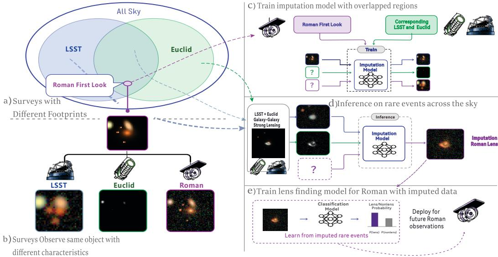  
Figure 1: Scientific context for cross-survey rare-event imputation for early-stage observations. (a) Astronomical surveys cover partially overlapping regions of the sky. (b) The same underlying astrophysical object is observed with heterogeneous characteristics across surveys. (c) An imputation model is trained on aligned observations of common galaxies in the overlapping regions. (d) The trained model is applied to infer missing observations for rare events. (e) The reconstructed observations enable downstream scientific tasks.

repository: https://github.com/fw-ic/COSMIO, and the dataset is available at https://www.kaggle.com/datasets/cosmidata/cosmio.

## 1 Introduction

Modern astronomical research is increasingly driven by large-scale sky surveys, which observe the Universe with different resolutions, wavelength coverage, noise characteristics, and sky footprints. Flagship surveys such as the Legacy Survey of Space and Time (LSST) at the Vera C. Rubin Observatory [1], the ESA Euclid mission [2], and upcoming surveys including the Nancy Grace Roman Space Telescope [3], the Simons Observatory [4], and SPHEREx [5] provide complementary measurements under substantially different instrumental conditions. Because their footprints overlap only partially, many objects are available in only a subset of surveys, creating a heterogeneous, partially observed multi-survey setting.

This setting gives rise to a natural machine learning problem. Incomplete cross-survey coverage at the object level limits analyses that require matched observations across surveys. More formally, given observations of an object in some surveys, the goal is to infer how the same object would appear in another survey in which it is unavailable. Such a capability would support more unified analysis across complementary surveys despite incomplete coverage. The problem is particularly consequential during the initial observation phase of a new survey, when only a limited region of the sky has been covered. Under this condition, rare yet scientifically important phenomena, including galaxy–galaxy strong gravitational lenses, mergers and interactions, supernovae and other transients, and unusual morphological outliers such as ring galaxies or tidal features [6, 7, 8, 9], are typically absent from the target survey, limiting event-specific model development and validation. Predictions from imputation models trained on overlapped regions can serve as proxy target-survey observations for early-stage analysis and method development. Figure 1 illustrates the scientific context.

We formalize this setting as cross-survey modality imputation, where the task is to infer the appearance of the same astrophysical source in a target survey from its available observations in one or more source surveys. To study this problem, we introduce COSMIO, a benchmark of forward-rendered, aligned multi-survey observations. COSMIO contains 115k regular galaxy samples and 14,825 galaxy–galaxy strong-lensing systems, rendered under realistic LSST, Euclid, and Roman survey configurations.

We use COSMIO to study three questions: (i) can models infer missing survey observations from available surveys? (ii) can models trained on common objects generalize to scientifically important rare-event regimes? and (iii) can imputed observations improve downstream scientific tasks? Our empirical study yields three main findings. First, methods developed for the most established missingmodality imputation setting, namely multi-contrast brain MRI imputation [10, 11, 12, 13, 14, 15], transfer poorly to astronomical survey data and are often outperformed by simple diffusion baselines, revealing a clear domain gap. Second, models trained on common galaxies degrade when evaluated on rare galaxy–galaxy strong-lensing systems. Third, imputed observations can support downstream strong-lens detection, but their performance remains below that of real target-survey observations and depends strongly on reconstruction quality. Together, these findings establish cross-survey imputation as a distinct modality-imputation setting and highlight the need for dedicated methods for multi-survey astronomical data, a problem that remains unsolved.

Our contributions are as follows: (i) We formulate cross-survey modality imputation as a new learning problem setting arising from partially overlapping astronomical surveys, and define the associated scientific setting and machine learning tasks. (ii) We introduce COSMIO, a benchmark with 115k regular galaxy samples and 14,825 strong-lensing systems across LSST, Euclid, and Roman, enabling systematic evaluation under realistic cross-survey configurations. (iii) We show that methods developed for existing imputation tasks transfer poorly to this regime and identify rare-event imputation as a key challenge which affects downstream scientific applications.

## 2 Related Work

## 2.1 Next-Generation Sky Surveys

Modern observational cosmology is entering a multi-survey era driven by wide-field facilities such as the Legacy Survey of Space and Time (LSST) at the Vera C. Rubin Observatory [1], the ESA Euclid mission [2], SPHEREx [5] and upcoming facilities including the Nancy Grace Roman Space Telescope [3], the Simons Observatory [4]. These surveys observe overlapping astrophysical populations, but through substantially different instruments and observing conditions. In this work, we focus on three representative surveys, including LSST, Euclid, and Roman, which form a prototypical multi-survey setting with substantial sky coverage and strong complementarity across resolution, depth, and spectral regimes.

Legacy Survey of Space and Time [1]. LSST is a ground-based, wide-field optical survey designed for high-cadence, deep imaging over a large fraction of the sky. It operates in wide optical bands and repeatedly scans the sky over a ten-year period. The survey is expected to begin full science operations soon this year (following first light in 2025), with incremental data releases throughout the survey and a final data release at the end of its ten-year program. LSST will cover approximately 18,000 deg² of the southern sky, forming one of the largest and deepest optical survey footprints. However, as a ground-based instrument, LSST observations are affected by atmospheric seeing, leading to PSF-dominated resolution limitations and variable noise characteristics.

ESA Euclid Mission [2]. Euclid is a space-based mission focused on high-precision cosmology through wide-area imaging and spectroscopy. Launched in 2023, Euclid is currently in its operational phase, with early public data products released, while the full wide survey is still ongoing. It aims to survey roughly 15,000 deg² of extragalactic sky, avoiding regions of high stellar density near the Galactic plane. Compared to LSST, Euclid offers significantly sharper morphology. However, its observational design trades off spectral richness and cadence, resulting in limited band coverage.

Nancy Grace Roman Space Telescope. [3] Roman extends this landscape with wide-field, spacebased near-infrared imaging and spectroscopy. Roman is scheduled for launch in Fall 2026, with major survey programs expected to begin shortly thereafter. Its planned surveys will cover smaller areas (typically thousands of deg² depending on survey strategy) but at significantly greater depth.

Table 1 summarizes the key observational properties of these surveys.

Table 1: Comparison of key observational parameters across LSST, Euclid, and Roman surveys.
<table><tr><td>Parameter</td><td>LSST</td><td>Euclid</td><td>Roman</td></tr><tr><td>Bands</td><td> $g , r , i , z , y$ </td><td>VIS</td><td> $F 1 0 6 ( Y ) , F 1 2 9 ( J ) , F 1 5 8 ( H )$ </td></tr><tr><td>PSF (arcsec)</td><td>~0.7&quot;</td><td> $\sim 0 . 1 6 ^ { \prime \prime }$ </td><td> $\sim 0 . 1 \mathrm { { i } ^ { \prime \prime } }$ </td></tr><tr><td>Pixel Scale (arcsec)</td><td> $0 . 2 { ^ { \prime \prime } }$ </td><td> $0 . 1 ^ { \prime \prime }$ </td><td> $0 . 1 1 ^ { \prime \prime }$ </td></tr><tr><td>Depth</td><td> $r \sim 2 7 . 5$ </td><td> $\mathrm { V I S } \sim 2 4 . 5$ </td><td> $H \sim 2 6 { - 2 7 }$ </td></tr><tr><td>Noise</td><td> $\mathrm { s e e i n g } + \mathrm { s k y }$ </td><td>readout</td><td>thermal + readout</td></tr><tr><td>Survey Area  $\scriptstyle ( \deg ^ { 2 } )$ </td><td> $\sim 1 8 { , } 0 0 0$ </td><td> $\sim 1 5 { , } 0 0 0$ </td><td>2  $2 , 0 0 0 { - } 5 , 0 0 0$ </td></tr></table>

## 2.2 Image Restoration in Astronomy

Recent learning-based methods have explored the use of deep generative models for astronomical settings. For example, GAN-based methods have been used to recover galaxy structures [16], and diffusion models have been applied to super-resolution of gravitational lensing images [17]. Several benchmarks have also been proposed for astronomical super-resolution, including AstroSR for galaxy images [18] and STAR for flux-consistent star-field super-resolution [19]. However, these works focus on observations from a single telescope with a single modality.

Another line of work reconstructs images or videos from sparse interferometric measurements collected by telescope arrays [20, 21]. These works involve multiple instruments, but the instruments belong to the same observational system and share the same measurement modality, differing mainly in spatial or temporal sampling.

## 2.3 Missing Modality Imputation

Missing-modality imputation studies how to infer unobserved measurements of the same underlying object from its available measurements under other acquisition processes. With an unobserved latent physical state $\mathbf { z } ,$ the k-th modality is an instrument-specific realization

$$
\mathbf { x } ^ { ( k ) } = \mathcal { A } _ { k } ( \mathbf { z } ) + \epsilon _ { k } ,\tag{1}
$$

where $\mathcal { A } _ { k }$ denotes the acquisition function of the k-th survey or instrument, and $\epsilon _ { k }$ denotes the corresponding observational noise.

Formally, let $\mathcal { V } = \{ 1 , \ldots , K \}$ denote the set of available modalities, and let $\mathbf { x } = \left( \mathbf { x } ^ { ( k ) } \right) _ { k \in \mathcal { V } }$ be the collection of observations of the same underlying object under these acquisition functions. Given an observed subset $\mathcal { O } \subset \mathcal { V }$ and a target subset ${ \check { \tau } } \subseteq \mathsf { \check { ( } } \nu \setminus \mathcal { O } )$ , the imputation task is to model the conditional distribution

$$
p _ { \theta } \left( \mathbf { x } ^ { ( \mathcal { T } ) } \mid \mathbf { x } ^ { ( \mathcal { O } ) } \right) ,\tag{2}
$$

where $\mathbf { x } ^ { ( \mathcal { O } ) } = \{ \mathbf { x } ^ { ( k ) } : k \in \mathcal { O } \}$ and $\mathbf { x } ^ { ( T ) } = \{ \mathbf { x } ^ { ( k ) } : k \in \mathcal { T } \}$

This problem has been extensively studied for multi-contrast brain MRI, where different image types, including T1, T2, FLAIR, and contrast-enhanced T1 MRI, observe the same brain under different acquisition contrasts. Each modality emphasizes different tissue properties, anatomical structures, or pathological patterns, and their combination provides a more complete characterization of the same subject than any single MRI sequence alone. Recent brain MRI imputation methods include CodeBrain [10], DiffM4RI [11], M2DN [15], MMGAN [12], MMSyn [14], and UMMI [13], and are commonly evaluated on BraTS benchmarks [22, 23].

Our astronomical surveys share a high-level similarity with medical imaging in that multiple observations can be viewed as different measurements of the same underlying object. However, the main difference lies in the relation between observed and target modalities. MRI contrasts are typically acquired on a common scanner with a common imaging geometry under relatively controlled conditions, whereas astronomical surveys differ across instruments and observation conditions, leading to larger variations in spatial resolution, point spread functions, wavelength coverage and noise characteristics. Our experiments show that the unified multi-to-multi formulation remains useful in the survey setting, whereas MRI-specific designs transfer poorly. This difference motivates cross-survey modality imputation as a separate benchmark problem rather than a direct extension of existing MRI imputation methods.

## 3 COSMIO

COSMIO is constructed as a controlled multi-survey observation benchmark. We first define an underlying astrophysical scene and then render how that same scene would be observed by LSST, Euclid, and Roman.

Formally, let s denote a latent sky scene. A scene contains the intrinsic astronomical content before observation, such as galaxy type, redshift, brightness, morphology, spatial position, and, for lensing systems, the foreground–background geometry that determines light deflection. In COSMIO, these source-level properties are sampled from real galaxy catalogs and then forward-rendered under survey-specific observing conditions. Each survey image is rendered by applying a survey-specific observation operator, $x ^ { ( \bar { k } ) } = \mathcal { O } _ { k } ( s ) + \epsilon _ { k }$ , where $k \in \{ \mathrm { L S S T } , \mathrm { E u c l i d } , \mathrm { R o m a n } \} , \mathcal { O } _ { k }$ represents the deterministic part of the imaging process, and $\epsilon _ { k }$ represents survey-specific stochastic noise. The operator $\mathcal { O } _ { k }$ includes the instrument bandpasses, angular resolution, point spread function (PSF), pixelization, and exposure configuration.

We generate two types of scenes. The first type consists of common galaxy fields. These are ordinary galaxy observations sampled from catalog-level population models. Each galaxy is assigned physically meaningful attributes, including redshift, spectral energy distribution, luminosity, size, ellipticity, and surface-brightness profile. To avoid an overly simplified single-object setting, commongalaxy scenes may also include projected neighboring galaxies. These additional field galaxies are sampled from the same population model and placed at random sky positions. They introduce realistic crowding and blending astronomical scenes.

The second type consists of rare galaxy–galaxy strong-lensing systems. These scenes are generated by pairing a foreground deflector galaxy with a more distant background source galaxy. The deflector is assigned a mass distribution, and the background source is assigned a light profile in the source plane. The lensing model then solves the lens equation to map source-plane coordinates to imageplane coordinates. This mapping determines where the source light appears after deflection by the foreground mass. Depending on the relative alignment, deflector mass, and source morphology, the same background source can be rendered as multiple distorted images, extended arcs, or Einsteinring-like structures [6]. Thus, the arc morphology is not imposed as an image template; it is produced by the physical lensing geometry and the sampled source and deflector properties. An introduction to galaxy–galaxy strong lensing is provided in Appendix A. We retain only lens configurations that are sufficiently resolved and bright to serve as meaningful rare-event examples. As in the common-galaxy scenes, lensing scenes may also include projected field galaxies, which are rendered as additional light components at random sky positions.

To preserve survey-native angular sampling while maintaining an approximately consistent field of view across surveys, we choose survey-specific cutout sizes based on the native pixel scale of each instrument instead of enforcing a common pixel grid. In the current dataset release, we use cutout sizes of $6 4 \times 6 4$ for Euclid, 32×32 for LSST, and $5 9 \times 5 9$ for Roman, yielding approximately matched angular coverage across the three surveys while retaining their native sampling characteristics.

In total, COSMIO contains 115,000 common-galaxy scenes and 14,825 scenes containing strong lensing systems. Figure 2 shows some sample data from the dataset. Implementation details, including the software packages, cosmological parameters, survey bandpasses, selection cuts, and data format, are provided in Appendix B.

## 4 Experiments

## 4.1 Baseline Methods

We compare a range of methods from the medical image domain, diffusion baselines, and two physically motivated baselines. For medical-domain baselines, we use CodeBrain [10] and include DiffM4RI [11], MM-GAN [12], UMMI [13], MMSyn [14], and M2DN [15]. Full descriptions are provided in Appendix C.2.

Except for imputation methods adapted from medical image problem, we further evaluate three diffusion baseline. The first is Palette [24], where we train a separate diffusion model for each imputation pattern. The model is conditioned on the observed survey modalities and learns to generate the missing modality, approximating the conditional distribution of the target observation given the available inputs.

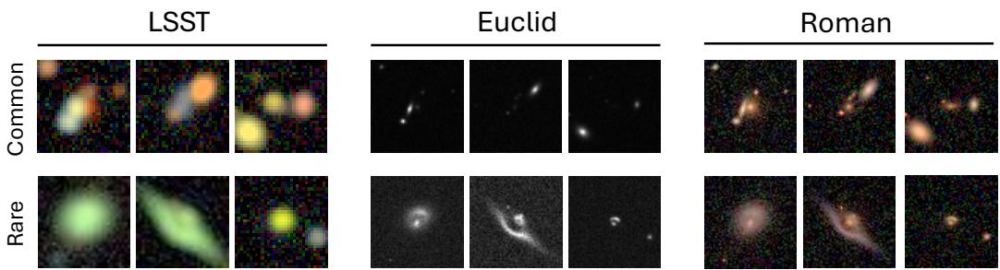  
Figure 2: COSMIO samples across three survey modalities, including both common galaxy fields and rare scenes such as strong-lensing systems. Additional dataset visualizations are provided in Appendix H.

Beyond this straightforward baseline, we consider two unified diffusion variants. This design is motivated by prior evidence from medical image imputation that a single model trained across multiple missing-modality patterns often generalizes better than pattern-specific models.

The second diffusion baseline is RePaint [25]. RePaint models the full joint distribution over all modalities using a single model. During sampling, at each reverse diffusion step, the observed modalities are first noised to the current timestep using the forward process, and then used to replace the corresponding part of the sample, while the missing modalities are updated by the model. This ensures consistency with the observations while allowing the model to generate the missing modalities.

We further propose an asynchronous diffusion baseline. Our goal with Asyn-Diff is primarily subtraction rather than architectural addition: removing MRI-specific components to establish a lightweight, reproducible reference baseline for cross-survey imputation. Relative to RePaint’s original spatial-inpainting formulation, Asyn-Diff uses a modality-level mask, treating each survey modality as entirely observed or entirely missing. Relative to M2DN, it removes separate modality embeddings and specialized modules such as channel attention. Modality availability is encoded directly through modality-specific timestep inputs to a minimal three-level U-Net. Relative to our Palette baseline, which trains separate conditional models for different imputation patterns, Asyn-Diff jointly trains all modalities and imputation patterns in a single model. The contribution is this deliberately minimal modality-level formulation as a strong reference baseline, rather than a fundamentally new diffusion mechanism. Architectural details are provided in Appendix C.3.

We also include two Physically motivated baselines. We include PSF-Linear, which combines PSF homogenization with a global ridge-regression color transform, and Sérsic-FM, which jointly fits a shared Sérsic morphology to the input bands and forward-renders native-resolution Roman predictions. Full descriptions are provided in Appendix C.4.

## 4.2 Experimental Setup

Training details. For the neural baselines, we normalize each survey band using a signed, capped asinh transform fitted independently for that band. The transform estimates a robust center and scale and clips only the most extreme percentile tails, preserving the wide dynamic range of astronomical images while mapping Euclid, LSST, and Roman pixel values to a common bounded range for stable model training. We also pad all corresponding LSST, Euclid, and Roman observations to aligned 64 × 64 patches, rather than resampling them to a common pixel scale. This choice preserves each survey’s native pixel grid and telescope-specific receptive field; rescaling would mix neighboring pixels and distort the approximately independent pixel-noise structure induced by the detector and observation process.

For neural imputation models other than CodeBrain, we train on regular galaxies. Optimization is performed with AdamW at a learning rate of $1 \times 1 0 ^ { - 4 }$ . We use a batch size of 128 and train for 100 epochs on a single NVIDIA H100 GPU. All diffusion models use 1, 000 timesteps, a linear beta schedule from $1 \times 1 0 ^ { - 4 } \mathrm { t o } 2 \times 1 0 ^ { - 2 }$ , epsilon prediction, and clipped $x _ { 0 }$ estimates. For downstream classification, we train ViT models under different data source settings. The training data are constructed from: (1) Roman images from forward physical modeling (GT); (2) Roman images imputed from LSST and Euclid jointly; (3) Roman images imputed from Euclid only; and (4) Roman images imputed from LSST only. All ViT classifiers are trained for 10 epochs with a batch size of 64. Training is performed with cross-entropy loss and balanced sampling over the training split to mitigate class imbalance.

Table 2: Performance comparison of cross-survey imputation methods on common galaxies. Results are grouped by target survey, with metrics averaged over all corresponding imputation tasks. Best results are in bold, and second-best results are underlined. CRPS is not reported for the two deterministic physical baselines. Detailed results for individual Roman-target imputation tasks are provided in Appendix F.
<table><tr><td>Tasks</td><td>Method</td><td>RMSE↓</td><td>PSNR↑</td><td>CRPS↓</td></tr><tr><td rowspan="9">Euclid → Roman LSST → Roman Euclid+LSST → Roman</td><td>PSF-Linear</td><td>0.403</td><td>33.758</td><td>1</td></tr><tr><td>Sérsic-FM</td><td>0.271</td><td>36.838</td><td>1</td></tr><tr><td>CodeBrain [10]</td><td>0.330</td><td>34.533</td><td>0.097</td></tr><tr><td>diffm4ri [11]</td><td>0.353</td><td>34.153</td><td>0.094</td></tr><tr><td>mmgan [12]</td><td>0.522</td><td>30.157</td><td>0.159</td></tr><tr><td>ummi [13]</td><td>0.449</td><td>33.567</td><td>0.134</td></tr><tr><td>mmsyn [14]</td><td>0.282</td><td>35.727</td><td>0.092</td></tr><tr><td>m2dn [15]</td><td>0.238</td><td>37.423</td><td>0.077</td></tr><tr><td>RePaint [25] Palette [24]</td><td>0.322</td><td>35.507</td><td>0.090</td></tr><tr><td>asyn-diff</td><td>0.196 0.184</td><td>38.737 39.190</td><td>0.072 0.069</td></tr><tr><td rowspan="10">Euclid → LSST</td><td>PSF-Linear</td><td>0.285</td><td>33.170</td><td></td></tr><tr><td>Sérsic-FM</td><td>0.336</td><td>31.571</td><td>1 1</td></tr><tr><td>CodeBrain [10]</td><td>0.241</td><td>34.580</td><td>0.112</td></tr><tr><td>diffm4ri [11]</td><td>3.327</td><td>9.420</td><td>1.407</td></tr><tr><td>mmgan [12]</td><td>1.418</td><td>20.330</td><td>0.378</td></tr><tr><td>ummi [13]</td><td>1.161</td><td>24.010</td><td>0.374</td></tr><tr><td>mmsyn [14]</td><td>0.393</td><td>32.330</td><td>0.161</td></tr><tr><td>m2dn [15]</td><td>0.314</td><td>32.420</td><td>0.137</td></tr><tr><td>RePaint [25]</td><td>0.953</td><td>25.720</td><td>0.291</td></tr><tr><td>Palette [24]</td><td>0.870</td><td>24.250</td><td>0.231</td></tr><tr><td></td><td>asyn-diff</td><td>0.332</td><td>32.690</td><td>0.111</td></tr><tr><td rowspan="10">LSST → Euclid</td><td>PSF-Linear</td><td>0.017</td><td>29.217</td><td>1</td></tr><tr><td>Sérsic-FM</td><td>0.011</td><td>32.948</td><td>1</td></tr><tr><td>CodeBrain [10]</td><td></td><td></td><td></td></tr><tr><td>diffm4ri [11]</td><td>0.011 0.014</td><td>32.200 30.430</td><td>0.006</td></tr><tr><td>mmgan [12]</td><td>0.030</td><td>23.070</td><td>0.005 0.010</td></tr><tr><td>ummi [13]</td><td>0.021</td><td>28.940</td><td>0.008</td></tr><tr><td>mmsyn [14]</td><td>0.011</td><td>32.180</td><td>0.006</td></tr><tr><td>m2dn [15]</td><td>0.010</td><td>33.330</td><td>0.005</td></tr><tr><td>RePaint [25]</td><td>0.014</td><td>31.020</td><td>0.005</td></tr><tr><td>Palette [24]</td><td>0.009</td><td>33.740</td><td>0.004</td></tr><tr><td></td><td>asyn-diff</td><td>0.009</td><td>33.820</td><td>0.004</td></tr></table>

For the main zero-shot comparison, the neural imputation models are trained exclusively on common galaxies, with 90,000 training examples and 9,000 validation examples. Imputation quality is evaluated on a held-out downstream-training split containing 7,481 strong-lensing systems and 8,000 common galaxies. We use the corresponding imputed observations from this split to train downstream lens classifiers, and evaluate classification performance on another disjoint downstream-test split containing 7,344 strong-lensing systems and 8,000 common galaxies.

Metric hierarchy and evaluation protocols. We use the Continuous Ranked Probability Score (CRPS) [26] as the primary general reconstruction metric for probabilistic methods. For each probabilistic method and test input, we draw five stochastic samples and evaluate $\mathrm { C R P S } ( \hat { F } , y ) =$ $\mathbb { E } _ { \hat { Y } \sim \hat { F } } | \hat { Y } - y | - \frac { 1 } { 2 } \mathbb { E } _ { \hat { Y } , \hat { Y } ^ { \prime } \sim \hat { F } } | \hat { Y } - \hat { Y } ^ { \prime } |$ . CRPS balances proximity to the observation with predictive dispersion. Its expected value is uniquely minimized by the true distribution of the evaluated scalar quantity, rather than by a collapsed point prediction when that distribution is non-degenerate. This motivates its use for uncertain cross-survey predictions.

RMSE and PSNR are secondary, per-pixel reconstruction diagnostics, computed from raw-flux images; PSNR uses the maximum ground-truth pixel value of each observation as its peak value.

We further report physically motivated diagnostics in Appendix G. Although scientifically informative, these measurements use task-specific definitions and extraction procedures rather than a standardized evaluation protocol. We therefore treat them as reference diagnostics. Recovery of low-dimensional summary statistics is also less central to COSMIO’s intended use in reconstructing spatially resolved morphology.

Downstream lens classification, measured by AUROC and AUPRC, directly evaluates the utility of the imputed images for our demonstrated scientific task.

We do not adopt SSIM or perceptual metrics such as LPIPS [27] as primary evaluation criteria. SSIM measures image-space structural similarity, while LPIPS relies on natural-image feature representations; neither directly captures the scientific fidelity required for downstream tasks.

## 4.3 Results

Regular Galaxies We first compare the performance of baseline methods on imputing regular galaxies. The results are reported in Table 2. Tasks are defined as all possible combinations of input and output modalities, and are grouped by target survey. Asynchronous diffusion has the lowest reported CRPS in each target-survey group. Both Asynchronous diffusion and conditional diffusion consistently outperform medical imputation baselines. This suggests that cross-survey modality imputation differs fundamentally from MRI imputation, and that architecture choices tailored to medical imaging do not generalize well to the astronomical setting.

Table 3: Average performance comparison of cross-survey imputation methods on rare galaxy–galaxy strong lensing. Results are averaged over three Roman-imputation tasks. Best results are in bold, and second-best results are underlined. CRPS is not reported for the two deterministic physical baselines. Detailed results for individual Roman-target imputation tasks are provided in Appendix F. AEE is reported separately in Appendix D.
<table><tr><td>Tasks</td><td>Method</td><td>RMSE↓</td><td>PSNR↑</td><td>CRPS↓</td></tr><tr><td></td><td>PSF-Linear</td><td>0.572</td><td>32.894</td><td>/</td></tr><tr><td></td><td>Sérsic-FM</td><td>0.538</td><td>33.759</td><td>1</td></tr><tr><td>Euclid → Roman</td><td>CodeBrain[10]</td><td>0.440</td><td>34.127</td><td>0.124</td></tr><tr><td>LSST → Roman</td><td>m2dn [15]</td><td>0.356</td><td>36.360</td><td>0.106</td></tr><tr><td>Euclid+LSST → Roman</td><td>RePaint [25]</td><td>0.522</td><td>34.040</td><td>0.144</td></tr><tr><td></td><td>Palette [24]</td><td>0.310</td><td>37.163</td><td>0.095</td></tr><tr><td></td><td>asyn-diff</td><td>0.297</td><td>37.527</td><td>0.090</td></tr></table>

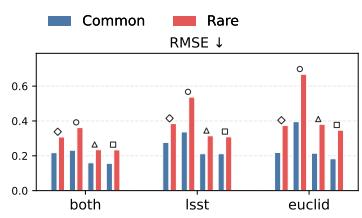

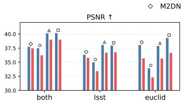

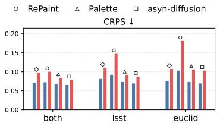  
Figure 3: Performance of Roman imputation from LSST, Euclid, or both under distribution shift from common galaxies to rare events. Performance degrades consistently across all three metrics, three imputation patterns, and four methods.

Rare Events We futher rare-event imputation results measure zero-shot transfer from common galaxies to strong-lensing systems: the imputation models receive no lens-target supervision before this evaluation. We compare the two physical baselines, all diffusion baselines, and the MRI imputation baselines M2DN and CodeBrain in Table 3. Here zero-shot refers to the imputation stage; downstream lens classifiers are trained separately on imputed lens and non-lens images. Appendix E evaluates lens-only fine-tuning and importance-weighted joint training with limited lens supervision as potential mitigations of this rare-event shift. Our asynchronous diffusion baseline achieves the lowest average CRPS in Table 3. Its strong performance on both common galaxies and strong-lensing systems makes it a useful reference baseline for future method development in crosssurvey imputation. However, as shown in Figure 3, all methods degrade noticeably compared with their performance on regular galaxies, revealing a substantial rare-event distribution shift. Figure 4 illustrates this failure mode. For an in-distribution edge-on disk galaxy, the model preserves the elongated morphology when imputing Roman observations from LSST, Euclid, or both. Although edge-on galaxies are visually distinctive, their flux distribution is still broadly consistent with the centrally concentrated profiles of regular galaxies. By contrast, strong-lensing systems contain extended arc- or ring-like structures caused by lensing, which deviate from the dominant morphology learned from common galaxies. Probabilistic generative imputation models therefore tend to favor high-density target-modality structures when the rare-event evidence is ambiguous, causing the ring to fragment into compact galaxy-like point sources.

Observed Input and Ground Truth Target  
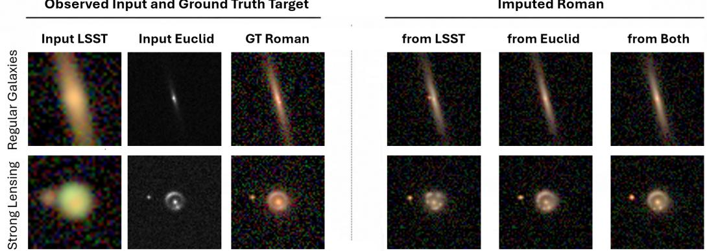  
Figure 4: Qualitative examples of Roman imputation under different observed modality sets. For an in-distribution edge-on disk galaxy, the model preserves the elongated morphology when imputing Roman from LSST, Euclid, or both. In contrast, for an out-of-distribution strong-lensing system, the ring-like lensing structure is not faithfully preserved and is partially broken into compact sources. More visualizations are provided in Appendix I.

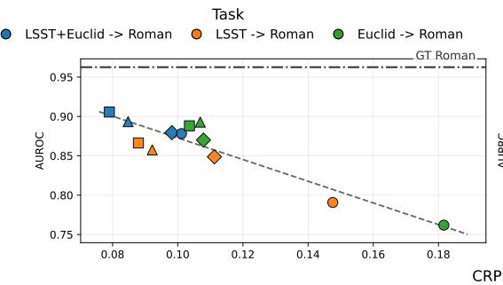

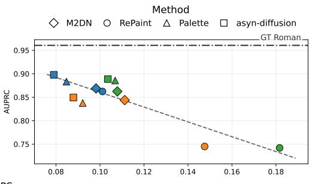  
Figure 5: Relationship between imputation quality and downstream classification performance. Each point represents one method on one survey-imputation task. Horizontal dash-dotted lines denote downstream performance using ground-truth Roman observations, while dashed lines show fitted trends across imputed inputs. Numerical AUROC and AUPRC values are reported in Appendix F.

Downstream Classification We further analyze how imputation quality translates to downstream scientific performance. Figure 5 shows the relationship between imputation quality, measured by CRPS, and downstream lens classification performance, measured by AUROC and AUPRC. This comparison tests whether gains in probabilistic reconstruction quality translate into improved downstream detection. The classification metrics complement CRPS by measuring scientific utility directly.

## 5 Conclusion

In this work, we introduced COSMIO, a benchmark for cross-survey astronomical modality imputation. Our experiments show that this setting is distinct from conventional imputation domains, as off-the-shelf methods do not readily generalize to astronomical survey data. We identify rare-event imputation as a key bottleneck, with current models degrading on scientifically important but underrepresented phenomena. We further show that imputation quality directly affects downstream scientific tasks, highlighting the need for more robust imputation methods for next-generation astro nomical surveys. Finally, we establish asynchronous diffusion as a strong baseline for future method development.

From an astronomical perspective, COSMIO provides a dataset for synthesizing complementary observations across heterogeneous surveys, enabling analysis in partially observed sky regions. From a machine learning perspective, COSMIO extends modality imputation beyond existing domains by using cross-survey astronomy as a testbed where standard missing-modality inference must also remain robust under rare-event distribution shifts. Potential applications beyond the demonstrated lens detection task include generating candidate realizations before follow-up or Target-of-Opportunity (ToO) observations to support planning and prioritization, and stress-testing early-survey imageanalysis pipelines. These uses remain directions for future evaluation.

## 6 Limitations and Future Work

Our dataset is constructed through forward physical rendering, which inevitably introduces a sim-toreal gap. Large-scale overlapping observations across next-generation surveys are not yet available, making simulation-based data the only viable approach for controlled method development. This simulation-first paradigm is standard in astronomy, where physically grounded forward models are widely used to approximate observational processes.

Moreover, the rarity of scientifically important phenomena further necessitates simulation. Real surveys contain only a limited number of such events, which is insufficient for training and systematic evaluation. Even as simulation fidelity improves, discrepancies between simulated and real survey data will inevitably remain. This limits the reliability of method development and calibration when they are based solely on physical simulations. This limitation is one motivation for introducing cross-survey imputation as a complement to pure physical simulation.

Once authorized Rubin access and sufficient overlapping imaging are available, we plan to crossmatch Rubin/LSST and Euclid observations, construct disjoint real-data training and test splits, and train and evaluate each method on these real matched pairs. We will compare method rankings, relative performance gaps, and failure modes with those from the corresponding COSMIO LSST– Euclid tasks. This evaluation will test whether conclusions from the controlled benchmark hold on real observations, with training and testing performed within each domain. It will complement COSMIO’s three-survey and rare-event evaluations and can be extended to Roman when suitable matched observations become available.

A complementary direction for mitigating the sim-to-real gap is to incorporate observed galaxy morphologies into COSMIO’s source population. We plan to adopt the catalog-based source rendering available in newer versions of SLSim [28], using high-resolution HST/COSMOS galaxy cutouts as source templates. These templates can be matched by physical size and axis ratio, optionally including Sérsic index, then rescaled and rotated to the desired source geometry before forward rendering through each survey’s instrument model. This would introduce observed substructure and irregular morphology beyond analytic profiles. We will evaluate whether this extension improves agreement with real-data method rankings and failure modes.

## References

[1] Željko Ivezic, Steven M. Kahn, J. Anthony Tyson, et al. LSST: From Science Drivers to ´ Reference Design and Anticipated Data Products. The Astrophysical Journal, 873(2):111, 2019. 2, 3

[2] Euclid Collaboration, Y. Mellier, Abdurro’uf, et al. Euclid: I. Overview of the Euclid mission. Astronomy & Astrophysics, 697:A1, 2025. 2, 3

[3] Gregory Mosby, Bernard Rauscher, Chris Bennett, et al. Properties and characteristics of the Nancy Grace Roman Space Telescope H4RG-10 detectors. Journal of Astronomical Telescopes, Instruments, and Systems, 6(4):046001, 2020. 2, 3

[4] Peter Ade, James Aguirre, Zeeshan Ahmed, et al. The Simons Observatory: science goals and forecasts. Journal ofCosmology and Astroparticle Physics, 2019(02):056, 2019. 2, 3

[5] Olivier Doré, Jamie Bock, Matthew Ashby, et al. Cosmology with the SPHEREX All-Sky Spectral Survey. arXiv preprint arXiv:1412.4872v3, 2015. 2, 3

[6] A. J. Shajib, G. Vernardos, T. E. Collett, et al. Strong Lensing by Galaxies. Space Science Reviews, 220(8):87, 2024. 2, 5, 13

[7] Christopher J. Conselice. The Evolution of Galaxy Structure Over Cosmic Time. Annual Review ofAstronomy and Astrophysics, 52(1):291–337, 2014. 2

[8] P. N. Appleton and Curtis Struck-Marcell. Collisional Ring Galaxies. Fundamentals of Cosmic Physics, 16:111–220, 1996. 2

[9] Mike Walmsley, Chris Lintott, Tobias Géron, et al. Galaxy Zoo DECaLS: Detailed visual morphology measurements from volunteers and deep learning for 314 000 galaxies. Monthly Notices ofthe Royal Astronomical Society, 509(3):3966–3988, 2022. 2

[10] Yicheng Wu, Tao Song, Zhonghua Wu, et al. Virtual Full-stack Scanning of Brain MRI via Imputing Any Quantised Code. In Proceedings of the IEEE/CVF Conference on Computer Vision and Pattern Recognition (CVPR), pages 21026–21035, 2026. 3, 4, 5, 7, 8, 16, 18

[11] Wen Ye, Zhetao Guo, Yuxiang Ren, et al. DiffM4RI: A Latent Diffusion Model With Modality Inpainting for Synthesizing Missing Modalities in MRI Analysis. IEEE Journal ofBiomedical and Health Informatics, 30(2):1006–1018, 2026. 3, 4, 5, 7, 16

[12] Anmol Sharma and Ghassan Hamarneh. Missing MRI Pulse Sequence Synthesis Using Multi-Modal Generative Adversarial Network. IEEE Transactions on Medical Imaging, 39(4):1170– 1183, 2020. 3, 4, 5, 7, 16

[13] Liangce Qi, Yusi Liu, Yuqin Li, Weili Shi, Guanyuan Feng, and Zhengang Jiang. A Unified Missing Modality Imputation Model with Inter-modality Contrastive and Consistent Learning. In Medical Image Computing and Computer Assisted Intervention – MICCAI 2025, volume 15967 of Lecture Notes in Computer Science, pages 44–53. Springer Nature Switzerland, 2025. 3, 4, 5, 7, 16

[14] Agisilaos Chartsias, Thomas Joyce, Mario Valerio Giuffrida, and Sotirios A. Tsaftaris. Multimodal MR Synthesis via Modality-Invariant Latent Representation. IEEE Transactions on Medical Imaging, 37(3):803–814, 2018. 3, 4, 5, 7, 16

[15] Xiangxi Meng, Kaicong Sun, Jun Xu, Xuming He, and Dinggang Shen. Multi-Modal Modality-Masked Diffusion Network for Brain MRI Synthesis With Random Modality Missing. IEEE Transactions on Medical Imaging, 43(7):2587–2598, 2024. 3, 4, 5, 7, 8, 16, 18

[16] Kevin Schawinski, Ce Zhang, Hantian Zhang, Lucas Fowler, and Gokula Krishnan Santhanam. Generative adversarial networks recover features in astrophysical images of galaxies beyond the deconvolution limit. Monthly Notices ofthe Royal Astronomical Society: Letters, 467(1):L110– L114, 2017. 4

[17] Pranath Reddy, Michael W Toomey, Hanna Parul, and Sergei Gleyzer. DiffLense: a conditional diffusion model for super-resolution of gravitational lensing data. Machine Learning: Science and Technology, 5(3):035076, 2024. 4

[18] Jiawei Miao, Liangping Tu, Bin Jiang, Xiangru Li, and Bo Qiu. AstroSR: A Data Set of Galaxy Images for Astronomical Superresolution Research. The Astrophysical Journal Supplement Series, 274(1):7, 2024. 4

[19] Guocheng Wu, Guohang Zhuang, Jinyang Huang, Xiang Zhang, Wanli Ouyang, and Yan Lu. STAR: A Benchmark for Astronomical Star Fields Super-Resolution. In Advances in Neural Information Processing Systems, volume 38, pages 157998–158033. Curran Associates, Inc., 2025. 4

[20] Katherine L. Bouman, Michael D. Johnson, Daniel Zoran, Vincent L. Fish, Sheperd S. Doeleman, and William T. Freeman. Computational Imaging for VLBI Image Reconstruction. In 2016 IEEE Conference on Computer Vision and Pattern Recognition (CVPR), pages 913–922, 2016. 4

[21] Katherine L. Bouman, Michael D. Johnson, Adrian V. Dalca, et al. Reconstructing Video of Time-Varying Sources From Radio Interferometric Measurements. IEEE Transactions on Computational Imaging, 4(4):512–527, 2018. 4

[22] Bjoern H. Menze, Andras Jakab, Stefan Bauer, et al. The Multimodal Brain Tumor Image Segmentation Benchmark (BRATS). IEEE Transactions on Medical Imaging, 34(10):1993– 2024, 2015. 4, 15

[23] Spyridon Bakas, Mauricio Reyes, Andras Jakab, et al. Identifying the Best Machine Learning Algorithms for Brain Tumor Segmentation, Progression Assessment, and Overall Survival Prediction in the BRATS Challenge. arXiv preprint arXiv:1811.02629v3, 2019. 4, 15

[24] Chitwan Saharia, William Chan, Huiwen Chang, et al. Palette: Image-to-Image Diffusion Models. In ACM SIGGRAPH Conference Proceedings, pages 1–10, 2022. 5, 7, 8, 18

[25] Andreas Lugmayr, Martin Danelljan, Andres Romero, Fisher Yu, Radu Timofte, and Luc Van Gool. RePaint: Inpainting using Denoising Diffusion Probabilistic Models. In 2022 IEEE/CVF Conference on Computer Vision and Pattern Recognition (CVPR), pages 11461– 11471. IEEE, 2022. 6, 7, 8, 18

[26] Tilmann Gneiting and Adrian E Raftery. Strictly Proper Scoring Rules, Prediction, and Estimation. Journal ofthe American Statistical Association, 102(477):359–378, 2007. 7

[27] Richard Zhang, Phillip Isola, Alexei A. Efros, Eli Shechtman, and Oliver Wang. The Unreasonable Effectiveness of Deep Features as a Perceptual Metric. In 2018 IEEE/CVF Conference on Computer Vision and Pattern Recognition, pages 586–595, 2018. 8

[28] Narayan Khadka, Simon Birrer, Henry Best, et al. SLSim: a strong lensing population simulation package. arXiv e-prints, page arXiv:2603.17138, 2026. 10, 14

[29] Prasenjit Saha, Dominique Sluse, Jenny Wagner, and Liliya L. R. Williams. Essentials of Strong Gravitational Lensing. Space Science Reviews, 220(1):12, 2024. 13

[30] Tommaso Treu. Strong Lensing by Galaxies. Annual Review of Astronomy and Astrophysics, 48(1):87–125, 2010. 13

[31] C. S. Kochanek. The Saas Fee Lectures on Strong Gravitational Lensing. arXiv preprint arXiv:astro-ph/0407232v1, 2004. 13

[32] S. Vegetti, S. Birrer, G. Despali, et al. Strong Gravitational Lensing as a Probe of Dark Matter. Space Science Reviews, 220(5):58, 2024. 13

[33] Thomas E. Collett. THE POPULATION OF GALAXY–GALAXY STRONG LENSES IN FORTHCOMING OPTICAL IMAGING SURVEYS. The Astrophysical Journal, 811(1):20, 2015. 14

[34] Masamune Oguri and Philip J. Marshall. Gravitationally lensed quasars and supernovae in future wide-field optical imaging surveys. Monthly Notices ofthe Royal Astronomical Society, 405(4):2579–2593, 2010. 14

[35] François Lanusse, Quanbin Ma, Nan Li, et al. CMU DeepLens: deep learning for automatic image-based galaxy–galaxy strong lens finding. Monthly Notices of the Royal Astronomical Society, 473(3):3895–3906, 2018. 14

[36] C Jacobs, T Collett, K Glazebrook, et al. Finding high-redshift strong lenses in DES using convolutional neural networks. Monthly Notices ofthe Royal Astronomical Society, 484(4):5330– 5349, 2019. 14

[37] Simon Birrer and Adam Amara. lenstronomy: Multi-purpose gravitational lens modelling software package. Physics ofthe Dark Universe, 22:189–201, 2018. 14

[38] Adam Amara, Lucia de la Bella, Simon Birrer, et al. SkyPy: A package for modelling the Universe. Journal ofOpen Source Software, 6(65):3056, 2021. 14

[39] David Kirkby, Thomas Robitaille, Benjamin Alan Weaver, et al. desihub/speclite: Bug fix release: General clean-up prior to refactoring package infrastructure. Zenodo software release, 2024. Version v0.20. 14

[40] J. L. Sérsic. Influence of the atmospheric and instrumental dispersion on the brightness distribution in a galaxy. Boletín de la Asociación Argentina de Astronomía, 6:41–43, 1963. 15

## A Galaxy–Galaxy Strong Lensing

Strong gravitational lensing occurs when a massive foreground galaxy, referred to as the deflector or lens, lies close to the line of sight to a more distant background source such that bending of light due to the foreground mass results in multiple images of the same background source. The gravitational potential of the deflector bends the light from the background source and changes the apparent position, shape, and brightness of the source image. In the thin-lens approximation, the relation between the angular position of the source $\beta$ and the observed image position θ is given by the lens equation

$$
\beta = \pmb { \theta } - \pmb { \alpha } ( \pmb { \theta } ) ,\tag{3}
$$

where $\beta$ and θ are two-dimensional angular coordinates on the source and image planes, and α is the reduced deflection angle. When the projected source position lies sufficiently close to the optical-axis the lens equation can have multiple solutions, corresponding to multiple observed images of the same background source. For a more detailed introduction into strong gravitational lensing, we refer to [29].

For an axisymmetric lens, the characteristic angular scale of strong lensing is the Einstein radius. For a singular isothermal sphere, it can be written as

$$
\theta _ { \mathrm { E } } = 4 \pi \left( \frac { \sigma _ { v } } { c } \right) ^ { 2 } \frac { D _ { \mathrm { l s } } } { D _ { \mathrm { s } } } ,\tag{4}
$$

where $\sigma _ { v }$ is the velocity dispersion of the lens, c is the speed of light, $D _ { \mathrm { s } }$ is the angular-diameter distance to the source, and $D _ { \mathrm { l s } }$ is the angular-diameter distance between the lens and the source. For a typical galaxy as a deflector, the Einstein radius is of order 0.1 − 2 arc seconds, right in the regime of (partial) blending for ground-based observations. When the source is nearly aligned with the deflector, its light can be highly magnified and stretched tangentially around the lens center, producing multiple images, arcs, or nearly complete Einstein rings [30, 31]. For extended background galaxies, the observed lensing morphology is therefore not a simple compact source but a non-local structure distributed around the foreground deflector.

These arc-like structures are scientifically important because their positions, curvatures, thicknesses, and surface-brightness distributions encode information about the projected mass distribution of the deflector, dark-matter substructure, and the morphology of the high-redshift background source (e.g., [30, 6, 32] for a set of reviews).

Galaxy–galaxy strong lenses are morphologically distinct from ordinary galaxies. Typical isolated galaxies often have smooth and centrally concentrated light profiles, whereas strong-lensing systems contain a superposition of the foreground deflector and one or more distorted images of a background source. The lensed arcs are frequently faint, spatially extended, low-surface-brightness features that may be partially blended with the deflector light. Their visibility depends strongly on survey-specific point-spread functions, pixel scales, noise levels, exposure depths, and bandpasses. Consequently, the same physical lens system can appear substantially different across LSST, Euclid, and Roman observations.

Strong lenses are intrinsically rare because they require a special geometric configuration: the background source must fall within a small lensing cross-section around the foreground deflector. In wide-field surveys, only a tiny fraction of galaxies exhibit recognizable strong-lensing configurations. Current and upcoming surveys are expected to detect on the order of $1 0 ^ { 4 } – 1 { \bar { 0 } } ^ { 5 }$ strong lenses among $\sim 1 0 ^ { 9 } – 1 0 ^ { 1 0 }$ galaxies, corresponding to an occurrence rate of roughly $1 0 ^ { - 5 } – 1 0 ^ { - 4 }$ per galaxy [33, 34]. Because of this rarity, strong-lens discovery has been widely studied using machine learning methods for identifying lens candidates [35, 36].

For cross-survey imputation, galaxy–galaxy strong lenses provide a stringent rare-event test case. A model trained primarily on common galaxy populations may learn a strong prior toward smooth, centrally concentrated profiles. When evaluated on strong lenses, such a model may suppress low-surface-brightness arcs, break continuous arcs into compact clumps, hallucinate regular galaxy structure, or fail to preserve the angular extent of the lensed source. This failure mode is especially important for scientific use: an imputed image can obtain reasonable pixel-level reconstruction metrics while still destroying the lensing morphology needed for downstream analysis.

In our benchmark, we therefore use galaxy–galaxy strong lenses as an out-of-distribution rare-event evaluation set. Models are trained on common galaxy populations and evaluated zero-shot on strong-lensing systems. This setting mimics early-stage survey deployment, where rare objects may be observed in existing surveys but remain sparsely covered by a new target survey. It allows us to evaluate whether cross-survey imputation methods can preserve scientifically meaningful rare morphology, rather than merely reconstructing the average appearance of ordinary galaxies.

## B Data Generator Implementation Details

We construct a physically forward-modelled multi-survey dataset for cross-survey generation using slsim [28], an open-source astronomical object and imaging simulation package, together with lenstronomy $[ 3 7 ]$ , a strong gravitational lensing simulation package. The pipeline separates population generation from image simulation: galaxy populations are drawn with SkyPy [38], a software package simulating catalog-level galaxy populations calibrated to astronomical surveys catalogs, while lensing calculations, point spread function (PSF) convolution, pixelization and noise rendering are handled downstream. Each galaxy has a description of its spectral energy density, such that flux can be computed for any of the band pass filters of the different instruments self consistently. Throughout this work, we adopt a concordance cosmological model with a flat geometry, a cosmological constant Λ and cold dark matter (ΛCDM). Within this model we set the Hubble constant $\mathrm { \Delta \ l _ { 0 } = 7 0 k m s ^ { - 1 } M p c ^ { - 1 } }$ and the current-time matter density $\Omega _ { m } = 0 . 3$

## B.1 Survey Setup

Galaxy populations are built from a shared SkyPy configuration including spectral energy densities. The filter troughputs for the different instruments and filter choices are managed through speclite [39]. We render Euclid in VIS, LSST in $g , r , i , z , y ,$ and Roman in F106(Y), F129(J), and F158(H). These filters are not all confined to the visible regime: Euclid VIS and the LSST optical filters mainly cover the visible/optical range with some extension toward the near-infrared, whereas the Roman F106, F129, and F158 filters are near-infrared bands. The Roman band choice follows the nominal High-Latitude Wide-Area Survey (HLWAS) imaging configuration, in which these bands define the core near-infrared multi-band setup.

To preserve survey-native angular sampling and maintain an approximately consistent field of view across surveys, we choose survey-specific cutout sizes based on the native pixel scale of each instrument instead of enforcing a common pixel grid. In the current dataset release, we use cutout sizes of $6 4 \times 6 4$ for Euclid, 32×32 for LSST, and $5 9 \times 5 9$ for Roman, yielding approximately matched angular coverage across the three surveys while retaining their native sampling characteristics.

## B.2 Common Galaxy Population

The common set is built from the same parent SkyPy-based catalog family used for the lensing pipeline. We retain two physically interpretable classes, namely red early-type galaxies and blue latetype galaxies, and apply simple astrophysical cuts to keep the common and lens samples consistent at the level of cosmology and photometric assumptions. In particular, we filter deflector-like galaxies with astronomical magnitude limits in the i-band $i < 2 4$ and in the cosmological redshift range $0 . 0 1 < z < 2$ , and source-like galaxies with $i < 2 6$ and $0 . 0 1 < z < 5$

Table 4: Padding versus common-grid rescaling for regular-galaxy Roman imputation, evaluated on the native target grid. Lower is better for RMSE and CRPS; higher is better for PSNR.
<table><tr><td>Preprocessing</td><td>RMSE↓</td><td>PSNR ↑</td><td>CRPS↓</td></tr><tr><td>Padding</td><td>0.184</td><td>39.190</td><td>0.069</td></tr><tr><td>Rescaling</td><td>0.277</td><td>36.105</td><td>0.074</td></tr></table>

To increase morphological realism, non-lens scenes may include projected neighboring galaxies introduced by Poisson sampling the sky density of galaxies from our catalog with random positions on the sky. This design introduces realistic crowding, blending, and lens-like false positives while preserving the non-lensing label. In the dataset, the non-lens manifests contain 115,000 examples across eight runs, resulting in 71.49 GB of data on disk.

## B.3 Strong-lens Population

The strong-lens set is constructed from the same cosmology and parent galaxy catalogs, but with explicit separation between foreground deflectors and background sources before constructing galaxy– galaxy lenses with SLSim’s LensPop class. Deflectors are selected with $0 . 1 < z _ { d } < 2$ and $i < 2 4$ while source galaxies are drawn from the blue galaxy population with $0 . 1 < z _ { s } < 5$ and $i < 2 6$ . The light distribution of the sources are modeled as single-Sérsic emitters [40].

We retain only systems satisfying detectability-oriented cuts: image separations between 0.1 and 8.0 arcsec, and a second-brightest lensed image brighter than $i = 2 5$ . In the dataset, each run begins from a cached population draw and writes accepted systems into sharded Zarr files. The two completed runs contain 14,825 accepted lens systems in total, resulting in 13.36 GB of data on disk.

## C Experimental Details

## C.1 Native-Grid Correspondence and Cross-Resolution Imputation

All survey observations are forward-rendered around a common angular center. They are therefore co-centered but not pixelwise aligned: the center-and-scale mapping between survey grids is fixed and shared across the dataset. The task remains imputation of an unobserved survey modality, even when source and target pixel scales differ.

Native MRI acquisitions can also differ in spatial resolution, although BraTS-style benchmarks resample them to a common isotropic grid [22, 23]. COSMIO deliberately retains survey-native pixel scales. Padding leaves the observed pixels and their native noise structure unchanged, whereas common-grid resampling interpolates neighboring pixels and alters noise correlations. This distinction is particularly relevant for noisy survey imaging. Table 4 compares padding with common-grid rescaling for regular-galaxy Roman imputation. Padding gives lower RMSE and CRPS and higher PSNR in this native-grid evaluation.

## C.2 Brain-MRI Imputation Baselines

The methods adapted from brain MRI imputation followed the model families specified in their original papers, with only the input/output modality interfaces changed to match the surveys. In all cases, the medical-image modalities were replaced by LSST, Euclid, and Roman tensors.

CodeBrain. CodeBrain was trained as a two-stage model over the packed 9-channel LSST–Euclid– Roman tensor. The model used quantization level $L = 5 .$ , code dimension 9, common feature dimension 128, and base convolutional width 64. Stage I trained the source encoder, posterior code encoder, decoder, and PatchGAN discriminator for reconstruction with quantized anchor codes. Stage II froze the Stage-I reconstruction modules and trained the prior encoder to predict full-modality quantized codes from incomplete inputs.

Table 5: Overview of the brain-MRI and physically motivated imputation baselines.
<table><tr><td>Method</td><td>Year</td><td>Core Idea</td><td>Source</td></tr><tr><td>CodeBrain [10] DiffM4RI [11] MMGAN [12] UMMI [13]</td><td>2026 2026 2020 2025</td><td>Quantized-code imputation Latent DiT inpainting GAN + GMM Mask-pretrained transformer</td><td>CVPR IEEE JBHI IEEE TMI MICCAI</td></tr><tr><td>MMSyn [14] M2DN [15] PSF-Linear</td><td>2018 2024</td><td>Modality-invariant latent Latent Conditional Diffusion PSF matching + ridge color map</td><td>IEEE TMI IEEE TMI</td></tr></table>

DiffM4RI. DiffM4RI was implemented as a 2D latent-diffusion model. A multimodal VQ-VAE first encoded the packed survey tensor into a latent representation, and a DiT-style denoiser was then trained unconditionally in the latent space. The VQ-VAE used 32 latent channels, hidden width 128, two residual blocks, codebook size 1024, commitment weight 0.25, and codebook loss weight 1.0.

The latent diffusion denoiser used hidden size 512, depth 12, 8 attention heads, patch size 2, MLP ratio 4.0, and learned variance prediction. The diffusion process used 1000 timesteps with the shared linear beta schedule.

UMMI. UMMI used the dual-branch encoder architecture from the unified missing-modality imputation model with inter-modality contrastive and consistency learning. The model used base dimension 96, stage depths (2, 2, 2, 2), attention heads (4, 6, 8, 12), window size 4, patch size 2, MLP ratio 4.0, and projection dimension 512. The loss combined reconstruction, inter-modality contrastive, and consistency terms. The contrastive loss weight was 0.3, the consistency loss weight was 0.5, the contrastive temperature was 0.8, and the consistency temperature was 0.9. The spatial mask ratio was 0.75.

MMSyn. MMSyn used per-modality encoders, a modality-invariant latent representation, pixelwise maximum latent fusion, and per-output decoder heads. The implementation used 16 latent channels and LeakyReLU slope 0.1. Each batch optimized the three MMSyn objective components: single-modality decode consistency, latent similarity regularization, and fused-latent multimodal reconstruction. The three loss weights were all set to 1.0.

M2DN. M2DN was trained as a modality-masked diffusion model for Roman synthesis from incomplete LSST/Euclid/Roman inputs. The model used base channels 48, fusion channels 128, bottleneck channels 192, and the shared 1000-step linear diffusion schedule. Masked inputs were filled with 0.

MMGAN. MMGAN was trained as a conditional multimodal GAN for missing-modality synthesis. The generator took the observed survey stack with missing channels zeroed, modality-presence indicators, latent noise, and a learned cluster embedding. Random observed-mask training sampled non-trivial modality subsets with at least one observed and one missing modality. The model used 8 mixture clusters, noise dimension 64, minimum mixture standard deviation 0.1, generator base width 128, discriminator and encoder base width 64, and cluster embedding dimension 16. The objective combined the cRaSGAN adversarial loss, cluster cross-entropy with weight 1.0, and missing-modality reconstruction with weight 100.0.

Overview of methods are shown in Table 5.

## C.3 Diffusion Baselines

For a fair comparison, the three direct diffusion baselines used the same simple CNN denoising backbone:

An initial 3×3 convolution; three resolution stages with channel multipliers (1, 2, 4) from a base width of 64; two residual blocks per stage.

Each residual block includes:

GroupNorm and SiLU activation; two 3×3 convolutions; FiLM-style timestep conditioning via a learned projection of the time embedding.

The bottleneck contains two additional residual blocks. Downsampling is implemented via stride-2 convolutions, and upsampling via nearest-neighbor interpolation followed by convolution. The decoder uses standard U-Net skip connections. All three used epsilon prediction, clipped x estimates, and the shared 1000-step linear beta schedule.

RePaint trained a single DDPM over the concatenated 9-channel LSST–Euclid–Roman tensor. Palette trained target-specific DDPMs conditioned on one or more source modalities.

Asyn-Diffusion trained a joint asynchronous diffusion model over the concatenated 9-channel tensor, sharing one model across all modalities and imputation patterns. The denoiser used the shared threelevel U-Net with three modality-specific timestep inputs. These inputs encode modality availability directly, without a separate modality embedding or specialized MRI modules such as channel attention. This minimal design isolates modality-level conditioning within the shared diffusion backbone.

The modality-specific timestep embeddings are concatenated and provided to the denoiser. During sampling, observed modalities are assigned timestep zero, corresponding to clean inputs, while missing modalities are progressively denoised from higher noise levels to zero.

## C.4 Physically Motivated Baselines

We evaluate two deterministic physical baselines for LSST+Euclid → Roman imputation.

PSF-Linear. We convert the five LSST bands and Euclid VIS to physical flux units and fluxconservingly resample them onto the Roman grid. Each input band is convolved with a band-specific Gaussian kernel. The Roman training targets are homogenized to the same PSF. We then fit a global ridge-regression color transform, shared across all objects and pixels, from the six input-band fluxes to the three Roman-band fluxes. The entire model contains only a 6 × 3 coefficient matrix and three intercepts.

Sérsic-FM. We jointly fit a single elliptical Sérsic morphology to all six input bands while accounting for their survey-specific PSFs, native pixel grids, and noise variances. The shared morphology contains six nonlinear parameters: the two-dimensional center, effective radius, Sérsic index, axis ratio, and position angle. The six band amplitudes are solved by weighted linear least squares conditional on the morphology. We then re-render the fitted profile through each Roman-band PSF on the native Roman grid. Roman-band total fluxes are predicted from the fitted input-band fluxes using a global ridge map learned exclusively from the training split. Unlike PSF-Linear, Sérsic-FM produces native-resolution Roman predictions without PSF homogenization.

Since both methods are deterministic, we report their RMSE and PSNR without CRPS, together with downstream lens classification AUROC and AUPRC. The supplied reconstruction results are reported in Tables 11 and 12, and the classification results in Table 13.

## C.5 Downstream Lens Classifier

The downstream classifier was trained as a Roman-only binary lens classifier for measuring how imputation quality affects the lens-versus-non-lens task. Each input was a 3-channel Roman image resized to 224 × 224. The model used the torchvision VisionTransformer implementation with patch size 16, 6 transformer layers, 8 attention heads, hidden dimension 256, MLP dimension 512, zero dropout, zero attention dropout, and 2 output classes.

## C.6 Downstream Evaluation Protocol and Lens Prevalence

For each method, the Roman lens classifier is trained on imputed lens and non-lens images and evaluated directly on held-out ground-truth Roman images, with disjoint object identities between the training and test splits. Thus, evaluation measures whether imputed training images support detection on ground-truth target-survey observations. These ground-truth images belong to the simulated benchmark; this protocol is separate from the future real-survey validation discussed in Section 6.

Table 6: Prior-adjusted AUPRC at target lens prevalence π (higher is better). Bold indicates the highest AUPRC in each column.
<table><tr><td>Method</td><td> $\pi = 0 . 1$ </td><td> $\pi = 0 . 0 5$ </td><td> $\pi = 0 . 0 1$ </td><td> $\pi = 0 . 0 0 1$ </td></tr><tr><td>Asyn-Diff</td><td>0.6104</td><td>0.4747</td><td>0.2141</td><td>0.0411</td></tr><tr><td>Palette</td><td>0.5630</td><td>0.4180</td><td>0.1629</td><td>0.0339</td></tr><tr><td>M2DN</td><td>0.5388</td><td>0.4038</td><td>0.1750</td><td>0.0397</td></tr><tr><td>RePaint</td><td>0.5027</td><td>0.3546</td><td>0.1285</td><td>0.0288</td></tr></table>

Table 7: Mean Angular Extent Error (AEE, radians; lower is better) over the three Roman-imputation tasks. Task-level results are reported in Table 12. Best and second-best values are bold and underlined, respectively.
<table><tr><td>Method</td><td>AEE↓</td></tr><tr><td>PSF-Linear</td><td>1.426</td></tr><tr><td>Sérsic-FM</td><td>1.460</td></tr><tr><td>CodeBrain [10]</td><td>1.424</td></tr><tr><td>m2dn [15]</td><td>0.822</td></tr><tr><td>RePaint [25]</td><td>0.848</td></tr><tr><td>Palette [24]</td><td>0.811</td></tr><tr><td>asyn-diff</td><td>0.780</td></tr></table>

The approximately balanced test set is useful for controlled comparisons but does not represent the much lower lens prevalence expected in deployment. We therefore report prior-adjusted AUPRC for lens prevalence $\pi \in \{ 0 . 1 , \bar { 0 } . 0 5 , 0 . 0 1 , 0 . \bar { 0 } 0 \bar { 1 } \}$ in Table 6. Under a change in class prevalence with fixed class-conditional score distributions, AUROC is invariant, while precision at threshold t becomes

$$
\operatorname { P r e c i s i o n } _ { \pi } ( t ) = { \frac { \pi \operatorname { T P R } ( t ) } { \pi \operatorname { T P R } ( t ) + ( 1 - \pi ) \operatorname { F P R } ( t ) } } .
$$

This adjustment addresses prevalence shift without modeling additional changes in the lens or non-lens populations.

Absolute AUPRC decreases sharply as the assumed lens prevalence falls. Asyn-Diff remains the best-performing method and RePaint remains the lowest-performing method at every reported prior. The intermediate ordering changes. The limited number of test negatives constrains the reliability of the low-false-positive-rate region, so estimates become less reliable at very small prevalence. We therefore do not report priors below $\pi = 0 . 0 0 1$

## D Angular Extent Error

AEE is a secondary, lens-specific morphology diagnostic in our metric hierarchy. It measures recovery of lens-arc angular extent and complements the general reconstruction metrics and downstream lens classification. Table 7 reports the task-averaged results; Table 12 provides individual task results.

Angular Extent Error measures how well an imputed Roman image preserves the azimuthal coverage of the strong-lensing arc. The metric is computed from binary arc masks rather than from all image pixels. First, the Roman image is collapsed to a single 2D signal map by clipping negative fluxes to zero and averaging over the Roman bands. To estimate the lens center, we apply a Gaussian filter with $\sigma = 1$ pixel to the deflector-only Roman image, take the 99th percentile of the smoothed finite pixels as a high-flux threshold, and compute the weighted centroid of pixels above that threshold using weights equal to the threshold-subtracted flux. If the image contains no positive finite signal, the center defaults to the geometric image center; if the thresholded region has zero total weight, the center defaults to the peak smoothed pixel.

We then extract a ground-truth arc mask from the clean lensed-source Roman image. After the same 2D collapse and $\sigma = 1$ smoothing, positive pixels are thresholded at the larger of the 90th percentile of positive smoothed values and 3% of the positive peak value. Connected components with fewer than 6 pixels are discarded. For a prediction, we first denormalize the predicted Roman tensor back to flux space, collapse and smooth it in the same way, and subtract a circularly symmetric lens-light profile: pixels are grouped by integer radial distance from the estimated lens center, the median flux in each radial bin is interpolated back to the image grid, and this radial profile is subtracted. Candidate predicted arc pixels are restricted to radii outside max( $1 . 5 , 0 . 3 5 r _ { \mathrm { g t } } )$ pixels, where $r _ { \mathrm { g t } }$ is the median ground-truth arc radius in pixels when a valid ground-truth arc exists. Within this valid region, the residual threshold is the maximum of three quantities: the residual median plus 3 times the MAD-based robust standard deviation, the 97th percentile residual, and 3% of the positive residual peak. Components with fewer than 6 pixels, or with median radius inside the allowed inner radius, are removed; the default mask uses the union of all remaining components.

Table 8: AEE sensitivity to arc-extraction settings (radians; lower is better) on LSST+Euclid→Roman. Each alternative changes the indicated parameter from the default, keeping the other settings fixed. Bold indicates the lowest AEE in each row.
<table><tr><td>Setting</td><td>Asyn-Diff</td><td>Palette</td><td>RePaint</td><td>M2DN</td></tr><tr><td>Default</td><td>0.754</td><td>0.790</td><td>0.786</td><td>0.781</td></tr><tr><td>gt_percentile: 90 → 85</td><td>0.763</td><td>0.804</td><td>0.801</td><td>0.789</td></tr><tr><td>gt_percentile: 90 → 95</td><td>0.663</td><td>0.690</td><td>0.692</td><td>0.688</td></tr><tr><td>pred_percentile: 97 → 85</td><td>0.648</td><td>0.658</td><td>0.708</td><td>0.651</td></tr><tr><td>pred_percentile: 97 → 90</td><td>0.647</td><td>0.657</td><td>0.708</td><td>0.651</td></tr><tr><td>pred_percentile: 97 → 95</td><td>0.673</td><td>0.686</td><td>0.733</td><td>0.695</td></tr><tr><td> $\mathtt { p r e d \_ s n r : 3 \to 2 }$ </td><td>0.754</td><td>0.789</td><td>0.787</td><td>0.781</td></tr><tr><td> $\mathtt { p r e d \_ s n r : 3 \to 4 }$ </td><td>0.755</td><td>0.792</td><td>0.789</td><td>0.782</td></tr><tr><td> $\mathtt { m i n \_ a r e a : 6 \to 3 }$ </td><td>0.751</td><td>0.772</td><td>0.782</td><td>0.776</td></tr><tr><td> $\mathtt { m i n \_ a r e a : 6 \to 1 2 }$ </td><td>0.770</td><td>0.814</td><td>0.801</td><td>0.795</td></tr></table>

Given an arc mask M and lens center $\left( c _ { x } , c _ { y } \right)$ , we compute the polar angle of every arc pixel, $\theta _ { i } = \operatorname { a t a n 2 } ( y _ { i } - c _ { y } , x _ { i } - c _ { x } )$ , wrap the angles to [0, 2π), sort them, and find the largest gap between adjacent angles on the circle, including the wrap-around gap. The angular extent is $\Delta \theta ( M ) =$ $2 \pi - \operatorname* { m a x } _ { j } ( \theta _ { j + 1 } - \theta _ { j } )$ , with a single-pixel arc assigned extent 0. The reported Angular Extent Error is the absolute difference $| \Delta \theta \overline { { ( } } M _ { \mathrm { p r e d } } ^ { \cdot } ) - \Delta \theta ( \bar { M _ { \mathrm { g t } } } )$ |; the relative version divides this value by $| \Delta \theta ( M _ { \mathrm { g t } } ) | + \epsilon ~ \mathrm { w i t h } ~ \epsilon = 1 0 ^ { - 8 }$ . Samples without a valid ground-truth or predicted arc mask are marked invalid for this metric.

## D.1 Reference Scale and Threshold Sensitivity

A PSF-Linear reference evaluated for this diagnostic obtains AEE of 1.457, compared with 0.754 for Asyn-Diff under the default extraction setting, a 48.2% reduction. This reference value belongs to the present sensitivity study and is reported separately from the physical-baseline reconstruction results in Table 12.

The qualitative examples in Figure 4 show that recovered arcs can retain much of their extent while developing localized breaks. This helps explain why methods can have relatively close AEE values despite visible differences in arc continuity: angular extent measures a specific aspect of morphology rather than complete structural fidelity.

Table 8 evaluates nine extraction configurations in addition to the default, varying the ground-truth and prediction percentiles, prediction signal-to-noise threshold, and minimum component area. Absolute AEE values change with these choices, but Asyn-Diff retains the lowest AEE across all ten settings tested. This supports the stability of that comparison within the tested parameter range.

## E Few-Shot Mitigation of Rare-Event Shift

The main-text rare-event imputation results evaluate zero-shot transfer from common galaxies to strong lenses. Here we investigate whether limited lens supervision can mitigate that shift for Asyn Diff. We evaluate two strategies with 10, 20, 50, and 100 lens examples: common-galaxy pretraining followed by lens-only fine-tuning, and joint training with importance-weighted lens sampling. For joint training, we sample with replacement, assigning 25% of the sampling probability mass to lenses and 75% to common galaxies.

Table 9: Asyn-Diff lens-imputation CRPS after common-galaxy pretraining followed by lens-only fine-tuning (lower is better). Each trial uses an independently sampled few-shot lens subset. The 0-shot column repeats the shared pretrained baseline without lens supervision.
<table><tr><td>Trial</td><td>0 shots</td><td>10 shots</td><td>20 shots</td><td>50 shots</td><td>100 shots</td></tr><tr><td>Trial 1</td><td>0.090</td><td>0.136</td><td>0.124</td><td>0.125</td><td>0.124</td></tr><tr><td>Trial 2</td><td>0.090</td><td>0.139</td><td>0.124</td><td>0.126</td><td>0.130</td></tr></table>

Table 10: Asyn-Diff lens-imputation CRPS with importance-weighted joint training, implemented by weighted sampling with replacement: 25% probability mass on lenses and 75% on common galaxies (lower is better). Each trial uses an independently sampled lens subset. The 0-shot column repeats the shared common-galaxy baseline.
<table><tr><td>Trial</td><td>0 shots</td><td>10 shots</td><td>20 shots</td><td>50 shots</td><td>100 shots</td></tr><tr><td>Trial 1</td><td>0.090</td><td>0.091</td><td>0.091</td><td>0.085</td><td>0.085</td></tr><tr><td>Trial 2</td><td>0.090</td><td>0.084</td><td>0.082</td><td>0.083</td><td>0.091</td></tr></table>

We run two trials for each strategy and each nonzero budget, using independently sampled few-shot lens subsets to assess sensitivity to which rare examples are selected. Tables 9 and 10 report lensimputation CRPS. The repeated 0-shot value of 0.090 is the common-galaxy pretrained baseline, not an additional independently sampled few-shot trial.

Lens-only fine-tuning. Fine-tuning on the small lens subset increases CRPS above the 0-shot baseline in both trials at every tested budget. Thus, lens-only fine-tuning does not mitigate the rare-event shift under the tested settings.

Importance-weighted joint training. Joint training can improve over the 0-shot baseline, but the gains are neither uniform across independently sampled subsets nor monotonic in the number of lens examples. At 100 shots, for example, Trial 1 reaches 0.085 while Trial 2 reaches 0.091, compared with the 0-shot value of 0.090. Limited rare-event supervision can therefore help, but its effectiveness depends strongly on sample composition. Two trials expose this sensitivity without establishing a precise estimate of its variability.

Interpretation and future directions. One plausible explanation is that the large common-galaxy set covers a broad range of galaxy appearances, whereas a small randomly selected lens subset may cover only a narrow, unrepresentative range of source and deflector properties. Promising directions include unsupervised or semi-supervised test-time adaptation using available LSST and Euclid observations of lens candidates.

## F Detailed Tables

This section provides the complete results for all Roman-related imputation tasks. The detailed results on common galaxies are shown in Table 11, and the detailed results on rare galaxy–galaxy strong lensing are shown in Table 12. Downstream lens detection performance using different training data are shown in Table 13

## G Photometric and Morphological Diagnostics

Table 14 reports RMSEs for total flux, aperture flux, ellipticity, and second-moment size T. Asyn-Diff has the lowest size error and ties M2DN for the lowest ellipticity error. Palette has the lowest aperture-flux error, while Sérsic-FM has the lowest total-flux error. These results show that the ranking depends on the scientific statistic: accurate total-flux recovery does not by itself imply accurate morphology or strong downstream detection performance.

These measurements serve as complementary diagnostics. COSMIO targets spatially resolved information, including irregular structures, that cannot be summarized by a few scalar quantities. If a particular statistic is the sole scientific target, a dedicated estimator with well-understood statistical properties is preferable. The superior total-flux result of Sérsic-FM illustrates this distinction; it does not contradict the motivation for evaluating image-level generative imputation through morphology and rare-event detection.

Table 11: Comparison of cross-survey imputation methods under deterministic (RMSE, PSNR) and probabilistic (CRPS) metrics for Roman-target imputation tasks. Lower is better for RMSE and CRPS; higher is better for PSNR. Best results are in bold, and second-best results are underlined. CRPS is not reported for the two deterministic physical baselines. A slash denotes an unavailable or unreported result.
<table><tr><td>Task</td><td>Method</td><td>RMSE↓</td><td>PSNR↑</td><td>CRPS↓</td></tr><tr><td rowspan="9">Euclid → Roman</td><td>PSF-Linear</td><td>0.256</td><td>36.33</td><td>1</td></tr><tr><td>Sérsic-FM</td><td>0.251</td><td>37.11</td><td>1</td></tr><tr><td>CodeBrain</td><td>0.331</td><td>34.50</td><td>0.098</td></tr><tr><td>diffm4ri</td><td>0.361</td><td>33.68</td><td>0.101</td></tr><tr><td>mmgan</td><td>0.591</td><td>28.99</td><td>0.165</td></tr><tr><td>ummi</td><td>0.406</td><td>34.48</td><td>0.129</td></tr><tr><td>mmsyn</td><td>0.270</td><td>36.07</td><td>0.090</td></tr><tr><td>m2dn</td><td>0.219</td><td>38.10</td><td>0.077</td></tr><tr><td>RePaint Palette</td><td>0.396</td><td>33.97</td><td>0.104</td></tr><tr><td>asyn-diff</td><td>0.215 0.183</td><td>37.93</td><td>0.074</td></tr><tr><td rowspan="10">Euclid+LSST → Roman</td><td></td><td></td><td>39.36</td><td>0.070</td></tr><tr><td>PSF-Linear Sérsic-FM</td><td>0.514 0.267</td><td>32.51</td><td>1</td></tr><tr><td>CodeBrain</td><td>0.314</td><td>37.47 34.88</td><td>1</td></tr><tr><td>diffm4ri</td><td>0.338</td><td>34.59</td><td>0.096</td></tr><tr><td>mmgan</td><td>0.455</td><td></td><td>0.087</td></tr><tr><td>ummi</td><td>0.402</td><td>31.29 34.48</td><td>0.152</td></tr><tr><td></td><td>0.265</td><td>36.17</td><td>0.127 0.091</td></tr><tr><td>mmsyn m2dn</td><td>0.218</td><td>37.79</td><td>0.072</td></tr><tr><td>RePaint</td><td>0.232</td><td>37.53</td><td>0.073</td></tr><tr><td>Palette</td><td>0.160</td><td>40.17</td><td>0.069</td></tr><tr><td></td><td>asyn-diff</td><td>0.157</td><td>40.22</td><td></td></tr><tr><td rowspan="12">LSST → Roman</td><td></td><td></td><td></td><td>0.066</td></tr><tr><td>PSF-Linear Sérsic-FM</td><td>0.440 0.295</td><td>32.43 35.94</td><td>1</td></tr><tr><td>CodeBrain</td><td>0.343</td><td>34.22</td><td>1 0.098</td></tr><tr><td>diffm4ri</td><td>0.360</td><td>34.19</td><td>0.093</td></tr><tr><td>mmgan</td><td>0.519</td><td>30.19</td><td>0.160</td></tr><tr><td>ummi</td><td>0.540</td><td>31.74</td><td>0.145</td></tr><tr><td>mmsyn</td><td>0.312</td><td>34.94</td><td>0.095</td></tr><tr><td>m2dn</td><td>0.277</td><td>36.38</td><td>0.082</td></tr><tr><td>RePaint</td><td>0.337</td><td>35.02</td><td>0.093</td></tr><tr><td>Palette</td><td>0.212</td><td>38.11</td><td>0.074</td></tr><tr><td></td><td></td><td>37.99</td><td>0.070</td></tr><tr><td>asyn-diff</td><td>0.212</td><td></td><td></td></tr></table>

## H Additional Dataset Visualizations

Additional visualizations of the COSMIO dataset are shown in Figure 6 for strong lensing and Figure 7 for regular galaxies.

## I Additional Imputation Visualizations

Additional visualization of imputed Roman Observations with asynchronous diffusion are shown in Figure 8 for strong lensing, and Figure. 9 for regular galaxies.

Table 12: Performance comparison of cross-survey imputation methods on rare galaxy-galaxy strong lensing. Results are reported for individual imputation tasks under distribution shift, where models trained on common galaxies are evaluated on rare events. Best results are in bold, and second-best results are underlined. CRPS is not reported for the two deterministic physical baselines.
<table><tr><td>Task</td><td>Method</td><td>RMSE↓</td><td>PSNR↑</td><td>CRPS↓</td><td>AEE↓</td></tr><tr><td rowspan="7">Euclid+LSST → Roman</td><td>PSF-Linear</td><td>0.715</td><td>31.88</td><td>1</td><td>1.595</td></tr><tr><td>Sérsic-FM</td><td>0.565</td><td>34.58</td><td>1</td><td>1.495</td></tr><tr><td>CodeBrain</td><td>0.413</td><td>34.56</td><td>0.119</td><td>1.400</td></tr><tr><td>m2dn</td><td>0.308</td><td>37.53</td><td>0.098</td><td>0.781</td></tr><tr><td>RePaint</td><td>0.362</td><td>36.29</td><td>0.101</td><td>0.786</td></tr><tr><td>Palette</td><td>0.235</td><td>39.05</td><td>0.085</td><td>0.790</td></tr><tr><td>asyn-diff</td><td>0.234</td><td>39.06</td><td>0.079</td><td>0.754</td></tr><tr><td rowspan="7">LSST → Roman</td><td>PSF-Linear</td><td>0.599</td><td>31.84</td><td>1</td><td>1.613</td></tr><tr><td>Sérsic-FM</td><td>0.551</td><td>33.05</td><td>1</td><td>1.520</td></tr><tr><td>CodeBrain</td><td>0.462</td><td>33.76</td><td>0.126</td><td>1.484</td></tr><tr><td>m2dn</td><td>0.385</td><td>35.83</td><td>0.111</td><td>0.845</td></tr><tr><td>RePaint</td><td>0.537</td><td>33.47</td><td>0.148</td><td>0.954</td></tr><tr><td>Palette</td><td>0.315</td><td>36.74</td><td>0.092</td><td>0.821</td></tr><tr><td>asyn-diff</td><td>0.309</td><td>36.82</td><td>0.088</td><td>0.813</td></tr><tr><td rowspan="7">Euclid → Roman</td><td>PSF-Linear</td><td>0.400</td><td>34.96</td><td>1</td><td>1.071</td></tr><tr><td>Sérsic-FM</td><td>0.499</td><td>33.65</td><td>1</td><td>1.365</td></tr><tr><td>CodeBrain</td><td>0.444</td><td>34.06</td><td>0.126</td><td>1.388</td></tr><tr><td>m2dn</td><td>0.374</td><td>35.72</td><td>0.108</td><td>0.839</td></tr><tr><td>RePaint</td><td>0.668</td><td>32.36</td><td>0.182</td><td>0.803</td></tr><tr><td>Palette</td><td>0.381</td><td>35.70</td><td>0.107</td><td>0.821</td></tr><tr><td>asyn-diff</td><td>0.347</td><td>36.70</td><td>0.104</td><td>0.773</td></tr></table>

Table 13: Downstream Roman lens detection performance.
<table><tr><td>Train source</td><td>Task</td><td>Method</td><td>AUROC</td><td>AUPRC</td></tr><tr><td>GT Roman</td><td></td><td>一</td><td>0.9626</td><td>0.9606</td></tr><tr><td rowspan="9">Imputed Roman</td><td rowspan="9">LSST+Euclid → Roman LSST → Roman</td><td>asyn-diffusion</td><td>0.9056</td><td>0.8978</td></tr><tr><td>RePaint</td><td>0.8782</td><td>0.8623</td></tr><tr><td>Palette</td><td>0.8934</td><td>0.8832</td></tr><tr><td>m2dn PSF-Linear</td><td>0.8794 0.7892</td><td>0.8688 0.7662</td></tr><tr><td>Sérsic-FM</td><td>0.6882</td><td>0.6181</td></tr><tr><td>CodeBrain</td><td>0.8353</td><td>0.8176</td></tr><tr><td>asyn-diffusion</td><td>0.8663</td><td>0.8495</td></tr><tr><td>RePaint</td><td>0.7907</td><td>0.7451</td></tr><tr><td>Palette</td><td>0.8575</td><td>0.8377</td></tr><tr><td rowspan="9">Euclid → Roman</td><td>m2dn</td><td>0.8487</td><td>0.8439</td></tr><tr><td>PSF-Linear</td><td>0.6778</td><td>0.6414</td></tr><tr><td>Sérsic-FM</td><td>0.7214</td><td>0.6274</td></tr><tr><td>CodeBrain</td><td>0.8083</td><td>0.7940</td></tr><tr><td>asyn-diffusion</td><td>0.8881</td><td>0.8887</td></tr><tr><td>RePaint</td><td>0.7619</td><td>0.7421</td></tr><tr><td>Palette</td><td>0.8928</td><td>0.8857</td></tr><tr><td>m2dn</td><td>0.8700</td><td>0.8624</td></tr><tr><td>PSF-Linear</td><td>0.8938</td><td>0.8923</td></tr><tr><td></td><td>Sérsic-FM</td><td>0.7953</td><td>0.6942</td></tr><tr><td></td><td>CodeBrain</td><td>0.8124</td><td>0.7920</td></tr></table>

Table 14: RMSE of photometric and low-order morphological statistics. Lower is better within each row; bold indicates the lowest error, including ties.
<table><tr><td>Statistic</td><td>Asyn-Diff</td><td>Palette</td><td>M2DN</td><td>Sérsic-FM</td></tr><tr><td>Total flux</td><td>139.30</td><td>345.70</td><td>479.50</td><td>83.57</td></tr><tr><td>Aperture flux</td><td>41.39</td><td>32.95</td><td>77.25</td><td>69.97</td></tr><tr><td>Ellipticity</td><td>0.054</td><td>0.060</td><td>0.054</td><td>0.210</td></tr><tr><td>Second-moment size T</td><td>0.84</td><td>0.90</td><td>1.30</td><td>3.50</td></tr></table>

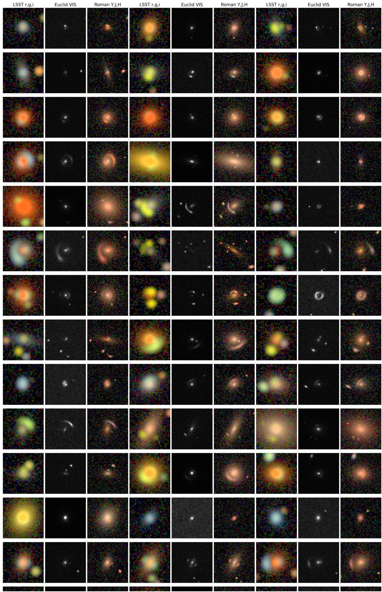  
Figure 6: Examples of galaxy–galaxy strong-lensing systems in the COSMIO dataset.

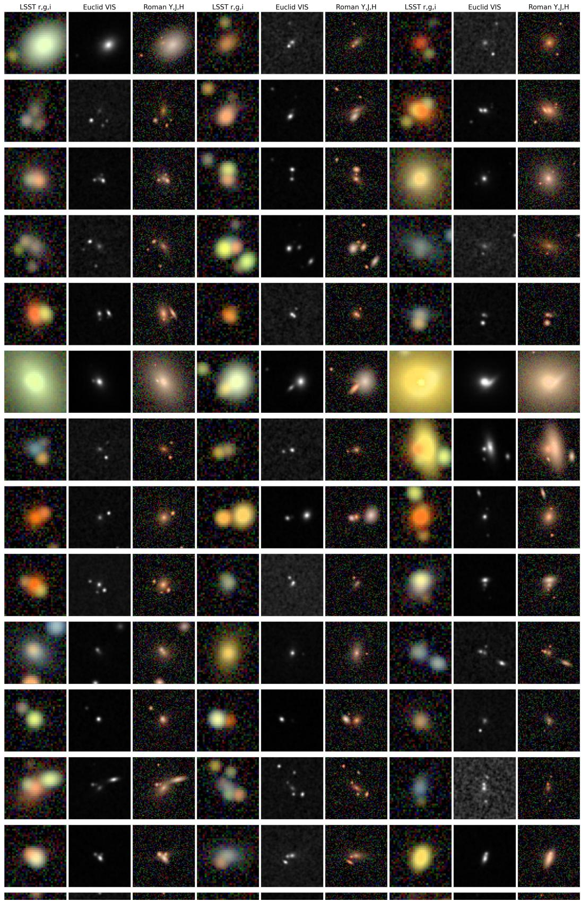  
Figure 7: Examples of regular galaxies in the COSMIO dataset.

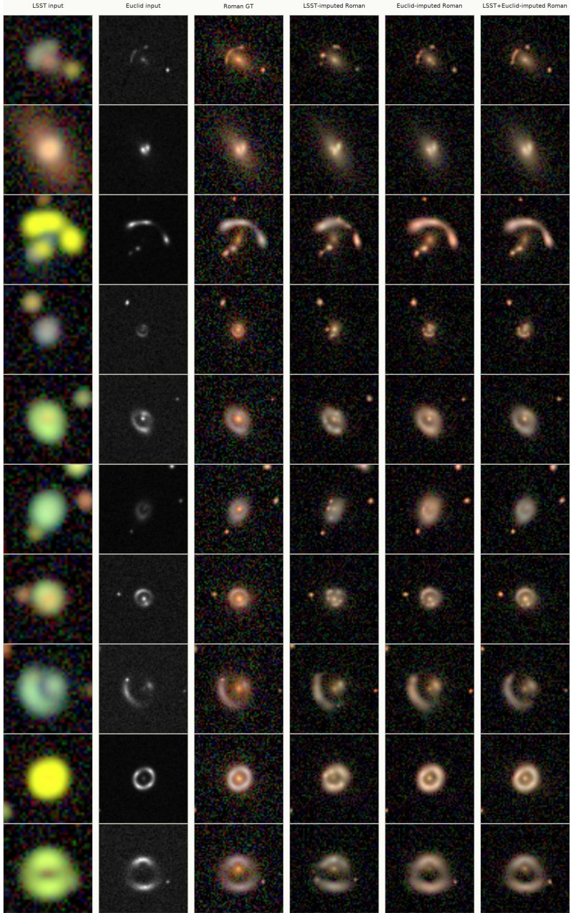  
Figure 8: Additional qualitative examples of strong-lensing imputation using asynchronous diffusion.

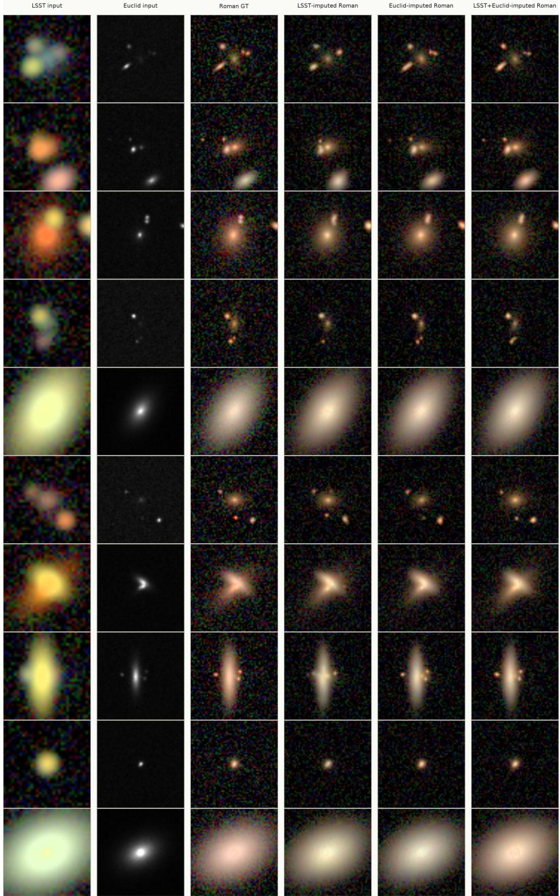  
Figure 9: Additional qualitative examples of regular-galaxy imputation using asynchronous diffusion.

## NeurIPS Paper Checklist

## 1. Claims

Question: Do the main claims made in the abstract and introduction accurately reflect the paper’s contributions and scope?

Answer: [Yes]

Justification: The claim made by Abstract and Introduction are reflected in the experimental results in Section. 4.3.

Guidelines:

• The answer [N/A] means that the abstract and introduction do not include the claims made in the paper.

• The abstract and/or introduction should clearly state the claims made, including the contributions made in the paper and important assumptions and limitations. A [No] or [N/A] answer to this question will not be perceived well by the reviewers.

• The claims made should match theoretical and experimental results, and reflect how much the results can be expected to generalize to other settings.

• It is fine to include aspirational goals as motivation as long as it is clear that these goals are not attained by the paper.

## 2. Limitations

Question: Does the paper discuss the limitations of the work performed by the authors?

Answer: [Yes]

Justification: We use Section 6 to discuss the limitation of this paper and benchmark.

Guidelines:

• The answer [N/A] means that the paper has no limitation while the answer [No] means that the paper has limitations, but those are not discussed in the paper.

• The authors are encouraged to create a separate “Limitations” section in their paper.

• The paper should point out any strong assumptions and how robust the results are to violations of these assumptions (e.g., independence assumptions, noiseless settings, model well-specification, asymptotic approximations only holding locally). The authors should reflect on how these assumptions might be violated in practice and what the implications would be.

• The authors should reflect on the scope of the claims made, e.g., if the approach was only tested on a few datasets or with a few runs. In general, empirical results often depend on implicit assumptions, which should be articulated.

• The authors should reflect on the factors that influence the performance of the approach. For example, a facial recognition algorithm may perform poorly when image resolution is low or images are taken in low lighting. Or a speech-to-text system might not be used reliably to provide closed captions for online lectures because it fails to handle technical jargon.

• The authors should discuss the computational efficiency of the proposed algorithms and how they scale with dataset size.

• If applicable, the authors should discuss possible limitations of their approach to address problems of privacy and fairness.

• While the authors might fear that complete honesty about limitations might be used by reviewers as grounds for rejection, a worse outcome might be that reviewers discover limitations that aren’t acknowledged in the paper. The authors should use their best judgment and recognize that individual actions in favor of transparency play an important role in developing norms that preserve the integrity of the community. Reviewers will be specifically instructed to not penalize honesty concerning limitations.

## 3. Theory assumptions and proofs

Question: For each theoretical result, does the paper provide the full set of assumptions and a complete (and correct) proof?

Answer: [N/A]

Justification: The paper does not include theoretical results, formal theorems, lemmas, or proofs. It is an empirical benchmark paper focused on dataset construction, experimental evaluation, and downstream analysis.

Guidelines:

• The answer [N/A] means that the paper does not include theoretical results.

• All the theorems, formulas, and proofs in the paper should be numbered and crossreferenced.

• All assumptions should be clearly stated or referenced in the statement of any theorems.

• The proofs can either appear in the main paper or the supplemental material, but if they appear in the supplemental material, the authors are encouraged to provide a short proof sketch to provide intuition.

• Inversely, any informal proof provided in the core of the paper should be complemented by formal proofs provided in appendix or supplemental material.

• Theorems and Lemmas that the proof relies upon should be properly referenced.

## 4. Experimental result reproducibility

Question: Does the paper fully disclose all the information needed to reproduce the main experimental results of the paper to the extent that it affects the main claims and/or conclusions of the paper (regardless of whether the code and data are provided or not)?

Answer: [Yes]

Justification: All experimental setups are in Section. 4.2. All architecture details are in Appendix C. Release code and data also contains everything include config files for reproduction.

Guidelines:

• The answer [N/A] means that the paper does not include experiments.

• If the paper includes experiments, a [No] answer to this question will not be perceived well by the reviewers: Making the paper reproducible is important, regardless of whether the code and data are provided or not.

• If the contribution is a dataset and/or model, the authors should describe the steps taken to make their results reproducible or verifiable.

• Depending on the contribution, reproducibility can be accomplished in various ways. For example, if the contribution is a novel architecture, describing the architecture fully might suffice, or if the contribution is a specific model and empirical evaluation, it may be necessary to either make it possible for others to replicate the model with the same dataset, or provide access to the model. In general. releasing code and data is often one good way to accomplish this, but reproducibility can also be provided via detailed instructions for how to replicate the results, access to a hosted model (e.g., in the case of a large language model), releasing of a model checkpoint, or other means that are appropriate to the research performed.

• While NeurIPS does not require releasing code, the conference does require all submissions to provide some reasonable avenue for reproducibility, which may depend on the nature of the contribution. For example

(a) If the contribution is primarily a new algorithm, the paper should make it clear how to reproduce that algorithm.

(b) If the contribution is primarily a new model architecture, the paper should describe the architecture clearly and fully.

(c) If the contribution is a new model (e.g., a large language model), then there should either be a way to access this model for reproducing the results or a way to reproduce the model (e.g., with an open-source dataset or instructions for how to construct the dataset).

(d) We recognize that reproducibility may be tricky in some cases, in which case authors are welcome to describe the particular way they provide for reproducibility. In the case of closed-source models, it may be that access to the model is limited in some way (e.g., to registered users), but it should be possible for other researchers to have some path to reproducing or verifying the results.

## 5. Open access to data and code

Question: Does the paper provide open access to the data and code, with sufficient instructions to faithfully reproduce the main experimental results, as described in supplemental material?

Answer: [Yes]

Justification: We provide open access to the code and data through the repository linked in the paper.

Guidelines:

• The answer [N/A] means that paper does not include experiments requiring code.

• Please see the NeurIPS code and data submission guidelines (https://neurips.cc/ public/guides/CodeSubmissionPolicy) for more details.

• While we encourage the release of code and data, we understand that this might not be possible, so [No] is an acceptable answer. Papers cannot be rejected simply for not including code, unless this is central to the contribution (e.g., for a new open-source benchmark).

• The instructions should contain the exact command and environment needed to run to reproduce the results. See the NeurIPS code and data submission guidelines (https: //neurips.cc/public/guides/CodeSubmissionPolicy) for more details.

• The authors should provide instructions on data access and preparation, including how to access the raw data, preprocessed data, intermediate data, and generated data, etc.

• The authors should provide scripts to reproduce all experimental results for the new proposed method and baselines. If only a subset of experiments are reproducible, they should state which ones are omitted from the script and why.

• At submission time, to preserve anonymity, the authors should release anonymized versions (if applicable).

• Providing as much information as possible in supplemental material (appended to the paper) is recommended, but including URLs to data and code is permitted.

## 6. Experimental setting/details

Question: Does the paper specify all the training and test details (e.g., data splits, hyperparameters, how they were chosen, type of optimizer) necessary to understand the results?

Answer: [Yes]

Justification: All experimental setups are in Section. 4.2.

Guidelines:

• The answer [N/A] means that the paper does not include experiments.

• The experimental setting should be presented in the core of the paper to a level of detail that is necessary to appreciate the results and make sense of them.

• The full details can be provided either with the code, in appendix, or as supplemental material.

## 7. Experiment statistical significance

Question: Does the paper report error bars suitably and correctly defined or other appropriate information about the statistical significance of the experiments?

Answer: [No]

Justification: The benchmark evaluates a broad set of methods across multiple imputation settings, target modalities, and downstream tasks, repeating every method under multiple random seeds is computationally prohibitive. Instead, the main empirical claims are supported by consistent trends across different model families, imputation patterns, and evaluation metrics, rather than by multiple repetition of a single experiment.

Guidelines:

• The answer [N/A] means that the paper does not include experiments.

• The authors should answer [Yes] if the results are accompanied by error bars, confidence intervals, or statistical significance tests, at least for the experiments that support the main claims of the paper.

• The factors of variability that the error bars are capturing should be clearly stated (for example, train/test split, initialization, random drawing of some parameter, or overall run with given experimental conditions).

• The method for calculating the error bars should be explained (closed form formula, call to a library function, bootstrap, etc.)

• The assumptions made should be given (e.g., Normally distributed errors).

• It should be clear whether the error bar is the standard deviation or the standard error of the mean.

• It is OK to report 1-sigma error bars, but one should state it. The authors should preferably report a 2-sigma error bar than state that they have a 96% CI, if the hypothesis of Normality of errors is not verified.

• For asymmetric distributions, the authors should be careful not to show in tables or figures symmetric error bars that would yield results that are out of range (e.g., negative error rates).

• If error bars are reported in tables or plots, the authors should explain in the text how they were calculated and reference the corresponding figures or tables in the text.

## 8. Experiments compute resources

Question: For each experiment, does the paper provide sufficient information on the computer resources (type of compute workers, memory, time of execution) needed to reproduce the experiments?

Answer: [Yes]

Justification: We report in Section. 4.2.

Guidelines:

• The answer [N/A] means that the paper does not include experiments.

• The paper should indicate the type of compute workers CPU or GPU, internal cluster, or cloud provider, including relevant memory and storage.

• The paper should provide the amount of compute required for each of the individual experimental runs as well as estimate the total compute.

• The paper should disclose whether the full research project required more compute than the experiments reported in the paper (e.g., preliminary or failed experiments that didn’t make it into the paper).

## 9. Code of ethics

Question: Does the research conducted in the paper conform, in every respect, with the NeurIPS Code of Ethics https://neurips.cc/public/EthicsGuidelines?

Answer: [Yes]

Justification: We have read and understood the code of ethics and have made every effort to adhere to it.

Guidelines:

• The answer [N/A] means that the authors have not reviewed the NeurIPS Code of Ethics.

• If the authors answer [No], they should explain the special circumstances that require a deviation from the Code of Ethics.

• The authors should make sure to preserve anonymity (e.g., if there is a special consideration due to laws or regulations in their jurisdiction).

## 10. Broader impacts

Question: Does the paper discuss both potential positive societal impacts and negative societal impacts of the work performed?

Answer: [N/A]

Justification: This work concerns a benchmark for observational cosmology data. It is intended for methodological development and scientific analysis in astronomy, and does not involve human subjects, social groups, or deployment-facing decision systems. Therefore, broader societal impacts are not directly applicable.

Guidelines:

• The answer [N/A] means that there is no societal impact of the work performed.

• If the authors answer [N/A] or [No], they should explain why their work has no societal impact or why the paper does not address societal impact.

• Examples of negative societal impacts include potential malicious or unintended uses (e.g., disinformation, generating fake profiles, surveillance), fairness considerations (e.g., deployment of technologies that could make decisions that unfairly impact specific groups), privacy considerations, and security considerations.

• The conference expects that many papers will be foundational research and not tied to particular applications, let alone deployments. However, if there is a direct path to any negative applications, the authors should point it out. For example, it is legitimate to point out that an improvement in the quality of generative models could be used to generate Deepfakes for disinformation. On the other hand, it is not needed to point out that a generic algorithm for optimizing neural networks could enable people to train models that generate Deepfakes faster.

• The authors should consider possible harms that could arise when the technology is being used as intended and functioning correctly, harms that could arise when the technology is being used as intended but gives incorrect results, and harms following from (intentional or unintentional) misuse of the technology.

• If there are negative societal impacts, the authors could also discuss possible mitigation strategies (e.g., gated release of models, providing defenses in addition to attacks, mechanisms for monitoring misuse, mechanisms to monitor how a system learns from feedback over time, improving the efficiency and accessibility of ML).

## 11. Safeguards

Question: Does the paper describe safeguards that have been put in place for responsible release of data or models that have a high risk for misuse (e.g., pre-trained language models, image generators, or scraped datasets)?

Answer: [N/A]

Justification: This work releases observational cosmology data and benchmark code for scientific imputation experiments. The released data do not contain human-subject information, private data, scraped personal content, or deployment-facing generative models with high misuse potential. Therefore, the work does not pose the type of release risk targeted by this safeguard question

Guidelines:

• The answer [N/A] means that the paper poses no such risks.

• Released models that have a high risk for misuse or dual-use should be released with necessary safeguards to allow for controlled use of the model, for example by requiring that users adhere to usage guidelines or restrictions to access the model or implementing safety filters.

• Datasets that have been scraped from the Internet could pose safety risks. The authors should describe how they avoided releasing unsafe images.

• We recognize that providing effective safeguards is challenging, and many papers do not require this, but we encourage authors to take this into account and make a best faith effort.

## 12. Licenses for existing assets

Question: Are the creators or original owners of assets (e.g., code, data, models), used in the paper, properly credited and are the license and terms of use explicitly mentioned and properly respected?

Answer: [Yes]

Justification: The software packages used for forward rendering the survey scenes are credited in Section 3. We cite the original sources for the simulation and rendering tools used in constructing the benchmark, and we use these assets consistently with their stated licenses and terms of use.

Guidelines:

• The answer [N/A] means that the paper does not use existing assets.

• The authors should cite the original paper that produced the code package or dataset.

• The authors should state which version of the asset is used and, if possible, include a URL.

• The name of the license (e.g., CC-BY 4.0) should be included for each asset.

• For scraped data from a particular source (e.g., website), the copyright and terms of service of that source should be provided.

• If assets are released, the license, copyright information, and terms of use in the package should be provided. For popular datasets, paperswithcode.com/datasets has curated licenses for some datasets. Their licensing guide can help determine the license of a dataset.

• For existing datasets that are re-packaged, both the original license and the license of the derived asset (if it has changed) should be provided.

• If this information is not available online, the authors are encouraged to reach out to the asset’s creators.

## 13. New assets

Question: Are new assets introduced in the paper well documented and is the documentation provided alongside the assets?

Answer: [Yes]

Justification: The paper introduces and releases a new benchmark dataset and associated code. The dataset construction process, survey modalities, simulation pipeline, evaluation protocols, and limitations are provided. The released repository provides the dataset files, code, configuration files, and instructions needed to use the assets and reproduce the main experiments.

Guidelines:

• The answer [N/A] means that the paper does not release new assets.

• Researchers should communicate the details of the dataset/code/model as part of their submissions via structured templates. This includes details about training, license, limitations, etc.

• The paper should discuss whether and how consent was obtained from people whose asset is used.

• At submission time, remember to anonymize your assets (if applicable). You can either create an anonymized URL or include an anonymized zip file.

## 14. Crowdsourcing and research with human subjects

Question: For crowdsourcing experiments and research with human subjects, does the paper include the full text of instructions given to participants and screenshots, if applicable, as well as details about compensation (if any)?

Answer: [N/A]

Justification: The paper does not involve crowdsourcing nor research with human subjects.

Guidelines:

• The answer [N/A] means that the paper does not involve crowdsourcing nor research with human subjects.

• Including this information in the supplemental material is fine, but if the main contribution of the paper involves human subjects, then as much detail as possible should be included in the main paper.

• According to the NeurIPS Code of Ethics, workers involved in data collection, curation, or other labor should be paid at least the minimum wage in the country of the data collector.

## 15. Institutional review board (IRB) approvals or equivalent for research with human subjects

Question: Does the paper describe potential risks incurred by study participants, whether such risks were disclosed to the subjects, and whether Institutional Review Board (IRB) approvals (or an equivalent approval/review based on the requirements of your country or institution) were obtained?

Answer: [N/A]

Justification: The paper does not involve crowdsourcing nor research with human subjects. Guidelines:

• The answer [N/A] means that the paper does not involve crowdsourcing nor research with human subjects.

• Depending on the country in which research is conducted, IRB approval (or equivalent) may be required for any human subjects research. If you obtained IRB approval, you should clearly state this in the paper.

• We recognize that the procedures for this may vary significantly between institutions and locations, and we expect authors to adhere to the NeurIPS Code of Ethics and the guidelines for their institution.

• For initial submissions, do not include any information that would break anonymity (if applicable), such as the institution conducting the review.

## 16. Declaration of LLM usage

Question: Does the paper describe the usage of LLMs if it is an important, original, or non-standard component of the core methods in this research? Note that if the LLM is used only for writing, editing, or formatting purposes and does not impact the core methodology, scientific rigor, or originality of the research, declaration is not required.

Answer: [N/A]

Justification: LLMs are not used as part of the benchmark construction and simulation pipeline.

Guidelines:

• The answer [N/A] means that the core method development in this research does not involve LLMs as any important, original, or non-standard components.

• Please refer to our LLM policy in the NeurIPS handbook for what should or should not be described.