# Cycle WAM: Coupling Action and Video through Cycle Consistency

Qinglin Yang1,2,†,‡, Jiepeng Wang2,†, Yuxing Huang3, Haibin Huang2

Kai Xu4, Chi Zhang2, Ruizhen Hu5,∗, Xuelong Li2,∗

1Zhejiang University 2Institute of Artificial Intelligence (TeleAI), China Telecom

3National University of Defense Technology

4Institute of AI for Industries, Chinese Academy of Sciences 5Shenzhen University

†Equal contribution. ∗Corresponding authors.

‡Work done during an internship at TeleAI.

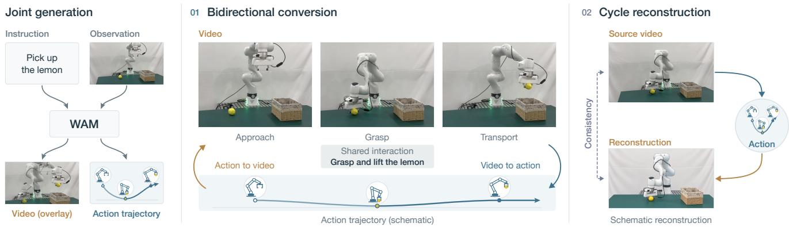  
Fig. 1. Cycle WAM learns the correspondence between video and action. Building on joint generation (left), Bidirectional Conversion relates the two modalities through a shared interaction (middle), and Cycle reinforces this relationship through reconstruction (right). Action trajectories and the reconstruction are schematic.

Abstract— Recent advances in video modeling have driven substantial progress in world action models (WAMs). Existing approaches exploit pretrained video priors by decoding actions from latent representations or inferring them from generated videos. The underlying link is causal: robot actions produce changes in the scene, and video observations of these changes provide evidence for inferring the actions that produced them. However, existing training formulations do not by themselves ensure that actions and their predicted visual consequences are consistent, potentially limiting the use of pretrained capabilities. We treat video and action as paired modalities linked by this causal relationship and learn their correspondence through a unified training framework designed to better exploit pretrained video priors. Cycle WAM first augments video–action co-training with bidirectional conversion to reinforce crossmodal correspondence and recover forward and inverse dynamics. It then introduces a differentiable cycle-reconstruction objective to further couple the two mappings. The resulting model supports both forward and inverse dynamics, with the potential to improve performance through more effective use of pretrained video priors. Cycle WAM achieves state-of-the-art performance among comparable methods on LIBERO-Pro and substantially improves DreamZero on DROID. Comparisons with UWM characterize its inverse-dynamics performance and show sharper visual detail in the displayed forward-dynamics predictions.

## I. INTRODUCTION

General-purpose manipulation requires robots to connect desired changes in the scene with executable actions. Pretrained video models offer rich priors over such changes, motivating world action models (WAMs) that learn visual dynamics and action generation together [1]–[3]. We study how learning the correspondence between video and action can more fully realize the potential of pretrained video models for action-conditioned forward dynamics, inverse dynamics, and policy execution. Within the broader AI Flow framework [4], this work focuses on video–action learning for embodied intelligence.

Early action-conditioned visual models supported modelpredictive control [5], [6], while visual planning translated predicted states into commands through learned inverse models or tracking controllers [7]. These approaches use predicted visual outcomes to guide action selection, providing a foundation for exploiting richer video priors in robot control.

Recent policies exploit stronger visual priors by conditioning controllers on generated video plans [8], [9] or learning actions alongside future visual representations [10]– [12]. These routes transfer visual knowledge, but a plausible future and an action that realizes it remain distinct prediction targets. Building on these advances, unified world action models jointly model robot actions and future visual observations. UWM uses separate diffusion timesteps for video and action to support forward and inverse dynamics [13]. DreamZero adapts a pretrained video backbone for joint video–action generation [2].

The connection between video and action is rooted in the causal structure of an interaction. Given the current scene, robot actions produce changes that become visible in subsequent observations. Conversely, these visual changes provide evidence about which actions could have produced them, enabling inverse dynamics inference even when the underlying action is not uniquely determined. A shared backbone does not by itself ensure consistency between predicted actions and their visual consequences. Our goal is to strengthen this correspondence so that pretrained video knowledge can support both predicting action outcomes and inferring actions from video.

We therefore view video and action as complementary modalities describing the same underlying interaction. Bidirectional conversion and cycle consistency encourage the model’s internal representations to capture how actions relate to visual changes, helping it make fuller use of pretrained video priors without introducing an explicit intermediate representation.

We introduce Cycle WAM, a unified training framework for learning this correspondence (Fig. 1). Building on video– action co-training, Bidirectional Conversion trains the model to convert between video and action, strengthening their correspondence and recovering forward and inverse dynamics. We further introduce a Cycle mechanism that reconstructs the input modality after conversion to the other modality, reinforcing the relationship learned through bidirectional conversion. By learning to convert between video and action and reconstruct the input modality, the model is encouraged to preserve information about the interaction that the two modalities share. Our theoretical analysis clarifies how bidirectional conversion and cycle consistency complement each other in learning the correspondence between video and action. Together, these training objectives aim to make pretrained video priors more useful for learning both visual dynamics and robot actions, supporting forward dynamics, inverse dynamics, and policy learning within the same WAM.

Experiments on LIBERO-Pro and DROID demonstrate improvements in model performance with our training strategy. Comparisons with UWM on LIBERO further characterize the model’s inverse- and forward-dynamics capabilities, with qualitative forward predictions showing sharper visual detail in the displayed examples.

Our contributions are:

• We study WAM learning from the perspective of video– action correspondence to better exploit pretrained video priors, and provide theoretical analysis of how bidirectional conversion and cycle consistency complement each other in learning this relationship.

• We introduce Cycle WAM, a unified training framework that extends video–action co-training with Bidirectional Conversion and Cycle reconstruction to learn and reinforce the correspondence between the two modalities.

• We demonstrate performance improvements with our training strategy on LIBERO-Pro and DROID, and characterize the model’s forward- and inverse-dynamics capabilities through comparisons with UWM on LIBERO.

## II. RELATED WORK

a) Action-conditioned video prediction: Actionconditioned video prediction models the visual consequences of robot commands and supports model-predictive control [5], [6]. Learned simulators extend this approach to robot manipulation [14], while predictive latent models support planning without pixel reconstruction [15]. Complementary visual-planning methods use predicted futures to guide a separately learned controller or inverse model [7]–[9]. These predictors need not also generate robot actions. Beyond robotics, generative video compression reconstructs video from compact transmitted representations using generative priors [16].

b) World action models: Unified models bring video and action generation into a shared architecture [1], [13], [17]. Related video-based policies couple action learning with future prediction [10]–[12]. UWM is a particularly close precedent: independent modality timesteps expose policy, forward dynamics, inverse dynamics, and video-generation modes [13]. DreamZero, our starting architecture, adapts a pretrained video model for joint video–action generation [2]. Recent WAMs extend this design through causal video– action modeling, visual–action tokenization, and actioncentered representations [3], [18]–[21], as well as languageconditioned reasoning and broader training data [22]–[26]. These architectures differ in how visual priors reach the action prediction. The broader role of prior knowledge in representation learning is also emphasized in deep clustering [27]. Our complementary question is how to train the correspondence between video and action once both are represented inside a shared WAM.

c) Coupling forward and inverse dynamics: The use of forward models to train controllers predates current WAMs. Distal supervised learning [28] propagates outcome errors through a learned forward model, and paired internal models connect prediction with motor commands [29]. Joint visual forward–inverse learning subsequently used action supervision to shape predictive interaction features [30], [31]. More broadly, multimodal generation models connect complementary descriptions of images, videos, and 3D shapes through unified modeling or shared representations [32]–[37]. Cycle consistency provides an explicit roundtrip constraint [38]: D3G uses inverse–forward composition to regularize reachability [39], while forward–inverse cycle consistency (FICC) [40] reconstructs future representations through quantized latent actions. WAV uses related cycles for world-model verification and self-improvement; SC3- Eval jointly trains forward and inverse modes and uses inverse agreement to detect rollout drift at inference [41], [42]. Cycle WAM builds on this established principle to couple video and action as two descriptions of an interaction. Bidirectional Conversion supplies paired supervision; Cycle trains forward dynamics on an action generated by the same WAM’s inverse dynamics, with gradient through that action. Action anchoring and joint-policy rehearsal connect this compositional objective to robot coordinates and the deployment query. This is a training-level distinction, not a claim that unified interfaces or forward–inverse coupling are new.

## III. LEARNING VIDEO–ACTION CORRESPONDENCE

We view video and action as two modalities that express the same underlying interaction. Their correspondence can be understood through a shared latent variable that captures the interaction information represented in both modalities. From this perspective, bidirectional conversion encourages the model to learn this shared information from paired video– action data, while Cycle reinforces its preservation through reconstruction. Our analysis examines how these complementary objectives help the model learn the correspondence between video and action.

## A. The Prediction Cost of Missing Correspondence

Let C be context, Z a fixed shared interaction variable, H the model’s input representation, and Y a prediction target. Assume finite second moments and conditional-mean sufficiency, $\mathbb { E } [ Y \mid C , Z , H ] = m _ { Z } ( C , Z ) : = \mathbb { E } [ Y \mid C , Z ] .$ Writing $m _ { H } = \mathbb { E } [ Y \mid C , H ] .$ , define the population prediction risk $\mathcal { R } _ { Y } ( d , H ) = \mathbb { E } \Vert Y - d ( C , H ) \Vert ^ { 2 }$ . It decomposes as

$$
\mathcal { R } _ { Y } ( d , H ) = \mathcal { R } _ { Z } ^ { * } + \Delta _ { Y } ( H ) + \mathcal { E } _ { Y } ( d , H ) ,\tag{1}
$$

where $\mathscr { R } _ { Z } ^ { \ast } = \mathbb { E } \Vert Y - m _ { Z } \Vert ^ { 2 } , \Delta _ { Y } ( H ) = \mathbb { E } \Vert m _ { Z } - m _ { H } \Vert ^ { 2 }$ , and $\mathcal { E } _ { Y } ( d , H ) = \mathbb { E } \Vert d ( C , H ) - m _ { H } \Vert ^ { 2 }$

The term $\Delta _ { Y } ( H )$ is the extra prediction error caused by missing shared information relevant to $Y ;$ improving the head alone cannot remove it. The final term measures the head’s failure to use the available representation. The sufficiency assumption must hold for the specified prediction direction, rather than for every visual detail.

## B. Risk Control through Conversion and Cycle

For paired actions A and videos V, let $H _ { V } = h ( C , V )$ $B = d _ { A } ( C , H _ { V } )$ , and $\widehat { V } = f ( C , B )$ , with sampling randomness fixed and no additional source-video input to f. Define pairing error $P _ { A } = \mathbb { E } \Vert B - A \Vert ^ { 2 }$ and reconstruction error $D _ { V } = \mathbb { E } \| \widehat { V } - V \| ^ { 2 }$ . Here B is an action output, not $Z .$

Assume fixed theoretical readouts $\psi _ { A } ( C , a )$ and $\psi _ { V } ( C , v )$ with Lipschitz constants $K _ { A } , K _ { V }$ over true and predicted inputs. Their calibration errors are $\eta _ { M } = \mathbb { E } \| Z - \psi _ { M } ( C , M ) \| ^ { 2 }$ for $M \in \{ A , V \}$ ; these readouts are analytical witnesses, not added network modules. Let

$$
\begin{array} { r } { U _ { \mathrm { B C } } = ( \sqrt { \eta _ { A } } + K _ { A } \sqrt { P _ { A } } ) ^ { 2 } , } \\ { U _ { \mathrm { C y c l e } } = ( \sqrt { \eta _ { V } } + K _ { V } \sqrt { D _ { V } } ) ^ { 2 } . } \end{array}\tag{2}
$$

For targets satisfying the preceding sufficiency assumption with $H = H _ { V } , \operatorname { i f } m _ { Z } ( C , \cdot )$ is L -Lipschitz on its conditional support, then

$$
\begin{array} { r l } & { { \mathcal { R } } _ { Y } ( d , H _ { V } ) - { \mathcal { R } } _ { Z } ^ { * } \leq L _ { Y } ^ { 2 } \operatorname* { m i n } \{ U _ { \mathrm { B C } } , U _ { \mathrm { C y c l e } } \} } \\ & { ~ + { \mathcal { E } } _ { Y } ( d , H _ { V } ) . } \end{array}\tag{3}
$$

Proof sketch. Conditional-mean orthogonality gives Equation 1. The conditional-variance identity and Lipschitz continuity bound $\Delta _ { Y } ( H )$ by $L _ { Y } ^ { 2 }$ times the minimum MSE for estimating Z from $( C , H )$ . Both $\psi _ { A } ( C , B )$ and $\psi _ { V } ( C , \widehat { V } )$ are such estimators from $( C , H _ { V } )$ . Conditional-mean optimality and Minkowski’s inequality bound their squared errors by $U _ { \mathrm { B C } }$ and $U _ { \mathrm { C y c l e } }$ , respectively, yielding Equation 3.

## C. Implications for Cycle WAM

Paired conversion constrains agreement with observed actions, while Cycle provides another requirement on information retained across conversion. The bound connects these objectives to the prediction cost of insufficient correspondence, supporting our aim of using video priors for robot learning. It does not guarantee that both bounds are tight or that every training run improves over its baseline; actual performance also depends on readout error.

For native flow training, the noisy source supplies additional information. Relating its loss to this guarantee requires high-noise coverage, independent noise, and stable readouts. Target-video-conditioned risk also does not establish autonomous policy performance, which we evaluate separately.

## IV. CYCLE WAM

Cycle WAM extends video–action co-training with Bidirectional Conversion and Cycle reconstruction to learn crossmodal correspondence and better exploit pretrained video priors. As shown in Fig. 2, a shared WAM progresses from joint generation (left), to paired conversion (middle), and then to reconstruction through the other modality (right).

## A. Video–Action Co-Training

Using the notation $( C , A , V )$ from Section III, co-training jointly predicts future video and robot actions from context $C ,$ , including visual observations, robot state, and task instruction. Modality-specific encoders map video, action, and text to tokens, and the video-pretrained backbone generates video and action from noisy inputs (Fig. 2, left). Its native flow-matching objective is $\mathscr { L } _ { J } = \ell _ { J } ^ { V } + \ell _ { J } ^ { A }$ , where the two terms supervise video and action generation, respectively. Positive-incentive noise relates beneficial perturbations to reduced task complexity [43], and its variational formulation learns noise generators [44]. Here, we retain the backbone’s native flow-matching noise process.

## B. Bidirectional Conversion

Bidirectional Conversion explicitly trains the relationship between paired modalities (Fig. 2, middle). Video-to-action conversion conditions on video to predict actions, learning inverse dynamics; action-to-video conversion conditions on actions to predict video, learning forward dynamics. We combine their native flow-matching losses, $\ell _ { I } ^ { A }$ and $\ell _ { F } ^ { V }$ , with co-training:

$$
\mathcal { L } _ { \mathrm { c o n v e r s i o n } } = \rho _ { J } \mathcal { L } _ { J } + \rho _ { I } \ell _ { I } ^ { A } + \rho _ { F } \ell _ { F } ^ { V } ,\tag{4}
$$

where the $\rho$ terms are query-sampling probabilities. The resulting model learns both directions of the correspondence while maintaining the joint-generation task.

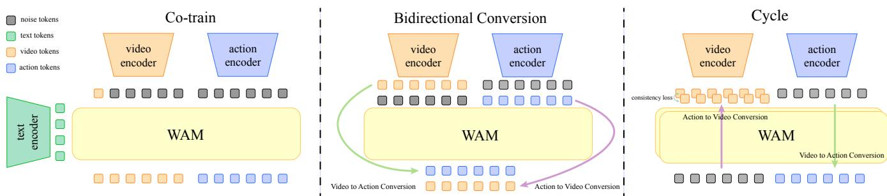  
Fig. 2. Overview of Cycle WAM. Left: co-training jointly models future video and robot actions using a video-pretrained WAM. Middle: Bidirectional Conversion learns video-to-action (green) and action-to-video (purple) mappings from paired data. Right: Cycle converts video to action and back to video, using reconstruction to reinforce the learned correspondence. The WAM blocks share parameters. Gray tokens denote noisy inputs; orange, blue, and green tokens denote video, action, and text, respectively. The diagram depicts the modality-level tasks; reconstruction is trained with the native video flow-matching objective.

## C. Cycle Reconstruction

Cycle reconstructs the source video through video–action– video conversion (Fig. 2, right), encouraging preservation of the shared interaction information discussed in Section III.

GenCeption demonstrates that video-generative backbones can be repurposed for single-pass perception [45]. In our cycle, the video-to-action query obtains a one-step action estimate using the WAM’s native flow readout:

$$
\widehat { A } = \mathrm { c l i p } \big ( \epsilon _ { A } - \sigma _ { \mathrm { m a x } } v _ { \theta } ^ { I } ( \epsilon _ { A } , \tau _ { \mathrm { m a x } } ; V , C _ { I } ) , - 1 , 1 \big ) ,\tag{5}
$$

where $\epsilon _ { A } \sim \mathcal { N } ( 0 , I )$ $v _ { \theta } ^ { I }$ is the predicted action flow, and $\sigma _ { \mathrm { m a x } }$ is the noise scale at the maximum timestep $\tau _ { \mathrm { m a x } } .$ The query observes $V ; C _ { I }$ retains robot state but omits language and additional image-feature conditioning. Clipping bounds the normalized action output.

The action-to-video query then uses $\widehat { A }$ for reconstruction, trained with the native video flow loss:

$$
\mathcal { L } _ { \mathrm { r e t u r n } } ^ { V } = \mathbb { E } _ { \omega } \Big [ w _ { \tau } \big \| v _ { \theta } ^ { F } ( X _ { \tau } ^ { V } , \tau ; C _ { F } , \widehat { A } ) - u _ { \tau } ^ { V } \big \| ^ { 2 } \Big ] .\tag{6}
$$

Here $X _ { \tau } ^ { V }$ is the corrupted source video, $u _ { \tau } ^ { V }$ its target flow, $w _ { \tau }$ is the scheduler weight, and ω collects noise and timesteps; masking and normalization follow the native loss. $C _ { F }$ includes robot state, the first-frame visual condition, and observed preceding video blocks, but no language prompt. This trains video flow on a noisy target; full sampled reconstructions are evaluated separately.

A separate video-to-action computation retains supervision from recorded pairs. Together with reconstruction, it gives $\mathcal { L } _ { \mathrm { c y c } } = \mathcal { L } _ { \mathrm { r e t u r n } } ^ { V } + \ell _ { I } ^ { A }$ , with unit weights. Thus, Cycle reinforces correspondence while retaining the paired conversion objective.

The converted action remains in the computation graph: the returned-video loss differentiates through the forward query and, through ${ \widehat { A } } ,$ the inverse query. Since both queries share the WAM, this couples action prediction to its visual consequences. The separate supervised inverse pass keeps the action output tied to recorded robot commands. A Cycle update therefore contains three computations: inverse conversion, forward reconstruction, and supervised inverse prediction. The one-step readout avoids unrolling an entire denoising trajectory, although clipping can suppress gradients for saturated action components.

## D. Training and Inference

Starting from the co-trained WAM, we train Bidirectional Conversion and then mix Cycle reconstruction with joint generation:

$$
\mathcal { L } _ { \mathrm { s t a g e 2 } } = ( 1 - \rho _ { C } ) \mathcal { L } _ { J } + \rho _ { C } \mathcal { L } _ { \mathrm { c y c } } .\tag{7}
$$

Training probabilities and parameter-update settings are given in the experimental setup. At inference, the two conversion queries provide forward and inverse dynamics. For robot control, joint generation produces video and executable actions from context, without requiring a target future video or an additional cycle at deployment.

## V. EXPERIMENTS

We evaluate control, conditional dynamics, training-stage effects, and physical execution on LIBERO, DROID, and real-robot tasks.

## A. Experimental Setup

a) Model and training: Using RLinf [46], we initialize a DreamZero-style 5B WAM [2] from Wan2.2-TI2V-5B and perform video–action co-training on LIBERO-40/90 [47] for 27,000 steps. Bidirectional Conversion then updates all parameters for 5,000 steps with joint/inverse/forward probabilities (0.50, 0.25, 0.25). Cycle uses 3,000 steps, joint/Cycle probabilities (0.70, 0.30), and shared LoRA adapters with rank and scaling 32; base weights, action/state interfaces, and query embeddings remain frozen.

The 5,652 episodes contain 848,036 frame-indexed window starts. At start t, we sample video at $t , t + 2 , \ldots , t + 6 4 ,$ actions at $t , \ldots , t + 6 3$ , and states at $t , t + 1 6 , t + 3 2 , t + 4 8$ repeating the final frame at episode boundaries. Inputs are two camera views, 8D states, and an instruction; outputs are 7D actions and video latents.

b) Control evaluation: We report success rates under the Harness VLA direct protocol on LIBERO-Pro [48], using 10 tasks and seeds 1–10 per condition with horizons of 220 steps (520 for LIBERO-10). The selected four-condition comparison covers 400 episodes; complete coverage includes 800 Pro and 400 Standard episodes. Captions define perturbations and identify public baseline results.

## B. Robot Control on LIBERO-Pro

Cycle WAM leads the selected-condition average and ranks first on Spatial-S and Goal-T (Table I), supporting control improvements beyond joint generation. Spatial-T remains below DreamZero and Goal-S below π0.5. Cycle WAM also outperforms LIBERO-finetuned UWM across these conditions. Task, seed, horizon, and success rules are shared, but UWM’s different action chunks and absence of state/language inputs make this a cross-architecture comparison.

## C. Robot Control on DROID

Both trained variants outperform official DreamZero-DROID [2], with full Cycle WAM best overall (Table II). Most improvement follows Bidirectional Conversion; Cycle adds a smaller gain in the final scene. Unpaired ablations and incomplete training-budget records limit Cycle attribution. The w/o Cycle variant uses forward/inverse/joint probabilities (0.40, 0.40, 0.20); the caption gives other settings.

## D. Forward and Inverse Dynamics on LIBERO

a) Inverse dynamics: We compare conditional action prediction on 100 paired windows (34 LIBERO-40, 66 LIBERO-90), sharing 16 × 7 targets, q99 normalization, seeds, and 16 denoising steps. Official LIBERO-90- pretrained UWM [13], distinct from the policy checkpoint, uses two history and two endpoint frames with DDIM; Cycle WAM uses nine two-view frames, state, and FlowUniPC. Both receive observed future video.

Table III shows lower rotation error and better motiondirection agreement for Cycle WAM, while UWM has lower aggregate action MSE. These component-specific strengths do not imply uniform superiority. The historical DreamZero row uses different windows and a longer horizon. Inverse prediction receives future video, so its ranking need not match autonomous control.

b) Forward dynamics: Cycle WAM improves reconstruction error, PSNR, SSIM, and Frame FID (Table IV); its unrounded MSE is 9.65% lower despite the displayed tie. Sharper contours and textures in Fig. 3 agree with these metrics, although object placement and view composition differ from GT. This comparison does not measure temporal consistency or action-intervention sensitivity, or isolate Cycle’s contribution.

## E. Training-Stage Ablations

a) Training-stage variants: Bidirectional Conversion improves the selected-condition control average (Table V). Cycle further improves it through Spatial-S and Goal-T gains, with declines on Spatial-T and Goal-S. Different budgets and update types prevent isolating each objective’s contribution.

Complete coverage limits these gains: Standard performance falls after Bidirectional Conversion and is not recovered by Cycle, while aggregate Pro performance changes little. Control improvements are therefore not uniform.

b) Matched continuations: From the same w/o Cycle checkpoint, we match 3,000-step rank-32 LoRA runs in data, noise, optimizer, and three-pass computation. The control replaces converted actions with recorded actions, changing both conditioning and gradient flow. Runs use 14 or 111 instructions, 10 demonstrations each, seeds 42–44, and a shared 20-task diagnostic whose separation from training is unverified.

With the larger task set, paired intervals do not resolve differences in inverse prediction, reconstruction, joint-action consistency, or action-sensitivity margins. With the smaller set, video reconstruction and both forward-loss margins favor control under unadjusted intervals; the others are inconclusive. Matched training thus shows no consistent additional Cycle benefit and does not separately isolate gradient coupling.

## F. Real-Robot Experiments

Cycle WAM completes the task in three of five evaluated real-world scenes, whereas DreamZero completes none (Table VI). This provides initial comparative evidence of physical execution, while two scenes remain unsuccessful for Cycle WAM. These scene-level counts do not establish repeated-trial reliability. Fig. 4 illustrates coordinated arm and gripper motion: the remote control is placed inside the basket, and the lemon is transported in the opposite direction and released above it.

## VI. LIMITATIONS

Like other video-pretrained WAMs, Cycle WAM depends on the fidelity and coverage of its pretrained visual priors. Video-prediction quality can influence action execution, while precise manipulation and long-horizon reasoning remain challenging for this model family [2]. Consistency between video and action cannot by itself supply missing physical knowledge: the two modalities may agree while misrepresenting geometry or contact dynamics. The benefit of correspondence learning is therefore constrained by the underlying model’s ability to represent the interaction. Stronger physical and temporal priors are important for extending these methods to more demanding manipulation. Language-guided video segmentation highlights object grounding and reasoning [56], while training-free long-video understanding explores frame selection, memory, and reasoning with frozen models [57]. Integrating such capabilities into WAMs remains an open direction.

A second shared bottleneck is the availability of diverse supervision beyond RGB video and actions. Acquiring geometric ground truth at scale remains difficult, motivating

TABLE I  
SUCCESS (%) ON FOUR SELECTED LIBERO-PRO CONDITIONS. T DENOTES INSTRUCTION REDIRECTION AND S POSITION SWAPS. THE FINAL COLUMN AVERAGES ONLY THESE FOUR CONDITIONS. BASELINE VALUES ARE REPORTED BY LIBERO-PRO [48], EXCEPT FOR THE †-MARKED LIBERO-130-FINETUNED CHECKPOINTS, WHICH WE EVALUATE ALONGSIDE CYCLE WAM WITH 100 EPISODES PER CONDITION.
<table><tr><td>Method</td><td>Spat-T</td><td>Spat-S</td><td>Goal-T</td><td>Goal-S</td><td>Avg.</td></tr><tr><td>OpenVLA [49]</td><td>0.0</td><td>0.0</td><td>0.0</td><td>0.0</td><td>0.0</td></tr><tr><td>π0 [50]</td><td>0.0</td><td>0.0</td><td>0.0</td><td>0.0</td><td>0.0</td></tr><tr><td>π0.5 [51]</td><td>1.0</td><td>20.0</td><td>2.0</td><td>38.0</td><td>15.3</td></tr><tr><td>MolmoAct [52]</td><td>0.0</td><td>0.0</td><td>0.0</td><td>0.0</td><td>0.0</td></tr><tr><td>NORA [53]</td><td>0.0</td><td>0.0</td><td>0.0</td><td>0.0</td><td>0.0</td></tr><tr><td>X-VLA [54]</td><td>0.0</td><td>0.0</td><td>9.0</td><td>1.0</td><td>2.5</td></tr><tr><td>AtomVLA [55]</td><td>1.0</td><td>16.0</td><td>11.0</td><td>2.0</td><td>7.5</td></tr><tr><td>UWM† [13]</td><td>21.0</td><td>1.0</td><td>3.0</td><td>0.0</td><td>6.3</td></tr><tr><td>DreamZero† [2]</td><td>27.0</td><td>13.0</td><td>12.0</td><td>2.0</td><td>13.5</td></tr><tr><td>Cycle WAM (ours)</td><td>24.0</td><td>25.0</td><td>19.0</td><td>3.0</td><td>17.8</td></tr></table>

TABLE II

CYCLE WAM VARIANTS ON THREE DREAMZERO-DROID 14B SIMULATOR SCENES [2], WITH 20 EPISODES PER SCENE. BC DENOTESBIDIRECTIONAL CONVERSION. THE W/O CYCLE VARIANT USES 5K STEPS OF RANK-32 LORA BC; OMITTING BOTH BC AND CYCLE GIVES THEOFFICIAL WEIGHTS. THE TWO ABLATED RUNS USE THE FULL20 PROTOCOL BUT ARE NOT PAIRED BY SEED.
<table><tr><td>Variant</td><td>Scene 1</td><td>Scene 2</td><td>Scene 3</td><td>Total</td></tr><tr><td>Cycle WAM</td><td>20/20</td><td>19/20</td><td>20/20</td><td>59/60 (98.3%)</td></tr><tr><td>Cycle WAM w/o Cycle</td><td>20/20</td><td>19/20</td><td>19/20</td><td>58/60 (96.7%)</td></tr><tr><td>Cycle WAM w/o BC and Cycle</td><td>20/20</td><td>17/20</td><td>15/20</td><td>52/60 (86.7%)</td></tr></table>

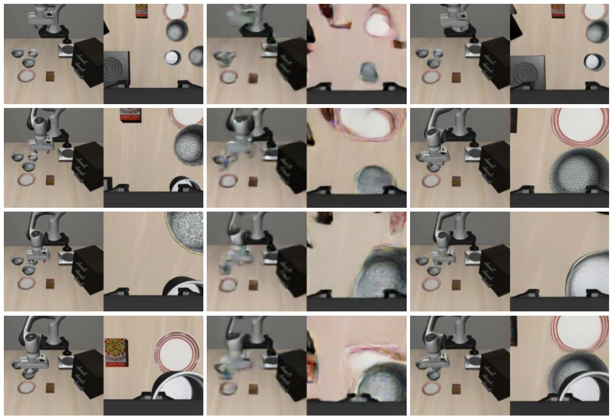  
UWM  
GT  
Cycle WAM  
Fig. 3. Forward-dynamics examples on LIBERO: GT, UWM, and Cycle WAM (left to right), with two views per panel. Cycle WAM retains sharper boundaries, but object placement and view composition still differ from GT.

02 Grasp  
04 Release  
(a) Place the white remote control in the basket  
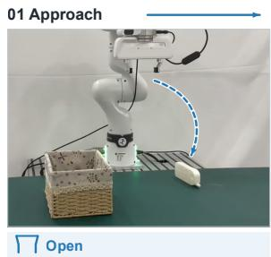

02 Grasp  
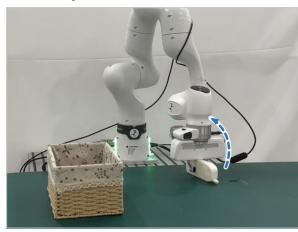  
(b) Pick up the lemon and put it in the basket

03 Transport  
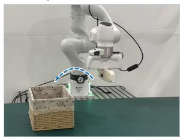  
04 Release  
Closed / holding

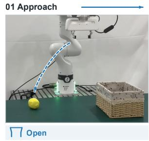

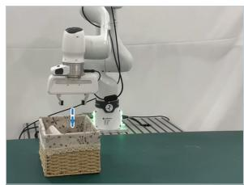

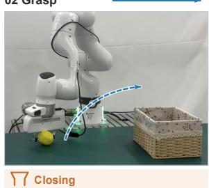

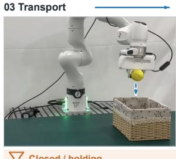

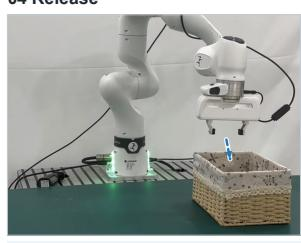  
Fig. 4. Real-robot placement of (a) a remote control and (b) a lemon into a basket. Ordered keyframes show approach, grasping, transport, and release Dashed arrows indicate schematic motion directions; colored strips denote visually inferred gripper states.

## TABLE III

INVERSE-DYNAMICS SUMMARY: TOTAL ACTION ERROR, ROTATION ERROR, AND MOTION-DIRECTION AGREEMENT. UWM AND CYCLE WAM USE 100 PAIRED WINDOWS. † MARKS LIBERO-130-FINETUNED DREAMZERO, A HISTORICAL REFERENCE WITH DIFFERENT WINDOWS AND HORIZON.

<table><tr><td>Model</td><td colspan="3">MSE ↓ Rot. RMSE ↓ Motion cos. ↑</td></tr><tr><td>UWM [13]</td><td>0.06</td><td>0.23</td><td>0.83</td></tr><tr><td>DreamZero† [2]</td><td>0.63</td><td>0.63</td><td>0.35</td></tr><tr><td>Cycle WAM (ours)</td><td>0.10</td><td>0.20</td><td>0.85</td></tr></table>

TABLE IV

FORWARD-DYNAMICS PREDICTION METRICS, ROUNDED TO TWO DECIMALS. RELATIVE IMPROVEMENTS USE UNROUNDED SCORES.
<table><tr><td>Model</td><td>MSE↓</td><td>MAE↓</td><td>PSNR ↑</td><td>SSIM↑</td><td>Frame FID ↓</td></tr><tr><td>UWM</td><td>0.03</td><td>0.10</td><td>15.48</td><td>0.57</td><td>280.84</td></tr><tr><td>Cycle WAM</td><td>0.03</td><td>0.08</td><td>15.92</td><td>0.63</td><td>96.02</td></tr></table>

synthetic supervision in video-based perception [45]. Extending WAMs to depth, tactile, and force modalities further requires synchronized and calibrated observations across tasks and robot platforms. Limited coverage of these signals leaves aspects of geometry and contact ambiguous from visual observations alone. Broader multimodal interaction data could provide complementary constraints on the shared interaction, although collection and alignment costs remain obstacles to scaling such training.

## TABLE V

CYCLE WAM CONTROL ABLATIONS ON FOUR SELECTED LIBERO-PRO CONDITIONS. BC DENOTES BIDIRECTIONAL CONVERSION; W/O LABELS INDICATE OMITTED TRAINING STAGES. OMITTING BOTH STAGES GIVES THE LIBERO-FINETUNED DREAMZERO BASELINE [2]. SUCCESS (%) USES 100 EPISODES PER SELECTED CONDITION. BUDGETS AND UPDATE

TYPES DIFFER; MATCHED CONTINUATIONS ARE DISCUSSED IN SECTION V-E.
<table><tr><td>Variant</td><td>Spat-T</td><td>Spat-S</td><td>Goal-T</td><td>Goal-S</td><td>Avg.</td></tr><tr><td>Cycle WAM</td><td>24.0</td><td>25.0</td><td>19.0</td><td>3.0</td><td>17.8</td></tr><tr><td>w/o Cycle</td><td>25.0</td><td>23.0</td><td>15.0</td><td>5.0</td><td>17.0</td></tr><tr><td>w/o BC and Cycle</td><td>27.0</td><td>13.0</td><td>12.0</td><td>2.0</td><td>13.5</td></tr></table>

TABLE VI

REAL-ROBOT TASK COMPLETION ACROSS FIVE EVALUATED SCENES. ENTRIES COUNT SCENES WITH OBSERVED TASK COMPLETION.
<table><tr><td>Method</td><td>Completed scenes</td></tr><tr><td>DreamZero [2]</td><td>0/5</td></tr><tr><td>Cycle WAM</td><td>3/5</td></tr></table>

## VII. CONCLUSION

Cycle WAM frames video-based robot learning as learning a correspondence between visual dynamics and robot actions. Bidirectional Conversion learns from paired modalities, while Cycle reinforces their relationship through reconstruction. Our analysis explains their complementary roles: paired supervision identifies the observed correspon dence, and reconstruction encourages information preservation across conversion. Simulation results characterize bidirectional dynamics and show gains on selected perturbation conditions, but not uniform improvements in aggregate control or matched diagnostics. Forward-dynamics comparisons with UWM show lower reconstruction errors, higher PSNR and SSIM, and lower Frame FID, alongside sharper visual detail; object-placement discrepancies remain. Physical-robot tests show task completion in more evaluated scenes than DreamZero, with qualitative sequences illustrating grasping, transport, and release in tabletop pick-and-place tasks. This perspective makes the relation between predicted visual consequences and executable actions an explicit training and evaluation target.

## ACKNOWLEDGMENT

We thank Yifei Huang from Nanjing University for assistance with real-robot deployment.

## REFERENCES

[1] S. Li, Y. Gao, D. Sadigh, and S. Song, “Unified Video Action Model,” in Proceedings ofRobotics: Science and Systems, 2025, doi: 10.15607/ RSS.2025.XXI.074.

[2] S. Ye, Y. Ge, K. Zheng, S. Gao, S. Yu, G. Kurian, et al., “World action models are zero-shot policies,” arXiv preprint arXiv:2602.15922, 2026.

[3] L. Li, Q. Zhang, Y. Luo, S. Yang, R. Wang, L. Zhang, et al., “Causal World Modeling for Robot Control,” in Proceedings of Robotics: Science and Systems, 2026, doi: 10.15607/RSS.2026.XXII.016.

[4] H. An, W. Hu, S. Huang, S. Huang, R. Li, Y. Liang, et al., “AI Flow: perspectives, scenarios, and approaches,” Vicinagearth, vol. 3, p. 1, 2026, doi: 10.1007/s44336-025-00031-y.

[5] C. Finn, I. Goodfellow, and S. Levine, “Unsupervised Learning for Physical Interaction through Video Prediction,” in Advances in Neural Information Processing Systems, vol. 29. Curran Associates, Inc., 2016, pp. 64–72.

[6] C. Finn and S. Levine, “Deep visual foresight for planning robot motion,” in 2017 IEEE International Conference on Robotics and Automation. IEEE, 2017, pp. 2786–2793, doi: 10.1109/ICRA.2017. 7989324.

[7] A. Wang, T. Kurutach, K. Liu, P. Abbeel, and A. Tamar, “Learning Robotic Manipulation through Visual Planning and Acting,” in Proceedings of Robotics: Science and Systems, Freiburg im Breisgau, Germany, 2019, doi: 10.15607/RSS.2019.XV.074.

[8] Y. Du, M. Yang, B. Dai, H. Dai, O. Nachum, J. B. Tenenbaum, et al., “Learning Universal Policies via Text-Guided Video Generation,” in Advances in Neural Information Processing Systems, vol. 36. Curran Associates, Inc., 2023, pp. 9156–9172, doi: 10.52202/075280-0403.

[9] H. Bharadhwaj, D. Dwibedi, A. Gupta, S. Tulsiani, C. Doersch, T. Xiao, et al., “Gen2Act: Human video generation in novel scenarios enables generalizable robot manipulation,” in Proceedings of The 9th Conference on Robot Learning, ser. Proceedings of Machine Learning Research, vol. 305. PMLR, 2025, pp. 3936–3951.

[10] H. Wu, Y. Jing, C. Cheang, G. Chen, J. Xu, X. Li, et al., “Unleashing Large-Scale Video Generative Pre-training for Visual Robot Manipulation,” in International Conference on Learning Representations, 2024, pp. 10 641–10 662.

[11] C.-L. Cheang, G. Chen, Y. Jing, T. Kong, H. Li, Y. Li, et al., “GR-2: A generative video-language-action model with web-scale knowledge for robot manipulation,” arXiv preprint arXiv:2410.06158, 2024.

[12] W. Zhang, H. Liu, Z. Qi, Y. Wang, X. Yu, J. Zhang, et al., “DreamVLA: A vision-language-action model dreamed with comprehensive world knowledge,” in Advances in Neural Information Processing Systems, vol. 38. Curran Associates, Inc., 2025, pp. 24 195–24 228, doi: 10.52202/085713-0818.

[13] C. Zhu, R. Yu, S. Feng, B. Burchfiel, P. Shah, and A. Gupta, “Unified World Models: Coupling Video and Action Diffusion for Pretraining on Large Robotic Datasets,” in Proceedings of Robotics: Science and Systems, 2025, doi: 10.15607/RSS.2025.XXI.015.

[14] F. Zhu, H. Wu, S. Guo, Y. Liu, C. Cheang, and T. Kong, “IRASim: A Fine-Grained World Model for Robot Manipulation,” in Proceedings of the IEEE/CVF International Conference on Computer Vision (ICCV), 2025, pp. 9834–9844.

[15] M. Assran, A. Bardes, D. Fan, Q. Garrido, R. Howes, M. Komeili, et al., “V-JEPA 2: Self-supervised video models enable understanding, prediction and planning,” arXiv preprint arXiv:2506.09985, 2025.

[16] X. Chen, J. Luo, J. Xu, F. Yi, C. Zhang, and X. Li, “Generative video compression: towards 0.01% compression rate for video transmission,” Vicinagearth, vol. 3, p. 7, 2026, doi: 10.1007/s44336-026-00035-2.

[17] J. Cen, C. Yu, H. Yuan, Y. Jiang, S. Huang, J. Guo, et al., “World-VLA: Towards autoregressive action world model,” arXiv preprint arXiv:2506.21539, 2025.

[18] Q. Zhang, L. Li, L. Zhang, S. Yang, Y. Luo, S. Li, et al., “Native videoaction pretraining for generalizable robot control,” arXiv preprint arXiv:2607.08639, 2026.

[19] J. Wang, Q. Zhang, S. Yang, Y. Luo, Y. Shen, Z. Wu, et al., “RepWAM: World action modeling with representation visual-action tokenizers,” arXiv preprint arXiv:2606.13674, 2026.

[20] H. Zhen, Z. Gao, Q. Sun, Y. Zhao, Y. Yang, Y. Du, et al., “Action images: End-to-end policy learning via multiview video generation,” arXiv preprint arXiv:2604.06168, 2026.

[21] A. Ye, B. Wang, C. Ni, G. Huang, G. Zhao, H. Li, et al., “GigaWorld-Policy: An efficient action-centered world–action model,” arXiv preprint arXiv:2603.17240, 2026.

[22] Y. Yang, Z. Liu, S. Kou, Y. Chen, Y. Hu, J. Zhou, et al., “Worldlanguage-action model for unified world modeling, language reasoning, and action synthesis,” arXiv preprint arXiv:2606.05979, 2026.

[23] J. Zhu, J. Zhang, T. Su, T. Liu, Z. Wang, K. Xie, et al., “DSWAM: A dual-system world action foundation model for fine-grained robot manipulation,” arXiv preprint arXiv:2607.04927, 2026.

[24] J. Zhou, Q. Zhang, G. Xu, C. Fan, Y. Zhao, R. Wang, et al., “Zero-WAM: In-context world-action modeling from human videos for openended task generalization,” arXiv preprint arXiv:2608.26103, 2026.

[25] Motubrain Team, C. Xiang, F. Bao, H. Liu, H. Tan, H. Bi, et al., “Motubrain: An advanced world action model for robot control,” arXiv preprint arXiv:2604.27792, 2026.

[26] P. Zhou, S. Chen, D. Chen, J. Wang, R. Jin, B. Zhu, et al., “τ0-WM: A unified video-action world model for robotic manipulation,” arXiv preprint arXiv:2606.01027, 2026.

[27] Y. Lu, H. Li, Y. Li, Y. Lin, and X. Peng, “A survey on deep clustering: from the prior perspective,” Vicinagearth, vol. 1, p. 4, 2024, doi: 10. 1007/s44336-024-00001-w.

[28] M. I. Jordan and D. E. Rumelhart, “Forward models: Supervised learning with a distal teacher,” Cognitive Science, vol. 16, no. 3, pp. 307–354, 1992, doi: 10.1207/S15516709COG1603 1.

[29] D. M. Wolpert and M. Kawato, “Multiple paired forward and inverse models for motor control,” Neural Networks, vol. 11, no. 7–8, pp. 1317–1329, 1998, doi: 10.1016/S0893-6080(98)00066-5.

[30] P. Agrawal, A. V. Nair, P. Abbeel, J. Malik, and S. Levine, “Learning to Poke by Poking: Experiential Learning of Intuitive Physics,” in Advances in Neural Information Processing Systems, vol. 29. Curran Associates, Inc., 2016, pp. 5074–5082.

[31] D. Pathak, P. Agrawal, A. A. Efros, and T. Darrell, “Curiosity-Driven Exploration by Self-Supervised Prediction,” in Proceedings of the 34th International Conference on Machine Learning, ser. Proceedings of Machine Learning Research, vol. 70. PMLR, 2017, pp. 2778–2787.

[32] D. Xi, Z. Zhou, Y. Wang, J. Wang, and C. Zhang, “A survey: advances in multi-modal visual understanding and generation,” Vicinagearth, vol. 3, no. 1, p. 8, 2026, doi: 10.1007/s44336-025-00032-x.

[33] J. Wang, Z. Wang, H. Pan, Y. Liu, D. Yu, C. Wang, et al., “MMGen: Unified multi-modal image generation and understanding in one go,” arXiv preprint arXiv:2503.20644, 2025.

[34] D. Xi, J. Wang, Y. Liang, X. Qiu, Y. Huo, R. Wang, et al., “OmniVDiff: Omni controllable video diffusion for generation and understanding,” Proceedings of the AAAI Conference on Artificial Intelligence, vol. 40, no. 13, pp. 10 915–10 923, 2026, doi: 10.1609/ aaai.v40i13.38068.

[35] D. Xi, J. Wang, Y. Liang, X. Qiu, J. Liu, H. Pan, et al., “CtrlVDiff: Controllable video generation via unified multimodal video diffusion,” arXiv preprint arXiv:2511.21129, 2025.

[36] J. Wang, H. Pan, Y. Liu, X. Tong, T. Komura, and W. Wang, “StructRe: Rewriting for structured shape modeling,” ACM Transactions on Graphics, vol. 44, no. 3, pp. 1–20, 2025, doi: 10.1145/3732934.

[37] Q. Dong, J. Wang, R. Xu, C. Lin, Y. Liu, S. Xin, et al., “CrossGen: Learning and generating cross fields for quad meshing,” ACM Transactions on Graphics, vol. 44, no. 6, 2025, doi: 10.1145/3763299.

[38] J.-Y. Zhu, T. Park, P. Isola, and A. A. Efros, “Unpaired Image-to-Image Translation Using Cycle-Consistent Adversarial Networks,” in Proceedings ofthe IEEE International Conference on Computer Vision (ICCV), 2017, pp. 2223–2232.

[39] A. Edwards, H. Sahni, R. Liu, J. Hung, A. Jain, R. Wang, et al., “Estimating $Q ( s , s ^ { \prime } )$ with deep deterministic dynamics gradients,” in Proceedings of the 37th International Conference on Machine Learning, ser. Proceedings of Machine Learning Research, vol. 119. PMLR, 2020, pp. 2825–2835.

[40] W. Ye, Y. Zhang, P. Abbeel, and Y. Gao, “Become a proficient player with limited data through watching pure videos,” in The Eleventh International Conference on Learning Representations, 2023.

[41] Y. Liu, F. Feng, L. Kong, W. Lu, J. Tang, K. Zhang, et al., “World Action Verifier: Self-improving world models via forward-inverse asymmetry,” arXiv preprint arXiv:2604.01985, 2026, also presented at the ICLR 2026 Workshop on World Models.

[42] W.-C. Tseng, G. Hussein, Y. Dong, A. Z. Ren, L. X. Shi, X. Wang, et al., “SC3-Eval: Evaluating robot foundation models via selfconsistent video generation,” arXiv preprint arXiv:2606.18610, 2026.

[43] X. Li, “Positive-incentive noise,” IEEE Transactions on Neural Networks and Learning Systems, vol. 35, no. 6, pp. 8708–8714, 2024, doi: 10.1109/TNNLS.2022.3224577.

[44] H. Zhang, S. Huang, Y. Guo, and X. Li, “Variational positive-incentive noise: How noise benefits models,” IEEE Transactions on Pattern Analysis and Machine Intelligence, vol. 47, no. 9, pp. 8313–8320, 2025, doi: 10.1109/TPAMI.2025.3575295.

[45] L. Wang, C. Zhang, R. Kabra, J. Uijlings, S. Waslander, A. Zisserman, et al., “Video generation models are general-purpose vision learners,” in European Conference on Computer Vision (ECCV), 2026.

[46] C. Yu, Y. Wang, Z. Guo, H. Lin, S. Xu, H. Zang, et al., “RLinf: Flexible and efficient large-scale reinforcement learning via macro-tomicro flow transformation,” arXiv preprint arXiv:2509.15965, 2025.

[47] B. Liu, Y. Zhu, C. Gao, Y. Feng, Q. Liu, Y. Zhu, et al., “LIBERO: Benchmarking knowledge transfer for lifelong robot learning,” in Advances in Neural Information Processing Systems, vol. 36. Curran Associates, Inc., 2023, pp. 44 776–44 791, doi: 10.52202/075280-1939.

[48] X. Zhou, Y. Xu, G. Tie, Y. Chen, G. Zhang, D. Chu, et al., “LIBERO-PRO: Towards robust and fair evaluation of vision-language-action models beyond memorization,” arXiv preprint arXiv:2510.03827, 2025.

[49] M. J. Kim, K. Pertsch, S. Karamcheti, T. Xiao, A. Balakrishna, S. Nair, et al., “OpenVLA: An open-source vision-language-action model,” in Proceedings of The 8th Conference on Robot Learning, ser. Proceedings of Machine Learning Research, vol. 270. PMLR, 2025, pp. 2679–2713.

[50] K. Black, N. Brown, D. Driess, A. Esmail, M. R. Equi, C. Finn, et al., “π0: A Vision-Language-Action Flow Model for General Robot Control,” in Proceedings of Robotics: Science and Systems, 2025, doi: 10.15607/RSS.2025.XXI.010.

[51] K. Black, N. Brown, J. Darpinian, K. Dhabalia, D. Driess, A. Esmail, et al., “π0.5: A vision-language-action model with open-world generalization,” in Proceedings of The 9th Conference on Robot Learning, ser. Proceedings of Machine Learning Research, vol. 305. PMLR, 2025, pp. 17–40.

[52] J. Lee, J. Duan, H. Fang, Y. Deng, S. Liu, B. Li, et al., “MolmoAct: Action reasoning models that can reason in space,” in 2026 IEEE International Conference on Robotics and Automation (ICRA), 2026.

[53] C.-Y. Hung, Q. Sun, P. Hong, A. Zadeh, C. Li, U.-X. Tan, et al., “NORA: A small open-sourced generalist vision language action model for embodied tasks,” arXiv preprint arXiv:2504.19854, 2025.

[54] J. Zheng, J. Li, Z. Wang, D. Liu, X. Kang, Y. Feng, et al., “X-VLA: Soft-prompted transformer as scalable cross-embodiment vision-language-action model,” in The Fourteenth International Conference on Learning Representations, 2026.

[55] X. Sun, Z. Xu, C. Cao, Z. Liu, Y. Sun, J. Pang, et al., “AtomVLA: Scalable post-training for robotic manipulation via predictive latent world models,” in 2026 IEEE/RSJ International Conference on Intelligent Robots and Systems (IROS), 2026, accepted for publication.

[56] Y. Shen and D. Zhang, “A survey of language-guided video object segmentation: from referring to reasoning,” Vicinagearth, vol. 2, p. 9, 2025, doi: 10.1007/s44336-025-00018-9.

[57] J. Liu, Y. Wang, L. Zhang, Y. Wang, S. Xu, L. Wang, et al., “Towards training-free long video understanding: methods, benchmarks, and open challenges,” Vicinagearth, vol. 2, p. 6, 2025, doi: 10.1007/ s44336-025-00017-w.