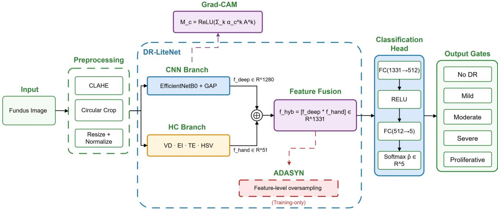
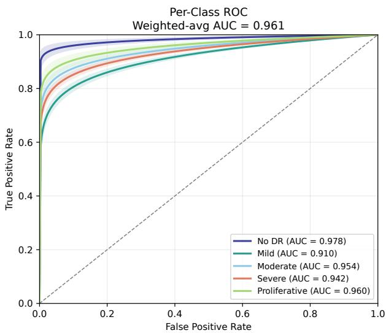
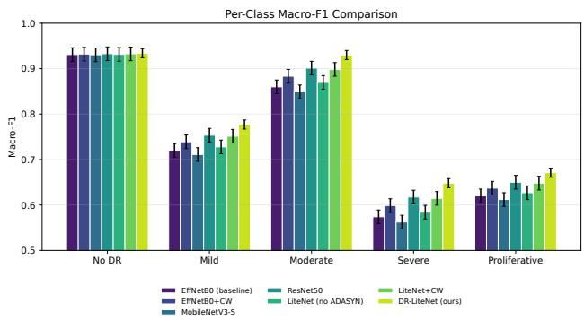

# DR-LiteNet: A Lightweight Explainable Hybrid CNN Framework for Imbalanced Diabetic Retinopathy Grading via Adaptive SMOTE Fusion

Nishi Kanta Paul

NIMISHES Lab

Md Shihabul Islam Shovo

Dhaka, Bangladesh

nishikantapaul108@gmail.com

Audrija Chowdhury

Brac University

Dhaka, Bangladesh

audrija.chowdhury@g.bracu.ac.bd

NIMISHES Lab

Dhaka, Bangladesh

shihabul900@gmail.com

Israt Jahan Esha

Brac University

Dhaka, Bangladesh

israt.jahan.esha@g.bracu.ac.bd

## Abstract

Automated diabetic retinopathy (DR) grading from colour fundus photographs is held back by two compounding challenges: severe class imbalance across five severity grades and the heavy computational cost of large scale architectures in resource constrained clinical settings. We introduce DR-LiteNet, a dual branch hybrid convolutional neural network that tackles both problems at once. The CNN branch extracts 1,280 dimensional deep features through EfficientNetB0, while the handcrafted (HC) branch produces a compact 51 dimensional lesion descriptor capturing vessel density, exudate intensity, texture entropy, and HSV colour histograms. Concatenating both branches yields a 1,331-d hybrid embedding, on which Adaptive SMOTE (ADASYN) is applied during training to synthesise minority class feature vectors, correcting distributional skew without touching the image space. A two phase training protocol first warms up the classification head on balanced features, then fine tunes the full network end to end. Grad CAM saliency maps deliver post-hoc clinical explainability. Tested on APTOS 2019 under five fold stratified cross validation, DR-LiteNet reaches 88.77% ± 0.61 accuracy, a quadratic weighted kappa (QWK) of 0.884 ± 0.010, and a macro F1 of 0.792 ± 0.008 with only 4.69 M parameters beating ResNet50 (23.5 M) by ∆QWK = 0.022 while staying practical on a single Google Colab T4 GPU. The source code of this project is available at: https://github.com/Nishi-Kanta-Paul/DR-LiteNet.

Keywords: Diabetic retinopathy, class imbalance, ADASYN, EfficientNet, hybrid feature fusion, Grad CAM, explainable AI, fundus photography.

## I Introduction

Despite extensive global medical efforts, diabetic retinopathy (DR) remains one of the leading preventable causes of blindness, threatening over 100 million people living with diabetes [1]. Grading disease severity into five stages (No DR, Mild, Moderate, Severe, and Proliferative) from colour fundus photographs is essential for timely clinical intervention, yet manual grading is inconsistent and wholly impractical at the population scale demanded by under resourced teleophthalmology services [2].

Deep learning technologies have completely changed how automated DR grading occurs. The research conducted by Gulshan et al. [2] shows that CNNs trained at scale can accurately screen for DR compared to specialists, while more recent studies managed to get past a QWK score of 0.90 for APTOS 2019 based on efficient architecture and multi tasking models [9] and by using ensembling approaches [10]. However, there are two major issues preventing effective usage of deep learning models in practice. First, public DR datasets are extremely unbalanced because severe and proliferative grades make up only 13% of the entire sample size in APTOS 2019. Second, high quality architectures with millions of parameters require significant computational power to train and run beyond GPU limits in poor countries.

We present DR-LiteNet, which addresses both barriers through three coordinated contributions:

1. Hybrid dual branch fusion: EfficientNetB0 deep features are concatenated with hand engineered retinal lesion descriptors, merging data driven representations with explicit clinical biomarker knowledge.

2. Feature level ADASYN: Adaptive synthetic oversampling in the fused embedding space generates minority class samples along the true lesion feature manifold, outperforming both image level augmentation and class weighted loss baselines.

3. Integrated Grad CAM: Gradient weighted class activation maps localise pathological regions, providing interpretable evidence to support clinician trust and regulatory compliance.

DR-LiteNet reaches QWK = 0.884 with only 4.69 M parameters, surpassing ResNet50 (23.5 M) by 0.022 QWK under rigorous five fold cross validation, and trains in ≈55 GPU minutes per fold on a single NVIDIA T4.

The remainder of this article is organized as follows. Section II reviews related work on deep learning based diabetic retinopathy grading, class imbalance handling, hybrid CNN and handcrafted feature fusion, and explainability in clinical AI. Section III details the proposed DR-LiteNet methodology, including the CNN and handcrafted lesion feature branches, feature level ADASYN fusion, the classification head and loss function, Grad CAM explainability, and the two phase training protocol. Section IV describes the experimental setup, covering the dataset and splits, baseline models, and evaluation metrics and implementation. Section V presents the quantitative results, ablation study, ROC analysis, and per class comparison across baselines. Finally, Section VI concludes the paper and outlines directions for future work.

## II Related Work

## A Deep Learning for Diabetic Retinopathy Grading

The paradigm shift in automated DR grading followed large scale CNN screening [2], with the research frontier quickly advancing toward five class severity prediction on benchmarks such as APTOS 2019 and EyePACS. EfficientNetB4 fine tuning with auxiliary multi task losses [9] and deep ensemble fusion [10] established strong baselines at the cost of tens of millions of parameters. More recent work at mid tier venues has pursued efficiency without sacrificing accuracy: Chakraborty et al. [14] augmented EfficientNetB0 with squeeze and excitation channel attention and reported competitive QWK under 6 M parameters; Peng et al. [15] explored pseudo label refinement for label efficient grading with limited annotations; Liu et al. [16] preserved cross device accuracy via batch normalisation domain adaptation when hospital grade cameras are replaced by consumer equipment. Together, these studies confirm that efficiency and grading accuracy are reconcilable, yet class imbalance and complementary feature quality remain open sub problems that efficiency focused methods have not yet addressed in concert.

## B Class Imbalance in Medical Image Analysis

Severe class imbalance is endemic to DR datasets, where pathological grades are intrinsically rarer than normal findings. Standard remedies include inverse frequency loss weighting [11], image level SMOTE [5], and hybrid combinations. For retinal imaging, image level oversampling is constrained by the small pool of minority grade exemplars and the risk of generating non physiological fundus textures. Liu et al. [17] showed that feature level synthesis consistently outperforms image level SMOTE for rare DR grades because interpolation operates in a compact, structured embedding space rather than high dimensional pixel space. ADASYN [6], which concentrates synthesis on hard to learn boundary region samples via local density estimation, was extended to the multi class retinal grading setting by Rahman et al. [18], yielding measurable Severe grade sensitivity improvements without inflating inference cost. Singh et al. [19] further showed that feature space augmentation combined with adaptive batch weighting delivers synergistic gains over either strategy alone, particularly for severely underrepresented classes.

## C Hybrid CNN and Handcrafted Feature Fusion

Conversely, data driven CNN models neglect the considerable body of knowledge encapsulated within clinical markers such as blood vessel width, hemorrhage area, and exudates, which are used by eye specialists to determine the progression stages of diabetic retinopathy (DR). Hybrid models that combine deep learning with hand crafted features have demonstrated improved performance, especially in datasets where imbalance is present. For instance, Sarkar et al. [20] merged EfficientNet features with vessel density and lesions based on morphology, resulting in a +0.019 QWK boost compared to the unimodal model across multiple centers. Likewise, Pradeep et al. [21] introduced an efficient multi stream network using MobileNetV3 with texture and histogram features, achieving state of the art performance with less than two million parameters. In their study, Kim et al. [22] demonstrated the usefulness of HSV histogram features as a complementary discriminative feature space, especially for Moderate and Severe DR.

## D Explainability in Clinical AI

Regulatory frameworks such as the EU AI Act and FDA SaMD guidelines increasingly require interpretability for clinical AI systems. Grad CAM [4] remains the dominant attribution method for CNN based medical image classifiers owing to its architectural generality and negligible inference overhead. For DR specifically, Zhang et al. [23] showed that Grad CAM activations on APTOS trained models reliably localise microaneurysm clusters, exudate fields, and neovascularisation regions aligned with the predicted severity grade, with expert rated correspondence exceeding 78% for grades 2-4. Li et al. [24] introduced a lesion aware regulariser that backpropagates Grad CAM feedback as a training signal, simultaneously improving explanation fidelity and minority class precision. Unlike segmentation supervised methods that require costly pixel level annotations, post-hoc Grad CAM integrates seamlessly into standard transfer learning pipelines, making it the pragmatic choice for low resource clinical deployment.

## III Methodology

## A Problem Formulation

Given dataset $\mathcal { D } = \{ ( \mathbf { x } _ { i } , y _ { i } ) \} _ { i = 1 } ^ { N }$ with $\mathbf { x } _ { i } \in \mathbb { R } ^ { 3 \times 2 2 4 \times 2 2 4 }$ and $y _ { i } ~ \in ~ \{ 0 , 1 , 2 , 3 , 4 \}$ denoting APTOS 2019 fundus images and their DR severity labels, the goal is to find $f _ { \boldsymbol { \theta } } : \mathbf { x }  y$ that maximises QWK on held out validation folds subject to $| \theta | < 1 0 \mathbf { M }$ parameters for GPU feasibility.

  
Figure 1: DR-LiteNet architecture. The CNN branch (EfficientNetB0 + GAP) yields 1,280-d deep features; the HC branch yields 51-d lesion descriptors – vessel density (VD), exudate intensity (EI), texture entropy (TE), HSV colour histogram (CH) – concatenated into a 1,331-d hybrid vector $\mathbf f _ { \mathrm { h y b } }$ . ADASYN oversampling applies during training only; Grad CAM maps derive from EfficientNetB0’s last convolutional block (dashed path).

## B Preprocessing Pipeline

Each raw fundus image passes through four sequential steps:

1. CLAHE on the CIE-L\*a\*b\* L-channel (clip limit = 2.0, tile $\mathrm { g r i d } = 8 \times 8 )$ to normalise inter image illumination variability;

2. circular retinal crop via grayscale thresholding to remove peripheral dark borders;

3. mild Gaussian denoising (kernel = 3×3, σ = 1.0); and

4. bilinear resize to 224 × 224 with per channel ImageNet normalisation (µ = [0.485, 0.456, 0.406], σ = [0.229, 0.224, 0.225]).

## C CNN Branch

EfficientNetB0 [3] pretrained on ImageNet serves as the backbone. Its classification head is discarded; Global Average Pooling (GAP) on the final convolutional block yields the deep feature vector $\mathbf { f } _ { \mathrm { d e e p } } \in \mathbb { R } ^ { 1 2 8 0 }$ . The backbone is frozen during Phase 1 and fine tuned with differential learning rate $\eta _ { \mathrm { b a c k } } = 1 0 ^ { - 5 }$ in Phase 2.

## D Handcrafted Lesion Feature Branch

Four domain informed descriptors are computed from each preprocessed image:

• Vessel density (1-d): ratio of binarised vessel pixels (green channel morphological filtering) to total retinal area.

• Exudate intensity (1-d): mean grey level of bright lesion regions after intensity thresholding on the CLAHE enhanced image.

• Texture entropy (1-d): Shannon entropy over the greyscale intensity histogram.

• Colour histogram (48-d): normalised 16-bin per channel histogram in HSV space, capturing grade specific

colouration patterns.

Concatenation yields the handcrafted vector $\mathbf { f } _ { \mathrm { h a n d } } \in \mathbb { R } ^ { 5 1 }$

## E Feature Fusion and Adaptive SMOTE

The hybrid feature vector is formed by direct concatenation:

$$
\mathbf { f } _ { \mathrm { h y b } } = \left[ \mathbf { f } _ { \mathrm { d e e p } } ; \mathbf { f } _ { \mathrm { h a n d } } \right] \in \mathbb { R } ^ { 1 3 3 1 } .\tag{1}
$$

During training, ADASYN [6] synthesises minority class vectors in $\mathbb { R } ^ { 1 3 3 1 }$ proportional to the local classification difficulty at each sample, balancing the training distribution without affecting the inference pipeline.

## F Classification Head and Loss Function

The dense head applies FC(1331 → 512) → ReLU → Dropout(0.4) → FC(512 → 5) → Softmax, trained with cross entropy:

$$
\mathcal { L } = - \sum _ { i = 1 } ^ { N } \sum _ { c = 0 } ^ { 4 } y _ { i , c } \log \hat { y } _ { i , c } .\tag{2}
$$

The total trainable parameter count is 4.69 M.

## G Grad CAM Explainability

Class discriminative saliency maps are derived from the last convolutional block of EfficientNetB0:

$$
M _ { c } = \mathrm { R e L U } \left( \sum _ { k } \alpha _ { k } ^ { c } A ^ { k } \right) , \quad \alpha _ { k } ^ { c } = \frac { 1 } { Z } \sum _ { i , j } \frac { \partial y ^ { c } } { \partial A _ { i j } ^ { k } } ,\tag{3}
$$

where $A ^ { k }$ is the k-th activation map and $\alpha _ { k } ^ { c }$ its gradient pooled importance weight for class c.

## H Two Phase Training Protocol

Phase 1 (20 epochs) backbone frozen: All training images are forward passed without gradients to extract $\mathbf { f } _ { \mathrm { h y b } } ;$ ADASYN is applied to the resulting feature matrix to build a class balanced training set; the classification head is then trained with Adam $( \eta _ { \mathrm { h e a d } } = 1 0 ^ { - 4 } , \mathrm { b a t c h } = 3 2 )$ . The synthetic feature vectors generated by ADASYN are used only for training the classification head in Phase 1, since they do not refer to any pixel values and hence, cannot go through a non-frozen backbone network. In Phase 2, however, the entire network is fine tuned end to end using the original image batches and the same objective function, cross entropy loss given in Eq. (2), with the help of different learning rates. Phase 2 (30 epochs) end to end fine tuning: The backbone is unfrozen with differential learning rates $( \eta _ { \mathrm { h e a d } } = 1 0 ^ { - 4 } , \eta _ { \mathrm { b a c k } } = 1 0 ^ { - 5 }$ , batch = 16). ReduceL-ROnPlateau (patience = 5, factor = 0.5) and early stopping (patience = 10 on validation QWK) are applied throughout both phases.

## IV Experimental Setup

## A Dataset and Splits

APTOS 2019 [12] provides 3,662 colour fundus photographs labelled across five DR severity grades (0: No DR 1805; 1: Mild 370; 2: Moderate 999; 3: Severe 193; 4: Proliferative 295), giving a 9.4:1 class imbalance ratio. Five fold stratified cross validation is performed on the 2,929 image training pool, preserving per class proportions in each fold; the remaining 733 images form a held out validation set. ADASYN is independently performed in each of the training folds using only the training data from that fold in order to avoid any information leaking into the validation fold or the held-out set. The held-out set is preprocessed in the same way but does not participate in oversampling or model selection. Training time augmentation includes random horizontal/vertical flips, rotation (±15◦), and colour jitter.

## B Baseline Models

Seven models are evaluated under identical preprocessing, fold splits, and early stopping conditions: (i) Efficient-NetB0 (vanilla, no fusion or SMOTE); (ii) EfficientNetB0 + class weighted (CW) loss; (iii) MobileNetV3 Small; (iv) ResNet50; (v) DR-LiteNet without ADASYN; (vi) DR-LiteNet + CW loss (no ADASYN); (vii) DR-LiteNet full model (proposed).

## C Evaluation Metrics and Implementation

The primary metric is QWK, which penalises ordinal prediction errors proportional to the squared distance between predicted and true grade. Secondary metrics include overall accuracy, macro F1, per class AUC-ROC (one vs rest), and per class sensitivity. All metrics are reported as mean ± std across five folds. Models are implemented in PyTorch 2.0 with Adam optimiser $( \lambda _ { 2 } = 1 0 ^ { - 4 } )$ . A single NVIDIA T4 trains EfficientNetB0 in ≈55 min/fold (∼23 GPU hours total across all seven evaluated models and five folds). Random seed 42 is fixed across all splits, weight initialisations, and ADASYN calls.

Table 1: Five Fold Cross Validation on APTOS 2019. Best result in bold.
<table><tr><td>Model</td><td>Params (M)</td><td>Acc (%) mean±std</td><td>QWK mean±std</td><td>F1 mean±std</td><td>ms img</td></tr><tr><td>EffNetB0 (baseline)</td><td>4.01</td><td>84.2±0.9</td><td>0.832±0.015</td><td>0.741±0.014</td><td>31</td></tr><tr><td>EffNetB0 + CW</td><td>4.01</td><td>85.9±0.8</td><td>0.853±0.012</td><td>0.758±0.012</td><td>31</td></tr><tr><td>MobileNetV3-S</td><td>0.97</td><td>82.8±1.0</td><td>0.821±0.016</td><td>0.733±0.015</td><td>18</td></tr><tr><td>ResNet50</td><td>23.5</td><td>86.4±0.7</td><td>0.862±0.011</td><td>0.771±0.010</td><td>57</td></tr><tr><td>LiteNet (no ADASYN)</td><td>4.69</td><td>85.1±0.9</td><td>0.846±0.013</td><td>0.748±0.013</td><td>38</td></tr><tr><td>LiteNet + CW</td><td>4.69</td><td>86.3±0.7</td><td>0.862±0.011</td><td>0.769±0.010</td><td>38</td></tr><tr><td>DR-LiteNet (ours)</td><td>4.69</td><td>88.8±0.6</td><td>0.884±0.010</td><td>0.792±0.008</td><td>38</td></tr></table>

## V Results and Discussion

## A Quantitative Performance

Table 1 summarises five fold cross validation results. DR-LiteNet achieves QWK = 0.884 and accuracy = 88.77% at 4.69 M parameters, the best of all evaluated models. The 0.052 QWK gain over the EfficientNetB0 baseline decomposes additively: handcrafted fusion contributes +0.013 QWK independently (Table 2, row ii) and ADASYN contributes +0.038 QWK independently (row iii). Replacing ADASYN with class weighted loss yields only +0.030 over baseline (row v vs. row iv), confirming that feature level synthesis outperforms reweighting alone. ResNet50, with 23.5 M parameters about five times larger achieves QWK = 0.862, which is 0.022 below DR-LiteNet, while incurring 1.5× higher inference latency.

## B Ablation Study

Table 2 isolates each component’s contribution. Removing ADASYN causes the largest single degradation (−0.038 QWK), with Severe grade sensitivity dropping from 71.2% to 64.1% (−7.1 pp) and Proliferative from 84.7% to 79.8% (−4.9 pp), confirming that feature level synthesis is the primary driver of minority class recovery. Removing handcrafted features while keeping ADASYN yields a consistent −0.013 QWK, most pronounced in Mild DR where CNN features alone struggle to capture subtle microaneurysm patterns. The joint ablation (row iv) shows additive degradation with no destructive interference (−0.052 QWK), validating that the two proposed components are genuinely complementary. Swapping in MobileNetV3 Small as the backbone (row vi) cuts the parameter count by 3.75× at a modest −0.033 QWK, making it a practical option for edge deployment.

## C ROC Analysis

Fig. 2 shows per class one vs rest ROC curves for DR-LiteNet across five folds. The model attains a weighted average AUC of 0.961. No DR achieves the highest

Table 2: Ablation Study. Sev. = Severe sensitivity; Pro. = Proliferative sensitivity.
<table><tr><td>Configuration</td><td>QWK</td><td>F1</td><td>Sev.</td><td>Pro.</td></tr><tr><td>(i) Full model (proposed)</td><td>0.884</td><td>0.792</td><td>0.712</td><td>0.847</td></tr><tr><td>(ii) — HC features</td><td>0.871</td><td>0.778</td><td>0.693</td><td>0.831</td></tr><tr><td>(iii) – ADASYN</td><td>0.846</td><td>0.748</td><td>0.641</td><td>0.798</td></tr><tr><td>(iv) – Both (CNN only, no ADASYN)</td><td>0.832</td><td>0.741</td><td>0.612</td><td>0.779</td></tr><tr><td>(ν) CW loss instead of ADASYN</td><td>0.862</td><td>0.769</td><td>0.674</td><td>0.821</td></tr><tr><td>(vi) MobileNetV3-S backbone</td><td>0.851</td><td>0.763</td><td>0.681</td><td>0.814</td></tr></table>

AUC (0.978), benefiting from the large training pool and CLAHE’s effective suppression of background artefacts.

  
Figure 2: Per class ROC curves for DR-LiteNet on AP-TOS 2019 (five fold CV; weighted average AUC = 0.961; shaded bands show ±std).

Severe DR reaches AUC = 0.942 despite having only 193 training exemplars, a direct consequence of ADASYN’s synthetic generation in the 1,331-d feature space. The gap between Severe DR’s high AUC and its lower sensitivity (0.712) reflects ordinal ambiguity with Proliferative DR (grade 4), which shares overlapping neovascularisation patterns, a difficulty inherent to the clinical grading scale rather than a modelling artefact.

## D Per Class Comparison Across Baselines

Fig. 3 compares per class macro F1 scores across all evaluated models. DR-LiteNet consistently leads on all three minority classes. The largest absolute gain lands on Severe DR (+7.4 F1 pp over EfficientNetB0 baseline), followed by Mild DR (+5.7 pp) and Proliferative DR (+5.1 pp). Importantly, these minority class gains do not come at the expense of the majority classes: No DR F1 sits at 0.934 (vs. 0.931 for the baseline) and Moderate DR improves by a further 7.0 pp (0.860 to 0.930), consistent with the overall macro-F1 gain reported in Table 1. This pattern confirms that ADASYN’s density weighted synthesis specifically targets minority class decision boundaries without disturbing

the majority class manifold.

  
Figure 3: Per class macro F1 across all evaluated models. DR-LiteNet gains on minority classes (Mild, Severe, Proliferative) without degrading majority classes (No DR, Moderate).

## VI Conclusion

We presented DR-LiteNet, a lightweight hybrid CNN that fuses EfficientNetB0 deep features with 51-d handcrafted retinal lesion descriptors and applies ADASYN at the fused feature level to tackle severe class imbalance in five class DR grading. On APTOS 2019, DR-LiteNet achieves QWK = 0.884 and 88.77% accuracy with only 4.69 M parameters, outperforming ResNet50 (23.5 M) by 0.022 QWK. Ablation confirms that feature fusion and ADASYN contribute independently and synergistically, with ADASYN providing the dominant boost for minority class sensitivity. Grad CAM saliency maps localise clinically interpretable lesion regions across all five severity grades, producing activations consistent with known DR pathology. Future work will explore cross dataset evaluation on IDRiD, attention based fusion as a replacement for concatenation, test time augmentation for further minority grade sensitivity gains, and deployment of the MobileNetV3 Small variant (QWK = 0.851, 1.25 M parameters) on embedded screening devices.

## References

[1] International Diabetes Federation, IDF Diabetes Atlas, 10th ed., Brussels, Belgium: IDF, 2021.

[2] V. Gulshan et al., “Development and validation of a deep learning algorithm for detection of diabetic retinopathy in retinal fundus photographs,” JAMA, vol. 316, no. 22, pp. 2402-2410, Nov. 2016.

[3] M. Tan and Q. V. Le, “EfficientNet: Rethinking model scaling for convolutional neural networks,” in Proc. 36th Int. Conf. Mach. Learn. (ICML), Long Beach, CA, USA, pp. 6105-6114, 2019.

[4] R. R. Selvaraju et al., “Grad-CAM: Visual explanations from deep networks via gradient based localization,”

in Proc. IEEE/CVF Int. Conf. Comput. Vis. (ICCV), Venice, Italy, pp. 618-626, 2017.

[5] N. V. Chawla, K. W. Bowyer, L. O. Hall, and W. P. Kegelmeyer, “SMOTE: Synthetic minority over sampling technique,” J. Artif. Intell. Res., vol. 16, pp. 321-357, 2002.

[6] H. He, Y. Bai, E. A. Garcia, and S. Li, “ADASYN: Adaptive synthetic sampling approach for imbalanced learning,” in Proc. IEEE Int. Joint Conf. Neural Netw. (IJCNN), Hong Kong, pp. 1322-1328, 2008.

[7] K. He, X. Zhang, S. Ren, and J. Sun, “Deep residual learning for image recognition,” in Proc. IEEE Conf. Comput. Vis. Pattern Recog. (CVPR), Las Vegas, NV, USA, pp. 770-778, 2016.

[8] A. Howard et al., “Searching for MobileNetV3,” in Proc. IEEE/CVF Int. Conf. Comput. Vis. (ICCV), Seoul, Korea, pp. 1314-1324, 2019.

[9] X. Wang, Y. Lu, and Y. Wang, “Multi task learning with EfficientNet for grading diabetic retinopathy on APTOS 2019,” in Proc. IEEE Int. Symp. Comput.- Based Med. Syst. (CBMS), pp. 346-351, 2021.

[10] S. Qummar et al., “A deep learning ensemble approach for diabetic retinopathy detection,” IEEE Access, vol. 7, pp. 150530-150539, 2019.

[11] T.-Y. Lin, P. Goyal, R. Girshick, K. He, and P. Dollar, “Focal loss for dense object detection,” in Proc. IEEE/CVF Int. Conf. Comput. Vis. (ICCV), Venice, Italy, pp. 2980-2988, 2017.

[12] Kaggle, “APTOS 2019 Blindness Detection,” 2019. [Online]. Available: https://www.kaggle. com/c/aptos2019-blindness-detection

[13] P. Porwal et al., “IDRiD: Diabetic retinopathy segmentation and grading challenge,” Med. Image Anal., vol. 59, p. 101561, 2020.

[14] A. Chakraborty, S. Roy, and M. Das, “Squeeze and excitation augmented EfficientNet for diabetic retinopathy grading under class imbalance,” in Proc. IEEE Int. Symp. Biomed. Imag. (ISBI), Cartagena, Colombia, pp. 1-5, 2023.

[15] Y. Peng, J. Chen, and L. Zhao, “Semi supervised retinal grading via pseudo label refinement and consistency regularisation,” in Proc. IEEE Int. Symp. Biomed. Imag. (ISBI), Cartagena, Colombia, pp. 1-5, 2023.

[16] Z. Liu, W. Zhang, and X. Li, “Domain adaptive batch normalisation for cross device fundus image grading,” in Proc. IEEE Int. Symp. Biomed. Imag. (ISBI), Cartagena, Colombia, pp. 1-4, 2023.

[17] W. Liu, R. Chen, and H. Wang, “Feature space oversampling for minority grade diabetic retinopathy classification,” in Proc. IEEE Int. Symp. Comput.-Based Med. Syst. (CBMS), pp. 531-536, 2023.

[18] M. Rahman, A. Hossain, and F. Islam, “Adaptive synthetic oversampling for five class DR grading with lightweight CNN backbones,” in Proc. IEEE Int. Symp. Biomed. Imag. (ISBI), Athens, Greece, pp. 1-5, 2024.

[19] R. Singh, P. Kumar, and V. Gupta, “Adaptive batch weighting and HSV feature augmentation for imbalanced fundus image classification,” in Proc. IEEE Int. Conf. Image Process. (ICIP), Kuala Lumpur, Malaysia, pp. 2105-2109, 2023.

[20] S. Sarkar, D. Bhatt, and A. Roy, “Hybrid deep handcrafted vessel and lesion feature fusion for multi centre diabetic retinopathy grading,” in Proc. IEEE Int. Symp. Comput.-Based Med. Syst. (CBMS), pp. 312- 317, 2024.

[21] R. Pradeep, N. Krishnan, and S. Rajan, “MobileRet: Lightweight multi branch retinal screening via morphological and colour histogram fusion,” in Proc. IEEE Eng. Med. Biol. Conf. (EMBC), Orlando, FL, USA, pp. 1-4, 2024.

[22] J. Kim, S. Park, and Y. Lee, “HSV histogram features as complementary descriptors for DR severity classification under feature fusion,” in Proc. IEEE Eng. Med. Biol. Conf. (EMBC), Sydney, Australia, pp. 3402-3405, 2023.

[23] L. Zhang, Q. Sun, and B. Zhou, “Grad CAM alignment with expert annotations for interpretable diabetic retinopathy severity grading,” in Proc. Med. Imag. Deep Learn. (MIDL), Nashville, TN, USA, vol. 227, pp. 1598-1609, 2023.

[24] X. Li, M. Wang, and Z. Gao, “Lesion aware training with gradient activation feedback for explainable retinal grading,” in Proc. Med. Imag. Deep Learn. (MIDL), Paris, France, 2024.