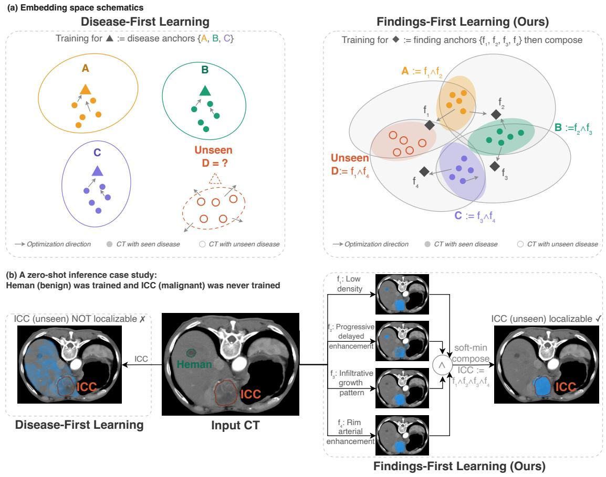
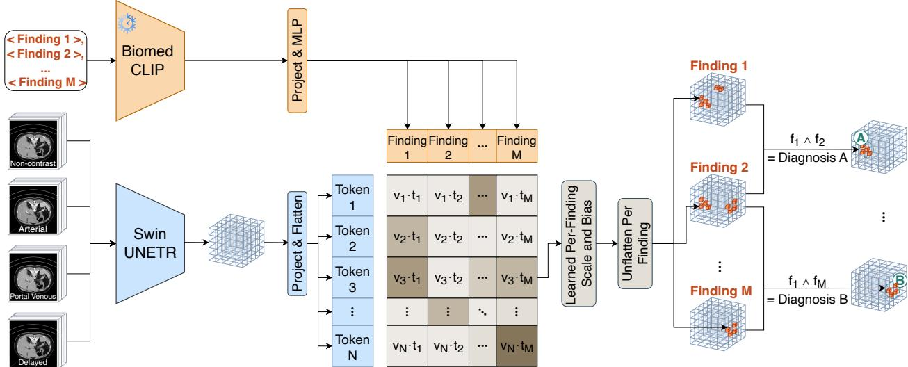
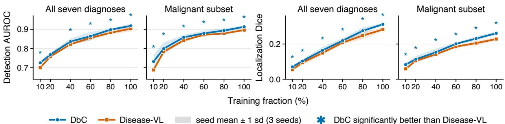
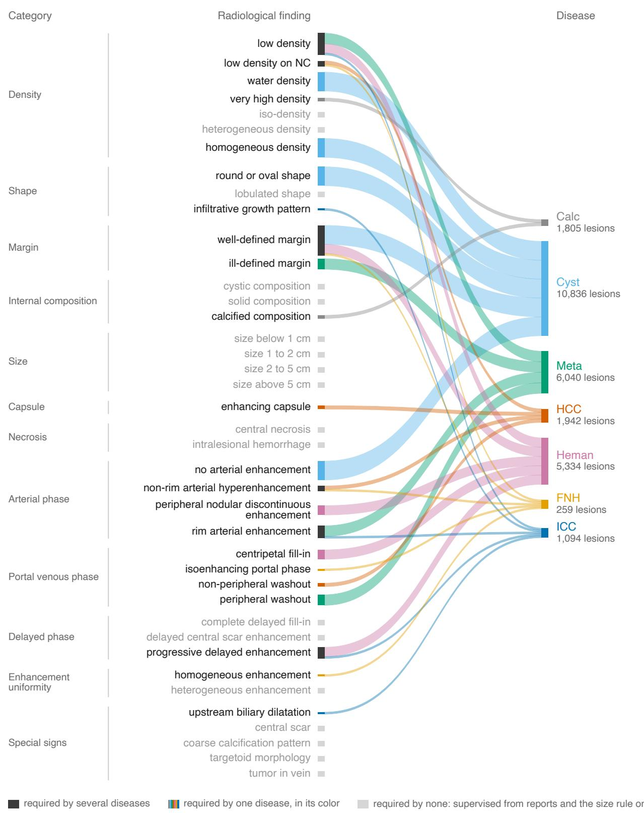
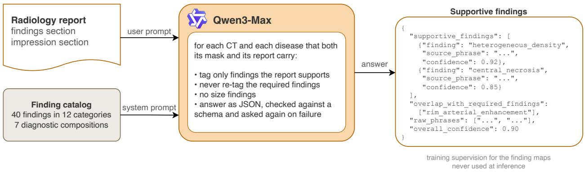
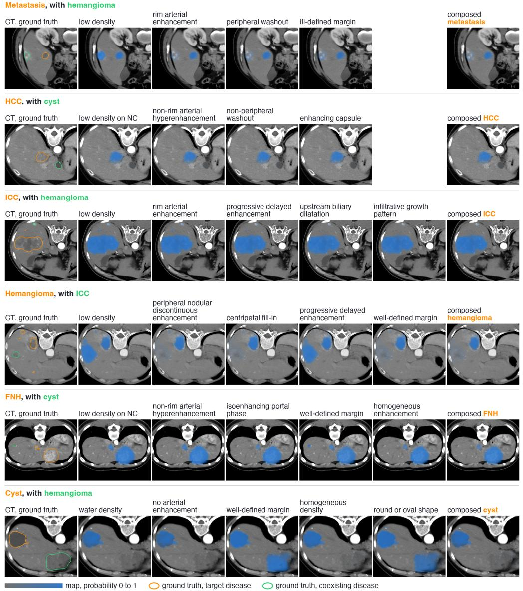

# Diagnosis by Composition: Detecting and Localizing Unseen Diseases by Composing Learned Radiological Findings

Kaihua Hou1, Wei Liu2, Yi Huang2, Hao Zhang3, Haibo Jin2, Yifei Sun4, Yuan Gao2, Zuoou Li5, Ling Zhang2, Ahmed Alaa1, Geoffrey H. Tison6, Xu Han7, Ke Yan2

1University of California, Berkeley 2Alibaba Group 3Fudan University 4Zhejiang University 5Imperial College London 6University of California, San Francisco 7Zhejiang Lab

## Abstract

Deep models for radiological diagnosis are typically trained to predict disease labels directly from images, which limits them to diseases seen during training and makes their decisions hard to interpret in radiologists’ terms. Radiology, however, proceeds from visual findings to disease through published guidelines that make this decision rule explicit, interpretable, and reproducible. We introduce diagnosis by composition (DbC), a representation learning framework that encodes this findings-first logic. DbC learns a vocabulary of radiological findings by aligning image features with the text embeddings of the findings, each finding represented as a dense map over the scan. A disease is defined by a set of required findings derived from its guidelines, and its diagnosis map is a fixed, parameter-free composition of the corresponding finding maps. Because the finding-to-disease mapping is derived from guidelines rather than learned, DbC is interpretable and auditable by design, can extend to new diseases by specifying their findings without retraining, and can diagnose unseen diseases by composing their findings. On multi-phase liver CT, DbC detects and localizes unseen diseases, rare diseases from a different institution, and an external cohort significantly better than all comparators, including models that align images with disease names. DbC also improves detection and localization in the fully supervised setting and remains superior across training-set sizes. Although demonstrated on liver CT, DbC applies wherever radiological guidelines define diseases through findings.

Code: https://anonymous.4open.science/r/DiagnosisByComposition

## 1 Introduction

Most machine learning models for radiological diagnosis are trained to predict a disease label directly from the image (Yasaka et al., 2018; Hamm et al., 2019). In this pattern, which we call disease-first, the disease is the unit of learning, and the visual findings a radiologist reasons about either never explicitly enter the model or are recovered from it afterwards (Wang et al., 2019). Such a model cannot explain a decision in a radiologist’s terms, and it is closed-set, with one output for each disease it was trained on. Vision-language aligned models, which bridge images with text in a shared space (Radford et al., 2021), appear to lift the closed-set limit, because a disease can be named at test time (Hamamci et al., 2026; Blankemeier et al., 2026; Du et al., 2024; Zhao et al., 2025; Rokuss et al., 2026). The image is still aligned with the name of the disease, however, and recent models aligned at the finer grain of individual anatomies (Shui et al., 2025) still construct representations around diagnosis targets.

Radiology itself is organized the other way around, in a pattern we call findings-first. A radiologist first identifies the visual findings in a scan, properties that are directly visible such as how dense a lesion is or how it takes up contrast, and then reads the disease as the combination of findings that defines it. For most diseases that combination is tracked in published radiological guidelines (Chernyak et al., 2018), which makes the diagnosis interpretable, reproducible, and teachable. Radiologists also learn in this order, trained to identify the findings first and to reason from them to diagnose (Accreditation Council for Graduate Medical Education, 2019; Hartung et al., 2020; European Society of Radiology, 2011; American College of Radiology, 2025), which is one reason they can take on a disease they rarely encountered, usually as a new combination of findings they already recognize.

  
Figure 1: Disease-first versus findings-first learning. (a) Disease anchors leave an unseen disease D without a trained anchor, while finding anchors express it as a composition. (b) With hemangioma (Heman) seen and ICC unseen in training, only DbC localizes the ICC, by composing four of its finding maps.

Here, we propose diagnosis by composition (DbC), a representation learning framework that builds this findings-first order into a model in three steps. First, the rule from findings to each disease is derived from published radiological guidelines by clinical experts on our team, who reviewed these guidelines and wrote the definitions of common liver diseases in one shared vocabulary of findings. Second, the model learns to recognize the findings by aligning image features at every location of the scan with the text embedding of each finding, supervised densely by the findings each disease requires and diversely by the further findings that reports record, with the loss computed on the findings alone. Third, at inference, a disease is diagnosed by localizing the findings its definition requires and combining the resulting finding maps with a fixed, parameter-free operation (Figure 1b).

fiDefining diseases as compositions over a shared finding vocabulary gives the DbC model three properties by design. Because a diagnosis is a combination of named finding maps, the model is interpretable and auditable finding by finding. Because a disease is added by stating the findings it requires, the model is extensible by declaration and reaches a new disease without retraining. And because the findings a disease requires can be recognized even when the disease never appeared in training, the model is zero-shot by composition (Figure 1a). Rigorous zero-shot experiments therefore can test whether the model has learned a reusable vocabulary of findings rather than a set of disease labels, and their results show that findingsfirst learning yields a more generalizable representation than disease-first learning. We make three main contributions in this work:

• We introduce diagnosis by composition (DbC), a findings-first representation learning framework for radiological diagnosis that is interpretable and auditable by design and extends to diseases never seen in training.

• We show that DbC localizes diseases never seen in training significantly better than every comparator, including models that align images with disease names.

• We show that this advantage extends to rare diseases and external institutions, and that DbC remains significantly better than its disease-first counterpart at every training-set size.

## 2 Related work

Medical vision-language representation learning. Contrastive pretraining aligns images and text in a shared space in which a category is recognized by the embedding of its name (Radford et al., 2021). Medical vision-language aligned models learn such spaces from biomedical figures (Zhang et al., 2025), chest radiographs (Tiu et al., 2022) and CT volumes (Hamamci et al., 2026; Blankemeier et al., 2026) paired with text, most often reports, at units as fine as image regions and report words (Huang et al., 2021; Wang et al., 2022), report entities (Wu et al., 2023) and anatomies (Shui et al., 2025), and multimodal large language models build report generation on their image encoders (Hamamci et al., 2026; Blankemeier et al., 2026). Language-driven dense prediction builds on this foundation and carries the match to pixels (Li et al., 2022) and to 3D medical volumes (Liu et al., 2023), and in the promptable interface of Segment Anything (Kirillov et al., 2023), SegVol (Du et al., 2024), SAT (Zhao et al., 2025) and VoxTell (Rokuss et al., 2026) return a region for a text prompt, even for a disease outside their training set. These dense models are the natural comparators of this work, since a lesion-level evaluation needs a map, and our matched ablation Disease-VL carries the scan-level matching of an image to a disease name down to the lesion level (Section 4.1). Across the family, a disease is anchored on its name or description, and the visual findings are learned only implicitly, as far as the paired text states them. Reports typically state few of the findings a lesion shows (Section 3.3), so what these models learn about findings is as sparse and noisy as the reports, whereas DbC supervises the findings explicitly and densely on the lesion masks from both the well-defined radiological guidelines and diverse clinical reports.

Concept bottleneck models and description-based inference. Concept bottleneck models predict named concepts and learn the mapping from them to each class from examples of that class (Koh et al., 2020), with the concepts later drawn from a language model or a vision-language space (Oikarinen et al., 2023; Yuksekgonul et al., 2023; Yang et al., 2023), so the class (i.e., diagnosis in this case) remains the anchor of learning. Diagnosis by composition shares the named intermediate layer but derives the mapping from findings to a disease from published radiological guidelines, uses a vocabulary that serves many diseases, and is evaluated on diseases the model never saw, a setting concept bottleneck models are not built for. Description-based methods score an image against language descriptions of a class (Menon and Vondrick, 2023), and in radiology Xplainer combines the scores that a pretrained vision-language aligned model gives the observations a radiologist looks for into a zero-shot diagnosis (Pellegrini et al., 2023), while CLEAR (Han et al., 2026) scores an image against observations mined from reports. The descriptive terms of these methods are found in clinical reports or scored by a pretrained model rather than optimized as training targets, whereas our findings are training targets that the model learns to localize.

## 3 Diagnosis by composition

## 3.1 Framework and inductive bias

Diagnosis by composition follows the two stages of radiological practice, learning to recognize the visual findings in a scan and reading a disease as the combination of findings that its guideline requires, with the rule derived from published radiological guidelines rather than learned from data.

Formally, let x be a CT and let $\mathcal { F } = \{ f _ { 1 } , \ldots , f _ { M } \}$ be a fixed vocabulary of radiological findings, each a named visual property that a radiologist would report. The model predicts one finding map per finding, $a _ { m } ( x ) \in [ 0 , 1 ] ^ { N }$ , the probability that $f _ { m }$ is present at each of N spatial tokens of the scan, and predicting these maps is its only trainable task. Each disease k is defined by its diagnostic composition $R _ { k } \subseteq { \mathcal { F } } .$ , the set of required findings that its guidelines define it by (Section 3.2). The diagnosis map $S _ { k } ( x )$ combines the maps of these findings with an operator that behaves like a logical AND, so that a token scores high for disease k only where every required finding scores high. We use the parameter-free soft minimum, taken token by token and written $\Lambda .$

$$
S _ { k } ( x ) = \bigwedge _ { m \in { \cal R } _ { k } } a _ { m } ( x ) = \sum _ { m \in { \cal R } _ { k } } a _ { m } ( x ) \frac { \exp \bigl ( - \beta a _ { m } ( x ) \bigr ) } { \sum _ { j \in { \cal R } _ { k } } \exp \bigl ( - \beta a _ { j } ( x ) \bigr ) } ,\tag{1}
$$

where the sharpness $\beta$ controls how strict the operator is (we set $\beta = 1 0 )$ . Figures and Table 6 write compositions with the same symbol. The operator has no learned parameters, so a diagnosis map means exactly what its diagnostic composition states, and as a map over the scan it localizes a disease while detecting it.

At inference, a disease is diagnosed from the required findings of its diagnostic composition alone. The detection score of the disease is the largest value of its diagnosis map on the scan, and the connected components of the thresholded map are the predicted lesions. Zero-shot diagnosis is the same computation for a disease with no training examples, whether withheld from training or outside the taxonomy, with no new output and no retraining, and Section 4.3 explains how each compared model reaches such a disease.

## 3.2 Finding vocabulary and diagnostic compositions for liver CT

We instantiate the framework for multi-phase liver CT, where a study may contain any of four contrast phases (non-contrast, arterial, portal venous and delayed) and the model uses whichever are available. Radiologists on our team who specialize in liver imaging defined the finding vocabulary and the diagnostic compositions by reviewing published radiological guidelines and reference reviews (Chernyak et al., 2018; Galle et al., 2018; Marrero et al., 2018), with the sources for each disease listed in Appendix B. The resulting finding catalog lists the $M = 4 0$ findings of the vocabulary in twelve categories, among them density, margin and the pattern of contrast enhancement in each phase (Table 5). The catalog was built to cover the six common liver diseases, which are those in our internal data, and Section 4.4 tests its robustness on two rare diseases beyond them.

A diagnostic composition is the definition of a disease derived from its guidelines and written in this vocabulary, the findings that the disease most typically shows and that must all be present. Through the soft minimum it is at once the clinical definition of the disease and the rule the model evaluates, for a seen disease and an unseen one alike, and it also labels every training lesion of the disease (Section 3.3). Hepatocellular carcinoma (HCC), for example, typically requires low density on the non-contrast phase, non-rim arterial hyperenhancement, non-peripheral washout and an enhancing capsule, and each of the seven diagnoses we model requires two to five findings (Table 6). The compositions share findings, so one vocabulary serves every disease and a finding such as low density is supervised by the lesions of every disease that requires it (Figure 4).

  
Figure 2: The DbC model. Visual embeddings $v _ { n }$ are matched to the text embeddings $t _ { m }$ of the finding names (Eq. 2), and each diagnosis map is the soft min of its required finding maps (Eq. 1).

## 3.3 Finding supervision from guidelines and reports

Each training lesion is labeled with findings from three complementary sources, which its mask places on the token grid (Appendix C). First, every lesion receives a set of required findings of its disease, derived from the radiological guidelines by clinical experts on our team, whether or not its report mentions them. The required findings give each disease a fixed composition grounded in authoritative clinical knowledge, but they also give every lesion of the disease the same findings, whereas the realistic mapping between findings and diseases is not deterministic and a lesion may show findings that are not typical of its disease (intra-disease variation). Thus, the second source of findings is the report, long mined for labels (Irvin et al., 2019; Jain et al., 2021; Adams et al., 2023), which captures this diversity. Qwen3-Max (Qwen Team, 2025) is used to extract the supportive findings of each lesion, the catalog findings that its report records beyond the required ones. Extraction from reports alone would not produce a high-quality set of findings, however, since radiologists seldom report the complete set of visual findings they observe. In our data, a lesion is associated with only about 1.2 radiological findings on average in the findings section of CT reports, too sparse a signal to learn a vocabulary of findings from, which largely limits models supervised by reports alone (Section 2). The guideline-derived required findings thus make the supervision dense, and the report-extracted supportive findings make it diverse. Lastly, each lesion also receives one of four size findings, derived from its mask dimensions. All three types of finding labels train the finding maps of each lesion, but only the required findings form the diagnostic composition used at inference.

## 3.4 Dense finding localizer

In the model that predicts the finding maps (Figure 2), a four-channel SwinUNETR encoder (Hatamizadeh et al., 2022; He et al., 2023) reads the available contrast phases of a CT together, with an all-zero channel for any phase that was not acquired (Appendix A), and its dense output is projected and flattened to one embedding $v _ { n }$ per token $n .$ Each finding is represented by its name, placed in a fixed prompt and encoded once by a frozen BiomedCLIP text encoder (Zhang et al., 2025) into a text embedding $t _ { m } .$ , which a small learned adapter ϕ maps into the space of the token embeddings. The cosine similarity of $v _ { n }$ and $\phi ( t _ { m } )$ , rescaled by a learned scale $s _ { m }$ and bias $b _ { m }$ for each finding and passed through a sigmoid, gives the probability of finding m at token $n ,$

$$
a _ { m n } = \sigma \left( s _ { m } \frac { v _ { n } ^ { \top } \phi ( t _ { m } ) } { \| v _ { n } \| _ { 2 } \| \phi ( t _ { m } ) \| _ { 2 } } + b _ { m } \right) ,\tag{2}
$$

so each finding map is produced the way a vision-language aligned model recognizes a category, by matching image features to the text embedding of its name (Radford et al., 2021), here at every token and trained with dense labels rather than image-text pairs. Keeping the text encoder frozen holds every finding in one shared space, which lets a diagnostic composition name any finding in the vocabulary, including one needed only for a new disease. The 40 finding maps are trained together under a single Dice-focal loss (Lin et al., 2017; Milletari et al., 2016), with the readout initialization and the full recipe in Appendix D.

## 4 Experiments

## 4.1 Setup

Data and split. We curated 15,609 multi-phase liver CTs with lesion masks and radiology reports from a single institution, split at the patient level into 12,487 training, 1,559 validation and 1,563 test CTs (Appendix A). Each CT may carry one or more of six liver diseases, hepatocellular carcinoma (HCC), intrahepatic cholangiocarcinoma (ICC), metastasis, hemangioma, focal nodular hyperplasia (FNH) and cyst. Calcification is a minor additional label that also enters the macro averages, and a CT with no lesion is a negative. Every experiment selects checkpoints on the validation split.

Metrics and significance. We evaluate detection, whether a disease is present, and localization, where its lesions are, for every disease and as a macro mean over diseases (Appendix F). Detection is scored per CT by AUROC, average precision (AP) and sensitivity at 95% specificity, and localization per lesion by the Dice, IoU and coverage of the best-matching predicted lesion and by mask average precision at $\mathrm { I o U } \geq 0 . 5$ $( \mathrm { A P _ { 5 0 } } )$ (Lin et al., 2014). Every metric is reported with a 95% confidence interval from a CT-level bootstrap with 2,000 replicates, in which every model receives the same resampled CTs, and one model is significantly better than another when the interval of their paired difference lies above zero.

Experiment settings. We train and evaluate under two regimes. In the supervised regime the model was trained on the disease it is asked to diagnose, and in the zero-shot regime it received no supervision for that disease and saw no CT that contains it. We create the zero-shot regime by leave-one-disease-out (LODO), removing from training and eval every CT that carries a given disease and training a separate model on the rest, so that this disease is unseen and the others are seen.

• Fully supervised (supervised, internal, Section 4.2). Every model is trained on the full training data and scored on the 1,563 internal test CTs.

• Unseen diseases (zero-shot, internal, Section 4.3). Each of the six diseases is made unseen in turn by LODO and scored on its test CTs against those without it.

• Rare diseases from a different institution (zero-shot, external, Section 4.4). Abscess and hepatoblastoma, two rare liver diseases outside our taxonomy and in no split, are scored from the fully supervised checkpoint against CTs without a liver lesion (Appendix G).

Table 1: Fully supervised diagnosis on the internal test set, with 95% confidence intervals. Bold marks the best value, ∗ a significant advantage over every comparator, and † a matched ablation.
<table><tr><td></td><td colspan="4">Localization</td><td colspan="3">Detection</td></tr><tr><td>Model</td><td>Dice</td><td>IoU</td><td>Coverage</td><td>AP50</td><td>AUROC</td><td>AP</td><td>Sens.@ 95% Spec.</td></tr><tr><td>Seg Vol</td><td>.055 [.039, .076]</td><td>.037[.026, .053]</td><td>.088[.062, .124]</td><td>.000[.000, .000]</td><td>.806[.759, .848]</td><td>.284[.213, .377]</td><td>.354[.304, .408]</td></tr><tr><td>SAT</td><td>.190[.156, .228]</td><td>.152[.124, .184]</td><td>.185[.150, .225]</td><td>.000 [.000, .001]</td><td>.900 [.888, .912]</td><td>.528[.484, . 582]</td><td>.592[.553, .630]</td></tr><tr><td>VoxTell</td><td>.096[.075, .124]</td><td>.069[.054, .091]</td><td>.200[.174, .230]</td><td>.000 [.000, .000]</td><td>.810[.794, .825]</td><td>.230[.215, .258]</td><td>.260[.205, .303]</td></tr><tr><td>Disease-V†</td><td>.288[.255, .326]</td><td>.233[.205, 266]</td><td>.287[.254, .326]</td><td>.153[.117, .212]</td><td>.915[.903, .928]</td><td>.628[.578, . 678]</td><td>.678[.633, .714]</td></tr><tr><td>Disease-VL†</td><td>.271 [.235, .311]</td><td>.220[.189, .255]</td><td>.274[.236, .318]</td><td>.137[.116, 190]</td><td>.916[.904, .927]</td><td>.582[.538, .642]</td><td>.646[.599, .700]</td></tr><tr><td>DbC (ours)</td><td>.313[.281, .349] .253[.226, .284] .314[.282, .351] .163[.128, .218] .931* [.920, .941] .663[.615, .708] .699 [.659, .789]</td><td></td><td></td><td></td><td></td><td></td><td></td></tr></table>

• External transfer (both regimes, external, Section 4.4). The public MCT-LTDiag cohort (Wu et al., 2026) holds four diseases from our taxonomy (Appendix G), each scored from the fully supervised checkpoint, which trained on the four, and from their respective LODO checkpoints, which did not.

• Data scaling (supervised, internal, Section 4.5). DbC and Disease-VL are repeatedly and independently trained on nested subsets of 10˜100% of the train set with three seeds each.

Comparators. Every comparator is trained on the same CTs, splits and compute as DbC under the same protocol, with its checkpoint selected on the same validation split, so that only the design differs. We aim for comparator models on lesion-level detection and localization, since it not only closely matches our modeling setup, but also demonstrates how precisely a learned representation is grounded in local visual evidence, which is an important test of its quality.

• Matched ablations (disease-first, on the encoder of DbC). Disease-VL and Disease-V share the image encoder, input, loss and optimizer of DbC but predict disease maps directly instead of composing them from findings, isolating the effect of learning findings-first. Disease-VL aligns the same model with disease names instead of finding names, so it can be prompted with unseen diseases. Disease-V drops the language arm, a closed-set vision-only control that appears only in the supervised comparison.

• Published baselines (disease-first vision-language aligned models). SegVol (Du et al., 2024), SAT (Zhao et al., 2025) and VoxTell (Rokuss et al., 2026) return a region for a text prompt, and each is fine-tuned from its released checkpoint on our data (Appendix E).

## 4.2 Fully supervised diagnosis

With every disease supervised, composing diagnoses from findings does not cost accuracy and in fact improves it. DbC is the best of the six systems on every localization and detection metric, and its detection is significantly better than every comparator (AUROC, Table 1). Because DbC also improves on its two matched ablations under identical data and compute, the gain comes from composing findings rather than from the encoder or the architecture. These results suggest that findings-first learning produces a better representation in the setting where every evaluated disease is supervised during training.

## 4.3 Unseen diseases by composition

DbC and every comparator in Table 2 are vision-language aligned models, and all of them reach an unseen disease through the principle that lets CLIP recognize categories it was never trained on (Radford et al., 2021). CLIP embeds images and text in a shared space and recognizes a category by matching an image to the text embedding of its name, so that in a well-aligned space an image of a new category lands near its name although the two were never paired. The models compared here make this match at every location, producing a map rather than a single score, and none is retrained for the unseen disease. What differs between them is the text that the image is matched with, the anchors of Figure 1a. A disease-first model matches image features with the embedding of the name of the unseen disease, while DbC matches them with the embeddings of its required findings and composes the resulting maps with the soft minimum. For DbC, every disease has some required findings that belong to no other disease (required or supportive), so every LODO run asks it to zero-shot localize at least one required finding with no direct supervision to compose.

Table 2: Zero-shot diagnosis of unseen diseases under leave-one-disease-out. Notation as in Table 1.
<table><tr><td colspan="2"></td><td colspan="3">Localization</td><td colspan="3">Detection</td></tr><tr><td>Unseen disease</td><td>Model</td><td>Dice</td><td>IoU</td><td>AP50</td><td>AUROC</td><td>AP</td><td>Sens.@ 95% Spec.</td></tr><tr><td rowspan="5">HCC</td><td>SegVol</td><td>.035 [.027, .043]</td><td>.020[.016, .025]</td><td>.000 [.000, .000]</td><td>.757 [.735, .779]</td><td>.560 [.522, .600]</td><td>.197[.139, .245]</td><td></td></tr><tr><td>SAT</td><td>.215[.185, 247]</td><td>.161[.138, 188]</td><td>.000[.000, .002]</td><td>.809 [.790, .827]</td><td>.607[.566, .648]</td><td>.212[.132, .309]</td><td></td></tr><tr><td>VoxTell</td><td>.206[.175, .240]</td><td>.157[.133, .182]</td><td>.000 [.000, .000]</td><td>.811[.792, .829]</td><td>.528[.496, .561]</td><td>.018[.007, .030]</td><td></td></tr><tr><td>Disease-VL†</td><td>.249 [.217, .283]</td><td>.195[.168, .225]</td><td>.089[.066, .124]</td><td>.691[.655, .723]</td><td>.624[.575, .674]</td><td></td><td>.092[.034, .175]</td></tr><tr><td>DbC</td><td></td><td></td><td></td><td>.376* [.328, 423] .311* [.271, .353] .158* [.128, 195] .834* [.817, .851]</td><td>.577[.542, .614]</td><td></td><td>.074[.040, .142]</td></tr><tr><td rowspan="5">ICC</td><td>SegVol</td><td>.065 [.057, .074]</td><td>.037[.032, .042]</td><td>.000 [.000, .000]</td><td>.835 [.816, .853]</td><td>.447[.406, .491]</td><td></td><td>.106[.078, .138]</td></tr><tr><td>SAT</td><td>.206 [.180, .238]</td><td>.147[.126, 169]</td><td>.000 [.000, .000]</td><td>.804[.782, .824]</td><td>.420[.381, .463]</td><td></td><td>.089[.051, .131]</td></tr><tr><td>VoxTell</td><td>.292[.258, 329]</td><td>.222[.195, .251]</td><td>.000[.000, .000]</td><td>.870[.854, .885]</td><td>.501[.460, . 547]</td><td></td><td>.113[.076, .173]</td></tr><tr><td>Disease-VL†</td><td>.347[.315, 378]</td><td>.263[.240, .290]</td><td>.080[.061, .107]</td><td>.828 [.799, .856]</td><td>.711[.659, .764]</td><td></td><td>.105[.017, .302]</td></tr><tr><td>DbC</td><td></td><td></td><td></td><td>.394* [.358, 433] .321* [.292, .354] .154* [.128, .192] .932* [.920, .944] .767*[.720, .810] .578*[.508, .642]</td><td></td><td></td><td></td></tr><tr><td rowspan="5">Metastasis</td><td>SegVol</td><td>.021[.017, .026]</td><td>.012[.010, .015]</td><td>.000 [.000, .000]</td><td>.731[.706, .756]</td><td>.461[.421, .504]</td><td></td><td>.131[.089, .177]</td></tr><tr><td>SAT</td><td>.147[.127, .170]</td><td>.110[.093, .128]</td><td>.009 [.004, .016]</td><td>.828 [.809, .846]</td><td>.586[.541, .632]</td><td></td><td>.208[.164, .281]</td></tr><tr><td>VoxTell</td><td>.013 [.008, .019]</td><td>.009 [.005, .013]</td><td>.000 [.000, .000]</td><td>.724[.701, .746]</td><td>.405[.373, .439]</td><td>.040[.022, .068]</td><td></td></tr><tr><td>Disease-VL†</td><td>.098[.082, .117]</td><td>.074[.062, .090]</td><td>.034[.025, .050]</td><td>.765 [.730, .797]</td><td>.617[.558, . 678]</td><td></td><td>.096[.044, .262]</td></tr><tr><td>DbC</td><td></td><td></td><td></td><td>.165* [.143, .192] .131*[.112, 154] .063* [.050, .084] .846* [.828, 862]</td><td>.624[.579, .667]</td><td></td><td>.290* [.225, .361]</td></tr><tr><td rowspan="5"></td><td>SegVol</td><td>.051[.047, .055]</td><td>.029[.027, .032]</td><td>.000 [.000, .000]</td><td>.764[.746, .783]</td><td>.705 [.677, .733]</td><td></td><td>.101[.062, .163]</td></tr><tr><td>SAT</td><td>.241[.227, .257]</td><td>.176[.165, .188]</td><td>.000[.000, .001]</td><td>.714[.695, .733]</td><td>.724[.699, .749]</td><td></td><td>.302[.235, .333]</td></tr><tr><td>Hemangioma VoxTell</td><td>.094[.087, .102]</td><td>.059[.053, .064]</td><td>.000 [.000, .000]</td><td>.807[.789, . 824]</td><td>.783[.757, .808]</td><td>.249 [.187, .335]</td><td></td></tr><tr><td>Disease-VL†</td><td>.133[.121, 146]</td><td>.099[.090, .110]</td><td>.052[.041, .064]</td><td>.776[.747, .804]</td><td>.822[.790, .852]</td><td>.166 [.119, .258]</td><td></td></tr><tr><td>DbC</td><td></td><td></td><td></td><td>.332*[.315, .351] .266* [.252, .282] .169*[.152, 191] .839* [.823, .855]</td><td>.801 [.777, .825]</td><td></td><td>.240[.202, .303]</td></tr><tr><td rowspan="5">FNH</td><td>SegVol</td><td>.048 [.029, .075]</td><td>.028[.016, .045]</td><td>.000[.000, .000]</td><td>.796[.756, .832]</td><td>.135[.103, .177]</td><td></td><td>.088 [.040, .202]</td></tr><tr><td>SAT</td><td>.150[.098, .223]</td><td>.106[.067, .160]</td><td>.000 [.000, .000]</td><td>.511[.457, .564]</td><td>.061[.045, .091]</td><td></td><td>.044[.010, .098]</td></tr><tr><td>VoxTell</td><td>.145 [.100, .207]</td><td>.093[.062, .135]</td><td>.000 [.000, .000]</td><td>.713[.674, .753]</td><td>.089 [.071, .110]</td><td></td><td>.011[.000, .076]</td></tr><tr><td>Disease-VL†</td><td>.035[.017, .061]</td><td>.022[.009, .041]</td><td>.000[.000, .001]</td><td>.532[.476, .585]</td><td>.121[.096, .152]</td><td></td><td>.000[.000, .000]</td></tr><tr><td>DbC</td><td>.265* [.182, .375]</td><td>.212*[.140, .305]</td><td>].067* [.034, 137]</td><td>.801[.764, .837]</td><td>.165[.118, .231]</td><td></td><td>.198*[.117, .294]</td></tr><tr><td rowspan="5">Cyst</td><td>SegVol</td><td>.001[.001, .002]</td><td>.001 [.000, .001]</td><td>.000 [.000, .000]</td><td>.734[.716, .752]</td><td>.735 [.710, .761]</td><td></td><td>.156[.115, .207]</td></tr><tr><td>SAT</td><td>.032[.028, .037]</td><td>.024[.020, .027]</td><td>.000[.000, .000]</td><td>.803[.786, .819]</td><td>.807[.785, . 827]</td><td></td><td>.246[.198, .296]</td></tr><tr><td>VoxTell</td><td>.001[.000, .002]</td><td>.001[.000, .001]</td><td>.000 [.000, .000]</td><td>.775[.757, .793]</td><td>.750[.725, .776]</td><td></td><td>.139[.111, .180]</td></tr><tr><td>Disease-VL†</td><td>.015 [.011, .018]</td><td>.010[.008, .012]</td><td>.000 [.000, .001]</td><td>.689 [.655, .721]</td><td>.808[.775, .839]</td><td></td><td>.099 [.061, .189]</td></tr><tr><td>DbC</td><td></td><td>.059*[.053, .065] .042* [.037, .046] .006* [.003, .012]</td><td></td><td>.809[.793, .825]</td><td>.798[.774, .821]</td><td></td><td>.257[.195, .313]</td></tr></table>

Composing generalizes to all six unseen diseases, and DbC localizes each significantly better than every comparator and detects it better than every comparator, significantly so for four of the six (Table 2). Disease-VL makes the contrast between disease-first and findings-first representation learning explicit. It shares the encoder structure, data, and compute of DbC, and it detects FNH at an AUROC of .532, close to chance, and HCC at .691, and localizes cyst at a Dice of .015.

Two intuitions may help explain why aligning the image with findings transfers where aligning it with disease names does not. Disease names may carry clinical meaning more than visual evidence, whereas findings name what is visible. The relations among finding terms in the language space may also mirror how the findings relate in appearance more closely than the relations among disease names do, which would give the image features a clearer structure to align with. If “delayed central scar enhancement” were unseen while “progressive delayed enhancement” and “central scar” were seen, for example, a model aligned with the latter two could plausibly match the new phrase to the right image regions, whereas a disease-first model trained on

Table 3: Rare diseases from a different institution, scored against CTs without a liver lesion.
<table><tr><td>Rare</td><td></td><td colspan="2">Localization</td><td colspan="3">Detection</td></tr><tr><td>disease</td><td>Model</td><td>Dice</td><td>IoU</td><td>AUROC</td><td></td><td>AP</td></tr><tr><td rowspan="5">Abscess</td><td>SegVol</td><td>.051[.042, .060]</td><td>.027[.022, .033]</td><td>.815[.767, .863]</td><td></td><td>.751[.676, .826]</td></tr><tr><td>SAT</td><td>.174[.119, .231]</td><td>.097[.063, .140]</td><td>.789 [.740, .836]</td><td></td><td>.782[.721, .837]</td></tr><tr><td>VoxTell</td><td>.094[.069, .123]</td><td>.066[.048, .086]</td><td></td><td>.781 [.731, .829]</td><td>.799 [.742, .848]</td></tr><tr><td>Disease-VL†</td><td>.170[.135, .211]</td><td>.113[.087, .145]</td><td></td><td>.830[.794, .861]</td><td>.840[.800, .893]</td></tr><tr><td>DbC</td><td>.238*[.203, .284]</td><td>.163*[.136, .196]</td><td></td><td>.890*[.851, .924]</td><td>.865* [.807, .916]</td></tr><tr><td rowspan="5">Hepatoblastoma</td><td>SegVol</td><td>.106[.063, .155]</td><td>.070[.039, .104]</td><td>.634[.543, .719]</td><td></td><td>.290[.186, .426]</td></tr><tr><td>SAT</td><td>.142[.095, .199]</td><td>.092[.059, .130]</td><td></td><td>.467[.392, .542]</td><td>.222[.149, .295]</td></tr><tr><td>VoxTell</td><td>.118[.075, .169]</td><td>.071[.044, .105]</td><td></td><td>.662[.605, .721]</td><td>.306[.260, .360]</td></tr><tr><td>Disease-VL†</td><td>.053[.027, .086]</td><td>.032[.015, .053]</td><td></td><td>.558[.444, .665]</td><td>.254[.172, .376]</td></tr><tr><td>DbC</td><td>.285* [.222, .355]</td><td>.185* [.142, .235]</td><td></td><td>.829* [.772, .883]</td><td>.456* [.207, . 595]</td></tr></table>

Table 4: External transfer to MCT-LTDiag from the zero-shot and full-training checkpoints.
<table><tr><td rowspan="2">Setup</td><td rowspan="2">Model</td><td colspan="2">Localization</td><td colspan="2">Detection</td></tr><tr><td>Dice</td><td>IoU</td><td>AUROC</td><td>AP</td></tr><tr><td rowspan="5">Zero-shot</td><td>SegVol</td><td>.044[.039, . 051]</td><td>.026 [.023, .030]</td><td>.489[.458, .520]</td><td>.245[.232, .264]</td></tr><tr><td>SAT</td><td>.094[.083, .109]</td><td>.065 [.056, .076]</td><td>.528 [.497, .559]</td><td>.281[.259, .313]</td></tr><tr><td>VoxTell</td><td>.064[.055, .075]</td><td>.042 [.036, .050]</td><td>.466[.441, .490]</td><td>.238[.227, .254]</td></tr><tr><td>Disease-VL†</td><td>.103[.091, 119]</td><td>.073[.065, .085]</td><td>.593[.560, . 625]</td><td>.278[.263, .302]</td></tr><tr><td>DbC</td><td>.173* [.156, .195]</td><td>.134* [.120, .152]</td><td>.639*[.606, .673]</td><td>.326 [.306, 358]</td></tr><tr><td rowspan="5">Full training</td><td>SegVol</td><td>.133[.119, .150]</td><td>.098 [.087, .111]</td><td>.614[.586, .642]</td><td>.381[.351, .419]</td></tr><tr><td>SAT</td><td>.088[.076, .101]</td><td>.061 [.052, .071]</td><td>.596[.569, .623]</td><td>.350[.324, .387]</td></tr><tr><td>VoxTell</td><td>.134[.121, .151]</td><td>.094[.085, .107]</td><td>.601[.575, .627]</td><td>.370[.341, .406]</td></tr><tr><td>Disease-VL†</td><td>.183[.168, .205]</td><td>.142[.130, .160]</td><td>.716[.692, .740]</td><td>.516[.487, .552]</td></tr><tr><td>DbC</td><td>.286*[.269, .310]</td><td>.247* [.233, .267]</td><td>.743*[.718, .766]</td><td>.571* [.534, .616]</td></tr></table>

“hepatocellular carcinoma” and “cholangiocarcinoma” may find it harder to localize a lesion prompted as “metastasis”.

## 4.4 Rare diseases from a different institution and external transfer

The rare-disease experiment is harder than internal leave-one-disease-out in two ways. Two diseases are withheld at once, and because our finding catalog was built only for the six internal diseases (Section 3.2), it also tests whether the catalog and its compositions reach diseases they were never designed for. The radiologists on our team defined each composition from published imaging criteria, as for the internal diseases and with no reference to the model or its outputs (Table 6). Evaluated on the checkpoint trained on the internal diseases, which never saw either disease, DbC is significantly better than every comparator on every metric for both rare diseases (Table 3). Moreover, on the public external MCT-LTDiag cohort, DbC is significantly better than every comparator in both regimes at localizing the lesions and at telling the diseases apart (Table 4, Appendix H). These results further support the robustness and generalizability of the DbC framework.

## 4.5 Data scaling

A final experiment scales the training data. DbC and its disease-first ablation Disease-VL are trained on nested subsets of the training data, each containing all diseases. At every fraction, each model is trained three times independently, with seeds 42, 43 and 44 setting both the sampled subset and the initialization, and every run is scored on the same internal test set (Figure 3). Both improve as the data grows, and DbC is significantly better than Disease-VL at almost every fraction across all diagnoses. This advantage, consistent over the three runs at every fraction, shows that the DbC framework scales with data. The relative gain is largest at the smallest fraction, which fits the view that supervising findings across diseases uses the data more efficiently than supervising diseases.

  
Figure 3: Data scaling, DbC against Disease-VL. A star marks a significant advantage of DbC.

## 5 Discussion

The results of Section 4 can be read through the clinical order that DbC builds in. Radiologists first learn to recognize findings and then read each disease as the combination of findings that its guidelines define, and DbC learns in the same order. A radiologist recognizes a rarely seen disease as a new combination of familiar findings, and DbC likewise composes an unseen or rare disease from findings learned on other diseases, localizing such diseases significantly better than every comparator. Findings describe what is visible and recur across diseases and institutions, which fits the transfer of the same representation to an external cohort. Every labeled lesion also supervises findings that several diseases share, so the same data inform many diagnoses at once, and DbC is better than its disease-first counterpart at every training-set size, most of all when data are scarce. Each of these advantages is measured side by side with the matched ablations, which isolate composing as their source. Read as representation learning, which we offer as a hypothesized interpretation, the results fit the view that a reusable vocabulary of findings generalizes better than a set of disease labels. The same view suggests that DbC should improve as more diseases and findings are incorporated in training, since each added disease supervises its findings on new lesions, much as a radiologist’s expertise grows with every disease learned.

A findings-first model is interpretable because its explanation is the computation itself, a diagnosis composed from named finding maps that a radiologist can check finding by finding. Figure 6 shows such maps on test CTs, where each composed map follows the findings specific to its disease. Such an interpretable and auditable representation may also serve generative models on CT. Multimodal large language models (LLMs) that write reports or answer clinical questions are commonly built on the image encoder of a vision-language aligned model (Hamamci et al., 2026; Blankemeier et al., 2026), and the generalizable representation that DbC learns by aligning images with findings could serve as such an encoder. A report states the findings before the impression they support, the order in which DbC reaches a diagnosis, so an LLM conditioned on the finding maps could generate clinical reports with localized finding maps, which will likely make the reports more visually faithful and verifiable. LLM reasoning could likewise build on the finding maps, an intermediate more granular than a disease label and grounded in the image, and we leave these extensions to future work.

This study has two main limitations. First, results are shown on 3D CTs for liver disease, with training data from a single institution and seven diagnoses. The framework itself is not specific to the liver, however. Most radiological diagnosis is guideline-based, so DbC can extend to other organs and diseases through a broader catalog of named findings and disease compositions, without changing the model, and we hope these results encourage further work to apply diagnosis by composition as an interpretable and auditable scheme beyond the liver. The second concerns the compositions, which experts derive from published guidelines and which require all of their findings. They label every lesion of a disease with the findings the disease typically shows, the reports add the further findings that radiologists recorded, and the finding labels of a lesion are therefore as complete as these two sources. Though combining them already supervises findings more densely and diversely than reports or medical terminologies alone (the sources of much prior work), richer composition rules could follow atypical presentations more closely still.

## 6 Conclusion

Radiologists name what they see before they name the disease, and published radiological guidelines define each disease as a combination of what can be seen. Diagnosis by composition builds that order into a model that learns a vocabulary of findings by aligning image features with their text embeddings and derives the finding-to-disease rule from the guidelines. On multi-phase liver CT, the model is interpretable and auditable by design, and composing diagnoses from findings is better than predicting them directly at every training-set size and significantly better than every comparator for diseases with no training examples, including rare diseases from a different institution

## AI use statement

Our method uses a large language model, Qwen3-Max, to extract supportive findings from radiology reports as training supervision (Section 3.3 and Appendix C), and a radiologist verified a random sample of its outputs. Beyond this component of the method, we used generative AI tools to organize and clean up our code base and to polish the text of this paper. The authors reviewed all AI-assisted code and text and take ful responsibility for the content of this work.

## Ethics statement

This study uses retrospective clinical CT studies and their radiology reports. The data were collected under institutional review board approval with a waiver of informed consent for retrospective analysis, and no individual can be identified from the reported results. The proposed model is a research prototype for methodological study and is not intended for clinical use without prospective validation and regulatory clearance.

## Reproducibility statement

Our code for reproducing the method is available at https://anonymous.4open.science/r/ DiagnosisByComposition/. The method, training recipe and evaluation protocol are described in Section 3 and Appendices A to F. The training and evaluation data are private clinical data and are not released. The external cohort we evaluate on, MCT-LTDiag, is publicly available under a CC0 license (Wu et al., 2026).

## References

Accreditation Council for Graduate Medical Education. Diagnostic radiology milestones. Second revision, version 2.2, 2019.

Lisa C. Adams, Daniel Truhn, Felix Busch, Avan Kader, Stefan M. Niehues, Marcus R. Makowski, and Keno K. Bressem. Leveraging GPT-4 for post hoc transformation of free-text radiology reports into structured reporting: A multilingual feasibility study. Radiology, 307(4):e230725, 2023. doi: 10.1148/ radiol.230725.

Domenico Alvaro, Gregory J. Gores, Joel Walicki, Cesare Hassan, Gonzalo Sapisochin, Mina Komuta,¨ Alejandro Forner, Juan W. Valle, Andrea Laghi, Sumera I. Ilyas, Joong-Won Park, Robin K. Kelley, Maria Reig, and Bruno Sangro. EASL-ILCA clinical practice guidelines on the management of intrahepatic cholangiocarcinoma. Journal ofHepatology, 79(1):181–208, 2023. doi: 10.1016/j.jhep.2023.03.010.

American College of Radiology. LI-RADS CT/MRI v2018 Core. Liver Imaging Reporting and Data System, version 2018, 2018.

American College of Radiology. ACR practice parameter for communication of diagnostic imaging findings. Practice parameter, revised 2025 (Resolution 9), 2025.

Louis Blankemeier, Ashwin Kumar, Joseph Paul Cohen, Jiaming Liu, Longchao Liu, Dave Van Veen, Syed Jamal Safdar Gardezi, Hongkun Yu, Magdalini Paschali, Zhihong Chen, et al. Merlin: A computed tomography vision–language foundation model and dataset. Nature, 652(8112):1318–1328, 2026. doi: 10.1038/s41586-026-10181-8.

M. Jorge Cardoso, Wenqi Li, Richard Brown, Nic Ma, Eric Kerfoot, Yiheng Wang, Benjamin Murrey, Andriy Myronenko, Can Zhao, Dong Yang, et al. MONAI: An open-source framework for deep learning in healthcare. arXiv preprint arXiv:2211.02701, 2022.

Victoria Chernyak, Kathryn J. Fowler, Aya Kamaya, Ania Z. Kielar, Khaled M. Elsayes, Mustafa R. Bashir, Yuko Kono, Richard K. Do, Donald G. Mitchell, Amit G. Singal, An Tang, and Claude B. Sirlin. Liver Imaging Reporting and Data System (LI-RADS) version 2018: Imaging of hepatocellular carcinoma in at-risk patients. Radiology, 289(3):816–830, 2018. doi: 10.1148/radiol.2018181494.

Joost Drenth, Thijs Barten, Hermien Hartog, Frederik Nevens, Richard Taubert, Roser Torra Balcells, Valerie´ Vilgrain, and Tobias Bottler. EASL clinical practice guidelines on the management of cystic liver diseases.¨ Journal ofHepatology, 77(4):1083–1108, 2022. doi: 10.1016/j.jhep.2022.06.002.

Yuxin Du, Fan Bai, Tiejun Huang, and Bo Zhao. SegVol: Universal and interactive volumetric medical image segmentation. In Advances in Neural Information Processing Systems (NeurIPS), volume 37, pages 110746–110783, 2024. doi: 10.52202/079017-3516.

Bradley Efron and Robert J. Tibshirani. An Introduction to the Bootstrap. Chapman and Hall, New York, 1993.

European Association for the Study of the Liver. EASL clinical practice guidelines on the management of benign liver tumours. Journal of Hepatology, 65(2):386–398, 2016. doi: 10.1016/j.jhep.2016.04.001.

European Society of Radiology. Good practice for radiological reporting. Guidelines from the European Society of Radiology (ESR). Insights into Imaging, 2(2):93–96, 2011. doi: 10.1007/s13244-011-0066-7.

Catherine Frenette, Mishal Mendiratta-Lala, Reena Salgia, Robert J. Wong, Bryan G. Sauer, and Anjana Pillai. ACG clinical guideline: Focal liver lesions. American Journal ofGastroenterology, 119(7):1235–1271, 2024. doi: 10.14309/ajg.0000000000002857.

Peter R. Galle, Alejandro Forner, Josep M. Llovet, Vincenzo Mazzaferro, Fabio Piscaglia, Jean-Luc Raoul, Peter Schirmacher, and Valerie Vilgrain. EASL clinical practice guidelines: Management of hepatocellular´ carcinoma. Journal ofHepatology, 69(1):182–236, 2018. doi: 10.1016/j.jhep.2018.03.019.

Chirag Govardhan, Benjamin W. Carney, Michael C. Larson, Ramit Lamba, Ghaneh Fananapazir, and Michael T. Corwin. Update on management of incidental findings seen on imaging studies of the abdomen and pelvis. RadioGraphics, 46(4):e250104, 2026. doi: 10.1148/rg.250104.

Ibrahim Ethem Hamamci, Sezgin Er, Chenyu Wang, Furkan Almas, Ayse Gulnihan Simsek, Sevval Nil Esirgun, Irem Dogan, Omer Faruk Durugol, Benjamin Hou, Suprosanna Shit, et al. Generalist foundation models from a multimodal dataset for 3D computed tomography. Nature Biomedical Engineering, 10(8): 1610–1628, 2026. doi: 10.1038/s41551-025-01599-y.

Charlie A. Hamm, Clinton J. Wang, Lynn J. Savic, Marc Ferrante, Isabel Schobert, Todd Schlachter, MingDe Lin, James S. Duncan, Jeffrey C. Weinreb, Julius Chapiro, and Brian Letzen. Deep learning for liver tumor diagnosis part I: development of a convolutional neural network classifier for multi-phasic MRI. European Radiology, 29(7):3338–3347, 2019. doi: 10.1007/s00330-019-06205-9.

Tianyu Han, Riga Wu, Yu Tian, Firas Khader, Lisa C. Adams, Keno K. Bressem, Christos Davatzikos, Jakob Nikolas Kather, Li Shen, David A. Mankoff, Eduardo Mortani Barbosa, Jr., and Daniel Truhn. CLEAR: an auditable foundation model for radiology grounded in clinical concepts. Nature Biomedical Engineering, 2026. doi: 10.1038/s41551-026-01741-4.

Michael P. Hartung, Ian C. Bickle, Frank Gaillard, and Jeffrey P. Kanne. How to create a great radiology report. RadioGraphics, 40(6):1658–1670, 2020. doi: 10.1148/rg.2020200020.

Ali Hatamizadeh, Vishwesh Nath, Yucheng Tang, Dong Yang, Holger R. Roth, and Daguang Xu. Swin UNETR: Swin transformers for semantic segmentation of brain tumors in MRI images. In Brainlesion: Glioma, Multiple Sclerosis, Stroke and Traumatic Brain Injuries (BrainLes 2021), volume 12962 of Lecture Notes in Computer Science, pages 272–284. Springer, 2022. doi: 10.1007/978-3-031-08999-2 22.

Yufan He, Vishwesh Nath, Dong Yang, Yucheng Tang, Andriy Myronenko, and Daguang Xu. SwinUNETR-V2: Stronger Swin transformers with stagewise convolutions for 3D medical image segmentation. In Medical Image Computing and Computer Assisted Intervention (MICCAI), volume 14223 of Lecture Notes in Computer Science, pages 416–426. Springer, 2023. doi: 10.1007/978-3-031-43901-8 40.

Mattias P. Heinrich, Mark Jenkinson, Manav Bhushan, Tahreema Matin, Fergus V. Gleeson, Michael Brady, and Julia A. Schnabel. MIND: Modality independent neighbourhood descriptor for multi-modal deformable registration. Medical Image Analysis, 16(7):1423–1435, 2012. doi: 10.1016/j.media.2012.05.008.

Shih-Cheng Huang, Liyue Shen, Matthew P. Lungren, and Serena Yeung. GLoRIA: A multimodal globallocal representation learning framework for label-efficient medical image recognition. In Proceedings of the IEEE/CVF International Conference on Computer Vision (ICCV), pages 3922–3931, 2021. doi: 10.1109/ICCV48922.2021.00391.

Jeremy Irvin, Pranav Rajpurkar, Michael Ko, Yifan Yu, Silviana Ciurea-Ilcus, Chris Chute, Henrik Marklund, Behzad Haghgoo, Robyn Ball, Katie Shpanskaya, Jayne Seekins, David A. Mong, Safwan S. Halabi, Jesse K. Sandberg, Ricky Jones, David B. Larson, Curtis P. Langlotz, Bhavik N. Patel, Matthew P. Lungren,

and Andrew Y. Ng. CheXpert: A large chest radiograph dataset with uncertainty labels and expert comparison. In Proceedings ofthe AAAI Conference on Artificial Intelligence, volume 33, pages 590–597, 2019. doi: 10.1609/aaai.v33i01.3301590.

Saahil Jain, Ashwin Agrawal, Adriel Saporta, Steven QH Truong, Du Nguyen Duong, Tan Bui, Pierre Chambon, Yuhao Zhang, Matthew P. Lungren, Andrew Y. Ng, Curtis P. Langlotz, and Pranav Rajpurkar. RadGraph: Extracting clinical entities and relations from radiology reports. In Proceedings ofthe Neural Information Processing Systems Track on Datasets and Benchmarks, volume 1, 2021.

Andrea S. Kierans, James Costello, Aliya Qayyum, Bachir Taouli, Sudhakar K. Venkatesh, Jeong Hee Yoon, Maria A. Bali, Candice W. Bolan, Jeong Min Lee, Robert M. Marks, Maria El Homsi, and Frank H. Miller. Imaging cholangiocarcinoma: CT and MRI techniques. Abdominal Radiology, 50(1):94–108, 2025. doi: 10.1007/s00261-024-04216-9.

Alexander Kirillov, Eric Mintun, Nikhila Ravi, Hanzi Mao, Chloe Rolland, Laura Gustafson, Tete Xiao, Spencer Whitehead, Alexander C. Berg, Wan-Yen Lo, Piotr Dollar, and Ross Girshick. Segment anything.´ In Proceedings ofthe IEEE/CVF International Conference on Computer Vision (ICCV), pages 3992–4003, 2023. doi: 10.1109/ICCV51070.2023.00371.

Stefan Klein, Marius Staring, Keelin Murphy, Max A. Viergever, and Josien P. W. Pluim. elastix: A toolbox for intensity-based medical image registration. IEEE Transactions on Medical Imaging, 29(1):196–205, 2010. doi: 10.1109/TMI.2009.2035616.

Pang Wei Koh, Thao Nguyen, Yew Siang Tang, Stephen Mussmann, Emma Pierson, Been Kim, and Percy Liang. Concept bottleneck models. In Proceedings of the 37th International Conference on Machine Learning (ICML), volume 119 of Proceedings of Machine Learning Research, pages 5338–5348, 2020.

Boyi Li, Kilian Q. Weinberger, Serge Belongie, Vladlen Koltun, and Rene Ranftl. Language-driven semantic´ segmentation. In International Conference on Learning Representations (ICLR), 2022.

Tsung-Yi Lin, Michael Maire, Serge Belongie, James Hays, Pietro Perona, Deva Ramanan, Piotr Dollar,´ and C. Lawrence Zitnick. Microsoft COCO: Common objects in context. In European Conference on Computer Vision (ECCV), volume 8693 of Lecture Notes in Computer Science, pages 740–755. Springer, 2014. doi: 10.1007/978-3-319-10602-1 48.

Tsung-Yi Lin, Priya Goyal, Ross Girshick, Kaiming He, and Piotr Dollar. Focal loss for dense object detection.´ In Proceedings of the IEEE International Conference on Computer Vision (ICCV), pages 2980–2988, 2017.

Jie Liu, Yixiao Zhang, Jie-Neng Chen, Junfei Xiao, Yongyi Lu, Bennett A. Landman, Yixuan Yuan, Alan Yuille, Yucheng Tang, and Zongwei Zhou. CLIP-driven universal model for organ segmentation and tumor detection. In Proceedings ofthe IEEE/CVF International Conference on Computer Vision (ICCV), pages 21095–21107, 2023. doi: 10.1109/ICCV51070.2023.01934.

Ilya Loshchilov and Frank Hutter. Decoupled weight decay regularization. In International Conference on Learning Representations (ICLR), 2019.

Robert M. Marks, Hina Arif, Maria Antonietta Bali, Ryan L. Brunsing, Guilherme M. Cunha, Hala Khasawneh, Maria El Homsi, Charanjeet Singh, Raj Paspulati, Andrea Kierans, and Aliya Qayyum. Standardizing the reporting of cholangiocarcinoma: the Society of Abdominal Radiology diseasefocused panel on cholangiocarcinoma lexicon. Abdominal Radiology, 50(7):2858–2867, 2025. doi: 10.1007/s00261-024-04769-9.

Jorge A. Marrero, Laura M. Kulik, Claude B. Sirlin, Andrew X. Zhu, Richard S. Finn, Michael M. Abecassis, Lewis R. Roberts, and Julie K. Heimbach. Diagnosis, staging, and management of hepatocellular carcinoma: 2018 practice guidance by the American Association for the Study of Liver Diseases. Hepatology, 68(2): 723–750, 2018. doi: 10.1002/hep.29913.

Sachit Menon and Carl Vondrick. Visual classification via description from large language models. In International Conference on Learning Representations (ICLR), 2023.

Fausto Milletari, Nassir Navab, and Seyed-Ahmad Ahmadi. V-Net: Fully convolutional neural networks for volumetric medical image segmentation. In Fourth International Conference on 3D Vision (3DV), pages 565–571, 2016. doi: 10.1109/3DV.2016.79.

Tony C. W. Mok and Albert C. S. Chung. Large deformation diffeomorphic image registration with Laplacian pyramid networks. In Medical Image Computing and Computer Assisted Intervention (MICCAI), volume 12263 of Lecture Notes in Computer Science, pages 211–221. Springer, 2020. doi: 10.1007/ 978-3-030-59716-0 21.

Tuomas Oikarinen, Subhro Das, Lam M. Nguyen, and Tsui-Wei Weng. Label-free concept bottleneck models. In International Conference on Learning Representations (ICLR), 2023.

Chantal Pellegrini, Matthias Keicher, Ege Ozsoy, Petra Jiraskova, Rickmer Braren, and Nassir Navab.¨ Xplainer: From X-ray observations to explainable zero-shot diagnosis. In Medical Image Computing and Computer Assisted Intervention (MICCAI), Lecture Notes in Computer Science, pages 420–429. Springer, 2023. doi: 10.1007/978-3-031-43904-9 41.

Qwen Team. Qwen3-Max: Just scale it. Blog post, https://qwen.ai/blog?id=qwen3-max, 2025.

Alec Radford, Jong Wook Kim, Chris Hallacy, Aditya Ramesh, Gabriel Goh, Sandhini Agarwal, Girish Sastry, Amanda Askell, Pamela Mishkin, Jack Clark, Gretchen Krueger, and Ilya Sutskever. Learning transferable visual models from natural language supervision. In Proceedings ofthe 38th International Conference on Machine Learning (ICML), volume 139 of Proceedings ofMachine Learning Research, pages 8748–8763, 2021.

Maximilian Rokuss, Moritz Langenberg, Yannick Kirchhoff, Fabian Isensee, Benjamin Hamm, Constantin Ulrich, Sebastian Regnery, Lukas Bauer, Efthimios Katsigiannopulos, Tobias Norajitra, and Klaus Maier-Hein. VoxTell: Free-text promptable universal 3D medical image segmentation. In Proceedings of the IEEE/CVF Conference on Computer Vision and Pattern Recognition (CVPR), pages 37538–37557, 2026.

Zhongyi Shui, Jianpeng Zhang, Weiwei Cao, Sinuo Wang, Ruizhe Guo, Le Lu, Lin Yang, Xianghua Ye, Tingbo Liang, Qi Zhang, and Ling Zhang. Large-scale and fine-grained vision-language pre-training for enhanced CT image understanding. In International Conference on Learning Representations (ICLR), 2025.

Ekin Tiu, Ellie Talius, Pujan Patel, Curtis P. Langlotz, Andrew Y. Ng, and Pranav Rajpurkar. Expert-level detection of pathologies from unannotated chest X-ray images via self-supervised learning. Nature Biomedical Engineering, 6(12):1399–1406, 2022. doi: 10.1038/s41551-022-00936-9.

Clinton J. Wang, Charlie A. Hamm, Lynn J. Savic, Marc Ferrante, Isabel Schobert, Todd Schlachter, MingDe Lin, Jeffrey C. Weinreb, James S. Duncan, Julius Chapiro, and Brian Letzen. Deep learning for liver tumor diagnosis part II: convolutional neural network interpretation using radiologic imaging features. European Radiology, 29(7):3348–3357, 2019. doi: 10.1007/s00330-019-06214-8.

Fuying Wang, Yuyin Zhou, Shujun Wang, Varut Vardhanabhuti, and Lequan Yu. Multi-granularity crossmodal alignment for generalized medical visual representation learning. In Advances in Neural Information Processing Systems (NeurIPS), volume 35, pages 33536–33549, 2022. doi: 10.52202/068431-2430.

Chaoyi Wu, Xiaoman Zhang, Ya Zhang, Yanfeng Wang, and Weidi Xie. MedKLIP: Medical knowledge enhanced language-image pre-training for X-ray diagnosis. In Proceedings of the IEEE/CVF International Conference on Computer Vision (ICCV), pages 21315–21326, 2023. doi: 10.1109/ICCV51070.2023.01954.

Xiang’an Wu, Haoyang Su, Yiwei Hua, Yali Xu, Lilong Wang, Xiaosong Wang, Shitian Wang, Bao Jin, Xiao Liu, Xueshuai Wan, Qiang Sun, Xuan Wang, and Shunda Du. A multi-phase CT dataset for automated differential diagnosis of liver tumors. Scientific Data, 13:31, 2026. doi: 10.1038/s41597-025-06343-4.

Yue Yang, Artemis Panagopoulou, Shenghao Zhou, Daniel Jin, Chris Callison-Burch, and Mark Yatskar. Language in a bottle: Language model guided concept bottlenecks for interpretable image classification. In Proceedings ofthe IEEE/CVF Conference on Computer Vision and Pattern Recognition (CVPR), pages 19187–19197, 2023. doi: 10.1109/CVPR52729.2023.01839.

Koichiro Yasaka, Hiroyuki Akai, Osamu Abe, and Shigeru Kiryu. Deep learning with convolutional neural network for differentiation of liver masses at dynamic contrast-enhanced CT: A preliminary study. Radiology, 286(3):887–896, 2018. doi: 10.1148/radiol.2017170706.

Mert Yuksekgonul, Maggie Wang, and James Zou. Post-hoc concept bottleneck models. In International Conference on Learning Representations (ICLR), 2023.

Sheng Zhang, Yanbo Xu, Naoto Usuyama, Hanwen Xu, Jaspreet Bagga, Robert Tinn, Sam Preston, Rajesh Rao, Mu Wei, Naveen Valluri, et al. A multimodal biomedical foundation model trained from fifteen million image–text pairs. NEJM AI, 2(1):AIoa2400640, 2025. doi: 10.1056/AIoa2400640.

Ziheng Zhao, Yao Zhang, Chaoyi Wu, Xiaoman Zhang, Xiao Zhou, Ya Zhang, Yanfeng Wang, and Weidi Xie. Large-vocabulary segmentation for medical images with text prompts. npj Digital Medicine, 8(1): 566, 2025. doi: 10.1038/s41746-025-01964-w.

## A Data and preprocessing

Data. We curated 15,609 multi-phase liver CTs with lesion masks and radiology reports from a single institution. A lesion mask labels each lesion with one disease of the taxonomy, and CTs without any lesion of the taxonomy supply dense negatives. The masks also carry two catch-all lesion classes, other malignant and other benign, that have no composition. Lesions of these two classes contribute supportive and size findings to the finding maps but no required findings.

Preprocessing. Contrast phases not already aligned to the non-contrast phase are registered to it with a Laplacian pyramid network (Mok and Chung, 2020) driven by modality-independent neighbourhood descriptors (Heinrich et al., 2012), and a missing phase is stored as an all-zero channel. Volumes are resampled to $0 . 7 5 \times 0 . 7 5 \times 5 . 0$ mm, clipped to [−75, 250] HU, scaled to [0, 1] and cropped around the liver to 384 × 288 × 64 voxels, and lesion instances are the 6-connected components of each disease mask. The token grid is $9 6 \times 7 2 \times 1 6$ , so $N = 1 1 0 { , } 5 9 2$ , with $4 \times 4 \times 4$ voxels $( 3 \times 3 \times 2 0$ mm) per token. The published baselines read the same CTs, split and masks with the wider window [−500, 1000] HU that their own normalizers expect.

Split. The 15,609 CTs are frozen into 12,487 training, 1,559 validation and 1,563 test CTs by a patient-level 80/10/10 split with seed 42, stratified by the rarest admitted disease present in each CT with a separate stratum for CTs without lesions. Of the 1,563 test CTs, 533 carry lesions of the taxonomy, with 2,571 lesions in total, and localization metrics are computed over these CTs.

## B Finding catalog and diagnostic compositions

Table 5 lists the 40 findings by category with the contrast phases on which each is supervised and read, and the compositions in which each is required. The last column also defines the mask-derived supervision. A lesion mask of disease k supplies positive tokens for every required finding of k on the phases of that finding and for the size finding of the lesion, and every other finding is positive only where the report supplies it as a supportive finding. Table 6 writes out the seven diagnostic compositions and the two compositions declared for the rare diseases, and Figure 4 draws the same membership as a flow from findings to diseases. The soft minimum also accepts a negated finding, read as $1 - a _ { m }$

Radiologists on our team who specialize in liver imaging defined the catalog and derived each diagnostic composition from published radiological guidelines and imaging references. The composition of hepatocellular carcinoma is derived from LI-RADS and the EASL and AASLD guidelines (Chernyak et al., 2018; Galle et al., 2018; Marrero et al., 2018), and that of intrahepatic cholangiocarcinoma from the EASL-ILCA guideline and society imaging references (Alvaro et al., 2023; Marks et al., 2025; Kierans et al., 2025). The compositions of metastasis, hemangioma, focal nodular hyperplasia and simple cyst are derived from the ACG focal-liver-lesion guideline (Frenette et al., 2024), with the LI-RADS criteria for malignancy other than hepatocellular carcinoma (LR-M) as a further source for metastasis (American College of Radiology, 2018) and the EASL benign-tumor and cystic-disease guidelines and a current imaging review for the three benign entities (European Association for the Study of the Liver, 2016; Drenth et al., 2022; Govardhan et al., 2026).

## C Finding labels from masks and reports

Figure 5 illustrates the extraction of supportive findings. For every CT and each disease that both its mask and its report carry, Qwen3-Max (Qwen Team, 2025) receives the fixed catalog and compositions (Appendix B) with the findings and impression sections of the report, and returns in a fixed schema the catalog findings that the report supports, excluding the required findings of the disease and the size findings, with the report phrase behind each. A radiologist on our team reviewed a random sample of 200 extractions and found all of them faithful to the source report. The finding labels of each lesion instance are then assembled deterministically from the required findings of its disease, the supportive findings of its CT and disease pair, and one size finding derived from the mask dimensions. For a lesion whose disease the report does not mention, the supportive layer is dropped and the lesion keeps its required and size findings only. The extraction never changes a diagnostic composition used at inference time, which is solely defined by the required findings for each disease.

Rasterization. The finding labels of every lesion instance are rasterized to the $9 6 \times 7 2 \times 1 6$ token grid. For every token and every disease with at least one voxel in the token, the token is assigned the lesion instance of that disease that holds the majority of its voxels, and all findings of that instance are set positive. A token touched by lesions of two diseases receives the findings of both. Low density on the non-contrast phase implies low density, a finding tied to a contrast phase is supervised only on CTs where that phase was acquired (Table 5), and tokens outside the liver remain all-zero and are used as hard negatives. The disease masks themselves, rasterized on the same grid with the same rule, are the training targets of Disease-VL, Disease-V and the published baselines, so every system is scored against the same token-level ground truth.

Table 5: The finding catalog. The Phase column gives the contrast phase on which a finding is supervised and read (NC non-contrast, A arterial, PV portal venous, D delayed), where “any” means phase-invariant, “and” means that every listed phase must be present and “or” that any one of them suffices. The Required in column lists the diagnostic compositions that contain the finding (Meta metastasis, Heman hemangioma, Calc calcification), and a dash marks a finding supervised from reports and the size rule only.
<table><tr><td>Category</td><td>Finding</td><td>Phase</td><td>Required in</td></tr><tr><td>Density</td><td>low density</td><td>any</td><td>ICC, Meta, Heman</td></tr><tr><td></td><td>low density on NC</td><td>NC</td><td>HCC, FNH</td></tr><tr><td></td><td>water density</td><td>any</td><td>Cyst</td></tr><tr><td></td><td>very high density</td><td>any</td><td>Calc</td></tr><tr><td></td><td>iso-density</td><td>any</td><td></td></tr><tr><td></td><td>heterogeneous density</td><td>any</td><td></td></tr><tr><td></td><td>homogeneous density</td><td>any</td><td>Cyst</td></tr><tr><td>Shape</td><td>round or oval shape</td><td>any</td><td>Cyst</td></tr><tr><td></td><td>lobulated shape</td><td>any</td><td></td></tr><tr><td></td><td>infiltrative growth pattern</td><td>any</td><td>ICC</td></tr><tr><td>Margin</td><td>well-defined margin</td><td>any</td><td>Heman, FNH, Cyst</td></tr><tr><td></td><td>ill-defined margin</td><td>any</td><td>Meta</td></tr><tr><td>Internal composition</td><td>cystic composition</td><td>any</td><td></td></tr><tr><td></td><td>solid composition</td><td>any</td><td></td></tr><tr><td></td><td>calcified composition</td><td>any</td><td>Calc</td></tr><tr><td>Size</td><td>size below 1 cm</td><td>any</td><td></td></tr><tr><td></td><td>size 1 to 2 cm</td><td>any</td><td></td></tr><tr><td></td><td>size 2 to 5 cm</td><td>any</td><td></td></tr><tr><td></td><td>size above 5 cm</td><td>any</td><td></td></tr><tr><td>Capsule</td><td>enhancing capsule</td><td>PV or D</td><td>HCC</td></tr><tr><td>Necrosis</td><td>central necrosis</td><td>any</td><td>一</td></tr><tr><td></td><td>intralesional hemorrhage</td><td>any</td><td></td></tr><tr><td>Arterial phase</td><td>no arterial enhancement</td><td>A</td><td>Cyst</td></tr><tr><td></td><td>non-rim arterial hyperenhancement</td><td>A</td><td>HCC, FNH</td></tr><tr><td></td><td>peripheral nodular discontinuous enhancement</td><td>A</td><td>Heman</td></tr><tr><td></td><td>rim arterial enhancement</td><td>A</td><td>ICC, Meta</td></tr><tr><td>Portal venous phase</td><td>centripetal fill-in</td><td>PV and D</td><td>Heman</td></tr><tr><td></td><td>isoenhancing portal phase</td><td>PV</td><td>FNH</td></tr><tr><td></td><td>non-peripheral washout</td><td>A and PV</td><td>HCC</td></tr><tr><td></td><td>peripheral washout</td><td>PV</td><td>Meta</td></tr><tr><td>Delayed phase</td><td>complete delayed fill-in</td><td>PV and D</td><td></td></tr><tr><td></td><td>delayed central scar enhancement</td><td>D</td><td></td></tr><tr><td></td><td>progressive delayed enhancement</td><td>PV and D</td><td>ICC, Heman</td></tr><tr><td>Enhancement uniformity</td><td>homogeneous enhancement</td><td>A or PV</td><td>FNH</td></tr><tr><td></td><td>heterogeneous enhancement</td><td>A or PV</td><td></td></tr><tr><td>Special signs</td><td>upstream biliary dilatation</td><td>any</td><td>ICC</td></tr><tr><td></td><td>central scar</td><td>any</td><td></td></tr><tr><td></td><td>coarse calcification pattern</td><td>any</td><td></td></tr><tr><td></td><td>targetoid morphology</td><td>A or PV</td><td></td></tr><tr><td></td><td>tumor in vein</td><td>any</td><td></td></tr></table>

  
Figure 4: The finding vocabulary and the seven diagnostic compositions drawn as a flow, with the 40 findings on the left, grouped by the twelve catalog categories in the order of Table 5, and the seven diseases on the right (Meta metastasis, Heman hemangioma, Calc calcification), ordered to reduce ribbon crossings. A ribbon joins a finding to every disease whose composition requires it. A finding required by several diseases (dark bar) fans out into several ribbons, a finding required by one disease (bar in the color of that disease) has a single ribbon, and a finding required by none (light bar, grey label) is supervised from reports and the size rule only.

Table 6: Diagnostic compositions, each the soft minimum ∧ of Eq. (1) over the required findings of a disease. The two rare diseases were declared at evaluation time from published imaging criteria and were never trained on. A dagger marks a required finding that belongs to exactly one of the seven compositions.
<table><tr><td>Disease Diagnostic composition (required findings)</td><td></td></tr><tr><td>HCC</td><td>low density on NC ∧ non-rim arterial hyperenhancement ∧ non-peripheral washout† ∧ enhancing capsule†</td></tr><tr><td>ICC</td><td>low density ∧ rim arterial enhancement ∧ progressive delayed enhancement ∧ up- stream biliary dilatation† ∧ infiltrative growth pattern†</td></tr><tr><td>Metastasis</td><td>low density ∧ rim arterial enhancement ∧ peripheral washout† ∧ ill-defined margin†</td></tr><tr><td>Hemangioma</td><td>low density ∧ peripheral nodular discontinuous enhancement† ∧ centripetal fill-in† ∧ progressive delayed enhancement ∧ well-defined margin</td></tr><tr><td>FNH</td><td>low density on NC ∧ non-rim arterial hyperenhancement ∧ isoenhancing portal phase† ∧ well-defined margin ∧ homogeneous enhancement†</td></tr><tr><td>Cyst</td><td>water density† ∧ no arterial enhancement† ∧ well-defined margin ∧ homogeneous</td></tr><tr><td>Calcification</td><td>density† ∧ round or oval shape† very high density† ∧ calcified composition†</td></tr><tr><td>Abscess (rare)</td><td>cystic composition ∧ rim arterial enhancement</td></tr><tr><td>Hepatoblastoma (rare)</td><td>low density ∧ non-rim arterial hyperenhancement ∧ non-peripheral washout ∧ hetero- geneous density</td></tr></table>

## D Training recipes

Shared recipe. DbC, Disease-VL and Disease-V are trained with the recipe in Table 7, and the only difference between the three is the output layer described in Section 4.1. Hyperparameters were searched separately for Disease-VL and DbC, and the optimum was the same. Training batches are drawn from the training split with replacement, about half lesion-bearing and half lesion-free. Each lesion-bearing CT is assigned to the rarest disease it contains and drawn with weight proportional to $q ^ { - 1 / 2 }$ , where q is the number of training CTs assigned to that disease, so each disease is drawn in proportion to $\sqrt { q }$ rather than $q .$

Readout. The projection of Figure 2 is a learned linear map from the 96-dimensional decoder feature of each token to the 512-dimensional token embedding $v _ { n }$ of Eq. (2). The adapter ϕ is an initial projection followed by two residual blocks, each a layer normalization, a 512-dimensional linear layer, a GELU and a second 512-dimensional linear layer. The scale is parameterized as $s _ { m } = \exp ( \gamma _ { m } )$ , initialized at 1/0.07 and capped at 100, and the bias $b _ { m }$ is initialized at the log-odds log $\left( \pi _ { m } / ( 1 - \pi _ { m } ) \right)$ of the prevalence $\pi _ { m }$ of finding m among training tokens, with $\pi _ { m } = 0 . 0 1$ when the prevalence is unavailable. Disease-VL uses the same projection, adapter and readout with disease names in place of finding names, and Disease-V initializes the bias of each disease output from its prevalence in the same way.

Leave-one-disease-out. For an unseen disease k, every CT whose mask contains k is removed from training and validation, and every other CT keeps its split assignment. Each model is trained with its usual recipe. For Disease-VL, Disease-V and the published baselines the output channel of k is also removed from the loss, so each can still be prompted with the name of k at test time. The positives of the test cohort of k are the removed CTs plus what’s already in the held-out test set, and its negatives are all CTs of the fixed test split that do not carry k, whatever their contrast phases.

Training fraction. For each seed, every stratum of the training split (rarest disease present, with or without contrast) is shuffled once, and a fraction keeps a prefix of each stratum, so that smaller fractions are nested in larger ones. Seeds 42, 43 and 44 set both the subset and the initialization, the validation and test splits are unchanged, and all other settings follow Table 7.

  
Figure 5: Extraction of supportive findings from the report. For every CT and each disease that both its mask and its report carry, Qwen3-Max receives the finding catalog and the diagnostic compositions in its system prompt and the report sections, the disease and the lesion long axes in its user prompt, and answers in JSON with the supported findings, their source phrases and a confidence (example values shown). The supportive findings supervise the finding maps during training and are never used at inference.

Published baselines. Each published baseline starts from its released checkpoint and is fine-tuned on native-resolution voxel masks of our training data with its published recipe and seed 42, for the same number of optimizer steps as the DbC run of the same setting. Its text encoder and prompt embeddings are frozen, and its checkpoint is selected by validation macro token AP.

## E Comparator adaptation

SegVol, SAT and VoxTell are wrapped so that each returns one full-resolution map per disease from the four-phase input, and the maps are max-pooled to the token grid, since a ground-truth token is positive when any of its voxels is. Every model is prompted with plain clinical names, namely hepatocellular carcinoma, intrahepatic cholangiocarcinoma, liver metastasis, hepatic hemangioma, focal nodular hyperplasia of the liver, hepatic cyst and liver calcification, and abscess and hepatoblastoma for the rare diseases. The one-channel input layer of each model is extended to the four phases by repeating its weights and dividing by four, which preserves the pretrained response when the phases are identical, and each phase is normalized with the model’s own rule. SegVol is used with text prompts only and resized to its fixed input shape, SAT in its released Nano configuration with its BioLORD text embeddings, and VoxTell as the full text-conditioned model with its positional encoding adapted to our crop.

## F Metric definitions and bootstrap

Scores. Every system supplies one map per disease on the token grid, namely the composed diagnosis map for DbC, the sigmoid of the direct channel for Disease-VL and Disease-V, and the max-pooled sigmoid of the native logits for the published baselines. The CT score of a disease is the maximum of its map, and the CT filabel is one when the CT holds a ground-truth lesion of that disease.

Detection. AUROC and AP are computed over CTs, and sensitivity at 95% specificity uses as threshold the 0.95 quantile of the negative CT scores. A disease without positives or negatives is excluded from the macro

Table 7: Shared training recipe of DbC, Disease-VL and Disease-V.
<table><tr><td>Hyperparameter</td><td>Value</td></tr><tr><td>Hardware</td><td>2 NVIDIA H200 GPUs, distributed data parallel</td></tr><tr><td>Micro-batch and accumulation</td><td>2 CTs per GPU, 8 micro-batches</td></tr><tr><td>Effective batch</td><td>32 CTs per optimizer step</td></tr><tr><td>Optimizer</td><td>AdamW (Loshchilov and Hutter, 2019), peak learning rate  $5 . 7 \times 1 0 ^ { - 5 }$  weight decay 0.1</td></tr><tr><td>Schedule</td><td>linear warm-up over the first 3% of optimizer steps, then constant global norm 1.0</td></tr><tr><td>Gradient clipping Precision</td><td>float16 mixed precision with gradient scaling</td></tr><tr><td>Epochs</td><td>at most 80, with validation every epoch on at most 128 batches</td></tr><tr><td>Early stopping</td><td>patience 8 validation passes</td></tr><tr><td>Checkpoint selection</td><td>validation macro token AP</td></tr><tr><td>Loss</td><td>Dice-focal with focal  $\alpha = 0 . 2 5$  and  $\gamma = 2 .$  Dice and focal weights 1 and 1,</td></tr><tr><td>Masks in the loss</td><td>Dice smoothing  $1 0 ^ { - 5 }$  per-finding contrast-phase mask, out-of-liver tokens as hard negatives</td></tr><tr><td>Augmentation and dropout</td><td>none, encoder dropout 0</td></tr><tr><td></td><td>SwinUNETR-V2 (He et al., 2023) in the MONAI implementation (Cardoso</td></tr><tr><td>Encoder</td><td>et al., 2022), feature size 48, depths (2, 2, 2, 2), heads (3, 6, 12, 24), window size 7</td></tr></table>

## mean.

Localization. The predicted lesions are the 6-connected components of the thresholded map. Each groundtruth lesion takes the IoU, Dice and coverage (the covered fraction of the lesion) of the overlapping predicted component with the largest IoU, a lesion without an overlapping component scores zero, and values are averaged over lesions. $\mathsf { A P } _ { 5 0 }$ ranks the components formed at score 0.005 by their maximum score, matches them greedily within each CT to ground-truth lesions at IoU $J \geq 0 . 5$ , and integrates the precision-recall curve as in the COCO evaluation code (Lin et al., 2014).

Macro values, bootstrap and seed means. A macro value is the unweighted mean over diseases, recomputed in every bootstrap replicate. The bootstrap draws 2,000 CT-level replicates, in which the lesions of a CT move with it and every system receives the same CTs, and the 95% interval is the percentile interval (Efron and Tibshirani, 1993). Significance is read from the interval of the paired difference between two systems, never from the overlap of their intervals. In data scaling every seed is scored on the same test CTs, a curve value is the mean over the three seeds with their standard deviation, and significance comes from the bootstrap of the seed mean (Table 10). On MCT-LTDiag every CT carries one of the four diseases, so the negatives of a disease are the CTs of the other three diseases, and macro values are over the four diseases.

## G External cohorts

MCT-LTDiag. The public source (Wu et al., 2026) holds four-phase CT studies of five tumor subtypes, one per study and none below 1 cm, and its colorectal and breast cancer metastases are merged into metastasis. The source registers the non-contrast, arterial and delayed volumes to the portal venous phase with B-spline registration in elastix (Klein et al., 2010), and its tumor masks are automated outputs corrected by a senior radiologist. The internal preprocessing (resampling, crop, window, connected components, rasterization) is applied unchanged, without the internal registration step. A source audit admits 482 CTs with 2,169 lesions

Table 8: MCT-LTDiag per disease in the zero-shot regime, each disease scored with the leave-one-disease-out checkpoint that never saw it (95% CI, with the number of CTs and lesions under each disease). Macro averages over the four diseases give the zero-shot rows of Table 4.
<table><tr><td></td><td></td><td colspan="2">Localization</td><td colspan="2">Detection</td></tr><tr><td>Target</td><td>Model</td><td>Dice</td><td>IoU</td><td>AUROC</td><td>AP</td></tr><tr><td rowspan="4">HCC 91 CT / 191 L</td><td>SegVol</td><td></td><td></td><td></td><td>.046[.031, .063] .028[.019, .041] .539[.472, .605] .205[.159, .262]</td></tr><tr><td>SAT</td><td></td><td></td><td></td><td>.092[.062, .124] .067[.044, .093].558[.490, .624].236[.176, .311]</td></tr><tr><td>VoxTell</td><td></td><td></td><td></td><td>.064[.043, .088].043[.029, .060].482[.415, .549].211 [.162, .269]</td></tr><tr><td>DbC</td><td></td><td></td><td></td><td>Disease-VL† .128[.098, .163] .090 [.067, .117] .615[.552, .678] .201 [.170, .236]</td></tr><tr><td rowspan="5">ICC 81 CT / 286 L</td><td>SegVol</td><td></td><td></td><td>.225[.180, .271] .176[.142, .219].581[.512, .648].188[.149, .243]</td><td></td></tr><tr><td>SAT</td><td></td><td></td><td>.041 [.033, .051] .023[.018, .029] .413[.346, .480] .141[.109, .183]</td><td>.052[.034, .076] .034[.021, .052] .499 [.429, .571] .185 [.139, .250]</td></tr><tr><td>VoxTell</td><td></td><td></td><td></td><td></td></tr><tr><td>Disease-VL† .163[.132, .201] .121[.097, .151] .610[.545, .671] .225[.170, .293]</td><td></td><td></td><td></td><td>.044[.029, .063] .029[.019, .042] .414[.347, .482] .151 [.114, .197]</td></tr><tr><td>DbC</td><td></td><td></td><td></td><td>.141[.108, .181].108[.082, .142].666[.593, .742] .364[.269, .482]</td></tr><tr><td rowspan="5">Metastasis 216 CT / 1,240 L</td><td>SegVol</td><td></td><td></td><td></td><td>.027[.022, .034] .015[.012, .019] .494[.443, .546] .437[.382, .500]</td></tr><tr><td>SAT</td><td></td><td></td><td></td><td>.108[.086, .132] .071[.056, .088].443[.394, .494].421[.367, .488]</td></tr><tr><td>VoxTell</td><td></td><td></td><td></td><td>.068[.054, .085] .045[.035, .058] .438[.388, .489].405[.352, .467]</td></tr><tr><td></td><td></td><td></td><td></td><td>Disease-VL† .060[.048, .077] .041[.032, .052] .529 [.478, .579] .420[.369, .481]</td></tr><tr><td>DbC</td><td></td><td></td><td></td><td>.127[.103, .159] .097[.078, .121] .676[.626, .723] .490[.415, .566]</td></tr><tr><td rowspan="5">Hemangioma 94 CT / 452 L</td><td>SegVol</td><td></td><td></td><td></td><td>.061[.049, .076] .037[.029, .046] .508[.441, .573] .198[.155, .251]</td></tr><tr><td>SAT</td><td></td><td></td><td></td><td>.125[.099, .155].087[.069, .110].612[.548, .675].281[.213, .371]</td></tr><tr><td>VoxTell</td><td></td><td></td><td></td><td>.080[.063, .099] .051[.039, .066] .530[.464, .595] .185[.143, .238]</td></tr><tr><td></td><td></td><td></td><td></td><td>Disease-VL† .062[.047, .080] .041[.031, .054] .620[.556, .676] .265[.205, .340]</td></tr><tr><td>DbC</td><td></td><td></td><td></td><td>.198[.161, .242] .154[.125, .191] .635[.576, .691].262[.205, .337]</td></tr></table>

(HCC 91 CTs with 191 lesions, ICC 81 with 286, metastasis 216 with 1,240, hemangioma 94 with 452). MCT-LTDiag is test-only. No weight or prompt was ever fit on it.

Rare-disease cohort. The abscess and hepatoblastoma studies and the lesion-free controls come from a different institution than the internal cohort, and neither disease appears in the internal training, validation or test data. Studies with the required contrast phases (arterial for abscess, arterial and portal venous for hepatoblastoma) are processed with the internal geometry and window and gated against the internal training split on liver extent, liver fraction in the crop and per-phase intensity statistics, which leaves 176 abscess studies, 43 hepatoblastoma studies and 119 lesion-free controls. Every model answers from its full-training data checkpoint. DbC evaluates the compositions of Table 6, and the other models are prompted with the disease name.

## H Additional results

Tables 8 and 9 break the MCT-LTDiag results down by disease, and their macro averages are the rows of Table 4. Table 10 lists the seed means plotted in Figure 3 with their across-seed standard deviation and, per fraction, the significance of the paired difference DbC minus Disease-VL under the CT-level bootstrap of the seed mean.

Table 9: MCT-LTDiag per disease after full training on the internal data (95% CI, with the number of CTs and lesions under each disease). Macro averages over the four diseases give the full-training rows of Table 4.
<table><tr><td></td><td></td><td colspan="2">Localization</td><td colspan="2">Detection</td></tr><tr><td>Target</td><td>Model</td><td>Dice</td><td>IoU</td><td>AUROC</td><td>AP</td></tr><tr><td rowspan="5">HCC 91 CT / 191 L</td><td>SegVol</td><td></td><td></td><td></td><td>.204[.166, .245] .151[.122, .184] .646 [.578, .713] .371 [.283, .471]</td></tr><tr><td>SAT</td><td></td><td></td><td></td><td>.121[.088, 155] .083[.060, 108] .626[.562, .689] .275[.209, .361]</td></tr><tr><td>VoxTell</td><td></td><td></td><td></td><td>.179 [.143, .218] .127[.101, .159] .623[.551, .693] .322 [.244, .424]</td></tr><tr><td></td><td></td><td></td><td></td><td>Disease-VL† .182[.148, 218] .133 [.106, .164] .638 [.568, .706] .338 [.249, .434]</td></tr><tr><td>DbC</td><td></td><td></td><td></td><td>.302[.263, .346] .254[.221, .292] .658[.585, .731] .413[.319, .522]</td></tr><tr><td rowspan="5">ICC 81 CT / 286 L</td><td>SegVol</td><td></td><td></td><td></td><td>.057[.041, .078] .038[.027, .053] .548 [.479, .617] .208[.154, .278]</td></tr><tr><td>SAT</td><td></td><td></td><td></td><td>.035[.023, .050] .023[.014, .034].534[.466, .602] .202[.149, .279]</td></tr><tr><td>VoxTell</td><td></td><td></td><td></td><td>.083[.060, .113] .058[.040, .080].570 [.503, .640] .219 [.162, .291]</td></tr><tr><td></td><td></td><td></td><td></td><td>Disease-VL† .160 [.123, 206] .127[.097, .166] .736 [.675, .794] .339 [.260, .439]</td></tr><tr><td>DbC</td><td></td><td></td><td></td><td>.250 [.217, .293] .219[.191, .256] .757[.697, .817] .393[.301, .499]</td></tr><tr><td rowspan="5">Metastasis 216 CT / 1,240 L</td><td>SegVol</td><td></td><td></td><td></td><td>.196[.165, .232] .153[.128, .182] .554[.503, .605] .508[.445, .576]</td></tr><tr><td>SAT</td><td></td><td></td><td></td><td>.097[.078, .120] .065 [.051, .082] .447[.395, .497] .421 [.369, .485]</td></tr><tr><td>VoxTell</td><td></td><td></td><td></td><td>.147[.124, .176] .104[.088, .124] .464[.412, .515] .414[.363, .473]</td></tr><tr><td></td><td></td><td></td><td></td><td>Disease-VL† .177[.148, .215] .132[.110, .160] .529 [.476, .582] .480[.417, .553]</td></tr><tr><td>DbC</td><td></td><td></td><td></td><td>.255[.226, .293] .217[.194, .246] .596[.542, .648] .563[.493, .636]</td></tr><tr><td rowspan="5">Hemangioma 94 CT / 452 L</td><td>SegVol</td><td></td><td></td><td></td><td>.074[.056, .096] .050[.037, .067] .706[.641, .767] .438[.346, .544]</td></tr><tr><td>SAT</td><td></td><td></td><td></td><td>.098[.072, .127] .072[.053, .097] .779[.718, .836] .501[.400, .613]</td></tr><tr><td>VoxTell</td><td></td><td></td><td></td><td>.128[.102, .158] .089 [.071, .111] .749 [.687, .809] .524[.422, .623]</td></tr><tr><td></td><td></td><td></td><td></td><td>Disease-VL† .214[.176, 260] .177 [.144, .219] .963[.933, .987] .906[.843, .957]</td></tr><tr><td>DbC</td><td></td><td></td><td></td><td>.337[.293, .390] .298[.259, .346].962[.923, .991] .913[.829, .978]</td></tr></table>

Table 10: Seed means behind Figure 3, the detection AUROC and localization Dice of DbC and Disease-VL at each training fraction, averaged over seeds 42, 43 and 44 with the across-seed standard deviation, over all seven diagnoses and the malignant subset (HCC, ICC, metastasis). The Sig. column shows a check mark when the 95% CI of the paired difference DbC minus Disease-VL, from the CT-level bootstrap of the seed mean, excludes zero, and ns otherwise.
<table><tr><td rowspan="2">Curve</td><td rowspan="2">Row</td><td colspan="6">Training fraction</td></tr><tr><td>10%</td><td>20%</td><td>40%</td><td>60%</td><td>80%</td><td>100%</td></tr><tr><td rowspan="3">Detection AUROC all diseases</td><td>DbC</td><td></td><td></td><td></td><td></td><td></td><td>.725 (sd .009) .768 (sd .011) .836 (sd .016) .864 (sd .022) .898 (sd .005) .918 (sd .011)</td></tr><tr><td></td><td></td><td></td><td></td><td></td><td></td><td>Disease-VL† .700 (sd .006) .758 (sd .007) .822 (sd .004) .855 (sd .013) .882 (sd .008) .903 (sd .014)</td></tr><tr><td>Significance</td><td>√</td><td>ns</td><td>√</td><td>√</td><td>√</td><td>√</td></tr><tr><td rowspan="3">Localization Dice all diseases</td><td>DbC</td><td></td><td></td><td>.070 (sd .010) .103 (sd .011) .164 (sd .019) .219 (sd .014) .275 (sd .019) .312 (sd .006)</td><td></td><td></td><td></td></tr><tr><td></td><td></td><td></td><td></td><td></td><td></td><td>Disease-VL† .054(sd .001) .094 (sd .014) .149 (sd.010) .208 (sd .009) .248 (sd .021) .282 (sd .010)</td></tr><tr><td>Significance</td><td>√</td><td>√</td><td>V</td><td>√</td><td>V</td><td>√</td></tr><tr><td rowspan="3">Detection AUROC malignant subset</td><td>DbC</td><td></td><td>.732 (sd .034) .799 (sd .032) .858 (sd .013) .879 (sd .014) .893 (sd .012) .913 (sd .007)</td><td></td><td></td><td></td><td></td></tr><tr><td>Disease-VL† .688 (sd .006) .783 (sd .007) .842 (sd .009) .871 (sd .003) .878 (sd .004) .896 (sd .008)</td><td></td><td></td><td></td><td></td><td></td><td></td></tr><tr><td>Significance</td><td>√</td><td>√</td><td>√</td><td>√</td><td>√</td><td>√</td></tr><tr><td rowspan="3">Localization Dice malignant subset</td><td>DbC</td><td></td><td></td><td>.083 (sd .010) .113 (sd .018) .153 (sd .021) .201 (sd .007) .231 (sd .012) .261 (sd .010)</td><td></td><td></td><td></td></tr><tr><td>Disease-VL† .059 (sd .005) .104 (sd.006) .141 (sd .005) .185 (sd .0065) .205 (sd .013) .228 (sd.009)</td><td></td><td></td><td></td><td></td><td></td><td></td></tr><tr><td>Significance</td><td>√</td><td>√</td><td>√</td><td></td><td>V</td><td>√</td></tr></table>

## I Qualitative examples

Figure 6 shows the composition on six CTs from the test set, one per disease, each with a coexisting lesion of another disease on the same slice. Findings shared between compositions, such as low density, are active on both lesions, while the findings specific to the target disease are active on the target lesion only, and the soft minimum follows them, so a lesion that shares some findings with the target disease but lacks the others is not composed into it.

  
Figure 6: Composition on six CTs from the test set, shown on one arterial-phase slice each, where every case has a coexisting lesion of another disease. Each row shows the CT with the ground truth outlined in orange for the target disease and in green for the coexisting disease, the finding maps of the required findings of the target disease as a blue overlay (probability 0 to 1), and the composed diagnosis map. In row 1, metastasis with hemangioma, low density is active on both lesions, the findings specific to metastasis (rim arterial enhancement, peripheral washout, ill-defined margin) are active on the metastasis, and the composed map follows them. In row 4, hemangioma with ICC, low density covers both lesions, the enhancement findings specific to hemangioma cover the hemangioma only, and the composed map excludes the ICC. In row 6, cyst with hemangioma, water density, no arterial enhancement and homogeneous density separate the cyst from the hemangioma although well-defined margin and round or oval shape are active on both, and the composed map excludes the hemangioma.