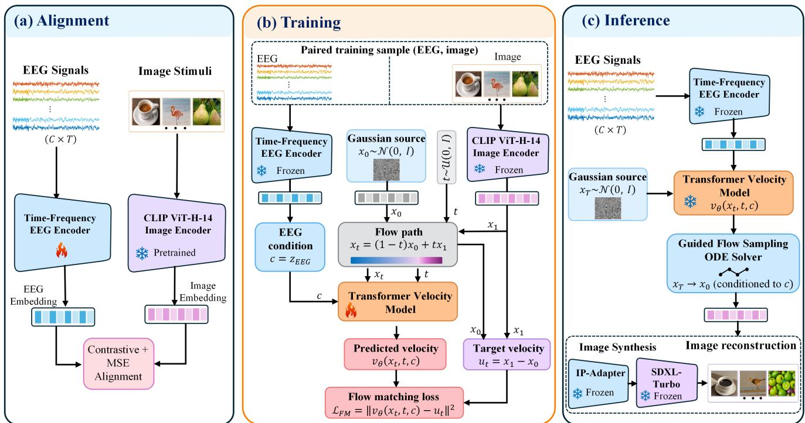
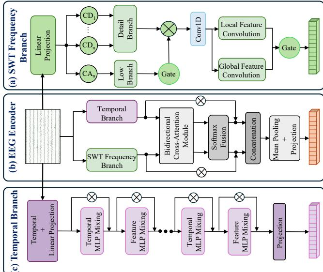
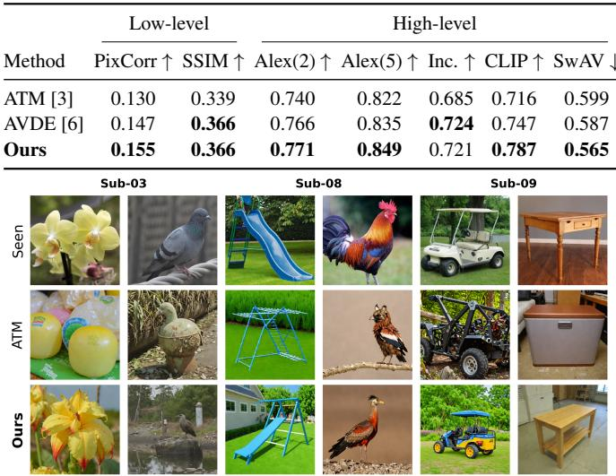

# E2I-FLOW: EEG-TO-IMAGE RECONSTRUCTION VIA WAVELET-TEMPORAL CROSS-ATTENTION AND CONDITIONAL FLOW MATCHING

Haowei Pan1, Hwa Hui Tew1, Junn Yong Loo2, Fuad Noman1, Hernando Ombao3, Chee-Ming Ting1,∗

1School of Information Technology, Monash University, Malaysia Campus 2School of Electrical and Electronic Engineering, Nanyang Technological University 3Statistics Program, King Abdullah University of Science and Technology

## ABSTRACT

Electroencephalography (EEG)-based visual decoding and reconstruction aims to recover visual information from noninvasive brain signals. But there are challenges due to the complex temporal-frequency characteristics of EEG signals and the difficulty of discrete denoising framework in mapping neural activity to meaningful visual representations. Here, we propose E2I-Flow, an EEG-to-image decoding and reconstruction framework that combines a novel EEG encoder for time-frequency representation learning from EEG features, and conditional flow matching for visual decoding. A stationary-wavelet frequency branch and a temporal-mixing branch are integrated through bidirectional cross-attention and adaptive fusion, with the resulting EEG representations aligned to ground-truth image embeddings using contrastive and mean-squared-error loss supervisions. The aligned EEG representation is then used as a condition for a Transformerbased flow-matching model to predict the corresponding visual embedding for image synthesis. Experimental results show strong zero-shot EEG-to-image retrieval and improved visual reconstruction performance, outperforming several state-of-the-art baselines.

Index Terms— EEG, visual decoding, image reconstruction, time-frequency representation, flow matching

## 1. INTRODUCTION

Decoding visual information from human brain activity enables us to investigate how visual perception is represented in the brain and has important potential for non-invasive braincomputer interfaces (BCIs) [1, 2]. Among the commonly used neural recording modalities, EEG is particularly attractive due to its non-invasive acquisition, high temporal resolution, relatively low cost, and portability [3]. Recent studies have advanced from visual object recognition to zero-shot recognition and image retrieval settings [4, 3]. And a more challenging objective is to reconstruct the visual content itself from EEG signals, which recently has become a promising direction in EEG-based visual decoding [5, 6].

Compared with recognition and retrieval, EEG-to-image reconstruction requires decoded neural information to visually meaningful content. Early studies explored GAN-based frameworks for synthesizing images from EEG signals [5]. The emergence of diffusion models provide new solutions to this task. For instance, DM-RE2I incorporated EEG-derived semantic information into a denoising diffusion process [7], whereas DreamDiffusion, BrainVis, and ATM explored alternative ways of conditioning diffusion models to reconstruct images from learned EEG representations [8, 9, 3]. In addition to diffusion models, AVDE introduced an autoregressive next-scale prediction approach for EEG-based visual reconstruction [6]. Nonetheless, a flow-based generative framework remains largely unexplored for EEG-to-image reconstruction.

EEG visual decoding depends strongly on how well the encoder captures temporal-frequency characteristics. Existing EEG encoders relied commonly on convolutional or Transformer-based architectures [10, 11], whereas more recent studies incorporated frequency-domain information to complement temporal EEG representations [12, 13, 9]. Recent studies have also explored multi-scale wavelet modeling and flow-based generation [14]. However, jointly modeling these representations within a unified EEG encoder remains limited, particularly for preserving multi-scale information while capturing temporal dynamics.

To address these limitations, we propose E2I-Flow, an EEG-based visual decoding and reconstruction framework that combines a unified time-frequency EEG representation with conditional flow matching (CFM). The framework first captures temporal and spectral EEG features and guide the flow matching process in the visual embedding space for image reconstruction. Our contributions are threefold: (1) a novel time-frequency EEG encoder that integrates stationary wavelet transform for multi-scale spectral modeling; (2) a bidirectional cross-attention and adaptive fusion mechanism that jointly captures spectral and temporal representations; and (3) a conditional flow matching framework that formulates EEG-to-image reconstruction as a continuous-time latent dynamical process, providing an alternative to diffusion and autoregressive approaches.

  
Fig. 1: Overview of E2I-Flow. (a) EEG–image representation alignment using the time-frequency EEG encoder and a pretrained image encoder. (b) Conditional flow matching training, where the aligned EEG representation conditions the Transformer velocity model. (c) Inference through guided flow sampling followed by IP-Adapter and SDXL-Turbo for image synthesis.

## 2. METHODS

## 2.1. Time-Frequency EEG Encoder

Fig. 1 shows an overall framework of E2I-Flow. First, to capture complementary spectral and temporal characteristics of EEG signals, we propose a time-frequency EEG encoder, consisting of three main components, as illustrated in Fig. 2. The stationary wavelet transform (SWT) decomposes the EEG signal into the approximation and multi-scale detail components without downsampling [15], thereby preserving temporal alignment across scales while providing multi-resolution time-frequency representations. The approximation and detail frequency components are processed by Conv1D-based branches, with adaptive softmax weighting used to aggregate the detail representations. A convolutional module captures localized patterns, whereas a transformer-based global network models longrange dependencies. Learnable gates adaptively balance the approximation-detail and local-global representations, allowing the fusion weights to vary according to the input EEG sample, producing $F _ { \mathrm { S W T } } ~ \in ~ \mathrm { \bar { R } } ^ { B \times 6 3 \times 2 5 \bar { 6 } }$ . The temporal branch models EEG temporal dynamics using stacked temporal mixing and feature mixing layers with residual connections, producing temporal features that are projected into 63 summary tokens, corresponding to the number of EEG channels, yielding $T _ { \mathrm { T S } } ~ \in ~ \dot { \mathbb { R } } ^ { B \times 6 3 \times 2 5 6 }$ . The frequency and temporal representations then interact through bidirectional cross-attention, producing $H _ { f t } \ = \ \mathrm { C r o s s A t t n } ( F _ { \mathrm { S W T } } , T _ { \mathrm { T S } } )$ and $H _ { t f } = \mathrm { C r o s s A t t n } ( T _ { \mathrm { T S } } , F _ { \mathrm { S W T } } )$ . In the frequency-totemporal direction, FSWT serves as query, while $T _ { \mathrm { T S } }$ as keys and values; the reverse direction exchanges these roles. The two outputs are adaptively combined through softmax fusion to obtain $H _ { \mathrm { f u s i o n } }$ . Residual connections are subsequently applied to the frequency and temporal branch outputs, yielding $U _ { f } = F _ { \mathrm { S W T } } + H _ { \mathrm { f u s i o n } }$ and $U _ { t } = T _ { \mathrm { T S } } + H _ { \mathrm { f u s i o n } }$ , which are then concatenated, mean-pooled, and projected to obtain the final EEG embedding zEEG $\in \mathbb { R } ^ { B \times 1 0 \bar { 2 } 4 }$

## 2.2. EEG-Image Representation Alignment

Denote the EEG signals to be $E \in \mathbb { R } ^ { B \times C \times T }$ , where B denote the batch size, C the number of EEG channels. The encoder produces embeddings $e \in \mathbb { R } ^ { B \times d }$ . Corresponding images are encoded by the pretrained CLIP image encoder [16] to obtain visual embeddings $\boldsymbol { z } \in \mathbb { R } ^ { B \times d }$ . We align paired EEG and image representations using a symmetric contrastive objective:

$$
\begin{array} { r l } { \mathcal { L } _ { \mathrm { C L I P } } = - \displaystyle \frac { 1 } { B } \sum _ { i = 1 } ^ { B } \Bigg ( \log \frac { \exp { \left( s ( e _ { i } , z _ { i } ) / \tau \right) } } { \sum _ { j = 1 } ^ { B } \exp { \left( s ( e _ { i } , z _ { j } ) / \tau \right) } } } & { } \\ { \quad \quad \quad \quad \quad \quad + \log \frac { \exp { \left( s ( e _ { i } , z _ { i } ) / \tau \right) } } { \sum _ { k = 1 } ^ { B } \exp { \left( s ( e _ { k } , z _ { i } ) / \tau \right) } } \Bigg ) . } \end{array}\tag{1}
$$

where s denotes cosine similarity and $\tau$ is a learned temperature parameter that controls the sharpness of the distribution.

  
Fig. 2: Architecture of time-frequency EEG encoder: (a) SWT frequency branch, (b) Bidirectional cross-attention with adaptive fusion, and (c) Temporal MLP-mixing branch.

This contrastive objective aligns the EEG and image representations in a shared embedding space.

To complement the contrastive objective with point-wise supervision, we add the mean squared error (MSE), which measures the distance between the EEG embeddings and their corresponding image embeddings:

$$
\mathcal { L } _ { a l i g n } = \lambda \mathcal { L } _ { C L I P } + ( 1 - \lambda ) \mathcal { L } _ { M S E }\tag{2}
$$

where λ balances the two objectives. Combining contrastive alignment with direct regression encourages both discriminative cross-modal correspondence and point-wise agreement between paired EEG and image representations.

## 2.3. Conditional Flow Matching Image Reconstruction

We reconstruct visual stimuli from the aligned EEG representation using conditional flow matching [17], which learns a continuous velocity field that transports samples from a simple source distribution toward the target visual-embedding distribution. Specifically, let $c = z _ { \mathrm { E E G } } ~ \in ~ \mathbb { R } ^ { B \times 1 0 2 4 }$ and $x _ { 1 } ~ = ~ z _ { \mathrm { i m a g e } } ~ \in ~ \mathbb { R } ^ { B \times \bar { 1 0 } 2 4 }$ denote the EEG condition and ground-truth CLIP image embedding, respectively. During training, a Gaussian source $x _ { 0 } \ \sim \ { \mathcal { N } } ( 0 , I )$ and a timestep $t \sim U ( 0 , 1 )$ are sampled to construct the intermediate state $x _ { t } = ( 1 - t ) x _ { 0 } + t x _ { 1 }$ and the corresponding target velocity $u _ { t } = x _ { 1 } - x _ { 0 }$ along the flow path. The EEG condition $c ,$ intermediate state $x _ { t } ,$ and timestep t are provided to the Transformer velocity model, together with positional and token-type embeddings, to predict the conditional velocity $v _ { \theta } ( x _ { t } , t , c )$

The model is optimized using the conditional Flow Matching objective

$$
\mathcal { L } _ { \mathrm { C F M } } = \left. v _ { \theta } ( x _ { t } , t , c ) - u _ { t } \right. _ { 2 } ^ { 2 }\tag{3}
$$

At inference time, the trained Transformer evaluates the conditional and unconditional velocities $v _ { \theta } ( x _ { t } , t , c )$ and $v _ { \theta } ( x _ { t } , t , \theta )$ , respectively, which are combined using classifierfree guidance (CFG) [18].

$$
\hat { v } ( x _ { t } , t , c ) = v _ { \theta } ( x _ { t } , t , \emptyset ) + s \left[ v _ { \theta } ( x _ { t } , t , c ) - v _ { \theta } ( x _ { t } , t , \emptyset ) \right]\tag{4}
$$

where vˆ denotes the guided velocity, ∅ is a zero vector used in place of the EEG condition embedding, and s is the guidance scale. The guided velocity $\hat { v } ( x _ { t } , t , c )$ is used by the ODE solver to iteratively update the current state from $t = 0 \mathrm { t o } t =$ 1, progressively transforming the initial Gaussian state into the predicted image embedding $\hat { z } _ { \mathrm { i m a g e } } \in \mathbb { R } ^ { B \times 1 0 2 4 }$ . Finally, the predicted visual representation $\hat { z } _ { \mathrm { i m a g e } }$ is converted into the reconstructed RGB image using pretrained IP-Adapter [19] and SDXL-Turbo [20].

## 3. EXPERIMENTAL RESULTS

Dataset. We conduct experiments on the THINGS-EEG benchmark [21], following the standard split used in prior EEG visual decoding studies [4, 3, 6]. The training set contains 1,654 concepts with 10 images per concept, while the test set contains 200 unseen concepts with one image per concept. Each training image was presented four times per subject and each test image 80 times. EEG signals were recorded from 63 channels at 1 KHz. We extracted 0–1,000 millisecond epochs, downsampled to 200 Hz, and, for evaluation, repeated trials corresponding to the same image were averaged before EEG encoding.

Implementational Details. The EEG encoder was trained with AdamW using a batch size of 128 and subject-specific learning rates of $5 \times 1 0 ^ { - 4 }$ and $9 \times 1 0 ^ { - 5 }$ , with a maximum of 50 epochs and early stopping patience of 10. CLIP ViT-H-14 is used to extract 1024-dimensional image embeddings. We set $\lambda = 0 . 5$ in the alignment objective and use db1 with two SWT decomposition levels. The conditional flow-matching model was trained for 150 epochs using Adam with a learning rate of $1 0 ^ { - 3 }$ and a batch size of 1024. At inference, the learned flow was integrated over $t \in [ 0 , 1 ]$ using a 50-step midpoint ODE solver with a classifier-free guidance scale of 14.

Main results. For EEG-to-image retrieval, we evaluate the matching scores between the predicted EEG representations and the CLIP image embeddings of the 200 unseen test concepts. Retrieval performance is reported using Top-1 and Top-5 accuracy. For image reconstruction, we follow prior work [22, 3]. Low-level reconstruction quality is evaluated using PixCorr and SSIM, while high-level perceptual quality is assessed using AlexNet-2, AlexNet-5 [23], Inception [24], CLIP, and SwAV [25] based metrics.

As shown in Table 1, E2I-Flow achieves the highest mean Top-1 and Top-5 retrieval accuracies of 31.0% and 60.1%, respectively, compared with 30.0% and 58.2% for the best competing method, AVDE. For visual reconstruction, Table 2 shows that E2I-Flow achieves the best average performance on five of the seven metrics, including PixCorr, AlexNet-2, AlexNet-5, CLIP, and SwAV, while remaining highly competitive on SSIM and Inception. In particular, the improvement in CLIP similarity suggests stronger preservation of high-level visual semantics. Consistent with the quantitative results, the qualitative comparison in Fig. 3 shows that our method recovers clearer object content and finer visual details.

Table 1: Within-subject 200-way zero-shot EEG-to-image retrieval performance (%) on the THINGS-EEG dataset. T1 and T5 denote Top-1 and Top-5 accuracy, respectively. Results are averaged over five random seeds.
<table><tr><td rowspan="2">Method</td><td colspan="2">Sub-01</td><td colspan="2">Sub-02</td><td colspan="2">Sub-03</td><td colspan="2">Sub-04</td><td colspan="2">Sub-05</td><td colspan="2">Sub-06</td><td colspan="2">Sub-07</td><td colspan="2">Sub-08</td><td colspan="2">Sub-09</td><td colspan="2">Sub-10</td><td colspan="2">Mean</td></tr><tr><td>T1</td><td>T5</td><td>T1</td><td>T5</td><td>T1</td><td>T5</td><td>T1</td><td>T5</td><td>T1</td><td>T5</td><td>T1</td><td>T5</td><td>T1</td><td>T5</td><td>T1</td><td>T5</td><td>T1</td><td>T5</td><td>T1</td><td>T5</td><td>T1</td><td>T5</td></tr><tr><td>Conformer (2023) [11]</td><td>9.5</td><td>26.1</td><td>10.8</td><td>27.4</td><td>14.2</td><td>30.6</td><td>15.5</td><td>37.1</td><td>8.8</td><td>19.8</td><td>8.1</td><td>28.0</td><td>12.2</td><td>31.8</td><td>16.4</td><td>40.5</td><td>10.9</td><td>29.8</td><td>15.1</td><td>39.2</td><td>12.2</td><td>31.0</td></tr><tr><td>NICE (2024) [4]</td><td>20.1</td><td>47.9</td><td>19.2</td><td>36.9</td><td>21.2</td><td>53.8</td><td>22.4</td><td>50.4</td><td>14.4</td><td>31.6</td><td>26.1</td><td>56.3</td><td>26.9</td><td>55.7</td><td>38.2</td><td>67.4</td><td>23.4</td><td>53.2</td><td>29.8</td><td>58.6</td><td>24.2</td><td>51.2</td></tr><tr><td>ATM (2024) [3]</td><td>23.2</td><td>51.2</td><td>18.8</td><td>43.2</td><td>27.3</td><td>57.0 </td><td>28.0</td><td>54.1</td><td>16.8</td><td>39.5</td><td>28.0</td><td>59.2</td><td>26.8</td><td>53.7</td><td>39.3</td><td>71.5</td><td>24.5</td><td>51.2</td><td>37.2</td><td>67.7</td><td>26.9</td><td>54.8</td></tr><tr><td>VDF (2025) [13]</td><td>20.4</td><td>49.0</td><td>16.5</td><td>49.0</td><td>17.5</td><td>51.0</td><td>25.5</td><td>58.0</td><td>13.0</td><td>43.0</td><td>23.0</td><td>54.5</td><td>19.5</td><td>48.0</td><td>24.0</td><td>55.0</td><td>18.0</td><td>50.0</td><td>20.5</td><td>49.5</td><td>19.8</td><td>50.7</td></tr><tr><td>AVDE (2026) [6]</td><td>25.0</td><td>55.2</td><td>24.1</td><td>51.0</td><td>27.5</td><td>58.6</td><td>29.8</td><td>54.7</td><td>25.4</td><td>50.3</td><td>33.5</td><td>60.3</td><td>27.4</td><td>55.2</td><td>41.7</td><td>71.3</td><td>26.1</td><td>52.1</td><td>39.5</td><td>73.0</td><td>30.0</td><td>58.2</td></tr><tr><td>E2I-Flow (Ours)</td><td>23.4</td><td>48.6</td><td>27.7</td><td>57.6</td><td>32.5</td><td>61.3</td><td>28.5</td><td>57.6</td><td>22.9</td><td>51.0</td><td>30.1</td><td>62.1</td><td>29.1</td><td>61.0</td><td>47.0</td><td>75.7</td><td>31.7</td><td>58.0</td><td>37.0</td><td>67.7</td><td>31.0</td><td>60.1</td></tr></table>

Table 2: Average quantitative comparison of EEG-based visual reconstruction over all 10 subjects.
<table><tr><td colspan="3">Low-level</td><td colspan="5">High-level</td></tr><tr><td>Method</td><td></td><td></td><td>PixCorr ↑ SSIM ↑ Alex(2) ↑ Alex(5) ↑ Inc. ↑</td><td></td><td></td><td>CLIP↑ SwAV↓</td><td></td></tr><tr><td>ATM [3]</td><td>0.130</td><td>0.339</td><td>0.740</td><td>0.822</td><td>0.685</td><td>0.716</td><td>0.599</td></tr><tr><td>AVDE [6]</td><td>0.147</td><td>0.366</td><td>0.766</td><td>0.835</td><td>0.724</td><td>0.747</td><td>0.587</td></tr><tr><td>Ours</td><td>0.155</td><td>0.366</td><td>0.771</td><td>0.849</td><td>0.721</td><td>0.787</td><td>0.565</td></tr></table>

  
Fig. 3: Qualitative comparison of EEG-based image reconstruction across multiple subjects using ATM, E2I-Flow, and the corresponding ground-truth stimuli.

Ablation Study. Table 3 evaluates the contributions of the frequency, temporal, and fusion components. In general, the complete encoder achieves the best performance. Using either the SWT or temporal branch alone generally reduces performance, while replacing bidirectional cross-attention and adaptive fusion with MLP fusion yields less consistent improvements. This attests to the benefits of leveraging on the complementary information of frequency and temporal modeling, and the adaptive cross-modal interaction between the two representations. Table 4 further shows that increasing SWT decomposition depth does not consistently improve retrieval performance; the final configuration of E2I-Flow therefore uses db1 with two decomposition levels.

Table 3: E2I-Flow ablation on selected subjects. T1 and T5 denote Top-1 and Top-5 retrieval accuracy (%), respectively.
<table><tr><td></td><td colspan="2">Sub-01</td><td colspan="2">Sub-02</td><td colspan="2">Sub-09</td><td colspan="2">Sub-10</td></tr><tr><td>Framework</td><td>T1</td><td>T5</td><td>T1</td><td>T5</td><td>T1</td><td>T5</td><td>T1</td><td>T5</td></tr><tr><td>SWT Frequency Only</td><td>17.0</td><td>40.0</td><td>24.5</td><td>52.5</td><td>23.5</td><td></td><td>52.5 33.5</td><td>63.0</td></tr><tr><td>Temporal Only</td><td>18.039.5 25.553.5 26.049.5 35.065.0</td><td></td><td></td><td></td><td></td><td></td><td></td><td></td></tr><tr><td>SWT + Temporal + MLP Fusion 20.0 41.5 24.5 54.5 29.0 52.5 33.5 61.5</td><td></td><td></td><td></td><td></td><td></td><td></td><td></td><td></td></tr><tr><td>E2I-Flow (Ours)</td><td>21.041.527.058.528.056.535.065.5</td><td></td><td></td><td></td><td></td><td></td><td></td><td></td></tr></table>

Table 4: Hyperparameter analysis of wavelet decomposition settings. Top-1 retrieval accuracy (%) is reported for different wavelet families and decomposition levels.
<table><tr><td>Wavelet</td><td>Level 2</td><td>Level 3</td><td>Level 4</td><td>Level 5</td><td>Level 6</td><td>Level 7</td></tr><tr><td>db1</td><td>48.0</td><td>43.5</td><td>47.5</td><td>43.0</td><td>44.5</td><td>44.0</td></tr><tr><td>db4</td><td>46.5</td><td>44.5</td><td>47.5</td><td>43.0</td><td>43.5</td><td>42.5</td></tr><tr><td>db8</td><td>43.0</td><td>43.5</td><td>46.5</td><td>39.5</td><td>43.0</td><td>42.0</td></tr></table>

## 4. CONCLUSION

We developed the E2I-Flow, a novel EEG-to-image reconstruction framework that combines wavelet-temporal representation learning with conditional flow matching. The proposed encoder integrates multi-scale SWT features and temporal representations through bidirectional cross-attention and adaptive fusion, while the conditional flow model maps aligned EEG representations toward the visual embedding space for reconstruction. Experiments on THINGS-EEG show improved mean zero-shot retrieval performance and stronger reconstruction quality across most evaluated perceptual metrics, supporting the effectiveness of the proposed framework. In future work, we plan to extend E2I-Flow from static image reconstruction to EEG-to-video generation by characterizing dynamic visual information.

## 5. REFERENCES

[1] Yukiyasu Kamitani and Frank Tong, “Decoding the visual and subjective contents of the human brain,” Nature Neuroscience, vol. 8, no. 5, pp. 679–685, 2005.

[2] Xiaorong Gao, Yijun Wang, Xiaogang Chen, and Shangkai Gao, “Interface, interaction, and intelligence in generalized brain–computer interfaces,” Trends in Cognitive Sciences, vol. 25, no. 8, pp. 671–684, 2021.

[3] Dongyang Li, Chen Wei, Shiying Li, Jiachen Zou, and Quanying Liu, “Visual decoding and reconstruction via EEG embeddings with guided diffusion,” in Advances in Neural Information Processing Systems, 2024, vol. 37.

[4] Yonghao Song, Bingchuan Liu, et al., “Decoding natural images from EEG for object recognition,” in International Conference on Learning Representations, 2024.

[5] Prajwal Singh, Pankaj Pandey, et al., “EEG2IMAGE: Image reconstruction from EEG brain signals,” in 2023 IEEE International Conference on Acoustics, Speech and Signal Processing (ICASSP), 2023, pp. 1–5.

[6] Sicheng Dai, Hongwang Xiao, Shan Yu, and Qiwei Ye, “Autoregressive visual decoding from EEG signals,” in International Conference on Learning Representations, 2026.

[7] Hong Zeng, Nianzhang Xia, et al., “DM-RE2I: A framework based on diffusion model for the reconstruction from EEG to image,” Biomedical Signal Processing and Control, vol. 86, pp. 105125, 2023.

[8] Yunpeng Bai, Xintao Wang, et al., “Dreamdiffusion: High-quality eeg-to-image generation with temporal masked signal modeling and clip alignment,” in Proceedings of the European Conference on Computer Vision, 2024.

[9] Honghao Fu, Hao Wang, Jing Jih Chin, and Zhiqi Shen, “BrainVis: Exploring the bridge between brain and visual signals via image reconstruction,” in 2025 IEEE International Conference on Acoustics, Speech and Signal Processing (ICASSP), 2025, pp. 1–5.

[10] Robin Tibor Schirrmeister, Jost Tobias Springenberg, et al., “Deep learning with convolutional neural networks for EEG decoding and visualization,” Human Brain Mapping, vol. 38, no. 11, pp. 5391–5420, 2017.

[11] Yonghao Song, Qingqing Zheng, Bingchuan Liu, and Xiaorong Gao, “EEG conformer: Convolutional transformer for EEG decoding and visualization,” IEEE Transactions on Neural Systems and Rehabilitation Engineering, vol. 31, pp. 710–719, 2023.

[12] Enshang Zhang, Zhicheng Zhang, and Takashi Hanakawa, “Category-aware EEG image generation based on wavelet transform and contrast semantic loss,” in Proceedings of the Thirty-Fourth International Joint Conference on Artificial Intelligence (IJCAI), 2025, pp. 7922–7930.

[13] Yebin Choi, Jun-Mo Kim, et al., “Visual decoding using a learnable wavelet-based spatial-spectral-temporal eeg embedding,” in 2025 13th International Conference on Brain-Computer Interface (BCI). IEEE, 2025, pp. 1–5.

[14] Hwa Hui Tew, Junn Yong Loo, et al., “Functional mri time series generation via wavelet-based image transform and spectral flow matching for brain disorder identification,” in International Conference on Learning Representations, 2026.

[15] Guy P. Nason and Bernard W. Silverman, “The stationary wavelet transform and some statistical applications,” in Wavelets and Statistics, vol. 103 of Lecture Notes in Statistics, pp. 281–299. Springer, 1995.

[16] Alec Radford, Jong Wook Kim, et al., “Learning transferable visual models from natural language supervision,” in Proceedings of the 38th International Conference on Machine Learning, 2021, vol. 139, pp. 8748–8763.

[17] Yaron Lipman, Ricky T. Q. Chen, et al., “Flow matching for generative modeling,” in International Conference on Learning Representations, 2023.

[18] Jonathan Ho and Tim Salimans, “Classifier-free diffusion guidance,” arXiv preprint arXiv:2207.12598, 2022.

[19] Hu Ye, Jun Zhang, et al., “IP-Adapter: Text compatible image prompt adapter for text-to-image diffusion models,” arXiv preprint arXiv:2308.06721, 2023.

[20] Axel Sauer, Dominik Lorenz, Andreas Blattmann, and Robin Rombach, “Adversarial diffusion distillation,” arXiv preprint arXiv:2311.17042, 2023.

[21] Alessandro T. Gifford, Kshitij Dwivedi, Gemma Roig, and Radoslaw M. Cichy, “A large and rich eeg dataset for modeling human visual object recognition,” NeuroImage, vol. 264, pp. 119754, 2022.

[22] Paul S. Scotti, Atmadeep Banerjee, et al., “Reconstructing the mind’s eye: fMRI-to-image with contrastive learning and diffusion priors,” in Advances in Neural Information Processing Systems, 2023, vol. 36, pp. 24705–24728.

[23] Alex Krizhevsky, Ilya Sutskever, and Geoffrey E. Hinton, “ImageNet classification with deep convolutional neural networks,” in Advances in Neural Information Processing Systems, 2012, vol. 25.

[24] Christian Szegedy, Wei Liu, et al., “Going deeper with convolutions,” in Proceedings ofthe IEEE Conference on Computer Vision and Pattern Recognition, 2015, pp. 1–9.

[25] Mathilde Caron, Ishan Misra, et al., “Unsupervised learning of visual features by contrasting cluster assignments,” in Advances in Neural Information Processing Systems, 2020, vol. 33.