# Efficient and Faithful High-Resolution Image Editing with Sparse Cross-Resolution Denoising

Maosen Zhao1,2 Xianfang Zeng3 Pengtao Chen2 Peng Ye4 Gang YU3 Jiayuan Fan2 Tao Chen1,2

1Shanghai Innovation Institute 2Fudan University 3StepFun 4The Chinese University of Hong Kong

## Abstract

Instruction-based image editors still primarily operate at 1K, whereas practical editing increasingly requires faithful 2K/4K outputs. Dense high-resolution adaptation preserves the editing trajectory but incurs expensive target–source attention; editing at 1K followed by external refinement is cheaper but can separate detail restoration from the editing trajectory. We introduce FLASH, a native high-resolution editor based on sparse cross-resolution denoising. A frozen 1K branch provides a semantic and structural anchor, while a target-resolution branch reconstructs local detail within the same Transformer. An asymmetric topology retains full 1K attention, guides high-resolution queries with spatially aligned low-resolution noisy-target states, and confines high-resolution target–reference interaction to local Halo neighborhoods. Resolution-specific diffusion-state mapping and spatial YaRN adapt the pretrained edi tor to larger grids. An optional, training-free progressive path replaces early high-resolution denoising with a 1K prefix and completes refinement in the same editor. On VINS-4KEval, the direct model achieves the strongest structural fidelity among the compared methods at both 2K and 4K. A separate 4K forward benchmark with R = 1 records 4.2× faster total forward execution and 25.3× faster attention than dense target–reference attention. Progressive inference reduces end-to-end 4K latency by 30.5%, with a modest quality cost.

Github: https://github.com/FDUPeter/FLASH

## 1 Introduction

Modern diffusion editors follow open-ended instructions while preserving source content (Brooks et al., 2023; Liu et al., 2025; Wu et al., 2025). Practical applications also demand readable text, fine textures, and precise local structure at 2K and 4K. Yet editing models and benchmarks remain concentrated at 1K or below, even as high-resolution generation advances (Chen et al., 2026b). Extending editing beyond 1K therefore requires both target-scale detail and reliable source preservation.

Two common approaches trade quality against computation. Dense native adaptation keeps editing and detail synthesis in one denoising trajectory, but its target–source sequences grow rapidly. With fixed latent downsampling and tokenization, scaling both image dimensions by k increases spatial-token counts by approximately k2. A dense 4K baseline already takes about 17 seconds per Transformer forward (Fig. 2), and denoising repeats this cost at every step. Editing at 1K and applying external super-resolution reduces editor cost, but moves detail recovery outside the editing trajectory and can distort source-specific content. We seek a third route: faithful full-canvas 2K/4K editing without dense target-resolution interaction (Fig. 1).

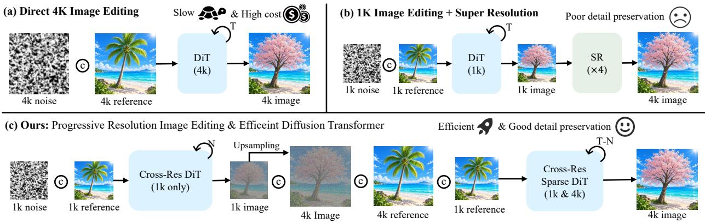  
Figure 1: Three routes to high-resolution editing: dense native 4K editing, 1K editing with super-resolution, and our FLASH framework.

Our central observation is that the two resolutions serve complementary roles. A capable 1K editor establishes the instruction-conditioned transformation, global layout, and principal edit structure. The highresolution grid is needed to recover textures, thin boundaries, and structures that cannot be represented at 1K. We therefore use the evolving 1K edit as an anchor for target-resolution detail generation. Both trajectories remain within the same editor: the low-resolution branch forms the global edit, and the high-resolution branch refines it on local support.

FLASH (Full-attention Low-resolution Anchor with Sparse High-resolution Halo attention) implements this division through sparse cross-resolution denoising. Its Transformer jointly processes text, low-resolution target–source tokens, and their highresolution counterparts. A full-attention 1K anchor maintains global editing behavior. Local Halo attention supplies spatially aligned high-resolution source details, while aligned low-to-high guidance transfers the evolving 1K edit to the target grid. Resolutiondependent timestep mapping and spatial RoPE adaptation make both scales compatible with the pretrained editor (Peng et al., 2024).

We further reduce temporal redundancy with optional progressive inference. Early high-noise steps run at 1K; the model then lifts a clean estimate through RGB space, re-noises it at the paired highresolution state, and completes the remaining steps with the same cross-resolution Transformer. Highresolution computation is thus reserved for later refinement. The lifted image is an intermediate state, not the final output of a separate super-resolution stage: subsequent denoising remains conditioned on the instruction, source image, and evolving 1K edit.

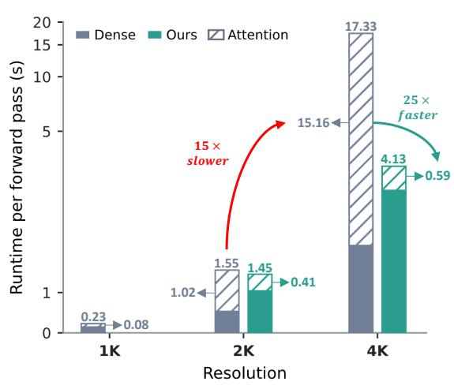  
Figure 2: Per-forward runtime across resolutions. Each bar shows attention and other forward computation. Dense attention uses target–reference sequences; the separate sparse diagnostic uses R = 1 and h = n. At 4K, it is 4.2× faster overall and 25.3× faster in attention. These timings do not represent the main R = 3 configuration.

Our contributions are threefold:

1. We formulate native high-resolution editing as low-resolution-guided denoising, separating global

edit formation from target-scale detail generation within one model.

2. We develop FLASH and a training-free progressive inference path to reduce spatial and temporal redundancy in high-resolution editing.

3. We evaluate source fidelity at 2K/4K on VINS-4KEval and examine the spatial support and progressive transition. The direct model leads the compared methods in HaarPSI, keep-region mPSNR, and mSSIM at both resolutions. Progressive inference further reduces end-to-end 4K latency by 30.5%.

## 2 Related Work

## 2.1 Diffusion-Based Image Editing

Instruction-based diffusion editing has evolved toward general-purpose source-conditioned generation. In structPix2Pix established feed-forward instruction following; MagicBrush strengthened human-annotated supervision, and MGIE added multimodal reasoning for underspecified requests (Brooks et al., 2023; Zhang et al., 2023; Fu et al., 2024). Flow- and DiT-based editors such as Step1X-Edit, Qwen-Image-Edit, and FLUX.1 Kontext further improve instruction fidelity and source consistency (Liu et al., 2025; Wu et al., 2025; Labs et al., 2025). Their training and evaluation nevertheless remain concentrated around 1K (Chen et al., 2026b). Dense target–reference interaction becomes expensive at 2K/4K; our approach retains the 1K editor as an anchor and adapts target-resolution detail modeling.

## 2.2 Efficient High-Resolution Generation and Editing

High-resolution diffusion generation extends pretrained models through receptive-field correction, progressive multiscale synthesis, overlapping diffusion paths, and hierarchical or windowed computation (He et al., 2024; Du et al., 2024; Bar-Tal et al., 2023; Zhang et al., 2024; Crowson et al., 2024). These approaches establish that low-resolution priors remain useful beyond their training scale, but editing additionally requires instruction fidelity and source preservation.

High-resolution editing follows two broad approaches. Cascades apply generative super-resolution after a 1K edit (Chen et al., 2025a; Duan et al., 2025; Sun et al., 2025; Dong et al., 2025), reducing editor cost but moving detail reconstruction outside the editing trajectory. VINS-120K instead adapts the editor directly at 4K, retaining native denoising over long target–reference sequences (Chen et al., 2026b). Complemen tary methods address computational redundancy: RegionE uses adaptive region-wise denoising for editing, and Sparse-vDiT exploits structured attention sparsity in video diffusion Transformers (Chen et al., 2025b, 2026a). Our focus is the cross-resolution coupling itself: a frozen 1K trajectory guides sparse, full-canvas target-resolution denoising within the same Transformer.

## 3 Method

We begin with flow-matching editing and its high-resolution attention bottleneck (§3.1). We then adapt diffusion states and spatial positions to larger grids (§3.2), introduce the sparse cross-resolution topology of FLASH (§3.3), and extend it with training-free progressive inference (§3.4).

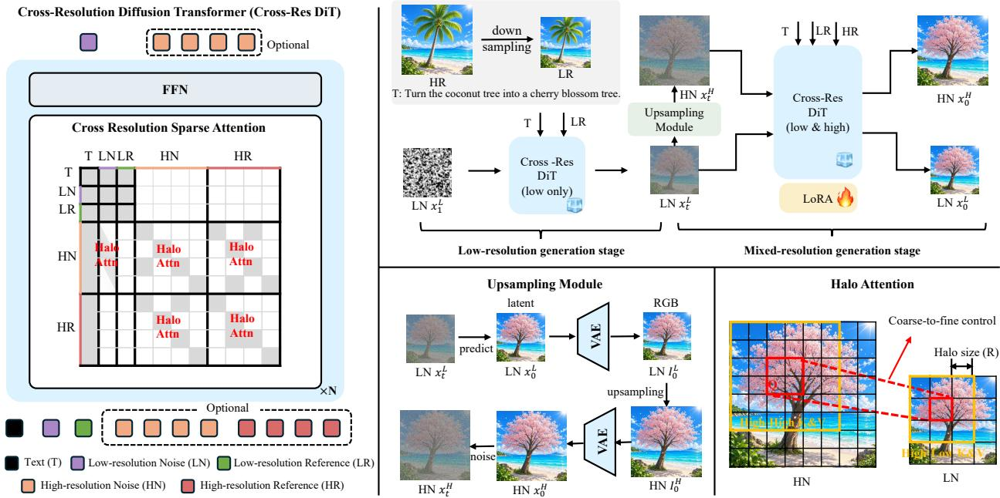  
Figure 3: Overview of FLASH. A frozen 1K branch anchors global editing, local high-resolution attention reconstructs detail, and progressive inference replaces early high-resolution steps with 1K denoising.

## 3.1 High-Resolution Image Editing

## 3.1.1 Flow-Matching Image Editing

Given a source image $I _ { R }$ and instruction c, the editor generates a target $I _ { 0 }$ while preserving unrelated source content. The pretrained variational autoencoder (VAE) encodes $I _ { R }$ as clean conditioning latent $z _ { R } ,$ , while the target latent starts from Gaussian noise $x _ { 1 }$ (Rombach et al., 2022). The Transformer denoiser predicts $v _ { \theta } ( x _ { t } , t ; c , z _ { R } )$ from noisy target, source, and text tokens; integrating this field from t = 1 to 0 and decoding the final latent yields the edit.

For training, encode $I _ { 0 }$ as clean latent $z _ { 0 } ,$ , sample $t \in [ 0 , 1 ]$ and $\epsilon \sim \mathcal { N } ( 0 , I )$ , and form the linear path

$$
x _ { t } = ( 1 - t ) z _ { 0 } + t \epsilon , \qquad v ^ { \star } = \frac { \mathrm { d } x _ { t } } { \mathrm { d } t } = \epsilon - z _ { 0 } .
$$

Here, t = 0 is the clean target and t = 1 is pure noise. We learn the conditional velocity from c and $z _ { R }$ using the flow-matching objective (Lipman et al., 2022)

$$
\mathcal { L } _ { \mathrm { F M } } = \mathbb { E } _ { z _ { 0 } , z _ { R } , c , \epsilon , t } \left[ \| v _ { \theta } ( x _ { t } , t ; c , z _ { R } ) - ( \epsilon - z _ { 0 } ) \| _ { 2 } ^ { 2 } \right] .
$$

## 3.1.2 Computational Bottleneck at High Resolution

With fixed latent downsampling and tokenization, scaling both image dimensions by k increases spatial tokens by approximately $k ^ { 2 }$ . VAE, projections, and FFNs grow with token count, whereas dense attention computes all query–key pairs (Vaswani et al., 2017; Crowson et al., 2024). Memory-efficient exact attention reduces score materialization but retains dense pairwise arithmetic (Dao et al., 2022). The independent R = 1 benchmark in Figure 2 illustrates this bottleneck. Dense attention accounts for about 15.2 s of a 17.33-s 4K forward, compared with 0.60 s of a 4.13-s forward for the sparse diagnostic. The corresponding speedups are 25.3× for attention and 4.2× overall. This diagnostic is separate from the R = 3 quality comparison; Appendix E gives its settings.

## 3.2 High-Resolution Capability Adaptation

Applying a pretrained 1K editor to a larger grid introduces two mismatches. A nominal timestep can correspond to a different effective noise state, and spatial coordinates extend beyond the range seen during pretraining. We address the former with resolution-dependent timestep mapping and the latter with spatial YaRN.

Resolution-Dependent Timestep Mapping. Greater spatial redundancy at higher resolution can preserve more recoverable signal at the same nominal noise level. Reusing a lower-resolution schedule therefore changes the effective denoising difficulty. Resolution-dependent timestep shifts address this mismatch in high-resolution diffusion and rectified-flow models (Chen, 2023; Hoogeboom et al., 2023; Esser et al., 2024). Given a raw timestep u, we map it to a resolution-specific state:

$$
s = f ( u ; \mu ) = \frac { e ^ { \mu } u } { 1 + ( e ^ { \mu } - 1 ) u } ,
$$

where $\mu$ controls the shift. The raw timestep u corresponds to the nominal flow time t in Section 3.1; the shifted state $s = f ( u ; \mu )$ is used both in $x _ { s } = ( 1 - s ) z _ { 0 } + s \epsilon$ and as the timestep input to $v _ { \theta }$ . At step $k ,$ the branches share $u _ { k }$ but apply different shifts, $s _ { L , k } = f ( u _ { k } ; \mu _ { L } )$ and $s _ { H , k } = f ( u _ { k } ; \mu _ { H } )$ . The paired states $\left( { { s _ { L , k } } , { s _ { H , k } } } \right)$ thus advance the two trajectories together while retaining their resolution-specific noise scales. Appendix A gives the mapping parameters.

RoPE Position Adaptation. Applying a pretrained editor to a larger spatial grid requires rotary position embedding (RoPE) to represent positions beyond the range observed during pretraining (Su et al., 2024). Insufficient adaptation can cause semantic drift or local repetition in high-resolution editing (Chen et al., 2026b). Uniform interpolation compresses phase differences across frequencies, so we use YaRN’s frequency-aware transition between interpolation and extrapolation (Peng et al., 2024).

For a target-grid coordinate i relative to the shared spatial origin, the pretrained-frame coordinate is $p _ { i } = i / n ,$ , where $n$ is the target-to-pretrained scale. On a spatial axis with rotary dimension $d _ { a }$ , index $j$ has native inverse frequency $\omega _ { j } = \theta _ { \mathrm { r o p e } } ^ { - 2 j / d _ { a } }$ , with rotary base $\theta _ { \mathrm { r o p e } }$ . YaRN adjusts it as

$$
\widetilde { \omega } _ { j } = \omega _ { j } [ n - ( n - 1 ) \gamma _ { j } ] , \qquad \phi _ { j } ( i ) = p _ { i } \widetilde { \omega } _ { j } ,
$$

where $\gamma _ { j } \in [ 0 , 1 ]$ is a linear ramp over rotary indices. Its endpoints use rotation-count thresholds $( \alpha , \beta ) =$ $( 1 , 8 )$ , computed from $r _ { j } = L _ { H , a } \omega _ { j } / ( 2 \pi )$ , where $L _ { H , a }$ is the target-axis grid length. High frequencies are extrapolated $( \gamma _ { j }  0 )$ , while low frequencies are fully interpolated $( \gamma _ { j }  1 )$ ). Non-spatial axes retain native RoPE.

## 3.3 Sparse Cross-Resolution Denoising

The adaptations above address diffusion states and spatial positions, but leave the dense-attention bottleneck intact. FLASH reduces this cost by coupling a global 1K editing anchor with local target-resolution detail generation. Here, cross-resolution means jointly denoising both states within one Transformer, with explicitly constrained information flow rather than a post-hoc super-resolution bridge.

At each denoising step, our cross-resolution Transformer block jointly processes five token groups from a mixed-resolution token sequence,

$$
\mathcal { X } = [ { \bf T } _ { \mathrm { t e x t } } , { \bf T } _ { L _ { N } } , { \bf T } _ { L _ { R } } , { \bf T } _ { H _ { N } } , { \bf T } _ { H _ { R } } ] ,
$$

where $\mathbf { T } _ { \mathrm { t e x t } }$ denotes text tokens; $\mathbf { T } _ { L _ { N } }$ and $\mathbf { T } _ { L _ { R } }$ denote the low-resolution noisy-target and clean-source tokens; and $\mathbf { T } _ { H _ { N } }$ and $\mathbf { T } _ { H _ { R } }$ denote their target-resolution counterparts. We use source and reference interchangeably for the conditioning image $I _ { R }$ . This joint sequence is the basis of the attention topology below.

Full-Attention 1K Anchor. The 1K branch retains the pretrained editor’s native attention pattern, preserving instruction understanding, global layout, and the principal edit structure. Its image queries do not read high-resolution image keys, so attention from the high-resolution branch cannot change the 1K trajectory. This trajectory anchors target-resolution generation.

Local High-Resolution Halo Attention. The high-resolution branch uses local target–source attention to recover native-grid structure and texture. Each low-resolution parent cell maps to an $n \times n$ high-resolution region. Expanding this region by h latent-token units on each side gives its Halo support. We synchronize $h$ with the low-resolution support radius R through $h = R n$ , so both supports cover the same parent-cell neighborhood $( h = 6$ at 2K and $h = 1 2$ at 4K for $R = 3 )$ . Before boundary clipping, the support size per high-resolution segment is

$$
K _ { H } = ( n + 2 h ) ^ { 2 } .
$$

The Halo contains both high-resolution noisy-target and reference tokens. It provides spatially aligned source details and exchanges context across neighboring parent cells, without dense attention over the complete target–source sequence. The support is fixed by local geometry and requires no additional userprovided edit mask.

Spatially Aligned Low-to-High Target Guidance. Local Halo attention supplies target-scale context, but not the global edit established at 1K. The aligned pathway $L _ { N } \to H _ { N }$ therefore carries the evolving low-resolution noisy-target state to high-resolution queries. With scale n along each spatial axis, a highresolution location $( y , x )$ maps to the low-resolution parent cell

$$
\pi ( y , x ) = \left( \left\lfloor { \frac { y } { n } } \right\rfloor , \left\lfloor { \frac { x } { n } } \right\rfloor \right) .
$$

Each high-resolution noisy-target query reads the low-resolution noisy-target neighborhood of Chebyshev radius R around $\pi ( y , x )$ , containing at most $K _ { L } = ( 2 R + 1 ) ^ { 2 }$ keys. Thus $L _ { N } \to H _ { N }$ denotes information flowing from the low-resolution edit to the high-resolution target; computationally, high-resolution queries read low-resolution keys. This bounded pathway ties local refinement to the global editing trajectory.

For efficient execution, we group high-resolution tokens by their low-resolution parent cell. Contiguous parent-cell groups expose regular Halo and cross-resolution neighborhoods that the sparse-attention kernel evaluates without a dense mask or score matrix. The ordering preserves the attention topology while improving memory locality. Appendix F gives the support-count and cost derivations.

Training. The merged 1K weights are frozen and retain their native attention connectivity. The branch remains in the forward pass to supply its evolving editing state. Only the high-resolution branch is adapted, via rank-32 low-rank adaptation (LoRA) residuals on attention and feed-forward network (FFN) projections. Training applies flow-matching regression to the high-resolution velocity alone, without an auxiliary crossresolution consistency loss.

## 3.4 Temporally Progressive Low-to-High-Resolution Editing

Direct inference jointly denoises both branches over the full paired schedule. The training-free progressive path instead uses a 1K prefix for early, high-noise edit formation and reserves high-resolution computation

Table 1: Main 2K/4K comparison. Bold and underline mark the best and second-best values per resolution; time is not ranked. HaarPSI uses the full image. mPSNR/mSSIM/mMSE use the keep region; mLPIPS uses the edit region, or the full image for global edits. Shaded rows do not use external super-resolution. Time is end-to-end latency in seconds, excluding model loading.
<table><tr><td>Method</td><td>HaarPSI↑</td><td>mPSNR↑</td><td>mSSIM↑</td><td>mMSE↓</td><td>mLPIPS↓</td><td>Time↓</td></tr><tr><td colspan="7">2K Resolution</td></tr><tr><td>FaithDiff (Chen et al., 2025a)</td><td>0.3840</td><td>21.7671</td><td>0.6900</td><td>0.01700</td><td>0.3101</td><td>29.43</td></tr><tr><td>DiT4SR (Duan et al., 2025)</td><td>0.3761</td><td>21.3047</td><td>0.6966</td><td>0.01757</td><td>0.3130</td><td>52.91</td></tr><tr><td>PiSA-SR (Sun et al., 2025)</td><td>0.3651</td><td>20.7503</td><td>0.6647</td><td>0.01843</td><td>0.3177</td><td>16.63</td></tr><tr><td>TSD-SR (Dong et al., 2025)</td><td>0.3600</td><td>20.1663</td><td>0.6468</td><td>0.02035</td><td>0.3338</td><td>16.89</td></tr><tr><td>VINS (Chen et al., 2026b)</td><td>0.4164</td><td>22.2907</td><td>0.7065</td><td>0.01693</td><td>0.2486</td><td>100.82</td></tr><tr><td>FLASH (Direct, R=3)</td><td>0.4235</td><td>22.5668</td><td>0.7780</td><td>0.01616</td><td>0.2976</td><td>108.95</td></tr><tr><td>FLASH (Progressive, R=3, K=12)</td><td>0.4137</td><td>22.4258</td><td>0.7733</td><td>0.01554</td><td>0.3165</td><td>88.19</td></tr><tr><td colspan="7">4K Resolution</td></tr><tr><td>FaithDiff (Chen et al., 2025a)</td><td>0.3630</td><td>21.5728</td><td>0.6578</td><td>0.01741</td><td>0.3079</td><td>87.04</td></tr><tr><td>DiT4SR (Duan et al., 2025)</td><td>0.3512</td><td>21.3398</td><td>0.6806</td><td>0.01786</td><td>0.3137</td><td>317.73</td></tr><tr><td>PiSA-SR (Sun et al., 2025)</td><td>0.3421</td><td>21.0066</td><td>0.6610</td><td>0.01817</td><td>0.3149</td><td>146.18</td></tr><tr><td>TSD-SR (Dong et al., 2025)</td><td>0.3352</td><td>20.5414</td><td>0.6329</td><td>0.01962</td><td>0.3161</td><td>62.46</td></tr><tr><td>VINS (Chen et al., 2026b)</td><td>0.2426</td><td>12.6890</td><td>0.4598</td><td>0.07081</td><td>0.4185</td><td>997.21</td></tr><tr><td>FLASH (Direct, R=3)</td><td>0.4067</td><td>22.2891</td><td>0.7621</td><td>0.01648</td><td>0.2934</td><td>309.69</td></tr><tr><td>FLASH (Progressive, R=3, K=12)</td><td>0.3775</td><td>21.6970</td><td>0.7369</td><td>0.01664</td><td>0.3190</td><td>215.31</td></tr></table>

for later refinement. For N denoising steps and transition index $1 \le K < N$ , the model first runs the 1K segment, then uses the same cross-resolution model for the remaining trajectory.

At the transition, the low-resolution state $x _ { L } ^ { K }$ and its velocity prediction provide a clean estimate

$$
\hat { x } _ { 0 , L } ^ { K } = x _ { L } ^ { K } - s _ { L , K } v _ { \theta , L } ^ { K } .
$$

RGB-domain lifting transfers this clean estimate to the target resolution:

$$
\hat { I } _ { L } ^ { K } = D _ { \mathrm { V A E } } \big ( \hat { x } _ { 0 , L } ^ { K } \big ) , \qquad \widetilde { I } _ { H } ^ { K } = \mathcal { R } _ { \mathrm { R G B } } \Big ( \hat { I } _ { L } ^ { K } \Big ) , \hat { x } _ { 0 , H } ^ { K } = E _ { \mathrm { V A E } } \Big ( \widetilde { I } _ { H } ^ { K } \Big ) .
$$

Here $D _ { \mathrm { V A E } }$ and $E _ { \mathrm { V A E } }$ denote VAE decoding and encoding, and $\mathcal { R } _ { \mathrm { R G B } }$ denotes RGB resizing to the target resolution. The re-encoded state is then re-noised with independent Gaussian noise at the high-resolution state paired with step K:

$$
x _ { H } ^ { K } = ( 1 - s _ { H , K } ) \hat { x } _ { 0 , H } ^ { K } + s _ { H , K } \epsilon _ { H } , \qquad \epsilon _ { H } \sim { \mathcal N } ( 0 , I ) .
$$

The high-resolution branch then joins the low-resolution branch for the remaining paired steps. The RGB-resized image serves only as an initialization, not as the final output of an external super-resolution stage. The trained editor continues denoising under the instruction, source condition, and evolving lowresolution edit.

Increasing K reduces high-resolution computation but leaves fewer steps for target-scale refinement, directly controlling the quality–efficiency trade-off. We evaluate latent interpolation separately as a lifting ablation.

## 4 Experiments

We evaluate source-faithful editing and inference efficiency at 2K and 4K, compare FLASH with edit–superresolution cascades and native high-resolution adaptation, and examine its design choices through ablations. The supplementary material details mask construction and implementation.

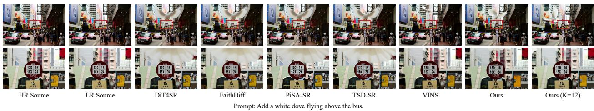  
Figure 4: 2K outputs for “Add a white dove flying above the bus.” Direct and progressive predictions are compared with edit–super-resolution cascades and VINS; crops show the edit and nearby text detail.

Table 2: 2K synchronized Halo ablation. Increasing R expands low- resolution support and the matched highresolution Halo of width h = Rn; time is not ranked.
<table><tr><td>Support | h |</td><td></td><td>HaarPSI↑</td><td>mPSNR↑</td><td>mSSIM↑</td><td>mMSE↓</td><td>mLPIPS↓</td><td>Time↓</td></tr><tr><td>R = 1</td><td>2</td><td>0.4234</td><td>22.4356</td><td>0.7774</td><td>0.01591</td><td>0.2966</td><td>94.42</td></tr><tr><td>R = 2</td><td>4</td><td>0.4213</td><td>22.4387</td><td>0.7732</td><td>0.01650</td><td>0.2977</td><td>99.64</td></tr><tr><td>R = 3</td><td>6</td><td>0.4235</td><td>22.5668</td><td>0.7780</td><td>0.01616</td><td>0.2976</td><td>108.95</td></tr></table>

## 4.1 Experimental Settings and Evaluation Protocol

We use FLUX.2 Klein Base 4B as the backbone, train on the full VINS-120K split (131,010 examples), and evaluate on VINS-4KEval (509 instructions in 12 edit categories). All methods share source images, instructions, and target resolutions. The 1K, 2K, and 4K settings use square 1024 × 1024, 2048 × 2048, and 4096 × 4096 canvases, respectively. Local edits use a shared source-only mask; global edits are excluded from keep-region scores and use the full image for mLPIPS. We compare with FaithDiff, DiT4SR, PiSA-SR, TSD-SR, and training-free VINS.

The editing routes share a supervised fine-tuned 1K base. FLASH freezes its low-resolution L = 1K branch and adapts $H \in \{ \mathrm { 2 K } , 4 \mathrm { K } \}$ with low-rank residuals (Hu et al., 2021). The main comparison uses R = 3, with K = 12 for progressive inference; the ablations vary these design choices. Appendix A gives the adapter, topology, schedule, and optimizer settings.

We measure source fidelity with HaarPSI, a full-image Haar wavelet-based perceptual similarity index, keep-region mPSNR/mSSIM/mMSE, and edit-region mLPIPS. The m prefix denotes masking for local edits; global edits use full-image LPIPS. These source–output metrics do not directly measure instruction completion. Quality values are macro averages over edit types. Timings exclude model loading and include external super-resolution where applicable.

## 4.2 Main Results

The direct model leads the comparison in structural fidelity (Table 1). It has the highest HaarPSI, keepregion mPSNR, and mSSIM at both resolutions, and the lowest 4K mMSE and source-relative mLPIPS. Progressive inference exchanges some quality for lower latency: at 2K it stays within 0.010 HaarPSI and 0.005 mSSIM of the direct model while reducing latency by 19.1%. At 4K it gives up 0.029 HaarPSI for a 30.5% latency reduction.

The separate forward diagnostic in Figure 2 evaluates an R = 1 sparse configuration, not the R = 3 adapters in the main table. It illustrates attention-cost reduction independently of the quality comparison.

Table 3: Progressive transition ablation at $R = 3 .$ . K is the initial 1K-prefix length; Direct denotes joint denoising. Time is end-to-end latency in seconds, excluding model loading.  
2K Resolution
<table><tr><td></td><td>Transition | HaarPSI↑ mPSNR↑ mSSIM↑ mMSE↓ mLPIPS↓ | Time↓</td><td></td><td></td><td></td><td></td><td></td></tr><tr><td>Direct</td><td>0.4235</td><td>22.5668</td><td>0.7780</td><td>0.01616</td><td>0.2976</td><td>108.95</td></tr><tr><td>K = 8</td><td>0.4173</td><td>22.4866</td><td>0.7768</td><td>0.01551</td><td>0.3132</td><td>102.32</td></tr><tr><td>K = 12</td><td>0.4137</td><td>22.4258</td><td>0.7733</td><td>0.01554</td><td>0.3165</td><td>88.19</td></tr><tr><td>K = 16</td><td>0.4097</td><td>22.4041</td><td>0.7693</td><td>0.01563</td><td>0.3157</td><td>74.84</td></tr></table>

4K Resolution
<table><tr><td></td><td>Transition | HaarPSI↑ mPSNR↑ mSSIM↑ mMSE↓ mLPIPS↓|</td><td></td><td></td><td></td><td></td><td>|Time↓</td></tr><tr><td>Direct</td><td>0.4067</td><td>22.2891</td><td>0.7621</td><td>0.01648</td><td>0.2934</td><td>309.69</td></tr><tr><td>K = 8</td><td>0.3888</td><td>21.8677</td><td>0.7470</td><td>0.01651</td><td>0.3118</td><td>257.22</td></tr><tr><td>K = 12</td><td>0.3775</td><td>21.6970</td><td>0.7369</td><td>0.01664</td><td>0.3190</td><td>215.31</td></tr><tr><td>K = 16</td><td>0.3682</td><td>21.5672</td><td>0.7299</td><td>0.01678</td><td>0.3205</td><td>174.12</td></tr></table>

## 4.3 Ablation Studies

Halo-Supported Local Attention. We compare synchronized supports using a shared merged 1K base and high-resolution adapters trained for the corresponding R values (Table 2). At 2K, R = 3 gives the highest HaarPSI, mPSNR, and mSSIM, but also the largest latency. The trend is not monotonic: $R = 2$ underperforms $R = 1$ on most metrics, and $R = 1$ has the lowest keep-region mMSE and edit-region mLPIPS. Thus a larger support does not improve every metric. Figure 5 complements this comparison with a qualitative $R = 0$ diagnostic: removing Halo support weakens cross-window continuity and texture near the edit boundary.

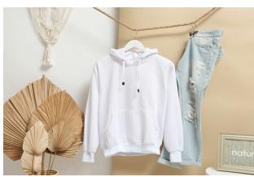  
HR Source

  
LR Source

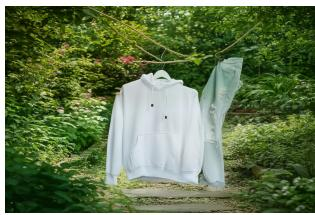  
R=3 (Ours)

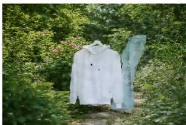  
R=0 (w/o Halo)  
Prompt: Change the indoor setting to an outdoor garden.

Figure 5: 2K Halo ablation under a shared instruction. R = 3 is compared with no Halo $( R = 0 , h = 0 )$ , highlighting cross-window continuity and texture.  
  
HR Source

  
LR Source

  
Cross-Res (Ours)

  
Sparse High-Res only  
Prompt: Transform the backdrop into a tropical rainforest.  
Figure 6: 2K anchor ablation. The anchor-free configuration removes the 1K branch; the full model retains instruction-driven scene layout.

Progressive Inference. Table 3 varies the transition index K at both resolutions. A larger K replaces more high-resolution steps with the 1K prefix, leaving fewer steps for target-scale refinement. At 2K, K = 8 gives

the strongest progressive quality among the tested transitions. At 4K, latency reductions increase with K;   
we use $K = 1 2$ in the main comparison. The table reports end-to-end timings for K = 8, 12, 16.

Low-Resolution Anchor and Low-to-High Guidance. We remove the complete 1K anchor while retaining the high-resolution sparse branch. This also removes the evolving low-resolution target state and its aligned guidance, leaving bounded high-resolution interactions to infer instruction-conditioned layout and object placement. Figure 6 shows the resulting structural failure mode. Appendix D documents the full-model topology, including the removed $L _ { N } \to H _ { N }$ pathway.

RGB/VAE versus Latent Lifting. We compare RGB resizing followed by target-resolution VAE encoding with direct latent interpolation, keeping subsequent denoising identical. Figure 7 isolates the lifting operator and shows better detail preservation with RGB-space upsampling.

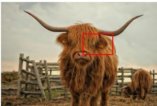

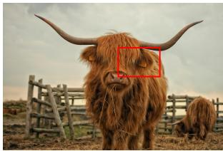

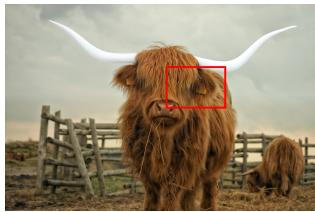

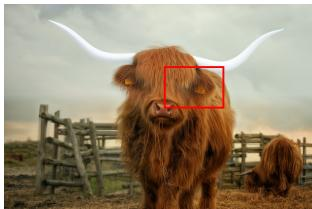

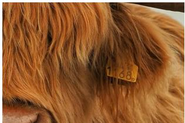  
HR Source

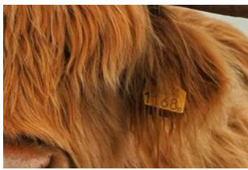  
LR Source

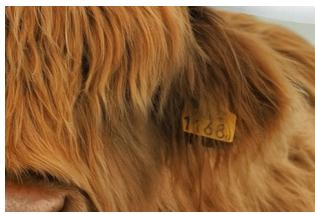  
w/ RGB

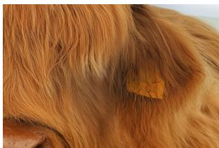  
w/ latent  
Prompt: Turn the cow's horns white.  
Figure 7: 2K lifting ablation at R = 3. RGB/VAE and latent configurations share the same progressive denoising and differ only in the lifting operator.

## 5 Conclusion

We presented FLASH, a native high-resolution editor that couples a frozen 1K editing anchor with sparse target-resolution refinement. Aligned low-to-high guidance connects the global editing trajectory to local Halo attention, while resolution-specific diffusion states and spatial position adaptation extend the pretrained editor to larger grids. Optional progressive inference replaces early high-resolution steps with a 1K prefix, controlling the quality–latency trade-off through the transition index. Experiments at 2K and 4K demonstrate this framework as a practical alternative to dense native editing and edit–then–refine cascades.

## AI Use Statement

AI tools assisted with manuscript editing and preparation of supporting release code. The authors are responsible for reviewing these contributions and for the accuracy of the manuscript, experimental results, figures, and released artifacts.

## Ethics Statement

This work does not involve human subjects, new personal-data collection, or human-participant experiments. We evaluate image editing models on an existing benchmark and report model behavior, sourceimage preservation, and computational cost. The released evaluation protocol should be used in accordance with the licenses and terms of the underlying benchmark and model checkpoints.

## Reproducibility Statement

The main paper describes the model, token topology, resolution mapping, training objective, and evaluation metrics. The supplementary material gives training and inference settings (Appendix A), algorithms (Appendix B), the evaluation-mask protocol (Appendix C), topology and kernel details (Appendices D and E), and additional visualizations (Appendix H). Reproduction requires the merged 1K checkpoint, its matching high-resolution adapter, the settings in Appendix A, and the evaluated connectivity in Appendix D.

## References

Omer Bar-Tal, Lior Yariv, Yaron Lipman, and Tali Dekel. Multidiffusion: Fusing diffusion paths for controlled image generation. 2023.

Tim Brooks, Aleksander Holynski, and Alexei A Efros. Instructpix2pix: Learning to follow image editing instructions. In 2023 IEEE/CVF Conference on Computer Vision and Pattern Recognition (CVPR), pp. 18392–18402. IEEE, 2023.

Junyang Chen, Jinshan Pan, and Jiangxin Dong. Faithdiff: Unleashing diffusion priors for faithful image super-resolution. In 2025 IEEE/CVF Conference on Computer Vision and Pattern Recognition (CVPR), pp. 28188–28197. IEEE, 2025a.

Pengtao Chen, Xianfang Zeng, Maosen Zhao, Mingzhu Shen, Peng Ye, Bangyin Xiang, Zhibo Wang, Wei Cheng, Gang Yu, and Tao Chen. Regione: Adaptive region-aware generation for efficient image editing. arXiv preprint arXiv:2510.25590, 2025b.

Pengtao Chen, Xianfang Zeng, Maosen Zhao, Mingzhu Shen, Wei Cheng, Gang Yu, and Tao Chen. Sparsevdit: Unleashing the power of sparse attention to accelerate video diffusion transformers. In Proceedings ofthe AAAI Conference on Artificial Intelligence, volume 40, pp. 2957–2965, 2026a.

Ting Chen. On the importance of noise scheduling for diffusion models. arXiv preprint arXiv:2301.10972, 2023.

Zhizhou Chen, Shanyan Guan, Zhanxin Gao, En Ci, Yanhao Ge, Wei Li, Zhenyu Zhang, Jian Yang, and Ying Tai. Vins-120k: Ultra high-resolution image editing with a large-scale dataset. arXiv preprint arXiv:2605.23518, 2026b.

Katherine Crowson, Stefan Andreas Baumann, Alex Birch, Tanishq Mathew Abraham, Daniel Z Kaplan, and Enrico Shippole. Scalable high-resolution pixel-space image synthesis with hourglass diffusion transformers. arXiv preprint arXiv:2401.11605, 2024.

Tri Dao, Dan Fu, Stefano Ermon, Atri Rudra, and Christopher Re. Flashattention: Fast and memory-efficient ´ exact attention with io-awareness. Advances in neural information processing systems, 35:16344–16359, 2022.

Linwei Dong, Qingnan Fan, Yihong Guo, Zhonghao Wang, Qi Zhang, Jinwei Chen, Yawei Luo, and Changqing Zou. Tsd-sr: One-step diffusion with target score distillation for real-world image superresolution. In 2025 IEEE/CVF Conference on Computer Vision and Pattern Recognition (CVPR), pp. 23174–23184. IEEE, 2025.

Ruoyi Du, Dongliang Chang, Timothy Hospedales, Yi-Zhe Song, and Zhanyu Ma. Demofusion: Democratising high-resolution image generation with no \$\$\$. In 2024 IEEE/CVF Conference on Computer Vision and Pattern Recognition (CVPR), pp. 6159–6168. IEEE, 2024.

Zheng-Peng Duan, Jiawei Zhang, Xin Jin, Ziheng Zhang, Zheng Xiong, Dongqing Zou, Jimmy S Ren, Chunle Guo, and Chongyi Li. Dit4sr: Taming diffusion transformer for real-world image super-resolution. In 2025 IEEE/CVF International Conference on Computer Vision (ICCV), pp. 18948–18958. IEEE, 2025.

Patrick Esser, Sumith Kulal, Andreas Blattmann, Rahim Entezari, Jonas Muller, Harry Saini, Yam Levi,¨ Dominik Lorenz, Axel Sauer, Frederic Boesel, Dustin Podell, Tim Dockhorn, Zion English, and Robin Rombach. Scaling rectified flow transformers for high-resolution image synthesis. In International Conference on Machine Learning, 2024.

Tsu-Jui Fu, Wenze Hu, Xianzhi Du, William Wang, Yinfei Yang, and Zhe Gan. Guiding instruction-based image editing via multimodal large language models. In International Conference on Learning Representations, volume 2024, pp. 54820–54833, 2024.

Yingqing He, Shaoshu Yang, Haoxin Chen, Xiaodong Cun, Menghan Xia, Yong Zhang, Xintao Wang, Ran He, Qifeng Chen, and Ying Shan. Scalecrafter: Tuning-free higher-resolution visual generation with diffusion models. In International conference on learning representations, volume 2024, pp. 37664– 37684, 2024.

Emiel Hoogeboom, Jonathan Heek, and Tim Salimans. Simple diffusion: End-to-end diffusion for high resolution images. In International Conference on Machine Learning, 2023.

Edward J Hu, Yelong Shen, Phillip Wallis, Zeyuan Allen-Zhu, Yuanzhi Li, Shean Wang, Lu Wang, and Weizhu Chen. Lora: Low-rank adaptation of large language models. arXiv preprint arXiv:2106.09685, 2021.

Black Forest Labs, Stephen Batifol, Andreas Blattmann, Frederic Boesel, Saksham Consul, Cyril Diagne, Tim Dockhorn, Jack English, Zion English, Patrick Esser, et al. Flux. 1 kontext: Flow matching for in-context image generation and editing in latent space. arXiv preprint arXiv:2506.15742, 2025.

Yaron Lipman, Ricky TQ Chen, Heli Ben-Hamu, Maximilian Nickel, and Matt Le. Flow matching for generative modeling. arXiv preprint arXiv:2210.02747, 2022.

Shiyu Liu, Yucheng Han, Peng Xing, Fukun Yin, Rui Wang, Wei Cheng, Jiaqi Liao, Yingming Wang, Honghao Fu, Chunrui Han, et al. Step1x-edit: A practical framework for general image editing. arXiv preprint arXiv:2504.17761, 2025.

Bowen Peng, Jeffrey Quesnelle, Honglu Fan, and Enrico Shippole. Yarn: Efficient context window extension of large language models. In International Conference on Learning Representations, 2024.

Robin Rombach, Andreas Blattmann, Dominik Lorenz, Patrick Esser, and Bjorn Ommer. High-resolution¨ image synthesis with latent diffusion models. In 2022 IEEE/CVF conference on computer vision and pattern recognition (CVPR), pp. 10674–10685. ieee, 2022.

Jianlin Su, Murtadha Ahmed, Yu Lu, Shengfeng Pan, Wen Bo, and Yunfeng Liu. Roformer: Enhanced transformer with rotary position embedding. Neurocomputing, 568:127063, 2024.

Lingchen Sun, Rongyuan Wu, Zhiyuan Ma, Shuaizheng Liu, Qiaosi Yi, and Lei Zhang. Pixel-level and semantic-level adjustable super-resolution: A dual-lora approach. In 2025 IEEE/CVF Conference on Computer Vision and Pattern Recognition (CVPR), pp. 2333–2343. IEEE, 2025.

Ashish Vaswani, Noam Shazeer, Niki Parmar, Jakob Uszkoreit, Llion Jones, Aidan N Gomez, Łukasz Kaiser, and Illia Polosukhin. Attention is all you need. Advances in neural information processing systems, 30, 2017.

Chenfei Wu, Jiahao Li, Jingren Zhou, Junyang Lin, Kaiyuan Gao, Kun Yan, Sheng-ming Yin, Shuai Bai, Xiao Xu, Yilei Chen, et al. Qwen-image technical report. arXiv preprint arXiv:2508.02324, 2025.

Kai Zhang, Lingbo Mo, Wenhu Chen, Huan Sun, and Yu Su. Magicbrush: A manually annotated dataset for instruction-guided image editing. Advances in neural information processing systems, 36:31428–31449, 2023.

Shen Zhang, Zhaowei Chen, Zhenyu Zhao, Yuhao Chen, Yao Tang, and Jiajun Liang. Hidiffusion: Unlocking higher-resolution creativity and efficiency in pretrained diffusion models. In European Conference on Computer Vision, pp. 145–161. Springer, 2024.

# Efficient and Faithful High-Resolution Image Editing with Sparse Cross-Resolution Denoising

Supplementary Material

This supplement details training and inference settings, algorithms, evaluation masks and metrics, attention topology, kernel implementation, complexity, limitations, and additional visual comparisons.

## A Training and Inference Settings

## A.1 Model initialization and data

We instantiate FLASH on FLUX.2 Klein Base 4B. We first fine-tune the 1K editor on the VINS-120K split (131,010 examples), merge it into the base Transformer, and freeze it. High-resolution adaptation then trains only a high-resolution LoRA branch; it neither re-trains the text encoder nor replaces the timestep embedding network.

The targets $H \in \{ 2 \mathrm { K } , 4 \mathrm { K } \}$ are square $2 0 4 8 \times 2 0 4 8$ and $4 0 9 6 \times 4 0 9 6$ canvases. With $L = 1 \mathrm { K }$ and $n = H / L ,$ each low-resolution parent cell corresponds to an $n \times n$ group of high-resolution latent tokens. Target and reference images are encoded natively at each resolution; the high-resolution noisy latent is not obtained by upsampling a low-resolution noisy latent.

## A.2 Trainable parameters and optimization

High-resolution adaptation uses rank-32 LoRA on attention and FFN projections. The 1K adapter has already been merged into the frozen base; only the high-resolution residual path is updated.

All high-resolution variants use AdamW with the settings in Table 4. The initial 2K screening stage has a matched 2,000-step budget, with the same data order, seed policy, adapter rank, optimizer, and inference protocol across variants. Each run archives its checkpoint, sampler, data split, step count, and evaluation set.

Table 4: Settings used in this work.
<table><tr><td>Item</td><td>Setting</td></tr><tr><td>Base model</td><td>FLUX.2 Klein Base 4B</td></tr><tr><td>Low-resolution editor</td><td>1K supervised fine-tuned checkpoint, merged and frozen</td></tr><tr><td>Training data</td><td>Full VINS-120K split; 131,010 examples</td></tr><tr><td>High-resolution branch</td><td>Rank-32 LoRA on attention and FFN projections</td></tr><tr><td>Optimizer</td><td>AdamW; learning rate  $2 \times 1 0 ^ { - 5 }$  ; weight decay 0.01</td></tr><tr><td>Warm-up</td><td>100 optimizer steps</td></tr><tr><td>High-resolution targets</td><td>2K and 4K</td></tr><tr><td>Low-to-high scale</td><td>n = 2 for 2K; n = 4 for 4K</td></tr><tr><td>RoPE</td><td>YaRN on the two spatial axes; image-stream and text axes keep na- tive RoPE; rotation-count thresholds  $( \alpha , \beta ) = ( 1 , 8 )$ </td></tr><tr><td>Timestep conditioning</td><td>Paired low/high branch conditioning with shared raw timesteps</td></tr><tr><td>Sparse support</td><td>R = 3 with synchronized Halo  $h = R n$ </td></tr></table>

## A.3 Noise schedule and conditioning

The training sampler draws a shared raw $u \in [ 0 , 1 ]$ and applies the resolution-dependent flow-matching shift

$$
s ( u ; \mu ) = \frac { \exp ( \mu ) u } { 1 + ( \exp ( \mu ) - 1 ) u } .
$$

The low-resolution branch follows the native 1K schedule. The high-resolution branch uses its paired state from Section 3.2 and receives its own timestep in the branch-conditioned Transformer blocks; reference rows remain clean. For FLUX.2, $\mu _ { L } = 1 . 1 5$ , with $\mu _ { H } = 1 . 3 8 0 5 1 7$ at 2K and $\mu _ { H } = 2 . 3 0 2 5 8 5 :$ at 4K.

The training loss is the flow-matching velocity regression on native resolution latents. For a clean latent z , independent Gaussian noise ϵ, and branch state s,

$$
x _ { s } = ( 1 - s ) z _ { 0 } + s \epsilon , \qquad v ^ { \star } = \epsilon - z _ { 0 } .
$$

Only the high-resolution branch is optimized against $v _ { H } ^ { \star }$ ; the frozen 1K branch supplies the editing anchor.   
No auxiliary cross-resolution consistency loss is used.

## A.4 Direct and progressive inference

Direct inference uses 28 denoising steps, classifier-free guidance 4.0, and one image per batch along the full joint trajectory. It applies YaRN RoPE and disables KV caching. Timing excludes one-time model loading; for the progressive path it includes the complete 1K prefix and the resolution transition.

Progressive inference uses K = 12 in the main comparison. After the first K native 1K steps, it forms a clean estimate, decodes it to RGB, resizes and re-encodes it, then re-noises it at the paired high-resolution state. The remaining $N - K$ steps use the direct cross-resolution model. Latent interpolation is evaluated separately as a lifting ablation.

## B Training and Inference Algorithms

## B.1 High-resolution training

Algorithm 1 High-resolution branch training   
Input: source/target images $I _ { R } , I _ { 0 } ;$ instruction $c ;$ frozen 1K editor L and trainable high-resolution LoRA   
parameters $\theta _ { H }$   
1: for each training example do   
2: (zRL, z0L) ← VAE ENCODE $( I _ { R }$ at 1K), VAE ENCODE $( I _ { 0 }$ at 1K)   
3: (zR , z0 ) ← VAE ENCODE(IR at H), VAE ENCODE $( I _ { 0 }$ at H)   
4: u ← Uniform(0, 1); sL ← shift(u; µL); sH ← shift(u; µH)   
5: ϵ , ϵ ← independent standard Gaussian noise   
6: $\mathbf { x } _ { L }  ( 1 - s _ { L } ) \mathbf { z } _ { L } ^ { 0 } + s _ { L } \epsilon _ { L } ; \mathbf { x } _ { H }  ( 1 - s _ { H } ) \mathbf { z } _ { H } ^ { 0 } + s _ { H } \epsilon _ { H }$   
7: X ← PACK(text(c), xL, zRL, xH, zRH)   
8: XH ← high-resolution segment of X   
9: X ← PARENT CELL PERMUTATION $\left( \mathbf { X } _ { H } , \mathbf { \Lambda } _ { n } \right)$   
10: X ← replace high-resolution segment in X with $\mathbf { X } _ { H }$   
11: (vL, vH) ← SPARSE CROSS RESOLUTION TRANSFORMER(X, sL, sH; θH)   
12: $\mathcal { L } \gets \mathrm { m e a n . s q u a r e } ( \mathbf { v } _ { H } , \epsilon _ { H } - \mathbf { z } _ { H } ^ { 0 } )$   
13: update $\theta _ { H }$ using AdamW(L)   
14: end for   
15: return frozen merged 1K editor and high-resolution LoRA checkpoint

The low-resolution branch is present in the forward pass so that the high-resolution branch can read the evolving editing state. Freezing the merged 1K branch prevents high-resolution adaptation from changing the native 1K editing prior.

## B.2 Parent-cell permutation

Algorithm 2 Window-major parent-cell permutation   
Input: low and high token-grid dimensions $( H _ { L } , W _ { L } )$ and $\left( H _ { H } , W _ { H } \right)$ ; scale $n = H _ { H } / H _ { L }$   
1: for each high token coordinate $( y , x )$ do   
2: $p _ { y }  \lfloor y / n \rfloor ; ~ p _ { x }  \lfloor x / n \rfloor ; ~ \ell _ { y }  y$ mod n; $\ell _ { x } \gets x$ mod n   
3: $k e y \gets ( p _ { y } , p _ { x } , \ell _ { y } , \ell _ { x } )$   
4: append original index to bucket[key]   
5: end for   
6: perm ← concatenate buckets in parent-cell row-major and local row-major order   
7: $\mathbf { X } _ { p e r m } \gets \mathrm { G A T H E R } ( \mathbf { X } _ { h i g h } , p e r m )$   
8: metaperm ← GATHER(token metadata, perm)   
9: inverse perm ← INVERT PERMUTATION(perm)   
10: return $\mathbf { X } _ { p e r m }$ , me $t a _ { p e r m } .$ inverse perm

The permutation makes all $n ^ { 2 }$ high-resolution tokens belonging to the same low-resolution parent cell contiguous. It changes storage order only; the inverse permutation restores the canonical sequence before decoding or writing diagnostics.

## B.3 Sparse attention support

Algorithm 3 Support construction for one Transformer block   
Input: token metadata; low-resolution radius R; Halo width h; enabled cross-resolution paths   
1: for each query $q$ do   
2: if $q$ is text or a low-resolution image token then   
3: keys(q) ← text, $L _ { N }$ , and $L _ { R }$ tokens (native global support)   
4: else if $q$ is $H _ { N }$ then   
5: $p $ PARENT CELL $( q )$   
6: $K _ { h i }  H _ { N }$ and $H _ { R }$ tokens in the local Halo around $p$   
7: $K _ { l o } \gets L _ { N }$ tokens in the parent neighborhood of Chebyshev radius $R$   
8: $K _ { t x t } \gets$ text tokens   
9: $k e y s ( q ) \gets K _ { h i } \cup K _ { l o } \cup K _ { t x t }$   
10: else if $q$ is $H _ { R }$ then   
11: $k e y s ( q )$ ← permitted text tokens plus the local high-resolution support   
12: end if   
13: emit row offsets and exact key indices for $q$   
14: end for   
15: apply one normalized sparse softmax over each emitted row   
16: return sparse attention output and row metadata

The high-resolution query rows are formed from exact spatial indices rather than a dense mask, and boundary cells are clipped to the valid image grid. Training evaluates the same connectivity with a dense block-

sparse mask, while inference uses the compressed-sparse-row (CSR) kernel described in Section E. In the configuration used throughout, high-resolution queries do not read low-resolution reference keys, while only HN queries retain the local low-resolution noisy-target support.

## B.4 Progressive low-to-high inference

Algorithm 4 Training-free progressive inference   
Input: source image $I _ { R } ,$ instruction c, total steps N, transition index K   
1: zRL ← VAE ENCODE(IR at 1K); zRH ← VAE ENCODE $( I _ { R }$ at target resolution H)   
2: x ← INITIALIZE NOISE(1K)   
3: for i = 0, . . . , K − 1 do   
4: vL ← FROZEN 1K EDITOR(xL, zR, c, sL[i])   
5: xL ← EULER STEP(xL, vL, sL[i] → sL[i+1])   
6: end for   
7: vL ← FROZEN 1K EDITOR(xL, zR, c, sL[K])   
8: x0,L ← CLEAN ESTIMATE(xL, vL, sL[K])   
9: ˆIL ← VAE DECODE(x0,L)   
10: $\begin{array} { r } { \tilde { I } _ { H } \gets \mathrm { R G B \_ R E S I Z E } ( \hat { I } _ { L } , } \end{array}$ target resolution H)   
11: x ← VAE ENCODE(˜I )   
12: xH ← (1 − sH[K]) x0,H + sH[K] GAUSSIAN NOISE   
13: for i = K, . . . , N − 1 do   
14: (vL, vH) ← CROSS RESOLUTION MODEL(xL, xH, zRL, zRH, c, sL[i], sH[i])   
15: (xL, xH) ← PAIRED EULER STEP(xL, xH, vL, vH)   
16: end for   
17: return VAE DECODE(xH)

## C Evaluation Masks and Metrics

## C.1 Evaluation protocol

VINS-4KEval contains 509 instructions across 12 edit categories. Before comparing methods, we generate each mask from the source image and the instruction-derived edit specification only. Outputs are never used in mask construction. Every method, resolution route, and transition uses the same mask for a given case.

We use GroundingDINO-Tiny in FP32 and SAM2.1 Hiera Tiny in the model dtype. Detection thresholds are 0.25 for boxes and 0.20 for text, with at most four detections per query. An elliptical structuring element dilates the mask with a radius of 1.5% of the shorter source-image dimension.

## C.2 Instruction parsing and query routing

A deterministic parser extracts the mask scope, source and requested object phrases, spatial anchor and relation, and parsing status. Where possible, part-level requests such as “eyes,” “beak,” or “horns” are queried directly rather than expanded to the whole object. Replacement records both object phrases; addition uses a source-only anchor because the requested object is absent.

## C.3 Mask construction

For local deletion, replacement, and attribute edits, GroundingDINO detects the source phrase and passes its boxes to SAM2. We take the mask union as $M _ { e }$ and apply the fixed dilation. If SAM2 is unavailable, detector boxes provide a marked coarse fallback, kept separate from SAM2 masks.

For addition, relations such as “above,” “near,” “left,” and “in the background” determine a region around the detected source anchor. If no concrete anchor is detected, a deterministic foreground, background, left, or right region is selected from the instruction. The added object is never localized from the generated image.

For background edits, the evaluator detects a category-aware source foreground query (for example, animal., person., vehicle., or object.) and segments it with SAM2. Let $M _ { f }$ be the dilated foreground mask. The editable region is

$$
M _ { e } = 1 - M _ { f } , M _ { k } = M _ { f } ,
$$

so the changed background is scored as editable while the source foreground is evaluated for preservation. Global tone, style, camera, and personalized generation edits use $M _ { e } = { \bf 1 }$ and are excluded from local keep-region metrics.

## C.4 Resolution normalization and per-image metrics

Every output is converted to the common target canvas before mask application. The mask is resized with nearest-neighbor interpolation. Let $I _ { s }$ be the source, $I _ { o }$ the output, $M _ { e }$ the editable region, and $M _ { k } = 1 - M _ { e }$ the keep region.

Non-edited-region preservation. For a valid keep region $M _ { k }$ , let $I _ { s } ( p ) , I _ { o } ( p ) \in [ 0 , 2 5 5 ] ^ { 3 }$ be the 8-bit RGB vectors at pixel $p .$ . We average over pixels and channels and normalize the squared error by $2 5 5 ^ { 2 }$

$$
\mathrm { m M S E } = \frac { 1 } { 3 2 5 5 ^ { 2 } | M _ { k } | } \sum _ { p \in M _ { k } } \| I _ { s } ( p ) - I _ { o } ( p ) \| _ { 2 } ^ { 2 } .
$$

The corresponding per-image PSNR is

$$
\mathrm { \ m P S N R } = - 1 0 \log _ { 1 0 } \mathrm { m M S E } .
$$

For zero squared error, mPSNR is +∞. These metrics are computed per image before macro-averaging; the mean PSNR is not inferred from the mean MSE. SSIM is computed after replacing the masked edit region with the same neutral value in both images. The keep-region mask is eroded by the SSIM window radius before averaging the SSIM map, with identical handling for all methods.

Edit-region perceptual distance. For local edits, mLPIPS is the source–output perceptual distance on the editable region. Before compositing, images are resized to a maximum long side of 1024 pixels with Lanczos interpolation; masks use nearest-neighbor resizing. Both images are composited against the same neutral background outside $M _ { e }$ , and LPIPS is computed on the pair,

$$
\mathrm { m L P I P S } = \mathrm { L P I P S } ( \mathrm { c o m p } ( I _ { s } , M _ { e } ) , \mathrm { c o m p } ( I _ { o } , M _ { e } ) ) .
$$

For global edits, $M _ { e } = { \bf 1 }$ , so this score is computed on the full source–output pair. It measures perceptual change from the source, not instruction completion. Keep-region and edit-region scores are aggregated separately.

Full-image structural score. HaarPSI is computed on the full normalized source/output pair, without restriction to $M _ { e }$ or $M _ { k }$

## C.5 Aggregation and validity

Per-sample records include the case, method, edit type, mask scope and coverage, normalization resolution, and metric values. We first average within each edit type over applicable finite scores and then across types, so larger categories do not dominate. Global edits contribute to full-image metrics but not local masked-preservation averages. Detector-based edit-success flags remain automatic proxies rather than human-verified semantic judgments.

We retain source queries, boxes, confidence scores, mask coverage, and visual sheets with the source, shared mask, and outputs with mask overlays. Ambiguous part-level masks are manually overridden or excluded, with the reason recorded. OCR exact-match and CER are not reported.

## D Low–High Attention Topology

## D.1 Information-flow statement

Arrows A → B denote information flow, not query–key matrix direction. The evaluated topology retains one direct cross-resolution guidance path:

$$
L _ { N } \longrightarrow H _ { N } .
$$

Its implementation is a high-resolution noisy-target query reading low-resolution noisy-target keys and values:

$$
\mathrm { A t t n } _ { L _ { N }  H _ { N } } ( Q _ { H _ { N } } , K _ { L _ { N } } , V _ { L _ { N } } ) .
$$

Thus high-resolution queries receive guidance from the evolving 1K edit.

## D.2 What is retained

The low-resolution branch keeps its native global editing interaction over text, $L _ { N }$ , and $L _ { R }$ . Highresolution noisy-target queries use a spatially aligned neighborhood of $L _ { N }$ keys, where the parent cell of a high-resolution query is

$$
\pi ( y , x ) = \left( \left\lfloor y / n \right\rfloor , \left\lfloor x / n \right\rfloor \right) .
$$

The support is bounded by a Chebyshev radius R, giving at most

$$
K _ { L } = ( 2 R + 1 ) ^ { 2 }
$$

low-resolution target keys before image-boundary clipping. High-resolution target/reference tokens interact locally through the Halo support on the high-resolution grid. These are local same-resolution source/detail interactions, not additional cross-resolution reference bridges.

## D.3 What is not retained

In the evaluated configuration, high-resolution queries exclude low-resolution reference keys. $H _ { N }$ queries still read their local $L _ { N }$ neighborhood. The low-resolution reference remains available to the 1K editor, and the high-resolution reference enters through local Halo support.

## D.4 Query–key adjacency in the reported configuration

Table 5 gives the full query–key connectivity. Text and low-resolution rows attend globally to Text, $L _ { N }$ and $L _ { R } , \ H _ { N }$ rows read text, their aligned $L _ { N }$ neighborhood, and local Halo keys; $H _ { R }$ rows read text and local Halo keys. Each row uses one attention distribution over the union of admitted keys. High-resolution rows do not read low-resolution reference keys.

Table 5: Query–key adjacency of the evaluated configuration. Local denotes the Chebyshev-R parent-cell neighborhood $( K _ { L } = ( 2 R + 1 ) ^ { 2 }$ keys) or the Halo support $( K _ { H } = ( n + 2 h ) ^ { 2 }$ keys); $\checkmark$ denotes the native global pattern.
<table><tr><td>Query\ Key</td><td>Text</td><td> $L _ { N }$ </td><td> $L _ { R }$   $H _ { N }$ </td><td></td><td> $H _ { R }$ </td></tr><tr><td>Text</td><td>√</td><td>√</td><td>V</td><td>一</td><td>一</td></tr><tr><td> $L _ { N }$ </td><td>V</td><td>V</td><td>V</td><td>一</td><td>一</td></tr><tr><td> $L _ { R }$ </td><td>V</td><td>√</td><td>√</td><td></td><td></td></tr><tr><td> $H _ { N }$ </td><td>√</td><td>local</td><td>一</td><td>local</td><td>local</td></tr><tr><td> $H _ { R }$ </td><td>√</td><td>一</td><td>一</td><td>local</td><td>local</td></tr></table>

## D.5 Scope of the comparison

The topology retains $L _ { N } \to H _ { N }$ guidance and excludes low-resolution reference keys from high-resolution queries. These choices apply to the evaluated configuration, not to every reference-fusion design.

## E Sparse Kernel Implementation

## E.1 Sequence layout and metadata

The canonical packed sequence is

$$
[ \mathbf { T } _ { \mathrm { t e x t } } , \mathbf { T } _ { L _ { N } } , \mathbf { T } _ { L _ { R } } , \mathbf { T } _ { H _ { N } } , \mathbf { T } _ { H _ { R } } ] .
$$

Before attention, high-resolution tokens are reordered by parent cell. Permuted metadata records segment identity, parent-cell and high latent-token coordinates, and inverse-permutation indices. The kernel uses these indices to construct exact supports without a dense $( S \times S )$ mask.

## E.2 CSR attention kernel

For 2K inference, text and low-resolution rows use FlashAttention, while high-resolution rows use a Triton CSR kernel over paired high-resolution target/reference rows with

$$
R = 3 , \qquad h = 6 \mathrm { ( 2 K ) } .
$$

Each descriptor stores valid key indices and offsets, avoiding scores for masked keys. Boundary rows are clipped to their valid prefix. Training uses a dense block-sparse mask with the same connectivity.

High-resolution support combines local target/reference keys, text, and the aligned $L _ { N }$ neighborhood for $H _ { N }$ queries. A single attention distribution normalizes this union.

## E.3 Correctness and runtime safeguards

We validate each permutation and CSR builder against a dense reference: the densified support must match the intended topology, and the inverse permutation must restore the original token order. Boundary cells are checked separately from interior parent cells because their valid key counts differ. Each run records model-loading time, generation time, and peak memory.

## E.4 Independent forward diagnostic

Figure 2 reports a separate single-forward diagnostic. The dense comparator processes text and target/reference image tokens without a low-resolution image branch. The sparse configuration uses $R = 1$ $h = 2$ at 2K and h = 4 at 4K, with high-resolution shifts 1.380517 and 3.229986, respectively. These are the benchmark settings, not the $R = 3 , h = 6 / 1 2$ quality configuration. Its 4.2× total-forward and 25.3× attention ratios therefore characterize that diagnostic only, not end-to-end generation or progressive inference.

## F Complexity Derivation

## F.1 Notation

Let $H _ { L } , W _ { L }$ and $H _ { H } , W _ { H }$ be the low- and high-resolution token-grid dimensions, and let ${ P _ { L } } = { H _ { L } } W _ { L }$ and $P _ { H } = H _ { H } W _ { H } = n ^ { 2 } P _ { L }$ be the corresponding image-token counts per image stream. Let T be the text token count, d the head dimension, R the low-resolution support radius, and h the high-resolution Halo width. The high-resolution local support before boundary clipping contains

$$
K _ { H } = ( n + 2 h ) ^ { 2 }
$$

tokens per image stream. The aligned low-resolution target support contains $K _ { L } = ( 2 R + 1 ) ^ { 2 }$ keys.

## F.2 Dense attention

The native dense comparator in Figure 2 uses a sequence of length $T + 2 P _ { H }$ , without low-resolution image tokens. For comparison with a fully dense mixed-resolution topology, all five token groups would participate in global attention, giving

$$
S _ { \mathrm { d e n s e } } = T + 2 P _ { L } + 2 P _ { H } .
$$

The score and value-mixing work of one dense attention layer is

$$
\mathcal { C } _ { \mathrm { d e n s e } } = \Theta \big ( S _ { \mathrm { d e n s e } } ^ { 2 } d \big ) , \qquad \mathcal { M } _ { \mathrm { d e n s e } } = \Theta \big ( S _ { \mathrm { d e n s e } } ^ { 2 } \big )
$$

if the score matrix is materialized. Flash-style kernels reduce score storage, but the dense pairwise arithmetic remains quadratic in $S _ { \mathrm { d e n s e } }$

## F.3 Sparse cross-resolution attention

The low-resolution/text part retains native global interaction:

$$
\mathcal { C } _ { L } = \Theta \big ( ( T + 2 P _ { L } ) ^ { 2 } d \big ) .
$$

For high-resolution query rows, each query sees a finite support and, for $H _ { N }$ rows, an additional lowresolution target neighborhood. Writing $Q _ { H }$ for the number of high-resolution query rows gives the conservative upper bound

$$
\mathcal { C } _ { H } = O \big ( Q _ { H } \left[ T + 2 ( n + 2 h ) ^ { 2 } + ( 2 R + 1 ) ^ { 2 } \right] d \big ) .
$$

For the common paired target/reference layout $Q _ { H }$ is proportional to $2 P _ { H }$ . Therefore,

$$
\mathcal { C } _ { \mathrm { s p a r s e } } = O \big ( ( T + 2 P _ { L } ) ^ { 2 } d ~ + ~ Q _ { H } \left[ T + 2 ( n + 2 h ) ^ { 2 } + ( 2 R + 1 ) ^ { 2 } \right] d \big ) ~ .
$$

The corresponding sparse score storage is

$$
{ \mathcal { M } } _ { \mathrm { s p a r s e } } = O { \left( ( T + 2 P _ { L } ) ^ { 2 } \ + \ Q _ { H } \left[ T + 2 ( n + 2 h ) ^ { 2 } + ( 2 R + 1 ) ^ { 2 } \right] \right) }
$$

for an implementation that stores low/text scores densely and high rows as CSR. A fused kernel can reduce the constant factor and avoid materializing the full score tensor.

## F.4 Scaling with resolution

With $P _ { H } = n ^ { 2 } P _ { L }$ , dense high-resolution visual interactions grow as $\Theta ( n ^ { 4 } P _ { L } ^ { 2 } d )$ . The sparse high-resolution term retains the explicit support factor

$$
O \big ( n ^ { 2 } P _ { L } \left[ ( n + 2 h ) ^ { 2 } + ( 2 R + 1 ) ^ { 2 } + T \right] d \big ) .
$$

For each fixed 2K/4K run, this is a finite-support edge count. Under the synchronized rule $h = R n$ , the support itself scales with $n ;$ therefore the sparse term should not be interpreted as resolution-independent linear scaling. The parent-cell permutation does not change the edge count; it improves memory locality and exposes regular CSR rows.

## F.5 End-to-end denoising cost

At fixed network depth and head count, let the joint-update cost include attention, projections, and feedforward computation:

$$
\mathcal { C } _ { \mathrm { s t e p } } = \Theta ( \mathcal { C } _ { \mathrm { s p a r s e } } + \mathcal { C } _ { \mathrm { p r o j } } + \mathcal { C } _ { \mathrm { F F N } } ) .
$$

Let $\mathcal { C } _ { \mathrm { s h a r e d } }$ collect common non-denoising work, including text and source encoding and final VAE decod ing. Let $\mathcal { C } _ { L \mathrm { { - o n l y } } }$ denote one native 1K update, $\mathcal { C } _ { \mathrm { s w i t c h } }$ the additional 1K velocity prediction at step K, and $\mathcal { C } _ { \mathrm { l i f t } }$ the RGB/VAE transition. The costs are then

$$
\mathcal { C } _ { \mathrm { d i r e c t } } = N \mathcal { C } _ { \mathrm { s t e p } } + \mathcal { C } _ { \mathrm { s h a r e d } } ,
$$

$$
\begin{array} { r } { \mathcal { C } _ { \mathrm { p r o g r e s s i v e } } = K \mathcal { C } _ { L \mathrm { - o n l y } } + \left( N - K \right) \mathcal { C } _ { \mathrm { s t e p } } } \\ { + \mathcal { C } _ { \mathrm { s h a r e d } } + \mathcal { C } _ { \mathrm { s w i t c h } } + \mathcal { C } _ { \mathrm { l i f t } } . } \end{array}
$$

Thus K and $N - K$ count Euler updates, not all model evaluations: forming the clean estimate requires an additional prediction at the switch. The lift is paid once, and its overhead must be included when assessing the benefit of replacing high-resolution updates.

## G Limitations and Future Work

## G.1 Current limitations

VINS-4KEval lacks pixel-level edit annotations, so evaluation masks are automatic estimates. GroundingDINO may select a whole object for a part-level request, and source-only addition regions are conservative when no concrete anchor is specified. Auditing these masks does not replace human semantic judgment.

The topology relies on a capable 1K semantic anchor and local target/reference support with bounded $L _ { N } \to H _ { N }$ guidance. Highly nonlocal edits, large geometric rearrangements, or instructions depending on fine target-scale text may not fit this division of labor. Boundary-dependent row lengths can also reduce kernel efficiency when CSR buckets pack poorly.

Progressive inference introduces RGB-transition states that differ from the native joint trajectory. Although training-free, the path is not explicitly represented during training. Direct latent interpolation is evaluated only as a lifting ablation.

## G.2 Future work: training-aware progressive inference

A natural extension is to include progressive transitions during training. At a sampled K, a 1K prefix would produce the clean estimate and lifting would initialize the high-resolution state. Training on a mixture of direct and post-transition states could reduce the progressive train–test gap while retaining direct-path quality.

Further directions include source-only mask uncertainty, resolution-adaptive CSR bucketing, fused neighborhood kernels preserving the single-softmax union, and human evaluation of part-level edits and small text.

Prompt: Replaced roadside bushes with palm trees

## H Additional Visualizations

## H.1 2K Resolution

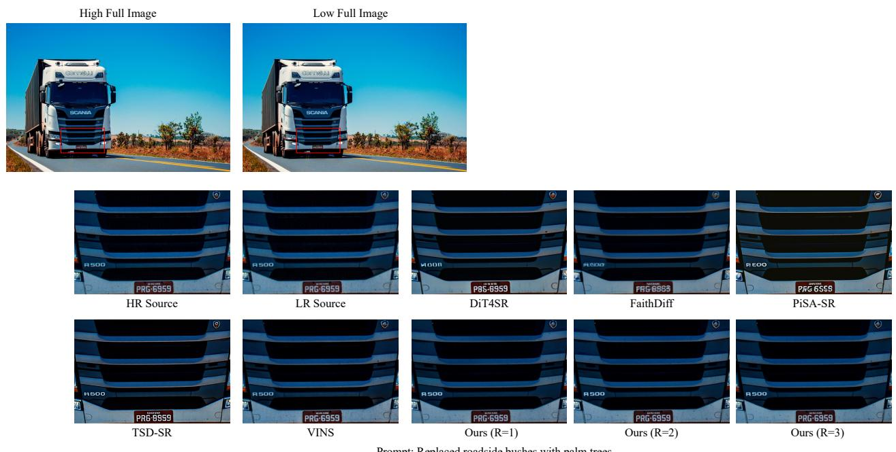  
Figure 8: Additional 2K comparisons on VINS-4KEval under the shared GroundingDINO+SAM2 masks. Each group shows the source, instruction, and method outputs. Local structure, small text, and thin boundaries reveal differences between 1K-upsampled and native high-resolution editing

## H.2 4K Resolution

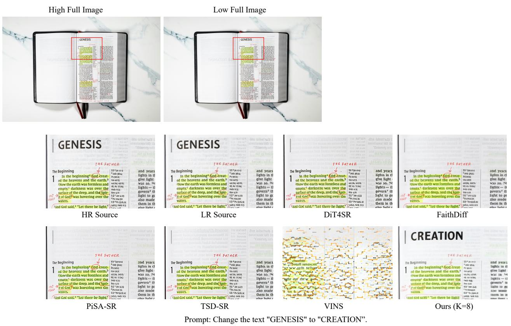  
Figure 9: Additional 4K comparisons on VINS-4KEval under the same shared-mask protocol, contrasting native target-resolution detail with 1K editing followed by super-resolution.