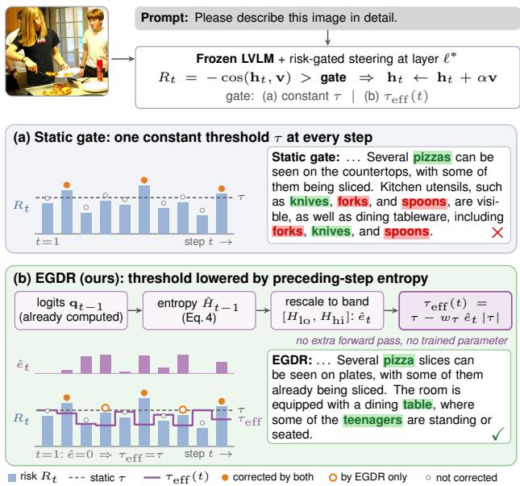
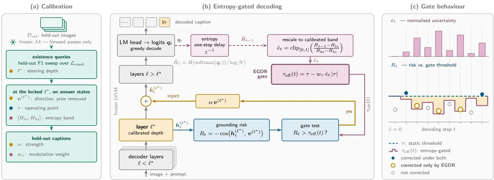
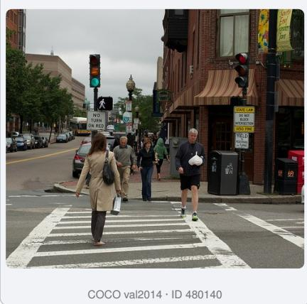

# Entropy-Gated Dynamic Rectification for Object Hallucination in Large Vision-Language Models

Riasad Alvi1, Md. Asaduzzaman Shuvo1, Md. Ahashan Habib1, Md. Faiyaz Abdullah Sayeedi1,2 1United International University, Bangladesh 2BRAC University, Bangladesh {ralvi212069, ashuvo221104, mhabib201261, msayeedi212049}@bscse.uiu.ac.bd

## Abstract

Large Vision-Language Models (LVLMs) routinely name objects that are absent from the image. Latent steering can reduce this failure in one model forward pass, but a fixed gate treats early and late decoding steps by the same criterion. We observe that predictive entropy varies sharply within free-running generation, while states that commit to short answers occupy a narrow, confident band. We exploit this temporal mismatch by using uncertainty as a causally available, token-local control signal for an existing steering gate. We propose Entropy-Gated Dynamic Rectification (EGDR), which lowers the intervention threshold when entropy derived from the preceding step’s already available logits is high and retains the calibrated operating point when it is low. On LLaVA-1.5-7B, the underlying static gate lowers CHAIR CS/CI from 53.00/15.30 to 32.00/14.30; replacing only its constant threshold with EGDR further lowers them to 29.00/13.60. At a matched 58% intervention rate, the corresponding static control obtains 30.50/14.00. The gain over the static gate holds on LLaVA-NeXT-7B and grows with the generation budget, while POPE scores and general multimodal capability remain effectively unchanged. EGDR requires no additional model forward pass and adds roughly 2% measured latency. Our code is available at https://github.com/alvi-uiu/EGDR.

## 1. Introduction

Large vision-language models (LVLMs) produce fluent descriptions that are frequently ungrounded: they name objects the image does not contain, a failure that persists across architectures and is severe enough to block deployment where precision matters [18, 25, 31]. Broader diagnostics further expose language–vision confusion and attribute–relation errors [11, 37]. The cause is commonly traced to the language backbone asserting its own priors when the visual evidence is weak or ambiguous.

  
Figure 1. Overview of EGDR. Both gates share $\mathbf { v } , \ell ^ { * }$ and α; only the threshold differs. (a) A static gate applies one threshold τ at every step. (b) EGDR lowers it to τeff(t) using the entropy of the preceding step’s logits, rescaled to the calibrated band, and so corrects states the static gate misses; at t=1, eˆ=0 and τeff=τ . Gate strips are schematic; bubbles quote the second paragraph of real LLaVA-1.5-7B captions verbatim (CHAIR: hallucinated objects in red, grounded in green).

Training-time curation and robust instruction tuning reduce such failures but require new data or optimization [22, 42]; post-hoc correction can instead verify and revise an initial response, at the cost of a multi-stage pipeline [41]. Mitigating hallucination inside a single decoding pass is therefore attractive. Contrastive decoding compares the output distribution against one from a degraded or augmented visual input [2, 15] or an earlier layer [5]; contrasting two inputs is effective but needs more than one forward pass per token. Latent steering instead adds a precomputed direction to the hidden state and therefore preserves the single pass [17, 19, 27, 40]. Because a steering vector is applied everywhere it would perturb computation that is working correctly, these methods admit it through a gate: a risk score is computed from the current hidden state and the correction is injected only when that score exceeds a threshold τ.

  
Figure 2. Pipeline of EGDR. (a) Held-out calibration selects the steering depth $\ell ^ { * }$ , estimates the prior-removed direction $\mathbf { v } ^ { ( \ell ^ { * } ) }$ , threshold τ, and entropy band $[ H _ { \mathrm { l o } } , H _ { \mathrm { h i } } ]$ , and tunes α and $w _ { \tau }$ . (b) At each decoding step, the current hidden state yields risk $R _ { t } ,$ while preceding-step entropy lowers τ to $\tau _ { \mathrm { e f f } } .$ . If $R _ { t } > \tau _ { \mathrm { e f f } }$ , EGDR injects $\boldsymbol { \dot { \alpha } } \mathbf { v } ^ { ( \ell ^ { * } ) }$ . This requires no additional forward pass or trained parameter. (c) The adaptive threshold admits states missed by the static gate; at the first token, $\hat { e } = 0$ and $\tau _ { \mathrm { e f f } } = \tau$

That threshold is a constant. The same value decides whether to intervene at an early caption token and at the two hundredth. Yet decoder uncertainty is not constant: the states at which LLaVA-1.5 commits to short answers occupy a narrow normalized-entropy band between 0.008 and 0.059, while the majority of free-running generation steps lie above it. This exposes a mismatch between a timevarying decoder and a time-invariant gate and suggests uncertainty as a causally available control signal. We evaluate it against both the original static gate and a firing-ratematched alternative.

We use that signal to set the gate. At each step we read the entropy of the distribution produced at the previous step, rescale it to a band estimated during calibration, and lower the threshold in proportion: $\tau _ { \mathrm { e f f } } = \tau - w _ { \tau } \hat { e } _ { t } | \tau |$ . Confident steps keep the calibrated operating point; uncertain steps are corrected more readily. The logits already exist; converting them to entropy adds a lightweight vocabulary reduction but no model forward pass and no trained parameter. We call it EGDR, Entropy-Gated Dynamic Rectification; Fig. 1 illustrates it and Fig. 2 details the pipeline.

The design follows from two further observations. The depth at which steering is effective is narrow and nonmonotonic: F1 varies by 16.24 points across five adjacent layers and peaks at the penultimate one, so we select the layer by calibration rather than by convention. And the mechanism is confined to multi-token generation, since a causally available entropy estimate does not exist at the first decoded token: on discriminative benchmarks answered in one token the effective threshold reduces to τ and EGDR uses the same decision-time intervention as static steering. This delimits where the method applies and explains why its benefit appears in captioning while discriminative accuracy is preserved.

On LLaVA-1.5-7B, a calibrated static gate lowers CHAIR from 15.30 to 14.30 and CHAIR from 53.00 to 32.00. Replacing only its constant threshold with EGDR further lowers the two metrics to 13.60 and 29.00. A static threshold matched to EGDR in firing rate reaches 14.00 and 30.50, respectively. EGDR also improves on the static gate on LLaVA-NeXT-7B, while POPE, MME and MM-Vet remain effectively unchanged and measured overhead is approximately 2% per token.

Our contributions are:

• We identify a temporal mismatch between a fixed steering threshold and non-stationary predictive uncertainty, and test preceding-step entropy as a causally available control signal without adding a model forward pass.

• We introduce EGDR, modulating the gate rather than the steering direction or its magnitude, and show that its benefit is not explained by intervening more often: a static gate matched in firing rate recovers only part of it.

• We show that the benefit grows monotonically with the generation budget and vanishes on single-token answers: this is the behavior the mechanism predicts, and one a discriminative benchmark does not expose.

• We use held-out validation, rather than an architectural convention, to select intervention depth and strength, and compare all gates at that locked operating point.

## 2. Related work

## 2.1. Object hallucination in LVLMs

Contemporary LVLMs attach a visual encoder to a language backbone through a projection module, as in BLIP-2 [16], MiniGPT-4 [45], InstructBLIP [6], Qwen-VL [3] and the LLaVA family [23, 24], which pairs a CLIP [30] encoder with an MLP connector. Cross-attention and groundedtoken variants include Flamingo, Kosmos-2 and DeepSeek-VL [1, 28, 29]. Across these designs the model may describe objects, attributes or relations that the image does not contain [25, 31]. The two standard probes measure this from opposite directions: CHAIR [31] counts hallucinated objects inside free-form captions, while POPE [18] poses balanced yes/no existence questions and is therefore answered in a single token; HallusionBench and AMBER broaden diagnosis to language–vision confusion, attributes and relations [11, 37]. The generative–discriminative distinction matters for any method whose signal is defined over a sequence of decoding steps, and we return to it in Sec. 3.4.

## 2.2. Inference-time mitigation

Robust instruction tuning and cleaning hallucinatory visual instructions improve the model before deployment [22, 42], while Woodpecker verifies and revises a generated response through a multi-stage post-hoc pipeline [41]. These approaches require data, optimization or additional modules, so a large body of work intervenes directly at inference. One family manipulates output distributions. VCD [15] contrasts the logits obtained from an image against those from a distorted copy, AGLA [2] fuses the original-image logits with those of a prompt-relevant augmented view, DoLa [5] contrasts early-exit and final-layer predictions, OPERA [12] penalizes the over-trust pattern that precedes hallucinated tokens during beam search, and M3ID [8] contrasts the conditioned and unconditioned distributions. Contrasting two inputs costs a second forward pass per token and OPERA adds beam search; DoLa reads earlier layers of the same pass. Several authors have noted that contrasting away language priors can also remove priors the model legitimately needs [4].

Other training-free decoders exploit internal structure: DeCo mixes evidence from selected preceding layers [36], DAMRO suppresses visually irrelevant high-attention tokens [10], and FarSight modifies the causal attention mask to limit snowballing errors [34]. These methods adapt logits or attention; EGDR instead adapts whether a fixed latent correction is admitted.

A second family edits internal state directly. PAI [26] rebalances attention toward image tokens and refines the logits against a text-only input, ICT [4] shifts the activations of attention heads that carry image-level and object-level evidence, and ONLY [35] reports that intervening at a single layer in a single query is sufficient: the design point we adopt. Attention-lens and head-suppression analyses likewise localize hallucination to particular middle-layer pathways or dynamically selected heads [13, 32].

## 2.3. Latent steering

Closest to our setting are methods that add a precomputed direction to the hidden state at inference. The idea originates with inference-time intervention [17] for language models and has been adapted to the multimodal case by VTI [27], steering latent representations along a direction estimated from contrastive pairs, by VISTA, which combines visual-information steering with early-layer token evidence [19], and by Nullu [40], projecting representations out of a subspace associated with hallucination. To isolate temporal gating, we instantiate a risk-gated steering baseline: a risk score is computed from the current hidden state and the direction is injected only when that score exceeds a fixed threshold. The visual direction used in our experiments is constructed from the model itself, by contrasting the hidden states produced with and without visual input and removing the component aligned with the languageprior direction (Sec. 3.1); Sec. 3 examines what such a threshold should depend on, and Sec. 4 derives it from the model’s own uncertainty.

This family leaves open where and when to intervene. Steering applied uniformly across layers disturbs unrelated computation and costs general capability [27, 40]; we select a single depth by calibration (Sec. 3.2). A fixed gate also treats all decoding steps as equally at risk, although errors accumulate autoregressively. We address this second point. Distribution-level decoders (VCD, DoLa, OPERA, M3ID) reshape the output distribution, mostly with extra forward passes; EGDR neither contrasts distributions nor alters the steering vector, and uses preceding-step entropy only to decide when a fixed latent correction is admitted.

The static arm reported throughout our experiments is exactly this formulation: a direction projected onto the orthogonal complement of the language prior, a single intervention depth fixed by calibration, and a threshold placed at a percentile of the risk observed on factual states; EGDR recovers it exactly at $w _ { \tau } ~ = ~ 0 .$ Every difference we report between the two arms is therefore the gate and nothing else. Concurrent work intervenes at other points of the same pipeline: HulluEdit edits an evidence-consistent subspace in a single pass [21], attribution-guided sparsification selects the layers to steer by causal attribution rather than by calibration [7], VEGAS keys an adaptive intervention on vision-encoder attention rather than on uncertainty [39], and prefill-time intervention argues that decoding-stage steering amplifies residual hallucinations because errors accumulate autoregressively [44]. Our length sweep in Sec. 5.3 bears directly on that last claim. Token reduction offers a complementary view of inference-time computation: compression removes redundant tokens to cut cost [33], it has been argued to serve goals beyond efficiency, including hallucination mitigation [14], and pruning can itself introduce safety vulnerabilities [38]. EGDR removes no token; it uses uncertainty only to decide at which decoding steps a fixed correction is admitted.

## 3. Preliminary analysis

This section asks whether a constant steering threshold is justified. We establish where the intervention is effective (Sec. 3.2), show that predictive uncertainty during generation lies largely outside the confident regime of committed answers (Sec. 3.3), and identify where an uncertaintydependent threshold can act (Sec. 3.4). All measurements use LLaVA-1.5-7B with greedy decoding on calibration data disjoint from every evaluation set.

## 3.1. Risk-gated steering

We use a risk-gated steering formulation. Let $\mathbf { h } _ { t } ^ { ( \ell ) }$ be the hidden state at layer ℓ and decoding step t. For each correctly answered calibration query, we replay the same answer with the image masked and average the paired state difference to obtain $\mathbf { v } _ { \mathrm { r a w } } ^ { ( \ell ) }$ . We also form a language-prior direction $\mathbf { u } _ { \mathrm { p r i o r } } ^ { ( \ell ) }$ from the mean difference between incorrect and correct answer states when the image is masked. All states are taken at the last answer token. The fixed direction used by every gated arm is

$$
\mathbf { v } ^ { ( \ell ) } = \mathrm { n o r m } \left( \mathbf { v } _ { \mathrm { r a w } } ^ { ( \ell ) } - \langle \mathbf { v } _ { \mathrm { r a w } } ^ { ( \ell ) } , \mathbf { u } _ { \mathrm { p r i o r } } ^ { ( \ell ) } \rangle \mathbf { u } _ { \mathrm { p r i o r } } ^ { ( \ell ) } \right) ,\tag{1}
$$

where $\mathbf { u } _ { \mathrm { p r i o r } } ^ { ( \ell ) }$ is unit-normalized and norm denotes unit normalization. The raw direction has cosine 0.40 with the prior direction; the projection reduces it below 0.02 and improves CHAIR under an otherwise identical configuration (supplementary material). This construction is held fixed in all comparisons, so the claimed contribution is the gate rather than a new steering direction. The hallucination risk of a state is its negative alignment with that direction,

$$
R ( \mathbf { h } ) = - \cos \bigl ( \mathbf { h } , \mathbf { v } ^ { ( \ell ) } \bigr ) ,\tag{2}
$$

and steering fires when the risk exceeds a threshold τ:

$$
\tilde { \mathbf { h } } _ { t } ^ { ( \ell ) } = \mathbf { h } _ { t } ^ { ( \ell ) } + \boldsymbol { \alpha } \cdot \mathbf { 1 } \big ( R _ { t } > \tau \big ) \cdot \mathbf { v } ^ { ( \ell ) } .\tag{3}
$$

This mechanism is governed by the depth ℓ at which it acts, the strength $\alpha ,$ and the threshold τ . We select depth and strength on held-out calibration data before comparing gate designs.

## 3.2. Steering depth is not a free parameter

Observation. We apply Eq. 3 at decoder layers 27–31, holding α and the threshold calibration fixed, and evaluate each choice on held-out 500-question development panels. F1 is non-monotonic: it rises from 82.10 at layer 27 to 88.64 at layer 30, then falls to 72.40 at layer 31 (supplementary material).

Implication. A representation-space separability heuristic is not a reliable depth selector: the final layer may separate factual and erroneous states yet leave no downstream block in which an edit can propagate. We therefore define depth selection operationally as held-out task performance, $\ell ^ { * } = \arg \operatorname* { m a x } _ { \ell \in \{ 2 7 , \dots , 3 1 \} } \operatorname { F 1 } _ { \deg } ( \ell )$ , which selects layer 30 for LLaVA-1.5-7B. The candidate set is fixed before the gate ablation and the same selection rule is rerun for the second backbone.

Strength is calibrated generatively. The gate targets multi-token generation, so we select α on held-out captions rather than on the development queries.

## 3.3. Predictive uncertainty varies within a generation

Observation. A constant threshold does not use the substantial temporal variation in the decoder’s confidence. We quantify that variation with the normalized predictive entropy

$$
\hat { H } _ { t } = \frac { H \big ( p ( \cdot \mid x _ { < t } ) \big ) } { \log \mid V \mid } \in [ 0 , 1 ]\tag{4}
$$

at every decoding step. The quantity is strongly nonstationary. The states at which the model commits to an answer occupy a narrow, highly confident band: writing $H _ { \mathrm { l o } }$ and $H _ { \mathrm { h i } }$ for its tenth and ninetieth percentiles, we measure $H _ { \mathrm { l o } } ~ = ~ 0 . 0 0 8$ and $H _ { \mathrm { h i } } = 0 . 0 5 9$ , whereas the majority of free-running generation steps lie above it: 62.5% of steps on binary existence questions and 71.6% on 512-token captioning exceed the ninetieth percentile of committed states.

Implication. These distributions establish the temporal signal needed by an adaptive scheduler. We use precedingstep entropy as the control variable and evaluate it against both the original static gate and a static gate matched in intervention rate. Computing entropy uses existing logits and adds no model forward pass; its measured cost is reported in Sec. 5.8.

## 3.4. The regime in which an adaptive gate can act

Observation. A causally available estimate of $\hat { H } _ { t }$ uses the distribution produced at step t − 1; at the first generated token no such distribution exists, so $\hat { H } _ { 0 } = 0$ by construction and any entropy-dependent threshold reduces exactly to its static value, so the first-token decision on a binary existence question is the same under both gates. A sweep over the modulation weight on the development panels confirms it: the firing rate moves from 20.8% to 75.8% while firsttoken accuracy and F1 are identical (supplementary material). POPE labels, however, are parsed from the generated answer, whose later tokens the gate can affect.

Implication. The gate is a mechanism for open-ended generation, where it has many decoding steps on which to act. On single-token answers it reduces to the calibrated static threshold, so it can be enabled by default without altering first-token decisions. We evaluate the gate on descriptive captioning and use the discriminative benchmark to confirm that this behavior is preserved.

Summary. Validation performance selects the intervention depth, while strongly non-stationary predictive uncertainty supplies the control signal for the adaptive gate. The matched controls in Sec. 5 isolate entropy-conditioned timing from a uniformly lower threshold.

## 4. EGDR: Entropy-Gated Dynamic Rectification

Sec. 3 established that intervention depth must be selected on held-out performance and that decoder uncertainty is non-stationary. EGDR tests whether the latter can improve gate timing: it makes the gate, rather than the injected direction, a function of predictive entropy. The method is calibration-based rather than trained: it adds no parameters or gradient updates and no additional forward pass, while its depth, threshold, entropy band, strength and modulation weight are set by forward passes on a held-out pool (100 images and 500 queries per replicate, plus held-out captions; Sec. 5.1). It proceeds in three parts: a calibrated threshold that fixes the operating point (Sec. 4.1), an entropydependent modulation of that threshold (Sec. 4.2), and heldout selection of the intervention depth (Sec. 4.3); Fig. 2 summarizes the three parts.

## 4.1. Calibrated operating point

The risk score of Eq. 2 is a cosine similarity, so its scale depends on the layer and on the model. A threshold expressed as an absolute constant does not transfer between them. We therefore define the threshold as a quantile of the risk distribution observed on states that the model produces when it answers correctly. Given a calibration set $\mathcal { D } _ { \mathrm { c a l } }$ of images with binary existence queries, we collect the risk scores of factual states, $S _ { \mathrm { f a c t } } = \{ R ( { \bf h } ) \ | \ { \bf h } \in \mathcal { H } _ { \mathrm { f a c t } } ^ { ( \ell ^ { \ast } ) } \}$ , and set

$$
\tau = \mathrm { P e r c e n t i l e } \left( S _ { \mathrm { f a c t } } , k \right) .\tag{5}
$$

The gate then opens only when a state is less visually grounded than the k-quantile of the model’s own correct behavior. Its nominal factual-state intervention rate is therefore 1 − k before distribution shift. On LLaVA-1.5-7B at $\ell ^ { * } = 3 0$ with $k = 0 . 8$ this yields $\tau = - 0 . 0 9 4 ;$ the negative value is typical, since deep hidden states are on average weakly anti-aligned with the visual direction.

## 4.2. Entropy-gated threshold

We now make the threshold a function of the uncertainty measured in Eq. 4. The modulation must satisfy two properties: it must be causally available, using only information that exists before the token is emitted, and scale-correct, lowering the threshold when the model is uncertain irrespective of the sign of τ.

Causally available estimate. At step t we read the entropy of the distribution produced at step $t - 1$ . This requires one softmax and reduction over logits that have already been computed, but no repeat model evaluation. Nonfinite logits are guarded and the estimate is clamped to [0, 1].

Normalization. Raw entropy is not comparable across models or tasks: on the calibration data of Sec. 3.3 it occupies a band of width 0.05 near zero, so an absolute modulation would be numerically negligible. We rescale it instead to the range the model actually occupies. Let $H _ { \mathrm { l o } }$ and $H _ { \mathrm { h i } }$ be the tenth and ninetieth percentiles of entropy at the answerdecision states in $\mathcal { D } _ { \mathrm { c a l } }$ , and set

$$
\hat { e } _ { t } = \mathrm { c l i p } _ { [ 0 , 1 ] } \left( \frac { \hat { H } _ { t - 1 } - H _ { \mathrm { l o } } } { H _ { \mathrm { h i } } - H _ { \mathrm { l o } } } \right) .\tag{6}
$$

This keeps the modulation strength $w _ { \tau }$ on an $O ( 1 )$ scale. It saturates for many captioning states; we retain it as the primary configuration because it uses the same answercalibration pass as τ, and report a generation-state normalization only as an ablation.

Modulation. The effective threshold at step t is

$$
\tau _ { \mathrm { e f f } } ( t ) = \tau - w _ { \tau } \cdot \hat { e } _ { t } \cdot | \tau | , \qquad w _ { \tau } \geq 0 .\tag{7}
$$

The multiplication by $| \tau |$ rather than by τ changes the mechanism, not just its notation. The familiar form $\tau ( 1 -$ $w _ { \tau } \hat { e } _ { t } )$ lowers the threshold only when $\tau > 0 ;$ ; for the negative thresholds $\operatorname { E q . }$ . 5 typically produces it raises the threshold, making an uncertain step harder to correct. Eq. 7 coincides with the familiar form when $\tau > 0$ and remains correct for either sign.

The steering rule is otherwise unchanged from Eq. 3:

$$
\tilde { \mathbf { h } } _ { t } ^ { ( \ell ^ { * } ) } = \mathbf { h } _ { t } ^ { ( \ell ^ { * } ) } + \alpha \cdot \mathbf { 1 } \big ( R _ { t } > \tau _ { \mathrm { e f f } } ( t ) \big ) \cdot \mathbf { v } ^ { ( \ell ^ { * } ) } .\tag{8}
$$

Confident steps retain the calibrated operating point; uncertain steps, at which the model is selecting among competing continuations, are corrected on a lower threshold (Fig. 1). The injected magnitude is left constant by design: scaling a vector that is already being injected changes how strongly the state is moved but not when the intervention occurs, and it is timing that Sec. 3 proposes as the control variable.

## 4.3. Depth calibration

Sec. 3.2 showed that representation-space separability does not identify an effective intervention depth. We fix a small set of late decoder layers and select

$$
\ell ^ { * } = \arg \operatorname* { m a x } _ { \ell \in \mathcal { L } _ { \mathrm { c a n d } } } \mathrm { F } 1 _ { \mathrm { d e v } } ( \ell ) ,\tag{9}
$$

using the static gate on held-out existence queries. Only after $\ell ^ { * }$ is locked do we estimate τ , $H _ { \mathrm { l o } }$ and $H _ { \mathrm { h i } }$ at that layer and compare gate designs. For LLaVA-1.5-7B, $\mathcal { L } _ { \mathrm { c a n d } } =$ $\{ 2 7 , \ldots , 3 1 \}$ and the rule selects layer 30. The same procedure, rather than the same layer index, is used for LLaVA-NeXT.

## 4.4. Complexity and scope

EGDR touches one layer at one point in the forward pass. The risk score is a single cosine similarity against a cached vector, entropy adds a softmax and reduction over existing logits, and the injection is one scaled vector addition. No parameter is trained and no auxiliary model is used. The operation is not computationally free, but it is small relative to a decoder forward pass; measured latency is reported in Sec. 5.8. Contrasting two inputs, by comparison, requires an additional model evaluation per step.

By Sec. 3.4, the mechanism acts only in multi-token generation: at the first token $\tau _ { \mathrm { e f f } } = \tau$ , so POPE, whose yes/no answer begins at that token, serves as a preservation check (Sec. 5.5) rather than as evidence for the gate.

Algorithm S1 in the supplementary material summarizes the complete calibration and decoding procedure.

## 5. Experiments

We ask whether EGDR reduces hallucination where its mechanism is active (Sec. 5.2), whether the reduction is attributable to the timing of the intervention rather than to its volume (Sec. 5.3, 5.4), and whether behavior outside that regime is preserved (Sec. 5.5, 5.7).

## 5.1. Setup

Model and decoding. Experiments use the frozen LLaVA-1.5-7B checkpoint (LLaVA-NeXT-7B in Sec. 5.6) in half precision with greedy decoding. No parameter is updated.

Benchmarks. POPE-style queries [18] use random, popular and adversarial sampling, a standard answerformat prompt and a 10-token budget; labels are parsed from the first sentence of the answer (a standalone $\mathbf { \vec { \mu } } _ { \mathrm { n o } } \mathbf { \vec { \mu } } _ { \mathrm { ~ } }$ or $\mathrm { \Delta ^ { 6 6 } n o t { 7 } { } }$ yields $n o ,$ as does an empty answer; otherwise yes). CHAIR [31] uses COCO val2014 images [20], a detaileddescription prompt and a 512-token budget; $C _ { S }$ and $C _ { I }$ are the fractions of captions and of object mentions that are hallucinated. We also report MME [9] and MM-Vet [43] on their fixed sets.

Aggregation. POPE, CHAIR and development results are means over ten independently sampled panels, paired across methods (3,000 balanced questions per POPE sampling strategy, 500 CHAIR images, 500 development queries); F1 and $C _ { I }$ are computed within each panel. The resampled POPE panels differ from the official fixed splits. All methods run in our pipeline on the same panels, prompt, budget and greedy decoding.

Implementation and selection. We steer at $\ell ^ { * } = 3 0$ with $\alpha = 1 . 1$ , quantile $k = 0 . 8$ and modulation $w _ { \tau } = 0 . 5$ Each calibration replicate contains 100 COCO train2014 images and 500 binary existence queries, disjoint from every evaluation image; the development panels are such replicates. Candidate depth is selected by Eq. 9; the direction, threshold and entropy band are then estimated at that locked layer. Strength and gate settings are selected on heldout captions from the calibration pool and fixed before any evaluation panel is decoded. No evaluation image enters a tuning decision. Table 3 is a sensitivity analysis around the locked value, not a test-set selection rule.

Matched controls. To isolate the contribution of the gate we include two static arms: one identical to EGDR in direction, depth and strength and differing only in that its threshold is constant, the configuration EGDR reduces to at $w _ { \tau } = 0 ;$ the other lowers that constant threshold until it fires as often as EGDR does, controlling for the volume of intervention and leaving only its timing.

## 5.2. Generative hallucination

Table 2 reports CHAIR. EGDR reduces $C _ { I }$ from 15.30 to 13.60 and $C _ { S }$ from 53.00 to 29.00. Against the static gate it improves both metrics, $3 2 . 0 0  2 9 . 0 0 \mathrm { o n } C _ { S }$ and 14.30 → 13.60 on $C _ { I } ,$ , and against the static gate matched in firing rate the metrics improve again, 30.50 → 29.00 and 14.00 → 13.60 (Tab. 3). Because the firing rates are matched, the remaining gap reflects intervention timing rather than intervention volume.

A caption that names few objects rarely names a wrong one, so $C _ { S }$ can be bought by describing less. The length column exposes part of this trade-off: VTI reaches 36.00 $C _ { S }$ with captions of 78.3 words, an 18% reduction in content, and its $C _ { I }$ is accordingly no better than Regular. EGDR shortens captions from 96.1 to 87.6 words while attaining the lowest value of both hallucination metrics, improving $C _ { I }$ rather than relying on sentence length alone. Fig. 3 shows an example: the unsteered model invents a frisbee, the static gate still invents backpacks, and EGDR names neither with a caption as long as the static gate’s.

## 5.3. The margin grows with the generation budget

If the gate acts through the entropy of preceding steps, it can do nothing when there are none and progressively more as the generation lengthens. Re-running both arms at three budgets (supplementary material) shows this pattern: at 64 tokens EGDR and the static gate are indistinguishable $( \Delta C _ { S } = - 0 . 5 0 )$ , at 128 tokens the margin is −1.50 and at 512 tokens −3.00, with $\Delta C _ { I }$ moving the same way, $- 0 . 1 0 \to - 0 . 4 0 \to - 0 . 7 0$ . This is the positive counterpart of the null result on POPE: the property that makes the gate inert on single-token answers makes it strongest on long captions, where object hallucination is measured.

Table 1. POPE on LLaVA-1.5-7B (ten-panel mean, 3,000 questions per strategy; %, higher is better). Both gates share τ at the first token (Sec. 3.4).
<table><tr><td>Method</td><td>POPE – Random (↑) ACC</td><td>Rec</td><td>F1</td><td>POPE – Popular (↑) ACC</td><td>Rec</td><td>F1</td><td>POPE – Adversarial (↑) ACC Rec</td><td>F1</td></tr><tr><td>Regular</td><td>87.75</td><td>78.69</td><td>86.53</td><td>85.95</td><td>78.69</td><td>84.85</td><td>83.25 78.69</td><td>82.45</td></tr><tr><td>VCD [15]</td><td>86.99</td><td>79.02</td><td>85.86</td><td>84.29</td><td>79.02</td><td>83.41 81.25</td><td>78.95</td><td>80.81</td></tr><tr><td>M3ID [8]</td><td>87.69</td><td>78.42</td><td>86.43</td><td>85.92</td><td>78.42 84.78</td><td>83.22</td><td>78.22</td><td>82.34</td></tr><tr><td>ONLY [35]</td><td>87.05</td><td>78.62</td><td>85.86</td><td>85.09</td><td>78.62 84.05</td><td>81.85</td><td>78.55</td><td>81.23</td></tr><tr><td>AGLA [2]</td><td>87.69</td><td>78.55</td><td>86.45</td><td>85.92</td><td>78.55</td><td>84.80 83.25</td><td>78.35</td><td>82.39</td></tr><tr><td>VTI [27]</td><td>87.59</td><td>77.49</td><td>86.19</td><td>85.25</td><td>77.49</td><td>84.01 81.79</td><td>77.29</td><td>80.93</td></tr><tr><td>Static gate (matched α)</td><td>89.30</td><td>83.31</td><td>88.62</td><td></td><td></td><td></td><td>83.20</td><td></td></tr><tr><td>EGDR (ours)</td><td>89.32</td><td>83.33</td><td>88.64</td><td>87.10 87.11</td><td>83.31 83.33</td><td>86.61 86.63</td><td>83.52 83.50 83.22</td><td>83.51 83.49</td></tr></table>

## Prompt: Please describe this image in detail.

Regular: The image depicts a busy city street with a group of people walking across the street at a crosswalk. There are at least nine people visible in the scene, some of them carrying handbags. A man is walking with a frisbee in his hand, adding a playful element to the scene. The street is filled with various vehicles, including cars and a bus. There are at least six cars and one bus in the image, with some of them parked or stopped at the crosswalk. The presence of multiple traffic lights indicates that the area is well-regulated for pedestrian and vehicular safety.

Static gate: The image depicts a busy downtown area with many people crossing the street. Pedestrians are seen crossing at crosswalks, while drivers are patiently waiting for them. Several cars are parked or driving down the street, and some are stopped at red lights. Pedestrians are carrying handbags, and some are wearing backpacks. Traffic lights can be seen at different points, controlling the flow of vehicles. Buildings line the street, contributing to the downtown feel.

EGDR (ours): The image depicts a busy downtown area with many people crossing the intersection. Pedestrians are seen crossing the crosswalk, while drivers are patiently waiting for them. Several cars are parked or driving through the intersection, with some visible in the foreground, middle, and background. Pedestrians can be seen carrying handbags, with at least three visible. Traffic lights are installed at the intersection, controlling the flow of vehicles. One of them is red, signaling for drivers to stop.

Figure 3. Qualitative comparison of object hallucination mitigation. LLaVA-1.5-7B captions of a COCO val2014 image under un steered decoding (Regular), the calibrated static gate, and EGDR at the locked operating point of Sec. 5.1 (greedy, 512 tokens). Objects that the CHAIR evaluator flags as hallucinated against the COCO annotations are in red. Image cropped for display.  
Table 2. CHAIR on LLaVA-1.5-7B (ten-panel mean, 500 images, 512 tokens; lower is better). Len.: mean caption length in words.
<table><tr><td rowspan=1 colspan=1>Method</td><td rowspan=1 colspan=2>Cs (↓)  C1 (↓)</td><td rowspan=1 colspan=1>Len.</td></tr><tr><td rowspan=5 colspan=1>RegularVCD [15]M3ID [8]ONLY [35]AGLA [2]</td><td rowspan=1 colspan=2>53.00   15.30</td><td rowspan=1 colspan=1>96.1</td></tr><tr><td rowspan=1 colspan=2>51.50   15.90</td><td rowspan=1 colspan=1>97.8</td></tr><tr><td rowspan=1 colspan=2>49.50   14.00</td><td rowspan=1 colspan=1>94.2</td></tr><tr><td rowspan=1 colspan=2>50.00   14.20</td><td rowspan=1 colspan=1>93.4</td></tr><tr><td rowspan=1 colspan=2>50.50   13.90</td><td rowspan=1 colspan=1>95.0</td></tr><tr><td rowspan=1 colspan=1>VTI [27]</td><td rowspan=1 colspan=2>36.00   15.60</td><td rowspan=1 colspan=1>78.3</td></tr><tr><td rowspan=1 colspan=1>Static gate (matched α)</td><td rowspan=1 colspan=1>32.00</td><td rowspan=1 colspan=1>14.30</td><td rowspan=1 colspan=1>88.4</td></tr><tr><td rowspan=1 colspan=1>EGDR (ours)</td><td rowspan=1 colspan=1>29.00</td><td rowspan=1 colspan=1>13.60</td><td rowspan=1 colspan=1>87.6</td></tr></table>

## 5.4. Isolating the gate

Table 3 separates the timing of the intervention from its volume. Lowering the static threshold from k = 0.8 to k = 0.45 raises the firing rate from 21.0% to 58.2%, matching EGDR at 58.0%, and recovers part of the improvement (32.00 → 30.50 on $C _ { S } )$ but not the rest: at the same volume of intervention EGDR is a further 1.50 points of $C _ { S }$ and 0.40 of $C _ { I }$ lower. Because $\hat { e } _ { t }$ saturates on most caption steps (71.6% exceed $H _ { \mathrm { { h i } } }$ , Sec. 3.3), EGDR largely switches between τ and a lower threshold; the matched arm tests whether one fixed lower threshold suffices, and it does not

Table 3. Gate ablation on LLaVA-1.5-7B (ten-panel mean, 512 tokens). Fire %: share of decoding steps with the gate open; bold: locked configuration.
<table><tr><td>Configuration</td><td>k</td><td>Wτ |Fire %</td><td>Cs / C1 (↓)</td></tr><tr><td>Static, calibrated τ</td><td>0.80 n/a</td><td>21.0</td><td>32.00 / 14.30</td></tr><tr><td>Static, matched firing</td><td>0.45 n/a</td><td>58.2</td><td>30.50 / 14.00</td></tr><tr><td>EGDR, wτ=0.25 EGDR, w=0.5 (ours)</td><td>0.80 0.25</td><td>38.1</td><td>30.50 / 13.90 29.00 / 13.60</td></tr><tr><td>EGDR, wτ=1.0</td><td>0.80 0.50 0.80 1.00</td><td>58.0 71.3</td><td></td></tr><tr><td></td><td></td><td></td><td>29.50 / 13.80</td></tr><tr><td>EGDR, band from generation</td><td>0.800.50</td><td>52.4</td><td>28.50 / 13.50</td></tr></table>

Table 4. CHAIR on LLaVA-NeXT-7B (ten-panel mean, 500 images), recalibrated by the same procedure.
<table><tr><td rowspan=1 colspan=1>Method</td><td rowspan=1 colspan=1>64 tokens $C _ { S }$    $C _ { I }$ </td><td rowspan=1 colspan=1>128 tokens $C _ { S }$    $C _ { I }$ </td><td rowspan=1 colspan=1>512 tokens $C _ { S }$    $C _ { I }$ </td></tr><tr><td rowspan=1 colspan=1>RegularVTI [27]Static gate (matched α)</td><td rowspan=1 colspan=1>11.004.6010.004.209.004.00</td><td rowspan=1 colspan=1>19.006.1018.005.5016.005.20</td><td rowspan=1 colspan=1>30.007.4929.006.1026.006.32</td></tr><tr><td rowspan=1 colspan=1>EGDR (ours)</td><td rowspan=1 colspan=1>8.803.95</td><td rowspan=1 colspan=1>15.205.05</td><td rowspan=1 colspan=1>24.506.05</td></tr></table>

recover the full gain.

The modulation weight is a single interpretable knob: at $w _ { \tau } = 0 . 2 5$ the gate fires less often, while at $w _ { \tau } = 1 . 0$ it fires at 71.3% of steps; the locked $w _ { \tau } = 0 . 5$ setting lies between them. Estimating the entropy band from free-running generation states rather than from committed-answer states improves both metrics further (28.50 / 13.50), since the rescaled uncertainty of Eq. 6 then uses its full dynamic range instead of saturating. We retain the answer-calibrated primary configuration because it estimates τ, $H _ { \mathrm { l o } }$ and $H _ { \mathrm { h i } }$ in a single calibration workflow.

## 5.5. Discriminative behavior

Table 1 reports POPE. EGDR obtains F1 scores of 88.64, 86.63 and 83.49 under the three sampling strategies, within 0.02 points of the static gate in every cell. Both gates share τ at the first token (Sec. 3.4), so POPE reflects the underlying steering configuration and confirms that the adaptive gate preserves discriminative behavior.

## 5.6. Generalization to a second backbone

We repeat the pipeline end to end on LLaVA-NeXT-7B, reestimating depth, threshold and entropy band and carrying no value over, so that what is tested is the procedure rather than a tuned constant. On CHAIR (Tab. 4) EGDR lowers $C _ { S }$ from 30.00 to 24.50 and $C _ { I }$ from 7.49 to 6.05 and improves on the static gate at every budget, with the same ordering observed on LLaVA-1.5; on POPE it tracks the static gate to within 0.02 F1 under all three sampling strategies, as Sec. 3.4 predicts (supplementary material).

## 5.7. General capability

Latent steering can buy a hallucination reduction with a loss of reasoning that hallucination benchmarks do not show, so we also report MME and MM-Vet (supplementary material). VTI steers every layer and loses 5.1 points of MM-Vet against unsteered decoding. EGDR does not: MME rises from 1754.33 to 1786.10 and MM-Vet from 31.10 to 33.20, within 1.2 and 0.33 points of the static gate. The static arm matched in firing rate intervenes as often as EGDR but obtains lower values on both capability benchmarks. Selective timing therefore preserves the utility of the static operating point at a substantially higher intervention rate.

## 5.8. Inference cost

EGDR requires no auxiliary model and no second forward pass. Measured over the full POPE evaluation, mean time per token is 14.60 ms against 14.29 ms for unsteered decoding and 14.63 ms for the static control, an overhead of approximately 2% from the cosine similarity, entropy reduction and vector addition (supplementary material). The estimate uses already available logits but is not a zero-cost operation. Contrasting two inputs instead requires a second forward pass per token.

## 6. Limitations

Our study focuses on object hallucination under greedy decoding, using CHAIR and POPE on two 7B LLaVA backbones. Extending the evaluation to other architecture families, decoding strategies, and hallucination types would further establish the breadth of the method. We report tenpanel means without confidence intervals, and resampled POPE panels limit comparison with published POPE results; the margin over the firing-rate-matched control (1.50 $C _ { S } , 0 . 4 0 C _ { I } )$ is modest, and its stability remains to be established. CHAIR is sensitive to descriptive density; we report caption length together with sentence- and object-level hallucination, while future evaluations may additionally pair these measures with explicit content coverage. The entropy band is estimated from committed-answer states, while the generation-calibrated variant in Tab. 3 provides an alternative when decoding-state calibration is available. Finally, EGDR transfers as a calibration procedure: depth, threshold, strength, and entropy statistics are re-estimated for each backbone.

## 7. Conclusion

Gated latent steering holds its threshold fixed while predictive uncertainty varies over a generation. EGDR uses preceding-step entropy to lower that gate without an additional model forward pass or trained parameter. Across two LLaVA backbones it improves on the static gate, and on LLaVA-1.5 a firing-rate-matched control recovers part but not all of the margin. The margin grows with the generation budget and is absent at the first-token decision where the two gates coincide. Entropy-conditioned timing is thus an effective, low-cost control for inference-time rectification.

Acknowledgements. The authors thank the anonymous reviewers and the area chair for their constructive feedback, which improved this paper.

## References

[1] Jean-Baptiste Alayrac, Jeff Donahue, Pauline Luc, Antoine Miech, Iain Barr, Yana Hasson, Karel Lenc, Arthur Mensch, Katherine Millican, Malcolm Reynolds, Roman Ring, Eliza Rutherford, Serkan Cabi, Tengda Han, Zhitao Gong, Sina Samangooei, Marianne Monteiro, Jacob L. Menick, Sebastian Borgeaud, Andy Brock, Aida Nematzadeh, Sahand Sharifzadeh, Mikołaj Binkowski, Ricardo Barreira,´ Oriol Vinyals, Andrew Zisserman, and Karen Simonyan.´ Flamingo: a visual language model for few-shot learning. In Advances in Neural Information Processing Systems, pages 23716–23736. Curran Associates, Inc., 2022. 3

[2] Wenbin An, Feng Tian, Sicong Leng, Jiahao Nie, Haonan Lin, QianYing Wang, Ping Chen, Xiaoqin Zhang, and Shijian Lu. Mitigating object hallucinations in large visionlanguage models with assembly of global and local attention. In Proceedings of the IEEE/CVF Conference on Computer Vision and Pattern Recognition (CVPR), pages 29915– 29926, 2025. 1, 3, 7

[3] Jinze Bai, Shuai Bai, Shusheng Yang, Shijie Wang, Sinan Tan, Peng Wang, Junyang Lin, Chang Zhou, and Jingren Zhou. Qwen-VL: A versatile vision-language model for understanding, localization, text reading, and beyond. arXiv preprint arXiv:2308.12966, 2023. 3

[4] Junzhe Chen, Tianshu Zhang, Shiyu Huang, Yuwei Niu, Linfeng Zhang, Lijie Wen, and Xuming Hu. ICT: Image-object cross-level trusted intervention for mitigating object hallucination in large vision-language models. In Proceedings of the IEEE/CVF Conference on Computer Vision and Pattern Recognition (CVPR), pages 4209–4221, 2025. 3

[5] Yung-Sung Chuang, Yujia Xie, Hongyin Luo, Yoon Kim, James R. Glass, and Pengcheng He. DoLa: Decoding by contrasting layers improves factuality in large language models. In International Conference on Learning Representations (ICLR), 2024. 1, 3

[6] Wenliang Dai, Junnan Li, Dongxu Li, Anthony Tiong, Junqi Zhao, Weisheng Wang, Boyang Li, Pascale N Fung, and Steven Hoi. InstructBLIP: Towards general-purpose visionlanguage models with instruction tuning. In Advances in Neural Information Processing Systems, pages 49250– 49267. Curran Associates, Inc., 2023. 3

[7] Tiantian Dang, Chao Bi, Shufan Shen, Jinzhe Liu, Qingming Huang, and Shuhui Wang. Locate-then-Sparsify: Attribution guided sparse strategy for visual hallucination mitigation. In Proceedings of the IEEE/CVF Conference on Computer Vision and Pattern Recognition (CVPR), pages 18251–18260, 2026. 3

[8] Alessandro Favero, Luca Zancato, Matthew Trager, Siddharth Choudhary, Pramuditha Perera, Alessandro Achille, Ashwin Swaminathan, and Stefano Soatto. Multi-modal hallucination control by visual information grounding. In Proceedings of the IEEE/CVF Conference on Computer Vision and Pattern Recognition (CVPR), pages 14303–14312, 2024. 3, 7

[9] Chaoyou Fu, Peixian Chen, Yunhang Shen, Yulei Qin, Mengdan Zhang, Xu Lin, Jinrui Yang, Xiawu Zheng, Ke Li, Xing Sun, Yunsheng Wu, Rongrong Ji, Caifeng Shan, and

Ran He. MME: A comprehensive evaluation benchmark for multimodal large language models. In Advances in Neural Information Processing Systems, Datasets and Benchmarks Track, 2025. 6

[10] Xuan Gong, Tianshi Ming, Xinpeng Wang, and Zhihua Wei. DAMRO: Dive into the attention mechanism of LVLM to reduce object hallucination. In Proceedings of the Conference on Empirical Methods in Natural Language Processing (EMNLP), pages 7696–7712. Association for Computationa Linguistics, 2024. 3

[11] Tianrui Guan, Fuxiao Liu, Xiyang Wu, Ruiqi Xian, Zongxia Li, Xiaoyu Liu, Xijun Wang, Lichang Chen, Furong Huang, Yaser Yacoob, Dinesh Manocha, and Tianyi Zhou. HallusionBench: An advanced diagnostic suite for entangled language hallucination and visual illusion in large visionlanguage models. In Proceedings of the IEEE/CVF Confer ence on Computer Vision and Pattern Recognition (CVPR), pages 14375–14385, 2024. 1, 3

[12] Qidong Huang, Xiaoyi Dong, Pan Zhang, Bin Wang, Con ghui He, Jiaqi Wang, Dahua Lin, Weiming Zhang, and Nenghai Yu. OPERA: Alleviating hallucination in multimodal large language models via over-trust penalty and retrospection-allocation. In Proceedings of the IEEE/CVF Conference on Computer Vision and Pattern Recognition (CVPR), pages 13418–13427, 2024. 3

[13] Zhangqi Jiang, Junkai Chen, Beier Zhu, Tingjin Luo, Yankun Shen, and Xu Yang. Devils in middle layers of large visionlanguage models: Interpreting, detecting and mitigating object hallucinations via attention lens. In Proceedings of the IEEE/CVF Conference on Computer Vision and Pattern Recognition (CVPR), pages 25004–25014, 2025. 3

[14] Zhenglun Kong, Yize Li, Fanhu Zeng, Lei Xin, Shvat Messica, Xue Lin, Pu Zhao, Manolis Kellis, Hao Tang, and Marinka Zitnik. Token reduction should go beyond efficiency in generative models – from vision, language to mul timodality. arXiv preprint arXiv:2505.18227, 2025. 4

[15] Sicong Leng, Hang Zhang, Guanzheng Chen, Xin Li, Shijian Lu, Chunyan Miao, and Lidong Bing. Mitigating object hallucinations in large vision-language models through vi sual contrastive decoding. In Proceedings of the IEEE/CVF Conference on Computer Vision and Pattern Recognition (CVPR), pages 13872–13882, 2024. 1, 3, 7

[16] Junnan Li, Dongxu Li, Silvio Savarese, and Steven C. H. Hoi. BLIP-2: Bootstrapping language-image pre-training with frozen image encoders and large language models. In International Conference on Machine Learning (ICML), pages 19730–19742. PMLR, 2023. 3

[17] Kenneth Li, Oam Patel, Fernanda Viegas, Hanspeter Pfister,´ and Martin Wattenberg. Inference-time intervention: Elicit ing truthful answers from a language model. Advances in Neural Information Processing Systems, 36:41451–41530, 2023. 1, 3

[18] Yifan Li, Yifan Du, Kun Zhou, Jinpeng Wang, Wayne Xin Zhao, and Ji-Rong Wen. Evaluating object hallucination in large vision-language models. In Proceedings of the Conference on Empirical Methods in Natural Language Processing (EMNLP), pages 292–305, 2023. 1, 3, 6

[19] Zhuowei Li, Haizhou Shi, Yunhe Gao, Di Liu, Zhenting Wang, Yuxiao Chen, Ting Liu, Long Zhao, Hao Wang, and Dimitris N. Metaxas. The hidden life of tokens: Reducing hallucination of large vision-language models via visual information steering. In International Conference on Machine Learning (ICML), pages 35799–35819. PMLR, 2025. 1, 3

[20] Tsung-Yi Lin, Michael Maire, Serge Belongie, James Hays, Pietro Perona, Deva Ramanan, Piotr Dollar, and C. Lawrence´ Zitnick. Microsoft COCO: Common objects in context. In European Conference on Computer Vision (ECCV), pages 740–755, 2014. 6

[21] Yangguang Lin, Quan Fang, Yufei Li, Jiachen Sun, Junyu Gao, and Jitao Sang. HulluEdit: Single-pass evidenceconsistent subspace editing for mitigating hallucinations in large vision-language models. In Proceedings of the IEEE/CVF Conference on Computer Vision and Pattern Recognition (CVPR), pages 11086–11095, 2026. 3

[22] Fuxiao Liu, Kevin Lin, Linjie Li, Jianfeng Wang, Yaser Yacoob, and Lijuan Wang. Mitigating hallucination in large multi-modal models via robust instruction tuning. In International Conference on Learning Representations (ICLR), pages 57689–57733, 2024. 1, 3

[23] Haotian Liu, Chunyuan Li, Qingyang Wu, and Yong Jae Lee. Visual instruction tuning. Advances in Neural Information Processing Systems, 36:34892–34916, 2023. 3

[24] Haotian Liu, Chunyuan Li, Yuheng Li, and Yong Jae Lee. Improved baselines with visual instruction tuning. In Proceedings of the IEEE/CVF Conference on Computer Vision and Pattern Recognition (CVPR), pages 26296–26306, 2024. 3

[25] Hanchao Liu, Wenyuan Xue, Yifei Chen, Dapeng Chen, Xiutian Zhao, Ke Wang, Liping Hou, Rongjun Li, and Wei Peng. A survey on hallucination in large vision-language models. arXiv preprint arXiv:2402.00253, 2024. 1, 3

[26] Shi Liu, Kecheng Zheng, and Wei Chen. Paying more attention to image: A training-free method for alleviating hallucination in LVLMs. In European Conference on Computer Vision (ECCV), pages 125–140. Springer, 2024. 3

[27] Sheng Liu, Haotian Ye, and James Y. Zou. Reducing hallucinations in large vision-language models via latent space steering. In International Conference on Learning Representations (ICLR), pages 72402–72419, 2025. 1, 3, 7, 8

[28] Haoyu Lu, Wen Liu, Bo Zhang, Bingxuan Wang, Kai Dong, Bo Liu, Jingxiang Sun, Tongzheng Ren, Zhuoshu Li, Hao Yang, et al. DeepSeek-VL: Towards real-world visionlanguage understanding. arXiv preprint arXiv:2403.05525, 2024. 3

[29] Zhiliang Peng, Wenhui Wang, Li Dong, Yaru Hao, Shaohan Huang, Shuming Ma, Qixiang Ye, and Furu Wei. Grounding multimodal large language models to the world. In International Conference on Learning Representations (ICLR), pages 51575–51598, 2024. 3

[30] Alec Radford, Jong Wook Kim, Chris Hallacy, Aditya Ramesh, Gabriel Goh, Sandhini Agarwal, Girish Sastry, Amanda Askell, Pamela Mishkin, Jack Clark, et al. Learning transferable visual models from natural language supervision. In International Conference on Machine Learning (ICML), pages 8748–8763. PMLR, 2021. 3

[31] Anna Rohrbach, Lisa Anne Hendricks, Kaylee Burns, Trevor Darrell, and Kate Saenko. Object hallucination in image captioning. In Proceedings of the Conference on Empir ical Methods in Natural Language Processing (EMNLP), pages 4035–4045. Association for Computational Linguistics, 2018. 1, 3, 6

[32] Sreetama Sarkar, Yue Che, Alex Gavin, Peter Anthony Beerel, and Souvik Kundu. Mitigating hallucinations in vision-language models through image-guided head suppression. In Proceedings of the Conference on Empirical Methods in Natural Language Processing (EMNLP), pages 12481–12500. Association for Computational Linguistics, 2025. 3

[33] Kele Shao, Keda Tao, Kejia Zhang, Sicheng Feng, Mu Cai, Yuzhang Shang, Haoxuan You, Can Qin, Yang Sui, and Huan Wang. A survey of token compression for efficient multimodal large language models. arXiv preprint arXiv:2507.20198, 2025. 4

[34] Feilong Tang, Chengzhi Liu, Zhongxing Xu, Ming Hu, Zile Huang, Haochen Xue, Ziyang Chen, Zelin Peng, Zhiwei Yang, Sijin Zhou, et al. Seeing far and clearly: Mitigating hallucinations in MLLMs with attention causal decoding. In Proceedings of the IEEE/CVF Conference on Computer Vision and Pattern Recognition (CVPR), pages 26147–26159, 2025. 3

[35] Zifu Wan, Ce Zhang, Silong Yong, Martin Q. Ma, Simon Stepputtis, Louis-Philippe Morency, Deva Ramanan, Katia Sycara, and Yaqi Xie. ONLY: One-layer intervention sufficiently mitigates hallucinations in large vision-language models. In Proceedings of the IEEE/CVF International Conference on Computer Vision (ICCV), pages 3225–3234, 2025. 3, 7

[36] Chenxi Wang, Xiang Chen, Ningyu Zhang, Bozhong Tian, Haoming Xu, Shumin Deng, and Huajun Chen. MLLM can see? Dynamic correction decoding for hallucination mitigation. In International Conference on Learning Representations (ICLR), 2025. 3

[37] Junyang Wang, Yuhang Wang, Guohai Xu, Jing Zhang, Yukai Gu, Haitao Jia, Jiaqi Wang, Haiyang Xu, Ming Yan, Ji Zhang, and Jitao Sang. AMBER: An LLM-free multidimensional benchmark for MLLMs hallucination evalua tion. arXiv preprint arXiv:2311.07397, 2023. 1, 3

[38] Shuailong Wang, Xinyu Lyu, Shengming Yuan, Jingkuan Song, Heng Tao Shen, and Lianli Gao. Understanding and mitigating token-pruning-induced vulnerabilities in VLMs. In International Conference on Machine Learning (ICML), pages 128879–128894. PMLR, 2026. 4

[39] Zihu Wang, Boxun Xu, Yuxuan Xia, and Peng Li. VEGAS: Mitigating hallucinations in large vision-language models via vision-encoder attention guided adaptive steering. In Proceedings of the IEEE/CVF Conference on Computer Vision and Pattern Recognition (CVPR) Findings, pages 9055– 9064, 2026. 3

[40] Le Yang, Ziwei Zheng, Boxu Chen, Zhengyu Zhao, Chenhao Lin, and Chao Shen. Nullu: Mitigating object hallucina tions in large vision-language models via HalluSpace projec tion. In Proceedings of the IEEE/CVF Conference on Com-

puter Vision and Pattern Recognition (CVPR), pages 14635– 14645, 2025. 1, 3

[41] Shukang Yin, Chaoyou Fu, Sirui Zhao, Tong Xu, Hao Wang, Dianbo Sui, Yunhang Shen, Ke Li, Xing Sun, and Enhong Chen. Woodpecker: Hallucination correction for multimodal large language models. Science China Information Sciences, 67(12):220105, 2024. 1, 3

[42] Qifan Yu, Juncheng Li, Longhui Wei, Liang Pang, Wentao Ye, Bosheng Qin, Siliang Tang, Qi Tian, and Yueting Zhuang. HalluciDoctor: Mitigating hallucinatory toxicity in visual instruction data. In Proceedings of the IEEE/CVF Conference on Computer Vision and Pattern Recognition (CVPR), pages 12944–12953, 2024. 1, 3

[43] Weihao Yu, Zhengyuan Yang, Linjie Li, Jianfeng Wang, Kevin Lin, Zicheng Liu, Xinchao Wang, and Lijuan Wang. MM-Vet: Evaluating large multimodal models for integrated capabilities. In International Conference on Machine Learning (ICML), pages 57730–57754. PMLR, 2024. 6

[44] Chengsheng Zhang, Chenghao Sun, Xinyan Jiang, Wei Li, and Xinmei Tian. Prefill-time intervention for mitigating hallucination in large vision-language models. In Proceedings of the IEEE/CVF Conference on Computer Vision and Pattern Recognition (CVPR), pages 25293–25303, 2026. 3

[45] Deyao Zhu, Jun Chen, Xiaoqian Shen, Xiang Li, and Mohamed Elhoseiny. MiniGPT-4: Enhancing vision-language understanding with advanced large language models. In International Conference on Learning Representations (ICLR), 2024. 3