# Factorized MLLM Embeddings for Composed Image Retrieval

WonJun Moon1 Seongchan Kim1 Dahun Kim2 Seungryong Kim1,∗

KAIST AI1 Google DeepMind2

https://cvlab-kaist.github.io/FactEmbed/

## Abstract

Composed Image Retrieval (CIR) aims to retrieve a target image given a reference image and a modification text. Although recent approaches leveraging Multimodal Large Language Models (MLLMs) have shown significant progress, we argue that the MLLM’s compositional understanding remains underutilized. This stems from directly mapping composed queries into a retrieval embedding via contrastive supervision alone, without explicitly resolving the intended visual modifications. In this work, we introduce Factorized MLLM Embeddings (FactEmbed), which decouples compositional query comprehensionfrom building discriminative embeddings. Rather than directly projecting the composed query into a single embedding without internal reasoning, FactEmbed employs a set offactorized latents that simulate the intended visual modifications via an intermediate target imagination objective. This process encourages the latents to ground into target semantics before forming discriminative representations for retrieval. Subsequently, to propagate these factorized representations throughout the model for retrieval, we optimize a factor-level contrastive loss while distilling the decomposed representations into a deeper attention layer of the MLLM. Finally, for efficient inference, we retain the [EOS] token to establish a globallevel embedding on top ofthesefactorized latents, while we exploit the mean-pooledfactorized latents to rerank a short candidate list at negligible cost, as both are produced by the sameforward pass. Extensive evaluations demonstrate that FactEmbed outperforms prior works across CIR benchmarks.

## 1. Introduction

Composed Image Retrieval (CIR) aims to retrieve a target image from a gallery using a composed query, consisting of a reference image and a modification text [1]. CIR allows users to express their search intent through relative descriptions: they may provide an image and specify how the desired result should differ from it. This paradigm is appealing when users can recognize a desired image by its visual relation to a reference, but cannot easily describe the target itself.

Recently, Multimodal Large Language Models (MLLMs) have emerged as a powerful foundation for CIR, owing to their ability to deeply fuse visual and linguistic information within a unified autoregressive representation space [2, 3]. A common strategy is to finetune an MLLM contrastively by compressing the multimodal query and the target image into a single embedding, typically obtained from the final [EOS] token, and directly optimizing their similarity [2, 4– 6]. Despite its effectiveness, this formulation exposes a key limitation: forcing a direct mapping onto a single embedding provides no explicit signal for the MLLM to exploit its compositional understanding capability to resolve the requested edit before forming a discriminative embedding.

To overcome this, we aim to decouple query comprehension from discriminative embedding learning, allowing the model to first simulate the requested edit, i.e., imagine the target, and then build its retrieval embedding upon the imagined target. We present FactEmbed, which realizes this intermediate step through a compact set of factorized latents that parse the query before producing the final embedding. These factorized latents are prepended to the [EOS] token in the input sequence, serving as information bottlenecks that decompose fused multimodal queries into factor-level components. This explicit decomposition enables FactEmbed to isolate specific visual attributes and distinguish the factors the text modifies from those it preserves, in contrast to direct contrastive mapping which only implicitly infers the modified embedding. To encourage each latent to capture different details in the target image, we adopt a target imagination objective parameterized by a lightweight decoder over these latents. Given a coarse layout prior of the target, the latents are trained to imagine the residual fine-grained factors that the prior cannot explain. Constraining reconstruction through these bottlenecks forces the latents to cluster semantically coherent target factors to maximize the coverage. This provides structural supervision without requiring explicit reasoning traces or dense annotations, thereby allowing the model to implicitly simulate the specified edit.

Reconstruction alone, however, shapes the latents generatively without ensuring their utility for retrieval: paired query and target could be faithfully decomposed yet embedded in incompatible coordinate spaces. We address this by adapting target imagination for retrieval in two ways. First, we apply a factor-level InfoNCE objective directly on the factorized latents, ensuring that the decomposed factors are aligned for retrieval rather than only for reconstruction. Second, we distill the decoder’s factorized representation into the attention maps of the latents at a deeper layer, transferring the fine-grained decomposition from the auxiliary head into the backbone layers accessed during retrieval.

Lastly, we assign complementary roles to the two outputs produced in a single forward pass. Positioned prior to the [EOS], the factorized latents allow [EOS] to integrate the decomposed factors into a global retrieval embedding, while [EOS] is optimized as a single retrieval embedding for efficient retrieval. Yet, as fine-grained information is inevitably diluted when aggregating multiple factors into a single discriminative embedding, we rerank a short candidate list retrieved by [EOS] using the mean-pooled latents. This complementary structure allows FactEmbed to achieve fast global recall via single [EOS] token while precision is significantly boosted by recovering fine-grained factor evidence during reranking. Because both representations originate from a single forward pass and the mean-pooled latent adds only one vector per image, this design complements the global embedding with factor-level evidence without additional encoding or heavy storage overhead. Combined with our MLLM data augmentation, FactEmbed achieves state-of-the-art results on CIR benchmarks, outperforming both CIR methods and general-purpose embedding models.

## 2. Related Work

Composed Image Retrieval. CIR aims to retrieve a target image from a gallery given a reference image with a modification text that states how the desired result should differ from it [1, 7–9]. Earlier works [1, 10–14] attempted to resolve representational conflict by performing the composition inside CLIP [15] or BLIP [16, 17] embeddings. Then, since collecting high-precision annotations for CIR incurs significant cost [18, 19], two parallel lines of research have been actively explored: learning with noisy CIR annotations [20] and zero-shot approaches [21]. While the former stream attempted to mitigate the impact of noisy annotations by leveraging loss dynamics [22], similarity curves [23], MLLM-constructed anchor set [24], or unlearning process [25], zero-shot approaches aim to bypass the high cost of collecting annotated triplets [26–31]. Notably, recent zero-shot methods also anticipate the target, either by generating a proxy image [30] or by leveraging a world model [31]; in contrast, our imagination is embedded within the embedding model itself, requiring neither a generative model nor an additional inference pass.

More recently, LLMs and MLLMs have been widely adopted in CIR owing to their strong comprehension capabilities. CIR-LVLM [4] adapted a local MLLM for CIR by introducing intent-aware instructions with learnable soft prompts, while ReCALL [2] proposed MLLM-based triplet augmentation strategy by diagnosing the blind spots of adapted MLLM retriever. To further exploit the comprehension capability of LLMs, CCIN [32] and FIRE-CIR [33] incorporated an external LLM at query time to decompose the query at the attribute level, which, however, incurs substantial inference overhead, with FIRE-CIR further requiring verification linear in the number of candidates. Thus, in this work, we adapt a local MLLM to exploit its inherent comprehension capability; whereas prior MLLM-based methods [2, 4] directly map the composed query onto a single embedding, we encourage the model to decompose the query within a single forward pass and build the retrieval embedding on top of the decomposed factors.

Multimodal Retrieval with MLLMs. MLLM embeddings are being extensively studied in multimodal retrieval where complex comprehension is required [34–36]. VLM2Vec [37] initially used the last hidden state of the [EOS] token of a causal MLLM. Yet, as [EOS] is not designed to generate embeddings, different methods are being studied, $e . g .$ , meanpooling [38–40] and multi-vector embeddings [41–43]. Also, integrating computation via explicit reasoning [44], latent rollouts [45], or reinforcement-learned generative embeddings [46] is another prominent line of research. Our work resembles the stream of appending a small bank of learned tokens whose hidden states become the representation [47, 48]. None of these works, however, constrains what an individual token should represent. In contrast, we leverage target reconstruction as a structural supervisory signal, forcing each factorized latent to ground and specialize in spatially coherent regions of the target scene.

Compact Latent Representations. Representing an input as a small set of latents has been studied extensively across fields. Retrievers used it for late interaction [49–52], Perceiver [53, 54] exploited latents to decouple compute from input size, DETR [55] used them as object queries to perform object detection, and slot attention [56–58] utilized slots to decompose the scene into object-wise regions by normalizing the attention across latents. FactEmbed adopts the same competitive normalization in its decoder to induce factor-level specialization, but keeps the MLLM’s forward pass intact, thereby preserving kernel optimizations such as FlashAttention [59].

## 3. FactEmbed: Factorized MLLM Embeddings

Task. Given a query $\boldsymbol { q } = \left( \boldsymbol { I _ { r } } , \boldsymbol { T } \right)$ consisting of a reference image $I _ { r }$ and a modification text T, the goal of Composed Image Retrieval (CIR) is to retrieve the target image $t = I _ { t }$ that depicts the reference after the described modification. The task is intrinsically compositional: the model must decide which visual factors of $I _ { r }$ the text modifies $( e . g . , \mathsf { \Omega } ^ { \ast } \mathrm { r e - }$ place the logo on the shirt”) and which it must preserve (e.g., the rest of the shirt and the background), then express the result of that edit as a retrievable representation.

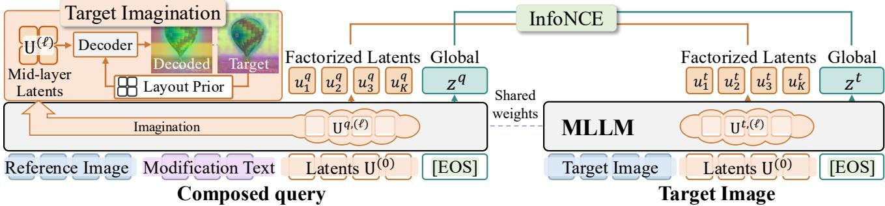  
Figure 1. Overview of FactEmbed. Given a composed query and a target image, FactEmbed introduces a compact set of learnable factorized latents into the input sequence. To enforce structured factorization without requiring dense annotations, we attach a decoder to an intermediate MLLM layer, which utilizes these latents as an information bottleneck to reconstruct target patch features via a target imagination objective. In addition, we apply a factor-level InfoNCE to the resulting latents $\{ u _ { k } \} _ { k = 1 } ^ { K }$ to leverage the decomposed factors for retrieval, while global-level embedding z is trained with the instance-level InfoNCE objective.

Overview. As shown in Fig. 1, FactEmbed adapts an MLLM to produce CIR embeddings, utilizing a shared backbone to encode both the multimodal query and the target image. Rather than mapping the input directly to a single vector, we first introduce K learnable factorized latents into the multimodal input, on top of which the [EOS] embedding is formed. This provides the model with the capacity to represent the complex query as a structured set of compositional components. To ground these latents in the visual content of the target image, we train them to reconstruct the target’s patch features beyond a coarse layout prior, a process we refer to as target imagination. We perform this reconstruction by attaching a lightweight decoder at an intermediate layer of the MLLM, which allows the deeper layers to transform the decomposed factors into discriminative representations for retrieval. For retrieval training, we apply InfoNCE [60] at two levels: a factor-level loss encourages the factorized latents to contribute to retrieval by matching the query and target latents via optimal transport, while an instance-level loss optimizes the global embedding. In this way, the imagined decomposition propagates fine-grained evidence into a compact embedding that remains efficient for retrieval.

## 3.1. Factorized Latents with Target Imagination

Motivation. CIR requires modifying specific visual concepts given text instructions (e.g., replacing an item). However, directly mapping a composed query to a global embedding in an MLLM provides no explicit mechanism for disentangling the visual attributes to be modified from those that should remain invariant. To overcome this, we introduce a compact set of factorized latents whose explicit job is to parse the scene into structured factors. By decomposing the representation, these latents are designed to give the model room to express the instructed modification on the relevant factors without distorting the others.

Factorized Latents. Factorized latents are defined as a set of K learnable tokens, ${ \bf U } ^ { ( 0 ) } \in \mathbb { R } ^ { K \times D }$ , which act as information bottlenecks to parse multimodal inputs into factorized representations. These tokens are prepended to the [EOS] in both the query and target sequences and interact with the multimodal inputs via the MLLM’s causal attention. We denote their hidden states at layer ℓ by ${ \bf U } ^ { s , ( \ell ) } = [ u _ { 1 } ^ { s , ( \ell ) } , \dots , u _ { K } ^ { s , ( \ell ) } ]$ for $s \in \{ q , t \}$ , where s indicates the query- or target-side input, and drop the layer index for the last layer, i.e., Us.

Lightweight Decoder for Imagination. For target imagination, we employ a lightweight decoder parameterized by a self-attention layer and 3-layer MLP attached to an intermediate layer $\ell \left( \ell = 1 4 \right.$ out of 28 layers by default) of the MLLM to reconstruct the target patch representation from a vision foundation model [61]. Note that we omit the superscript s for brevity since the decoder is applied to each side independently. Each 1D factorized latent $\bar { u } _ { k } ^ { ( \ell ) } \in \mathbb { R } ^ { D }$ is spatially broadcast across a 2D grid with learnable positional embeddings and passed through the decoder. Yet, reconstructing the target from the latents alone would force them to encode the global layout of the target, which is dominated by low-frequency signals (often irrelevant to the localized edits in CIR). Thus, we condition the decoding process on a layout prior that provides only the coarse layout of the target; ground-truth (GT) target features $F \in \mathbb { R } ^ { H \times W \times D _ { \mathrm { D I N O } } }$ are average-pooled to $h \times h$ , expanded back to full resolution, and added to the broadcast latents. As this layout prior already explains the coarse layout, minimizing the reconstruction error drives the latents to carry only the information that is not contained in the coarse layout. Consequently, for each latent $k ,$ , the decoder predicts spatial logits $\mathcal { M } _ { k } \in \mathbb { R } ^ { H \times W }$ along with reconstruction features $\hat { F } _ { k } \in \mathbb { R } ^ { H \times \tilde { W } \times D _ { \mathrm { D I N O } } }$ , where we index the HW spatial positions by $p .$ To ensure that the contributions of all latents sum to 1 at each position $p ,$ we obtain the normalized alpha mask $\bar { \mathcal { M } } _ { k }$ via a softmax over the latent dimension:

$$
\bar { \mathcal { M } } _ { k , p } = \frac { \exp ( \mathcal { M } _ { k , p } ) } { \sum _ { k ^ { \prime } = 1 } ^ { K } \exp ( \mathcal { M } _ { k ^ { \prime } , p } ) } .\tag{1}
$$

Then, the reconstructed feature is formed by the maskweighted sum:

$$
\textstyle { \hat { F } } = \sum _ { k = 1 } ^ { K } { \bar { \mathcal { M } } } _ { k } \odot { \hat { F } } _ { k } ,\tag{2}
$$

where $\odot$ is element-wise multiplication with broadcasting along the channel dimension. Let ${ \hat { F } } ^ { q }$ and ${ \hat { F } } ^ { t }$ denote the features predicted from the query- and target-side latents, respectively. Both are supervised against the same GT target features $F$ , and the imagination loss is the mean squared error averaged over both sides:

$$
\mathcal { L } _ { \mathrm { i m a g } } = \frac { 1 } { 2 } \sum _ { s \in \{ q , t \} } \mathbf { M S E } ( \hat { F } ^ { s } , F ) .\tag{3}
$$

As the coarse target layout prior is shared by both sides, $\mathcal { L } _ { \mathrm { i m a g } }$ is minimized only by improving the residual details that are not covered by the layout prior. On the query side, the latents must infer this residual from $( I _ { r } , T )$ without observing the target, which is the component we refer to as imagination. On the target side, the same objective anchors the target latents to the same residual factors, so that query and target latents occupy comparable factor slots for the latent matching in Sec. 3.2.

## 3.2. From Imagination to Retrieval

Factor-level Matching. To explicitly involve the factorized latents in retrieval, we apply an InfoNCE [60] on top of them. Building upon the factor alignment established by $\mathcal { L } _ { \mathrm { i m a g } }$ , we define the matching score $s _ { \mathrm { O T } } ( \mathbf { U } ^ { q } , \mathbf { U } ^ { t } )$ using Sinkhorn optimal transport (OT) over pairwise cosine similarities to allow flexible factor-to-factor correspondences (see Appendix E). For the i-th query and j-th target in a batch of size $B ,$ the factor-level similarity is $\mathbf { S } _ { i j } ^ { f } = s _ { \mathrm { O T } } ( \mathbf { U } _ { i } ^ { q } , \mathbf { U } _ { j } ^ { t } )$ With the batch-wise contrastive loss over a similarity matrix $\mathbf { S } \in \mathbb { R } ^ { B \times B }$ defined as:

$$
\mathcal { C } ( \mathbf { S } ) = - \frac { 1 } { B } \sum _ { i = 1 } ^ { B } \log \frac { \exp ( \mathbf { S } _ { i i } / \tau ) } { \sum _ { j = 1 } ^ { B } \exp ( \mathbf { S } _ { i j } / \tau ) } ,\tag{4}
$$

applying $\mathcal { C } ( \mathbf { S } ^ { f } )$ encourages each query factor to align with its counterpart in the target, which a single pooled vector cannot enforce. τ is a temperature parameter.

Instance-level Matching. The [EOS] token, which attends to the factorized latents, aggregates the comprehended factors into a single embedding. We read out its normalized hidden state as the global embedding z and apply the same contrastive loss $\mathcal { C } ( \mathbf { S } ^ { g } )$ with the instance-level similarity ${ \bf S } _ { i j } ^ { g } = z _ { i } ^ { q \top } z _ { j } ^ { t }$ between the i-th query and the j-th target. Unlike the factorized set, which requires storing K vectors per target image, z remains a single vector and thus serves as the primary retrieval embedding at scale. Our retrieval objective thus combines both levels:

$$
\mathcal { L } _ { \mathrm { N C E } } = \mathcal { C } ( \mathbf { S } ^ { f } ) + \mathcal { C } ( \mathbf { S } ^ { g } ) ,\tag{5}
$$

where $\mathcal { C } ( \mathbf { S } ^ { f } )$ aligns individual factors through OT and C(Sg) directly optimizes the embedding used at test time.

Propagating Factorization into the MLLM Backbone. While intermediate-layer decoding effectively encourages latent specialization, deeper layers near the retrieval output tend to lose spatial decomposition as representations abstract into global embeddings. To preserve factorized knowledge within the MLLM backbone, we distill the spatial alpha masks M¯ generated by the decoder into the latent-to-patch attention of the factorized latents at a deeper layer. Note that we formulate the spatial distillation loss exclusively on the target-side forward pass, as the query-side attention maps are defined over the reference image space, which does not share a spatial grid with the target alpha masks. Specifically, let $\mathcal { A } _ { k } \in \mathbb { R } ^ { H \times W }$ denote the head-averaged attention of the k-th factorized latent toward the target patch tokens at layer $\ell _ { \mathrm { t o p } } .$ with the softmax taken over the patch keys only, bilinearly resampled to the decoder grid. Then, we normalize $\mathcal { A } _ { k }$ and $\bar { \mathcal { M } } _ { k }$ over the spatial positions into distributions ${ \bf a } _ { k }$ and $\mathbf { m } _ { k }$ each describing the region the k-th latent occupies:

$$
\mathbf { a } _ { k , p } = \frac { \mathcal { A } _ { k , p } } { \sum _ { p ^ { \prime } } \mathcal { A } _ { k , p ^ { \prime } } } , \quad \mathbf { m } _ { k , p } = \frac { \bar { \mathcal { M } } _ { k , p } } { \sum _ { p ^ { \prime } } \bar { \mathcal { M } } _ { k , p ^ { \prime } } } .\tag{6}
$$

Consequently, we formulate a spatial distillation loss using Kullback-Leibler (KL) divergence to align the deeper layer attention distributions with the decoder’s spatial alpha masks:

$$
\mathcal { L } _ { \mathrm { d i s t i l l } } = \frac { 1 } { K } \sum _ { k = 1 } ^ { K } \mathrm { K L } \big ( \mathbf { m } _ { k } \parallel \mathbf { a } _ { k } \big ) .\tag{7}
$$

This explicitly transfers spatial decomposition from the decoder to the MLLM. Although the supervision is applied only on the target side, it shapes the backbone and the latents shared by both sides, thereby encouraging the query-side latents to also retain localized semantics at inference, where the target layout prior is unavailable.

## 3.3. Training Objective and Inference

Training. Our joint objective reconciles two competing dynamics: $\mathcal { L } _ { \mathrm { i m a g } }$ forces factorized latents to partition target features into disjoint factors, whereas $\mathcal { L } _ { \mathrm { N C E } }$ encourages latents within an instance to collapse into a single discriminative embedding [62]. To address this, we employ a staged learning strategy. In Stage 1, we optimize only the reconstruction loss $\mathcal { L } _ { \mathrm { i m a g } }$ to warm up the factorized latents and the decoder, establishing a stable factorized prior by mapping latents to a spatially coherent region of the target scene. In Stage 2, we further train the MLLM backbone with DoRA [63] adapters, jointly with the latents and the decoder, using full objective:

$$
\mathcal { L } _ { \mathrm { t o t a l } } = \mathcal { L } _ { \mathrm { N C E } } + \lambda _ { \mathrm { i m a g } } \mathcal { L } _ { \mathrm { i m a g } } + \lambda _ { \mathrm { d i s t i l l } } \mathcal { L } _ { \mathrm { d i s t i l l } } ,\tag{8}
$$

where $\lambda _ { \mathrm { i m a g } }$ and $\lambda _ { \mathrm { d i s t i l l } }$ are coefficients. Finally, we follow ReCALL [2] to add a post-training stage which integrates MLLM-augmented triplets to reduce false negatives [23, 33] and mitigate the influence of mislabeled triplets [20, 22, 25], both of which stem from the sparse supervision of CIR datasets. In brief, we adopt the existing augmentation pipeline to generate modification texts between each reference image and its mined hard negatives; the difference from [2] is that we condition the MLLM on the original target image and prompt it to describe what distinguishes the hard negative, which yields captions non-redundant with the original modification text in a single generation pass. Details on the augmentation are in Appendix F.

Table 1. Results on Refined-CIRR and Refined-FashionIQ. † are the results from CoLLM [19]. All other baselines are reproduced using official checkpoints, except for QWEN2.5-VL and ReCALL, which were re-run from scratch due to the lack of available checkpoints. ∗ denotes the use of additional gallery image captions. $\bf \ddot { \tau } A v g . \vec { \tau }$ for Refined-CIRR is computed as $( R @ 1 + R _ { \mathrm { s u b s e t } } @ 1 ) / 2$ , while on Refined FashionIQ, it represents the mean across all three categories. Best and second-best results are shown in bold and underlined, respectively.
<table><tr><td rowspan="3">Method</td><td colspan="8">Refined-CIRR</td><td colspan="8">Refined-FashionIQ</td></tr><tr><td colspan="2">Recall@N</td><td colspan="2"></td><td colspan="3"> $\overline { { { \mathrm { R e c a l l } } _ { \mathrm { s u b s e t } } @ { \mathrm { N } } } }$ </td><td> $\operatorname { A v g } .$ </td><td colspan="2">Dress</td><td colspan="2">Shirt</td><td colspan="2">Top&amp;Tee</td><td colspan="2"> $\operatorname { A v g } .$ </td></tr><tr><td>R@1</td><td>R@5</td><td>R@10</td><td>R@50</td><td>R@1</td><td>R@2</td><td>R@3</td><td></td><td>R@10</td><td>R@50</td><td>R@10</td><td>R@50</td><td>R@10</td><td>R@50</td><td>R@10</td><td>R@50</td></tr><tr><td>CoVR-2†</td><td>56.1</td><td></td><td>91.1</td><td>97.9</td><td></td><td>一</td><td>一</td><td></td><td></td><td></td><td></td><td></td><td></td><td></td><td>54.2</td><td>72.9</td></tr><tr><td>CoLLM†</td><td>60.4</td><td></td><td>92.6</td><td>98.2</td><td></td><td></td><td></td><td></td><td></td><td></td><td></td><td></td><td></td><td></td><td>57.2</td><td>76.4</td></tr><tr><td>VLM2Vec 7B</td><td>53.39</td><td>83.50</td><td>90.96</td><td>97.89</td><td>78.16</td><td>91.65</td><td>96.72</td><td>65.78</td><td>18.59</td><td>37.41</td><td>30.57</td><td>50.21</td><td>26.98</td><td>47.61</td><td>25.38</td><td>45.08</td></tr><tr><td>VLM2Vec-v2 2B</td><td>59.93</td><td>86.79</td><td>92.57</td><td>98.32</td><td>81.47</td><td>93.30</td><td>97.73</td><td>70.70</td><td>35.57</td><td>60.19</td><td>53.83</td><td>71.53</td><td>49.13</td><td>70.09</td><td>46.18</td><td>67.27</td></tr><tr><td>LIMN</td><td>52.32</td><td>82.74</td><td>90.40</td><td>98.04</td><td>74.41</td><td>90.55</td><td>96.28</td><td>63.37</td><td>53.27</td><td>74.43</td><td>60.03</td><td>78.73</td><td>63.84</td><td>82.36</td><td>59.05</td><td>78.50</td></tr><tr><td>ENCODER</td><td>57.76</td><td>86.15</td><td>92.80</td><td>98.75</td><td>82.76</td><td>94.53</td><td>97.94</td><td>70.26</td><td>56.62</td><td>78.50</td><td>62.76</td><td>80.78</td><td>66.07</td><td>84.64</td><td>61.82</td><td>81.31</td></tr><tr><td>TME</td><td>65.05</td><td>90.53</td><td>94.76</td><td>98.91</td><td>86.86</td><td>95.93</td><td>98.50</td><td>75.96</td><td>63.15</td><td>82.19</td><td>70.48</td><td>86.03</td><td>72.58</td><td>88.38</td><td>68.74</td><td>85.53</td></tr><tr><td>MM-Embed 8B</td><td>60.64</td><td>87.73</td><td>93.66</td><td>98.57</td><td>81.54</td><td>92.64</td><td>97.35</td><td>71.09</td><td>52.21</td><td>74.37</td><td>63.71</td><td>81.67</td><td>64.98</td><td>83.88</td><td>60.30</td><td>79.97</td></tr><tr><td>Qwen3-VL-Emb 8B</td><td>67.03</td><td>90.45</td><td>95.37</td><td>98.93</td><td>84.60</td><td>94.76</td><td>98.12</td><td>75.82</td><td>63.71</td><td>80.96</td><td>69.75</td><td>85.29</td><td>72.37</td><td>86.48</td><td>68.61</td><td>84.25</td></tr><tr><td>Core-Emb 8B</td><td>64.00</td><td>88.85</td><td>93.30</td><td>98.73</td><td>81.11</td><td>93.05</td><td>97.53</td><td>72.56</td><td>59.13</td><td>78.11</td><td>66.54</td><td>81.93</td><td>66.34</td><td>83.06</td><td>64.00</td><td>81.04</td></tr><tr><td>ReMatch 3B</td><td>62.40</td><td>89.36</td><td>94.04</td><td>98.98</td><td>83.17</td><td>94.35</td><td>98.17</td><td>72.79</td><td>33.50</td><td>57.40</td><td>50.53</td><td>69.43</td><td>46.85</td><td>66.18</td><td>43.63</td><td>64.34</td></tr><tr><td>CSMCIR*</td><td>67.16</td><td>90.96</td><td>95.44</td><td>99.06</td><td>86.15</td><td>95.75</td><td>98.55</td><td>76.66</td><td>63.65</td><td>82.08</td><td>71.48</td><td>86.61</td><td>73.51</td><td>88.82</td><td>69.55</td><td>85.83</td></tr><tr><td>Qwen2.5-VL (Base)</td><td>64.64</td><td>89.51</td><td>94.53</td><td>98.91</td><td>84.65</td><td>94.68</td><td>97.86</td><td>74.65</td><td>61.14</td><td>80.74</td><td>69.01</td><td>84.40</td><td>70.30</td><td>85.50</td><td>66.82</td><td>83.55</td></tr><tr><td>ReCALL</td><td>67.41</td><td>90.99</td><td>95.24</td><td>99.06</td><td>87.12</td><td>96.00</td><td>98.55</td><td>77.27</td><td>64.21</td><td>82.47</td><td>71.17</td><td>86.08</td><td>73.07</td><td>88.55</td><td>69.48</td><td>85.70</td></tr><tr><td>FactEmbed (Ours)</td><td>68.99</td><td>91.29</td><td>95.42</td><td>99.06</td><td>87.45</td><td>96.16</td><td>98.63</td><td>78.22</td><td>66.61</td><td>83.08</td><td>72.79</td><td>87.66</td><td>74.00</td><td>88.49</td><td>71.13</td><td>86.41</td></tr></table>

Inference. During inference, a single forward pass yields both global embedding z and factorized latents $\{ u _ { k } \} _ { k = 1 } ^ { K }$ . To minimize the memory footprint and computational cost, we aggregate latents into a single mean vector $\begin{array} { r } { \tilde { \boldsymbol { u } } = \frac { 1 } { K } \sum _ { k = 1 } ^ { K } \boldsymbol { u } _ { k } , } \end{array}$ and utilize it exclusively for efficient reranking. Note that u˜ is not explicitly optimized during training; rather, it serves as a compact proxy for the factorized set, whose members are aligned via OT, and thus requires no additional training. Specifically, candidates in the gallery are initially searched with z alone, and the top-100 candidate shortlist is reranked by integrating the cosine similarity of the mean factor as:

$$
\boldsymbol { r } ( \boldsymbol { q } , t ) = \cos \left( z ^ { q } , z ^ { t } \right) + \cos \left( \tilde { u } ^ { q } , \tilde { u } ^ { t } \right) .\tag{9}
$$

Since only the top candidates are rescored with a single vector, the additional cost is negligible and independent of the gallery size, while still leveraging the factor-level evidence.

## 4. Experiments

Datasets & Metrics. We test FactEmbed on CIRR [7] and FashionIQ [72], two standard CIR benchmarks. However, as original benchmarks contain ambiguous samples [19] and fail to provide robust evaluation [73], we conduct our primary evaluations on Refined-CIRR and Refined-

FashionIQ [19]. Results on original datasets are also reported. For evaluation metrics, we use Recall@N (R@N), the fraction of queries whose target appears in the top-N results. Along with standard Recall, we also report ${ \mathrm { R e c a l l } } _ { \mathrm { s u b s e t } } @ \{ 1 , 2 , 3 \}$ on CIRR, which are computed within each query’s curated six-candidate subset.

Implementation Details. Adopting the base setup from ReCALL’s repository [2], we use DoRA [63] to finetune Qwen2.5-VL-7B-Instruct [67] with rank 16, scaling factor 64. We use AdamW optimizer, a cosine schedule with 10% warmup, a batch size of 512, and bfloat16 mixed precision. The last checkpoint is used for evaluation. For hyperparameters, we set the number of latents $K = 8 ,$ , the resolution of target layout prior to $2 \times 2 ( h = 2 )$ , and the decoding layer to $\ell = 1 4$ . Additionally, we distill the factorized map into the attention map from the 3rd layer from the top $( \ell _ { \mathrm { t o p } } = - 3 )$ Loss coefficients are set to $\lambda _ { \mathrm { i m a g } } = 1 . 0$ and $\lambda _ { \mathrm { d i s t i l l } } = 0 . 5$ for all experiments.

## 4.1. Main Results

In Tab. 1, we benchmark FactEmbed on refined CIR benchmarks against recent CIR methods and general-purpose embedding models [34, 36, 37, 74–76] using their official checkpoints. While prior works primarily relied on broader metrics like Recall@5 on CIRR due to sample ambiguities in original benchmarks, we emphasize that Recall@1 and Subset Recall@1 on CIRR serve as more precise ranking metrics under these refined evaluation settings, where broader metrics saturate near top performance. Specifically, FactEmbed outperforms two strong baselines, CSMCIR [66] (which additionally relies on synthetic text captions for every gallery image) and ReCALL [2]: it achieves improvements of 2.7% and 2.3% in Recall@1 on Refined-CIRR, and 2.3% and 2.4% in average Recall@10 on Refined-FashionIQ, respectively. Notably, even when post-trained with ReCALL’s augmentation strategy, FactEmbed still surpasses prior methods (Fig. 6), indicating that the gains are not attributed to the augmentation alone. These gains demonstrate the advantage of decoupling complex query understanding from direct visual alignment: our decomposed factorized latents yield fine-grained, disambiguated semantic representations that standard contrastive architectures do not explicitly encourage.

Table 2. Results on CIRR test set. “Avg.” for CIRR test set is computed as $( R @ 5 + R _ { \mathrm { s u b s e t } } @ 1 ) / 2$
<table><tr><td rowspan="2">Method</td><td colspan="4">Recall@N</td><td colspan="3"> $\overline { { { \mathrm { R e c a l l } } _ { \mathrm { s u b s e t } } @ { \mathrm { N } } } }$ </td><td rowspan="2"> $\operatorname { A v g } .$ </td></tr><tr><td>R@1</td><td>R@5</td><td>R@10</td><td>R@50</td><td>R@1</td><td>R@2</td><td>R@3</td></tr><tr><td>ARTEMIS [11]</td><td>16.96</td><td>46.10</td><td>61.31</td><td>87.73</td><td>39.99</td><td>62.20</td><td>75.67</td><td>43.05</td></tr><tr><td>TG-CIR [12]</td><td>45.25</td><td>78.29</td><td>87.16</td><td>97.30</td><td>72.84</td><td>89.25</td><td>95.13</td><td>75.57</td></tr><tr><td>SPRC [10]</td><td>51.96</td><td>82.12</td><td>89.74</td><td>97.69</td><td>80.65</td><td>92.31</td><td>96.60</td><td>81.39</td></tr><tr><td>LIMN [13]</td><td>43.64</td><td>75.37</td><td>85.42</td><td>97.04</td><td>69.01</td><td>86.22</td><td>94.19</td><td>72.19</td></tr><tr><td>CoVR-2 [64]</td><td>50.43</td><td>81.08</td><td>88.89</td><td>98.05</td><td>76.75</td><td>90.34</td><td>95.78</td><td>78.92</td></tr><tr><td>CaLa [14]</td><td>49.11</td><td>81.21</td><td>89.59</td><td>98.00</td><td>76.27</td><td>91.04</td><td>96.46</td><td>78.74</td></tr><tr><td>ENCODER [65]</td><td>46.10</td><td>77.98</td><td>87.16</td><td>97.64</td><td>76.92</td><td>90.41</td><td>95.95</td><td>77.45</td></tr><tr><td>CIR-LVLM [4]</td><td>53.64</td><td>83.76</td><td>90.60</td><td>97.93</td><td>79.12</td><td>92.33</td><td>96.67</td><td>81.44</td></tr><tr><td>QuRe [23]</td><td>52.22</td><td>82.53</td><td>90.31</td><td>98.17</td><td></td><td>78.51 91.28 96.48</td><td></td><td>80.52</td></tr><tr><td>CCIN [32]</td><td>53.41</td><td>84.05</td><td>91.17</td><td>98.00</td><td></td><td></td><td></td><td></td></tr><tr><td>TME [22]</td><td>53.42</td><td>82.99</td><td>90.24</td><td>98.15</td><td>81.04</td><td>92.58</td><td>96.94</td><td>82.01</td></tr><tr><td>Air-Know [24]</td><td>51.97</td><td>82.25</td><td>90.42</td><td>98.25</td><td>79.21</td><td>91.94</td><td>96.87</td><td>80.73</td></tr><tr><td>ConeSep [25]</td><td>53.06</td><td>83.45</td><td>90.60</td><td>98.34</td><td>81.23</td><td>92.62</td><td>97.24</td><td>82.34</td></tr><tr><td>Q3-VL-Emb 8B [36]‡</td><td>51.95</td><td>80.92</td><td>88.58</td><td>97.49</td><td>75.23</td><td>90.29</td><td>95.66</td><td>78.08</td></tr><tr><td>CSMCIR* [66]</td><td>53.88</td><td>85.06</td><td>91.69</td><td>98.58</td><td>80.10</td><td>92.24</td><td>96.92</td><td>82.58</td></tr><tr><td>Q2.5-VL (Base) [67]‡</td><td>51.98</td><td>81.90</td><td>90.27</td><td>98.19</td><td>77.69</td><td>91.85</td><td>96.92</td><td>79.80</td></tr><tr><td>ReCALL [2] ‡</td><td>53.76</td><td>83.76</td><td>91.54</td><td>98.34</td><td>81.11</td><td>93.35</td><td>97.52</td><td>82.44</td></tr><tr><td>FactEmbed (Ours)</td><td>56.60</td><td>84.87</td><td>91.78</td><td>98.41</td><td></td><td>81.86 93.78</td><td>97.61</td><td>83.37</td></tr></table>

Bold and underline denote the best and second-best results, respectively. additional use of image captions for gallery images, and Q denotes QWEN.

In Tab. 2 and Tab. 3, we further report performance on the original CIRR and FashionIQ datasets. Notably, all methods score substantially lower on the original benchmarks than on their refined counterparts. Excluding Qwen3-VL-Embedding 8B, this gap reaches at most 13.7 points in R@1 on CIRR and 15.6 points in average R@10 on FashionIQ, whereas Qwen3-VL-Embedding 8B, the state-of-the-art generalist model, exhibits the largest gap (15.1 and 16.7 points, respectively). This is consistent with prior findings [19, 73] that the original benchmarks contain ambiguous annotations and evaluation artifacts, which may underestimate the compositional reasoning capabilities of high-capacity models. Nevertheless, FactEmbed achieves the best overall result.

## 4.2. Forming Embeddings with Factorized Latents

As factorized latents can be turned into a retrieval score in several ways, we compare the variants in Tab. 4. Matching the full latent set via OT (“Full Factor”) achieves the highest R@1 on both benchmarks, but requires storing K vectors per gallery image, whose storage and search costs grow with the gallery size [42, 43]. Among single-vector alternatives, the mean-pooled latents (“Mean Factor”) [76] perform the worst, as u˜ is never directly optimized for retrieval, leaving u˜ less discriminative as a standalone global embedding. Yet, directly optimizing u˜ with the instancelevel objective in place of [EOS] (“Mean Factor#”) still falls behind [EOS] in R@1 on both benchmarks, suggesting that imposing instance-level objective on the latents pulls them toward a single discriminative embedding at the cost of fine-grained evidence. We therefore keep the latents factoraligned and use [EOS] as the global embedding for initial retrieval, while exploiting u˜ as complementary factor-level evidence for reranking. This efficient reranking narrows the R@1 gap to Full Factor to 0.24 and 0.21, with only two vectors per gallery image, a memory footprint on par with standard multi-vector CIR methods [10, 22, 23, 25, 32].

Table 3. Results on FashionIQ validation set. “Avg.” represents the mean performance across all three categories.
<table><tr><td rowspan="2">Method</td><td colspan="2">Dress</td><td colspan="2">Shirt</td><td colspan="2"> $\overline { { \mathrm { T o p } \& T e e } }$ </td><td colspan="2">Avg.</td></tr><tr><td>R@10R@50</td><td></td><td>R@10 R@50</td><td></td><td>R@10 R@50</td><td></td><td>R@10 R@50</td><td></td></tr><tr><td>FashionSAP [68]</td><td>33.71</td><td>60.43</td><td>41.91</td><td>70.93</td><td>33.17</td><td>61.33</td><td>36.26</td><td>64.23</td></tr><tr><td>FAME-ViL [69]</td><td>42.19</td><td>67.38</td><td>47.64</td><td>68.79</td><td>50.69</td><td>73.07</td><td>46.84</td><td>69.75</td></tr><tr><td>SyncMask [70]</td><td>33.76</td><td>61.23</td><td>35.82</td><td>62.12</td><td>44.82</td><td>72.06</td><td>38.13</td><td>65.14</td></tr><tr><td>SADN [71]</td><td>40.01</td><td>65.10</td><td>43.67</td><td>66.05</td><td>48.04</td><td>70.93</td><td>43.91</td><td>67.36</td></tr><tr><td>CaLa [14]</td><td>42.38</td><td>66.08</td><td>46.76</td><td>68.16</td><td>50.93</td><td>73.42</td><td>46.69</td><td>69.22</td></tr><tr><td>CoVR-2 [64]</td><td>46.53</td><td>69.60</td><td>51.23</td><td>70.64</td><td>52.14</td><td>73.27</td><td>49.96</td><td>71.17</td></tr><tr><td>SPRC [10]</td><td>49.18</td><td>72.43</td><td>55.64</td><td>73.89</td><td>59.35</td><td>78.58</td><td>54.72</td><td>74.97</td></tr><tr><td>CIR-LVLM [4]</td><td>50.42</td><td>73.60</td><td>58.59</td><td>75.86</td><td>59.61</td><td>78.99</td><td>56.21</td><td>76.14</td></tr><tr><td>CCIN [32]</td><td>49.38</td><td>72.58</td><td>55.93</td><td>74.14</td><td>57.93</td><td>77.56</td><td>54.41</td><td>74.76</td></tr><tr><td>TME [22]</td><td>49.73</td><td>71.69</td><td>56.43</td><td>74.44</td><td>59.31</td><td>78.94</td><td>55.15</td><td>75.02</td></tr><tr><td>QuRe [23]</td><td>46.80</td><td>69.81</td><td>53.53</td><td>72.87</td><td>57.47</td><td>77.77</td><td>52.60</td><td>73.48</td></tr><tr><td>Air-Know [24]</td><td>51.03</td><td>73.08</td><td>56.76</td><td>75.05</td><td>59.47</td><td>79.02</td><td>55.75</td><td>75.72</td></tr><tr><td>ConeSep [25]</td><td>50.96</td><td>73.02</td><td>56.98</td><td>75.22</td><td>58.80</td><td>79.40</td><td>55.58</td><td>75.88</td></tr><tr><td>Q3-VL-Emb 8B [36]‡</td><td>47.84</td><td>69.46</td><td>52.36</td><td>71.34</td><td>55.58</td><td>74.40</td><td>51.93</td><td>71.73</td></tr><tr><td>CSMCIR* [66]</td><td>52.45</td><td>74.81</td><td>57.70</td><td>75.76</td><td>61.14</td><td>80.98</td><td>57.10</td><td>77.18</td></tr><tr><td>Q2.5-VL (Base) [67]‡</td><td>45.81</td><td>70.65</td><td>55.50</td><td>73.45</td><td>57.62</td><td>76.95</td><td>52.98</td><td>73.68</td></tr><tr><td>ReCALL [2] ‡</td><td>48.93</td><td>72.63</td><td>54.76</td><td>73.60</td><td>57.98</td><td>78.74</td><td>53.89</td><td>74.99</td></tr><tr><td>FactEmbed (Ours)</td><td>53.25</td><td>74.67</td><td>58.34</td><td>76.30</td><td>61.55</td><td>79.65</td><td>57.71</td><td>76.87</td></tr></table>

denotes results reproduced by us with official implementation. ∗ denotes the

Table 4. Inference strategy for balancing performance and efficiency. While matching the full set of factorized latents via optimal transport yields the best performance, its memory footprint scales with the number of latents. Efficient reranking achieves comparable results to full factor matching while maintaining low overhead. “Mean Factor#” is a variant where the instance-level contrastive loss is applied to the mean-pooled latent u˜ instead of [EOS], together with the factor-level loss. Red highlights our default configuration.
<table><tr><td rowspan="2"></td><td colspan="3">CIRR</td><td colspan="3">Refined-CIRR</td></tr><tr><td>R@1</td><td>R@5</td><td>R@10</td><td>R@1</td><td>R@5</td><td>R@10</td></tr><tr><td>Full Factor</td><td>56.84</td><td>84.87</td><td>91.81</td><td>69.20</td><td>91.47</td><td>95.24</td></tr><tr><td>Mean Factor</td><td>54.87</td><td>83.21</td><td>90.53</td><td>67.21</td><td>90.30</td><td>94.68</td></tr><tr><td>Mean Factor#</td><td>55.69</td><td>84.36</td><td>91.37</td><td>68.25</td><td>91.60</td><td>95.42</td></tr><tr><td>[EOS]</td><td>56.12</td><td>84.58</td><td>91.61</td><td>68.84</td><td>90.96</td><td>94.93</td></tr><tr><td>Efficient Rerank</td><td>56.60</td><td>84.87</td><td>91.78</td><td>68.99</td><td>91.29</td><td>95.42</td></tr></table>

## 4.3. Ablation Study

In Tab. 5, we conduct component ablation study. Introducing factorized latents with the target imagination alone (b) does not consistently improve retrieval: while it improves R@10 on FashionIQ and Refined-FashionIQ by 1.00 and 1.16, and R@5 on CIRR by 0.99, it slightly lowers R@1 on CIRR. We attribute this to the gap between generation and discrimination: target reconstruction structures the latents into semantically factorized components, which already benefits FashionIQ where modifications are confined to localized attributes, but it provides no explicit alignment metric for ranking, so the decomposition alone is insufficient for precise top-1 retrieval on open-domain CIRR. Yet, as it lays a robust foundation for fine-grained query decomposition, we find that bridging the gap with factor-level InfoNCE (c) and incorporating the attention distillation loss (e) effectively enhances the retrieval performance by transferring localized decomposition into the MLLM’s deeper attention layer. Subsequently, incorporating our ERR in (f) delivers a prominent gain of 1.17 and 0.97 in Avg. on CIRR and Refined-CIRR, respectively. In contrast, applying the same reranking to latents trained without any auxiliary objective changes Avg. by only −0.37 and +0.24, indicating that the gain does not stem from merely fusing an additional vector but from the structure imposed by our objectives. We note that this gain comes at a marginal computational overhead, as the factorized latents are generated within the same forward pass (see Appendix C). Lastly, integrating the posttraining stage (h) achieves additional gains, demonstrating the effectiveness of mitigating the noise arising from the sparse supervision of CIR datasets. To verify that these gains are not attributed to the augmentation alone, we also apply the post-training stage directly to the baseline (g). While post-training alone improves the baseline, our full model (h) further surpasses it by 2.91 and 2.57 in R@1 on CIRR and Refined-CIRR, and by 2.87 and 2.37 in R@10 on FashionIQ and Refined-FashionIQ, respectively. Moreover, the gains of our components remain comparable with and without posttraining ((a)→(f) vs. (g)→(h)), indicating that our framework and the augmentation are complementary.

Table 5. Ablation study. Imag., NCE, and Distill represent ${ \mathcal { L } } _ { \mathrm { i m a g } } ( \mathrm { E q } . 3 ) ,$ factor-level InfoNCE, and attention distillation (Eq. 7), respectively. ERR represents efficient reranking (Eq. 9) and Post denotes the post-training stage with augmented triplets. $\mathrm { R } _ { s }$ @N denotes Recall $\mathrm { \ s u b s e t }$ @N.
<table><tr><td rowspan="2">Imag</td><td rowspan="2"></td><td rowspan="2">NCE Distill ERR</td><td rowspan="2"></td><td rowspan="2"></td><td rowspan="2">Post</td><td colspan="5">CIRR test</td><td colspan="2">FIQ</td><td colspan="5">Refined-CIRR</td><td colspan="2">Refined-FIQ</td></tr><tr><td>R@1</td><td>R@5</td><td>R@10</td><td>Rs@1</td><td>Rs@2</td><td>R@10</td><td>R@50</td><td>R@1</td><td>R@5</td><td>R@10</td><td>Rs@1</td><td>Rs@2</td><td>R@10</td><td>R@50</td></tr><tr><td>a</td><td></td><td></td><td></td><td></td><td></td><td>51.98</td><td>81.90</td><td>90.27</td><td>77.69</td><td>91.85</td><td>52.98</td><td>73.68</td><td>64.64</td><td>89.51</td><td>94.53</td><td>84.65</td><td>94.68</td><td>66.82</td><td>83.55</td></tr><tr><td>b</td><td>√</td><td></td><td></td><td></td><td></td><td>51.45</td><td>82.89</td><td>90.36</td><td>77.64</td><td>91.76</td><td>53.98</td><td>74.26</td><td>63.72</td><td>89.56</td><td>94.27</td><td>83.73</td><td>94.76</td><td>67.98</td><td>84.47</td></tr><tr><td>c</td><td>√</td><td>√</td><td></td><td></td><td></td><td>52.72</td><td>83.28</td><td>90.96</td><td>78.68</td><td>92.22</td><td>55.25</td><td>75.01</td><td>65.17</td><td>89.94</td><td>94.65</td><td>84.83</td><td>94.81</td><td>68.94</td><td>84.97</td></tr><tr><td>d</td><td> $\checkmark$ </td><td></td><td></td><td></td><td></td><td>52.53</td><td>82.84</td><td>90.82</td><td>78.15</td><td>92.02</td><td>54.69</td><td>75.36</td><td>64.92</td><td>89.74</td><td>94.53</td><td>84.14</td><td>94.78</td><td>68.40</td><td>84.88</td></tr><tr><td>e</td><td> $\checkmark$ </td><td>√</td><td>√</td><td></td><td></td><td>53.28</td><td>83.42</td><td>91.18</td><td>78.94</td><td>92.51</td><td>55.98</td><td>75.94</td><td>65.43</td><td>90.17</td><td>94.83</td><td>84.73</td><td>94.86</td><td>69.19</td><td>85.50</td></tr><tr><td>f</td><td>√</td><td>√</td><td>√</td><td></td><td></td><td>54.75</td><td>83.86</td><td>91.61</td><td>80.84</td><td>93.18</td><td>56.67</td><td>76.19</td><td>66.55</td><td>90.33</td><td>95.11</td><td>85.54</td><td>95.47</td><td>69.78</td><td>85.67</td></tr><tr><td>g</td><td>=</td><td></td><td></td><td></td><td></td><td>53.69</td><td>83.21</td><td>91.01</td><td>80.63</td><td>92.99</td><td>54.84</td><td>75.12</td><td>66.42</td><td>90.19</td><td>95.21</td><td>86.33</td><td>95.67</td><td>68.76</td><td>84.60</td></tr><tr><td>h</td><td>√</td><td>√</td><td></td><td></td><td></td><td>56.60</td><td>84.87</td><td>91.78</td><td>81.86</td><td>93.78</td><td>57.71</td><td>76.87</td><td>68.99</td><td>91.29</td><td>95.42</td><td>87.45</td><td>96.16</td><td>71.13</td><td>86.41</td></tr></table>

## 4.4. Analysis and Discussion

Imagination Layer Selection. Determining the MLLM layer ℓ for target imagination governs a trade-off; when the decoder is attached too early, the factorized latents may lack sufficient contextual fusion of multimodal inputs to imagine the target, while attaching it too late leaves insufficient subsequent layers to transform the decomposed factors into a discriminative retrieval embedding. In Fig. 2a, we evaluate decoder placements at layers $\ell \in \{ 7 , 1 4 , 2 1 \}$ of the 28-layer MLLM, and find that $\ell = 1 4$ yields the best result, which aligns with recent findings [77, 78].

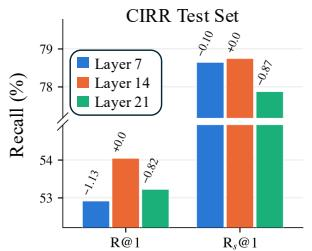

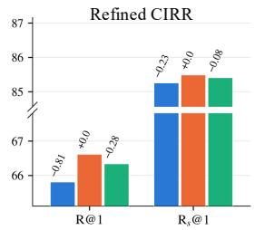  
(a) Impact of imagination layer.

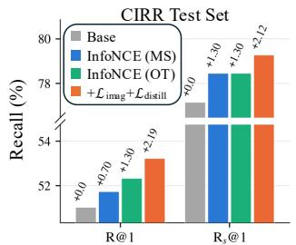  
(b) Impact of target imagination.

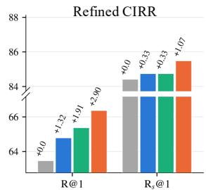  
Figure 2. Studies on imagination layer and comparison against NCE-only baselines with different matching metrics. MS and OT denote maximum similarity and optimal transport applied to latents, respectively, without the imagination objective for factorization.

Impact of Target Imagination. To isolate the effect of target imagination, we compare against variants that train the latents solely with InfoNCE, matched by either maximum similarity (MS) [47] or OT, in Fig. 2b. While these variants outperform the na¨ıve baseline, we observe that target imagination brings a further gain by enforcing the latents to decompose and structure the target scene rather than relying on the contrastive signal alone. Also, OT matching consistently outperforms MS matching strategy on both benchmarks, supporting our choice of OT for factor-level matching.

What Does the Decoder Imagine? Fig. 3 compares the imagined features ${ \hat { F } } ^ { q }$ against the GT target features $F ,$ using joint PCA basis. On the query side, the imagined features reconstruct the overall structure of the target: while the layout prior supplies only the coarse layout, the factorized latents recover fine-grained details such as object silhouettes. The rightmost column visualizes arg maxk $\bar { \mathcal { M } } _ { k , p }$ , demonstrating that each factorized latent contributes to reconstructing semantically coherent regions. This suggests that each latent specializes in a coherent semantic factor of the target. Additional visualizations are in Appendix A.

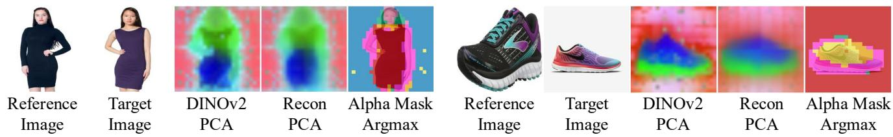  
Figure 3. Qualitative analysis of target imagination. For each composed query, we visualize target DINOv2 features (DINOv2 PCA) and features imagined by our decoder from the query (Recon PCA), projected onto a joint PCA basis. Alpha Mask Argmax shows, for each spatial position p, the factorized latent with the largest decoder alpha weight, i.e., arg max $\bar { \mathcal { M } } _ { k , p } ,$ where each color denotes a differen latent. On top of the coarse layout from the target prior, fine details are recovered by the latents, jointly reconstructing the target structure.

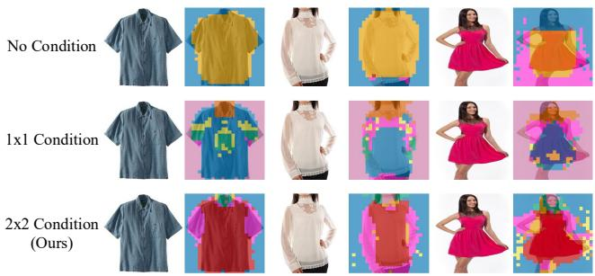  
Figure 4. Impact of layout prior in target imagination. Three rows compare factor decomposition across different layout prior configurations: (top) without a layout prior, (middle) with a 1 × 1 layout prior, and (bottom) with our default 2 × 2 layout prior. While the unconditioned model collapses into coarse global semantics, introducing the 2 × 2 layout prior guides the latents to isolate semantically editable parts.

Impact of Target Layout Prior. As described in Sec. 3.1, the decoder is conditioned on a coarse target layout prior. Fig. 4 visualizes the decomposition under different prior resolutions. Without the layout prior, the latents must also encode the global layout, which dominates the reconstruction objective and causes them to collapse into a few coarse regions. In contrast, when the prior is injected, we found that the factorized latents are encouraged to focus on fine-grained visual structures, decomposing the target into localized parts such as arms, legs, and necklines. We set h = 2 so that the layout prior provides only the coarse layout while leaving the localized factors to the latents.

Generalization across Backbones. We further apply FactEmbed to stronger MLLM backbones in Tab. 6. Specifically, we observe that upgrading the backbone from Qwen2.5-VL-7B to Qwen3-VL-8B improves R@1 by 2.65 points on the CIRR test set, exceeding the 1.60 points gain reported by ReCALL [2] for the same backbone transition. This demonstrates that FactEmbed scales more effectively with improved backbone capabilities. The performance gains further extend to Qwen3-VL-Embedding-8B, a backbone already specialized for retrieval, where FactEmbed achieves top performance across most metrics.

Table 6. FactEmbed with different MLLM backbones. “Avg.” follows Tab. 2 and Tab. 1, i.e., (R@5 + Rs@1)/2 on CIRR test and (R@1 + R @1)/2 on Refined-CIRR.
<table><tr><td></td><td>Backbone</td><td>R@1 R@5</td><td>R@10 R@50</td><td></td><td>Rs@1</td><td>Rs@21 Rs@3</td><td>Avg.</td></tr><tr><td rowspan="3">CIRR test</td><td>Qwen2.5-VL-7B</td><td>56.60 84.87</td><td>91.78</td><td>98.41</td><td>81.86</td><td>93.78</td><td>97.61 83.37</td></tr><tr><td>Qwen3-VL-8B</td><td>59.25 86.10</td><td>91.93</td><td>98.36</td><td>83.54</td><td>94.53 97.74</td><td>84.82</td></tr><tr><td>Qwen3-VL-Emb-8B</td><td>60.43 86.99</td><td>93.35</td><td>98.70</td><td>84.15</td><td>94.82 97.81</td><td>85.57</td></tr><tr><td rowspan="3">Rend[ CIRR</td><td>Qwen2.5-VL-7B</td><td>68.99 91.29</td><td>95.42</td><td>99.06</td><td>87.45</td><td>96.16</td><td>98.63 78.22</td></tr><tr><td>Qwen3-VL-8B</td><td>71.31 92.29</td><td>95.72</td><td>99.16</td><td>89.33</td><td>96.59 98.88</td><td>80.32</td></tr><tr><td>Qwen3-VL-Emb-8B</td><td>73.60 93.02</td><td>96.41</td><td>99.13</td><td>88.95</td><td>97.12 98.88</td><td>81.28</td></tr></table>

## 5. Conclusion

In this work, we present FactEmbed, a framework that better exploits the MLLM’s compositional understanding capability to simulate visual edits by decoupling compositional query comprehension from learning discriminative embedding. To structure query comprehension, we prepend factorized latents that act as an information bottleneck, trained to imagine the residual target factors beyond a coarse layout prior that groups semantically coherent visual factors of the target without dense annotations. We then bridge generative imagination and discriminative retrieval by optimizing a factor-level InfoNCE loss via optimal transport and distilling the decoder’s alpha masks into the MLLM’s deeper attention maps. At inference, the [EOS] token serves as a globallevel embedding to perform initial retrieval, while the meanpooled factorized latents, produced in the same forward pass, rerank a short candidate list at negligible cost. Extensive evaluations show that FactEmbed achieves state-of-the-art performance, suggesting that factor-level supervision on top of instance-level matching improves MLLM-based CIR.

Limitations. Despite its effectiveness, FactEmbed has several limitations. First, using a fixed K ignores the input complexity since no explicit supervision specifies the number of semantic factors. Exploring query-adaptive latents and matching schemes across varying set sizes remains for future work. Second, while full-factor retrieval achieves higher accuracy, we mean-pool the latents for efficient reranking, unexploiting part of the fine-grained information. Incorporating Matryoshka representation learning [79] into factor representations may preserve accuracy of full-factor matching near single-vector storage costs. Lastly, our evaluation is limited to CIRR and FashionIQ; thus, generalizability as a unified multimodal retriever requires further verification.

## A. Additional Visualizations for Imagination

In this section, we present additional results for target imagination in Fig. 5. Following the protocol in Sec. 4.4, we jointly apply PCA to the ground-truth DINOv2 [61] feature maps and our imagined representations for visualization. Although the shared color mapping between both visualized images is partly facilitated by the target layout prior, we remark that this prior provides only a highly coarse, average-pooled $2 \times 2$ spatial layout. Consequently, the reconstruction of details (e.g., geometry and position) demonstrates that our factorized latents successfully capture rich spatial positioning and object geometry, allowing the decoder to synthesize the spatial maps across local regions.

## B. Diversity of Factorized Latents

To analyze whether each factorized latent specializes in distinct concepts, we examine the cosine similarity between factorized latents both within the same instance and across different instances (Tab. 7). Specifically, we compare our approach against two baseline variants: one where learnable latents are prepended to the [EOS] token without additional constraints, and another where the factor-level InfoNCE objective is introduced.

As discussed in Sec. 3.3, applying the factor-level InfoNCE alone without the imagination objective $\mathcal { L } _ { \mathrm { i m a g } }$ (b) increases the similarity among latents within each instance, causing them to collapse into a single instance-level representation. This is because the retrieval objective only requires the latents to be collectively discriminative across instances, providing no incentive for individual latents to take on distinct roles. Furthermore, this representation collapse becomes even more pronounced when the per-latent mean vector (computed across the dataset) is subtracted from each latent, indicating that the latents share instance-specific rather than factor-specific information. In contrast, incorporating our imagination and distillation objectives (c) yields the lowest within-instance similarity, with a clear margin after removing the per-latent mean (0.548 vs. 0.599 and 0.841). This indicates that our framework encourages the latents to take on distinct roles, whereas na¨ıvely employing multi-vector latents with a retrieval objective drives them toward a shared representation.

Note that the latents without any auxiliary objective (a) also exhibit low within-instance similarity. We attribute this phenomenon to the fact that the latents are orthogonally initialized and largely retain this initial bias due to the lack of direct supervision. Indeed, these latents do not benefit retrieval: even with efficient reranking, they achieve an average of 73.21 on Refined-CIRR and 79.60 on the CIRR test set, falling below the baseline without latents (74.65 and 79.80), where the averages follow Tab. 1 and Tab. 2, i.e., $( \mathrm { R } @ 1 + \mathrm { R } _ { \mathrm { s u b s e t } } @ 1 ) / 2$ and $( \mathsf { R } @ 5 + \mathsf { R } _ { \mathrm { s u b s e t } } @ 1 ) / 2$ , respectively.

In contrast, under the same setting without post-training, our latents raise these scores to 76.05 and 82.35 (Tab. 5 (f)), confirming that they are not only distinct but also informative for retrieval.

## C. Inference Cost

A natural concern with multi-vector representations is that they trade retrieval quality for memory footprint and query latency [42, 47]. To address this, Tab. 8 quantifies the inference overhead on the CIRR validation set (2,297 gallery images) using a single NVIDIA RTX PRO 5000 Blackwell GPU. Crucially, the forward pass of the query encoder dominates the end-to-end latency pipeline, requiring 353ms per query at batch size 1 and an average of 164ms per query at batch size 32. In contrast, scoring the gallery using only the [EOS] embedding requires only 0.06ms per query. Our efficient reranking procedure, which re-scores the top-100 shortlist with the sum of the cosine similarities from each [EOS] and mean factorized vector, adds one extra vector per image to the index and 0.17ms per query at batch size 1 (0.003ms amortized), which only induces less than 0.05% overhead on the total latency. We adopt this design as our default inference configuration, as its storage footprint remains comparable to, or slightly smaller than that of recent CIR methods that maintain multi-vector galleries [10, 14, 22, 23, 25, 32]. When storage and compute budgets permit, however, the full latent variant can be preferred, as full OT matching offers slightly higher R@1 (Tab. 4). Note that its time overhead remains marginal at the scale of the CIRR validation gallery, but both its storage (K vectors per image) and its scoring cost grow linearly with the gallery size, whereas efficient reranking only rescores a fixed top-100 shortlist.

## D. Additional Implementation Details

In this section, we elaborate additional implementation details. While we use base learning rates of $2 \times 1 0 ^ { - 5 }$ and $4 \times 1 0 ^ { - 5 }$ to train DoRA modules attached to the pretrained backbone parameters for CIRR and Fashion-IQ, respectively, we apply $4 \times 1 0 ^ { - 4 }$ as the learning rate to modules such as the factorized latent and imagination decoder since our newly introduced components are trained from scratch. For the training schedule, we use 3,000, 500, and 350 steps across the three stages for CIRR, and 3,000, 350, and 350 steps for FashionIQ. While Stage 1 could technically be trained jointly with the later stages, the competing dynamics between $\mathcal { L } _ { \mathrm { i m a g } }$ and $\mathcal { L } _ { \mathrm { N C E } }$ slow down the formation of factorized latents, requiring substantially longer training to converge. Isolating Stage 1 to train only the decoder and the latents with $\mathcal { L } _ { \mathrm { i m a g } }$ removes this competition and further allows bypassing the upper layers of the MLLM backbone, yielding a substantially more compute-efficient setup: Stage 1 completes in approximately 13 hours on 4× RTX PRO 5000 Blackwell

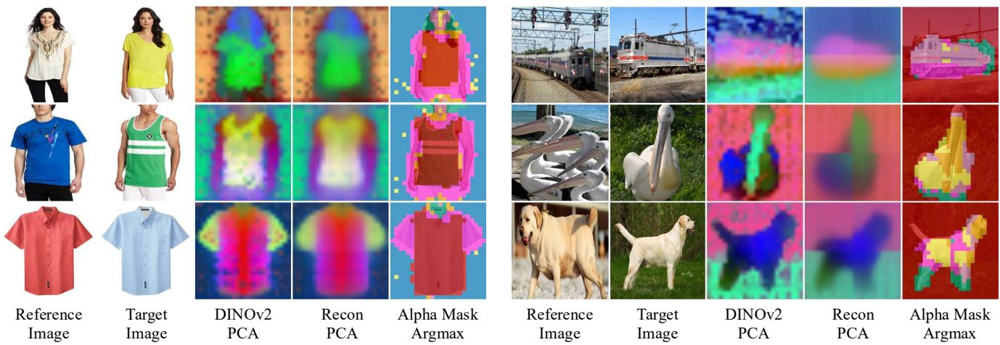  
Figure 5. Additional Qualitative Analysis of Target Imagination.

Table 7. Diversity analysis on factorized latents. “Within instance” denotes the mean cosine similarity across all latent pairs within the same image, whereas “Across instances” denotes the mean cosine similarity between latents of different images. Further, we report prototype-removed diversity which is computed by subtracting the dataset-wide per-latent mean vector (computed over the CIRR dataset) from each latent to isolate diversity from MLLM residual biases.
<table><tr><td></td><td>Methods</td><td colspan="2">Raw Similarity</td><td>Prototype-removed</td></tr><tr><td></td><td></td><td>within instance</td><td>across instances</td><td>within instance</td></tr><tr><td>a</td><td>Learnable Latents only (no auxiliary loss)</td><td>0.606</td><td>0.408</td><td>0.599</td></tr><tr><td>b</td><td>Latents with InfoNCE</td><td>0.764</td><td>0.548</td><td>0.841</td></tr><tr><td>C</td><td>Ours</td><td>0.586</td><td>0.426</td><td>0.548</td></tr></table>

GPUs. Then, subsequent training stages were conducted using 2× RTX PRO 6000 Blackwell GPUs using PyTorch FSDP. Images are resized within the processor to between 3,136 and 147,456 pixels, with input sequences truncated at 512 tokens.

## E. Optimal Transport for Matching Score between Factorized Sets

To measure the similarity between two unordered factorized sets, we used Optimal Transport (OT) to find the best possible alignment between them. Given the query and target factorized latents $\mathbf { U } ^ { q } = [ u _ { 1 } ^ { q } , \dots , u _ { K } ^ { q } ]$ and $\mathbf { U } ^ { t } = [ u _ { 1 } ^ { t } , \dots , u _ { K } ^ { t } ]$ we first compute a pairwise cosine similarity matrix $\mathbf { R \in }$ $\mathbb { R } ^ { K \times K }$ , where $\mathbf { R } _ { k , m } = \cos ( u _ { k } ^ { q } , u _ { m } ^ { t } )$ is the cosine similarity between the k-th query factor and the m-the target factor. Based on this similarity matrix R, the OT matching score is defined as:

$$
\begin{array} { r l } & { s _ { \mathrm { O T } } ( \mathbf { U } ^ { q } , \mathbf { U } ^ { t } ) = \langle \mathbf { P } ^ { \star } , \mathbf { R } \rangle , } \\ & { \mathbf { P } ^ { \star } = \arg \underset { \mathbf { P } \in \Pi ( \frac { 1 } { K } \mathbf { 1 } , \frac { 1 } { K } \mathbf { 1 } ) } { \operatorname* { m a x } } \langle \mathbf { P } , \mathbf { R } \rangle + \varepsilon \mathcal { H } ( \mathbf { P } ) , } \end{array}\tag{10}
$$

where $\mathbf { P } ^ { \star }$ is the optimal transport plan that maximizes the overall alignment score and $\langle \cdot , \cdot \rangle$ denotes the Frobenius inner product. $\textstyle \Pi ( \frac { 1 } { K } \mathbf { 1 } , \frac { 1 } { K } \mathbf { 1 } )$ denotes the set of transport plans whose rows and columns each sum to $1 / K$ , so that every query and target factor contributes equally. The entropy regularization $\begin{array} { r } { \mathcal { H } ( \mathbf { P } ) = - \sum _ { k , m } \mathbf { P } _ { k , m } } \end{array}$ log $\mathbf { P } _ { k , m }$ allows $\mathbf { P } ^ { \star }$ to be computed efficiently with a few Sinkhorn iterations, serving as a differentiable surrogate for one-to-one matching. We set the $\varepsilon = 0 . 1$ and run 30 Sinkhorn iterations. Since the elements of $\mathbf { P } ^ { \star }$ sum to 1, ⟨P⋆, R⟩ represents the average matching score in [−1, 1], which is subsequently used as the factor-level similarity $\mathbf { \bar { S } } ^ { f }$ in the first term of Eq. 5. This encourages the factorized set of a query to align with that of its target while repulsing the sets of non-matching targets.

## F. Post-training with MLLM Augmentation

A typical challenge in CIR is that the modification text often underdetermines the target image. In other words, instructions are often rarely exhaustive; they specify what should change while leaving everything else implicit. Consequently, a single composed query can often be satisfied by multiple candidate images in the gallery. To address this, prior works have leveraged LLM/MLLMs to sharpen the query itself to disambiguate the instruction [32, 33], enlarged the clean paired triplets [2, 18, 19, 35]. Similarly, we follow ReCALL [2] to augment training triplets by pairing each reference image with its mined hard negative instances, and then finetune the model on the resulting data (comprising the reference image, its hard negative, and a generated modification text). Operating on FactEmbed after Stage 2, our augmentation pipeline consists of two phases: hard negative mining and contrastive captioning. During the mining phase, we follow ReCALL to extract hard negative instances $I _ { h }$ for each reference image $I _ { r }$ that ranks above the ground truth $I _ { t } ,$ which are then passed to the contrastive captioning phase.

Table 8. Per-query inference cost on CIRR validation set (2,297 gallery images). We report the number of vectors indexed per gallery image, the scoring cost (similarity matching), and the total inference latency for both single and batched queries. Total inference latency involves the scoring cost and the encoding cost of the query-side, while the cost of encoding offline gallery (target-side) is excluded. ∆ indicates the latency overhead relative to the [EOS]-only baseline.
<table><tr><td rowspan="3">Retrieval Unit</td><td rowspan="3">Num Vectors</td><td colspan="2">Scoring</td><td colspan="4">Total</td></tr><tr><td></td><td>Single (bs=1) Batched (bs=32)</td><td colspan="2">Single (bs=1)</td><td colspan="2">Batched (bs=32)</td></tr><tr><td>ms/q</td><td>ms/q</td><td>ms/q</td><td> $\Delta$ </td><td>ms/q</td><td> $\Delta$ </td></tr><tr><td>[EOS] only</td><td>1</td><td>0.06</td><td>0.004</td><td>353.1</td><td></td><td>163.8</td><td></td></tr><tr><td>+ Efficient Rerank</td><td>2</td><td>0.23</td><td>0.007</td><td></td><td> $3 5 3 . 3 \mathrm { \Omega } + 0 . 1 7 \mathrm { m s }$ </td><td></td><td> $1 6 3 . 8 + 0 . 0 0 3 \mathrm { m s }$ </td></tr><tr><td>Full Factor</td><td>8</td><td>3.99</td><td>0.31</td><td></td><td> $3 5 7 . 1 \quad + 3 . 9 3 \mathrm { m s }$ </td><td>164.1</td><td>+0.31ms</td></tr></table>

## F.1. Contrastive Captioning

Following ReCALL [2], we convert each mined hard negative $I _ { h }$ into a new positive triplet $( I _ { r } , \acute { T } , I _ { h } )$ , where an MLLM writes a minimal modification text T´ that transforms $I _ { r }$ into $I _ { h }$ . In practice, however, we found this pipeline to be both noisy and costly. Since mined hard negatives frequently serve as valid targets for $( I _ { r } , T )$ themselves and the captioner observes only $I _ { r }$ and $I _ { h } .$ , we observed that the captioner has no cue to separate $I _ { h }$ from $I _ { t }$ . As a result, it often returned T unchanged, producing duplicate queries with conflicting positives (9% and 11% of the samples that survived ReCALL’s VQA filter on CIRR and FashionIQ). This pipeline was also inefficient: the local MLLM captioner frequently violated the required output format, with 37% (CIRR) and 56% (FashionIQ) of instances failing on the first pass and 9% and 12% remaining unresolved even after six retry rounds, and the subsequent VQA filter added another full inference pass.

We thus streamline the pipeline with two modifications, while keeping the remaining instructions of ReCALL’s captioning prompt unchanged. First, we employ contrastive captioning strategy, which additionally presents the original target $I _ { t }$ alongside $I _ { r }$ and $I _ { h }$ , and instruct the model to describe $I _ { h }$ such that the text no longer applies to $I _ { t } .$ Note that $I _ { t }$ serves purely as a conditioning signal and is omitted from the augmented triplet. Second, we replace the local captioner with GPT-5.6-luna [80] via the batch API, which can follow both the contrast instruction and the output format in a single pass, removing the retry loop and separate verification stage.

Compared with the ReCALL’s two-image prompting strategy on 100 sampled mined queries per dataset, we found that our contrastive captioning successfully yields an edited modification text while the two-image prompting strategy produced 27.0% (CIRR) and 33.0% (FashionIQ) of modification texts unchanged. Furthermore, among the edited queries, we found that 30.1% (CIRR) and 10.5% (FashionIQ) of the modification texts rewritten by the two-image prompting strategy were judged by GPT-5.6-luna to describe the original target $I _ { t }$ better than the mined target $I _ { h }$ , while our contrastive captioning reduced this reversal rate to 7.0% and 0.0%, respectively. Consequently, as shown in Fig. 6, our contrastive captioning yields larger gains than the augmentation strategy of ReCALL on most metrics, with comparable results on $\mathsf { R } _ { s }$ @1 of Refined-CIRR. This demonstrates that our streamlined pipeline is not only more efficient, as it requires neither a caption retry loop nor a separate verification stage, but also yields higher-quality augmentation. We remark that other than these modifications, we followed ReCALL [2] to mine five hard negatives per composed query, resulting in 57,476 (CIRR) and 56,499 (FashionIQ) captioning requests. This incurs a one-time cost of only \$22.82 (CIRR) and \$26.17 (FashionIQ), which is highly economical compared to renting GPU servers to deploy a local MLLM, which often struggles with strict output formatting and thus requires repeated retries.

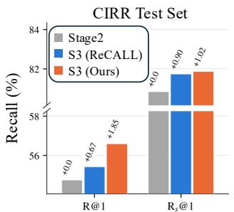

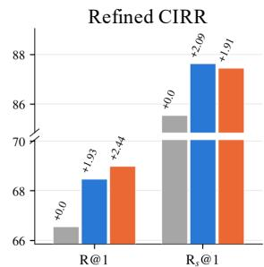  
(a) Impact of Stage3 Post-training on CIRR dataset.

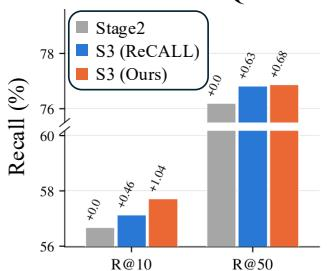

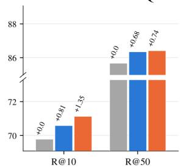  
(b) Impact of Stage3 Post-training on FashionIQ Dataset.  
Figure 6. Impact of augmentation strategies for post-training. Starting from our model before post-training (Stage 2), we compare post-training with triplets augmented by the two-image prompting of ReCALL [2] and by our contrastive captioning. Numbers above the bars denote the absolute gains over stage 2 baseline.

## F.2. Hard Negative Filtering

Hard negative mining occasionally yields near-duplicate instances that are virtually identical to the annotated target despite holding distinct identifiers in the same dataset. Rewriting such a pair forces the model to generate text that separates two near-identical images, teaching the retriever to incorrectly push them apart. To prevent this, we filter out these pairs prior to contrastive captioning based on visual feature similarity via DINOv2 [61] before we query the MLLM to write the captions. Specifically, we encoded each image using a frozen DINOv2 ViT-B/14 backbone and mean-pooled the patch tokens into a single descriptor, discarding hard negative candidates $( I _ { h } )$ that exhibit a cosine similarity exceeding 0.99 with the original target $\left( I _ { t } \right)$ . This filtering step removes 743 CIRR instances and 277 FashionIQ instances out of 58, 219 and 56, 776 mined pairs, respectively. For Stage 3, we additionally filter mislabeled original triplets: when mining with the Stage 2 model, we also record the rank of the ground-truth target, and drop the 3% of original triplets whose ground truth is ranked lowest.

## F.3. Post-training

Finally, for the post-training stage, we optimize our model using the total objective, described in Eq. 8, similarly to stage 2. Note that we construct each batch for CIRR by grouping an original triplet with its MLLM-augmented counterparts following [2]. This strategy supplies high-quality in-batch hard negatives, explicitly encouraging the model to discern subtle visual differences.

## F.4. Limitation of Contrastive Captioning

While our contrastive captioning mitigates noisy supervision in both the original and augmented triplets, a limitation remains when scaling up the augmentation. Contrastive captioning conditions each rewrite only on the original target $I _ { t } ,$ so it reduces ambiguity between $I _ { t }$ and a hard negative but not among the multiple hard negatives mined for the same composed query. As more hard negatives are mined per query, i.e., each pair of reference image $I _ { r }$ and modification text $T ,$ , we expect these sibling hard negatives to increasingly overlap in semantics, so that a modification text written for one may equally describe another, introducing false negatives within the augmented set. An effective augmentation strategy for CIR therefore requires conditioning across both the original and augmented sets, so that each generated instruction captures features that distinguish its target from all other candidates of the same query. Nevertheless, since the augmented triplets consistently improve CIR performance in our experiments, we will publicly release them to facilitate future research.

## G. Qualitative Results

In Fig. 7, Fig. 8, Fig. 9, and Fig. 10, we present qualitative comparisons between FactEmbed and our baseline (Qwen2.5-VL-7B-Instruct [67] fine-tuned via DoRA [63]). In CIR, modifying a reference image with text often projects the query into a broad semantic space where multiple target images can be considered valid matches. Therefore, rather than restricting our analysis to Top-1 prediction, we examine the Top-8 retrieved results to better assess the overall alignment between the composed query and the retrieved distribution.

In the first example of Fig. 7, which belongs to the dress category of FashionIQ dataset, the query specifies an item that is “more fashionable and party wear and is cream and brown with animal print”. While both models successfully capture the desired color scheme, FactEmbed ranks candidates that accurately reflect the fine-grained “animal print” pattern higher than the baseline. In the second example, the baseline struggles with structural modifications, incorrectly retrieving an item with short sleeves at Rank-2 and entirely ignoring the requested “strap” detail at Rank-3. Conversely, FactEmbed strictly adheres to these fine-grained structural constraints across the top ranked candidates. Fig. 8 further highlights a common failure mode in standard contrastive learning, which fails to handle negative constraints. For the query containing the phrase “instead of superman logo”, the baseline fails to disentangle the negated element, retrieving images containing the superman logo. In contrast, FactEmbed successfully suppresses the negated visual element while maintaining the core semantics of the reference image.

This gap in multimodal understanding extends to the opendomain CIRR dataset. As shown in the first example of Fig. 10, the query requires the model to identify “map displayed on the screen” of a smartphone. While the baseline is easily distracted by generic smartphone images, FactEmbed accurately grounds the text modification into the precise visual context. Also, for queries involving relative counting or relational reasoning (e.g., second example), the baseline exhibits a severe lack of compositional understanding. Overall, we find that the baseline trained with standard contrastive learning often ignores the comparative conditions, while FactEmbed captures these relationships more faithfully.

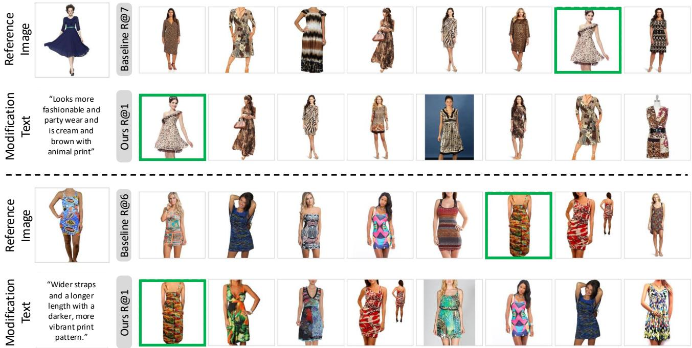  
Figure 7. Results on dress category.

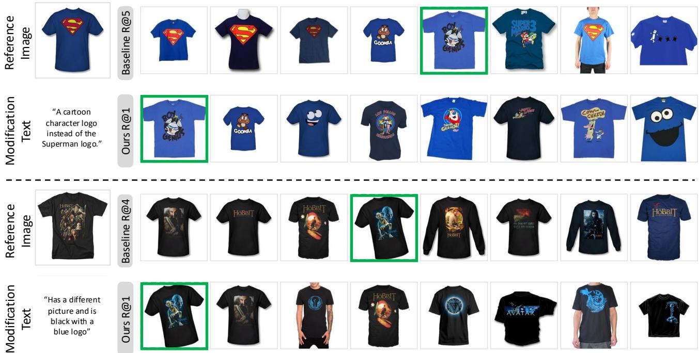  
Figure 8. Results on Shirt category.

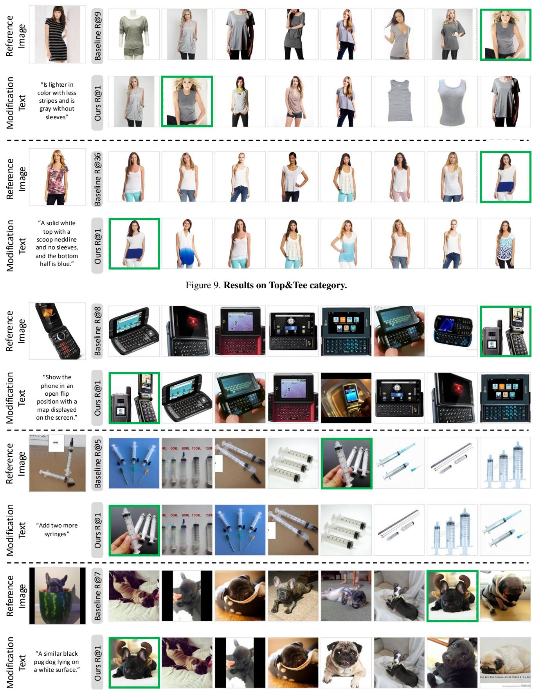  
Figure 10. Results on CIRR.

## References

[1] Nam Vo, Lu Jiang, Chen Sun, Kevin Murphy, Li-Jia Li, Li Fei-Fei, and James Hays. Composing text and image for image retrieval - an empirical odyssey. In Proceedings of the IEEE/CVF Conference on Computer Vision and Pattern Recognition, pages 6439–6448, 2019. 1, 2

[2] Tianyu Yang, ChenWei He, Xiangzhao Hao, Tianyue Wang, Jiarui Guo, Haiyun Guo, Leigang Qu, Jinqiao Wang, and Tat-Seng Chua. Recall: Recalibrating capability degradation for mllm-based composed image retrieval. In Proceedings ofthe IEEE/CVF Conference on Computer Vision and Pattern Recognition (CVPR), pages 38763–38773, June 2026. 1, 2, 4, 5, 6, 8, 10, 11, 12

[3] Ting Jiang, Minghui Song, Zihan Zhang, Haizhen Huang, Weiwei Deng, Feng Sun, Qi Zhang, Deqing Wang, and Fuzhen Zhuang. E5-v: Universal embeddings with multimodal large language models. arXiv preprint arXiv:2407.12580, 2024. 1

[4] Zelong Sun, Dong Jing, Guoxing Yang, Nanyi Fei, and Zhiwu Lu. Leveraging large vision-language model as user intent-aware encoder for composed image retrieval. In Proceedings of the AAAI Conference on Artificial Intelligence, volume 39, pages 7149–7157, 2025. 1, 2, 6

[5] Yikun Liu, Yajie Zhang, Jiayin Cai, Xiaolong Jiang, Yao Hu, Jiangchao Yao, Yanfeng Wang, and Weidi Xie. Lamra: Large multimodal model as your advanced retrieval assistant. In 2025 IEEE/CVF Conference on Computer Vision and Pattern Recognition (CVPR), pages 4015–4025. IEEE, 2025.

[6] Xin Zhang, Yanzhao Zhang, Wen Xie, Mingxin Li, Ziqi Dai, Dingkun Long, Pengjun Xie, Meishan Zhang, Wenjie Li, and Min Zhang. Gme: Improving universal multimodal retrieval by multimodal llms. arXiv preprint arXiv:2412.16855, 2024. 1

[7] Zheyuan Liu, Cristian Rodriguez-Opazo, Damien Teney, and Stephen Gould. Image retrieval on real-life images with pre-trained vision-and-language models. In Proceedings ofthe IEEE/CVF International Conference on Computer Vision (ICCV), pages 2125–2134, October 2021. 2, 5

[8] Rohan Mahadev, Joyce Yuan, Patrick Poirson, David Xue, Hao-Yu Wu, and Dmitry Kislyuk. Pinpoint: Evaluation of composed image retrieval with explicit negatives, multi-image queries, and paraphrase testing. In Proceedings of the IEEE/CVF Conference on Computer Vision and Pattern Recognition (CVPR), pages 9742–9751, June 2026.

[9] Geonmo Gu, Sanghyuk Chun, Wonjae Kim, HeeJae Jun, Yoohoon Kang, and Sangdoo Yun. Compodiff: Versatile composed image retrieval with latent diffusion. arXiv preprint arXiv:2303.11916, 2023. 2

[10] Yang Bai, Xinxing Xu, Yong Liu, Salman Khan, Fahad Khan, Wangmeng Zuo, Rick Siow Mong Goh, and Chun-Mei Feng. Sentence-level prompts benefit composed image retrieval. In The Twelfth International Conference on Learning Representations, 2024. 2, 6, 9

[11] Ginger Delmas, Rafael Sampaio de Rezende, Gabriela Csurka, and Diane Larlus. Artemis: Attention-based retrieval with text-explicit matching and implicit similarity. In International Conference on Learning Representations, 2022. 6

[12] Haokun Wen, Xian Zhang, Xuemeng Song, Yinwei Wei, and Liqiang Nie. Target-guided composed image retrieval. In Proceedings ofthe 31st ACM International Conference on Multimedia, 2023. 6

[13] Haokun Wen, Xuemeng Song, Jianhua Yin, Jianlong Wu, Weili Guan, and Liqiang Nie. Self-training boosted multi-factor matching network for composed image retrieval. IEEE Transactions on Pattern Analysis and Machine Intelligence, 46:3665–3678, 2024. 6

[14] Xintong Jiang, Yaxiong Wang, Mengjian Li, Yujiao Wu, Bingwen Hu, and Xueming Qian. Cala: Complementary association learning for augmenting composed image retrieval. In Proceedings of the 47th International ACM SIGIR Conference on Research and Development in Information Retrieval, pages 2177–2187, 2024. 2, 6, 9

[15] Alec Radford, Jong Wook Kim, Chris Hallacy, Aditya Ramesh, Gabriel Goh, Sandhini Agarwal, Girish Sastry, Amanda Askell, Pamela Mishkin, Jack Clark, et al. Learning transferable visual models from natural language supervision. In International conference on machine learning, pages 8748–8763. PMLR, 2021. 2

[16] Junnan Li, Dongxu Li, Caiming Xiong, and Steven Hoi. Blip: Bootstrapping language-image pre-training for unified vision-language understanding and generation. In ICML, 2022. 2

[17] Junnan Li, Dongxu Li, Silvio Savarese, and Steven Hoi. Blip-2: Bootstrapping language-image pre-training with frozen image encoders and large language models. In International conference on machine learning, pages 19730–19742. PMLR, 2023. 2

[18] Kai Zhang, Yi Luan, Hexiang Hu, Kenton Lee, Siyuan Qiao, Wenhu Chen, Yu Su, and Ming-Wei Chang. MagicLens: Self-supervised image retrieval with openended instructions. In Ruslan Salakhutdinov, Zico Kolter, Katherine Heller, Adrian Weller, Nuria Oliver, Jonathan Scarlett, and Felix Berkenkamp, editors, Proceedings of the 41st International Conference on Machine Learning, volume 235 of Proceedings of Machine Learning Research, pages 59403–59420. PMLR, 21– 27 Jul 2024. 2, 10

[19] Chuong Huynh, Jinyu Yang, Ashish Tawari, Mubarak Shah, Son Tran, Raffay Hamid, Trishul Chilimbi, and

Abhinav Shrivastava. Collm: A large language model for composed image retrieval. In 2025 IEEE/CVF Conference on Computer Vision and Pattern Recognition (CVPR), pages 3994–4004. IEEE, 2025. 2, 5, 6, 10

[20] Zhiwei Chen, Yupeng Hu, Zhiheng Fu, Zixu Li, Jiale Huang, Qinlei Huang, and Yinwei Wei. Intent: Invariance and discrimination-aware noise mitigation for robust composed image retrieval. In Proceedings ofthe AAAI Conference on Artificial Intelligence, 2026. 2, 5

[21] Kuniaki Saito, Kihyuk Sohn, Xiang Zhang, Chun-Liang Li, Chen-Yu Lee, Kate Saenko, and Tomas Pfister. Pic2word: Mapping pictures to words for zeroshot composed image retrieval. In Proceedings ofthe IEEE/CVF Conference on Computer Vision and Pattern Recognition, 2023. 2

[22] Shuxian Li, Changhao He, Xiting Liu, Joey Tianyi Zhou, Xi Peng, and Peng Hu. Learning with noisy triplet correspondence for composed image retrieval. In Proceedings ofthe IEEE/CVF Conference on Computer Vision and Pattern Recognition, pages 19628– 19637, 2025. 2, 5, 6, 9

[23] Jaehyun Kwak, Ramahdani Muhammad Izaaz Inhar, Se-Young Yun, and Sung-Ju Lee. Qure: Query-relevant retrieval through hard negative sampling in composed image retrieval. In Forty-second International Conference on Machine Learning, 2025. 2, 5, 6, 9

[24] Zhiheng Fu, Yupeng Hu, Qianyun Yang, Shiqi Zhang, Zhiwei Chen, and Zixu Li. Air-know: Arbitercalibrated knowledge-internalizing robust network for composed image retrieval. In Proceedings of the Computer Vision and Pattern Recognition Conference (CVPR), 2026. 2, 6

[25] Zixu Li, Yupeng Hu, Zhiwei Chen, Mingyu Zhang, Zhiheng Fu, and Liqiang Nie. Conesep: Cone-based robust noise-unlearning compositional network for composed image retrieval. In Proceedings of the Computer Vision and Pattern Recognition Conference (CVPR), 2026. 2, 5, 6, 9

[26] Young Kyun Jang, Dat Huynh, Ashish Shah, Wen-Kai Chen, and Ser-Nam Lim. Spherical linear interpolation and text-anchoring for zero-shot composed image retrieval. In European conference on computer vision, pages 239–254. Springer, 2024. 2

[27] Alberto Baldrati, Lorenzo Agnolucci, Marco Bertini, and Alberto Del Bimbo. Zero-shot composed image retrieval with textual inversion. In Proceedings of the IEEE/CVF International Conference on Computer Vision, pages 15338–15347, 2023.

[28] Geonmo Gu, Sanghyuk Chun, Wonjae Kim, Yoohoon Kang, and Sangdoo Yun. Language-only efficient training of zero-shot composed image retrieval. In 2024 IEEE/CVF Conference on Computer Vision and Pat-

tern Recognition (CVPR), pages 13225–13234. IEEE, 2024.

[29] Shyamgopal Karthik, Karsten Roth, Massimiliano Mancini, and Zeynep Akata. Vision-by-language for training-free compositional image retrieval. International Conference on Learning Representations (ICLR), 2024.

[30] You Li, Fan Ma, and Yi Yang. Imagine and seek: Improving composed image retrieval with an imagined proxy. In Proceedings of the Computer Vision and Pattern Recognition Conference (CVPR), pages 3984– 3993, June 2025. 2

[31] Yuanmin Tang, Jing Yu, Keke Gai, Jiamin Zhuang, Gang Xiong, Gaopeng Gou, and Qi Wu. Missing targetrelevant information prediction with world model for accurate zero-shot composed image retrieval. In 2025 IEEE/CVF Conference on Computer Vision and Pattern Recognition (CVPR), pages 24785–24795. IEEE, 2025. 2

[32] Likai Tian, Jian Zhao, Zechao Hu, Zhengwei Yang, Hao Li, Lei Jin, Zheng Wang, and Xuelong Li. Ccin: Compositional conflict identification and neutralization for composed image retrieval. In Proceedings of the IEEE/CVF Conference on Computer Vision and Pattern Recognition, pages 3974–3983, 2025. 2, 6, 9, 10

[33] Franc¸ois Garderes, Camille-Sovanneary Gauthier, Jean\` Ponce, and Shizhe Chen. Fire-cir: Fine-grained reasoning for composed fashion image retrieval. In Proceedings of the IEEE/CVF Conference on Computer Vision and Pattern Recognition (CVPR) Findings, pages 5694– 5703, June 2026. 2, 5, 10

[34] Rui Meng, Ziyan Jiang, Ye Liu, Mingyi Su, Xinyi Yang, Yuepeng Fu, Can Qin, Zeyuan Chen, Ran Xu, Caiming Xiong, Yingbo Zhou, Wenhu Chen, and Semih Yavuz. Vlm2vec-v2: Advancing multimodal embedding for videos, images, and visual documents. arXiv preprint arXiv:2507.04590, 2025. 2, 5

[35] Junjie Zhou, Yongping Xiong, Zheng Liu, Ze Liu, Shitao Xiao, Yueze Wang, Bo Zhao, Chen Jason Zhang, and Defu Lian. Megapairs: Massive data synthesis for universal multimodal retrieval. In Proceedings ofthe 63rd Annual Meeting of the Association for Computational Linguistics (Volume 1: Long Papers), pages 19076–19095, 2025. 10

[36] Mingxin Li, Yanzhao Zhang, Dingkun Long, Keqin Chen, Sibo Song, Shuai Bai, Zhibo Yang, Pengjun Xie, An Yang, Dayiheng Liu, Jingren Zhou, and Junyang Lin. Qwen3-vl-embedding and qwen3-vl-reranker: A unified framework for state-of-the-art multimodal retrieval and ranking. arXiv, 2026. 2, 5, 6

[37] Ziyan Jiang, Rui Meng, Xinyi Yang, Semih Yavuz, Yingbo Zhou, and Wenhu Chen. Vlm2vec: Training vision-language models for massive multimodal em-

bedding tasks. arXiv preprint arXiv:2410.05160, 2024. 2, 5

[38] Jinhyuk Lee, Feiyang Chen, Sahil Dua, Daniel Cer, Madhuri Shanbhogue, Iftekhar Naim, Gustavo Hernandez´ Abrego, Zhe Li, Kaifeng Chen, Hen-´ rique Schechter Vera, et al. Gemini embedding: Generalizable embeddings from gemini. arXiv preprint arXiv:2503.07891, 2025. 2

[39] Henrique Schechter Vera, Sahil Dua, Biao Zhang, Daniel Salz, Ryan Mullins, Sindhu Raghuram Panyam, Sara Smoot, Iftekhar Naim, Joe Zou, Feiyang Chen, et al. Embeddinggemma: Powerful and lightweight text representations. arXiv preprint arXiv:2509.20354, 2025.

[40] Xiaojie Li, Chu Li, Shi-Zhe Chen, and Xi Chen. Umarvel: Unveiling key factors for universal multimodal retrieval via embedding learning with mllms. In International Conference on Learning Representations, volume 2026, pages 121298–121319, 2026. 2

[41] Lihao Liu, Biao Yang, Yan Wang, Da Li, Jiangxia Cao, Yuxiao Luo, Xiang Chen, Xiangyu Wu, Wei Yuan, Fan Yang, Guiguang Ding, Tingting Gao, and Guorui Zhou. Crem: Compression-driven representation enhancement for multimodal retrieval and comprehension. In Proceedings of the IEEE/CVF Conference on Computer Vision and Pattern Recognition (CVPR) Findings, pages 5714–5724, June 2026. 2

[42] Omar Khattab and Matei Zaharia. Colbert: Efficient and effective passage search via contextualized late interaction over bert. In Proceedings of the 43rd International ACM SIGIR conference on research and development in Information Retrieval, pages 39–48, 2020. 6, 9

[43] Manuel Faysse, Hugues Sibille, Tony Wu, Bilel Omrani, Gautier Viaud, Celine Hudelot, and Pierre´ Colombo. Colpali: Efficient document retrieval with vision language models. In International Conference on Learning Representations, volume 2025, pages 61424– 61449, 2025. 2, 6

[44] Xiangzhao Hao, Shijie Wang, Tianyu Yang, Tianyue Wang, Haiyun Guo, and Jinqiao Wang. Trace: Task-adaptive reasoning and representation learning for universal multimodal retrieval. arXiv preprint arXiv:2603.02929, 2026. 2

[45] Chenwei He, Xiangzhao Hao, Tianyu Yang, Yuxiang Ma, Yuheng Jia, Lingxiang Wu, Chaoyang Zhao, Haiyun Guo, and Jinqiao Wang. Plume: Latent reasoning based universal multimodal embedding. arXiv preprint arXiv:2604.02073, 2026. 2

[46] Zhibin Lan, Liqiang Niu, Fandong Meng, Jie Zhou, and Jinsong Su. Ume-r1: Exploring reasoning-driven generative multimodal embeddings. In International

Conference on Learning Representations, volume 2026, pages 115779–115806, 2026. 2

[47] Zilin Xiao, Qi Ma, Mengting Gu, Chun-cheng Chen, Xintao Chen, Vicente Ordonez, and Vijai Mohan. Metaembed: Scaling multimodal retrieval at test-time with flexible late interaction. In International Conference on Learning Representations, volume 2026, pages 23619–23638, 2026. 2, 7, 9

[48] Siyu Sun, Jing Ren, Zhaohe Liao, Dongxiao Mao, Xiangyuan Ren, Yiyi Zhang, Haohua Zhao, Weixiong Lin, Jiang Shaohua, Liqing Zhang, et al. Bottleneck tokens for unified multimodal retrieval. arXiv preprint arXiv:2604.11095, 2026. 2

[49] Hao Li, Jingkuan Song, Lianli Gao, Xiaosu Zhu, and Hengtao Shen. Prototype-based aleatoric uncertainty quantification for cross-modal retrieval. Advances in Neural Information Processing Systems, 36, 2023. 2

[50] WonJun Moon, Cheol-Ho Cho, Woojin Jun, Taeoh Kim, Inwoong Lee, Dongyoon Wee, Minho Shim, and Jae-Pil Heo. Prototypes are balanced units for efficient and effective partially relevant video retrieval. In Proceedings of the IEEE/CVF International Conference on Computer Vision (ICCV), pages 21789–21799, October 2025.

[51] Chengzhi Lin, Ancong Wu, Junwei Liang, Jun Zhang, Wenhang Ge, Wei-Shi Zheng, and Chunhua Shen. Textadaptive multiple visual prototype matching for videotext retrieval. Advances in neural information processing systems, 35:38655–38666, 2022.

[52] Pandeng Li, Chen-Wei Xie, Liming Zhao, Hongtao Xie, Jiannan Ge, Yun Zheng, Deli Zhao, and Yongdong Zhang. Progressive spatio-temporal prototype matching for text-video retrieval. In Proceedings of the IEEE/CVF International Conference on Computer Vision, pages 4100–4110, 2023. 2

[53] Andrew Jaegle, Felix Gimeno, Andy Brock, Oriol Vinyals, Andrew Zisserman, and Joao Carreira. Perceiver: General perception with iterative attention. In International conference on machine learning, pages 4651–4664. PMLR, 2021. 2

[54] Andrew Jaegle, Sebastian Borgeaud, Jean-Baptiste Alayrac, Carl Doersch, Catalin Ionescu, David Ding, Skanda Koppula, Daniel Zoran, Andrew Brock, Evan Shelhamer, Olivier J Henaff, Matthew Botvinick, Andrew Zisserman, Oriol Vinyals, and Joao Carreira. Perceiver IO: A general architecture for structured inputs & outputs. In International Conference on Learning Representations, 2022. 2

[55] Nicolas Carion, Francisco Massa, Gabriel Synnaeve, Nicolas Usunier, Alexander Kirillov, and Sergey Zagoruyko. End-to-end object detection with transformers. In European conference on computer vision, pages 213–229. Springer, 2020. 2

[56] Francesco Locatello, Dirk Weissenborn, Thomas Unterthiner, Aravindh Mahendran, Georg Heigold, Jakob Uszkoreit, Alexey Dosovitskiy, and Thomas Kipf. Object-centric learning with slot attention. Advances in neural information processing systems, 33:11525– 11538, 2020. 2

[57] Maximilian Seitzer, Max Horn, Andrii Zadaianchuk, Dominik Zietlow, Tianjun Xiao, Carl-Johann Simon-Gabriel, Tong He, Zheng Zhang, Bernhard Scholkopf,¨ Thomas Brox, et al. Bridging the gap to realworld object-centric learning. arXiv preprint arXiv:2209.14860, 2022.

[58] Hyun Seok Seong, WonJun Moon, and Jae-Pil Heo. From vicious to virtuous cycles: Synergistic representation learning for unsupervised video object-centric learning. In The Fourteenth International Conference on Learning Representations, 2026. 2

[59] Tri Dao. Flashattention-2: Faster attention with better parallelism and work partitioning. In International Conference on Learning Representations, volume 2024, pages 35549–35562, 2024. 2

[60] Ting Chen, Simon Kornblith, Mohammad Norouzi, and Geoffrey Hinton. A simple framework for contrastive learning of visual representations. In International conference on machine learning, pages 1597–1607. PMLR, 2020. 3, 4

[61] Maxime Oquab, Timothee Darcet, Theo Moutakanni,´ Huy V. Vo, Marc Szafraniec, Vasil Khalidov, Pierre Fernandez, Daniel Haziza, Francisco Massa, Alaaeldin El-Nouby, Russell Howes, Po-Yao Huang, Hu Xu, Vasu Sharma, Shang-Wen Li, Wojciech Galuba, Mike Rabbat, Mido Assran, Nicolas Ballas, Gabriel Synnaeve, Ishan Misra, Herve Jegou, Julien Mairal, Patrick Labatut, Armand Joulin, and Piotr Bojanowski. Dinov2: Learning robust visual features without supervision, 2023. 3, 9, 12

[62] WonJun Moon, MinSeok Jung, Gilhan Park, Tae-Young Kim, Cheol-Ho Cho, Woojin Jun, and Jae-Pil Heo. Mitigating semantic collapse in partially relevant video retrieval. Advances in Neural Information Processing Systems, 38, 2025. 4

[63] Shih-Yang Liu, Chien-Yi Wang, Hongxu Yin, Pavlo Molchanov, Yu-Chiang Frank Wang, Kwang-Ting Cheng, and Min-Hung Chen. Dora: Weightdecomposed low-rank adaptation. arXiv preprint arXiv:2402.09353, 2024. 4, 5, 12

[64] Lucas Ventura, Antoine Yang, Cordelia Schmid, and Gul Varol. Covr-2: Automatic data construction for composed video retrieval. IEEE Transactions on Pattern Analysis and Machine Intelligence, 46:11409– 11421, 2024. 6

[65] Zixu Li, Zhiwei Chen, Haokun Wen, Zhiheng Fu, Yupeng Hu, and Weili Guan. Encoder: Entity mining

and modification relation binding for composed image retrieval. In Proceedings of the AAAI Conference on Artificial Intelligence, 2025. 6

[66] Zhipeng Qian, Zihan Liang, Yufei Ma, Ben Chen, Huangyu Dai, Yiwei Ma, Jiayi Ji, Chenyi Lei, Han Li, and Xiaoshuai Sun. CSMCIR: CoT-enhanced symmetric alignment with memory bank for composed image retrieval. In Maria Liakata, Viviane P. Moreira, Jiajun Zhang, and David Jurgens, editors, Findings of the Association for Computational Linguistics: ACL 2026, pages 4411–4424, San Diego, California, United States, July 2026. Association for Computational Linguistics. 5, 6

[67] Shuai Bai, Keqin Chen, Xuejing Liu, Jialin Wang, Wenbin Ge, Sibo Song, Kai Dang, Peng Wang, Shijie Wang, Jun Tang, Humen Zhong, Yuanzhi Zhu, Mingkun Yang, Zhaohai Li, Jianqiang Wan, Pengfei Wang, Wei Ding, Zheren Fu, Yiheng Xu, Jiabo Ye, Xi Zhang, Tianbao Xie, Zesen Cheng, Hang Zhang, Zhibo Yang, Haiyang Xu, and Junyang Lin. Qwen2.5-vl technical report. arXiv preprint arXiv:2502.13923, 2025. 5, 6, 12

[68] Yunpeng Han, Lisai Zhang, Qingcai Chen, Zhijian Chen, Zhonghua Li, Jianxin Yang, and Zhao Cao. Fashionsap: Symbols and attributes prompt for fine-grained fashion vision-language pre-training. In Proceedings of the IEEE/CVF Conference on Computer Vision and Pattern Recognition, pages 15028–15038, 2023. 6

[69] Xiao Han, Xiatian Zhu, Licheng Yu, Li Zhang, Yi-Zhe Song, and Tao Xiang. Fame-vil: Multi-tasking visionlanguage model for heterogeneous fashion tasks. In Proceedings of the IEEE/CVF Conference on Computer Vision and Pattern Recognition, pages 2669– 2680, 2023. 6

[70] Chull Hwan Song, Taebaek Hwang, Jooyoung Yoon, Shunghyun Choi, and Yeong Hyeon Gu. Syncmask: Synchronized attentional masking for fashion-centric vision-language pretraining. In Proceedings of the IEEE/CVF Conference on Computer Vision and Pattern Recognition, pages 13948–13957, 2024. 6

[71] Yifan Wang, Wuliang Huang, Lei Li, and Chun Yuan. Semantic distillation from neighborhood for composed image retrieval. In ACM Multimedia 2024, 2024. 6

[72] Hui Wu, Yupeng Gao, Xiaoxiao Guo, Ziad Al-Halah, Steven Rennie, Kristen Grauman, and Rogerio Feris. The fashion iq dataset: Retrieving images by combining side information and relative natural language feedback. CVPR, 2021. 5

[73] Yikun Liu, Jiangchao Yao, Weidi Xie, and Yanfeng Wang. A sanity check on composed image retrieval, 2026. 5, 6

[74] Sheng-Chieh Lin, Chankyu Lee, Mohammad Shoeybi, Jimmy Lin, Bryan Catanzaro, and Wei Ping. Mmembed: Universal multimodal retrieval with multi-

modal llms. In International Conference on Learning Representations, volume 2025, pages 44215–44234, 2025. 5

[75] Tingyu Song, Mingxin Li, Yanzhao Zhang, Dingkun Long, Chu Liu, Pengjun Xie, Yilun Zhao, and Shu Wu. Core: Improving compositional reasoning in mllm embedding via reranker distillation. arXiv preprint arXiv:2609.04083, 2026.

[76] Qianying Liu, Xiao Liang, Zhiqiang Zhang, Yibo Chen, Xu Tang, Zhongfei Qing, Fengfan Zhou, Yao Hu, and Paul Henderson. Rematch: Boosting representation through matching for multimodal retrieval. In Proceedings ofthe IEEE/CVF Conference on Computer Vision and Pattern Recognition, pages 16823–16833, 2026. 5, 6

[77] Zhangqi Jiang, Junkai Chen, Beier Zhu, Tingjin Luo, Yankun Shen, and Xu Yang. Devils in middle layers of large vision-language models: Interpreting, detecting and mitigating object hallucinations via attention lens. In Proceedings of the Computer Vision and Pattern Recognition Conference, pages 25004–25014, 2025. 7

[78] Heeji Yoon, Jaewoo Jung, Junwan Kim, Hyungyu Choi, Heeseong Shin, Sangbeom Lim, Honggyu An, Chaehyun Kim, Jisang Han, Donghyun Kim, Chanho Eom, Sunghwan Hong, and Seungryong Kim. Visual representation alignment for multimodal large language models, 2025. 7

[79] Aditya Kusupati, Gantavya Bhatt, Aniket Rege, Matthew Wallingford, Aditya Sinha, Vivek Ramanujan, William Howard-Snyder, Kaifeng Chen, Sham Kakade, Prateek Jain, et al. Matryoshka representation learning. Advances in Neural Information Processing Systems, 35:30233–30249, 2022. 8

[80] OpenAI. Gpt-5.6: Frontier intelligence that scales with your ambition, July 2026. 11