# From Natural Images to Medical Scans: Transferability of Diffusion Models for Medical Image Generation

Efthymios Georgiou1,2 Ioannis Kakogeorgiou3 Sarah Bruningk ¨ 1,2

1Department of Digital Medicine, University of Bern, Switzerland

2Department of Radiation Oncology, Inselspital, Bern University Hospital and University of Bern, Switzerland

3IIT, National Centre for Scientific Research “Demokritos”, Greece

## Abstract

Transfer learningfrom natural images is standard in supervised and increasingly adopted in self-supervised medical image analysis, but its role in generative modelling, and in particular diffusion denoisers, remains underexplored. Medical diffusion models typically train the denoiser from scratch, with no systematic evaluation of natural-image transfer. We analyse this across latent and pixel paradigms, model sizes (131M–952M) and two radiology datasets (RadImageNet, BraTS), and ask which aspects of transfer support generation. We find that: i) Natural-image initialisation consistently improves generation, by 21-34% relative gFID in pixel space against 14% in latent space, where the tokeniser supplies much of the prior. gFID gains mirror downstream pathology classification and radiomic-feature FD, both proxies for clinical fidelity. ii) Benefits reflect spatial structure, not semantics: semantic probing does not predict generation quality, whereas a spatial-structure metric adapted to internal denoiser representations tracks gFID at |r|=0.85, positioning spatial organisation as a channel through which pretraining manifests. iii) Mixeddomain denoiser training shows that natural and medical images share similar layer-wise representations up to the late blocks, and mixing natural images into medical training improves fidelity. iv) Transfer benefit is tied to natural image initialisation, outperforming in-domain medical pretraining and several reinitialisation schemes. Overall, natural image denoisers transfer positively to medical ones in our setup. Code is available at CAIROLab-Bern/rad-dit.

## 1. Introduction

Pedagogical drawing textbooks decompose image creation into a small set of basic primitives, e.g., edges, contours, proportions, and light-and-shade, from which complex scenes can be composed [9, 46]. A related principle appears in visual neuroscience, where neurons in early visual cortex respond to low-level features such as oriented edges [22, 23], which are present in any visual input, whether a natural photograph or a medical scan.

Domain expertise is built on top ofthis sharedperceptual basis. Radiologists, for example, acquire domain-specific pattern-recognition skills through extensive exposure to medical images [1, 65], but this advantage does not generally extend to non-radiological visual search tasks [47]. This suggests a distinction between broadly reusable visual primitives and learned domain-specific expertise.

A similar pattern motivates transfer learning in computer vision. Initialising from IMAGENET (IN) [6] is the standard approach in supervised medical imaging. Early works on convolutional models find that transfer benefits are modest, mostly faster convergence and reuse of low-level (generic) features [25, 53]. Mustafa et al. [44] identify scale as a crucial factor for transferability. Matsoukas et al. [39] extend their analysis to convolutional [13, 32] and transformer [8, 64] models and find feature reuse to be the main source when transfer helps, especially for smaller datasets and closer domains. Interestingly, transformers rely on feature reuse more than convolutional networks. In selfsupervised (SSL) medical imaging, natural-image encoders are increasingly used as initialisation or off-the-shelf, at times matching domain-specific models [24, 67]. For generative modelling, however, and diffusion denoisers in particular, the role of transfer remains underexplored.

State-of-the-art diffusion generative models fall into two broad paradigms: pixel diffusion and latent diffusion. Pixel diffusion applies the denoiser directly to pixels. Latent diffusion pairs a tokeniser with a denoiser that operates in its latent space. In latent diffusion, natural-image priors can be transferred through the tokeniser, the denoiser, or both. In the medical domain, natural-image tokenisers have been reused, and a few works fine-tune pretrained text-to-image denoisers [3, 70]. Yet denoiser transfer remains uncommon [16, 21, 36, 52, 66] and is treated as an implementation detail rather than a studied phenomenon. Whether naturalimage denoiser transfer is beneficial for medical image generation, and which aspects of the pretrained model account for any observed benefit, remain open questions.

In this work, we study natural-image denoiser transfer for medical image generation. Our analysis revolves around two broad questions: do natural denoisers transfer to the medical domain, and if so, what is it that transfers and how? We address these across latent and pixel-space, model sizes (131M–952M), and two radiology datasets (RADIN; BRATS). Our results show a positive transfer, and suggest that the benefit is tied to natural-image initialisation and manifests as better spatial organisation of the internal denoiser representations. We centre our analysis on pixel denoisers, with parallel results for latent ones.

Our main findings are:

1. Natural-image initialisation improves generation in both paradigms. Pixel-space models benefit most, improving by 21–34% gFID against 14% in latent space, where the tokeniser carries much of the prior. FID gains are mirrored in radiomic Frechet distance (FD-R´ AD) and pathology classification MACROF1, both proxies for clinical fidelity.

2. Transfer benefits reflect spatial structure. Semantic probing shows that linear separability does not predict generation quality, while a modified spatial structure metric for diffusion representations, LDSC, tracks gFID at |r|=0.85, positioning spatial organisation as a channel through which pretraining manifests.

3. Mixed-domain experiments show that the denoiser computes similar layer-wise representations for natural and medical inputs through most of the network, and mixing natural data into medical training improves medical fidelity.

4. The benefit is tied to natural-image initialisation. It cannot be recovered by medical pretraining or several reinitialisation schemes. Illustrative extrapolation suggests far more medical data would be needed to close the gap.

## 2. Related Work

## 2.1. Diffusion and Flow Models

Diffusion [18, 59, 60] and flow models [35, 37] generate data from noise. To do so, they are trained to reverse a forward noising process of data towards noise. The networks that approximate this denoising process are denoisers.

Latent-space denoising. Latent denoisers operate in the latent space of a visual tokeniser, typically a Variational Autoencoder (VAE) [27], which reduces spatial dimensionality and computational cost relative to pixel-space diffusion. Esser et al. [10] propose a VQ-GAN to compress the image space into a discrete codebook, trained with additional perceptual and patch discriminator [14] loss. Rombach et al. [54] use a continuous, KL-regularised VAE latent space with a U-Net denoiser [55]. VA-VAE [69] improves the latent space structure while achieving larger spatial compression (16×), by aligning it with DINOv2 features [48]. On the denoiser side, Peebles et al. [50] replace the U-Net backbone with a Diffusion Transformer (DiT), and SiT [38] extends it to flow objectives. LightningDiT (LDiT) [69] proposes training and architectural advancements on top of the vanilla DiT architecture. Here, we couple LDiT with different VAEs, and study whether the denoiser benefits from natural-image transfer beyond the prior already provided by the tokeniser.

Pixel-space denoising. Pixel diffusion applies the denoiser directly to pixels, avoiding the VAE reconstruction (decoder) bottleneck. Early diffusion models operate in pixel space [18], but the high dimensionality led to the popularisation of the latent paradigm [10, 54]. Pixel-based approaches have also been used as multi-stage cascades for increasing resolution [19, 56]. Only recently, JiT [33] revived single-stage pixel diffusion with a plain transformer that denoises large pixel patches (16–32), carrying over advances from DiT and an x-prediction objective. We use JiT as our pixel-space denoiser, and, to the best of our knowledge, are the first to transfer it to the medical domain.

Representation Alignment & Joint denoising. REPA [72] aligns diffusion features to a pretrained encoder, and iREPA [58] finds that spatial structure, rather than semantics, drives alignment gains. We observe an analogous pattern for natural-image initialisation. Joint-denoising methods model images and features together. ReDi [28] couples VAE latents with PCA DINOv2 features, and REGLUE [51] denoises compressed DINOv2 features concatenated with VAE latents. Latent Forcing [2] brings joint denoising to pixel space, and V-Co [34] jointly denoises pixels and features with an MMDiT [11] architecture. We employ V-Co as a joint image-feature denoising baseline and, to the best of our knowledge, are the first to study this paradigm for medical image generation.

## 2.2. Medical-domain Generation and Transfer

Medical generative modelling. Diffusion and flow models are widely used for medical image generation. In 3D, a U-Net [55] denoiser is typically trained in 3D VQ-GAN [10] (discrete) or VAE [27, 54] (continuous) latents [26, 43], directly in voxel space [7, 68], or in wavelet space [12]. At scale, MAISI [16] generates 3D CT with a latent U-NET, and MAISIv2 [74] reuses MAISI’s VAE and U-NET, yet replaces the objective with rectified flow [37]. 3D MedDiffusion [66] pairs a custom VAE with a latent denoiser trained from scratch on medical data. 2D slices can also be stacked into 3D volumes [31]. In 2D, most works train the denoiser from scratch [21, 30, 36, 42, 49, 52], yet a few fine-tune a pretrained text-to-image model, e.g., RoentGen [3],

MediSyn [4], and Med-Art [15], fine-tune pretrained text-to-image models. In histopathology, PathLDM [70] initialises its denoiser from IN weights, improving generation, and ZoomLDM [71] follows a similar recipe. Most works treat transfer as an implementation detail. We instead isolate the denoiser and study it systematically across size and paradigms.

Transfer learning in medical imaging. Natural-image transfer is well studied in medical image analysis, where gains are often linked to faster convergence, scale, and feature reuse [25, 39, 44, 53]. More recently, SSL naturalimage encoders have also been transferred as initialisation or off-the-shelf for medical tasks, with competitive results compared to domain-specific models [24, 67]. In contrast, we study transfer for generative modelling, focusing on whether natural-image denoisers transfer to medical generation and what transfers.

## 3. Experimental Setup

In this section, we describe our experimental setup, denoising schemes, datasets, evaluation protocol, initialisation schemes, and implementation details.

## 3.1. Denoising models

A denoiser $F ( \cdot ; \mathrm { W } )$ with parameters W differs across paradigms by what it operates on. Pixel-space models denoise noisy images directly, $F ( \mathbf { x } _ { t } ; \mathrm { W } )$ . Latent-space models first encode the image via a tokeniser, ${ \bf z } = \mathcal { E } ( { \bf x } )$ , and then denoise the noisy latent, $F ( \mathbf { z } _ { t } ; \mathrm { W } )$ . The joint modelling approach employed in this study also operates in pixel space and denoises the noisy image together with an auxiliary semantic-feature stream, $\mathbf { s } = \Phi ( \mathbf { x } )$ ; we denote this as $F ( \mathbf { x } _ { t } , \mathbf { s } ; \mathrm { W } )$ ; t denotes the diffusion timestep/noise level.

Latent denoising. We instantiate F with LDiT-XL [69], a 28-layer (675M) latent diffusion transformer trained with a flow objective. We couple it with three tokenisers E that produce latents z: i) SDVAE [54], the standard Stable Diffusion autoencoder trained on natural images; ii) VAVAE [69], a natural-image VAE aligned with DINOv2 [48]; and iii) MedVAE [63], our medical-domain VAE baseline.

Pixel denoising. We instantiate F with JiT [33], a diffusion transformer that operates directly on noisy pixels $\mathbf { x } _ { t }$ and utilises x-prediction, and is trained via flow matching. We study three sizes, $\mathtt { B } / 1 6 , \mathtt { L } / 1 6$ , and H/16 (12, 24, 32 layers; 131M, 459M, 952M parameters), which allows us to examine phenomena across models scales.

Joint denoising. We instantiate F with $\mathtt { V - C o - B / 1 6 }$ [34], a joint denoising variant that operates on noisy pixels $\mathbf { x } _ { t }$ together with an auxiliary DINOv2 feature stream $\mathbf { s } = \Phi ( \mathbf { x } )$

## 3.2. Datasets

RADIMAGENET [40]. is a 2D radiology dataset covering CT and MR. Its CT and MR sub-collections comprise

530,534 slice PNGs spanning 5 (modality, body part) regions: CT abdomen, CT lung, MR hip, MR knee, and MR shoulder. Each region is further subdivided into perpathology sub-folders, with 19 pathology classes remaining after discarding the rare ones (fewer than 100 samples) in our validation set.

BRATS [5, 41]. We use the 2024 BraTS post-treatment adult glioma cohort, where each subject has four coregistered, skull-stripped MRI modalities (T1, T1c, T2, T2FLAIR). From 1,621 training and 188 validation patients, we extract 226,940 training and 26,320 validation 4- channel samples. In the single-channel setup, channel flattening yields 907,760 training and 105,280 validation images. We detail more in the Supp.

## 3.3. Spatial Structure Metrics

Spatial (structure) similarity metrics (SSMs) describe a visual entity by its internal geometric layout, e.g., how each patch resembles other patches of the same image, rather than by appearance such as colour or texture [57]. Singh et al. [58] show, that this property, of the target representation (VFM), predicts generation quality under representation alignment [72]. We instead measure it on the internal representations of the denoiser itself.

LDS metric. [20] Let $F _ { l } ( \mathbf { x } _ { t } ) \in \mathbb { R } ^ { N \times D }$ be the denoiser representation at layer l and noise level t, with N patch tokens of dimension D. We measure self-similarity between tokens $i , j$ with the cosine kernel $K _ { i j }$ , and their spatial separation with the Manhattan distance $d _ { i j }$ . LDS [20] contrasts nearby $( R _ { \mathrm { n } } )$ against distant (Rf) pairs,

$$
\mathrm { L D S } ( F _ { l } ) = \mathrm { L D S } _ { l } = \mathbb { E } _ { d _ { i j } < R _ { \mathrm { n } } } [ K _ { i j } ] - \mathbb { E } _ { d _ { i j } \ge R _ { \mathrm { f } } } [ K _ { i j } ] ,
$$

where $i \neq j ,$ , and $R _ { \mathrm { n } } , R _ { \mathrm { f } }$ are near and far thresholds.

LDSC metric. We modify LDS calculation by 1) meancentering the tokens before computing the kernel and 2) excluding first and last blocks, whose representations remain close to the generation (pixel/latent) space, giving LDSC (a centered version of LDS).

## 3.4. Evaluation metrics

Generation metrics. We report FID [17] as our primary generation-quality metric. We additionally report density (DENS.) and coverage (COV.) [45], more robust alternatives to precision and recall [29] that disentangle fidelity and diversity. We detail both in the Supp.

Spectral profile of generated images. As a finegrained diagnostic, we compute the radial power spectrum of generated images and report the per-frequency ratio $P _ { \mathrm { g e n } } ( f ) / P _ { \mathrm { r e a l } } ( f )$ . A ratio of 1 matches the real power at that frequency band. This is a diagnostic, not a standalone metric. It is (more) informative for similar, within-family models, e.g., the same JiT architecture under different learning rates, initialisations or sizes.

## 3.5. Initialisation schemes

Whole-model initialisation. We compare three schemes: 1) IN loads the full IN-init denoiser weights; 2) RAN-DOM uses each model’s default random initialisation; and 3) Statistically-matched (ST) [53] resamples each tensor from a Gaussian matching the per-tensor mean and variance of the IN weights, preserving the weight statistics but not the learned structure. ST thus isolates how much of the benefit comes from statistics alone [39, 53].

Block reversion. Following [73], we take afullyfine-tuned denoiser, revert each transformer block to its original IN weights and measure the gFID change. A large change marks a block which the model relies on; a small one marks a block whose original IN weights remain useful.

## 3.6. Implementation details

Models and training. We use the pretrained VAVAE, SDVAE, and MedVAE tokenisers off the shelf. As VAVAE applies higher spatial compression, we pair it with $\mathrm { L D i T - X L } / 1$ (latent patch size 1), and the lowercompression SDVAE and MedVAE with $\mathtt { L D i T - X L } / 2$ (patch size 2). The denoisers are our object of study: we follow each repository’s recipe and hyperparameters for LDiT1 [69], JiT2 [33], and $\mathsf { V } - \mathsf { C o } ^ { 3 } \ [ 3 4 ]$ , with pixel models $J \mathrm { i } \mathrm { T } - \left\{ \mathrm { B } , \mathrm { L } , \mathrm { H } \right\}$ /16 and $\mathtt { V - C o - B / 1 6 }$ using a 16×16 patch size. All models are trained at 256×256 resolution, with RADIN models conditioned on 5 body-part classes and BRATS models on 2 classes (tumour/no tumour). We train for 80 epochs on RADIN, 40 epochs on single-channel BRATS, and 55 epochs on multi-channel BRATS, unless otherwise stated. Additional details are provided in Supp.

Sampling. We follow each model’s recommended sampler and step budget: LDiT uses Euler ODE sampler with 250 steps, while JiT and V-Co use Heun with 50 steps. We use cfg=1.0 throughout to measure transfer effects without confounding from guidance tuning.

Evaluation. We compute all metrics with the ${ \tt d g m \mathrm { - } } { \tt e v a l } ^ { 4 }$ suite [61], reporting gFID, DENS , and COV. We evaluate against each dataset’s held-out test split: 15k images for RADIN and 50k for BRATS. This split is not used for training or per-model hyperparameter tuning.

## 4. Natural-image transfer improves medical image generation

## 4.1. The case of RadImageNet

Table 1 reports generation metrics (gFID, DENS, COV) on RADIN across the three denoising paradigms.

Transfer helps, and most in pixel space. IN transfer consistently improves generation, but its magnitude differs across paradigms. In latent space, LDiT-XL/1 improves by 13.8%, whereas in pixel space JiT improves by 34.3% (B), 21.6% (L), and 31.4% (H), with density and coverage following suit. Latent thus attains the best absolute performance (16.43), while pixel gains most from transfer (21-34%). The tokeniser likely explains this gap: naturalimage VAEs compress images spatially 8-16× and reconstruct radiology well (1.88 rFID VAVAE) despite no medical training, giving the denoiser 1) much of the transferable prior already, and 2) an easier, lower-dimensional problem. Together, these explain the latent denoiser’s strong performance (∼12 gFID over pixel/joint) and why IN-init adds a smaller yet significant, gain (2.62 gFID). Pixel diffusion has no tokeniser: the denoiser benefits from the prior directly, so transfer helps more. The joint V-Co (28.86 gFID) falls in the same performance regime. We therefore focus on pixel-space JiT, where transferability lies in the denoiser.

Larger capacity does not uniformly improve RadIN gFID. Within the JiT family, scaling from B/16 to L/16 improves gFID by over 4 points, and density and coverage by ∼0.1. Scaling to H/16 (952M), however, does not improve gFID. Thus, in our setup and data regime (∼0.5M images), increasing capacity beyond L/16 does not translate into a clear gain in generation metrics.

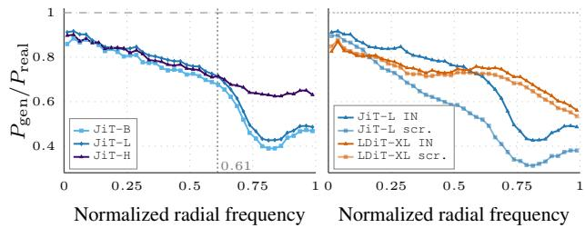  
Figure 1. Radial power-spectrum ratio: $P _ { \mathrm { g e n } } ( f ) / P _ { \mathrm { r e a l } } ( f )$ on RADIN. A ratio of 1 means the generated samples match real power at that frequency.

Spectral diagnostics show differences in generated image structure. In Figure 1 we use the spectral profile of generated images as a within-family diagnostic of image structure, across three comparisons. First, across JiT sizes: all models reproduce low-to-mid frequencies more closely than high ones, but while $\mathtt { B / 1 6 }$ and $\mathtt { L } / 1 6$ undershoot highfrequency power, H/16 better preserves it. $\mathtt { L } / 1 6$ is in turn slightly better aligned in the low-to-mid bands, which may explain its better gFID; so although H/16 does not improve gFID on RADIN, it does change the frequency profile. Second, RANDOM vs IN-initialised JiT-L/16 shows that natural-image initialisation alters the generated spectrum. Finally, in latent space the difference between RAN-

Table 1. RadImageNet (RadIN) 256×256 gFID across the three denoising paradigms. rFID is the off-the-shelf tokenizer reconstruction FID; EP. is the number of RadIN training epochs; PARAMS reports trainable denoiser parameters only; $\Delta _ { \mathrm { i n i t } }$ and $\Delta _ { \mathrm { i n i t } } \%$ is the absolute and relative gFID improvement of IN (✓) vs RANDOM (✗) Denoiser, as indicated in INIT column. Bold = best per category.
<table><tr><td>DENOISER</td><td>TOKENIZER</td><td>INIT.</td><td>EP.</td><td>PARAMS</td><td>rFID↓</td><td>gFID↓</td><td>DENS.↑</td><td>Cov.↑</td><td> $\Delta _ { \mathrm { i n i t } } / \Delta _ { \mathrm { i n i t } } ( \% )$ </td></tr><tr><td colspan="10">LATENT DENOISING</td></tr><tr><td>LDiT-XL/2</td><td>MedVAE</td><td>x</td><td>80</td><td>675M</td><td>6.35</td><td>21.33</td><td>0.64</td><td>0.72</td><td></td></tr><tr><td>LDiT-XL/2</td><td>SDVAE</td><td>x</td><td>80</td><td>675M</td><td>2.63</td><td>19.15</td><td>0.69</td><td>0.80</td><td></td></tr><tr><td>LDiT-XL/1</td><td>VAVAE</td><td>x</td><td>80</td><td>675M</td><td>1.88</td><td>19.05</td><td>0.79</td><td>0.85</td><td></td></tr><tr><td>LDiT-XL/1</td><td>VAVAE</td><td>√</td><td>80</td><td>675M</td><td>1.88</td><td>16.43</td><td>0.77</td><td>0.86</td><td>2.6 / 13.8</td></tr><tr><td colspan="10">PIXEL DENOISING</td></tr><tr><td>JiT-B/16</td><td></td><td>x</td><td>80</td><td>131M</td><td></td><td>55.50</td><td>0.27</td><td>0.31</td><td></td></tr><tr><td>JiT-B/16</td><td></td><td>√</td><td>80</td><td>131M</td><td></td><td>36.48</td><td>0.39</td><td>0.51</td><td>19.0 /34.3</td></tr><tr><td>JiT-L/16</td><td></td><td>x</td><td>80</td><td>459M</td><td></td><td>41.27</td><td>0.44</td><td>0.50</td><td></td></tr><tr><td>JiT-L/16</td><td></td><td>√</td><td>80</td><td>459M</td><td></td><td>32.34</td><td>0.48</td><td>0.60</td><td>8.9 / 21.6</td></tr><tr><td>JiT-H/16</td><td></td><td>x</td><td>40</td><td>952M</td><td></td><td>47.89</td><td>0.30</td><td>0.34</td><td></td></tr><tr><td>JiT-H/16</td><td></td><td>√</td><td>40</td><td>952M</td><td></td><td>32.83</td><td>0.46</td><td>0.60</td><td>15.1 / 31.4</td></tr><tr><td colspan="10">JOINT DENOISING</td></tr><tr><td>V-Co-B/16</td><td>DINOv2</td><td></td><td>80</td><td>260M</td><td></td><td>28.86</td><td>0.44</td><td>0.56</td><td></td></tr></table>

DOM and IN LDiT-XL/1 is smaller, consistent with the tokeniser already providing a structured representation.

## 4.2. The case of BraTS

We next study transfer on BraTS, in single and multichannel scenarios.

Table 2. BraTS-GLI 256×256 gFID across single- and multichannel diffusion. (a) Single-channel: the denoiser randomly generates one of the four MRI modalities; (b) Multi-channel: the denoiser generates all four MRI modalities; EP. the number of training epochs; Bold = best per panel.  
(a) Single-channel
<table><tr><td>DENOISER</td><td>INIT.</td><td>EP.</td><td>gFID↓</td><td>DENS.↑</td><td>Cov.↑</td><td> $\Delta _ { \mathrm { i n i t } }$ </td></tr><tr><td>LDiT-XL/1</td><td>x</td><td>40</td><td>9.22</td><td>0.67</td><td>0.76</td><td></td></tr><tr><td>LDiT-XL/1</td><td>√</td><td>40</td><td>7.66</td><td>0.68</td><td>0.78</td><td>1.56</td></tr><tr><td>JiT-L/16</td><td>x</td><td>40</td><td>37.93</td><td>0.19</td><td>0.26</td><td></td></tr><tr><td>JiT-L/16</td><td>√</td><td>40</td><td>29.34</td><td>0.25</td><td>0.36</td><td>8.59</td></tr><tr><td>JiT-H/16</td><td>√</td><td>10</td><td>29.13</td><td>0.23</td><td>0.35</td><td></td></tr></table>

(b) Multi-channel
<table><tr><td>DENOISER</td><td>INIT.</td><td>EP.</td><td>gFID↓</td><td>DENS.↑</td><td>Cov.↑</td></tr><tr><td>JiT-L/16</td><td>x</td><td>55</td><td>43.97</td><td>0.09</td><td>0.14</td></tr><tr><td>JiT-L/16</td><td>√</td><td>55</td><td>35.17</td><td>0.15</td><td>0.23</td></tr><tr><td>JiT-H/16</td><td>√</td><td>55</td><td>32.75</td><td>0.18</td><td>0.26</td></tr></table>

Single-channel MRI reproduces the transfer pattern. IN initialisation improves both latent and pixel-space models: LDiT-XL/1 by 1.56 gFID and JiT-L/16 by 8.59, again a larger absolute gain in pixel space. JiT-H/16 reaches comparable gFID to JiT-L/16 in fewer epochs (10 vs. 40). Since H/16 has roughly twice the FLOPs of L/16,5 this corresponds to about half the compute.

Multi-channel generation benefits from capacity. Generating all four modalities jointly is more challenging than the single-channel task: JiT-L/16 gFID rises from 29.34 to 35.17. IN initialisation nonetheless remains beneficial, improving pretrained JiT-L/16 by 8.80 gFID over RAN-DOM. Unlike RADIN, additional capacity here improves all metrics, with JiT-H/16 outperforming JiT-L/16, suggesting capacity may matter more when jointly representing multiple co-registered MRI contrasts.

## 4.3. Do FID gains carry clinical signal?

To assess whether FID improvement translates to clinically relevant information we perform the following experiment. We first sample 100k samples from our training set. We then train two JiT-B/16 (scratch; IN) models on the whole RADIN, conditioned on all (67) classes, and generate 100k samples over the 19 (validation) classes. This way we get three 100k pools with identical pathology distributions.

Table 3. Clinical Proxies on synthetic data. We measure FD-RAD and MACROF1 on two synthetic 100k pools.
<table><tr><td>DENOISER</td><td>INIT.</td><td>gFID↓</td><td>FD-RAD↓</td><td>MACROF1↑</td></tr><tr><td>JiT-B/16</td><td>√</td><td>40.81</td><td>37.99</td><td>0.47</td></tr><tr><td>JiT-B/16</td><td>x</td><td>72.67</td><td>87.46</td><td>0.43</td></tr></table>

FD-RAD In Table 3, we use 93 radiomic features [62], a radiology feature space capturing low-level image properties and measure the Frechet Distance from the real (100k)´ radiomic distribution. We find that lower gFID translates to lower FD-RAD, i.e., more clinically meaningful images.

Pathology Classification We train ResNet-50 models on real and synthetic data as a proxy to clinical (19-class pathology) classification. The classifier trained on the real data pool achieves 0.72. For the synthetic pools (Table 3) we find that lower gFID translates to better MACROF1, pointing towards more meaningful clinical generation.

## 5. What transfers: spatial structure, not semantics

Since the pixel denoiser carries the entire prior, we focus on pixel-space JiT and ask whether the benefit reflects highlevel (semantics) or low-level (spatial) structure.

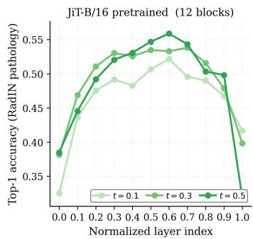

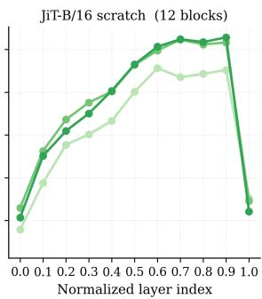  
Figure 2. Semantic probing. Top-1 accuracy of linear probes on frozen JiT-B representations classifying 19 RADIN pathology classes, by layer depth and noise level t. Averages over three runs.

## 5.1. Semantics do not predict generation quality

Following [72], a hypothesis is that pretraining helps via semantics, either by transferring semantic features or by providing an initialisation from which it learns stronger semantics. We probe frozen denoiser representations to classify the 19 pathology classes of RADIN. Since the generative models are conditioned on 5 broad anatomy classes, probes capture semantic information beyond generation labels.

Higher probe accuracy does not translate to better generation. JiT-B/16 from scratch probes similar to its IN counterpart (0.56) yet generates far worse samples (55.50 vs 36.48 gFID, Figure 2). The same holds across model sizes $( \mathbb { L } / \mathbb { H }$ see Supp.), with all models performing comparably. $J \mathrm { i } \mathrm { T } \mathrm { - } \mathrm { B } / 1 6$ probes slightly higher than JiT-H/16 (0.56 vs 0.54) but has worse gFID (36.48 vs 32.83). In latent space the scratch model also probes higher than the IN-init (0.557 vs 0.510) while generating worse (Supp.). Semantic separability cannot explain the transfer benefit.

## 5.2. Spatial structure tracks generation quality

An alternative hypothesis is that the benefit comes from spatial (low-level) structure [39, 58]. To test this, we collect all JiT models trained in this paper, i.e., pretrained, scratch, mixed (subsection 5.3), and limited-data (subsection 6.4). Applying LDS (subsection 3.3) to frozen denoiser representations gives inconclusive results. We modify LDS for denoiser representations, giving LDSC, and track gFID at $\vert r \vert { = } 0 . 8 4 6$ over 12 models (Figure 3). The fitted law is $\Delta \mathrm { g F I D { = } { - } 2 9 6 . 6 \times \Delta \mathrm { L D S c } }$ . We ask how much of the pretrained-scratch gFID gap this rule predicts from the LDSC gap alone. We multiply the observed LDSC gap by the fitted slope to obtain a predicted gFID gap, and divide by the actual gFID gap to get the fraction that the LDSC signal captures. For B/L/H it captures 92/58/52%, or 67% on average. Two checks confirm this: 1) Monte-Carlo perturbation of every measured gFID by $\sigma { = } 1$ (more than the seed noise), refitting over 5k runs gives $6 9 \pm 6 \% ; 2 )$ Removing both IN and scratch models of a size before refitting and predicting that size’s gap gives 95/62/42%, again 2/3 on average. LDSC predicts about two-thirds of the pretraining benefit. Better spatial organisation is one channel through which pretraining manifests.

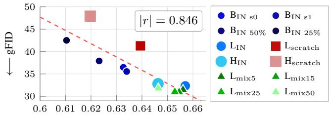  
Spatial Structure (LDSC) −→  
Figure 3. LDSC correlation with gFID across 12 JiT variants. LDSC here is the max value across JiT layers, at t=0.5.

## 5.3. Mixed-domain training

Early-to-mid representations are shared across domains We further test the structural hypothesis and train $J \mathrm { i } \mathrm { T } \mathrm { - } \mathrm { L } / 1 6$ jointly on RADIN and 10% IN (mixed-JiT-L/16), so a single model represents both domains internally, and measure the per-block cosine similarity of its representations (concatenated over the token sequence) under natural and medical inputs. Figure 4 shows that early-to-mid blocks (0–16) stay highly similar across domains (cos ≥ 0.7), so the model computes similar representations for both domains there. Deeper blocks (17–22) behave differently: cross-domain similarity drops (cos ≈ 0.35–0.50), suggesting domain-specific behaviour.

Table 4. Natural-image mixing. gFID of $J \mathrm { i } \mathrm { T } \mathrm { - } \mathrm { L } / 1 6$ (IN) trained for 80 epochs on mixed medical and natural data.
<table><tr><td>IN mix (%) RadIN:IN</td><td>0 1:0</td><td>5 19:1</td><td>15 5.7:1</td><td>25 3:1</td><td>50 1:1</td></tr><tr><td>gFID↓</td><td>32.34</td><td>31.46</td><td>30.94</td><td>31.01</td><td>31.80</td></tr></table>

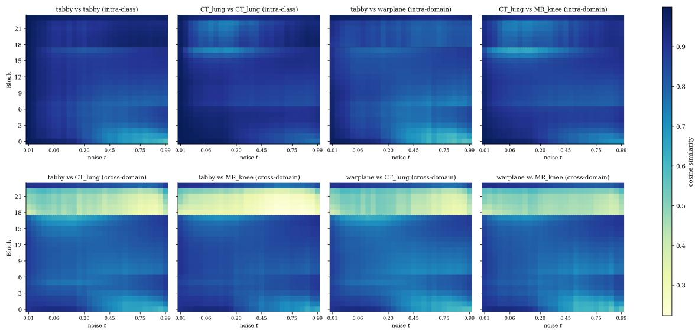  
Figure 4. Cosine similarity of internal representations in mixed-JiT-L/16. Blocks (y-axis) and noise levels t (x-axis). Intra-class and intra-domain pairs (top row); Cross-domain pairs (bottom row).

Natural-image mixing helps medical fidelity Since both domains yield similar representations, we sweep the ratio of natural images added to the mix. gFID improves across all ratios (Table 4), with the largest gain (1.4 gFID) at 15%. Even at 1:1 we observe a small improvement, though its magnitude sits near gFID noise.

## 6. The benefit is tied to natural-image initialisation

We ask whether the benefit of IN initialisation can be reproduced without it, or decomposed into simpler parts. To reproduce it, we test in-domain medical pretraining, statistically matched reinitialisation, and medical data scaling; none matches IN transfer in our setup. To decompose it, we compare parameter drift with block reversion, and find that drift does not predict functional importance.

## 6.1. Natural-image transfer outperforms medical pretraining

A natural alternative to IN-init is to pretrain on medical data. To our knowledge, no 2D radiology denoiser weights exist at a compatible architecture, so we train our own.

Single-channel target A JiT-B/16 pretrained from scratch on RADIN for 160 epochs and fine-tuned on singlechannel BRATS for 20 epochs is 5 gFID worse than direct IN fine-tuning (Table 5). A RADIN stage on top of IN helps slightly, but within seed noise $( \sigma _ { \mathrm { I N } } { = } 0 . 4 1 , \mathrm { S u p p . } )$ ).

Multi-channel target. We test whether an intermediate single-channel medical stage helps before transferring to multi-channel BRATS (Table 6). Direct IN transfer is the best (40.17). Inserting a medical stage only hurts, giving 50.90 after single-channel BRATS and 75.40 after RADIN.

Table 5. Single-channel BraTS transfer.
<table><tr><td>DENOISER (INIT)</td><td>PRETRAIN EP.</td><td>gFID↓</td><td>DENS.↑</td><td>Cov.↑</td></tr><tr><td>JiT-B/16(RAND)</td><td>RADIN</td><td>160 36.73</td><td>0.209</td><td>0.277</td></tr><tr><td>JiT-B/16 (IN)</td><td>RADIN</td><td>80 31.13</td><td>0.221</td><td>0.320</td></tr><tr><td>JiT-B/16(IN)</td><td></td><td>31.73</td><td>0.218</td><td>0.322</td></tr></table>

Table 6. Multi-channel BraTS transfer
<table><tr><td>DENOISER</td><td>PRETRAIN</td><td>EP.</td><td>gFID↓</td></tr><tr><td>JiT-L/16</td><td>RADIN</td><td>30</td><td>75.40</td></tr><tr><td>JiT-L/16</td><td>BRATS</td><td>30</td><td>50.90</td></tr><tr><td>JiT-L/16</td><td>一</td><td>30</td><td>40.17</td></tr></table>

## 6.2. Per-tensor weight statistics are not sufficient

If IN only set a suitable per-tensor scale, statistically matched (ST) initialisation would recover its benefit. Instead, ST is worse than RANDOM in both paradigms. Table 7 shows gFID rises from 41.27 to 62.64 for JiT-L and from 19.05 to 51.45 for LDiT-XL. The benefit comes from the specific weight values, not their distribution.

Table 7. Initialisation schemes. gFID on RADIN after 80 epochs from RANDOM, ST, and IN initialisation across both paradigms.
<table><tr><td>DENOISER</td><td>RANDOM</td><td>ST</td><td>IN</td></tr><tr><td>LDiT-XL/1</td><td>19.05</td><td>51.45</td><td>16.43</td></tr><tr><td>JiT-L/16</td><td>41.27</td><td>62.64</td><td>32.34</td></tr></table>

## 6.3. Parameter drift and functional importance

We ask whether a layer’s change during training reflects its importance. We measure change with parameter drift and importance with block reversion.

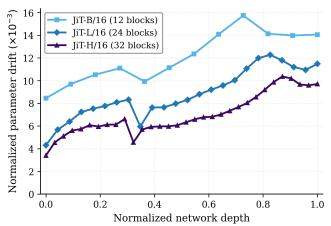

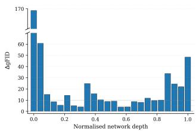  
Figure 5. (LEFT) Per transformer block normalized parameter drift: $\| \Delta W \| _ { F } / \sqrt { N _ { \mathrm { b l o c k } } }$ from IN init. All models trained for 20 epochs. (RIGHT) Per-block reversion importance: ∆gFID for each block of $J \mathrm { i } \mathrm { T } \mathrm { - } \mathrm { L } / 1 6$

Larger models drift less. Figure 5 (LEFT) shows that drift increases with depth. Early blocks remain closer to their IN-init, while deeper blocks move further. Averaged over blocks, drift decreases with model size: 12.10 (B), 8.80 (L), and 6.98 (H) $( \times 1 0 ^ { - 3 } )$ , so larger models adapt less.

Functional importance is not captured by drift alone. Block reversion (Figure 5 RIGHT) gives a different picture from parameter drift. Reverting the first transformer block to its IN weights is by far the most damaging, raising gFID by ∼170, even though this block drifts less than the deeper ones. The second and four final blocks are also important. Several intermediate blocks can be reverted with smaller changes in gFID. To account for any activation mismatch we also perform activation renormalisation after block reversion in the Supp. Results follow similar trend, thus drift cannot capture functional importance.

## 6.4. The gap is not closed by data scaling

A final hypothesis is that more medical data lets the model learn from scratch what transfer provides.

Limited data analysis We train JiT-B/16 from both scratch and IN init on 25%, 50%, and 100% of RADIN (Figure 6). The pretrained model leads at every scale, the gap narrows (from 30.0 to 19.0) but stays large. IN on 25% outperforms scratch on 100% (42.5 vs 55.5), while scratch fails to converge at 25%.

Data requirements extrapolation Fitting $\mathrm { F I D } \propto N ^ { - \alpha }$ to each model, gives $\alpha _ { \mathrm { R a n d } } = 0 . 2 9$ and $\alpha _ { \mathrm { I N } } = 0 . 1 1$ . If scratch improves at $\alpha _ { \mathrm { R a n d } }$ until it reaches the fidelity of IN at 25%, and at α thereafter, it needs about 10× more data to close the gap (an illustrative estimate).

## 7. Conclusion & Discussion

We present a systematic study of natural-image denoiser transfer for medical image generation. IN transfer consistently improves generation performance across latent and pixel space, model scales, and two radiology datasets. Gains are also mirrored in radiomic distance and pathology classification. Models trained from scratch reach similar semantic probe accuracy yet generate worse samples, whereas spatial organisation, measured by LDSC, correlates with gFID at $| r | { = } 0 . 8 5$ , positioning spatial structure as a channel through which pretraining manifests. Although natural and medical images differ in high-level content, a mixeddomain denoiser computes similar representations for both through most of the network, and mixing natural images into medical training improves fidelity. The benefit is tied to natural-image initialisation, and no alternative we test reproduces it, including in-domain medical pretraining. From a generative modelling lens, natural images are very useful for medical image generation.

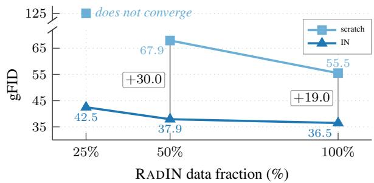  
Figure 6. Data scaling. gFID of JiT-B/16 trained 80 epochs from scratch versus IN on 25%, 50%, and 100% of RADIN.

Limitations and future work. LDSC predicts about twothirds of the pretraining benefit, so spatial organisation is one channel through which it manifests, but might not be the full account. What exactly is inherited (edges, textures or contours), and how architecture, data, training budget and optimisation contribute, remains open. Moreover, whether the benefits of natural images can be learned from medical data alone remains an open question. Our extrapolation scales data quantity, not diversity. Furthermore, our clinical evidence relies on proxies, and expert clinical evaluation is needed before any claim of clinical utility. Finally, we study 2D generation, the native format for X-ray and histopathology, in which even volumetric scans are read slice by slice. Extending to 3D generation is a natural next step.

## 8. Acknowledgements

This work was supported by the Swiss National Science Foundation (TMSGI3 225913, CRSK-3 229103) and the Chad Tough Defeat DIPG Foundation. We acknowledge EuroHPC Joint Undertaking for awarding us access to Discoverer+ (project EHPC-DEV-2026D06-289), hosted by PetaSC at Sofia Tech Park, Bulgaria, and co-funded by EuroHPC JU and the Bulgarian government. E. Georgiou would like to thank T. Kouzelis for connecting him with I. Kakogeorgiou.

## References

[1] Robert G. Alexander, Stephen Waite, Stephen L. Macknik, and Susana Martinez-Conde. What do radiologists look for? Advances and limitations of perceptual learning in radiologic search. Journal of Vision, 20(10):17, 2020. 1

[2] Alan Baade, Eric Ryan Chan, Kyle Sargent, Changan Chen, Justin Johnson, Ehsan Adeli, and Li Fei-Fei. Latent forcing: Reordering the diffusion trajectory for pixel-space image generation. In Forty-third International Conference on Machine Learning, 2026. 2

[3] Pierre Chambon, Christian Bluethgen, Jean-Benoit Delbrouck, Rogier Van der Sluijs, Małgorzata Połacin, Juan Manuel Zambrano Chaves, Tanishq Mathew Abraham, Shivanshu Purohit, Curtis P Langlotz, and Akshay Chaudhari. Roentgen: vision-language foundation model for chest x-ray generation. arXiv preprint arXiv:2211.12737, 2022. 1, 2

[4] Joseph Cho, Mrudang Mathur, Cyril Zakka, Dhamanpreet Kaur, Matthew Leipzig, Alex Dalal, Aravind Krishnan, Eubee Koo, Karen Wai, Cindy S Zhao, et al. Medisyn: A generalist text-guided latent diffusion model for diverse medical image synthesis. arXiv preprint arXiv:2405.09806, 2024. 3

[5] Maria Correia de Verdier, Rachit Saluja, Louis Gagnon, Dominic LaBella, Ujjwall Baid, Nourel Hoda Tahon, Martha Foltyn-Dumitru, Jikai Zhang, Maram Alafif, Saif Baig, et al. The 2024 brain tumor segmentation (brats) challenge: Glioma segmentation on post-treatment mri. arXiv preprint arXiv:2405.18368, 2024. 3

[6] Jia Deng, Wei Dong, Richard Socher, Li-Jia Li, Kai Li, and Li Fei-Fei. Imagenet: A large-scale hierarchical image database. In 2009 IEEE Conference on Computer Vision and Pattern Recognition, pages 248–255, 2009. 1

[7] Zolnamar Dorjsembe, Hsing-Kuo Pao, Sodtavilan Odonchimed, and Furen Xiao. Conditional diffusion models for semantic 3d brain mri synthesis. IEEE Journal of Biomedical and Health Informatics, 28(7):4084–4093, 2024. 2

[8] Alexey Dosovitskiy, Lucas Beyer, Alexander Kolesnikov, Dirk Weissenborn, Xiaohua Zhai, Thomas Unterthiner, Mostafa Dehghani, Matthias Minderer, Georg Heigold, Sylvain Gelly, Jakob Uszkoreit, and Neil Houlsby. An image is worth 16x16 words: Transformers for image recognition at scale. In International Conference on Learning Representations, 2021. 1

[9] Betty Edwards. Drawing on the Right Side of the Brain. J. P. Tarcher, Los Angeles, 1979. 1

[10] Patrick Esser, Robin Rombach, and Bjorn Ommer. Taming transformers for high-resolution image synthesis. In Proceedings of the IEEE/CVF conference on computer vision and pattern recognition, pages 12873–12883, 2021. 2

[11] Patrick Esser, Sumith Kulal, Andreas Blattmann, Rahim Entezari, Jonas Muller, Harry Saini, Yam Levi, Dominik¨ Lorenz, Axel Sauer, Frederic Boesel, et al. Scaling rectified flow transformers for high-resolution image synthesis. In Forty-first international conference on machine learning, 2024. 2

[12] Paul Friedrich, Julia Wolleb, Florentin Bieder, Alicia Durrer, and Philippe C Cattin. Wdm: 3d wavelet diffusion models for high-resolution medical image synthesis. In MICCAI workshop on deep generative models, pages 11–21. Springer, 2024. 2

[13] Kunihiko Fukushima. Neocognitron: A self-organizing neural network model for a mechanism of pattern recognition unaffected by shift in position. Biological cybernetics, 36 (4):193–202, 1980. 1

[14] Ian J. Goodfellow, Jean Pouget-Abadie, Mehdi Mirza, Bing Xu, David Warde-Farley, Sherjil Ozair, Aaron Courville, and Yoshua Bengio. Generative adversarial nets. In Advances in Neural Information Processing Systems. Curran Associates, Inc., 2014. 2

[15] Changlu Guo, Anders Nymark Christensen, and Morten Rieger Hannemose. Med-art: Diffusion transformer for 2d medical text-to-image generation. In MICCAI Workshop on Deep Generative Models, pages 57–66. Springer, 2025. 3

[16] Pengfei Guo, Can Zhao, Dong Yang, Ziyue Xu, Vishwesh Nath, Yucheng Tang, Benjamin Simon, Mason Belue, Stephanie Harmon, Baris Turkbey, and Daguang Xu. Maisi: Medical ai for synthetic imaging. In 2025 IEEE/CVF Winter Conference on Applications of Computer Vision (WACV), pages 4430–4441, 2025. 1, 2

[17] Martin Heusel, Hubert Ramsauer, Thomas Unterthiner, Bernhard Nessler, and Sepp Hochreiter. Gans trained by a two time-scale update rule converge to a local nash equilibrium. In Advances in Neural Information Processing Systems, 2017. 3

[18] Jonathan Ho, Ajay Jain, and Pieter Abbeel. Denoising diffusion probabilistic models. Advances in neural information processing systems, 33:6840–6851, 2020. 2

[19] Jonathan Ho, Chitwan Saharia, William Chan, David J Fleet, Mohammad Norouzi, and Tim Salimans. Cascaded diffu sion models for high fidelity image generation. Journal of Machine Learning Research, 23(47):1–33, 2022. 2

[20] Jing Huang, S.R. Kumar, M. Mitra, Wei-Jing Zhu, and R. Zabih. Image indexing using color correlograms. In Proceedings of IEEE Computer Society Conference on Computer Vision and Pattern Recognition, pages 762–768, 1997. 3

[21] Peng Huang, Xue Gao, Lihong Huang, Jing Jiao, Xiaokang Li, Yuanyuan Wang, and Yi Guo. Chest-diffusion: A light weight text-to-image model for report-to-cxr generation. In 2024 IEEE International Symposium on Biomedical Imaging (ISBI), pages 1–5. IEEE, 2024. 1, 2

[22] David H. Hubel and Torsten N. Wiesel. Receptive fields, binocular interaction and functional architecture in the cat’s visual cortex. The Journal of Physiology, 160(1):106–154, 1962. 1

[23] Yukiyasu Kamitani and Frank Tong. Decoding the visual and subjective contents of the human brain. Nature Neuroscience, 8(5):679–685, 2005. 1

[24] Mikhail Karasikov, Joost van Doorn, Nicolas Kanzig,¨ Melis Erdal Cesur, Hugo Mark Horlings, Robert Berke, Fei Tang, and Sebastian Otalora. Training state-of-the-art pathol-´ ogy foundation models with orders of magnitude less data.

In Medical Image Computing and Computer Assisted Intervention – MICCAI 2025, pages 573–583. Springer Nature Switzerland, 2025. 1, 3

[25] Alexander Ke, William Ellsworth, Oishi Banerjee, Andrew Y Ng, and Pranav Rajpurkar. Chextransfer: performance and parameter efficiency of imagenet models for chest x-ray interpretation. In Proceedings of the conference on health, inference, and learning, pages 116–124, 2021. 1, 3

[26] Firas Khader, Gustav Muller-Franzes, Soroosh¨ Tayebi Arasteh, Tianyu Han, Christoph Haarburger, Maximilian Schulze-Hagen, Philipp Schad, Sandy Engelhardt, Bettina Baeßler, Sebastian Foersch, et al. Denoising diffusion probabilistic models for 3d medical image generation. Scientific reports, 13(1):7303, 2023. 2

[27] Diederik P. Kingma and Max Welling. Auto-encoding variational bayes. In 2nd International Conference on Learning Representations, 2014. 2

[28] Theodoros Kouzelis, Efstathios Karypidis, Ioannis Kakogeorgiou, Spyros Gidaris, and Nikos Komodakis. Boosting generative image modeling via joint image-feature synthesis. In NeurIPS, 2025. 2

[29] Tuomas Kynka¨anniemi, Tero Karras, Samuli Laine, Jaakko¨ Lehtinen, and Timo Aila. Improved precision and recall metric for assessing generative models. In Advances in Neural Information Processing Systems (NeurIPS), 2019. 3

[30] Daria Laslo, Efthymios Georgiou, Marius George Linguraru, Andreas M Rauschecker, Sabine Muller, Catherine R¨ Jutzeler, and Sarah Bruningk. Mechanistic learning with¨ guided diffusion models to predict spatio-temporal brain tumor growth. In International Workshop on Learning with Longitudinal Medical Images and Data, pages 68–79. Springer, 2025. 2

[31] Daria Laslo, Julia Wolleb, Maria Monzon, Raimund Kottke, Selma Sirin, Timothy Muller, Dror Suhami, Franziska¨ Vogt, Aashim Bhatia, Deep B. Gandhi, Anahita Fathi Kazerooni, Ariana M. Familiar, Thien Nguyen, Zhifan Jiang, Abhijeet Parida, Nicolas U. Gerber, Ana Guerreiro Stucklin,¨ Ali Nabavizadeh, Javad Nazarian, Marius George Linguraru, Andreas M. Rauschecker, Sabine Muller, Catherine Jutzeler,¨ and Sarah Bruningk. Generative ai for spatial tumor growth¨ on mri: a proof-of-principle study in pediatric diffuse midline glioma. BMC Medicine, 24(1):389, 2026. 2

[32] Yann LeCun, Bernhard Boser, John S Denker, Donnie Henderson, Richard E Howard, Wayne Hubbard, and Lawrence D Jackel. Backpropagation applied to handwritten zip code recognition. Neural computation, 1(4):541–551, 1989. 1

[33] Tianhong Li and Kaiming He. Back to basics: Let denoising generative models denoise. In Proceedings ofthe IEEE/CVF Conference on Computer Vision and Pattern Recognition (CVPR), pages 36115–36125, 2026. 2, 3, 4

[34] Han Lin, Xichen Pan, Zun Wang, Yue Zhang, Chu Wang, Jaemin Cho, and Mohit Bansal. V-co: A closer look at visual representation alignment via co-denoising. In ECCV, 2026. 2, 3, 4

[35] Yaron Lipman, Ricky T. Q. Chen, Heli Ben-Hamu, Maximilian Nickel, and Matthew Le. Flow matching for genera-

tive modeling. In The Eleventh International Conference on Learning Representations, 2023. 2

[36] Qinghui Liu, Elies Fuster-Garcia, Ivar Thokle Hovden, Bradley J. MacIntosh, Edvard O. S. Grødem, Petter Brandal, Carles Lopez-Mateu, Donatas Sederevicius, Karoline Sko-ˇ gen, Till Schellhorn, Atle Bjørnerud, and Kyrre Eeg Emblem. Treatment-aware diffusion probabilistic model for lon gitudinal mri generation and diffuse glioma growth prediction. IEEE Transactions on Medical Imaging, 44(6):2449– 2462, 2025. 1, 2

[37] Xingchao Liu, Chengyue Gong, and qiang liu. Flow straight and fast: Learning to generate and transfer data with rectified flow. In The Eleventh International Conference on Learning Representations, 2023. 2

[38] Nanye Ma, Mark Goldstein, Michael S Albergo, Nicholas M Boffi, Eric Vanden-Eijnden, and Saining Xie. Sit: Exploring flow and diffusion-based generative models with scalable interpolant transformers. In European Conference on Com puter Vision, pages 23–40. Springer, 2024. 2

[39] Christos Matsoukas, Johan Fredin Haslum, Moein Sorkhei, Magnus Soderberg, and Kevin Smith. What makes trans-¨ fer learning work for medical images: Feature reuse & other factors. In Proceedings of the IEEE/CVF conference on computer vision and pattern recognition, pages 9225–9234, 2022. 1, 3, 4, 6

[40] Xueyan Mei, Zelong Liu, Philip M. Robson, Brett Marinelli, Mingqian Huang, Amish Doshi, Adam Jacobi, Chendi Cao, Katherine E. Link, Thomas Yang, Ying Wang, Hayit Greenspan, Timothy Deyer, Zahi A. Fayad, and Yang Yang. RadImageNet: An open radiologic deep learning research dataset for effective transfer learning. Radiology: Artificial Intelligence, 4(5):e210315, 2022. 3

[41] Bjoern H Menze, Andras Jakab, Stefan Bauer, Jayashree Kalpathy-Cramer, Keyvan Farahani, Justin Kirby, Yuliya Burren, Nicole Porz, Johannes Slotboom, Roland Wiest, et al. The multimodal brain tumor image segmentation benchmark (BRATS). IEEE Transactions on Medical Imag ing, 34(10):1993–2024, 2015. 3

[42] Puria Azadi Moghadam, Sanne Van Dalen, Karina C Mar tin, Jochen Lennerz, Stephen Yip, Hossein Farahani, and Ali Bashashati. A morphology focused diffusion probabilistic model for synthesis of histopathology images. In Proceedings of the IEEE/CVF winter conference on applications of computer vision, pages 2000–2009, 2023. 2

[43] Gustav Muller-Franzes, Jan Moritz Niehues, Firas Khader,¨ Soroosh Tayebi Arasteh, Christoph Haarburger, Christiane Kuhl, Tianci Wang, Tianyu Han, Teresa Nolte, Sven Nebelung, et al. A multimodal comparison of latent denoising diffusion probabilistic models and generative adversarial networks for medical image synthesis. Scientific reports, 13 (1):12098, 2023. 2

[44] Basil Mustafa, Aaron Loh, Jan Freyberg, Patricia MacWilliams, Megan Wilson, Scott Mayer McKinney, Marcin Sieniek, Jim Winkens, Yuan Liu, Peggy Bui, et al. Supervised transfer learning at scale for medical imaging. arXiv preprint arXiv:2101.05913, 2021. 1, 3

[45] Muhammad Ferjad Naeem, Seong Joon Oh, Youngjung Uh, Yunjey Choi, and Jaejun Yoo. Reliable fidelity and diversity

metrics for generative models. In Proceedings ofthe 37th International Conference on Machine Learning (ICML), 2020. 3

[46] Kimon Nicola¨ıdes. The Natural Way to Draw: A Working Planfor Art Study. Houghton Mifflin, Boston, 1941. 1

[47] Calvin F. Nodine and Elizabeth A. Krupinski. Perceptual skill, radiology expertise, and visual test performance with NINA and WALDO. Academic Radiology, 5(9):603–612, 1998. 1

[48] Maxime Oquab, Timothee Darcet, Th´ eo Moutakanni, Huy´ Vo, Marc Szafraniec, Vasil Khalidov, Pierre Fernandez, Daniel Haziza, Francisco Massa, Alaaeldin El-Nouby, et al. Dinov2: Learning robust visual features without supervision. Transactions on Machine Learning Research Journal, 2024. 2, 3

[49] Shaoyan Pan, Tonghe Wang, Richard L. J. Qiu, Marian Axente, Chih-Wei Chang, Junbo Peng, Ashish B. Patel, Joseph Shelton, Sagar A. Patel, Justin Roper, and Xiaofeng Yang. 2d medical image synthesis using transformer-based denoising diffusion probabilistic model. Physics in Medicine & Biology, 68(10):105004, 2023. 2

[50] William Peebles and Saining Xie. Scalable diffusion models with transformers. In Proceedings of the IEEE/CVF international conference on computer vision, pages 4195–4205, 2023. 2

[51] Giorgos Petsangourakis, Christos Sgouropoulos, Bill Psomas, Theodoros Giannakopoulos, Giorgos Sfikas, and Ioannis Kakogeorgiou. Reglue your latents with global and local semantics for entangled diffusion. In ECCV, 2026. 2

[52] Walter HL Pinaya, Petru-Daniel Tudosiu, Jessica Dafflon, Pedro F Da Costa, Virginia Fernandez, Parashkev Nachev, Sebastien Ourselin, and M Jorge Cardoso. Brain imaging generation with latent diffusion models. In MICCAI workshop on deep generative models, pages 117–126. Springer, 2022. 1, 2

[53] Maithra Raghu, Chiyuan Zhang, Jon Kleinberg, and Samy Bengio. Transfusion: Understanding transfer learning for medical imaging. In Advances in Neural Information Processing Systems. Curran Associates, Inc., 2019. 1, 3, 4

[54] Robin Rombach, Andreas Blattmann, Dominik Lorenz, Patrick Esser, and Bjorn Ommer. High-resolution image¨ synthesis with latent diffusion models. In Proceedings of the IEEE/CVF conference on computer vision and pattern recognition, pages 10684–10695, 2022. 2, 3

[55] Olaf Ronneberger, Philipp Fischer, and Thomas Brox. Unet: Convolutional networks for biomedical image segmentation. In International Conference on Medical image computing and computer-assisted intervention, pages 234–241. Springer, 2015. 2

[56] Chitwan Saharia, William Chan, Saurabh Saxena, Lala Li, Jay Whang, Emily L Denton, Kamyar Ghasemipour, Raphael Gontijo Lopes, Burcu Karagol Ayan, Tim Salimans, et al. Photorealistic text-to-image diffusion models with deep language understanding. Advances in neural information processing systems, 35:36479–36494, 2022. 2

[57] Eli Shechtman and Michal Irani. Matching local selfsimilarities across images and videos. In 2007 IEEE Con-

ference on Computer Vision and Pattern Recognition, pages 1–8, 2007. 3

[58] Jaskirat Singh, Xingjian Leng, Zongze Wu, Liang Zheng, Richard Zhang, Eli Shechtman, and Saining Xie. What mat ters for representation alignment: Global information or spatial structure? In The Fourteenth International Conference on Learning Representations, 2026. 2, 3, 6, 14

[59] Jascha Sohl-Dickstein, Eric Weiss, Niru Maheswaranathan, and Surya Ganguli. Deep unsupervised learning using nonequilibrium thermodynamics. In International confer ence on machine learning, pages 2256–2265. pmlr, 2015. 2

[60] Yang Song, Jascha Sohl-Dickstein, Diederik P Kingma, Abhishek Kumar, Stefano Ermon, and Ben Poole. Score-based generative modeling through stochastic differential equations. In International Conference on Learning Representations, 2021. 2

[61] George Stein, Jesse Cresswell, Rasa Hosseinzadeh, Yi Sui, Brendan Ross, Valentin Villecroze, Zhaoyan Liu, Anthony L Caterini, Eric Taylor, and Gabriel Loaiza-Ganem. Exposing flaws of generative model evaluation metrics and their unfair treatment of diffusion models. In Advances in Neural Information Processing Systems, 2023. 4

[62] Joost J. M. van Griethuysen, Andrey Fedorov, Chintan Parmar, Ahmed Hosny, Nicole Aucoin, Vivek Narayan, Regina G. H. Beets-Tan, Jean-Christophe Fillion-Robin, Steven D. Pieper, and Hugo J.W.L. Aerts. Computational radiomics system to decode the radiographic phenotype. Cancer research, 77:e104 – e107, 2017. 5

[63] Maya Varma, Ashwin Kumar, Rogier Van der Sluijs, Sophie Ostmeier, Louis Blankemeier, Pierre Joseph Marcel Chambon, Christian Bluethgen, Jip Prince, Curtis Langlotz, and Akshay S Chaudhari. MedVAE: Efficient automated interpretation of medical images with large-scale generalizable autoencoders. In Medical Imaging with Deep Learning, 2025. 3

[64] Ashish Vaswani, Noam Shazeer, Niki Parmar, Jakob Uszkoreit, Llion Jones, Aidan N Gomez, Łukasz Kaiser, and Illia Polosukhin. Attention is all you need. Advances in neural information processing systems, 30, 2017. 1

[65] Stephen Waite, Arkadij Grigorian, Robert G. Alexander, Stephen L. Macknik, Marisa Carrasco, David J. Heeger, and Susana Martinez-Conde. Analysis of perceptual expertise in radiology – current knowledge and a new perspective. Fron tiers in Human Neuroscience, 13:213, 2019. 1

[66] Haoshen Wang, Zhentao Liu, Kaicong Sun, Xiaodong Wang, Dinggang Shen, and Zhiming Cui. 3d meddiffusion: A 3d medical latent diffusion model for controllable and highquality medical image generation. IEEE Transactions on Medical Imaging, 2025. 1, 2

[67] Yizhou Wu, Shansong Wang, Yuheng Li, Mojtaba Safari, Mingzhe Hu, Chih-Wei Chang, Harini Veeraraghavan, and Xiaofeng Yang. Braindino: A brain mri foundation model for generalizable clinical representation learning. arXiv preprint arXiv:2604.27277, 2026. 1, 3

[68] Yanwu Xu, Li Sun, Wei Peng, Shuyue Jia, Katelyn Mor rison, Adam Perer, Afrooz Zandifar, Shyam Visweswaran, Motahhare Eslami, and Kayhan Batmanghelich. Medsyn:

text-guided anatomy-aware synthesis of high-fidelity 3-d ct images. IEEE Transactions on Medical Imaging, 43(10): 3648–3660, 2024. 2

[69] Jingfeng Yao, Bin Yang, and Xinggang Wang. Reconstruction vs. generation: Taming optimization dilemma in latent diffusion models. In Proceedings of the Computer Vision and Pattern Recognition Conference, pages 15703–15712, 2025. 2, 3, 4

[70] Srikar Yellapragada, Alexandros Graikos, Prateek Prasanna, Tahsin Kurc, Joel Saltz, and Dimitris Samaras. Pathldm: Text conditioned latent diffusion model for histopathology. In Proceedings of the IEEE/CVF Winter Conference on Applications of Computer Vision, pages 5182–5191, 2024. 1, 3

[71] Srikar Yellapragada, Alexandros Graikos, Kostas Triaridis, Prateek Prasanna, Rajarsi Gupta, Joel Saltz, and Dimitris Samaras. Zoomldm: Latent diffusion model for multi-scale image generation. In Proceedings of the Computer Vision and Pattern Recognition Conference, pages 23453–23463, 2025. 3

[72] Sihyun Yu, Sangkyung Kwak, Huiwon Jang, Jongheon Jeong, Jonathan Huang, Jinwoo Shin, and Saining Xie. Representation alignment for generation: Training diffusion transformers is easier than you think. In The Thirteenth International Conference on Learning Representations, 2025. 2, 3, 6

[73] Chiyuan Zhang, Samy Bengio, and Yoram Singer. Are all layers created equal? Journal of Machine Learning Research, 23(67):1–28, 2022. 4

[74] Can Zhao, Pengfei Guo, Dong Yang, Yufan He, Yucheng Tang, Benjamin Simon, Mason Belue, Stephanie Harmon, Baris Turkbey, and Daguang Xu. Maisi-v2: Accelerated 3d high-resolution medical image synthesis with rectified flow and region-specific contrastive loss. In Proceedings of the AAAI Conference on Artificial Intelligence, pages 13088– 13098, 2026. 2

## 9. Additional Results

Table 8. rFID of off-the-shelf Tokenizers on BraTS and RadImageNet (RadIN) (256×256). The medical-domain MedVAE is dominated by every natural-image VAE on both datasets, despite the latter having seen no medical data.

<table><tr><td rowspan="2">TOKENIZER</td><td colspan="2">rFID ↓</td></tr><tr><td>BRATS</td><td>RADIN</td></tr><tr><td>NATURAL-IMAGE</td><td></td><td></td></tr><tr><td>SDVAE</td><td>2.27</td><td>2.63</td></tr><tr><td>SD3.5VAE</td><td>0.48</td><td>0.92</td></tr><tr><td>VAVAE</td><td>1.34</td><td>1.88</td></tr><tr><td>RAEv2(DINOv3-L-k7)</td><td>1.60</td><td>2.42</td></tr><tr><td>MEDICAL-DOMAIN</td><td></td><td></td></tr><tr><td>MedVAE</td><td>6.43</td><td>6.35</td></tr></table>

Theoretically, an optimal compressor approaches the Kolmogorov complexity of its training data: it learns patterns rather than memorising, and reuses them to compress OOD data. We find natural VAEs compress radiology images very well with no medical training. We treat this as another positive transfer result, and hypothesise MedVAE’s performance stems from limited data and optimisation, e.g, training epochs, regularisation. We do not claim that medical data and pretraining do not help in general. Our illustrative extrapolation suggests that closing the gap would need far more medical data, whereas natural images are abundant and transfer to radiology.

Table 9. Seed variance. gFID on RADIN after 80 epochs. δ is the range (max−min) and σ the standard deviation across seeds. IN seeds share a fixed initialisation and vary only in data order, noise, etc., which likely explains why σRand > σIN.
<table><tr><td></td><td colspan="2">JiT-B/16</td><td colspan="2">LDiT-XL/1</td></tr><tr><td>SEED</td><td>RAND.</td><td>IN</td><td>RAND.</td><td>IN</td></tr><tr><td>0</td><td>55.50</td><td>36.48</td><td>19.05</td><td>16.43</td></tr><tr><td>1</td><td>56.30</td><td>35.71</td><td>18.62</td><td>16.28</td></tr><tr><td>2</td><td>54.27</td><td>36.33</td><td>一</td><td></td></tr><tr><td>MEAN</td><td>55.36</td><td>36.17</td><td>18.84</td><td>16.36</td></tr><tr><td>δ</td><td>2.03</td><td>0.77</td><td>0.43</td><td>0.15</td></tr><tr><td>σ</td><td>1.02</td><td>0.41</td><td>-</td><td>-</td></tr></table>

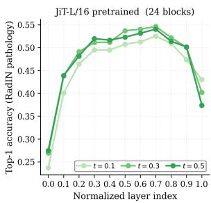

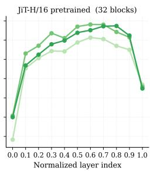

(a) JiT-L/16; JiT-H/16 (pixel-space)  
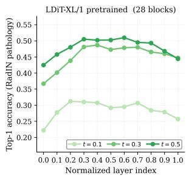

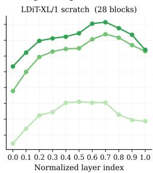  
(b) LDiT-XL/1; left pretrained; right scratch.  
Figure 7. Semantic/pathology probing results.

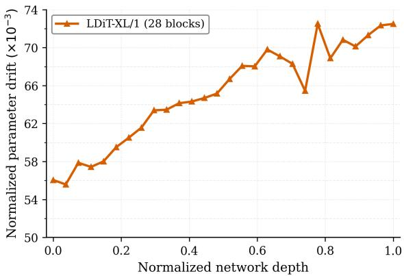

Figure 8. Parameter drift of IN-init LDiT-XL/1  
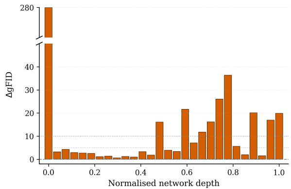  
Figure 9. Per-block reversion of LDiT-XL/1

Table 10. Block reversion with activation renormalisation. ∆gFID (↑ worse) on RADIN when a single block $L _ { k }$ of the finetuned $\mathbb { J i T - L / 1 }$ 6 is reverted to the IN weights. + RENORM additionally rescales the block k output to match the original perchannel statistics $( \mu , \sigma ) _ { k , c } .$ Damage persists after renormalisation so it cannot be attributed to activation mismatch alone.
<table><tr><td>METHOD</td><td> $L _ { 0 }$ </td><td> $L _ { 1 }$ </td><td> $L _ { 2 0 }$ </td><td> $L _ { 2 3 }$ </td></tr><tr><td>REINIT</td><td>+167.4</td><td>+60.7</td><td>+33.8</td><td>+48.5</td></tr><tr><td>+ RENORM</td><td>+101.0</td><td>+63.1</td><td>+14.3</td><td>+19.0</td></tr></table>

## 10. Datasets

## 10.1. RadImageNet

We use the RADIMAGENET as our primary diverse and large 2D radiology dataset. We were given access to its CT and MR sub-collections. Our subset covers five anatomical regions: CT abdomen, CT thorax (lung), MR hip, MR knee, and MR shoulder. Each region is further subdivided into per-pathology sub-folders, for a total of 71 pathology classes, with 67 of them having more than 100 samples.

The provided set consists of 530, 534 2D slice PNGs. We randomly hold out 15,000 images as validation and train on the remaining 515, 534. Preprocessing involves center-cropping and bicubic upsampling to 256×256. The class-conditional generator is conditioned on the five (modality, body part) region labels. The finer pathology taxonomy enters only at evaluation, where the linear-probe analysis restricts to the 19 pathology classes by filtering out rare (long-tail) pathology classes with fewer than 100 samples in our validation set.

Table 11. The 19 pathology classes used for the linear-probe analysis. Names follow the original RADIMAGENET folder labels verbatim. MR HIP contributes no class above the threshold.
<table><tr><td>REGION</td><td>CLASS</td></tr><tr><td>CT ABD</td><td>renal_lesion liver_lesion bowel_abnormality bowel_inflammation post_op</td></tr><tr><td>CT LUNG</td><td>Airspace_opacity Nodule interstitial_lung-disease</td></tr><tr><td>MR KNEE</td><td>chondral_abnormality meniscal_abnormality soft_tissue_fluid_collection bone_inflammation acl-pathology mcl_pathology intra</td></tr><tr><td>MR SHOULDER</td><td>labral-pathology soft_tissue_fluid soft_tissue_edema supraspinatus-pathology</td></tr></table>

BRATS. We use the 2024 BraTS post-treatment adult glioma cohort, contributed by seven academic medical centers. Each subject is acquired with four co-registered, skullstripped 1 mm isotropic multi-parametric MRI volumes covering the standard clinical contrasts: native T1 (T1), post-contrast T1-weighted (T1c), T2-weighted (T2), and T2 fluid-attenuated inversion recovery (T2FLAIR). BRATS consists of 1,621 training patients (6,484 3D mpMRI volumes). The official validation split contributes a held-out cohort of 188 patients (752 volumes).

We flatten each volume to 2D by keeping the axial slices 15–154 (140 per volume) and bicubic-upsampling from 192×192 to 256×256. Every multi-channel (patient, slice) pair is stored as a single 4×256×256 tensor in which the four co-registered modalities occupy the channel dimension, yielding 226, 940 training and 26, 320 validation multi-channel samples.

We use the data in two ways. In the 4-channel setup, each slice is one 4-channel image. In the single-channel setup, each modality is a separate grayscale image (replicated to three channels for IN initialisation), which gives 907, 760 training and 105, 280 validation single-channel images.

## 11. Spatial structure metrics

## 11.1. LDS and LDSC: implementation

We follow the definitions of subsection 3.3 and use the reference implementation of [58]. JiT tokenises a 256×256 image into a 16×16 grid of N=256 patch tokens. Incontext (class) tokens are removed before computing the metric. Near pairs are adjacent tokens $( d _ { i j } { = } 1 , i . e . , R _ { \mathrm { n } } { = } 2 ;$ 4 per interior token) and far pairs have $d _ { i j } { \geq } R _ { \mathrm { f } } { = } 6$ (195 per central token), following [58] (Figure 10 a,b). A high LDSC means that nearby patches, e.g., the fur of a bird or a tissue in an MRI scan, have similar representations, while distant patches differ. For LDSC, we mean-centre the tokens of each image before computing the cosine kernel, so that LDSC is the near term minus the far term of the centred tokens (Figure 10c). We compute LDSC for every block at t=0.5 and report the peak over blocks, excluding the I/O blocks (Figure 10 d).

## 11.2. Robustness to the I/O exclusion

The main paper excludes only the first and last block. However, in deeper models the near-input region spans more than one block. For example, the L/16 and H/16 scratch denoisers reach their highest LDSC in block 1, directly after the input, where representations remain close to the pixel space (Figure 10d, Figure 11 top). This reduces their IN vs. scratch gap (2.8% and 4.3% for L and H, vs. 10.3% for B). An alternative is to exclude a fixed fraction of depth, e.g., 5% or 10% at each end, i.e., removing these blocks and focusing on the mid-layers. The scratch peaks shift into the trunk (L/16 block 15, H/16 block 19 at 10%), the gap becomes similar across sizes (10.3/14.3/13.9% at 10%), and the correlation with gFID increases from $\left| \boldsymbol { r } \right| { = } 0 . 8 4 6$ to 0.903 and 0.945 (Figure 11 bottom). The IN peaks do not change. Therefore, our conclusions hold under all three rules, and the first/last-block rule is the conservative choice.

## 12. Evaluation Metrics

Evaluation setup. All quantitative metrics are computed with the dgm-eval suite, using the INCEPTION-V3 feature extractor. Evaluation features are extracted in fp32.

FID Measures the feature distance between the distributions of real and generated images. It uses the INCEPTION-V3 network and computes the Frechet distance under the´ assumption that both feature distributions are multivariate Gaussian. Lower is better.

Density & Coverage Refine precision / recall to be more robust to outliers and large feature variance. DENS. counts how many real-sample k-NN neighbourhoods contain each generated sample (fidelity); COV. is the fraction of real samples whose neighbourhood contains at least one generated sample (diversity). Higher is better.

Spectral profile. Diagnostic, not a headline metric. We take the 2D-FFT of each image, radially average the power to obtain $P ( f )$ as a function of spatial frequency, and plot the ratio $P _ { \mathrm { g e n } } ( f ) / P _ { \mathrm { r e a l } } ( f )$ : 1 matches the real spectrum at that frequency, $< 1$ is under-production, > 1 is over-shoot. We only use it for within-family comparisons. We do not compare across architectures, because their spectra differ for reasons unrelated to transfer.

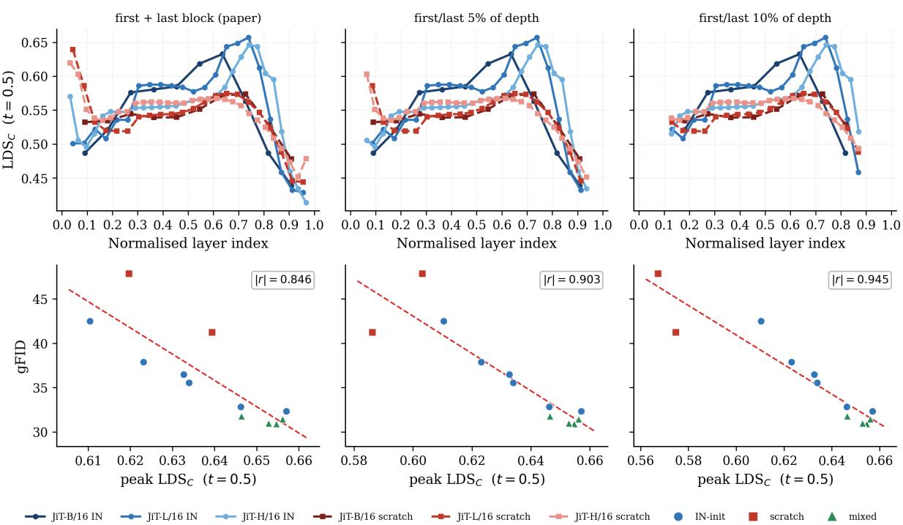

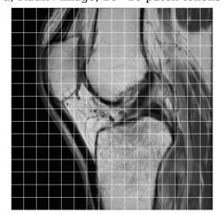

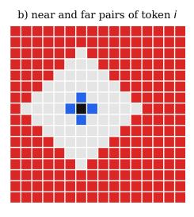

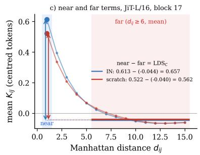

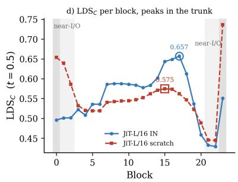  
Figure 10. LDS and LDSC. a) A RADIN image and its 16×16 patch tokens. b) Near $( d _ { i j } < R _ { \mathrm { n } }$ , blue) and far $( d _ { i j } \ge R _ { \mathrm { f } } ,$ red) pairs of token i. c) Mean cosine of mean-centred tokens vs. Manhattan distance for JiT-L/16 (block 17, t=0.5, 2k RADIN images); LDSC is the near term $( d _ { i j } = 1 )$ minus the mean far term $( d _ { i j } \ge 6 )$ . d) LDSC per block. Values in the first and last blocks (dark grey) and the adjacent near-I/O blocks (light grey) stay close to the pixel space; excluding them places the peak of both models in the trunk (subsection 11.2). The main paper excludes only the first and last block.  
Figure 11. Robustness to the I/O exclusion. Top: LDSC per block (t=0.5) for JiT-B/L/H, IN (solid) and scratch (dashed), after excluding the first and last block (main paper), or the first/last 5% or 10% of depth. Bottom: peak LDSC vs. gFID for the 12 models of Figure 3, with linear fit and Pearson |r|.

Table 12. Latent-space LDiT implementation details
<table><tr><td></td><td>LDiT-XL/2</td><td>LDiT-XL/2</td><td>LDiT-XL/1</td></tr><tr><td>TOKENISER</td><td>MedVAE</td><td>SDVAE</td><td>VAVAE</td></tr><tr><td colspan="4">ARCHITECTURE</td></tr><tr><td>Tokeniser downsample</td><td>8×</td><td>8×</td><td>16×</td></tr><tr><td>Tokeniser latent channels</td><td>4</td><td>4</td><td>32</td></tr><tr><td>Latent grid (256×256 in)</td><td>32×32</td><td>32×32</td><td>16×16</td></tr><tr><td>Latent patch size</td><td>2</td><td>2</td><td>1</td></tr><tr><td>Token count</td><td>256</td><td>256</td><td>256</td></tr><tr><td>Transformer blocks</td><td>28</td><td>28</td><td>28</td></tr><tr><td>Hidden dim</td><td>1152</td><td>1152</td><td>1152</td></tr><tr><td>Attention heads</td><td>16</td><td>16</td><td>16</td></tr><tr><td>MLP ratio</td><td>4</td><td>4</td><td>4</td></tr><tr><td>QK-norm</td><td>√</td><td>√</td><td>V</td></tr><tr><td>Activation</td><td>SWIGLU</td><td>SWIGLU</td><td>SWIGLU</td></tr><tr><td>Positional emb.</td><td>RoPE</td><td>RoPE</td><td>RoPE</td></tr><tr><td>Normalisation</td><td>RMSNORM</td><td>RMSNORM</td><td>RMSNORM</td></tr><tr><td>Trainable params</td><td>675M</td><td>675M</td><td>675M</td></tr><tr><td colspan="4">OPTIMISATION &amp; TRAINING</td></tr><tr><td>Transport</td><td>rect. flow</td><td>rect. flow</td><td>rect. flow</td></tr><tr><td>Prediction parameterisation</td><td>velocity (v)</td><td>velocity (v)</td><td>velocity (v)</td></tr><tr><td>Loss</td><td>MSE on v</td><td>MSE on v</td><td>MSE on v</td></tr><tr><td>Velocity Directional Loss (aux)</td><td></td><td></td><td>√</td></tr><tr><td>t-sampling</td><td>logit-normal (µ=0, σ=1)</td><td>logit-normal (µ=0, σ=1) 1ogit-normal (µ=0, σ=1)</td><td></td></tr><tr><td>Optimizer</td><td>AdamW</td><td>AdamW</td><td>AdamW</td></tr><tr><td>β1, β2</td><td>0.9, 0.95</td><td>0.9, 0.95</td><td>0.9, 0.95</td></tr><tr><td>Grad-norm clip</td><td>1.0</td><td>1.0</td><td>1.0</td></tr><tr><td>Learning rate (LR)</td><td> $2 \times 1 0 ^ { - 4 }$ </td><td> $2 \times 1 0 ^ { - 4 }$ </td><td>2×10⁻4</td></tr><tr><td>LR schedule</td><td>constant</td><td>constant</td><td>constant</td></tr><tr><td>Warm-up</td><td>none</td><td>none</td><td>none</td></tr><tr><td>Effective batch size</td><td>384</td><td>384</td><td>384</td></tr><tr><td>Precision</td><td>bf16</td><td>bf16</td><td>bf16</td></tr><tr><td colspan="4">SAMPLING</td></tr><tr><td>Sampler</td><td>Euler ODE</td><td>Euler ODE</td><td>Euler ODE</td></tr><tr><td>Sampling steps</td><td>250</td><td>250</td><td>250</td></tr><tr><td>CFG scale</td><td>1.0</td><td>1.0</td><td>1.0</td></tr></table>

Medical-image tokenizer Natural-image tokenizer.

Table 13. Pixel-space JiT denoiser implementation details
<table><tr><td></td><td>JiT-B/16</td><td>JiT-L/16</td><td>JiT-H/16</td></tr><tr><td colspan="4">ARCHITECTURE</td></tr><tr><td>Patch size</td><td>16×16</td><td>16×16</td><td>16×16</td></tr><tr><td>Token count (256×256 in)</td><td>256</td><td>256</td><td>256</td></tr><tr><td>Transformer blocks</td><td>12</td><td>24</td><td>32</td></tr><tr><td>Hidden dim</td><td>768</td><td>1024</td><td>1280</td></tr><tr><td>Attention heads</td><td>12</td><td>16</td><td>16</td></tr><tr><td>MLP ratio</td><td>4</td><td>4</td><td>4</td></tr><tr><td>QK-norm</td><td>√</td><td>√</td><td>√</td></tr><tr><td>Activation</td><td>SWIGLU</td><td>SWIGLU</td><td>SWIGLU</td></tr><tr><td>Positional emb.</td><td> $\mathrm { s i n – c o s + R o P E }$ </td><td> $\mathrm { s i n – c o s + R o P E }$ </td><td>sin-cos + RoPE</td></tr><tr><td>Normalisation</td><td>RMSNORM</td><td>RMSNORM</td><td>RMSNORM</td></tr><tr><td>Trainable params</td><td>131M</td><td>459M</td><td>952M</td></tr><tr><td colspan="4">OPTIMISATION &amp; TRAINING</td></tr><tr><td>Transport</td><td>rect. flow</td><td>rect. flow</td><td>rect. flow</td></tr><tr><td>Prediction parameterisation</td><td>x-prediction</td><td>x-prediction</td><td>x-prediction</td></tr><tr><td>Loss</td><td>MSE on v</td><td>MSE on v</td><td>MSE on v</td></tr><tr><td>t-sampling Optimizer</td><td>logit-normal  $( \mu { = } { - } 0 . 8 , \sigma { = } 0 . 8 )$ </td><td>logit-normal (µ=−0.8, σ=0.8)</td><td>logit-normal (µ=−0.8, σ=0.8)</td></tr><tr><td>β1, β2</td><td>AdamW 0.9, 0.95</td><td>AdamW</td><td>AdamW</td></tr><tr><td>Learning Rate (LR)</td><td> $5 \times 1 0 ^ { - 5 }$ </td><td>0.9, 0.95</td><td>0.9, 0.95</td></tr><tr><td>LR schedule</td><td></td><td> $5 \times 1 0 ^ { - 5 }$ </td><td> $5 \times 1 0 ^ { - 5 }$ </td></tr><tr><td>Warm-up</td><td>constant</td><td>constant</td><td>constant</td></tr><tr><td></td><td>5 epochs</td><td>5 epochs</td><td>5 epochs</td></tr><tr><td>Effective batch size</td><td>288</td><td>288</td><td>144</td></tr><tr><td>Precision</td><td>bf16</td><td>bf16</td><td>bf16</td></tr><tr><td colspan="4">SAMPLING</td></tr><tr><td>Sampler</td><td>Heun</td><td>Heun</td><td>Heun</td></tr><tr><td>Sampling steps</td><td>50</td><td>50</td><td>50</td></tr><tr><td>CFG scale</td><td>1.0</td><td>1.0</td><td>1.0</td></tr></table>

Scratch  
Pretrained  
CT abdomen  
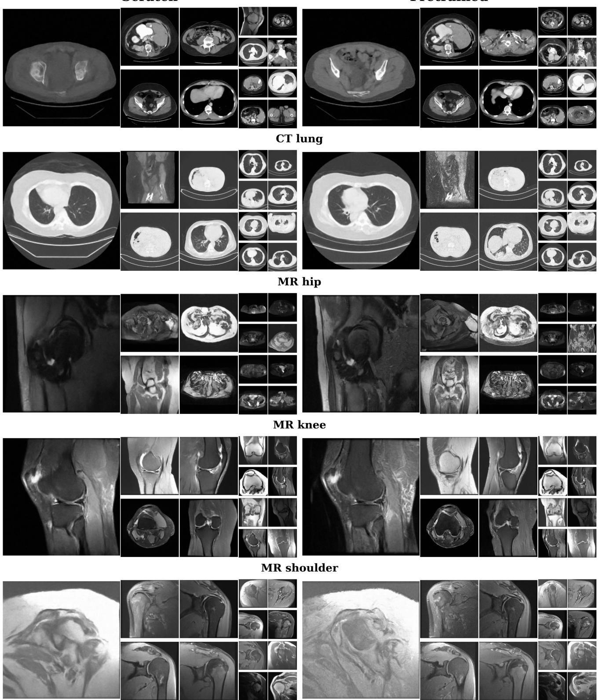  
Figure 12. JiT-B. Uncurated results with cfg 1.0 on RADIN

Scratch  
Pretrained  
CT abdomen  
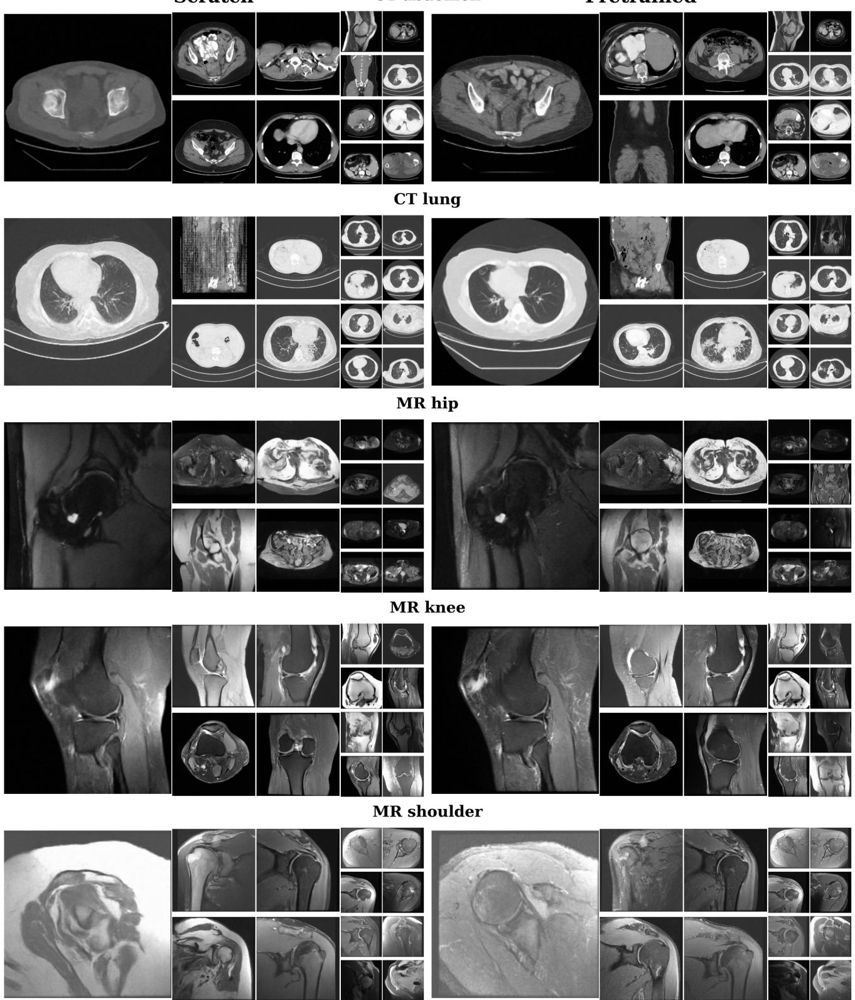  
Figure 13. JiT-L. Uncurated results with cfg 1.0 on RADIN

Scratch  
CT abdomen  
Pretrained  
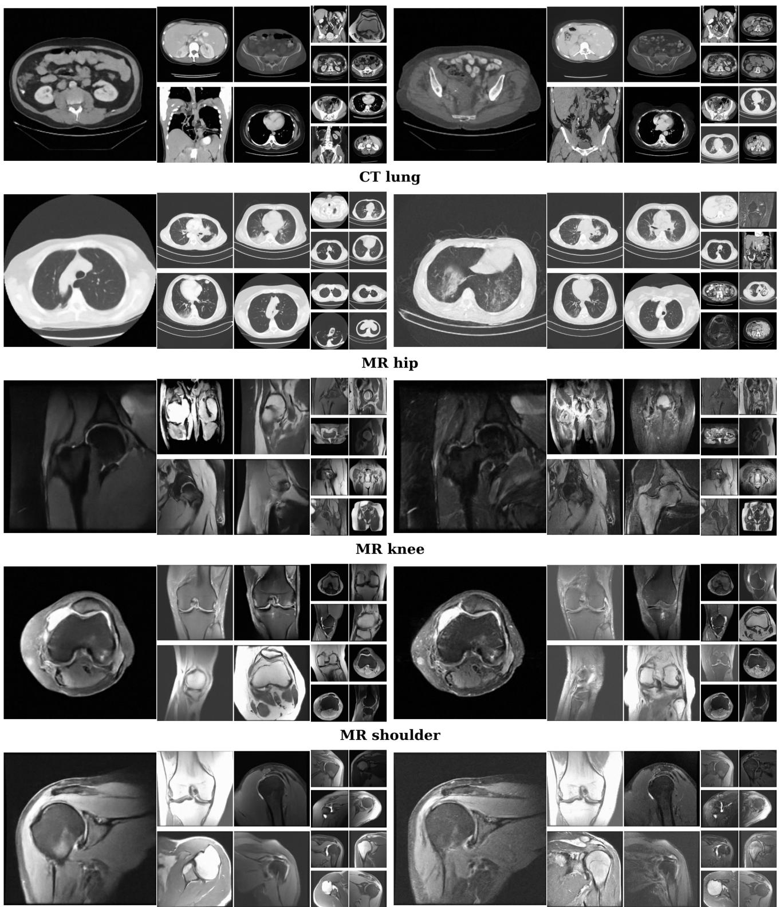  
Figure 14. JiT-H. Uncurated results with cfg 1.0 on RADIN

JiT-L/16 scratch  
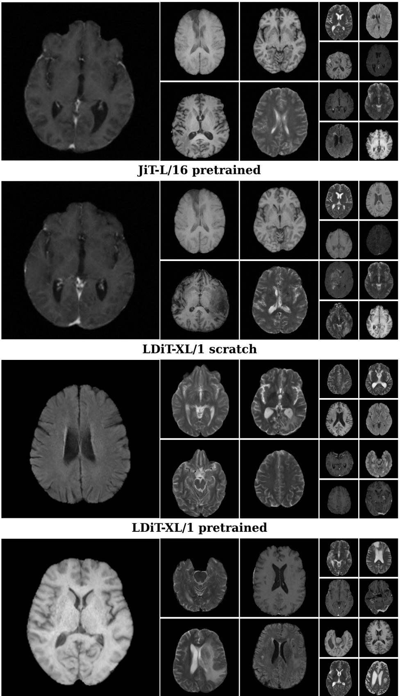  
Figure 15. Uncurated results with cfg 1.0 on BRATS