# Generalizable AI-Generated Image Detection with Embedding-Space Explanations

Nikos Giakoumoglou1\* Paschalis Giakoumoglou2 Tania Stathaki1 Symeon Papadopoulos2 1Imperial College London 2Information Technologies Institute, CERTH

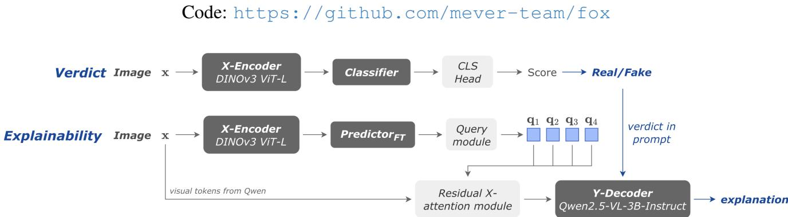  
Figure 1. Inference in FOX. (Top) Detection uses a pure-vision encoder: the verdict is read from the Classifier logits over the adapted X-Encoder, without language-model decoding. (Bottom) Explanation is separate. PredictorFT converts the detector’s visual representation into caption-space forensic guidance that Y-Decoder verbalizes, conditioned on the locked verdict.

## Abstract

AI-generated images have reached unprecedented realism, while instruction-driven AI editors re-synthesize images for local changes, leaving no splice boundary to localize. Most detectors are black boxes with unverifiable verdicts and generalize poorly because adapting a backbone on the detection distribution memorizes generator-specific fingerprints that quickly become obsolete. Specialist detectors built on pure-vision representations, particularly DINOv3, generalize well across generators, but explainable methods forgo this advantage: jointly training one multimodal model for classification and language generation subjects its vi sual representation to the language objective. We therefore require that explanation training cannot alter the verdict. We introduce FOX, which first builds and locks a specialist DINOv3 detector, then uses its representation to guide a lightweight VLM toward forensic explanation. A jointembedding predictor maps locked visual evidence into a frozen text encoder’s semantic space, producing guidance that the VLM verbalizes on demand. FOX achieves 97.4 mean AUC across 14 unseen generators, 69.8 BERTScore on XPlainVerse, and 56.1 on LOKI.

## 1. Introduction

The evolution of GANs [43, 65] and diffusion models [27, 52, 96] has made synthetic images highly realistic, enabling misinformation, targeted attacks, and online harms through weaponised deepfake content. Recent diffusion models [13, 30, 42] and autoregressive techniques [104] expand the threat surface: instruction-following editors built on VLMs perform targeted manipulations by re-synthesizing the entire image rather than splicing a region into it [47]. With no pasted patch, boundary inconsistency, or provenance mask, forensic localization operates near chance, and humans fare little better [41, 47]. A bare real-versus-fake score is then of limited use, since journalists, moderators, and users need to know why an image was flagged.

Existing detectors exploit low-level generator traces [8, 22, 29, 34, 40, 64, 102] or semantic representations [23, 69, 78, 89, 98]. Four issues remain. First, most detectors are black boxes, whose verdicts humans cannot verify. Second, unconstrained backbone adaptation memorizes generator-specific fingerprints and transfers poorly [16, 44, 89, 114, 124]. Third, artifact-driven methods depend on high-frequency traces that improving generators mimic and resizing or compression destroy [22, 64]. Fourth, explainable MLLM detectors [20, 56, 57, 100, 113, 118] finetune billions of parameters for a vision-first problem, with weaker detection [59, 115, 123].

At the same time, a new line of forensic detectors has emerged around pure vision self-supervised encoders, particularly DINOv3 [99]. Frozen DINO representations generalize strongly across generators [58], parameter-efficient DINOv3 adaptations perform strongly in recent competitions [92], and DINOv3 systems dominate recent robustness evaluations [53]. This suggests that reliable forensic perception may be better provided by a specialist pure vision encoder than by a general-purpose MLLM vision tower (Sec. 2.3). Yet, explainable detection largely follows the opposite design: authenticity prediction and explanation generation are optimized together in one multimodal pipeline (Sec. 2.2), coupling objectives with different representations, losses, and convergence timescales.

We therefore ask: rather than making one model responsible for both perception and language, can we first obtain the strongest possible detector and use its representation to help a lightweight VLM explain the fixed verdict? Explanation need not require the language model to rediscover forensic perception from scratch. A VLM already provides strong language generation and image understanding, but it lacks access to the specialist detector’s forensic evidence. Decoupling the objectives lets detection optimize solely for cross-generator transfer and explanation optimize afterwards without altering the verdict.

Joint Embedding Predictive Architectures (JEPAs) [73] provide a natural interface between these modules by predicting target representations in latent space [3, 4, 11, 19, 55]. For explanation, this means predicting what the forensic evidence describes instead of reconstructing an exact token realization. FOX predicts evidence in the semantic space of a frozen text encoder, where semantically equivalent explanations remain nearby despite different wording. The fixed target space removes target co-collapse, where predictor and target encoder jointly converge to a constant [60, 67], while contrastive learning discourages a constant predictor. A VLM then verbalizes the representation only when requested [2, 19]; these embeddings provide forensic guidance without reconstructing the classifier’s internal reasoning.

We instantiate this design in FOX (FOrensic eXplanations) (Fig. 1). We first investigate which visual representation preserves forensic evidence and how it should be adapted. Under a common readout, viewconsistency self-supervised encoders transfer best, with DINOv3 being the strongest; brief LoRA adaptation selected on an external generator distribution further improves transfer (Secs. 6.1 and 6.2). The detector is permanently locked. A separate predictor maps its visual features into a frozen text-embedding space, and predicted query vectors guide a Qwen2.5-VL-3B decoder. In that way, the VLM never determines authenticity: it only verbalizes the explanation solely on the basis of the input image, fixed verdict, and detector-derived evidence. This separation lets detector and explainer use different objectives and optimization timescales while allowing language generation to benefit from the specialist representation.

Our main contributions are the following:

• We introduce FOX, an explainable AI-generated image detector that decouples specialist visual detection from language generation: the verdict is completed and locked before any explanation objective, so explanation training cannot alter detection.

• We systematically study the detection pathway from pretrained representations. Under an identical readout, DINOv3 transfers better than language-supervised, reconstruction-based, and latent-prediction alternatives, while external-validation checkpoint selection outperforms freezing, end-of-epoch LoRA, and internalvalidation selection (Secs. 6.1 and 6.2).

• We show how the specialist representation guides a lightweight VLM. A joint-embedding predictor maps detector features into a frozen text space, and predicted query vectors condition the decoder toward forensic evidence without requiring the VLM to perform detection.

• FOX reaches 97.4 mean AUC across 14 unseen generators (Tab. 1), 69.8 BERTScore on XPlainVerse (XPV) and 56.1 on LOKI (Tab. 2), while remaining robust to common perturbations (Fig. 4).

## 2. Related Work

## 2.1. AI-Generated Image Detection

Low-level detectors exploit frequency traces [8, 22, 28, 29, 34, 40, 74, 103, 120], gradients [101], pixel relationships [102], or texture-rich patches [122]; SPAI [64] treats synthetic images as spectral outliers. Semantic methods probe or adapt vision-language features [23, 69, 78, 89, 98, 114], while reconstruction-based approaches score generative fidelity [15, 18, 24, 51, 82, 95, 110]. Despite strong in-domain results, cross-generator transfer remains difficult [16, 44, 83, 124], and most return only a score.

## 2.2. Explainable Detection with MLLMs

General-purpose MLLMs trail specialist detectors on bare classification [59, 75, 115], motivating supervised forensic variants spanning face forgery [56, 121], expert-feature fusion [20], segmentation/trace encoders [57, 62, 100, 113, 118], preference optimization [123], and VQA-style formulations [17, 66]. Most train billions of parameters for a perception problem, many adapt the vision tower and so risk cross-generator transfer, and they generate explanations autoregressively together with the verdict, thereby coupling detection and explanation quality within one set of weights. FOX instead locks perception first, predicts forensic content in a fixed semantic space, and uses the VLM only to verbalize an already-decided verdict, thus avoiding the use of the language model as a forensic detector.

## 2.3. Pure Vision Backbones for Forensics

The standard encoder was long a language-aligned model [23, 77, 89, 93, 108], but results now favour purely visual self-supervised encoders, specifically DINOv2 [68] and DINOv3 [99]. Frozen probes generalize across generators [58], parameter-efficient adaptations win open challenges [92], and the latest robustness benchmark is led almost uniformly by DINOv3 entries [53]. This says nothing about how much to adapt, since the frozen-probe [58, 89] and parameter-efficient [78, 92] lines reach opposite conclusions, and checkpoint selection remains vague or oraclebased. Section 6 systematically examines both choices.

## 3. Methodology

We propose FOX, a Joint Embedding Predictive Architecture for generalizable and explainable AI-generated image detection, realized as brief visual adaptation, a locked detector, forensic prediction in a fixed semantic embedding space, and on-demand verbalization. FOX is trained with triplets $\langle \mathbf { x } , \mathbf { y } , \boldsymbol { \ell } \rangle$ , where x is the visual input (a single image), y the textual target (the natural language explanation of its forensic evidence), and $\ell \in \{ 0 , 1 \}$ the authenticity label. Given a test image, the model must output a verdict ˆℓ and, on demand, a human-readable explanation yˆ that presents forensic evidence supporting that verdict. Throughout,frozen means a module receives no gradient in any stage, and locked means it was trained in an earlier stage and receives none afterwards.

FOX comprises five components:

1. X-Encoder $f _ { x } \ ( \mathbf { x }  \mathbf { s } _ { x } )$ compresses the input image into compact visual features. It is initialized from a pure vision self-supervised backbone with frozen weights, adapted through LoRA in Stage 1, and locked thereafter.

2. ${ \mathsf { C l a s s i f i e r } } \ c _ { \phi } \ ( \mathbf { s } _ { x } \ \to \ { \bar { \ell } } )$ maps the visual features to the verdict ˆℓ through a classification readout. It is trained jointly with the X-Encoder LoRA parameters and locked at the end of Stage 1, so the verdict function is fixed before any explanation objective is initialized.

3. Predictor gθ $( \mathbf { s } _ { x }  \langle \hat { \mathbf { s } } _ { y } , \mathbf { Q } \rangle )$ ) maps the same locked visual features into the fixed semantic embedding space, producing a global prediction $\hat { \mathbf { s } } _ { y }$ and, once extended with a query module, a set Q of caption-space vectors. It is optimized only after Classifier is locked, so its objective cannot alter the learned verdict.

4. Y-Encoder $f _ { y } ( \mathbf { y }  \mathbf { s } _ { y } )$ embeds the textual target into the continuous space that serves as the prediction target, abstracting away surface information such as phrasing and word order. It is frozen, used only to precompute training targets, and discarded at inference.

5. Y-Decoder $d _ { \psi } (  \mathbf { x } , \hat { \ell } , \mathbf { Q }   \hat { \mathbf { y } } )$ verbalizes the verdict into grounded natural language forensic evidence.

Figure 2 illustrates how we instantiate FOX. The

X-Encoder is DINOv3 ViT-L/16 [99], adapted through a rank-32 LoRA; its block-wise readouts are projected and fed to Classifier, a lightweight transformer trunk [106] with a classification readout. An independently parameterized Predictor of the same shape reads the same locked visual features and is trained against targets from Y-Encoder, a frozen E5-large-v2 [107]. Y-Decoder is Qwen2.5-VL-3B-Instruct [6], a late-fusion VLM whose vision encoder remains frozen and whose language side carries a lightweight LoRA adapter. Full component definitions are given in Appendix B.

## 3.1. Training Objectives

Training FOX proceeds in three sequential stages (Fig. 2), each optimizing a disjoint subset of parameters while every previously trained component remains locked.

Stage 1 (Verdict Prediction). Stage 1 jointly trains the X-Encoder LoRA and Classifier on image-label pairs ⟨x, ℓ⟩ (Fig. 1), using cross-entropy on authenticity labels alone, without captions, text encoders, or explanation losses. Checkpoints are selected by AUC on Chameleon, an independently collected external validation set disjoint from XPV training. Its provenance and generalization to newer generators are further examined in Appendix E.2. The selected encoder and classifier are then locked, fixing the verdict function for all subsequent stages of FOX.

Stage 2 (Joint Embedding Prediction). Stage 2 trains the Predictor on triplets ⟨x, y, ℓ⟩ with the X-Encoder locked and the Y-Encoder frozen (Fig. 2). The embedding readout is trained with InfoNCE [105] at temperature τ, aligning each predicted embedding $\hat { \mathbf { s } } _ { y }$ with the target embedding $\mathbf { s } _ { y }$ of its own explanation while contrasting it against the other explanations in the batch. Because the Y-Encoder is frozen, the targets are fixed points in a pretrained space and cannot drift toward the predictor, so the trivial solution in which both sides converge to a constant is unavailable; the contrastive term additionally penalizes a constant predictor directly. It is also the better fit geometrically: pretrained text embeddings are strongly anisotropic, concentrating in a narrow cone in which unrelated pairs still exhibit high cosine similarity [31, 35], so absolute similarity targets carry little signal whereas relative comparisons against in-batch negatives remain discriminative, and a contrastive objective is suitable for this geometry [36]. The resulting JEPA predictor therefore learns explanationaligned forensic representations without changing the detector’s verdict function.

Stage 3 (Explanation Decoding). Stage 3 trains the explanation pathway in three steps. First (Stage 3a), a language-side LoRA on Y-Decoder is trained with cross-entropy on the reference explanation tokens, conditioned only on the image and the locked verdict written into the prompt as a word (e.g., “This image is fake.

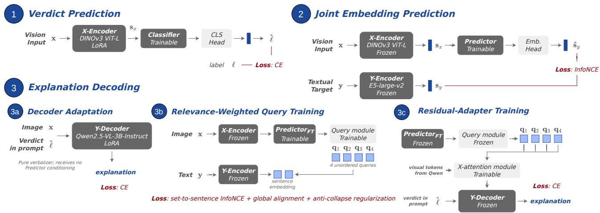  
Figure 2. Training of FOX. Detection and explanation are optimized separately. Stage 1 adapts the X-Encoder through LoRA jointly with the Classifier under cross-entropy; Stage 2 trains the Predictor with InfoNCE against the frozen Y-Encoder. Stage 3 trains a LoRA on the decoder (3a), the query module together with the Predictor (3b), and the residual adapter (3c).

## 3.2. Inference

Write the forensic explanation.”); only these LoRA parameters are trained, and they remain locked for the rest of training and at inference. We refer to the resulting decoder, which receives no query conditioning, as the unconditioned decoder. Second (Stage 3b), we attach to the trained Predictor a small cross-attention module with four learned query slots (Sec. 6.6) that attend over its hidden state and block tokens to produce four query vectors q1, . . . , q4 (Fig. 2), and fine-tune the two jointly, yielding Predictor . A symmetric query-set-to-sentenceset InfoNCE objective aligns each image’s query set with the sentence-level Y-Encoder embeddings of its reference explanation. Sentences assigned higher teacher-forced negative log-likelihood by the frozen unconditioned decoder receive greater weight, focusing query learning on evidence that the decoder does not already explain well, while a whole-explanation alignment term preserves the Stage 2 semantic representation. Because this permutationinvariant objective admits an identical-slot fixed point, we discourage collapse through annealed sentence-to-slot routing, sentence-level ownership and load-balancing losses, a squared pairwise-cosine penalty, and slot-specific output projections. Third (Stage 3c), with PredictorFT, the query module, and Y-Decoder all locked, a zeroinitialized residual cross-attention adapter conditions the decoder’s visual tokens on the query vectors, in the spirit of gated cross-attention injection into a frozen decoder [2]; only this adapter is trained, again with cross-entropy on the reference explanations. We give the training protocol in Sec. 4 and defer the derivation of the full objectives to Appendix C.

At inference (Fig. 1), a single pass through the adapted X-Encoder feeds Classifier, which reads the verdict ˆℓ directly from its classification logits at no decoding cost, and Predictor with its query module, which produces the query vectors. Y-Encoder plays no role at inference and is not loaded, since its embedding space is only needed to supervise the predictor during training. The explanation is generated only on demand: the adapter conditions Y-Decoder’s visual tokens on the query vectors, and the image together with the verdict-bearing prompt is decoded into natural language forensic evidence supporting the verdict. The verdict therefore requires no language-model decoding at all, and every base model remains reusable exactly as released, against the billions of parameters finetuned end-to-end by MLLM-based systems [57, 62, 100, 113, 118].

## 4. Implementation of FOX

## 4.1. Model Architecture

X-Encoder. We instantiate $f _ { x }$ as DINOv3 ViT-L/16 [99] at 384 × 384 resolution. Its pretrained weights remain frozen, and LoRA parameters [54] of rank 32 and scale 64 are inserted into the fused query-key-value projection of each attention block for Stage 1 following [92]. We read the last four transformer blocks with their output normalization applied; at each block, the mean-pooled patch tokens, [cls] token, and four register tokens are concatenated, and the four block representations form a sequence of four visual tokens.

Classifier. $c _ { \phi }$ projects each of the four X-Encoder readouts to a common width with its own linear layer, prepends a learned global token, and applies a four-layer pre-norm transformer with eight attention heads. A linear head from the global-token position produces the two authenticity logits from which the verdict ˆℓ is read.

Predictor. $g _ { \theta }$ follows the same configuration as Classifier with independently parameterized weights. Its global token representation is projected to an $\ell _ { 2 ^ { - } }$ normalized prediction $\hat { \mathbf { s } } _ { y }$ in the semantic embedding space. It is trained from scratch in Stage 2, and fine-tuned jointly with the query module in Stage 3b to give PredictorFT. Y-Encoder. We instantiate $f _ { y }$ as a frozen E5-largev2 [107], producing normalized text embeddings. Wholeexplanation embeddings supervise the global Predictor prediction in Stage 2 and the retention term of Stage 3b, while sentence-level embeddings supervise the query module in Stage 3b; Y-Encoder only precomputes these targets and is discarded at inference.

Query module. Four learned slot vectors cross-attend to a memory of Predict $\mathrm { \Omega } ) \mathrm { r _ { F T } \mathrm { \ ' } s }$ global hidden state and its projected per-block visual tokens, producing four normalized query vectors $\mathbf { q } _ { 1 } , \ldots , \mathbf { q } _ { 4 }$ . The slots are exchangeable and receive no predefined forensic category or aspect label. Y-Decoder. We use $d _ { \psi }$ as Qwen2.5-VL-3B-Instruct [6]. The vision encoder remains frozen, while a language-side LoRA adapter [54] of rank 16 is applied to the attention and MLP projections and trained in Stage 3a; the detector verdict is written into the prompt as a word. For query conditioning, a residual cross-attention adapter [2] projects $d _ { \psi } \mathbf { \ ' } _ { \mathbf { S } }$ visual tokens and $\mathbf { q } _ { 1 } , \ldots , \mathbf { q } _ { 4 }$ to a shared width, using the visual tokens as queries and the query vectors as keys and values; its output is projected back to the visual token width and added residually, with the output projection initialized to zero so the decoder is unchanged before adapter training. Only this adapter is trained in Stage 3c; the decoder weights and its LoRA remain locked.

## 4.2. Three-Stage Training

Stage 1 (Verdict Prediction). We train the X-Encoder LoRA parameters, the Classifier trunk, and its classification readout using cross-entropy loss, with class balancing by undersampling. We use AdamW [81] with learning rate $1 0 ^ { - 4 }$ , weight decay $1 0 ^ { - 2 }$ , and a 512-step linear warmup, physical batch size 16 with four-step gradient accumulation for an effective batch size of 64. Stage 1 runs for a single epoch over the training split; checkpoints are evaluated at a fixed update interval on the external Chameleon validation set, and the checkpoint with the highest validation AUC is selected $( c f .$ . Sec. 6.2). The resulting X-Encoder and Classifier are then locked.

Stage 2 (Joint Embedding Prediction). Using features from the selected X-Encoder, we train Predictor with InfoNCE loss [105] at temperature $\tau = 0 . 0 5$ against wholeexplanation Y-Encoder embeddings. We use AdamW with sharpness-aware minimization [33], learning rate 3 × $1 0 ^ { - 4 }$ , weight decay 0.05, a 500-step warm-up, and cosine decay, with batch size 2048 for 24 epochs.

Stage 3a (Decoder Adaptation). We train the languageside LoRA of Y-Decoder with next-token cross-entropy loss, conditioned on the image and the locked verdict and with no conditioning from Predictor. We use AdamW with learning rate $1 0 ^ { - 4 }$ , weight decay $1 0 ^ { - 2 }$ , and cosine decay, with class balancing by undersampling, physical batch size 4 and eight-step gradient accumulation for an effective batch size of 32, for one epoch.

Stage 3b (Relevance-Weighted Query Training). We jointly optimize the Stage 2 Predictor and the query module with a symmetric set-to-sentence InfoNCE objective, using slot-aggregation temperature $\tau _ { s } ~ = ~ 0 . 0 5$ and contrastive temperature $\tau _ { c } ~ = ~ 0 . 0 5$ , a whole-explanation global alignment term, and a diversity penalty over the four slots, giving $\mathtt { P r e d i c t o r \mathrm { _ { F T } } }$ Sentence weights are derived from the unconditioned decoder’s per-sentence negative log-likelihood (NLL), so that sentences it already explains poorly receive greater weight. We use AdamW with learning rate $3 \times 1 0 ^ { - 4 }$ , weight decay $1 0 ^ { - 2 }$ , cosine decay, batch size 128 without gradient accumulation, and classbalanced cycling for 15 epochs.

Stage 3c (Residual-Adapter Training). With Predictor , the query module, and Y-Decoder and its LoRA all locked, we train only the residual crossattention adapter with next-token cross-entropy loss. We use AdamW with learning rate $1 0 ^ { - 4 }$ , weight decay $1 0 ^ { - 2 }$ and cosine decay, with class balancing by undersampling, physical batch size 4, eight-step gradient accumulation, and effective batch size 32, for one epoch. Complete settings for all five optimization steps are collected in Appendix C. Cost. FOX trains 89.26M parameters in total, 28.35M of which define the verdict, against roughly 3.65B frozen weights that are not modified. The verdict itself requires a single X-Encoder pass with no language-model decoding. More in Appendices B and C.

## 5. Experiments

## 5.1. Experimental Setup

Metrics. We report AUC for detection. Explanation quality is measured with ROUGE-L, CSS [62], and BERTScore F1 [119] against the reference explanation.

Datasets. FOX is trained on the XPlainVerse (XPV) [87] training split, derived from MultiFakeVerse [47]. Detection transfer is evaluated on a benchmark assembled from two sources. From the any-resolution protocol of SPAI [64], we retain the 10 generators whose outputs exceed 0.5 megapixels, spanning latent diffusion [30, 91, 96], flow-based [13], GAN [63], and commercial [1, 12, 85, 94] models. We additionally use four frontier generators from the held-out

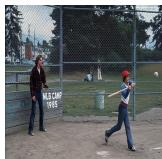

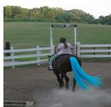  
The image contains several visual inconsistencies that suggest manipulation. Most notably, the ‘MLB CAMP 1985’ text on the wooden fence appears unnaturally sharp and flat compared to the weathered texture of the wood it is painted on; the letters do not follow the slight curves or grain of the wood surface. Additionally, there is a noticeable smudge and loss of detail in the area directly behind the fence where the background elements seem to have been blurred or erased, leaving a patchy, unnatural texture in the grass and trees.

The image contains a significant visual anomaly where the horse’s tail appears as a bright, neon blue color that lacks any natural texture or lighting consistency with the rest of the animal. This vibrant blue hue is unnaturally saturated and does not match the muted, earthy tones of the horse’s coat or the surrounding environment. Furthermore, the edges of this blue tail are overly sharp and lack the motion blur seen in the horse’s legs and the dust kicked up by its hooves, making it look like a flat digital overlay rather than a physical part of the scene.

The image contains several visual inconsistencies that suggest digital manipulation. Most notably, the white text ‘MLB CAMP 1985’ on the wooden fence appears unnaturally sharp and bright compared to the grainy, weathered texture of the wood behind it. The letters do not follow the physical gaps or grain of the wooden planks, making them look like a flat digital overlay. Additionally, there is a faint, blurry blue smudge visible just to the left of the text that doesn’t correspond to any physical object in the scene. Furthermore, the batter’s hands and the handle of the baseball bat show significant distortion, with the fingers appearing to blend into the wood of the bat in a smeared, unnatural way.

The image contains a significant visual anomaly in the horse’s tail, which appears as a vibrant, neon blue color that is inconsistent with the natural brown and earthy tones of the rest of the scene. Furthermore, the texture of the blue hair is overly smooth and lacks the fine detail and motion blur seen in the dust kicked up by the horse’s hooves, making it look like a digital overlay rather than a physical part of the animal.

Figure 3. Qualitative explanations produced by FOX. For each detected fake: input image (left), the explanation produced by the guided Y-Decoder (center), and the ground-truth forensic annotation (right).  
Table 1. Detection performance on unseen generators. AUC (×100) on 14 unseen generators. Best per column in bold, second best underlined, with ties bolded jointly. The XPV ows indicate retraining on XPlainVerse.
<table><tr><td></td><td colspan="2">Stable Diffusion</td><td colspan="4">Midjourney</td><td colspan="2">DALL-E</td><td colspan="2">GPT</td><td colspan="5">Other</td></tr><tr><td>Approach</td><td>SD2</td><td>SDXL SD3 MJv5 MJv6.1 MJ7 DALLE2 DALLE3</td><td></td><td></td><td></td><td></td><td></td><td></td><td>3 GPT-I2 GPT-I1.5 Flux GigaGAN Firefly NB-Pro Mean</td><td></td><td></td><td></td><td></td><td></td><td></td></tr><tr><td>DeFake [98]</td><td>76.3</td><td>84.5</td><td>95.6</td><td>83.5</td><td>86.4</td><td>81.9</td><td>68.1</td><td>94.8</td><td>82.6</td><td>80.0</td><td>95.5</td><td>58.9</td><td>84.5</td><td>71.1</td><td>81.7</td></tr><tr><td>PatchCr. [122]</td><td>95.5</td><td>96.3</td><td>32.5</td><td>78.0</td><td>95.7</td><td>94.8</td><td>80.0</td><td>28.5</td><td>59.5</td><td>78.7</td><td>67.2</td><td>86.9</td><td>78.2</td><td>59.7</td><td>73.7</td></tr><tr><td>RINE [69]</td><td>83.6</td><td>86.5</td><td>30.7 75.7</td><td></td><td>67.7</td><td>63.7</td><td>75.6</td><td>72.3</td><td>29.4</td><td>42.7</td><td>68.1</td><td>93.4</td><td>70.7</td><td>33.5</td><td>63.8</td></tr><tr><td>SPAI [64]</td><td>93.3</td><td>94.0</td><td>61.2 97.4</td><td></td><td>80.4</td><td>83.7</td><td>83.2</td><td>81.1</td><td>63.7</td><td>78.0</td><td>80.0</td><td>92.9</td><td>87.6</td><td>60.8</td><td>81.2</td></tr><tr><td>B-Free [46]</td><td></td><td></td><td>100.0 100.0 92.7</td><td>99.9</td><td>96.2</td><td>92.7</td><td>98.8</td><td>99.5</td><td>73.1</td><td>66.8</td><td>93.9</td><td>96.4</td><td>99.9</td><td>96.7</td><td>93.3</td></tr><tr><td>FakeVLM [111]</td><td>64.8</td><td>58.4</td><td>33.1 57.0</td><td></td><td>52.5</td><td>49.5</td><td>64.8</td><td>37.1</td><td>36.6</td><td>46.9</td><td>32.7</td><td>83.1</td><td>40.6</td><td>56.4</td><td>51.0</td></tr><tr><td>SIDA [57]</td><td>61.2</td><td>87.5</td><td>96.6 94.6</td><td></td><td>96.1</td><td>95.5</td><td>61.1</td><td>99.7</td><td>82.3</td><td>85.5</td><td>99.3</td><td>66.4</td><td>90.6</td><td>91.1</td><td>86.3</td></tr><tr><td>SPAIxPv[64]</td><td>77.7</td><td>92.0</td><td>73.2 85.4</td><td></td><td>93.8</td><td>79.0</td><td>71.9</td><td>90.6</td><td>62.1</td><td>73.0</td><td>91.9</td><td>89.9</td><td>84.7</td><td>94.9</td><td>82.9</td></tr><tr><td>RINExpv[69]</td><td>83.8</td><td>98.5</td><td>79.5 95.1</td><td></td><td>95.2</td><td>86.3</td><td>89.5</td><td>98.0</td><td>74.8</td><td>76.1</td><td>93.8</td><td>80.1</td><td>86.0</td><td>93.8</td><td>87.9</td></tr><tr><td>B-Freexpv[46]</td><td>90.8</td><td>92.3</td><td>94.5 99.7</td><td></td><td>94.3</td><td>92.6</td><td>99.5</td><td>99.1</td><td>78.9</td><td>83.2</td><td>98.7</td><td>80.1</td><td>82.1</td><td>92.9</td><td>91.4</td></tr><tr><td>DINOMACxPv[92]</td><td>99.1</td><td>99.9</td><td>94.0</td><td>99.1</td><td>98.3</td><td>78.9</td><td>99.7</td><td>100.0</td><td>81.1</td><td>81.3</td><td>99.8</td><td>99.8</td><td>86.4</td><td>94.2</td><td>93.7</td></tr><tr><td>FOX (ours)</td><td>99.3</td><td></td><td>100.0 96.1</td><td>99.8</td><td>99.0</td><td>96.6</td><td>99.8</td><td>100.0</td><td>90.7</td><td>94.9</td><td>99.9</td><td>99.8</td><td>90.0</td><td>97.3</td><td>97.4</td></tr></table>

Table 2. Explanation performance comparison. ROUGE-L (R-L), CSS [62], and BERTScore F1 [119] (×100). †No public LE-GION detection checkpoint is available, entries are from [62].
<table><tr><td></td><td>XPlainVerse</td><td>LOKI</td></tr><tr><td>Approach</td><td>R-L CSS BERTSc. R-L</td><td>CSS BERTSc.</td></tr><tr><td>SIDA [57]</td><td>15.7 40.4 52.3</td><td>19.2 40.9 53.4</td></tr><tr><td>FakeVLM [111]</td><td>17.0 47.1 57.0</td><td>17.4 51.4 55.8</td></tr><tr><td>LEGION [62]†</td><td>n/a n/a n/a</td><td>18.5 45.9 n/a</td></tr><tr><td>FOX (Stage 3a only) 25.5 59.9</td><td>65.3</td><td>17.1 48.9 52.1</td></tr><tr><td>FOX (proposed)</td><td>27.5 62.2 69.8</td><td>20.1 52.0 56.1</td></tr></table>

out-of-distribution split of OpenFake [80], which also shifts the real image distribution. Explanation is evaluated on the held-out XPlainVerse split and LOKI [115]. LOKI is outside the XPlainVerse training distribution and therefore provides an external test of whether forensic explanations transfer robustly to an independent set. More in Appendix D.

Baselines. For detection, we compare with DeFake [98], PatchCraft [122], RINE [69], SPAI [64], and B-Free [46]. We also retrain SPAI, RINE, B-Free and DINO-MAC on XPlainVerse. The latter retrained baselines use the same external Chameleon validation protocol as FOX. For explanation, we compare with SIDA [57], FakeVLM [111], and LEGION [62]. Unless stated otherwise, baseline results are recomputed from public checkpoints under the same evaluation protocol. More in Appendix E.

## 5.2. Comparison with State of the Art

Detection performance on unseen generators. Table 1 shows strong transfer across all generator families: FOX improves mean AUC by +3.7 points over the runner-up,

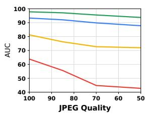

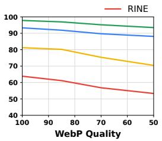

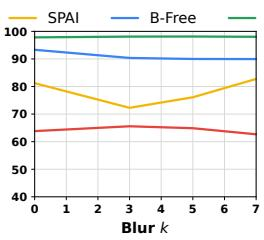

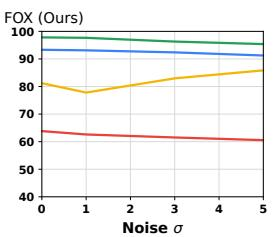

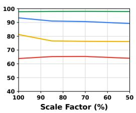  
Figure 4. Robustness to common perturbations. AUC (×100) of FOX and representative baselines under increasing severity of JPEG compression, WebP compression, downscaling, additive Gaussian noise, and blur.

DINO-MAC [92]. The XPV controls show that this advantage cannot be attributed solely to training on XPlainVerse. Explanation quality. Table 2 shows that FOX achieves the strongest similarity on both XPlainVerse and the external LOKI. To isolate the detector-derived guidance, we compare against a Stage 3a variant that receives only the verdict at inference. The full pathway improves every metric on both datasets, with gains on LOKI at least as large as in domain, while the variant falls below FakeVLM on all three LOKI metrics. Therefore, the predicted caption-space representation (and not the decoder fine-tuning) is the part that carries explanation quality to an unseen forensic distribution. The qualitative examples in Fig. 3 show that the decoder captures the principal forensic evidence in the references.

## 5.3. Robustness to Common Perturbations

Figure 4 shows that FOX is substantially more robust than the compared detectors under compression, downscaling, noise, and blur. DINOv3 [99] inherits invariances from view-consistency pretraining and augmentations that include scaling and blur [14, 90], whereas forensic methods that rely on high-frequency generator traces are particularly vulnerable to such transformations [21]. We therefore view preservation of these pretrained invariances through brief adaptation as a plausible explanation of the observed robustness.

## 6. Ablation Study of FOX

All ablations use the same DINOv3 backbone, training data, and evaluation protocol, isolating the effect of each architectural or optimization choice while controlling all remaining components. We report mean unseen-generator AUC for detection and BERTScore F1 on the held-out validation split for explanation quality. More in Appendix F.

## 6.1. Backbone Choice

Which representation should perform forensic detection? Prior work has predominantly relied on language-aligned representations [23, 69, 89], while recent forensic systems increasingly exploit pure, self-supervised [38] vision DINO features [58, 92]. Table 3 compares these families under the same frozen readout and shows that view-consistency representations transfer most reliably across unseen generators, with DINOv3 consistently being the strongest. This supports our use of DINOv3 as the specialist visual encoder while reserving language-aligned models for explanation.

Table 3. Ablation on backbone choice. Frozen backbones share the same downstream readout and are evaluated on five unseen GenImage generators.
<table><tr><td>Backbone</td><td colspan="5">SD1.5 BigGAN VQDM MJv4 Wuk Mean</td></tr><tr><td colspan="5">Language-supervised</td></tr><tr><td>CLIP [93] SigLIP [117] AIMv2 [32]</td><td>88.6 89.7 84.9</td><td>90.9 86.8 86.6</td><td>93.2 84.4 82.8</td><td>81.9 80.3 85.4</td><td>86.1 88.1 91.5 86.5 88.5 85.6</td></tr><tr><td colspan="6">Pure-vision, generative or predictive</td></tr><tr><td colspan="6">MAE [50] 83.1 84.2 87.6 85.5 83.1 84.7</td></tr><tr><td>I-JEPA [3] 78.4 V-JEPA 2 [4] 71.7</td><td>61.4 57.8</td><td>62.2 54.9</td><td>81.9 87.8</td><td>75.7 73.4</td><td>71.9 69.1</td></tr><tr><td colspan="6">Pure-vision, view-consistency</td></tr><tr><td colspan="6">94.8</td></tr><tr><td>DINOv2 [90]</td><td>96.9</td><td>96.0</td><td>89.7</td><td>96.1</td><td>94.7</td></tr><tr><td>DINOv3 [99] 99.3</td><td>99.2</td><td>99.2</td><td>96.9</td><td>99.5</td><td>98.8</td></tr></table>

## 6.2. Backbone Adaptation

How should the selected backbone be adapted? Prior work finds strong transfer from frozen probes [58, 89] and parameter-efficient adaptation [78, 92], leaving selection unclear. Table 4 shows that XPV validation AUC is nearly saturated across adaptation strategies, despite substantial differences in cross-generator transfer, making it unreliable for checkpoint selection. Selecting the LoRA checkpoint using external Chameleon validation instead yields the strongest transfer to the GenImage generators.

## 6.3. End-to-End versus Decoupled Training

Should detection and explanation be optimized within one pipeline? Existing explainable detectors commonly train multimodal models to predict authenticity and generate its explanation jointly [57, 100, 113, 118]. Table 5 compares this design with FOX, where the detector is locked before explanation training. Decoupling provides a stronger combination of detection transfer and explanation quality. The shared-trunk variants further expose a checkpoint trade-off: stopping earlier favours detection, whereas continuing optimization favours explanation alignment. Disjoint trunks avoid this competition and allow each objective to converge independently, supporting the central design choice of separating specialist perception from language generation.

Table 4. Ablation on backbone adaptation. We compare freezing, end-of-epoch LoRA
<table><tr><td>DINOv3</td><td>XPV</td><td></td><td>Cham. GenImage</td></tr><tr><td>Frozen</td><td>99.4</td><td>79.9</td><td>98.8</td></tr><tr><td>LoRA</td><td>99.9</td><td>83.6</td><td>97.6</td></tr><tr><td> $\mathrm { L o R A } + \mathrm { i n t } .$  val. (XPV)</td><td>99.9</td><td>82.6</td><td>95.0</td></tr><tr><td> $\mathrm { L o R A + e x t . }$  val. (Cham.) (ours)</td><td>99.9</td><td>97.2</td><td>99.7</td></tr></table>

Table 5. Ablation on training design. Joint versus separate optimization and shared versus disjoint trunks.
<table><tr><td>Variant</td><td>AUC (Unseen) BERTSc.</td><td></td></tr><tr><td>Training organization</td><td></td><td></td></tr><tr><td>Single end-to-end pipeline</td><td>93.4</td><td>68.9</td></tr><tr><td>Decoupled detector + explainer (ours)</td><td>97.4</td><td>72.1</td></tr><tr><td>Representation sharing</td><td></td><td></td></tr><tr><td>Shared trunk, early stop</td><td>96.9</td><td>68.9</td></tr><tr><td>Shared trunk, late stop</td><td>94.5</td><td>69.5</td></tr><tr><td>Disjoint trunks (ours)</td><td>97.4</td><td>72.1</td></tr></table>

## 6.4. Query Training Components

Which components prevent query collapse and improve explanation quality? Table 6 isolates collapse resistance, global retention, and relevance weighting (of Stage 3b). Collapse resistance reduces query similarity and improves explanation quality. Global retention raises explanation quality, while NLL weighting outperforms uniform weighting and produces more distinct queries.

Table 6. Ablation on query training.. Cosine similarity is the mean pairwise similarity between query vectors (×100); lower values indicate less query collapse.
<table><tr><td>Weighting</td><td>Global retention</td><td>Collapse resistance</td><td></td><td>BERTSc. Cos. sim.↓</td></tr><tr><td>NLL</td><td>No</td><td>No</td><td>68.5</td><td>99.9</td></tr><tr><td>NLL</td><td>No</td><td>Yes</td><td>69.3</td><td>35.7</td></tr><tr><td>Uniform</td><td>Yes</td><td>Yes</td><td>70.2</td><td>68.4</td></tr><tr><td>NLL</td><td>Yes</td><td>Yes</td><td>72.1</td><td>31.1</td></tr></table>

## 6.5. VLM Backbone and Explanation Pathway

Does stronger explanation require a stronger VLM or better forensic guidance? Explainable detectors commonly invest substantial capacity in the multimodal model itself [57, 100, 113], whereas FOX uses the VLM only for verbalization. Table 7 shows that the selected compact Qwen backbone is competitive before adaptation, while the full pathway becomes strongest only with detector-derived query conditioning. The weak improvement from a queryfree adapter isolates the benefit of the predicted forensic representation.

Table 7. Ablation on the explanation. Top: VLM backbone. Bottom: progressive conditioning with Qwen2.5-VL-3B fixed.
<table><tr><td>Stage 3: Configuration</td><td>BERTSc.</td></tr><tr><td colspan="2">PaliGemma-2-3B Mix 66.3 InternVL2.5-4B 66.2 Qwen2.5-VL-3B (selected) 69.1</td></tr><tr><td colspan="2">Qwen2.5-VL-3B explanation pathway Stage 3a + 3c, no queries 69.3</td></tr></table>

## 6.6. Query Set Size

How much detector-derived guidance should the VLM receive? A single query may compress forensic cues into one representation, whereas excessive capacity may add redundant conditioning. Table 8 shows that four exchangeable queries provide the best balance. Shuffling these queries across images while preserving their number and marginal distribution degrades explanation quality, showing that their benefit comes from image-specific forensic content.

Table 8. Ablation on query set size. We vary the number of slots while fixing the remaining explanation pathway.
<table><tr><td>Stage 3b: Query slots</td><td>BERTSc.</td></tr><tr><td>1 slot</td><td>69.3</td></tr><tr><td>2 slots</td><td>69.9</td></tr><tr><td>4 slots (ours)</td><td>72.1</td></tr><tr><td>8 slots</td><td>70.1</td></tr><tr><td>4 slots, shuffled across images</td><td>68.9</td></tr></table>

## 7. Conclusion

We presented FOX, which decouples reliable detection from forensic explanation. A briefly adapted DINOv3 detector transfers strongly across unseen generators and remains robust to common perturbations. Once locked, a joint-embedding predictor maps its visual evidence into a frozen text space that guides a lightweight VLM. Explanation training therefore cannot alter the verdict, and still benefits from the specialist detector’s representation. Our results demonstrate that strong detection and explanation can work synergetically: the detector decides, and language is limited to explaining the decision.

## Acknowledgements

This work was supported by the Horizon Europe projects ELLIOT (Grant Agreement No. 101214398) and AI-CODE (Grant Agreement No. 101135437).

## References

[1] Adobe Inc. Adobe Firefly. https://firefly. adobe.com, 2023. 5

[2] Jean-Baptiste Alayrac, Jeff Donahue, Pauline Luc, Antoine Miech, Iain Barr, Yana Hasson, Karel Lenc, Arthur Mensch, Katherine Millican, Malcolm Reynolds, Roman Ring, Eliza Rutherford, Serkan Cabi, Tengda Han, Zhitao Gong, Sina Samangooei, Marianne Monteiro, Jacob Menick, Sebastian Borgeaud, Andrew Brock, Aida Nematzadeh, Sahand Sharifzadeh, Mikolaj Binkowski, Ricardo Barreira, Oriol Vinyals, Andrew Zisserman, and Karen Simonyan. Flamingo: A Visual Language Model for Few-Shot Learning. In Advances in Neural Information Processing Systems (NeurIPS), 2022. 2, 4, 5, 15

[3] Mahmoud Assran, Quentin Duval, Ishan Misra, Piotr Bojanowski, Pascal Vincent, Michael Rabbat, Yann LeCun, and Nicolas Ballas. Self-Supervised Learning from Images with a Joint-Embedding Predictive Architecture. In Proceedings ofthe IEEE/CVF Conference on Computer Vision and Pattern Recognition (CVPR), pages 15619–15629, 2023. 2, 7, 15, 24

[4] Mido Assran, Adrien Bardes, David Fan, Quentin Garrido, Russell Howes, Mojtaba Komeili, Matthew Muckley, Ammar Rizvi, Claire Roberts, Koustuv Sinha, Artem Zholus, Sergio Arnaud, Abha Gejji, Ada Martin, Francois Robert Hogan, Daniel Dugas, Piotr Bojanowski, Vasil Khalidov, Patrick Labatut, Francisco Massa, Marc Szafraniec, Kapil Krishnakumar, Yong Li, Xiaodong Ma, Sarath Chandar, Franziska Meier, Yann LeCun, Michael Rabbat, and Nicolas Ballas. V-JEPA 2: Self-Supervised Video Models Enable Understanding, Prediction and Planning, 2025. 2, 7, 15, 24

[5] Alexei Baevski, Wei-Ning Hsu, Qiantong Xu, Arun Babu, Jiatao Gu, and Michael Auli. data2vec: A General Framework for Self-Supervised Learning in Speech, Vision and Language, 2022. 15

[6] Shuai Bai, Keqin Chen, Xuejing Liu, Jialin Wang, Wenbin Ge, Sibo Song, Kai Dang, Peng Wang, Shijie Wang, Jun Tang, Humen Zhong, Yuanzhi Zhu, Mingkun Yang, Zhaohai Li, Jianqiang Wan, Pengfei Wang, Wei Ding, Zheren Fu, Yiheng Xu, Jiabo Ye, Xi Zhang, Tianbao Xie, Zesen Cheng, Hang Zhang, Zhibo Yang, Haiyang Xu, and Junyang Lin. Qwen2.5-VL Technical Report, 2025. 3, 5, 17

[7] Randall Balestriero and Yann LeCun. LeJEPA: Provable and Scalable Self-Supervised Learning without the Heuristics, 2025. 15

[8] Quentin Bammey. Synthbuster: Towards Detection of Diffusion Model Generated Images. IEEE Open Journal of Signal Processing, 5:1–9, 2024. 1, 2, 15, 22

[9] Hangbo Bao, Li Dong, Songhao Piao, and Furu Wei. BEiT: BERT Pre-Training of Image Transformers. In Interna-

tional Conference on Learning Representations (ICLR), 2022. 15

[10] Adrien Bardes, Jean Ponce, and Yann LeCun. VI-CReg: Variance-Invariance-Covariance Regularization for Self-Supervised Learning. In International Conference on Learning Representations (ICLR), 2022. 15

[11] Adrien Bardes, Quentin Garrido, Jean Ponce, Xinlei Chen, Michael Rabbat, Yann LeCun, Mahmoud Assran, and Nicolas Ballas. Revisiting Feature Prediction for Learning Visual Representations from Video, 2024. 2, 15

[12] James Betker, Gabriel Goh, Li Jing, Tim Brooks, Jianfeng Wang, Linjie Li, Long Ouyang, Juntang Zhuang, Joyce Lee, Yufei Guo, et al. Improving Image Generation with Better Captions. Technical report, OpenAI, 2023. 5

[13] Black Forest Labs. FLUX.1. https://github.com/ black-forest-labs/flux, 2024. Accessed: 2026- 07-14. 1, 5

[14] Mathilde Caron, Hugo Touvron, Ishan Misra, Herve J ´ egou,´ Julien Mairal, Piotr Bojanowski, and Armand Joulin. Emerging Properties in Self-Supervised Vision Transformers, 2021. 7

[15] George Cazenavette, Avneesh Sud, Thomas Leung, and Ben Usman. FakeInversion: Learning to Detect Images from Unseen Text-to-Image Models by Inverting Stable Diffusion. In Proceedings ofthe IEEE/CVF Conference on Computer Vision and Pattern Recognition (CVPR), pages 10759–10769, 2024. 2, 15

[16] Lucy Chai, David Bau, Ser-Nam Lim, and Phillip Isola. What Makes Fake Images Detectable? Understanding Properties That Generalize, 2020. 1, 2, 15

[17] You-Ming Chang, Chen Yeh, Wei-Chen Chiu, and Ning Yu. AntifakePrompt: Prompt-Tuned Vision-Language Models Are Fake Image Detectors, 2024. 2, 15

[18] Baoying Chen, Jishen Zeng, Jianquan Yang, and Rui Yang. DRCT: Diffusion Reconstruction Contrastive Training Towards Universal Detection of Diffusion Generated Images. In Proceedings ofthe International Conference on Machine Learning (ICML), pages 7621–7639. PMLR, 2024. 2, 15

[19] Delong Chen, Mustafa Shukor, Theo Moutakanni, Willy´ Chung, Lei Yu, Tejaswi Kasarla, Allen Bolourchi, Yann LeCun, and Pascale Fung. VL-JEPA: Joint Embedding Predictive Architecture for Vision-Language. In International Conference on Learning Representations (ICLR), 2026. 2, 15

[20] Yize Chen, Zhiyuan Yan, Guangliang Cheng, Kangran Zhao, Siwei Lyu, and Baoyuan Wu. X2-DFD: A Frame work for Explainable and Extendable Deepfake Detection. In Advances in Neural Information Processing Systems (NeurIPS), 2025. 1, 2, 15

[21] Riccardo Corvi, Davide Cozzolino, Giovanni Poggi, Koki Nagano, and Luisa Verdoliva. Intriguing Properties of Synthetic Images: From Generative Adversarial Networks to Diffusion Models. In Proceedings of the IEEE/CVF Conference on Computer Vision and Pattern Recognition Work shops (CVPRW), pages 973–982, 2023. 7, 15

[22] Riccardo Corvi, Davide Cozzolino, Giada Zingarini, Giovanni Poggi, Koki Nagano, and Luisa Verdoliva. On the De-

tection of Synthetic Images Generated by Diffusion Models. In IEEE International Conference on Acoustics, Speech and Signal Processing (ICASSP), pages 1–5, 2023. 1, 2, 15

[23] Davide Cozzolino, Giovanni Poggi, Riccardo Corvi, Matthias Nießner, and Luisa Verdoliva. Raising the Bar of AI-Generated Image Detection with CLIP. In Proceedings of the IEEE/CVF Conference on Computer Vision and Pattern Recognition Workshops (CVPRW), pages 4356–4366, 2024. 1, 2, 3, 7, 15

[24] Davide Cozzolino, Giovanni Poggi, Matthias Nießner, and Luisa Verdoliva. Zero-Shot Detection of AI-Generated Images. In Proceedings of the European Conference on Computer Vision (ECCV), 2024. 2, 15

[25] Duc-Tien Dang-Nguyen, Cecilia Pasquini, Valentina Conotter, and Giulia Boato. RAISE: A Raw Images Dataset for Digital Image Forensics. In Proceedings of the ACM Multimedia Systems Conference (MMSys), page 219–224, New York, NY, USA, 2015. Association for Computing Machinery. 22

[26] Jia Deng, Wei Dong, Richard Socher, Li-Jia Li, Kai Li, and Fei-Fei Li. ImageNet: A Large-Scale Hierarchical Image Database. In 2009 IEEE Conference on Computer Vision and Pattern Recognition, pages 248–255. IEEE Computer Society, 2009. 22

[27] Prafulla Dhariwal and Alexander Quinn Nichol. Diffusion Models Beat GANs on Image Synthesis. In Advances in Neural Information Processing Systems (NeurIPS), 2021. 1

[28] Chandler Timm Doloriel and Ngai-Man Cheung. Frequency Masking for Universal Deepfake Detection. In IEEE International Conference on Acoustics, Speech and Signal Processing (ICASSP), pages 13466–13470, 2024. 2, 15

[29] Ricard Durall, Margret Keuper, and Janis Keuper. Watch Your Up-Convolution: CNN Based Generative Deep Neural Networks Are Failing to Reproduce Spectral Distributions. In Proceedings of the IEEE/CVF Conference on Computer Vision and Pattern Recognition (CVPR), pages 7887–7896, 2020. 1, 2, 15

[30] Patrick Esser, Sumith Kulal, Andreas Blattmann, Rahim Entezari, Jonas Muller, Harry Saini, Yam Levi, Dominik¨ Lorenz, Axel Sauer, Frederic Boesel, Dustin Podell, Tim Dockhorn, Zion English, Kyle Lacey, Alex Goodwin, Yannik Marek, and Robin Rombach. Scaling Rectified Flow Transformers for High-Resolution Image Synthesis, 2024. 1, 5

[31] Kawin Ethayarajh. How Contextual Are Contextualized Word Representations? Comparing the Geometry of BERT, ELMo, and GPT-2 Embeddings, 2019. 3, 26

[32] Enrico Fini, Mustafa Shukor, Xiujun Li, Philipp Dufter, Michal Klein, David Haldimann, Sai Aitharaju, Victor Guilherme Turrisi da Costa, Louis Bethune, Zhe Gan,´ Alexander T Toshev, Marcin Eichner, Moin Nabi, Yinfei Yang, Joshua M. Susskind, and Alaaeldin El-Nouby. Multimodal Autoregressive Pre-Training of Large Vision Encoders, 2024. 7, 24

[33] Pierre Foret, Ariel Kleiner, Hossein Mobahi, and Behnam Neyshabur. Sharpness-Aware Minimization for Efficiently Improving Generalization, 2021. 5

[34] Joel Frank, Thorsten Eisenhofer, Lea Schonherr, Asja Fis-¨ cher, Dorothea Kolossa, and Thorsten Holz. Leveraging Frequency Analysis for Deep Fake Image Recognition. In Proceedings of the International Conference on Machine Learning (ICML). PMLR, 2020. 1, 2, 15

[35] Jun Gao, Di He, Xu Tan, Tao Qin, Liwei Wang, and Tie-Yan Liu. Representation Degeneration Problem in Training Natural Language Generation Models, 2019. 3, 26

[36] Tianyu Gao, Xingcheng Yao, and Danqi Chen. Sim-CSE: Simple Contrastive Learning of Sentence Embeddings, 2022. 3, 26

[37] GeroldMeisinger. Huggingface: Geroldmeisinger / laion2b-En-a65 cogvlm2-4bit Captions, 2024. accessed 11th Nov. 2024. 22

[38] Nikos Giakoumoglou, Tania Stathaki, and Athanasios Gkelias. A Review on Discriminative Self-Supervised Learning Methods in Computer Vision, 2025. 7

[39] Nikos Giakoumoglou, Paschalis Giakoumoglou, and Tania Stathaki. Three Necessary Principles for Self-Supervised Visual Representation Learning, 2026. 15

[40] Paschalis Giakoumoglou and Symeon Papadopoulos. DiffusionPrint: Learning Generative Fingerprints for Diffusion-Based Inpainting Localization, 2026. 1, 2

[41] Paschalis Giakoumoglou, Dimitrios Karageorgiou, Symeon Papadopoulos, and Panagiotis C. Petrantonakis. SAGI: Semantically Aligned and Uncertainty Guided AI Image Inpainting. In Proceedings of the IEEE/CVF International Conference on Computer Vision (ICCV), pages 16090– 16101, 2025. 1

[42] Paschalis Giakoumoglou, Manos Schinas, and Symeon Papadopoulos. Harmful content generation in text-to-image models: Capabilities and moderation limitations. ACM Trans. Intell. Syst. Technol., 2026. 1

[43] Ian J. Goodfellow, Jean Pouget-Abadie, Mehdi Mirza, Bing Xu, David Warde-Farley, Sherjil Ozair, Aaron Courville, and Yoshua Bengio. Generative Adversarial Networks, 2014. 1

[44] D. Gragnaniello, D. Cozzolino, F. Marra, G. Poggi, and L. Verdoliva. Are GAN Generated Images Easy to Detect? A Critical Analysis of the State-of-the-Art. In IEEE International Conference on Multimedia and Expo (ICME), pages 1–6, 2021. 1, 2, 15

[45] Jean-Bastien Grill, Florian Strub, Florent Altche, Corentin´ Tallec, Pierre H. Richemond, Elena Buchatskaya, Carl Doersch, Bernardo Avila Pires, Zhaohan Daniel Guo, Mo hammad Gheshlaghi Azar, Bilal Piot, Koray Kavukcuoglu, Remi Munos, and Michal Valko. Bootstrap Your Own La-´ tent: A New Approach to Self-Supervised Learning, 2020. 15

[46] Fabrizio Guillaro, Giada Zingarini, Ben Usman, Avneesh Sud, Davide Cozzolino, and Luisa Verdoliva. A Bias-Free Training Paradigm for More General AI-Generated Image Detection. In Proceedings ofthe IEEE/CVF Conference on Computer Vision and Pattern Recognition (CVPR), pages 18685–18694, 2025. 6, 15, 27, 28, 29

[47] Parul Gupta, Shreya Ghosh, Tom Gedeon, Thanh-Toan Do, and Abhinav Dhall. Multiverse Through Deep-

fakes: The MultiFakeVerse Dataset of Person-Centric Visual and Conceptual Manipulations. In Proceedings of the ACM International Conference on Multimedia (ACM MM), pages 13258–13265. Association for Computing Machinery, 2025. 1, 5

[48] Benjamin Hadwiger and Christian Riess. The Forchheim Image Database for Camera Identification in the Wild. In Proceedings of the International Conference on Pattern Recognition Workshops (ICPRW), pages 500–515. Springer, 2021. 22

[49] Kaiming He, Haoqi Fan, Yuxin Wu, Saining Xie, and Ross Girshick. Momentum Contrast for Unsupervised Visual Representation Learning. In Proceedings ofthe IEEE/CVF Conference on Computer Vision and Pattern Recognition (CVPR), pages 9726–9735, 2020. 15

[50] Kaiming He, Xinlei Chen, Saining Xie, Yanghao Li, Piotr Dollar, and Ross Girshick. Masked Autoencoders Are´ Scalable Vision Learners. In Proceedings ofthe IEEE/CVF Conference on Computer Vision and Pattern Recognition (CVPR), pages 15979–15988, 2022. 7, 15, 24

[51] Zhiyuan He, Pin-Yu Chen, and Tsung-Yi Ho. RIGID: A Training-Free and Model-Agnostic Framework for Robust AI-Generated Image Detection, 2024. 2, 15

[52] Jonathan Ho, Ajay Jain, and Pieter Abbeel. Denoising Diffusion Probabilistic Models. In Advances in Neural Information Processing Systems (NeurIPS), pages 6840–6851, 2020. 1

[53] Benedikt Hopf, Radu Timofte, Chenfan Qu, Junchi Li, Fei Wu, Dagong Lu, Mufeng Yao, Xinlei Xu, Fengjun Guo, Yongwei Tang, Zhiqiang Yang, Zhiqiang Wu, Jia Wen Seow, Hong Vin Koay, Haodong Ren, Feng Xu, Shuai Chen, Minh-Khoa Le-Phan, Minh-Hoang Le, Trong-Le Do, Minh-Triet Tran, Chih-Yu Jian, Yi-Fan Wang, Bang-Kang Chen, You-Chen Chao, Chia-Ming Lee, Fu-En Yang, Yu-Chiang Frank Wang, Chih-Chung Hsu, Aashish Negi, Hardik Sharma, Prateek Shaily, Jayant Kumar, Sachin Chaudhary, Akshay Dudhane, Praful Hambarde, Amit Shukla, Jielun Peng, Yabin Wang, Yaqi Li, Jincheng Liu, Xiaopeng Hong, Krish Wadhwani, Liam Fitzpatrick, Utkarsh Tiwari, Bilel Benjdira, Anas M. Ali, Wadii Boulila, Cristian Lazo Quispe, Aishwarya A, Akshara S, Ashwathi N, Jiachen Tu, Guoyi Xu, Yaoxin Jiang, Jiajia Liu, and Yaokun Shi. Robust Deepfake Detection, NTIRE 2026 Challenge: Report, 2026. 2, 3, 26

[54] Edward J Hu, Yelong Shen, Phillip Wallis, Zeyuan Allen-Zhu, Yuanzhi Li, Shean Wang, Lu Wang, and Weizhu Chen. LoRA: Low-Rank Adaptation of Large Language Models. In International Conference on Learning Representations (ICLR), 2022. 4, 5

[55] Hai Huang, Yann LeCun, and Randall Balestriero. LLM-JEPA: Large Language Models Meet Joint Embedding Predictive Architectures. In International Conference on Learning Representations (ICLR), 2026. 2, 15

[56] Zhengchao Huang, Bin Xia, Zicheng Lin, Zhun Mou, Wenming Yang, and Jiaya Jia. FFAA: Multimodal Large Language Model Based Explainable Open-World Face Forgery Analysis Assistant, 2024. 1, 2, 15

[57] Zhenglin Huang, Jinwei Hu, Xiangtai Li, Yiwei He, Xingyu Zhao, Bei Peng, Baoyuan Wu, Xiaowei Huang, and Guangliang Cheng. SIDA: Social Media Image Deepfake Detection, Localization and Explanation with Large Multimodal Model. In Proceedings of the IEEE/CVF Conference on Computer Vision and Pattern Recognition (CVPR), 2025. 1, 2, 4, 6, 7, 8, 15, 27, 28, 29

[58] Zhenglin Huang, Jason Li, Haiquan Wen, Tianxiao Li, Xi Yang, Lu Qi, Bei Peng, Xiaowei Huang, Ming-Hsuan Yang, and Guangliang Cheng. Rethinking Cross-Generator Image Forgery Detection Through DINOv3, 2025. 2, 3, 7

[59] Shan Jia, Reilin Lyu, Kangran Zhao, Yize Chen, Zhiyuan Yan, Yan Ju, Chuanbo Hu, Xin Li, Baoyuan Wu, and Siwei Lyu. Can ChatGPT Detect DeepFakes? A Study of Using Multimodal Large Language Models for Media Forensics, 2024. 1, 2, 15

[60] Li Jing, Pascal Vincent, Yann LeCun, and Yuandong Tian. Understanding Dimensional Collapse in Contrastive Self Supervised Learning, 2022. 2, 15

[61] Yan Ju, Shan Jia, Lipeng Ke, Hongfei Xue, Koki Nagano, and Siwei Lyu. Fusing Global and Local Features for Generalized AI-Synthesized Image Detection. In IEEE International Conference on Image Processing (ICIP), pages 3465–3469, 2022. 15

[62] Hengrui Kang, Siwei Wen, Zichen Wen, Junyan Ye, Weijia Li, Peilin Feng, Baichuan Zhou, Bin Wang, Dahua Lin, Linfeng Zhang, and Conghui He. LEGION: Learning to Ground and Explain for Synthetic Image Detection, 2025. 2, 4, 5, 6, 15, 22

[63] Minguk Kang, Jun-Yan Zhu, Richard Zhang, Jaesik Park, Eli Shechtman, Sylvain Paris, and Taesung Park. Scaling Up GANs for Text-to-Image Synthesis. In Proceedings of the IEEE/CVF Conference on Computer Vision and Pattern Recognition (CVPR), pages 10124–10134. IEEE, 2023. 5, 22

[64] Dimitrios Karageorgiou, Symeon Papadopoulos, Ioannis Kompatsiaris, and Efstratios Gavves. Any-Resolution AI-Generated Image Detection by Spectral Learning. In Proceedings of the IEEE/CVF Conference on Computer Vision and Pattern Recognition (CVPR), pages 18706–18717, 2025. 1, 2, 5, 6, 15, 21, 22, 26, 27, 28, 29

[65] Tero Karras, Samuli Laine, and Timo Aila. A Style-Based Generator Architecture for Generative Adversarial Networks, 2019. 1

[66] Mamadou Keita, Wassim Hamidouche, Hessen Bougueffa Eutamene, Abdenour Hadid, and Abdelmalik Taleb Ahmed. Bi-LORA: A Vision-Language Approach for Synthetic Image Detection, 2024. 2, 15

[67] Tristan Kenneweg, Philip Kenneweg, and Barbara Hammer. JEPA for RL: Investigating Joint-Embedding Predictive Architectures for Reinforcement Learning, 2025. 2, 15

[68] Despina Konstantinidou, Dimitrios Karageorgiou, Christos Koutlis, Olga Papadopoulou, Emmanouil Schinas, and Symeon Papadopoulos. Navigating the Challenges of AI-Generated Image Detection in the Wild: What Truly Mat ters?, 2025. 3

[69] Christos Koutlis and Symeon Papadopoulos. Leveraging Representations from Intermediate Encoder-Blocks for Synthetic Image Detection, 2024. 1, 2, 6, 7, 15, 27, 28, 29

[70] Lukas Kuhn, Giuseppe Serra, Randall Balestriero, and Florian Buettner. LeVLJEPA: End-to-End Vision-Language Pretraining without Negatives, 2026. 15

[71] Alina Kuznetsova, Hassan Rom, Neil Alldrin, Jasper R. R. Uijlings, Ivan Krasin, Jordi Pont-Tuset, Shahab Kamali, Stefan Popov, Matteo Malloci, Alexander Kolesnikov, Tom Duerig, and Vittorio Ferrari. The Open Images Dataset V4. International Journal of Computer Vision, 128(7):1956– 1981, 2020. 22

[72] LatentSpacer. Civitai: Dataset with 6000+ Flux.1 Dev Images, 2024. accessed 11th Nov. 2024. 22

[73] Yann LeCun. A Path Towards Autonomous Machine Intelligence. OpenReview preprint, 2022. Version 0.9.2, 2022- 06-27. 2, 15

[74] Yanhao Li, Quentin Bammey, Marina Gardella, Tina Nikoukhah, Jean-Michel Morel, Miguel Colom, and Rafael Grompone Von Gioi. MaskSim: Detection of Synthetic Images by Masked Spectrum Similarity Analysis. In Proceedings ofthe IEEE/CVF Conference on Computer Vision and Pattern Recognition Workshops (CVPRW), pages 3855–3865, 2024. 2, 15

[75] Yixuan Li, Xuelin Liu, Xiaoyang Wang, Bu Sung Lee, Shiqi Wang, Anderson Rocha, and Weisi Lin. FakeBench: Probing Explainable Fake Image Detection via Large Multimodal Models, 2024. 2, 15

[76] Tsung-Yi Lin, Michael Maire, Serge J. Belongie, James Hays, Pietro Perona, Deva Ramanan, Piotr Dollar, and´ C. Lawrence Zitnick. Microsoft COCO: Common Objects in Context. In Proceedings ofthe European Conference on Computer Vision (ECCV), pages 740–755. Springer, 2014. 22

[77] Haotian Liu, Chunyuan Li, Qingyang Wu, and Yong Jae Lee. Visual Instruction Tuning. In Advances in Neural Information Processing Systems (NeurIPS), 2023. 3

[78] Huan Liu, Zichang Tan, Chuangchuang Tan, Yunchao Wei, Jingdong Wang, and Yao Zhao. Forgery-Aware Adaptive Transformer for Generalizable Synthetic Image Detection. In Proceedings of the IEEE/CVF Conference on Computer Vision and Pattern Recognition (CVPR), 2024. 1, 2, 3, 7, 15

[79] Zhengzhe Liu, Xiaojuan Qi, and Philip H.S. Torr. Global Texture Enhancement for Fake Face Detection in the Wild. In Proceedings of the IEEE/CVF Conference on Computer Vision and Pattern Recognition (CVPR), pages 8057–8066, 2020. 15

[80] Victor Livernoche, Akshatha Arodi, Andreea Musulan, Zachary Yang, Adam Salvail, Gaetan Marceau Caron, Jean-´ Franc¸ois Godbout, and Reihaneh Rabbany. OpenFake: An Open Dataset and Platform Toward Real-World Deepfake Detection, 2025. 6, 15, 21, 22, 26, 27, 28, 29

[81] Ilya Loshchilov and Frank Hutter. Decoupled Weight Decay Regularization, 2019. 5

[82] Yunpeng Luo, Junlong Du, Ke Yan, and Shouhong Ding. LaRE2: Latent Reconstruction Error Based Method for

Diffusion-Generated Image Detection. In Proceedings of the IEEE/CVF Conference on Computer Vision and Pattern Recognition (CVPR), pages 17006–17015, 2024. 2, 15

[83] Hannes Mareen, Dimitrios Karageorgiou, Paschalis Giakoumoglou, Peter Lambert, Symeon Papadopoulos, and Glenn Van Wallendael. TGIF2: Extended text-guided inpainting forgery dataset & benchmark. Journal on Information Security, 2026. 2

[84] Francesco Marra, Cristiano Saltori, Giulia Boato, and Luisa Verdoliva. Incremental Learning for the Detection and Classification of GAN-Generated Images. In IEEE International Workshop on Information Forensics and Security (WIFS), pages 1–6, 2019. 15

[85] Midjourney, Inc. Midjourney. https : / / www . midjourney.com, 2023. 5

[86] Lorenzo Mur-Labadia, Matthew Muckley, Amir Bar, Mido Assran, Koustuv Sinha, Mike Rabbat, Yann LeCun, Nicolas Ballas, and Adrien Bardes. V-JEPA 2.1: Unlocking Dense Features in Video Self-Supervised Learning, 2026. 15

[87] Abhijeet Narang, Kartik Kuckreja, Shreya Ghosh, Muhammad Haris Khan, Jianfei Cai, and Abhinav Dhall. XPlain Verse: A Million-Scale Benchmark for Explainable Deep fake Detection, 2026. 5, 21

[88] Abhijeet Narang, Kartik Kuckreja, Shreya Ghosh, Muhammad Haris Khan, Usman Tariq, Jianfei Cai, and Abhinav Dhall. Explainable Deepfake Detection Challenge, 2026. 23

[89] Utkarsh Ojha, Yuheng Li, and Yong Jae Lee. Towards Universal Fake Image Detectors That Generalize Across Generative Models. In Proceedings of the IEEE/CVF Confer ence on Computer Vision and Pattern Recognition (CVPR), pages 24480–24489, 2023. 1, 2, 3, 7, 15

[90] Maxime Oquab, Timothee Darcet, Th´ eo Moutakanni,´ Huy V. Vo, Marc Szafraniec, Vasil Khalidov, Pierre Fernandez, Daniel Haziza, Francisco Massa, Alaaeldin El-Nouby, Mido Assran, Nicolas Ballas, Wojciech Galuba, Russell Howes, Po-Yao Huang, Shang-Wen Li, Ishan Misra, Michael Rabbat, Vasu Sharma, Gabriel Synnaeve, Hu Xu, Herve Jegou, Julien Mairal, Patrick Labatut, Armand Joulin, and Piotr Bojanowski. DINOv2: Learning Robust Visual Features without Supervision. Transactions on Machine Learning Research, 2024. Featured Certification. 7, 24

[91] Dustin Podell, Zion English, Kyle Lacey, Andreas Blattmann, Tim Dockhorn, Jonas Muller, Joe Penna, and¨ Robin Rombach. SDXL: Improving Latent Diffusion Models for High-Resolution Image Synthesis. In International Conference on Learning Representations (ICLR), 2024. 5

[92] Chenfan Qu, Lianwen Jin, Junchi Li, Jingjing Liu, Bohan Yu, Jiangwei Xie, and Jian Liu. DINO-MAC: First-Place Winner Solution of the CVPR2026 Robust DeepFake Detection Challenge. In Proceedings of the IEEE/CVF Conference on Computer Vision and Pattern Recognition Work shops (CVPRW), pages 2406–2415, 2026. 2, 3, 4, 6, 7, 23, 26

[93] Alec Radford, Jong Wook Kim, Chris Hallacy, Aditya Ramesh, Gabriel Goh, Sandhini Agarwal, Girish Sastry,

Amanda Askell, Pamela Mishkin, Jack Clark, Gretchen Krueger, and Ilya Sutskever. Learning Transferable Visual Models from Natural Language Supervision, 2021. 3, 7, 15, 24

[94] Aditya Ramesh, Prafulla Dhariwal, Alex Nichol, Casey Chu, and Mark Chen. Hierarchical Text-Conditional Image Generation with CLIP Latents, 2022. 5

[95] Jonas Ricker, Denis Lukovnikov, and Asja Fischer. AER-OBLADE: Training-Free Detection of Latent Diffusion Images Using Autoencoder Reconstruction Error. In Proceedings of the IEEE/CVF Conference on Computer Vision and Pattern Recognition (CVPR), pages 9130–9140, 2024. 2, 15

[96] Robin Rombach, Andreas Blattmann, Dominik Lorenz, Patrick Esser, and Bjorn Ommer. High-Resolution Image¨ Synthesis with Latent Diffusion Models. In Proceedings of the IEEE/CVF Conference on Computer Vision and Pattern Recognition (CVPR), pages 10684–10695, 2022. 1, 5

[97] saq1b. Huggingface: saq1b/Midjourney-v6.1, 2024. accessed 11th Nov. 2024. 22

[98] Zeyang Sha, Zheng Li, Ning Yu, and Yang Zhang. DE-FAKE: Detection and Attribution of Fake Images Generated by Text-to-Image Generation Models, 2023. 1, 2, 6, 15, 27, 28, 29

[99] Oriane Simeoni, Huy V. Vo, Maximilian Seitzer, Federico´ Baldassarre, Maxime Oquab, Cijo Jose, Vasil Khalidov, Marc Szafraniec, Seungeun Yi, Michael Ramamonjisoa,¨ Francisco Massa, Daniel Haziza, Luca Wehrstedt, Jianyuan Wang, Timothee Darcet, Th´ eo Moutakanni, Leonel Sen-´ tana, Claire Roberts, Andrea Vedaldi, Jamie Tolan, John Brandt, Camille Couprie, Julien Mairal, Herve J ´ egou,´ Patrick Labatut, and Piotr Bojanowski. DINOv3, 2025. 2, 3, 4, 7, 16, 25

[100] Zhihao Sun, Haoran Jiang, Haoran Chen, Yixin Cao, Xipeng Qiu, Zuxuan Wu, and Yu-Gang Jiang. ForgerySleuth: Empowering Multimodal Large Language Models for Image Manipulation Detection. In Advances in Neural Information Processing Systems (NeurIPS), 2025. 1, 2, 4, 7, 8, 15

[101] Chuangchuang Tan, Yao Zhao, Shikui Wei, Guanghua Gu, and Yunchao Wei. Learning on Gradients: Generalized Artifacts Representation for GAN-Generated Images Detection. In Proceedings of the IEEE/CVF Conference on Computer Vision and Pattern Recognition (CVPR), pages 12105–12114, 2023. 2, 15

[102] Chuangchuang Tan, Huan Liu, Yao Zhao, Shikui Wei, Guanghua Gu, Ping Liu, and Yunchao Wei. Rethinking the Up-Sampling Operations in CNN-Based Generative Network for Generalizable Deepfake Detection. In Proceedings ofthe IEEE/CVF Conference on Computer Vision and Pattern Recognition (CVPR), pages 28130–28139, 2024. 1, 2, 15

[103] Chuangchuang Tan, Yao Zhao, Shikui Wei, Guanghua Gu, Ping Liu, and Yunchao Wei. Frequency-Aware Deepfake Detection: Improving Generalizability Through Frequency Space Domain Learning. In Proceedings ofthe AAAI Conference on Artificial Intelligence (AAAI), pages 5052–5060, 2024. 2, 15

[104] Keyu Tian, Yi Jiang, Zehuan Yuan, Bingyue Peng, and Liwei Wang. Visual Autoregressive Modeling: Scalable Im age Generation via Next-Scale Prediction. In Advances in Neural Information Processing Systems (NeurIPS), 2024. 1

[105] Aaron van den Oord, Yazhe Li, and Oriol Vinyals. Representation Learning with Contrastive Predictive Coding, 2019. 3, 5, 15, 26

[106] Ashish Vaswani, Noam Shazeer, Niki Parmar, Jakob Uszkoreit, Llion Jones, Aidan N Gomez, Łukasz Kaiser, and Illia Polosukhin. Attention is All You Need. In Advances in Neural Information Processing Systems (NIPS), pages 5998–6008, 2017. 3

[107] Liang Wang, Nan Yang, Xiaolong Huang, Binxing Jiao, Linjun Yang, Daxin Jiang, Rangan Majumder, and Furu Wei. Text Embeddings by Weakly-Supervised Contrastive Pre-Training, 2024. 3, 5, 16

[108] Peng Wang, Shuai Bai, Sinan Tan, Shijie Wang, Zhihao Fan, Jinze Bai, Keqin Chen, Xuejing Liu, Jialin Wang, Wenbin Ge, Yang Fan, Kai Dang, Mengfei Du, Xuancheng Ren, Rui Men, Dayiheng Liu, Chang Zhou, Jingren Zhou, and Junyang Lin. Qwen2-VL: Enhancing Vision-Language Model’s Perception of the World at Any Resolution, 2024. 3

[109] Sheng-Yu Wang, Oliver Wang, Richard Zhang, Andrew Owens, and Alexei A Efros. CNN-Generated Images Are Surprisingly Easy to Spot... for Now. In Proceedings of the IEEE/CVF Conference on Computer Vision and Pattern Recognition (CVPR), pages 8695–8704, 2020. 15

[110] Zhendong Wang, Jianmin Bao, Wengang Zhou, Weilun Wang, Hezhen Hu, Hong Chen, and Houqiang Li. DIRE for Diffusion-Generated Image Detection. In Proceedings of the IEEE/CVF International Conference on Computer Vision (ICCV), pages 22445–22455, 2023. 2, 15

[111] Siwei Wen, Junyan Ye, Peilin Feng, Hengrui Kang, Zichen Wen, Yize Chen, Jiang Wu, Wenjun Wu, Conghui He, and Weijia Li. Spot the Fake: Large Multimodal Model-Based Synthetic Image Detection with Artifact Explana tion. In Advances in Neural Information Processing Sys tems (NeurIPS), 2025. 6, 15, 27, 28, 29

[112] Ross Wightman. PyTorch Image Models. https: //github.com/rwightman/pytorch- imagemodels, 2019. GitHub repository. 16

[113] Zhipei Xu, Xuanyu Zhang, Runyi Li, Zecheng Tang, Qing Huang, and Jian Zhang. FakeShield: Explainable Image Forgery Detection and Localization via Multi-Modal Large Language Models. In International Conference on Learn ing Representations (ICLR), 2025. 1, 2, 4, 7, 8, 15

[114] Shilin Yan, Ouxiang Li, Jiayin Cai, Yanbin Hao, Xiaolong Jiang, Yao Hu, and Weidi Xie. A Sanity Check for AI Generated Image Detection, 2025. 1, 2, 15, 26

[115] Junyan Ye, Baichuan Zhou, Zilong Huang, Junan Zhang, Tianyi Bai, Hengrui Kang, Jun He, Honglin Lin, Zihao Wang, Tong Wu, Zhizheng Wu, Yiping Chen, Dahua Lin, Conghui He, and Weijia Li. LOKI: A Comprehensive Syn thetic Data Detection Benchmark Using Large Multimodal Models, 2025. 1, 2, 6, 15

[116] Ning Yu, Larry Davis, and Mario Fritz. Attributing Fake Images to GANs: Learning and Analyzing GAN Finger-

prints. In Proceedings of the IEEE/CVF International Conference on Computer Vision (ICCV), pages 7555–7565, 2019. 15

[117] Xiaohua Zhai, Basil Mustafa, Alexander Kolesnikov, and Lucas Beyer. Sigmoid Loss for Language Image Pre-Training. In Proceedings of the IEEE/CVF International Conference on Computer Vision (ICCV), pages 11941– 11952, 2023. 7, 24

[118] Fanrui Zhang, Jiawei Liu, Jiaying Zhu, Esther Sun, Qiang Zhang, and Zheng-Jun Zha. ForgeryGPT: A Multimodal LLM for Interpretable Image Forgery Detection and Localization. IEEE Transactions on Image Processing, 35: 10241–10256, 2026. 1, 2, 4, 7, 15

[119] Tianyi Zhang, Varsha Kishore, Felix Wu, Kilian Q. Weinberger, and Yoav Artzi. BERTScore: Evaluating Text Generation with BERT. In International Conference on Learning Representations (ICLR), 2020. 5, 6

[120] Xu Zhang, Svebor Karaman, and Shih-Fu Chang. Detecting and Simulating Artifacts in GAN Fake Images. In IEEE International Workshop on Information Forensics and Security (WIFS), pages 1–6, 2019. 2, 15

[121] Yue Zhang, Ben Colman, Xiao Guo, Ali Shahriyari, and Gaurav Bharaj. Common Sense Reasoning for Deepfake Detection, 2024. 2, 15

[122] Nan Zhong, Yiran Xu, Sheng Li, Zhenxing Qian, and Xinpeng Zhang. PatchCraft: Exploring Texture Patch for Efficient AI-Generated Image Detection, 2024. 2, 6, 15, 27, 28, 29

[123] Ziyin Zhou, Yunpeng Luo, Yuanchen Wu, Ke Sun, Jiayi Ji, Ke Yan, Shouhong Ding, Xiaoshuai Sun, Yunsheng Wu, and Rongrong Ji. AIGI-Holmes: Towards Explainable and Generalizable AI-Generated Image Detection via Multimodal Large Language Models, 2025. 1, 2, 15

[124] Mingjian Zhu, Hanting Chen, Qiangyu Yan, Xudong Huang, Guanyu Lin, Wei Li, Zhijun Tu, Hailin Hu, Jie Hu, and Yunhe Wang. GenImage: A Million-Scale Benchmark for Detecting AI-Generated Image. In Advances in Neural Information Processing Systems (NeurIPS), Datasets and Benchmarks Track, 2023. 1, 2, 15, 26

# Generalizable AI-Generated Image Detection with Embedding-Space Explanations

Supplementary Material

## A. Extended Related Work

## A.1. AI-Generated Image Detection

A first family targets low-level generation artifacts. CNNSpot [109] showed that a classifier trained on ProGAN images generalizes to unseen GANs with careful augmentation, and subsequent work located traces in the frequency domain [8, 22, 28, 29, 34, 74, 103, 120], in gradient statistics [101], in upsampling-induced pixel relationships [102], in cooccurrence and correlation cues fused across streams [61], in global texture statistics [79], and in texture-rich patches [122]. SPAI [64] reframes detection as one-class, modeling the spectral distribution of real images at arbitrary resolution and flagging synthetic ones as outliers. These cues sit close to image formation, which is their appeal, but the fingerprint a generator leaves is a property of its weights and sampling procedure [84, 116], so it shifts with every release and is attenuated by the resizing and compression that images undergo online [21]. A second family exploits semantics by probing frozen encoders: UnivFD [89] linearly probes CLIP [93] embeddings, later refined through intermediate-block representations [69], training recipes [23], forgery-aware adaptation [78], hybrid low-level and semantic streams [114], and text-conditioned variants [98]. A third family measures how faithfully a generative model reconstructs an image, via diffusion reconstruction error [110], refined inversions [15, 95], intermediate latents [82], local reconstruction statistics [51], and training-free variants [24], or contrasts reconstructions during training [18]. A fourth, emerging family recasts detection as an explainable task addressed by multimodal large language models. General-purpose models trail specialist detectors on the bare binary decision [59, 75, 115], which has motivated forensic variants supervised for manipulated faces [56, 121], expert-feature fusion [20], segmentation and trace encoders [57, 62, 100, 113, 118], preference optimization [123], and VQA-style prompting [17, 66], with FakeVLM [111] and SIDA [57] pairing the verdict directly with a natural-language rationale; these systems train billions of parameters for what is fundamentally a perception problem, and because verdict and rationale are decoded from one set of weights, the two objectives trade against each other. A fifth line attributes part of the transfer gap to the training corpus rather than to the detector, either by controlling the biases a detector can absorb from it [46] or by redesigning the benchmark so that provenance cannot be mistaken for authenticity, as in GenImage [124], the any-resolution protocol of SPAI [64], and OpenFake [80], which holds out the real-image distribution alongside the generators. Across all these families, models are validated in-domain, degrade on unseen generators [16, 44, 124], and, with the exception of the fourth, return a bare score with no account of the evidence behind it. FOX addresses this at the representation level: the verdic function is selected using a labeled external validation distribution and locked before any explanation objective is initialized so neither further adaptation nor explanation training can specialize it to the training generators.

## A.2. Joint Embedding Predictive Architectures

Unlike generative models that reconstruct raw inputs [9, 50], a JEPA [73] predicts the embedding of a target signal from a related context signal, discarding detail that is unpredictable in principle rather than spending capacity on it. I-JEPA [3] instantiated this for images; the principle has been extended to video [4, 11, 86] and carried into language modeling [55] and vision-language learning [19, 70], where the latter predicts continuous text embeddings instead of autoregressively generating tokens, which is the direction closest to FOX because it separates what an utterance means from the surface form that realizes it. A central concern in this line is preventing the target representation from collapsing to a trivial constant, a failure characterized both for joint-embedding methods in general [39, 60] and for JEPAs specifically [67], and addressed through momentum target encoders [3, 45, 49], self-distillation with stop-gradient [5], variance-covariance regularization [10], and, more recently, the provable single-term regularizer of LeJEPA [7]. FOX sidesteps this machinery entirely: because the Y-Encoder is frozen and never trained, the target space is fixed by construction and cannot collapse, while InfoNCE [105] penalizes a constant predictor directly. The design also differs from CLIP-style contrastive learning [93]; instead of cotraining two encoders for generic image-text matching, we train neither and learn a one-directional mapping from frozen visual features into a fixed caption space, narrowing the objective to the single question of which manipulation explanation fits the image, and its sentence-level extension yields an unordered set of continuous evidence vectors consumed by an otherwise frozen verbalizer [2].

## B. Extended Methodology

This section specifies the information passed between the five components of FOX. Training objectives and optimization settings are deferred to Appendix C. Checkpoint identifiers below are given verbatim: timm [112] names resolve through the timm model registry, and org/name paths resolve on the Hugging Face Hub.

## B.1. X-Encoder

The X-Encoder $f _ { x }$ is DINOv3 ViT-L/16 [99] (vit large patch16 dinov3.lvd1689m), evaluated at 384 × 384 resolution. We read the normalized outputs of its last four transformer blocks. At block l, the mean-pooled patch tokens, [cls] token, and four register tokens are concatenated:

$$
\mathbf { v } ^ { ( l ) } = \mathrm { c o n c a t } \left( \mathrm { m e a n } ( \mathbf { P } ^ { ( l ) } ) , \mathbf { c } ^ { ( l ) } , \mathbf { r } _ { 1 } ^ { ( l ) } , \dots , \mathbf { r } _ { 4 } ^ { ( l ) } \right) .\tag{B.1}
$$

Each constituent token has dimension 1024, giving $\mathbf { v } ^ { ( l ) } \in \mathbb { R } ^ { 6 1 4 4 }$ . The complete visual representation is

$$
\begin{array} { r } { \mathbf s _ { x } = \left[ \mathbf v ^ { ( 2 0 ) } , \mathbf v ^ { ( 2 1 ) } , \mathbf v ^ { ( 2 2 ) } , \mathbf v ^ { ( 2 3 ) } \right] \in \mathbb R ^ { 4 \times 6 1 4 4 } . } \end{array}\tag{B.2}
$$

Thus, the downstream modules receive four compact block-level vectors rather than the complete sequence of spatial patch tokens.

The released DINOv3 parameters remain frozen. Stage 1 inserts rank-32 LoRA parameters with scale 64 into the fused query–key–value projections. After Stage 1, these parameters are locked and the same adapted representation is used by the Classifier and Predictor.

## B.2. Classifier and Predictor

Both modules process the four vectors in Eq. (B.2) using the same trunk configuration but independently parameterized weights. Each block vector is projected to width 512, a learned global token is prepended, and learned positional embeddings are added. A four-layer pre-normalized transformer with eight attention heads processes the resulting sequence.

The Classifier $c _ { \phi }$ maps the final global-token representation to two authenticity logits:

$$
\mathbf { u } = c _ { \phi } ( \mathbf { s } _ { x } ) \in \mathbb { R } ^ { 2 } .\tag{B.3}
$$

Its softmax output defines the detector score, while the verdict is

$$
\hat { \ell } = \mathop { \arg \operatorname* { m a x } } _ { j \in \{ 0 , 1 \} } u _ { j } ,\tag{B.4}
$$

where $j = 0$ denotes real and $j = 1$ generated.

The Predictor $g _ { \theta }$ instead maps its global-token representation into the fixed semantic space of the Y-Encoder:

$$
\hat { \bf s } _ { y } = \frac { g _ { \theta } ( { \bf s } _ { x } ) } { \| g _ { \theta } ( { \bf s } _ { x } ) \| _ { 2 } } .\tag{B.5}
$$

The Predictor has no classification readout. It is trained after the detector has been locked, so semantic prediction cannot alter the verdict function.

## B.3. Y-Encoder and Query Module

The Y-Encoder $f _ { y }$ is frozen E5-large-v2 [107] (intfloat/e5-large-v2, 335M parameters). It produces normalized embeddings for both complete reference explanations and their constituent sentences:

$$
\mathbf { s } _ { y , i } = \frac { f _ { y } ( \mathbf { y } _ { i } ) } { \lVert f _ { y } ( \mathbf { y } _ { i } ) \rVert _ { 2 } } ,\tag{B.6}
$$

$$
\mathbf { t } _ { i j } = \frac { f _ { y } ( y _ { i j } ) } { \lVert f _ { y } ( y _ { i j } ) \rVert _ { 2 } } .\tag{B.7}
$$

These embeddings are precomputed and remain fixed throughout training. The complete reference embeddings supervise global semantic prediction, while the sentence embeddings supervise query learning. Y-Encoder is not loaded at inference.

In Stage 3b, four learned slot vectors cross-attend to a memory containing the Predictor’s global hidden state and projected block-level visual vectors. After residual feed-forward processing, independently parameterized output projections map the slots into the semantic target space. Normalization produces

$$
\mathbf { Q } _ { i } = \left\{ \mathbf { q } _ { i 1 } , \dots , \mathbf { q } _ { i 4 } \right\} , \qquad \| \mathbf { q } _ { i k } \| _ { 2 } = 1 .\tag{B.8}
$$

The slots are exchangeable: no query index is assigned a predefined forensic category, sentence position, or aspect label.

## B.4. Y-Decoder and Residual Adapter

The Y-Decoder $d _ { \psi }$ is Qwen2.5-VL-3B-Instruct [6] (Qwen/Qwen2.5-VL-3B-Instruct). Its vision encoder and pretrained language parameters remain frozen. Stage 3a trains a rank-16 language-side LoRA with scale 32 on the attention and MLP projections. The decoder receives the image through its native visual pathway and the supplied verdict as the word real or fake in the prompt.

Stage 3c introduces query conditioning through a residual cross-attention adapter. Let $\mathbf { V } _ { i } \in \mathbb { R } ^ { N _ { i } \times d _ { \mathrm { L M } } }$ denote the decoder’s existing visual-token embeddings and $\mathbf { Q } _ { i } \in \mathbb { R } ^ { 4 \times d _ { y } }$ the learned semantic queries. The adapter computes

$$
\mathbf { V } _ { i } ^ { \prime } = \mathbf { V } _ { i } + W _ { o } \mathrm { \ M H A \ } \Big ( W _ { v } \mathrm { L N } _ { v } ( \mathbf { V } _ { i } ) , W _ { q } \mathrm { \ L N } _ { q } ( \mathbf { Q } _ { i } ) , W _ { q } \mathrm { \ L N } _ { q } ( \mathbf { Q } _ { i } ) \Big ) .\tag{B.9}
$$

Visual tokens act as attention queries, while the semantic vectors act as keys and values. Only visual-token positions are modified, and the original sequence length is preserved.

The output projection is initialized to zero,

$$
W _ { o } = \mathbf { 0 } , \qquad \mathbf { b } _ { o } = \mathbf { 0 } ,\tag{B.10}
$$

so the adapter initially leaves the Stage 3a decoder unchanged. During Stage 3c, only the residual adapter is trained; the decoder, its LoRA, the predictor, and the query module remain locked.

At inference, the detector can return its verdict without loading Y-Encoder or invoking Y-Decoder. If an explanation is requested, the predicted verdict and query-conditioned visual tokens are provided to the decoder for verbalization.

## B.5. Parameters

Table B.1 separates the two pathways. Detection depends on 28.35M trained parameters, the X-Encoder LoRA and the Classifier, all fixed by the end of Stage 1; the remaining 60.91M belong to the explanation pathway and are optimized only afterwards. Total trained parameters are 89.26M against roughly 3.65B of frozen released weights.

Table B.1. Parameters of FOX. Trained parameters by pathway and stage.
<table><tr><td>Module</td><td>Initialization</td><td>Total</td><td>Trained</td><td>Stage</td></tr><tr><td colspan="5">Detection pathway</td></tr><tr><td>X-Encoder</td><td>DINOv3 ViT-L/16</td><td>307M</td><td></td><td></td></tr><tr><td>LoRA (r=32, s=64)</td><td>zero</td><td>3.15M</td><td>3.15M</td><td>1</td></tr><tr><td>Classifier</td><td>scratch</td><td>25.20M</td><td>25.20M</td><td>1</td></tr><tr><td colspan="5">Explanation pathway</td></tr><tr><td>Predictor</td><td>scratch</td><td>25.72M</td><td>25.72M</td><td>2,3b</td></tr><tr><td>Query module</td><td>scratch</td><td>3.68M</td><td>3.68M</td><td>3b</td></tr><tr><td>Y-Decoder</td><td>Qwen2.5-VL-3B-Instruct</td><td>3.75B</td><td></td><td></td></tr><tr><td>LoRA (r=16)</td><td>zero</td><td>29.93M</td><td>29.93M</td><td>3a</td></tr><tr><td>Residual adapter</td><td>zero output</td><td>1.58M</td><td>1.58M</td><td>3c</td></tr><tr><td colspan="5">Training only, discarded at inference</td></tr><tr><td>Y-Encoder</td><td>E5-large-v2</td><td>335M</td><td></td><td></td></tr></table>

## B.6. Model Size Comparison

FOX requires approximately 0.34B parameters for detection and an additional 3.81B for explanation (4.15B total), compared with approximately 7.06B for FakeVLM, 7.71B for SIDA-7B, and 8B for LEGION. These figures represent complete inference models where available, or reported model sizes otherwise. FOX performs detection without loading the explanation pathway.

## C. Training Objectives and Hyperparameters

This section gives the objectives and complete optimization settings for the five sequential training steps described in Sec. 4.2.

## C.1. Preliminaries

Stages 2 and 3b use the same symmetric contrastive form. Given a similarity matrix $\mathbf { A } \in \mathbb { R } ^ { B \times B }$ whose diagonal contains the paired examples, define

$$
\mathcal { Z } ( \mathbf { A } ; \tau ) = - \frac { 1 } { 2 B } \left[ \sum _ { i = 1 } ^ { B } \log \frac { \exp ( A _ { i i } / \tau ) } { \sum _ { m = 1 } ^ { B } \exp ( A _ { i m } / \tau ) } + \sum _ { m = 1 } ^ { B } \log \frac { \exp ( A _ { m m } / \tau ) } { \sum _ { i = 1 } ^ { B } \exp ( A _ { i m } / \tau ) } \right] .\tag{C.1}
$$

The first term retrieves the paired text target for each image prediction; the second retrieves the paired image prediction for each text target.

## C.2. Stage 1: Verdict Prediction

The detector probability is

$$
p _ { \phi } \left( \ell \mid \mathbf { x } _ { i } \right) = \operatorname { s o f t m a x } \left( c _ { \phi } \left( f _ { x } ( \mathbf { x } _ { i } ) \right) \right) _ { \ell } .\tag{C.2}
$$

The X-Encoder LoRA and Classifier minimize

$$
\mathcal { L } _ { 1 } = - \frac { 1 } { B } \sum _ { i = 1 } ^ { B } \log p _ { \phi } \left( \ell _ { i } \mid \mathbf { x } _ { i } \right) .\tag{C.3}
$$

No textual target participates in this stage.

## C.3. Stage 2: Joint Embedding Prediction

For a minibatch of normalized predictions $\hat { \mathbf { s } } _ { y , i }$ and fixed reference embeddings $\mathbf { s } _ { y , i } ,$ define

$$
A _ { i m } ^ { \mathrm { g l o b a l } } = \hat { \mathbf { s } } _ { y , i } ^ { \top } \mathbf { s } _ { y , m } .\tag{C.4}
$$

The Predictor is trained with

$$
\begin{array} { r } { \mathcal { L } _ { 2 } = \mathcal { T } \left( \mathbf { A } ^ { \mathrm { g l o b a l } } ; \tau _ { c } \right) . } \end{array}\tag{C.5}
$$

The X-Encoder, Classifier, and Y-Encoder remain fixed.

## C.4. Stage 3a: Decoder Adaptation

During decoder training, the ground-truth verdict $\ell _ { i }$ is written into the prompt. For the reference token sequence $\mathbf { y } _ { i } =$ $( y _ { i , 1 } , \dots , y _ { i , T _ { i } } )$ , the language-side LoRA minimizes

$$
\mathcal { L } _ { 3 a } = - \frac { 1 } { \sum _ { i = 1 } ^ { B } T _ { i } } \sum _ { i = 1 } ^ { B } \sum _ { r = 1 } ^ { T _ { i } } \log p _ { \psi } \left( y _ { i , r } \mid y _ { i , < r } , \mathbf { x } _ { i } , \ell _ { i } \right) .\tag{C.6}
$$

Only reference-explanation tokens contribute to the loss. This decoder is unconditioned specifically with respect to the learned semantic queries; it remains conditioned on the image and verdict-bearing prompt.

## C.5. Stage 3b: Relevance-Weighted Query Training

Stage 3b fine-tunes the Predictor together with the query module. Let the reference explanation for image i contai sentences $\{ y _ { i j } \} _ { j = } ^ { J _ { i } }$ with normalized targets $\mathbf { t } _ { i j }$

Sentence relevance. Let $\mathcal { T } _ { i j }$ contain the token positions belonging to sentence $j$ in the complete reference. Its teacherforced NLL under the frozen Stage 3a decoder is

$$
n _ { i j } = - \frac { 1 } { \left| \mathcal { T } _ { i j } \right| } \sum _ { r \in \mathcal { T } _ { i j } } \log p _ { \psi } \left( y _ { i , r } \mid y _ { i , < r } , \mathbf { x } _ { i } , \ell _ { i } \right) .\tag{C.7}
$$

Let $F _ { \mathrm { N L L } }$ be its empirical percentile over all training sentences. We define

$$
w _ { i j } ^ { \mathrm { r a w } } = 0 . 5 + 1 . 5 F _ { \mathrm { N L L } } ( n _ { i j } ) ,
$$

$$
\bar { w } _ { i j } = \frac { w _ { i j } ^ { \mathrm { r a w } } } { J _ { i } ^ { - 1 } \sum _ { r = 1 } ^ { J _ { i } } w _ { i r } ^ { \mathrm { r a w } } } .\tag{C.8}
$$

(C.9)

The normalized weights have mean one within each explanation.

Set alignment. The compatibility between query set $\mathbf { Q } _ { i }$ and sentence $\mathbf { t } _ { m j }$

$$
s \left( \mathbf { Q } _ { i } , \mathbf { t } _ { m j } \right) = \tau _ { s } \log \sum _ { k = 1 } ^ { K } \exp \left( \frac { \mathbf { q } _ { i k } ^ { \top } \mathbf { t } _ { m j } } { \tau _ { s } } \right) .\tag{C.10}
$$

The image-to-explanation score is

$$
S _ { i m } = \frac { \sum _ { j = 1 } ^ { J _ { m } } \bar { w } _ { m j } s \left( \mathbf { Q } _ { i } , \mathbf { t } _ { m j } \right) } { \sum _ { j = 1 } ^ { J _ { m } } \bar { w } _ { m j } } ,\tag{C.11}
$$

and the set-alignment loss is

$$
\begin{array} { r } { \mathcal { L } _ { \mathrm { s e t } } = \mathcal { I } \left( \mathbf { S } ; \tau _ { c } \right) . } \end{array}\tag{C.12}
$$

Collapse-resistant routing. The soft routing probability of sentence $j$ to query $k$ is

$$
a _ { i k j } = \frac { \exp \left( \mathbf { q } _ { i k } ^ { \top } \mathbf { t } _ { i j } / \tau _ { s } \right) } { \sum _ { r = 1 } ^ { K } \exp \left( \mathbf { q } _ { i r } ^ { \top } \mathbf { t } _ { i j } / \tau _ { s } \right) } .\tag{C.13}
$$

If the queries are identical, $a _ { i k j } = 1 / K$ and every slot receives the same sentence-level signal. We therefore anneal $\tau _ { s }$ from a soft initial value to a sharper final value and add three complementary terms.

Sentence-level ownership is encouraged by

$$
\mathcal { L } _ { \mathrm { o w n } } = - \frac { 1 } { B } \sum _ { i = 1 } ^ { B } \frac { \sum _ { j } \bar { w } _ { i j } \log ( \operatorname* { m a x } _ { k } a _ { i k j } ) } { \sum _ { j } \bar { w } _ { i j } } .\tag{C.14}
$$

To discourage a single query from owning every sentence, define

$$
h _ { i j } = \arg \operatorname* { m a x } _ { k } a _ { i k j } ,\tag{C.15}
$$

$$
f _ { i k } = \frac { \sum _ { j } \bar { w } _ { i j } \mathbb { I } [ h _ { i j } = k ] } { \sum _ { j } \bar { w } _ { i j } } ,\tag{C.16}
$$

$$
P _ { i k } = \frac { \sum _ { j } \bar { w } _ { i j } a _ { i k j } } { \sum _ { j } \bar { w } _ { i j } } ,\tag{C.17}
$$

and

$$
\mathcal { L } _ { \mathrm { b a l } } = \frac { 1 } { B } \sum _ { i = 1 } ^ { B } K \sum _ { k = 1 } ^ { K } f _ { i k } P _ { i k } .\tag{C.18}
$$

The hard assignments in $f _ { i k }$ are treated as constants during backpropagation.

Finally, normalized queries are separated geometrically using

$$
\mathcal { L } _ { \mathrm { o r t h } } = \frac { 1 } { B K ( K - 1 ) } \sum _ { i = 1 } ^ { B } \sum _ { \stackrel { k , r = 1 } { k \neq r } } ^ { K } \left( \mathbf { q } _ { i k } ^ { \top } \mathbf { q } _ { i r } \right) ^ { 2 } .\tag{C.19}
$$

Independently parameterized slot-output projections provide an additional architectural symmetry break.

Global retention and complete objective. Let $\hat { \mathbf { s } } _ { y , i } ^ { \mathrm { F T } }$ be the global output of the fine-tuned predictor and define

$$
G _ { i m } = { \left( \hat { \mathbf { s } } _ { y , i } ^ { \mathrm { F T } } \right) } ^ { \top } \mathbf { s } _ { y , m } .\tag{C.20}
$$

The global retention term is

$$
\begin{array} { r } { \mathcal { L } _ { \mathrm { g l o b a l } } = \mathcal { I } \left( \mathbf { G } ; \tau _ { c } \right) . } \end{array}\tag{C.21}
$$

The complete Stage 3b objective is

$$
\mathcal { L } _ { 3 b } = \mathcal { L } _ { \mathrm { s e t } } + \lambda _ { \mathrm { g l o b a l } } \mathcal { L } _ { \mathrm { g l o b a l } } + \lambda _ { \mathrm { o w n } } \mathcal { L } _ { \mathrm { o w n } } + \lambda _ { \mathrm { b a l } } \mathcal { L } _ { \mathrm { b a l } } + \lambda _ { \mathrm { o r t h } } \mathcal { L } _ { \mathrm { o r t h } } .\tag{C.22}
$$

## C.6. Stage 3c: Residual-Adapter Training

With the predictor, query module, and Stage 3a decoder locked, only the residual adapter parameters ω are trained:

$$
\mathcal { L } _ { 3 c } = - \frac { 1 } { \sum _ { i = 1 } ^ { B } T _ { i } } \sum _ { i = 1 } ^ { B } \sum _ { r = 1 } ^ { T _ { i } } \log p _ { \psi , \omega } \left( y _ { i , r } \mid y _ { i , < r } , \mathbf { x } _ { i } , \ell _ { i } , \mathbf { Q } _ { i } \right) .\tag{C.23}
$$

Only reference tokens contribute to this loss. The residual adapter learns how the frozen decoder should consume $\mathbf { Q } _ { i }$ but cannot modify the queries, decoder, or detector.

Verdict sources. During decoder adaptation, sentence-NLL computation, and residual-adapter training, the prompt contains the ground-truth verdict:

$$
\tilde { \ell } _ { i } ^ { \mathrm { t r a i n } } = \ell _ { i } .\tag{C.24}
$$

At validation and inference, it contains the locked detector prediction:

$$
\begin{array} { r } { \tilde { \ell } _ { i } ^ { \mathrm { e v a l } } = \hat { \ell } _ { i } = \mathbb { I } \left[ \mathrm { s o f t m a x } \left( c _ { \phi } ( f _ { x } ( \mathbf { x } _ { i } ) ) \right) _ { 1 } \geq \gamma \right] , } \end{array}\tag{C.25}
$$

where $\gamma$ is the operating threshold of the corresponding evaluation protocol. The explanation pathway consumes this verdic as a fixed word and cannot propagate gradient into the detector.

## C.7. Optimization

All experiments use seed 42. The five optimization steps are summarized below.

Table C.1. Optimization settings for the five sequential training steps. Products in the effective-batch column denote physical batch size times gradient accumulation.
<table><tr><td>Stage</td><td>Optimizer</td><td>Learning rate</td><td>Weight decay</td><td>Effective batch</td><td>Duration</td></tr><tr><td>1</td><td>AdamW</td><td> $1 \times 1 0 ^ { - 4 }$ </td><td> $1 \times 1 0 ^ { - 2 }$ </td><td> $1 6 \times 4 = 6 4$ </td><td>1 epoch</td></tr><tr><td>2</td><td>SAM-AdamW</td><td> $3 \times 1 0 ^ { - 4 }$ </td><td> $5 \times 1 0 ^ { - 2 }$ </td><td>2048</td><td>24 epochs</td></tr><tr><td>3a</td><td>AdamW</td><td> $1 \times 1 0 ^ { - 4 }$ </td><td> $1 \times 1 0 ^ { - 2 }$ </td><td> $4 \times 8 = 3 2$ </td><td>1 epoch</td></tr><tr><td>3b</td><td>AdamW</td><td> $3 \times 1 0 ^ { - 4 }$ </td><td> $1 \times 1 0 ^ { - 2 }$ </td><td>128</td><td>15 epochs</td></tr><tr><td>3c</td><td>AdamW</td><td> $1 \times 1 0 ^ { - 4 }$ </td><td> $1 \times 1 0 ^ { - 2 }$ </td><td> $4 \times 8 = 3 2$ </td><td>1 epoch</td></tr></table>

Stage 1 uses class-balanced undersampling, a 512-step linear warm-up, and checkpoint evaluation at fixed intervals on the external Chameleon validation set; the checkpoint with maximum validation AUC is selected. Stage 2 uses SAM radius

$\rho = 0 . 0 5$ , a 500-step warm-up, and cosine decay. Stages 3a and 3c use class-balanced undersampling and cosine decay.   
Stage 3b uses class-balanced cycling and cosine decay.

For Stage 3b, we use

$$
K = 4 , \qquad \tau _ { c } = 0 . 0 5 , \qquad \tau _ { s } : 0 . 5 \to 0 . 0 5 ,\tag{C.26}
$$

with routing temperature annealed over the first seven epochs and held fixed thereafter. The objective coefficients are

$$
\lambda _ { \mathrm { g l o b a l } } = 0 . 2 5 , \qquad \lambda _ { \mathrm { o w n } } = 0 . 1 6 , \qquad \lambda _ { \mathrm { b a l } } = 0 . 1 4 , \qquad \lambda _ { \mathrm { o r t h } } = 0 . 1 5 .\tag{C.27}
$$

The final query configuration uses slot-specific output projections and no slot dropout.

The decoder LoRA uses rank 16, scale 32, and dropout 0.05. Decoder targets are capped at 360 tokens. The residual adapter uses attention width 256 with eight heads and adds 1.58M trainable parameters. Explanation generation is greedy and produces at most 180 new tokens.

Across its disjoint training stages, FOX optimizes 89.26M parameters, of which 28.35M define the verdict pathway. Approximately 3.65B released backbone parameters remain frozen.

## D. Data and Evaluation Protocol

## D.1. XPlainVerse Training Dataset

FOX and the XPV baselines are trained using XPlainVerse [87]. The publicly available release provides training and validation splits. The training split described in Tab. D.1 contains 360,000 examples from three generation sources. The distribution is highly concentrated in Gemini-2.0-Flash. None of the exact generator versions in this training inventory appears as an evaluation generator. The public XPV validation split contains 110,000 images. We randomly sample 10,000 of these images and use this fixed subset as the XPV test set throughout the study; the XPV results reported in Table 2 are computed on this subset. Explanation-side ablations instead use a 20,000-image holdout from the training split, preventing leakage into the final XPV test set. This separation is important because the public validation split exhibits a distribution shift from training [87] and is therefore reserved for final evaluation only.

Table D.1. Generator composition of the synthetic XPV training data. Percentages are relative to the 360000 synthetic examples.
<table><tr><td>Generation source</td><td>Examples</td><td>Share</td></tr><tr><td>Gemini-2.0-Flash</td><td>354,256</td><td>98.40%</td></tr><tr><td>ICEdit</td><td>3050</td><td>0.85%</td></tr><tr><td>GPT-Image-1</td><td>2694</td><td>0.75%</td></tr><tr><td>Total</td><td>360,000</td><td>100.00%</td></tr></table>

The XPV versions of SPAI, RINE, B-Free and DINO-MAC use the same XPV training data and the same external Chameleon validation protocol as FOX. Consequently, their comparison with FOX controls for access to the XPV training distribution and for the checkpoint-selection data.

## D.2. Evaluation Datasets

The detection benchmark combines data from the SPAI any-resolution protocol [64] and OpenFake [80]. The main paper comparison contains 14 generators: 10 from SPAI whose outputs exceed 0.5 megapixels and four held-out OpenFake generators. The expanded appendix evaluation adds 19 generators, producing a total of 33 fake image sources. The appendix-onl generators do not contribute to the mean reported in the main paper detection table.

Both evaluations use the same five real image sources. RAISE and FODB come from the SPAI protocol, while COCO ImageNet, and OpenImages provide the shifted real image distributions introduced through OpenFake. Each real source contains 1000 images.

The main paper benchmark therefore contains 12498 fake images from 14 generators and 5000 real images. The expanded evaluation contains 25,258 fake images from 33 generators and the same 5000 real images, for 30,258 unique evaluation images in total. Generator datasets smaller than 1000 images use all available valid images; the remaining datasets are capped at 1000 images.

Table D.2. Detection evaluation inventory. Parentheses give the number of evaluated images. Rows marked SPAI protocol are not drawn from a single released benchmark: we follow the collection protocol of [64] and gather images from its specified sources. OpenFake [80] is a released benchmark. The main paper reports 14 generators; the appendix adds 19. The same 5 real sources are used in both evaluations.
<table><tr><td>Reported</td><td>Protocol / source</td><td>Generators or real-image sources</td><td>Total images</td></tr><tr><td>Main</td><td>SPAI protocol [64]</td><td>From Synthbuster [8]: SD2 (1000), SDXL (1000), MJv5 (1000), DALLE2 (1000), DALLE3 (1000), and Firefly (1000). From [72]: Flux (1000). From [97]: MJv6.1</td><td>9638</td></tr><tr><td>Main</td><td>OpenFake [80]</td><td>(638). From [37]: SD3 (1000). From [63]: GigaGAN (1000) MJ7 (1000), GPT-I2 (474), GPT-I1.5 (1000), and NB-Pro (386)</td><td>2860</td></tr><tr><td>Appendix Appendix</td><td>SPAI protocol [64]</td><td>From Synthbuster [8]: GLIDE (1000), SD1.3 (1000), and SD1.4 (1000) Aurora-20-1-25 (282), ERNIE-Image (315), ERNIE-Image-Turbo (687), FLUX.2-</td><td>3000</td></tr><tr><td></td><td>OpenFake [80]</td><td>Klein-9B (1000), Frames-23-1-25 (250), Halfmoon-4-4-25 (190), Ideogram-2.0 (282), Illustrious (1000), Lumina-17-2-25 (543), Recraft-v2 (282), Recraft-v3 (1000), Seedream-v5.0 (372), Sora-2 (557), Veo-3 (1000), Wan-Video-2.5 (1000),</td><td>9760</td></tr><tr><td>Both</td><td>SPAI protocol [64]</td><td>and Z-Image-Turbo (1000) RAISE [25] (1000), FODB [48] (1000), ImageNet [26] (1000), COCO [76] (1000), and OpenImages [71] (1000)</td><td>5000</td></tr></table>

## D.3. Detection Score Aggregation

We evaluate each fake generator against each real image source separately. For a particular generator, a detector first assigns one fake-likelihood score to every image from that generator and to every image from each of COCO, ImageNet, OpenImages, RAISE, and FODB. We then construct five binary comparisons: the generator against COCO, against ImageNet, against OpenImages, against RAISE, and against FODB. In every comparison, synthetic images are the positive class.

An AUC is calculated independently for each of these five comparisons. The score shown for that generator is the unweighted mean of the five resulting AUC values. We deliberately do not pool the five real datasets into a single negative set: separate evaluation prevents the composition of a larger real pool from obscuring sensitivity to a particular real-image distribution.

The final Mean column is also unweighted across generators. In the main paper, it averages the 14 displayed generator scores; in the expanded appendix table, it averages all 33 generator scores. Thus, every real source has equal influence withi a generator score, and every generator has equal influence on the final mean, irrespective of its number of available images.

The robustness evaluation follows the same aggregation process independently at every perturbation setting. A given perturbation is applied to both the fake and real images before scoring, and the pairwise AUC always compares images subjected to the exact same perturbation and severity.

## D.4. Text Similarity Metrics

Each generated explanation is compared with its single reference explanation, and the dataset-level score is the arithmetic mean of the per-example scores.

ROUGE-L. Both texts are Unicode-case-folded and tokenized into words and individual punctuation symbols using the regular expression $\backslash \boldsymbol { \mathsf { w } } + | \ \boldsymbol { \mathsf { I } } \ \boldsymbol { \mathsf { \Omega } } ^ { \star } \backslash \boldsymbol { \mathsf { w } } \backslash \boldsymbol { \mathsf { s } } ]$ . No stemming is applied. Let m and n be the numbers of prediction and reference tokens, respectively, and let L be the length of their longest common subsequence. We compute

$$
P _ { \mathrm { L C S } } = { \frac { L } { m } } , \qquad R _ { \mathrm { L C S } } = { \frac { L } { n } } , \qquad \mathrm { R O U G E - L } _ { F _ { 1 } } = { \frac { 2 P _ { \mathrm { L C S } } R _ { \mathrm { L C S } } } { P _ { \mathrm { L C S } } + R _ { \mathrm { L C S } } } } .
$$

The score is set to zero if either text is empty.

Cosine semantic similarity (CSS). The raw prediction and reference texts, without task-specific prefixes, are encoded independently using sentence-transformers/paraphrase-MiniLM-L6-v2, following [62], with the model’s standard sentence pooling and a maximum sequence length of 512 tokens. If $\mathbf { z } _ { p }$ and $\mathbf { z } _ { r }$ denote their sentence embeddings, CSS is

$$
\mathrm { C S S } ( p , r ) = \frac { \mathbf { z } _ { p } ^ { \top } \mathbf { z } _ { r } } { \| \mathbf { z } _ { p } \| _ { 2 } \| \mathbf { z } _ { r } \| _ { 2 } } .
$$

BERTScore. We use the English microsoft/deberta-xlarge-mnli encoder (layer 40) with a maximum sequence length of 512 tokens. Baseline rescaling and inverse-document-frequency weighting are disabled. Let $\mathbf { h } _ { i } ^ { p }$ and $\mathbf { h } _ { j } ^ { r }$ be the contextual embeddings of the non-special subword tokens in the prediction and reference, and let

$$
s _ { i j } = \frac { ( \mathbf { h } _ { i } ^ { p } ) ^ { \top } \mathbf { h } _ { j } ^ { r } } { \| \mathbf { h } _ { i } ^ { p } \| _ { 2 } \| \mathbf { h } _ { j } ^ { r } \| _ { 2 } } .
$$

BERTScore precision and recall use greedy maximum-similarity matching:

$$
P _ { \mathrm { B E R T } } = \frac { 1 } { m } \sum _ { i = 1 } ^ { m } \operatorname* { m a x } _ { j } s _ { i j } , \qquad R _ { \mathrm { B E R T } } = \frac { 1 } { n } \sum _ { j = 1 } ^ { n } \operatorname* { m a x } _ { i } s _ { i j } ,
$$

and

$$
\mathrm { B E R T S c o r e - } F _ { 1 } = \frac { 2 P _ { \mathrm { B E R T } } R _ { \mathrm { B E R T } } } { P _ { \mathrm { B E R T } } + R _ { \mathrm { B E R T } } } .
$$

Raw scores are retained for aggregation; where percentage-scale results are shown, their dataset means are multiplied by 100.

## E. Extended Results

## E.1. Detection

Recent DINOv3-based systems have achieved top rankings in deepfake detection competitions [88, 92]. However, the trained checkpoints or their exact training data required to evaluate these systems under our common protocol are not publicly available, so they are not included in the quantitative comparison. Tables H.1 to H.3 extends the evaluation to all 33 unseen generators. FOX remains strongest overall, achieving mean AUC, AP, and fixed threshold accuracy of 96.1, 95.0, and 89.8, respectively. The broader suite nevertheless exposes generator-specific limitations. Most notably, performance on Flux2-K9 falls to 53.6 AUC, 61.3 AP, and 53.8 accuracy. Firefly presents a different failure mode: its 90.0 AUC and 90.4 AP fall to 58.7 accuracy at the fixed threshold of 0.5, indicating poor score calibration instead of a complete loss of ranking ability. Thus, the aggregate gains do not imply uniform transfer, and calibration under generator shift remains an open problem.

## E.2. Generalization to newer generators

Chameleon was introduced in June 2024 and publicly released in December 2024, with no documented subsequent expansion. To assess generalization beyond potential generator overlap, we evaluate subsets released after these dates. The post-December subset comprises 14 generators: Midjourney v7, GPT-Image-2, GPT-Image-1.5, FLUX.2 Klein, Sora 2, Veo 3, Wan 2.5, Halfmoon, ERNIE-Image, ERNIE-Image-Turbo, Lumina-Image 2.0, Nano Banana Pro, Seedream 5.0, and Z-Image Turbo. The post-June subset additionally includes Midjourney v6.1, FLUX.1, Ideogram 2.0, Illustrious, Recraft v3, Frames, and Aurora, totaling 21 generators. As shown in Tab. E.1, FOX achieves 94.8 and 93.4 mean AUC on the respective subsets, outperforming the strongest XPV-retrained baseline by 4.3 and 4.7 points.

Table E.1. Temporal generalization. Mean AUC (×100) across 33 generators and subsets released after Chameleon’s publication (June 2024) and dataset release (December 2024). All methods share the XPV training and Chameleon checkpoint-selection protocol.
<table><tr><td>Method</td><td>All 33</td><td>Post-Jun. (21)</td><td>Post-Dec. (14)</td></tr><tr><td>SPAIXPV</td><td>82.2</td><td>82.7</td><td>82.5</td></tr><tr><td>RINEXPV</td><td>85.6</td><td>86.0</td><td>83.7</td></tr><tr><td>B-FreexPV</td><td>91.6</td><td>90.5</td><td>88.8</td></tr><tr><td> $\mathrm { { D I N O - M A C _ { X P V } } }$ </td><td>91.5</td><td>88.0</td><td>85.6</td></tr><tr><td>FOX</td><td>96.1</td><td>94.8</td><td>93.4</td></tr></table>

## E.3. Qualitative Examples and Failure Cases

We complement the main quantitative results with qualitative examples probing FOX along three axes: generalization to unseen generators, explanation quality across the BERTScore distribution, and characteristic failure modes.

Generalization to unseen generators. Fig. H.1 show two OpenFake examples for each of five recent image/video generators (GPT-Image-1.5, GPT-Image-2, Midjourney-7, Veo-3, and Nano Banana Pro), none of which appear in our training data.

FOX correctly flags all 10 images as fake, including two examples from GPT-Image-2, the single hardest generator in this set. For each example we report the FOX score together with the model’s predicted-verdict explanation. This indicates that FOX’s forensic reasoning transfers to novel synthesis artifacts (e.g., fused fingers on a sword grip, an airbrushed wolf pelt, an anatomically implausible duck neck, flattened compositing on a man surrounded by cats, or unnaturally smooth gingerbread icing) without any generator-specific fine-tuning. Because OpenFake has no reference explanations, no ground-truth column is reported for this figure.

Explanation quality across the BERTScore distribution. Fig. H.2 shows four correctly classified XPV examples, spanning both fake and real ground truth and both high- and low-BERTScore explanations. In every case the verdict is correct, and even the low-BERTScore explanations (BERTScore F1 as low as 0.65) identify a genuine, independently verifiable cue (e.g., the floating figure and mismatched bicycle contact shadows in the red jacket example, or the wrinkled plastic bag in the bicycle basket example) that simply does not lexically overlap with the reference. This supports our claim in the main paper that BERTScore underestimates semantically correct but differently-phrased explanations.

Failure modes. Fig. H.3 shows four representative errors, two of each error type. In the fake labeled birthday cake and freight car examples, FOX predicts “real” by anchoring on a plausible but ultimately incorrect cue (bumpy frosting, muddy wheels) instead of the actually manipulated region that was flagged (the flat, two-dimensional “ALEX” text overlay; the pasted-on newspaper texture wrapped around the curved tank car end). In the real labeled cyclist and chef examples, FOX predicts “fake” by misreading ordinary capture artifacts, motion blur and a grainy, low-light exposure, as signs of oversmoothed, synthetic skin texture. Taken together, these failure cases suggest that FOX’s remaining errors are concentrated at the boundary between generative artifacts and conventional photographic artifacts (blur, grain, compression, print/graphic overlays), and are not random or uninterpretable. We see explicitly disentangling these two artifact families as promising future work.

## F. Extended Ablation Study

## F.1. Implementation Details of Table 3

All eight backbones in Table 3 use public pretrained checkpoints and remain fully frozen. We read the final four transformer blocks and construct one representation per block from the token types exposed by each checkpoint, concatenating the patch token mean, [cls] token, and register tokens where available, or otherwise using the available subset down to the patch token mean alone. The resulting per-block width therefore ranges from 1024 dimensions to 6144 for DINOv2 and DINOv3; each representation is independently projected to the common trunk width $d _ { h } = 5 1 2 .$ , so every backbone supplies the same four-token sequence to the downstream transformer. The parameter counts in Table F.1 correspond to the 6144- dimensional DINOv3 readout and are thus the largest, since only the input projections depend on backbone-specific width. Seven backbones contain approximately 300–400M parameters, with I-JEPA as the scale exception at approximately 600M (ViT-H). Thus, the comparison controls the downstream readout, training data, and evaluation protocol, but not the pretrained corpus or exact backbone scale, which are properties of the released checkpoints.

• CLIP [93]: vit large patch14 clip quickgelu 336.openai, ViT-L/14 pretrained by OpenAI with visionlanguage contrastive supervision, input resolution 336. Readout is patch mean concatenated with the [cls] token, taken from blocks 20-23 of 24.

• SigLIP [117]: vit so400m patch14 siglip 384.webli, a shape-optimized ViT-So400m/14 pretrained with vision-language sigmoid contrastive loss on WebLI, input resolution 384. This checkpoint exposes no prefix token through our interface, so readout is the patch mean alone, taken from the last four of its 27 blocks.

• AIMv2 [32]: aimv2 large patch14 336.apple pt, ViT-L/14 pretrained by Apple with a multimodal autoregressive objective, input resolution 336. No prefix token is exposed, so readout is the patch mean alone, taken from blocks 20-23 of 24.

• MAE [50]: vit large patch16 224.mae, ViT-L/16 pretrained as a masked autoencoder, input resolution 224. Readout is patch mean concatenated with the [cls] token, taken from blocks 20-23 of 24.

• I-JEPA [3]: vit huge patch14 gap 224.in1k ijepa, ViT-H/14 pretrained on ImageNet-1k with the image JEPA objective, input resolution 224. This is our only ViT-Huge backbone (˜600M parameters). No prefix token is exposed, so readout is the patch mean alone, taken from blocks 28-31 of its 32 blocks.

• V-JEPA 2 [4]: facebook/vjepa2-vitl-fpc64-256, a video ViT-L pretrained with the video JEPA objective, input resolution 256. Since it is a video model, we repeat the static image across 16 frames and mean-pool over all resulting space-time tokens, taken from blocks 20-23 of 24.

• DINOv2 [90]: vit large patch14 reg4 dinov2.lvd142m, ViT-L/14 with four register tokens, pretrained on

LVD-142M with self-distillation, input resolution 392. Readout is patch mean concatenated with the [cls] token and the four register tokens, taken from blocks 20-23 of 24.

• DINOv3 [99]: vit large patch16 dinov3.lvd1689m, ViT-L/16 with four register tokens, pretrained on LVD-1689M with self-supervised learning, input resolution 384. Readout is patch mean concatenated with the [cls] token and the four register tokens, taken from blocks 20-23 of 24.

## F.2. Readout Capacity

Do the backbone results depend on downstream readout capacity? Table F.1 varies only the classifier readout while holding the frozen DINOv3 representation fixed. All readouts perform similarly on the five unseen GenImage generators, but the linear head transfers markedly worse to Chameleon. Transformer depth then quickly saturates: the four- and eight-layer variants perform nearly identically, while the four-layer trunk uses substantially fewer parameters. We therefore use the four-layer transformer throughout the backbone comparison.

Table F.1. How much readout capacity does the comparison need? AUC with a frozen DINOv3 ViT-L/16 and only the readout varied, trained on XPlainVerse and tested on unseen generators. GenImage averages five unseen GenImage generators (SD1.5, BigGAN, VQDM, MJv4, Wukong); Chameleon is reported separately. Parameter counts correspond to the 6144-dimensional DINOv3 readout.
<table><tr><td>Readout</td><td>Params</td><td>GenImage</td><td>Cham</td></tr><tr><td>Linear</td><td>0.05M</td><td>98.6</td><td>68.9</td></tr><tr><td>Transformer-2L</td><td>18.90M</td><td>98.9</td><td>76.3</td></tr><tr><td>Transformer-4L</td><td>25.20M</td><td>98.8</td><td>79.9</td></tr><tr><td>Transformer-8L</td><td>37.81M</td><td>98.7</td><td>79.6</td></tr></table>

## F.3. Implementation Details of Table 5

Shared trunk. Verdict prediction and joint-embedding prediction share one visual trunk and are optimized jointly with $\mathcal { L } _ { 1 } + \mathcal { L } _ { 2 }$ . In Shared trunk, early stop, checkpoint selection follows detection performance on Chameleon. In Shared trunk, late stop, training instead continues for the full InfoNCE schedule, allowing the embedding objective to converge further. The former favors detection performance, whereas the latter favors explanation quality.

Single end-to-end pipeline. This variant combines shared-trunk verdict and embedding learning with concurrent Stage 3a decoder adaptation in one training schedule, optimizing $\mathscr { L } _ { 1 } + \mathscr { L } _ { 2 } + \mathscr { L } _ { 3 a }$ . Stage 3b query training and Stage 3c residual adapter training are subsequently applied unchanged.

## F.4. Implementation Details of Table 7

We first compare three VLMs using Stage 3a only: each model is fine-tuned to generate an explanation from the image and verdict, without semantic conditioning. Qwen performs best and is used thereafter. In Stage 3a+3c, the Stage 2 Predictor’s global explanation embedding is passed directly to the residual adapter, without the Stage 3b query module. The full model instead conditions the adapter on four sentence-level queries learned in Stage 3b. Its clear improvement shows that structured query conditioning is more effective than either the unconditioned decoder or a single global semantic representation.

## F.5. Implementation Details of Table 8

For the shuffled-query control in Table 8, we replace each image’s complete query set with that of a different image from the same authenticity class, while keeping the image and verdict prompt unchanged. We shuffle whole query sets rather than individual slots. This preserves class information, query count, and the class-conditional query distribution while breaking only the correspondence between the image and its forensic guidance. The resulting drop in BERTScore therefore reflects the loss of image-specific evidence rather than a mismatch between real and fake queries.

## F.6. Semantic Pretraining

Does query learning benefit from semantic pretraining of the Predictor? We compare the Stage 2-pretrained Predictor with an identically parameterized Predictor initialized randomly before Stage 3b. Both variants subsequently undergo the same Stage 3b query training and Stage 3c adapter training. Table F.2 shows that removing Stage 2 substantially reduces explanation quality, indicating that the semantic representation learned before query training provides an important initialization. We therefore retain Stage 2 pretraining.

Table F.2. Effect of semantic predictor pretraining. The two variants differ only in the initialization used at the beginning of Stage 3b.
<table><tr><td>Predictor initialization</td><td>BERTSc.</td></tr><tr><td>Random init. (no Stage 2)</td><td>68.3</td></tr><tr><td>Stage 2 semantic pretraining (ours)</td><td>72.1</td></tr></table>

## F.7. Predictor Objective

How should detector evidence be predicted in the semantic embedding space? Direct regression provides a simple alignment objective, whereas contrastive learning preserves relative structure using negatives [36, 105]. Table F.3 shows that InfoNCE provides the stronger explanation representation, consistent with the anisotropic geometry of pretrained text embeddings [31, 35]. We therefore use contrastive embedding prediction in Stage 2.

Table F.3. Ablation on the predictor objective. Direct cosine regression is compared with contrastive embedding prediction.
<table><tr><td>Stage 2: Objective BERTSc.</td><td></td></tr><tr><td>Cosine regression</td><td>65.6</td></tr><tr><td>InfoNCE (ours)</td><td>72.1</td></tr></table>

## G. Discussion

## G.1. Scope of the Claims

Our detection results are an investigation of what generalizes without claiming superiority for pure-vision pretraining. Under a matched readout, DINOv3’s view-consistency representation transfers best, while the weaker MAE, I-JEPA, and V-JEPA 2 results show that removing language supervision alone is insufficient; the discriminating property is view consistency, and not simply the absence of a text objective. The adaptation recipe follows the parameter-efficient configuration that has proven effective in recent robust detection challenges [53, 92], and we adopt it deliberately: our aim is to identify which choices along this pathway carry cross-generator transfer, evaluated under a single controlled protocol. Within that pathway, checkpoint selection is the choice that has remained unspecified. Table 4 illustrates this: XPV validation AUC is nearly saturated across adaptation strategies, despite substantial differences in cross-generator transfer, making internal validation unreliable for checkpoint selection. Selecting the same LoRA trajectory on an independent external validation distribution recovers the gap, and makes explicit a criterion that competition entries approximate through oracle or unreported selection. We report this as a design requirement with a stated cost, namely a labeled external validation distribution. Finally, locking the detector before explanation training guarantees that explanation gradients cannot alter its verdict without claiming tha this architectural guarantee is in any way implying a causal link between the generated text and the classifier’s computation.

## G.2. Limitations

An embedding is not an explanation. Because Y-Decoder receives the image and locked verdict, the predicted queries should be interpreted as forensic guidance for post-hoc verbalization, but not as a complete account of the decision. Explanation quality is evaluated against automatically constructed references and through similarity metrics, which measure agreement with a reference, but this does not imply factual correctness or causal faithfulness. Although LOKI evaluates transfer beyond XPV, human evaluation remains necessary. FOX also produces a whole-image verdict and does not localize manipulated regions. Its detector is trained on locally edited images but evaluated largely on fully synthetic generators, leaving possible provenance and dataset biases despite strong cross-generator transfer. Finally, the four unordered queries have no predefined semantic roles, so their aggregate contribution is measurable but individual queries are not directly interpretable.

## H. Reproducibility

To ensure full reproducibility, we provide comprehensive architectural details (Section B), implementation details (Section C), and evaluation protocols (Section D). Every component of FOX is initialized from a publicly available checkpoint, and all evaluations use public datasets under their published protocols [64, 80, 114, 124]. Fixed random seeds are used throughout, though minor variations may occur due to non-deterministic CUDA operations

<table><tr><td></td><td colspan="6">Off-the-shelf</td><td colspan="5">Retrained XPV</td></tr><tr><td>Generator</td><td></td><td>DeFake PatchCraft</td><td>RINE</td><td>SPAI B-Free</td><td></td><td>FakeVLM</td><td>SIDA</td><td>SPAI RINE</td><td>B-Free</td><td>DINO-MAC</td><td>FOX</td></tr><tr><td>Stable Diffusion</td><td></td><td></td><td></td><td></td><td></td><td></td><td></td><td></td><td></td><td></td><td></td></tr><tr><td>SD1.3</td><td>88.6</td><td>95.7</td><td>91.4</td><td>99.0 100.0</td><td>69.5</td><td></td><td>80.7 80.6</td><td>82.0</td><td>97.1</td><td>99.9</td><td>100.0</td></tr><tr><td>SD1.4</td><td>88.9</td><td>95.7</td><td>91.5</td><td>99.0 100.0</td><td>70.9</td><td></td><td>81.2 81.2</td><td>82.0</td><td>97.2</td><td>99.9</td><td>100.0</td></tr><tr><td>SD2</td><td>76.3</td><td>95.5</td><td>83.6</td><td>93.3 100.0</td><td>64.8</td><td>61.2</td><td>77.7</td><td>83.8</td><td>90.8</td><td>99.1</td><td>99.3</td></tr><tr><td>SDXL</td><td>84.4</td><td>96.3</td><td>86.5</td><td>94.0 100.0</td><td></td><td>58.4</td><td>87.5 92.0</td><td>98.5</td><td>92.3</td><td>99.9</td><td>100.0</td></tr><tr><td>SD3</td><td>95.5</td><td>32.5</td><td>30.7</td><td>61.2 92.7</td><td></td><td>33.1</td><td>96.6 73.2</td><td>79.5</td><td>94.5</td><td>94.0</td><td>96.1</td></tr><tr><td>Midjourney</td><td></td><td></td><td></td><td></td><td></td><td></td><td></td><td></td><td></td><td></td><td></td></tr><tr><td>Midjourney v5</td><td>83.5</td><td>78.0</td><td>75.7</td><td>97.4</td><td>99.9</td><td>57.0</td><td>94.6</td><td>85.4 95.1</td><td>99.7</td><td>99.1</td><td>99.8</td></tr><tr><td>Midjourney v6.1</td><td>86.4</td><td>95.7</td><td>67.7</td><td>80.4 96.2</td><td></td><td>52.5</td><td>96.1 93.8</td><td>95.2</td><td>94.3</td><td>98.3</td><td>99.0</td></tr><tr><td>Midjourney v7</td><td>81.9</td><td>94.8</td><td>63.7</td><td>83.7 92.7</td><td></td><td>49.5</td><td>95.5 79.0</td><td>86.3</td><td>92.6</td><td>78.9</td><td>96.6</td></tr><tr><td>DALL-E</td><td></td><td></td><td></td><td></td><td></td><td></td><td></td><td></td><td></td><td></td><td></td></tr><tr><td>DALLE-2</td><td>68.1</td><td>80.0</td><td>75.6</td><td>83.2</td><td>98.8</td><td>64.8</td><td>61.1</td><td>71.9 89.5</td><td>99.5</td><td>99.7</td><td>99.8</td></tr><tr><td>DALLE-3</td><td>94.8</td><td>28.5</td><td>72.3</td><td>81.1</td><td>99.5</td><td>37.1</td><td>99.7</td><td>90.6 98.0</td><td>99.1</td><td>100.0</td><td>100.0</td></tr><tr><td>GPT</td><td></td><td></td><td></td><td></td><td></td><td></td><td></td><td></td><td></td><td></td><td></td></tr><tr><td>GPT-Image-2</td><td>82.6</td><td>59.4</td><td>29.4</td><td>63.7</td><td>73.0</td><td>36.6</td><td>82.3</td><td>62.1 74.8</td><td>78.9</td><td>81.1</td><td>90.7</td></tr><tr><td>GPT-Image-1.5</td><td>80.0</td><td>78.7</td><td>42.6</td><td>78.0</td><td>66.8</td><td>46.9</td><td>85.5</td><td>73.0 76.1</td><td>83.2</td><td>81.3</td><td>94.9</td></tr><tr><td>Flux</td><td></td><td></td><td></td><td></td><td></td><td></td><td></td><td></td><td></td><td></td><td></td></tr><tr><td>Flux</td><td>95.5</td><td>67.2</td><td>68.1</td><td>80.0</td><td>93.9</td><td>32.7</td><td>99.3 91.9</td><td>93.8</td><td>98.7</td><td>99.8</td><td>99.9</td></tr><tr><td>Flux2-K9</td><td>86.5</td><td>55.4</td><td>11.9</td><td>34.5</td><td>44.5</td><td>40.0</td><td>76.3</td><td>54.3 39.6</td><td>45.3</td><td>41.0</td><td>53.6</td></tr><tr><td>Video</td><td></td><td></td><td></td><td></td><td></td><td></td><td></td><td></td><td></td><td></td><td></td></tr><tr><td>Sora2</td><td>84.3</td><td>63.7</td><td>32.3</td><td>55.0</td><td></td><td></td><td>81.9</td><td>87.2</td><td>91.7</td><td>96.4</td><td>99.3</td></tr><tr><td>Veo3</td><td>80.9</td><td>56.1</td><td>34.7</td><td>61.1</td><td>83.0 94.0</td><td>52.5 50.9</td><td>93.4 94.4</td><td>92.8 89.1</td><td>95.6</td><td>93.9</td><td>99.3</td></tr><tr><td>Wan2.5</td><td>88.4</td><td>50.9</td><td>33.0</td><td>65.1 91.7</td><td></td><td>43.3</td><td>96.5 98.3</td><td>96.3</td><td>95.6</td><td>97.4</td><td>99.9</td></tr><tr><td>OpenFake</td><td></td><td></td><td></td><td></td><td></td><td></td><td></td><td></td><td></td><td></td><td></td></tr><tr><td>Aurora</td><td>91.6</td><td>79.7</td><td>32.1</td><td>88.7</td><td>90.1</td><td>38.0</td><td>96.8 94.2</td><td>97.3</td><td>96.0</td><td>100.0</td><td>100.0</td></tr><tr><td>Frames</td><td>91.0</td><td>97.7</td><td>70.5</td><td>85.6</td><td>88.2</td><td>57.9</td><td>96.6 80.1</td><td>84.2</td><td>89.2</td><td>80.8</td><td>91.8</td></tr><tr><td>Halfmoon</td><td>87.7</td><td>88.2</td><td>77.3</td><td>95.3</td><td>94.3</td><td>55.5</td><td>95.9 78.3</td><td>79.7</td><td>96.1</td><td>78.8</td><td>92.9</td></tr><tr><td>Lumina</td><td>97.2</td><td>85.5</td><td>85.9</td><td>76.6</td><td>99.6</td><td>63.9</td><td>97.9 93.9</td><td>91.9</td><td>97.4</td><td>99.7</td><td>99.6</td></tr><tr><td>Ideo2</td><td>89.6</td><td>97.0</td><td>66.0</td><td>91.6</td><td>99.4</td><td>53.8</td><td>96.9 58.3</td><td>91.3</td><td>95.9</td><td>84.3</td><td>95.8</td></tr><tr><td>Recraft2</td><td>96.1</td><td>29.4</td><td>49.9</td><td>67.8</td><td>99.8</td><td>38.4</td><td>97.7 49.3</td><td>71.7</td><td>96.5</td><td>93.8</td><td>97.2</td></tr><tr><td>Recraft3</td><td>89.4</td><td>39.3</td><td>49.0</td><td>88.7</td><td>83.5</td><td>37.0</td><td>91.3 70.6</td><td>73.5</td><td>86.9</td><td>87.4</td><td>95.7</td></tr><tr><td>Other</td><td></td><td></td><td></td><td></td><td></td><td></td><td></td><td></td><td></td><td></td><td></td></tr><tr><td>ERNIE</td><td>87.8</td><td>64.8</td><td>43.0</td><td>72.7</td><td>94.0</td><td>43.4</td><td>93.5 95.5</td><td>93.2</td><td>96.6</td><td>91.0 84.6</td><td>96.7 93.0</td></tr><tr><td>ERNIE-T Firefly</td><td>90.5 84.5</td><td>54.4 78.2</td><td>31.4</td><td>68.1 88.7</td><td></td><td>34.3</td><td>96.1 90.3</td><td>90.5</td><td>94.5 82.1</td></tr><tr><td>Generator</td><td>DeFake PatchCraft</td><td></td><td>RINE</td><td>SPAI B-Free</td><td>FakeVLM</td><td></td><td>SIDA SPAI</td><td>RINE</td><td>B-Free</td><td>DINO-MAC</td><td>FOX</td></tr><tr><td>Stable Diffusion</td><td></td><td></td><td></td><td></td><td></td><td></td><td></td><td></td><td></td><td></td><td></td></tr><tr><td>SD1.3</td><td>79.8</td><td>85.6</td><td>81.6</td><td>84.8 98.9</td><td>50.4</td><td></td><td>71.7 60.6</td><td>70.7</td><td>94.9</td><td>96.9</td><td>99.8</td></tr><tr><td>SD1.4</td><td>80.5</td><td>85.2</td><td>81.7 84.8</td><td>98.9</td><td>50.4</td><td>72.6</td><td>61.0</td><td>71.2</td><td>95.1</td><td>96.3</td><td>99.7</td></tr><tr><td>SD2</td><td>68.7</td><td>85.4</td><td>76.1 81.6</td><td>98.9</td><td>50.2</td><td>57.5</td><td>59.9</td><td>72.9</td><td>90.0</td><td>77.8</td><td>87.2</td></tr><tr><td>SDXL</td><td>76.8</td><td>87.9</td><td>78.8</td><td>83.3 99.0</td><td>50.2</td><td></td><td>79.2 81.3</td><td>86.4</td><td>95.7</td><td>97.5</td><td>99.5</td></tr><tr><td>SD3</td><td>85.7</td><td>38.5</td><td>38.7</td><td>53.6 78.2</td><td>47.3</td><td>89.1</td><td>69.7</td><td>68.5</td><td>83.3</td><td>76.5</td><td>84.1</td></tr><tr><td>Midjourney</td><td></td><td></td><td></td><td></td><td></td><td></td><td></td><td></td><td></td><td></td><td></td></tr><tr><td>Midjourney v5</td><td>75.2</td><td>70.6</td><td>68.6</td><td>84.6 98.5</td><td></td><td>50.1</td><td>86.6 77.8</td><td>84.7</td><td>95.9</td><td>85.9</td><td>95.3</td></tr><tr><td>Midjourney v6.1</td><td>77.0</td><td>84.0</td><td>63.5</td><td>71.5 88.5</td><td></td><td>38.7</td><td>87.0 87.1</td><td>82.9</td><td>92.6</td><td>84.1</td><td>91.0</td></tr><tr><td>Midjourney v7</td><td>74.4</td><td>85.8</td><td>58.5</td><td>74.9 77.0</td><td></td><td>49.9</td><td>87.5 72.7</td><td>77.5</td><td>89.5</td><td>57.3</td><td>79.2</td></tr><tr><td>DALL-E</td><td></td><td></td><td></td><td></td><td></td><td></td><td></td><td></td><td></td><td></td><td></td></tr><tr><td>DALLE-2</td><td>61.4</td><td>71.1</td><td>68.6</td><td>75.9 93.6</td><td></td><td>50.2</td><td>57.7 52.4</td><td>81.1</td><td>68.9</td><td>89.8</td><td>95.7</td></tr><tr><td>DALLE-3</td><td>85.1</td><td>38.8</td><td>64.7</td><td>73.3 96.9</td><td></td><td>47.7</td><td>92.0 83.8</td><td>86.5</td><td>95.7</td><td>98.4</td><td>99.6</td></tr><tr><td>GPT</td><td></td><td></td><td></td><td></td><td></td><td></td><td></td><td></td><td></td><td></td><td></td></tr><tr><td>GPT-Image-2</td><td>75.3</td><td>63.5</td><td>50.4</td><td>62.9</td><td>72.1</td><td>48.6</td><td>74.3 71.9</td><td>68.3</td><td>76.4</td><td>68.3</td><td>76.3</td></tr><tr><td>GPT-Image-1.5</td><td>72.5</td><td>71.8</td><td>45.0</td><td>71.0 60.2</td><td></td><td>31.8</td><td>77.5 69.3</td><td>64.4</td><td>63.2</td><td>61.1</td><td>72.9</td></tr><tr><td>Flux</td><td></td><td></td><td></td><td></td><td></td><td></td><td></td><td></td><td></td><td></td><td></td></tr><tr><td>Flux</td><td>85.8</td><td>65.3</td><td>62.4</td><td>71.1</td><td>78.8</td><td>47.4</td><td>91.5 85.3</td><td>82.6</td><td>92.5</td><td>96.3</td><td>98.0</td></tr><tr><td>Flux2-K9</td><td>78.4</td><td>48.5</td><td>35.1</td><td>38.5 51.2</td><td></td><td>49.0</td><td>68.8 59.1</td><td>41.4</td><td>49.5</td><td>50.8</td><td>53.8</td></tr><tr><td></td><td></td><td></td><td></td><td></td><td></td><td></td><td></td><td></td><td></td><td></td><td></td></tr><tr><td>Video Sora2</td><td>75.5</td><td>59.8</td><td></td><td></td><td></td><td></td><td></td><td></td><td></td><td></td><td></td></tr><tr><td>Veo3</td><td>72.9</td><td>49.2</td><td>48.3 40.6</td><td>56.5 78.3</td><td></td><td>35.5</td><td>85.9 79.7</td><td>76.4</td><td>83.7</td><td>87.0</td><td>95.6</td></tr><tr><td>Wan2.5</td><td>80.4</td><td>44.5</td><td>39.8</td><td>53.1 81.3 56.4 85.2</td><td></td><td>49.6 49.4</td><td>87.1 83.6 88.9 92.8</td><td>79.9 85.6</td><td>87.9 91.9</td><td>73.2 86.6</td><td>94.3 98.6</td></tr><tr><td>OpenFake</td><td></td><td></td><td></td><td></td><td></td><td></td><td></td><td></td><td></td><td></td><td></td></tr><tr><td>Áurora</td><td>78.2</td><td>74.2</td><td>55.6</td><td>74.8</td><td>88.8</td><td>21.3</td><td>86.4 88.5</td><td>80.1</td><td>93.9</td><td>99.3</td><td>99.5</td></tr><tr><td>Frames</td><td>77.5</td><td>80.2</td><td>67.3</td><td>72.7</td><td>85.9</td><td>20.6</td><td>86.3 82.8</td><td>75.5</td><td>84.3</td><td>82.6</td><td>88.8</td></tr><tr><td>Halfmoon</td><td>76.1</td><td>77.2</td><td>69.8</td><td>74.3 92.4</td><td></td><td>16.6</td><td>85.3 84.5</td><td>73.1</td><td>93.6</td><td>87.5</td><td>90.8</td></tr><tr><td>Lumina</td><td>83.0</td><td>77.0</td><td>75.3</td><td>69.2</td><td>97.3</td><td>35.4</td><td>88.1 88.7</td><td>79.9</td><td>95.7</td><td>94.7</td><td>97.8</td></tr><tr><td>Ideo2</td><td>77.4</td><td>80.8</td><td>65.4</td><td>74.8 96.9</td><td></td><td>22.2</td><td>86.4 75.1</td><td>77.6</td><td>93.4</td><td>82.7</td><td>89.4</td></tr><tr><td>Recraft2</td><td>79.8</td><td>59.8</td><td>60.2</td><td>66.3 98.0</td><td></td><td>21.7</td><td>86.3 73.4</td><td>67.1</td><td>93.8</td><td>85.5</td><td>91.9</td></tr><tr><td>Recraft3</td><td>81.1</td><td>39.5</td><td>46.4</td><td>80.7</td><td>72.3</td><td>49.0</td><td>83.5 57.7</td><td>62.8</td><td>74.2</td><td>61.7</td><td>81.8</td></tr><tr><td>Other</td><td></td><td></td><td></td><td></td><td></td><td></td><td></td><td></td><td></td><td></td><td></td></tr><tr><td>ERNIE</td><td>77.0</td><td>67.5</td><td>57.6</td><td>68.5</td><td>91.6</td><td>23.9</td><td>84.7 89.8</td><td>78.9</td><td>93.9</td><td>85.8</td><td>93.3</td></tr><tr><td>ERNIE-T Firefly</td><td>80.2 76.4</td><td>54.2</td><td>44.9</td><td>64.5 82.4</td><td></td><td>39.2</td><td>88.0 86.4</td><td>78.1</td><td>90.7</td></tr><tr><td>Generator</td><td>DeFake</td><td>PatchCraft</td><td>RINE</td><td>SPAI B-Free</td><td>FakeVLM</td><td></td><td>SIDA SPAI</td><td>RINE</td><td>B-Free</td><td>DINO-MAC</td><td>FOX</td></tr><tr><td>Stable Diffusion</td><td></td><td></td><td></td><td></td><td></td><td></td><td></td><td></td><td></td><td></td><td></td></tr><tr><td>SD1.3</td><td>88.0</td><td>96.2</td><td>90.3</td><td>98.1 100.0</td><td>70.3</td><td>82.0</td><td>77.2</td><td>85.1</td><td>97.2</td><td>99.9</td><td>100.0</td></tr><tr><td>SD1.4</td><td>88.3</td><td>96.3</td><td>90.1 98.1</td><td>100.0</td><td>71.1</td><td></td><td>82.4 77.9</td><td>85.0</td><td>97.2</td><td>99.9</td><td>100.0</td></tr><tr><td>SD2</td><td>76.0</td><td>95.9</td><td>80.7 93.3</td><td>100.0</td><td>68.6</td><td>64.5</td><td>76.0</td><td>86.7</td><td>95.9</td><td>99.1</td><td>99.2</td></tr><tr><td>SDXL</td><td>84.6</td><td>94.7</td><td>84.0</td><td>92.9 100.0</td><td></td><td>60.2</td><td>89.6 92.3</td><td>98.8</td><td>97.3</td><td>99.9</td><td>100.0</td></tr><tr><td>SD3</td><td>95.1</td><td>41.1</td><td>39.0</td><td>58.5 93.7</td><td></td><td>39.5</td><td>97.2 79.4</td><td>81.3</td><td>93.4</td><td>95.4</td><td>97.0</td></tr><tr><td>Midjourney</td><td></td><td></td><td></td><td></td><td></td><td></td><td></td><td></td><td></td><td></td><td></td></tr><tr><td>Midjourney v5</td><td>82.7</td><td>79.8</td><td>71.0</td><td>96.5</td><td>99.9</td><td>58.3</td><td>95.6 87.8</td><td>95.6</td><td>97.4</td><td>99.2</td><td>99.8</td></tr><tr><td>Midjourney v6.1</td><td>81.8</td><td>93.5</td><td>56.4</td><td>75.1 95.3</td><td></td><td>43.9</td><td>95.5 92.6</td><td>93.9</td><td>95.8</td><td>97.9</td><td>98.6</td></tr><tr><td>Midjourney v7</td><td>82.6</td><td>94.5</td><td>62.3</td><td>83.2 93.5</td><td></td><td>50.3</td><td>95.5 82.7</td><td>86.2</td><td>95.9</td><td>86.3</td><td>97.2</td></tr><tr><td>DALL-E</td><td></td><td></td><td></td><td></td><td></td><td></td><td></td><td></td><td></td><td></td><td></td></tr><tr><td>DALLE-2</td><td>67.2</td><td>78.0</td><td>72.0</td><td>81.6</td><td>99.0</td><td>64.4</td><td>64.4 66.9</td><td>89.3</td><td>89.0</td><td>99.7</td><td>99.8</td></tr><tr><td>DALLE-3</td><td>94.6</td><td>39.4</td><td>67.2</td><td>78.2 99.6</td><td></td><td>43.5</td><td>99.7 92.2</td><td>98.3</td><td>97.3</td><td>100.0</td><td>100.0</td></tr><tr><td>GPT</td><td></td><td></td><td></td><td></td><td></td><td></td><td></td><td></td><td></td><td></td><td></td></tr><tr><td>GPT-Image-2</td><td>70.1</td><td>50.3</td><td>23.8</td><td>47.3</td><td>62.9</td><td>42.3</td><td>82.3</td><td>56.4 64.0</td><td>74.7</td><td>78.4</td><td>85.3</td></tr><tr><td>GPT-Image-1.5</td><td>78.9</td><td>80.7</td><td>45.9</td><td>78.8 72.5</td><td></td><td>35.1</td><td>85.5 79.0</td><td>77.8</td><td>79.8</td><td>89.0</td><td>95.8</td></tr><tr><td></td><td></td><td></td><td></td><td></td><td></td><td></td><td></td><td></td><td></td><td></td><td></td></tr><tr><td>Flux Flux</td><td>95.2</td><td>73.2</td><td>67.5</td><td>82.4</td><td>94.5</td><td></td><td></td><td></td><td></td><td>99.8</td><td>99.9</td></tr><tr><td>Flux2-K9</td><td>85.8</td><td>55.8</td><td>32.5</td><td>41.6</td><td>50.6</td><td>40.3 44.1</td><td>99.5 93.7 79.2</td><td>95.0</td><td>96.7 52.2</td><td>49.6</td><td>61.3</td></tr><tr><td></td><td></td><td></td><td></td><td></td><td></td><td></td><td>64.3</td><td>46.4</td><td></td><td></td><td></td></tr><tr><td>Video</td><td></td><td></td><td></td><td></td><td></td><td></td><td></td><td></td><td></td><td></td><td></td></tr><tr><td>Sora2 Veo3</td><td>75.5</td><td>51.5</td><td>27.5</td><td>41.8</td><td>80.5</td><td>41.6</td><td>92.6 78.0</td><td>81.8</td><td>89.2</td><td>96.2</td><td>98.6</td></tr><tr><td>Wan2.5</td><td>81.3 88.2</td><td>56.3 52.3</td><td>41.1</td><td>57.9 95.0</td><td></td><td>54.5</td><td>95.3 93.0</td><td>89.9</td><td>95.5</td><td>95.3</td><td>99.3</td></tr><tr><td></td><td></td><td></td><td>39.9</td><td>60.9</td><td>94.2</td><td>47.3</td><td>97.3 98.2</td><td>96.8</td><td>96.0</td><td>98.1</td><td>99.9</td></tr><tr><td>OpenFake Áurora</td><td>79.5</td><td>52.5</td><td></td><td>65.8</td><td>81.5</td><td></td><td></td><td></td><td></td><td>99.9</td><td>99.9</td></tr><tr><td>Frames</td><td>75.4</td><td>92.1</td><td>16.0 37.1</td><td></td><td>73.4</td><td>17.2</td><td>93.7 86.3</td><td>92.1</td><td>94.3</td><td>65.7</td><td>80.5</td></tr><tr><td>Halfmoon</td><td>64.6</td><td>68.1</td><td>38.1</td><td>61.0 78.0</td><td></td><td>29.0</td><td>92.4 65.9 62.1</td><td>57.0 51.4</td><td>74.3 91.9</td><td>64.1</td><td>80.0</td></tr><tr><td>Lumina</td><td>95.1</td><td>80.0</td><td>75.1</td><td>66.5</td><td>84.7 99.5</td><td>20.9 52.3</td><td>88.8</td><td></td><td></td><td>99.6</td><td>99.3</td></tr><tr><td>Ideo2</td><td>73.5</td><td>91.0</td><td>33.5</td><td></td><td></td><td></td><td>97.1 93.1</td><td>87.9</td><td>97.3</td><td></td><td>90.9</td></tr><tr><td>Recraft2</td><td>87.9</td><td>16.7</td><td></td><td>74.6</td><td>98.2</td><td>24.9</td><td>92.8 37.6</td><td>80.6</td><td>94.2</td><td>74.1</td><td></td></tr><tr><td>Recraft3</td><td>89.8</td><td>44.7</td><td>23.8</td><td>40.3</td><td>99.3</td><td>18.0</td><td>95.3 31.1</td><td>44.7 71.9</td><td>94.5</td><td>88.3 89.5</td><td>91.9 95.9</td></tr><tr><td></td><td></td><td></td><td>49.4</td><td>86.8</td><td>87.1</td><td>41.5</td><td>92.9</td><td>69.2</td><td>88.8</td><td></td><td></td></tr><tr><td>Other ERNIE</td><td>72.8</td><td>48.1</td><td>22.0</td><td>53.0</td><td>89.5</td><td>24.8</td><td>89.1 92.5</td><td>86.3</td><td>95.1</td><td>87.5</td><td>93.5</td></tr><tr><td>ERNIE-T</td><td>87.5</td><td>51.7</td><td>31.1</td><td>61.1</td><td>88.9</td><td>31.5</td><td>96.1 91.4</td><td>90.2</td><td>94.5</td></tr></table>

Table H.1. Detection performance on the full generator suite. AUC (×100) on all 33 generators. Best per row in bold, second bes underlined, with ties marked jointly. Off-the-shelf baselines are DeFake [98], PatchCraft [122], RINE [69], SPAI [64], B-Free [46], FakeVLM [111] and SIDA [57]; the XPV columns retrain SPAI, RINE, B-Free and DINO-MAC on our training split. The OpenFake group collects generators sourced from the OpenFake benchmark [80]; none of them, and none of the other generators here, appear in any training split used in this work.

Table H.2. Accuracy at a fixed threshold of 0.5 on the full generator suite. Accuracy (×100) on all 33 generators. Best per row in bold, second best underlined, with ties bolded jointly. Off-the-shelf baselines are DeFake [98], PatchCraft [122], RINE [69], SPAI [64], B-Free [46], FakeVLM [111] and SIDA [57]; the XPV columns retrain SPAI, RINE, B-Free and DINO-MAC on our training split. The OpenFake group collects generators sourced from the OpenFake benchmark [80]; none of them, and none of the other generators here appear in any training split used in this work.

Table H.3. Average precision on the full generator suite. AP (×100) on all 33 generators. Best per row in bold, second best underlined, with ties bolded jointly. Off-the-shelf baselines are DeFake [98], PatchCraft [122], RINE [69], SPAI [64], B-Free [46], FakeVLM [111] and SIDA [57]; the XPV columns retrain SPAI, RINE, B-Free and DINO-MAC on our training split. The OpenFake group collects generators sourced from the OpenFake benchmark [80]; none of them, and none of the other generators here, appear in any training split used in this work.

GPT-Image-1.5

GPT-Image-2

Midjourney-7

Veo-3

NanoBananaPro

FOX: Verdict: fake (97.3%) · Explanation: Visual inconsistencies appear around the man’s face and the accordion. His facial features are unnaturally smoothed and lack the fine skin texture seen on his hands, giving a ‘plastic’ look. Blurring is visible where his jawline meets the background, and the lighting on his face does not match the warm glow from the lantern behind him.

FOX: Verdict: fake (94.4%) · Explanation: The white wolf has a soft, airbrushed texture that lacks the fine fur detail present in the surrounding environment. The lighting on its body is inconsistent with the deep blue ambient light of the night sky, and it casts no realistic shadow onto the rock beneath it.

FOX: Verdict: fake (99.97%) · Explanation: Anatomical and blending inconsistencies are present throughout. The duck’s head is disproportionately large for its body, and the neck lacks natural muscle definition where it meets the torso. A halo effect and soft blurring surround the edges of the wings.

FOX: Verdict: fake (99.96%) · Explanation: The man’s eyes are unnaturally wide and bulging, with a noticeable loss of skin texture around the eyelids. The cats’ fur overlapping his jacket lacks realistic depth and appears as flat overlays rather than strands sitting on fabric.

FOX: Verdict: fake (80.4%) · Explanation: Visual inconsistencies cluster around the gingerbread sled. The white decorative trim is unnaturally flat, and the blue icing on the boots has a digital, paintedon quality that does not follow the natural contours of the dough.

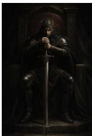

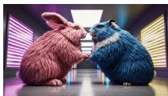

FOX: Verdict: fake (95.9%) · Explanation: The anatomy of the hands gripping the sword is the most prominent issue: the fingers appear fused and lack distinct knuckles, blending into a single smooth mass rather than showing individual digits. The sword itself has an overly uniform texture, closer to a digital render than a metallic object.

FOX: Verdict: fake (67.7%) · Explanation: Anatomical and physical inconsistencies suggest manipulation. The woman’s hand holding the cigarette is distorted, with fingers that lack natural joints. The cigarette is held at an impossible angle and appears to float or clip through the fingers rather than being firmly grasped.

FOX: Verdict: fake (99.95%) · Explanation: The sky and horizon line carry the clearest synthetic cues. The clouds are flat, repetitive white shapes with no natural texture or depth, creating a ‘pastedon’ effect. The water’s surface lacks realistic wave patterns and reads as a solid, painted layer.

FOX: Verdict: fake (99.2%) · Explanation: Lighting and texture on both subjects show synthetic qualities. The fur has an unnaturally uniform, brush-like appearance, and the floor reflection lacks the complex distortion expected from such large, textured bodies.

FOX: Verdict: fake (99.3%) · Explanation: The plate of food floats without realistic contact shadows against the surface below it. The text on the white cup is garbled and illegible, a common artifact in synthetic imagery.

Figure H.1. FOX generalizes to unseen, recent generators without retraining. Each row pairs two examples from one generator with the verdict and explanation produced by FOX. None of the five generators were seen during training, and all verdicts shown are correct.

<table><tr><td>Image</td><td>FOX (ours)</td><td>Ground Truth</td></tr><tr><td>Fake 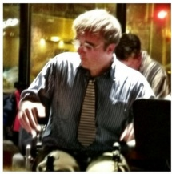</td><td>The image exhibits several signs of synthetic generation. The man's right hand, resting on his lap, appears distorted with fin- gers that seem to merge into a single, indistinct mass rather than showing clear individual digits. The texture of the skin on his face and hands has an overly smooth, plastic-like quality, lack- ing natural pores or fine detail. Additionally, the background elements, particularly the person behind him, appear smeared and lack coherent structure, blending unnaturally into the sur- roundings. The lighting on the subject feels somewhat flat and inconsistent with the ambient light sources visible in the window behind him.</td><td>The image exhibits several synthetic qualities, most notably in the rendering of the man's hair, which appears as a blurry, undif- ferentiated mass that lacks natural strand definition and seems to float unnaturally above his forehead. His glasses are distorted, with the frames blending directly into his skin and hair with- out clear structural edges. Additionally, the man's right hand is anatomically incorrect, featuring elongated, smudged fingers that lack joints and appear to melt into the surrounding space. The lighting on his face is also inconsistent with the rest of the scene, appearing overly bright and flat compared to the high-</td></tr><tr><td></td><td>(BERTScore F1: 0.75 · E5: 0.92 · Generated tokens: 119) The image contains several visual inconsistencies that suggest manipulation, particularly around the man in the red jacket. His</td><td>contrast shadows on his shirt and the background. The image contains a significant lighting inconsistency centered</td></tr><tr><td>Fake </td><td>figure appears to be floating slightly above the ground, as there are no contact shadows beneath his boots to ground him in the environment. The bicycle he is holding lacks a realistic connec- tion to his hands; the handlebars seem to merge into his gloves without clear grip points, and the front wheel of the bike has a distorted, smudged appearance that doesn't match the sharp- ness of the surrounding gravel. Additionally, the lighting on the man's face and jacket is much flatter and more diffused than the high-contrast, directional light hitting the buildings and water in the background, creating a disjointed sense of depth. (BERTScore F1: 0.65 · E5: 0.90 · Generated tokens: 145)</td><td>on the person's bright red jacket. While the overall scene is overcast with soft, muted lighting and diffused shadows, the red jacket appears unnaturally vibrant and lacks the atmospheric haze present on the rest of the subject and the background. Fur- thermore, the reflection in the water directly behind the person does not accurately represent the intense red color of the gar- ment, showing a much duller, desaturated tone that contradicts the jacket's current appearance.</td></tr><tr><td rowspan="2">Real 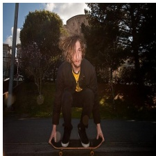</td><td></td><td></td></tr><tr><td>This picture looks real because the boy's hair is all messy and flying up in the air. It shows he was really moving fast on his skateboard, just like when you jump or turn really quickly. (BERTScore F1: 0.79 · E5: 0.95 · Generated tokens: 41)</td><td>This picture looks real because the man's hair is all messy and flying up in the air. It looks like he is really moving or jumping on his skateboard, and the wind is making his hair go whoosh!</td></tr><tr><td></td><td></td><td></td></tr><tr><td>Real </td><td>This picture looks real because of the bike's little basket. You can see how it's holding a big, wrinkly plastic bag full of stuff, just like someone would carry on their way to work or run er- rands. (BERTScore F1: 0.65 · E5: 0.85 · Generated tokens: 46)</td><td>This picture looks real because the street isn't perfectly clean. You can see some little pieces of paper on the road by the car's tire, which happens in a real city but is the kind of tiny mess a computer might forget to draw.</td></tr><tr><td>FRa ← eal 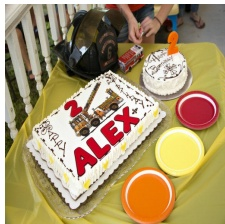</td><td>This picture looks real because the writing on the big fire truck cake isn't perfect. You can see how the frosting is a little bumpy and follows the shape of the letters, just like when a real person carefully squeezes it out of a bag to write a name. (BERTScore F1: 0.60 · E5: 0.88 · Generated tokens: 56)</td><td>The image contains several visual inconsistencies that suggest digital manipulation. Most notably, the name 'ALEX' on the large rectangular cake appears as a flat, two-dimensional graphic rather than physical icing; it lacks the natural highlights, shad- ows, and texture found on the 2’ and the fire truck illustration above it. The red color of the letters is unnaturally uniform and saturated, and the black outlines are too sharp and clean compared to the softer, hand-drawn quality of the surrounding 'Happy Birthday' script. Additionally, the letters do not follow the slight perspective or surface irregularities of the cake's frost- ing, making them look like they are floating on top of the image.</td></tr><tr><td>Fa ←eal </td><td>This looks like a real train because its big, round wheels are covered in dirt and mud. You can see how the wheels have been rolling over the rocky ground, which makes them look messy just like a real one would. (BERTScore F1: 0.51 · E5: 0.84 · Generated tokens: 46)</td><td>The rear vertical end of the freight car clearly looks synthetic: the curved face is filled with a repeating newspaper column tex- ture whose vertical column edges remain unnaturally straight across the curved surface. The paper pattern does not fol- low surface wear or rust; text blocks keep uniform contrast and crisp edges while the surrounding metal shows mottled dirt and scratches, creating a visible mismatch in texture and aging. There is a soft halo and slight color fringing where the news- paper meets the metal flange and ladder, indicating a pasted-on layer rather than integrated paint. Several headlines and lines of type are cut off or wrapped oddly at the curved corners, produc- ing impossible letter distortions and partial characters near the left and right edges of the end panel</td></tr><tr><td>Rl ←Rake 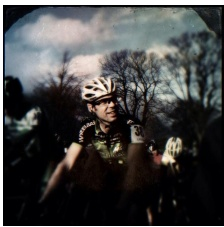</td><td>The generated image looks fake due to several visual incon- sistencies. Around the cyclist's face, the skin texture appears overly smooth and plastic-like, lacking natural detail. The fa- cial expression itself seems unnatural, an odd, forced smile that doesn't match the rest of the scene's tone. Additionally, the lighting on the face feels inconsistent with the surrounding envi- ronment, creating a subtle but noticeable mismatch in brightness and shadow direction. These combined cues make the image ap- pear synthetic rather than authentic. (BERTScore F1: 0.62 · E5: 0.84 · Generated tokens: 96)</td><td>This picture looks like a real snapshot because the edges are all dark and fuzzy, like an old photo that got a little dirty. Also, the man's face is a bit blurry because he was moving fast while the picture was taken.</td></tr><tr><td>Ral ← Rake </td><td>The image contains several visual inconsistencies that suggest manipulation, particularly around the chef's head and hat. The white chef's hat appears unnaturally bright and lacks the soft lighting and shadows found on the rest of the person's body. Furthermore, the yellow band of the hat has a jagged, poorly blended edge where it meets the forehead, and the texture of the hat itself looks overly smooth and flat compared to the more</td><td>This looks like a real picture because you can see how the round pizza cutter is pressing down into the cheesy pizza. It makes</td></tr><tr><td></td><td>detailed fabric of the red jacket. There is also a slight misalign- ment in the perspective of the hat's brim relative to the angle of the chef's face. (BERTScore F1: 0.55 · E5: 0.79 · Generated tokens: 117)</td><td>a little line and squishes the toppings, just like it would if you were really cutting a warm slice for a snack.</td></tr></table>

Figure H.2. Correct, forensically grounded explanations from FOX across the BERTScore distribution on XPV. The rotated labe gives the ground-truth class; FOX predicts the correct verdict in all four cases. The two rows per class are drawn from the high and low ends of the BERTScore distribution.

Figure H.3. Representative failure modes of FOX on XPV. The rotated label gives the ground-truth class and the predicted class; the verdict is wrong in all four cases. The two rows per direction are drawn from the high and low ends of the BERTScore distribution among wrong verdict predictions.