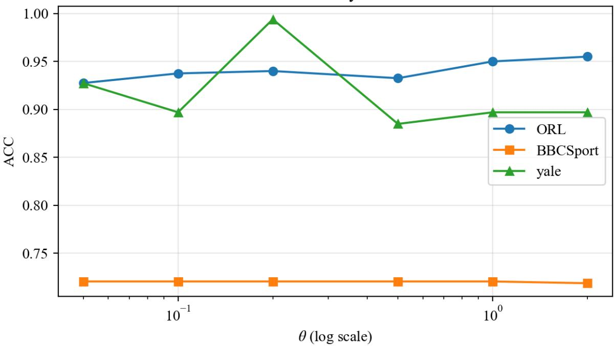
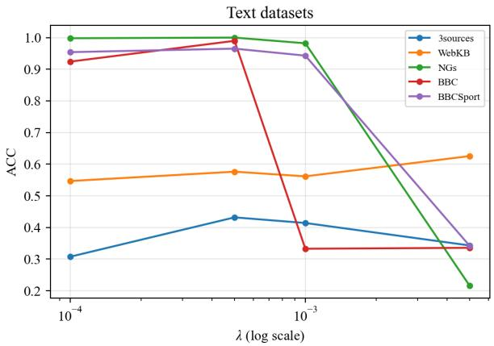
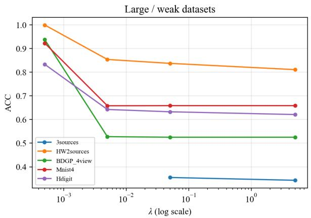
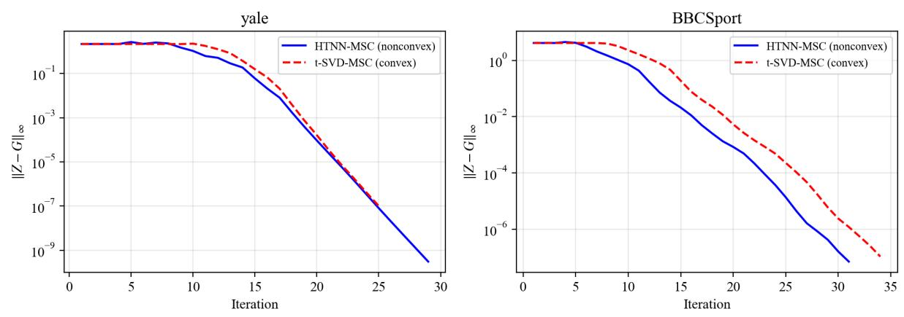
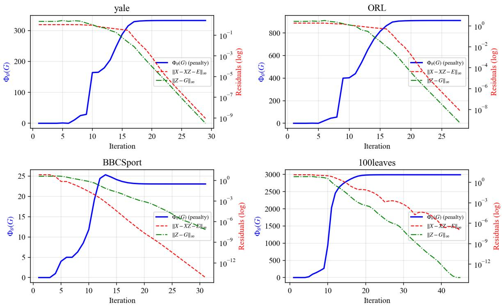

# HTNN-MSC: Multi-view Subspace Clustering with a Hyperbolic Tangent Tensor Low-Rank Surrogate

Yiwen Doua, Yiqiang Dinga

aSchool of Computer and Information, Anhui Polytechnic University, Wuhu, China

## Abstract

High-order dependencies among views can be modeled by tensor singular value decomposition (t-SVD) in multi-view subspace clustering. However, the tensor nuclear norm often used with this framework assigns the same asymptotic marginal penalty to singular values of diferent magnitudes, which may excessively shrink dominant components that encode cluster structure. We propose HTNN-MSC, which replaces this norm with a bounded hyperbolic tangent tensor rank surrogate. The surrogate is strictly concave on the positive half-axis and has a Lipschitz continuous derivative. Its marginal penalty decreases as singular values grow. We develop an alternating direction method of multipliers solver in which the tensor subproblem decomposes into scalar frequency-domain shrinkage problems. Safeguarded multi-start Newton iterations and candidate-objective comparison implement the resulting hyperbolic tangent thresholding operator. The shape parameter is scaled by the input spectrum. We also establish o-minimal definability of the augmented objective. Under explicit boundedness, descent, relative-error, and exactblock conditions, the Kurdyka–Łojasiewicz framework guarantees convergence of the full sequence to a KKT point. On 23 datasets, HTNN-MSC achieves a mean clustering accuracy of 0.8404 and an average accuracy rank of 2.78 against nine representative methods. Friedman tests and Holm-adjusted Wilcoxon comparisons reveal significant overall diferences, although several pairwise diferences remain nonsignificant. HTNN-MSC records 19 wins, one tie, and three losses against the convex t-SVD-MSC skeleton. A sameskeleton ablation also shows that the proposed surrogate does not uniformly outperform alternative nonconvex penalties.

Keywords: multi-view clustering, subspace clustering, low-rank tensor, nonconvex surrogate, tensor singular value decomposition, ADMM

## 1. Introduction

Multiple sensors, modalities, or feature extractors can provide complementary descriptions of a common set of objects. For example, intensity, texture, and shape features ofer distinct characterizations of an image, whereas multilingual versions of a news article provide diferent textual views. By exploiting information shared across these representations together with view-specific cues, multi-view clustering seeks to partition data without labels [1]. Multi-view subspace clustering (MVSC) addresses data whose samples approximately occupy a collection of low-dimensional subspaces. It learns within-view coeficients that express each sample through other samples, and then converts these coeficients into an afinity graph.

To obtain these coeficients, sparse subspace clustering uses a sparsity prior, whereas low-rank representation adopts a low-rank prior [2, 3]. Learning each view independently, however, can miss dependencies between views. Tensor-based MVSC instead stacks the view-specific representations into a third-order tensor and constrains their joint structure. The choice of tensor rank surrogate then determines how the model suppresses noise and retains principal cluster structure.

Many t-SVD-based models use the tensor nuclear norm (TNN) [4]. Its convexity simplifies optimization, but its derivative with respect to each positive singular value is constant. Small coeficients associated with noise and large coeficients associated with dominant structure therefore receive the same asymptotic marginal penalty. Nonconvex surrogates reduce this penalty as the singular value increases. Logarithmic Schatten-p and generalized nonconvex tensor penalties illustrate this idea in MVSC [5, 6]. Arctangent and refined-sigmoid penalties add bounded alternatives [7, 8]. The remaining question is how a particular penalty afects shrinkage, numerical solution, parameter scaling, and convergence analysis.

We study $\phi _ { \theta } ( \sigma ) = \operatorname { t a n h } ( \sigma / \theta )$ as a tensor rank surrogate. This function is bounded and smooth, strictly concave for $\sigma > 0$ , and finite in derivative at the origin. It shrinks small coeficients while its marginal penalty vanishes for suficiently large ones. We incorporate this penalty into a self-expression MVSC model and derive an alternating direction method of multipliers (ADMM) solver. Fourier transformation and singular value decomposition reduce the tensor update to independent scalar problems. The resulting mapping, called hyperbolic tangent thresholding (HTT), is evaluated from three starting points with safeguarded Newton updates and objective-value comparison.

The paper makes four contributions.

1. We formulate the hyperbolic tangent tensor surrogate and establish its boundedness, strict concavity, Lipschitz derivative, rank-approximation limit, and definability in an o-minimal structure.

2. We derive a two-penalty ADMM algorithm that matches the implementation. A data-adaptive rule sets θ from the initial frequency-domain spectrum, while the error-weight parameter remains dataset dependent.

3. We state the exact-block, descent, and relative-error conditions required for KLbased whole-sequence convergence. The statement distinguishes the theoretical algorithm from the practical multi-start HTT solver and does not treat tanh as semi-algebraic.

4. We compare ten methods on 23 datasets. HTNN-MSC achieves a mean ACC of 0.8404 and a mean NMI of 0.8029, with respective average ranks of 2.78 and 3.02. Friedman and Holm-adjusted Wilcoxon tests assess cross-dataset diferences. Sameskeleton comparisons measure the change from convex soft thresholding and expose cases where other nonconvex surrogates perform better. Repeated post-processing, sensitivity analyses, convergence plots, and runtime measurements describe the numerical behavior of the method.

## 2. Related work

## 2.1. Multi-view subspace clustering

Self-expression reconstructs a sample from other samples in the same subspace. Given $X \in \mathbb { R } ^ { d \times n }$ , the model learns Z from $X = X Z + E$ and applies spectral clustering to an afinity derived from Z. Multi-view extensions learn $\{ Z _ { v } \} _ { v = 1 } ^ { V }$ and reconcile view-specific reconstruction with a shared cluster structure.

LT-MSC stacks these matrices and constrains the Tucker multi-rank of the resulting tensor [9]. t-SVD-MSC rotates the representation tensor and applies a tensor nuclear norm after Fourier transformation [10]. ETLMSC learns an essential tensor for spectral clustering [11]. UGLTL jointly learns graphs and a low-rank tensor, whereas WTNNM introduces a weighted tensor nuclear norm into graph-based MVSC [12, 13]. LRTGL and LTBPL combine tensor modeling with graph learning and proximity learning, respectively [14, 15].

Full-representation methods store an $n \times n$ matrix for each view. Anchor-based models reduce this cost. LMVSC has linear complexity in the sample number under fixed anchor settings [16]. ESTMC combines anchor representations with nonconvex tensor rank learning [17], and TLRLF4MVC adds a tensor low-frequency operator to scalable multiview clustering [18]. GFT-TMVC replaces the fixed sample-mode Fourier basis with a graph Fourier basis to reduce sensitivity to sample ordering [19]. These methods change the representation scale or transform basis. Our model keeps the full representation and changes the singular-value penalty.

## 2.2. Nonconvex low-rank regularization

Rank is measured by the number of nonzero singular values; by contrast, the sum of their magnitudes defines the nuclear norm. MCP and SCAD reduce estimation bias by making the penalty derivative depend on coeficient size [20, 21]. Logarithmic and Schatten-p penalties also reduce pressure on large coeficients, but their derivatives can be unbounded or singular near the origin.

TLSpNM uses a logarithmic Schatten-p penalty, and GNLTA considers a broader family of nonconvex tensor approximations. Arctangent and refined-sigmoid surrogates supply bounded alternatives. HTNN-MSC instead uses tanh, scales it from the input spectrum, and compares it with convex and nonconvex penalties in the same optimization skeleton. Its o-minimal formulation states the conditions needed for a KL convergence argument. The experiments evaluate these properties without assuming that they imply higher accuracy on every dataset.

## 3. Notation and preliminaries

Matrices are written in uppercase and third-order tensors in calligraphic letters. For view $v , X _ { v } = [ x _ { v , 1 } , \ldots , x _ { v , n } ] \in \mathbb { R } ^ { d _ { v } \times n }$ contains n samples, $Z _ { v } \in \mathbb { R } ^ { n \times n }$ stores self-expression coeficients, and $E _ { v }$ contains reconstruction errors. The numbers of views and clusters are V and K. The Frobenius norm is denoted by $\left\| \cdot \right\| _ { F } ,$ and the matrix inner product is $\langle A , B \rangle = \operatorname { t r } ( A ^ { \top } B )$ . Column sparsity is promoted by $\begin{array} { r } { \| \bar { \boldsymbol E } \| _ { 2 , 1 } = \sum _ { j = 1 } ^ { n } \| \boldsymbol E _ { : , j } \| _ { 2 } } \end{array}$

The representation tensor $\mathcal { Z } \in \mathbb { R } ^ { n \times n \times V }$ has frontal slices $Z _ { v } . \mathrm { ~ A ~ }$ cyclic dimension shift rotates it to $\mathcal { Z } ^ { r } \in \mathbb { R } ^ { V \times n \times n }$ . The discrete Fourier transform acts on the last, sampleindexed mode. We write $\widehat { \mathcal { Z } } = \mathrm { f f } ( \mathcal { Z } ^ { r } , [ ] , 3 )$ and denote its jth frontal slice by $\widehat Z ^ { ( j ) }$ . The Fourier mode therefore has length $n _ { 3 } = n$ , rather than V. The t-product and t-SVD frameworks behind this construction appear in [22, 23].

For a real tensor under the unnormalized FFT, $\left\| \mathcal { Z } \right\| _ { F } ^ { 2 } = n _ { 3 } ^ { - 1 } \left\| \widehat { \mathcal { Z } } \right\| _ { F } ^ { 2 }$ . Conjugate symmetry allows us to process only the first $\lfloor n _ { 3 } / 2 \rfloor + 1$ Fourier slices and reconstruct the remainder. We define the scaled nonconvex penalty

$$
\Phi _ { \theta } ( \mathcal { G } ) = \frac { 1 } { n _ { 3 } } \sum _ { j = 1 } ^ { n _ { 3 } } \sum _ { i = 1 } ^ { r _ { j } } \phi _ { \theta } \Bigl ( \sigma _ { i } ( \widehat { G } ^ { ( j ) } ) \Bigr ) , \qquad r _ { j } = \mathrm { r a n k } ( \widehat { G } ^ { ( j ) } ) ,\tag{1}
$$

where zero singular values contribute zero. The factor $1 / n _ { 3 }$ matches the proximal derivation to the unnormalized FFT in the implementation.

After optimization, the afinity matrix is

$$
S = \sum _ { v = 1 } ^ { V } \left( | Z _ { v } | + | Z _ { v } ^ { \top } | \right) ,\tag{2}
$$

where absolute values are elementwise. Spectral clustering partitions S into K groups [24, 25].

## 4. The proposed HTNN-MSC model

4.1. Hyperbolic tangent rank surrogate

For $\sigma \geq 0$ and $\theta > 0$ , define

$$
\phi _ { \theta } ( \sigma ) = \operatorname { t a n h } \left( { \frac { \sigma } { \theta } } \right) = { \frac { e ^ { 2 \sigma / \theta } - 1 } { e ^ { 2 \sigma / \theta } + 1 } } .\tag{3}
$$

Applying $\phi _ { \theta }$ to each Fourier-slice singular value in Eq. (1) gives the tensor penalty $\Phi _ { \theta }$

Proposition 1 (Properties of $\phi _ { \theta } )$ . The following properties hold for $\sigma \geq 0$

1. Boundedness and normalization. $\phi _ { \theta } ( 0 ) = 0$ and $0 \leq \phi _ { \theta } ( \sigma ) < 1$

2. Strict concavity. For $\sigma > 0$

$$
\phi _ { \theta } ^ { \prime \prime } ( \sigma ) = - \frac { 2 } { \theta ^ { 2 } } \mathrm { s e c h } ^ { 2 } ( \sigma / \theta ) \operatorname { t a n h } ( \sigma / \theta ) < 0 .\tag{4}
$$

3. Finite and Lipschitz derivative. $\phi _ { \theta } ^ { \prime } ( 0 ) = 1 / \theta$ , lim $_ { 1 _ { \sigma \to \infty } } \phi _ { \theta } ^ { \prime } ( \sigma ) = 0$ , and

$$
| \phi _ { \theta } ^ { \prime \prime } ( \sigma ) | \leq { \frac { 4 } { 3 \sqrt { 3 } \theta ^ { 2 } } } .\tag{5}
$$

Hence $\phi _ { \theta } ^ { \prime }$ is Lipschitz with constant $4 / ( 3 \sqrt { 3 } \theta ^ { 2 } )$

4. Rank limit. $\scriptstyle \operatorname* { l i m } _ { \theta \to 0 ^ { + } } \phi _ { \theta } ( \sigma )$ equals zero at $\sigma = 0$ and one for every fixed $\sigma > 0$

5. Definability. $\phi _ { \theta }$ is definable in the o-minimal structure $\mathbb { R } _ { \mathrm { e x p } }$

Direct calculus gives the first four properties. The curvature bound follows because $\operatorname { s e c h } ^ { 2 } ( x )$ tanh(x) has maximum absolute value $2 / ( 3 \sqrt { 3 } )$ at tanh $( x ) = 1 / \sqrt { 3 }$ . Eq. (3) and Wilkie’s theorem for the real exponential field give definability [26]. Tanh is not semialgebraic. The KL analysis must therefore use the o-minimal structure $\mathbb { R } _ { \mathrm { e x p } }$

Shrinkage is governed by $\phi _ { \theta } ^ { \prime } ( \sigma ) = \theta ^ { - 1 } \mathrm { s e c h } ^ { 2 } ( \sigma / \theta )$ . This derivative is finite and positive near zero, then decays rapidly as the singular value grows. A nuclear-norm penalty instead has a constant derivative for positive singular values. Tanh thus reduces asymptotic shrinkage of dominant spectral components, although this bias-reduction mechanism does not guarantee higher accuracy on every dataset.

## 4.2. Optimization model

We combine view-specific reconstruction errors with the nonconvex tensor penalty.

$$
\begin{array} { r l } { \displaystyle \operatorname* { m i n } _ { \{ Z _ { v } , E _ { v } \} , \mathcal { G } } } & { \displaystyle \Phi _ { \theta } ( \mathcal { G } ) + \lambda \sum _ { v = 1 } ^ { V } \| E _ { v } \| _ { 2 , 1 } } \\ { \mathrm { s . t . } \quad X _ { v } = X _ { v } Z _ { v } + E _ { v } , \quad v = 1 , \ldots , V , } & { } \\ { \displaystyle \mathcal { Z } = \mathcal { G } . } & { } \end{array}\tag{6}
$$

The parameter $\lambda > 0$ weights the error term. The auxiliary tensor $\mathcal { G }$ separates the lowrank penalty from the reconstruction constraints. The algorithm and experiments use this same parameterization.

The afinity construction is identical to that of the convex t-SVD-MSC skeleton. $\mathrm { R e } -$ placing $\phi _ { \theta }$ with the identity penalty therefore changes singular-value shrinkage without changing graph fusion or spectral post-processing. The ablation study uses this controlled substitution.

## 4.3. Data-adaptive surrogate scale

Datasets can have singular values on very diferent scales, so a fixed θ is dificult to choose. We define σ¯ as the average of the singular values in the first $\lfloor n _ { 3 } / 2 \rfloor + 1$ Fourier slices of the input to the first G-subproblem, and set $\theta = c \bar { \sigma }$ . The main experiments use $c = 1$ . Formally,

$$
\bar { \sigma } = \frac { 1 } { M } \sum _ { j = 1 } ^ { \lfloor n _ { 3 } / 2 \rfloor + 1 \operatorname* { m i n } ( V , n ) } \sigma _ { i } ( \widehat { B } ^ { ( 1 , j ) } ) , \qquad \theta = c \bar { \sigma } ,\tag{7}
$$

Here, M denotes the total number of singular values included in the average, and $\boldsymbol { B } ^ { ( 1 ) } =$ $\mathcal { Z } ^ { ( 0 ) } + \mathcal { W } ^ { ( 0 ) } / \rho _ { 0 }$ . This rule fixes the scale of $\theta$ from the data, but λ still requires selection. The best λ varies substantially between text and image data.

## 5. Optimization

## 5.1. Augmented Lagrangian

Let $r _ { v } = X _ { v } - X _ { v } Z _ { v } - E _ { v }$ . Using separate penalty parameters $\mu$ and $\rho ,$ the augmented Lagrangian is

$$
\begin{array} { l } { { \displaystyle { \mathcal { L } } _ { \mu , \rho } = \Phi _ { \theta } ( \mathcal { G } ) + \lambda \sum _ { v } \left\| E _ { v } \right\| _ { 2 , 1 } + \sum _ { v } \left. Y _ { v } , r _ { v } \right. + \frac { \mu } { 2 } \sum _ { v } \left\| r _ { v } \right\| _ { F } ^ { 2 } } } \\ { { \displaystyle ~ + \sum _ { v } \left. W _ { v } , Z _ { v } - G _ { v } \right. + \frac { \rho } { 2 } \sum _ { v } \left\| Z _ { v } - G _ { v } \right\| _ { F } ^ { 2 } } . }  \end{array}\tag{8}
$$

Reconstruction and tensor consistency operate at diferent scales, so the model uses two penalty parameters. With the sign convention $\langle W _ { v } , Z _ { v } - G _ { v } \rangle$ , the Z-equation contains $- W _ { v } / \rho$

## 5.2. View-specific updates

For fixed $E _ { v } , G _ { v } , Y _ { v } , W _ { v }$ , the $Z _ { v }$ -subproblem is quadratic. Its minimizer is

$$
\begin{array} { r l } & { Z _ { v } ^ { k + 1 } = \bigg ( I + \frac { \mu _ { k } } { \rho _ { k } } X _ { v } ^ { \top } X _ { v } \bigg ) ^ { - 1 } \bigg [ G _ { v } ^ { k } + \frac { 1 } { \rho _ { k } } \left( X _ { v } ^ { \top } Y _ { v } ^ { k } \right. } \\ & { \quad \left. + \mu _ { k } X _ { v } ^ { \top } X _ { v } - \mu _ { k } X _ { v } ^ { \top } E _ { v } ^ { k } - W _ { v } ^ { k } \right) \big ] . } \end{array}\tag{9}
$$

The matrix $I + ( \mu _ { k } / \rho _ { k } ) X _ { v } ^ { \top } X _ { v }$ is positive definite. Since the penalty ratio changes between iterations, the implementation recomputes the linear solve rather than assuming a single fixed inverse.

After updating $Z _ { v }$ , define

$$
T _ { v } = X _ { v } - X _ { v } Z _ { v } ^ { k + 1 } + \frac { Y _ { v } ^ { k } } { \mu _ { k } } .\tag{10}
$$

The $E _ { v }$ -subproblem separates by columns.

$$
E _ { v , : , j } ^ { k + 1 } = \operatorname* { m a x } \left( 1 - \frac { \lambda } { \mu _ { k } \left\| T _ { v , : , j } \right\| _ { 2 } } , 0 \right) T _ { v , : , j } ,\tag{11}
$$

Here $E _ { v , : , j } ^ { k + 1 } = 0$ when $\| T _ { v , : , j } \| _ { 2 } = 0$ . The reconstruction multiplier is then updated by

$$
\begin{array} { r } { Y _ { v } ^ { k + 1 } = Y _ { v } ^ { k } + \mu _ { k } \left( X _ { v } - X _ { v } Z _ { v } ^ { k + 1 } - E _ { v } ^ { k + 1 } \right) . } \end{array}\tag{12}
$$

## 5.3. Hyperbolic tangent tensor thresholding

The G-subproblem is

$$
\operatorname* { m i n } _ { { \mathcal { G } } } \ \Phi _ { \theta } ( { \mathcal { G } } ) + \frac { \rho _ { k } } { 2 } \left\| { \mathcal { G } } - { \mathcal { B } } ^ { k + 1 } \right\| _ { F } ^ { 2 } , \qquad { \mathcal { B } } ^ { k + 1 } = { \mathcal { Z } } ^ { k + 1 } + \frac { \mathcal { W } ^ { k } } { \rho _ { k } } .\tag{13}
$$

Proposition 2 (Frequency-domain separability). Let $t = \sigma _ { i } ( \widehat { B } ^ { ( k + 1 , j ) } )$ . With the scaled surrogate in Eq. (1) and the unnormalized FFT, $E q$ . (13) separates into scalar problems

$$
\operatorname* { m i n } _ { s \ge 0 } \ f _ { t , \tau } ( s ) = \frac { 1 } { 2 } ( s - t ) ^ { 2 } + \tau \operatorname { t a n h } ( s / \theta ) , \qquad \tau = \frac { 1 } { \rho _ { k } } .\tag{14}
$$

The matrix solution is obtained by replacing each singular value with the selected minimizer and retaining the corresponding singular vectors.

Proof. Parseval’s identity gives $\left\| \boldsymbol { \mathcal { G } } - \boldsymbol { \mathcal { B } } \right\| _ { F } ^ { 2 } = n _ { 3 } ^ { - 1 } \left\| \widehat { \mathcal { G } } - \widehat { \mathcal { B } } \right\| _ { F } ^ { 2 } .$ . Multiplying Eq. (13) by $n _ { 3 }$ removes the scale factors in both terms. Each Fourier-slice problem is then a unitarily invariant matrix proximal problem. Its SVD reduces the matrix problem to Eq. (14), and conjugate symmetry reconstructs a real tensor. □

For $t \geq 0$ , any interior stationary point satisfies

$$
h ( s ) = s - t + { \frac { \tau } { \theta } } \mathrm { s e c h } ^ { 2 } ( s / \theta ) = 0 , \qquad 0 < s \leq t .\tag{15}
$$

Moreover,

$$
h ^ { \prime } ( s ) = 1 - \frac { 2 \tau } { \theta ^ { 2 } } \mathrm { s e c h } ^ { 2 } ( s / \theta ) \operatorname { t a n h } ( s / \theta ) .\tag{16}
$$

Algorithm 1 HTNN-MSC   
Require: Views $\overline { { \{ X _ { v } \} _ { v = 1 } ^ { V } } }$ cluster number $K , \lambda > 0$ , scale factor $c > 0 .$   
1: Normalize each view and initialize $Z _ { v } ^ { 0 } = G _ { v } ^ { 0 } = W _ { v } ^ { 0 } = 0 , E _ { v } ^ { 0 } = Y _ { v } ^ { 0 } = 0 .$   
2: Initialize $\mu _ { 0 } = 1 0 ^ { - 4 } , \rho _ { 0 } = 1 0 ^ { - 4 } \mathrm { , }$ , and cached $X _ { v } ^ { \top } X _ { v }$   
3: for $k = 0 , 1 , \ldots$ . until convergence do   
4: for $v = 1 , \ldots , V$ do   
5: Update $Z _ { v } ^ { k + 1 }$ by Eq. (9).   
6: Update $E _ { \ v { v } } ^ { \bar { k } + 1 }$ by Eq. (11).   
7: Update $Y _ { v } ^ { k + 1 }$ by Eq. (12).   
8: end for   
9: Form $\smash { \boldsymbol { B } ^ { k + 1 } = \mathcal { Z } ^ { k + 1 } + \boldsymbol { \mathcal { W } } ^ { k } / \rho _ { k } }$   
10: if $k = 0$ and adaptive scaling is enabled then   
11: Compute σ¯ and set $\theta = c \bar { \sigma }$ by Eq. (7).   
12: end if   
13: Apply FFT to the rotated tensor and compute slice-wise SVDs.   
14: Apply HTT to each singular value with $\tau = 1 / \rho _ { k }$   
15: Reconstruct ${ \mathcal { G } } ^ { k + 1 }$ using conjugate symmetry and inverse FFT.   
16: Update $\mathcal { W } ^ { k + 1 }$ by Eq. (17).   
17: Increase $\mu _ { k + 1 } = \operatorname* { m i n } ( 2 \mu _ { k } , \mu _ { \operatorname* { m a x } } )$ and $\rho _ { k + 1 } = \operatorname* { m i n } ( 2 \rho _ { k } , \rho _ { \operatorname* { m a x } } )$   
18: Stop when both maxv $\lVert X _ { v } - X _ { v } Z _ { v } - E _ { v } \rVert _ { \infty }$ and maxv $\| Z _ { v } - G _ { v } \| _ { \infty }$ are at most $1 0 ^ { - 7 }$   
or at the iteration cap.   
19: end for   
20: Construct S by Eq. (2) and apply spectral clustering.   
Ensure: Cluster assignments, afinity S, and representations $\{ Z _ { v } \}$

Since $\operatorname { s e c h } ^ { 2 } ( x )$ tanh(x) increases and then decreases, $h ^ { \prime }$ has at most two zeros and h has at most three roots on (0, t]. A certified global solver can bracket these monotone intervals and compare all roots with $s = 0$

The experimental implementation uses a less expensive numerical procedure. It starts safeguarded Newton iterations from max $( t - \tau / \theta , 0 ) , \ t / 2$ , and min(max $( \tau / \theta , 1 0 ^ { - 3 } t ) , t )$ Steps are projected onto [0, t], with a half-interval backtracking step when the Newton denominator is too small or nonfinite. After at most 60 iterations per start, all returned candidates and $s = 0$ are compared by $f _ { t , \tau }$ . We call this mapping HTT. The three starts provide candidate solutions but do not certify exhaustive root enumeration.

After shrinking all processed Fourier slices, the inverse FFT and inverse dimension shift produce $\mathcal { G } ^ { k + 1 }$ . The multiplier update is

$$
\begin{array} { r } { \mathcal { W } ^ { k + 1 } = \mathcal { W } ^ { k } + \rho _ { k } ( \mathcal { Z } ^ { k + 1 } - \mathcal { G } ^ { k + 1 } ) . } \end{array}\tag{17}
$$

Both penalties double at each iteration until they reach prescribed maxima. Algorithm 1 summarizes the procedure.

## 6. Convergence conditions and computational complexity

## 6.1. KL-based convergence statement

The KL property converts suficient descent and a relative-error bound into a finitelength iterate sequence for nonconvex splitting methods. Tanh is not semi-algebraic, but

$\phi _ { \theta }$ is definable in $\mathbb { R } _ { \mathrm { e x p } }$ . The quadratic terms, linear constraints, and $\ell _ { 2 , 1 }$ norm are semialgebraic. Their finite compositions and sums with $\phi _ { \theta }$ preserve definability in $\mathcal { L } _ { \mu , \rho } .$ The augmented objective therefore satisfies the KL property on bounded sets [27, 28].

Theorem 1 (Conditional whole-sequence convergence). Let $x ^ { k }$ collect all primal and dual variables. Suppose the following conditions hold.

1. Every $Z \mathrm { - } , ~ E \mathrm { - } ,$ and G-subproblem is globally minimized.

2. Boundedness of the sequence is assumed, together with a proper lower-bounded $p o -$ tential Ψ and a constant $a > 0$ satisfying $\bar { \Psi ( x ^ { k } ) } - \Psi ( x ^ { k + 1 } ) \geq a \left\| x ^ { k + 1 } - x ^ { k } \right\| ^ { 2 }$

3. A constant $b > 0$ and a subgradient $d ^ { k + 1 } \in \partial \Psi ( x ^ { k + 1 } )$ satisfy

$$
\left\| d ^ { k + 1 } \right\| \le b \left\| x ^ { k + 1 } - x ^ { k } \right\| .
$$

These conditions imply $\textstyle \sum _ { k } \left\| x ^ { k + 1 } - x ^ { k } \right\| < \infty$ . Hence, $\{ x ^ { k } \}$ has a single limit $x ^ { * }$ . At this limit, $0 \in \partial \Psi ( x ^ { * } )$ ; under standard constraint qualifications, $x ^ { * }$ is a KKT point of $E q .$ (6). If the KL exponent at $x ^ { * }$ is $1 / 2$ , the convergence rate is linear.

The proof uses the standard KL descent argument for tame nonconvex optimization and nonconvex ADMM [29, 30]. Appendix A outlines the steps. The curvature bound of tanh alone does not establish suficient descent for an arbitrary two-penalty schedule, and the practical three-start HTT solver does not establish the exact-block assumption. The theorem applies to the exact-block algorithm under the stated conditions, not unconditionally to every numerical run.

## 6.2. Complexity

Let $D = \textstyle \sum _ { v } d _ { v }$ . Precomputing all $X _ { v } ^ { \top } X _ { v }$ costs $O ( n ^ { 2 } D )$ . Each iteration is dominated by V dense $n \times n$ linear solves in the Z-updates, costing $O ( V n ^ { 3 } )$ time in a direct im plementation. The reconstruction and error updates cost $O ( n ^ { 2 } D )$ across views. After rotation and FFT, the tensor update performs $O ( n )$ SVDs of $V \times n$ matrices. This cost is below the dense Z-solve cost when $V \ll n$ . HTT itself evaluates $O ( n V )$ scalar problems per iteration, each with a fixed iteration cap.

The main storage requirements are $O ( V n ^ { 2 } )$ for representations, auxiliary variables, and multipliers, plus $O ( n D )$ for the data and cached cross-products. Thus the asymptotic orders are comparable to other full-representation t-SVD-based MVSC methods. The nonconvex scalar solver does not change the dominant big-O order, but dense cubic solves and quadratic memory remain the practical bottleneck for large n.

## 7. Experiments

## 7.1. Datasets

The evaluation uses 23 real benchmark datasets covering faces, objects, scenes, documents, handwritten digits, and other visual features. Sample sizes range from 169 to 10,800, view numbers from two to six, and class numbers from four to 100. Table 1 lists the dimensions. All views of a dataset use the same sample ordering and cross-view correspondence.

Table 1: Summary of the 23 benchmark datasets. Entries in the last column follow the view order.
<table><tr><td>Dataset</td><td>Samples n</td><td>Views V</td><td>Classes K</td><td>View dimensions</td></tr><tr><td>Yale</td><td>165</td><td>3</td><td>15</td><td>4096, 3304, 6750</td></tr><tr><td>ORL</td><td>400</td><td>3</td><td>40</td><td>4096, 3304, 6750</td></tr><tr><td>COIL20</td><td>1440</td><td>4</td><td>20</td><td>1024, 944, 4096, 576</td></tr><tr><td>Scene15</td><td>4485</td><td>3</td><td>15</td><td>1800, 1180, 1240</td></tr><tr><td>MSRCv1</td><td>210</td><td>5</td><td>7</td><td>24, 576, 512, 256, 254</td></tr><tr><td>Caltech101-7</td><td>1474</td><td>6</td><td>7</td><td>48, 40, 254, 1984, 512, 928</td></tr><tr><td>EYaleB10</td><td>640</td><td>3</td><td>10</td><td>1024, 1239, 256</td></tr><tr><td>BBC</td><td>685</td><td>4</td><td>5</td><td>4659, 4633, 4665, 4684</td></tr><tr><td>BBCSport</td><td>544</td><td>2</td><td>5</td><td>3183, 3203</td></tr><tr><td>NGs</td><td>500</td><td>3</td><td>5</td><td>2000, 2000, 2000</td></tr><tr><td>3Sources</td><td>169</td><td>3</td><td>6</td><td>3560, 3631, 3068</td></tr><tr><td>WebKB</td><td>203</td><td>3</td><td>4</td><td>1703, 230, 230</td></tr><tr><td>Handwritten</td><td>2000</td><td>6</td><td>10</td><td>216, 76, 64, 6, 240, 47</td></tr><tr><td>UCI</td><td>2000</td><td>3</td><td>10</td><td>240, 76, 6</td></tr><tr><td>HDigit</td><td>10000</td><td>2</td><td>10</td><td>784, 256</td></tr><tr><td>MNIST4</td><td>4000</td><td>3</td><td>4</td><td>30, 9, 30</td></tr><tr><td>HW1256</td><td>2000</td><td>4</td><td>10</td><td>76, 216, 47, 6</td></tr><tr><td>HW2Sources</td><td>2000</td><td>2</td><td>10</td><td>784, 256</td></tr><tr><td>100Leaves</td><td>1600</td><td>3</td><td>100</td><td>64, 64, 64</td></tr><tr><td>BDGP</td><td>2500</td><td>4</td><td>5</td><td>1000, 500, 250, 79</td></tr><tr><td>CCV</td><td>6773</td><td>3</td><td>20</td><td>20, 20, 20</td></tr><tr><td>ALOI100</td><td>10800</td><td>4</td><td>100</td><td>77, 13, 64, 125</td></tr><tr><td>Scene</td><td>2688</td><td>4</td><td>8</td><td>512, 432, 256, 48</td></tr></table>

## 7.2. Compared methods and implementation details

The comparison uses nine representative methods. GMC [31] is the graph-based baseline. The others are LT-MSC, TLSpNM, LTBPL, LMVSC, LRTGL, t-SVD-MSC, GFT-TMVC, and GNLTA. They cover Tucker and t-SVD tensor models, nonconvex penalties, graph and proximity learning, graph-spectral transforms, and anchor-based clustering.

Each view uses the normalization routine supplied with its implementation. Baseline parameters follow the authors’ recommended settings or dataset-specific code configurations. HTNN-MSC sets θ adaptively with c = 1. The parameter studies consider

$$
\lambda \in \{ 1 0 ^ { - 4 } , 5 \times 1 0 ^ { - 4 } , 1 0 ^ { - 3 } , 5 \times 1 0 ^ { - 3 } , 5 \times 1 0 ^ { - 2 } , 0 . 5 , 5 , 1 0 , 1 0 0 \} .\tag{18}
$$

For each dataset, the main tables report one post-processing run at the λ with the best ACC. This oracle grid-selection protocol has no separate validation split and gives optimistic benchmark scores rather than held-out generalization estimates. Section 7.8 evaluates repeated post-processing at the selected parameters.

All algorithms run in MATLAB R2024a on a Windows workstation with 32 GB RAM using CPU computation. Running times cover the main optimization routines and exclude data loading and common spectral post-processing. All 230 method–dataset combinations completed. Our baseline adapters assign equal-weight feasible simplex solutions when GMC or LRTGL encounters zero denominators or empty graph rows. GMC also uses sparse partial eigendecomposition on CCV. On ALOI100, LT-MSC and GFT-TMVC use low-dimensional solves based on the Woodbury identity. Redundant memory is also cleared to fit the available RAM. These changes preserve their model objectives. Seven clustering metrics are computed: ACC, NMI, adjusted Rand index, F-score, precision, recall, and purity. The subsequent analysis focuses on ACC and NMI, which quantify label agreement and information consistency, respectively.

Table 2: ACC results for ten methods across 23 datasets. Bold and underlined values indicate the best and second-best results, respectively.
<table><tr><td>Dataset</td><td>LT-MSC</td><td>TLSpNM</td><td>LTBPL</td><td>GMC</td><td>LMVSC</td><td>LRTGL</td><td>t-SVD-MSC</td><td>GFT-TMVC</td><td>GNLTA</td><td>HTNN-MSC (ours)</td></tr><tr><td>Yale</td><td>0.7394</td><td>1.0000</td><td>0.7091</td><td>0.6545</td><td>0.5030</td><td>0.6727</td><td>0.8848</td><td>0.9212</td><td>0.5885</td><td>0.9152</td></tr><tr><td>ORL</td><td>0.8175</td><td>0.9350</td><td>0.9975</td><td>0.6325</td><td>0.4875</td><td>0.9225</td><td>0.8800</td><td>0.8000</td><td>0.8650</td><td>0.9250</td></tr><tr><td>COIL20</td><td>0.7556</td><td>0.7736</td><td>0.9250</td><td>0.8035</td><td>0.6472</td><td>0.9861</td><td>0.7542</td><td>0.7514</td><td>0.7581</td><td>0.7590</td></tr><tr><td>Scene15</td><td>0.5663</td><td>0.8163</td><td>0.3278</td><td>0.3810</td><td>0.4970</td><td>0.6246</td><td>0.7897</td><td>0.5217</td><td>0.4211</td><td>0.8096</td></tr><tr><td>MSRCv1</td><td>0.8286</td><td>0.9857</td><td>0.9905</td><td>0.7476</td><td>0.3429</td><td>0.7424</td><td>0.9524</td><td>0.8286</td><td>0.7405</td><td>0.8238</td></tr><tr><td>Caltech101-7</td><td>0.6011</td><td>0.6282</td><td>0.6649</td><td>0.6920</td><td>0.3365</td><td>0.6058</td><td>0.6567</td><td>0.5068</td><td>0.4094</td><td>0.6275</td></tr><tr><td>EYaleB10</td><td>0.4672</td><td>0.7672</td><td>0.4203</td><td>0.5156</td><td>0.2781</td><td>0.5783</td><td>0.5766</td><td>0.7125</td><td>0.2428</td><td>0.6234</td></tr><tr><td>BBC</td><td>0.5796</td><td>0.3285</td><td>1.0000</td><td>0.6934</td><td>0.4102</td><td>0.8934</td><td>0.3270</td><td>0.6102</td><td>0.9766</td><td>0.9898</td></tr><tr><td>BBCSport</td><td>0.3971</td><td>0.3438</td><td>0.9890</td><td>0.8070</td><td>0.3235</td><td>0.9449</td><td>0.9982</td><td>0.8474</td><td>0.9426</td><td>0.9651</td></tr><tr><td>NGs</td><td>0.9900</td><td>0.2020</td><td>0.0140</td><td>0.9820</td><td>0.2540</td><td>0.7560</td><td>1.0000</td><td>0.9780</td><td>0.6866</td><td>1.0000</td></tr><tr><td>3Sources</td><td>0.7811</td><td>0.3491</td><td>0.0592</td><td>0.6923</td><td>0.4260</td><td>0.9467</td><td>0.3491</td><td>0.6864</td><td>0.2456</td><td>0.4320</td></tr><tr><td>WebKB</td><td>0.5369</td><td>0.5222</td><td>0.5419</td><td>0.7586</td><td>0.6404</td><td>0.6946</td><td>0.5074</td><td>0.5517</td><td>0.5813</td><td>0.6256</td></tr><tr><td>Handwritten</td><td>0.9160</td><td>0.9985</td><td>1.0000</td><td>0.8820</td><td>0.6550</td><td>0.9815</td><td>0.9975</td><td>0.9115</td><td>0.8890</td><td>0.9985</td></tr><tr><td>UCI</td><td>0.8030</td><td>0.9855</td><td>0.9990</td><td>0.7045</td><td>0.7135</td><td>0.9775</td><td>0.9650</td><td>0.9215</td><td>0.8718</td><td>0.9855</td></tr><tr><td>HDigit</td><td>0.7826</td><td>0.6449</td><td>0.9998</td><td>0.9981</td><td>0.5424</td><td>0.9840</td><td>0.6557</td><td>0.5998</td><td>0.7197</td><td>0.8332</td></tr><tr><td>MNIST4</td><td>0.6442</td><td>0.6518</td><td>0.7440</td><td>0.9203</td><td>0.7270</td><td>0.6498</td><td>0.6525</td><td>0.6375</td><td>0.8466</td><td>0.9227</td></tr><tr><td>HW1256</td><td>0.8045</td><td>0.9975</td><td>0.8970</td><td>0.7590</td><td>0.7260</td><td>0.8825</td><td>0.9960</td><td>0.8935</td><td>0.8862</td><td>0.9975</td></tr><tr><td>HW2Sources</td><td>0.8965</td><td>0.8250</td><td>0.1025</td><td>0.9940</td><td>0.5415</td><td>0.8785</td><td>0.8900</td><td>0.5930</td><td>0.7448</td><td>0.9995</td></tr><tr><td>100Leaves</td><td>0.7531</td><td>0.9056</td><td>0.9069</td><td>0.8237</td><td>0.3762</td><td>0.8647</td><td>0.9200</td><td>0.6894</td><td>0.8166</td><td>0.9331</td></tr><tr><td>BDGP</td><td>0.5272</td><td>0.5248</td><td>0.2028</td><td>0.2036</td><td>0.4248</td><td>0.9410</td><td>0.5268</td><td>0.7116</td><td>0.7208</td><td>0.9376</td></tr><tr><td>CCV</td><td>0.2153</td><td>0.5368</td><td>0.1364</td><td>0.1160</td><td>0.1410</td><td>0.2026</td><td>0.4781</td><td>0.2101</td><td>0.1881</td><td>0.5649</td></tr><tr><td>ALOI100</td><td>0.6018</td><td>0.7889</td><td>0.6312</td><td>0.7207</td><td>0.3925</td><td>0.7825</td><td>0.7227</td><td>0.6972</td><td>0.6561</td><td>0.7663</td></tr><tr><td>Scene</td><td>0.7128</td><td>0.9003</td><td>0.5934</td><td>0.3400</td><td>0.5097</td><td>0.6670</td><td>0.8795</td><td>0.3586</td><td>0.4211</td><td>0.8951</td></tr><tr><td>Mean</td><td>0.6834</td><td>0.7135</td><td>0.6457</td><td>0.6879</td><td>0.4737</td><td>0.7904</td><td>0.7548</td><td>0.6930</td><td>0.6617</td><td>0.8404</td></tr><tr><td>Avg. Rank</td><td>6.07</td><td>4.39</td><td>5.09</td><td>5.96</td><td>8.57</td><td>4.43</td><td>4.70</td><td>6.28</td><td>6.74</td><td>2.78</td></tr></table>

## 7.3. Overall clustering performance

Tables 2 and 3 report ACC and NMI. HTNN-MSC achieves the highest mean ACC of 0.8404, compared with 0.7904 for LRTGL, and the best average ACC rank of 2.78. Its mean NMI is 0.8029 and its average NMI rank is 3.02. LRTGL records a mean NMI of 0.7738 and an average rank of 4.22. Several baselines achieve the best score on individual datasets, so the aggregate advantage does not amount to uniform dominance.

The nonconvex model improves substantially over the convex t-SVD-MSC skeleton on some text datasets. On BBC, HTNN-MSC attains an ACC of 0.9898, while t-SVD-MSC attains 0.3270. Both methods attain 1.0000 on NGs. BBCSport favors the convex skeleton, whose ACC is 0.9982 compared with 0.9651 for HTNN-MSC. On ALOI100, the largest dataset with 10,800 samples and 100 classes, HTNN-MSC attains an ACC of 0.7663 and an NMI of 0.8728. TLSpNM performs better with 0.7889 ACC and 0.8792 NMI.

Other datasets expose weaker cases for HTNN-MSC. Its ACC on 3Sources is 0.4320, whereas LRTGL and LT-MSC attain 0.9467 and 0.7811. HTNN-MSC also trails the best methods on MSRCv1 and Caltech101-7. Section 8 examines these limitations.

## 7.4. Cross-dataset statistical analysis

We follow the multiple-dataset comparison protocol in [32]. Each dataset forms a block, tied methods receive average ranks, and the Friedman test is applied separately to ACC and NMI. For ACC, $\chi ^ { 2 } ( 9 ) = 5 6 . 8 8 8$ and $p = 5 . 3 1 \times 1 0 ^ { - 9 }$ . For NMI, $\chi ^ { 2 } ( 9 ) = 6 1$ .790 and $p = 6 . 0 5 \times 1 0 ^ { - 1 0 }$ . Both tests reject the null hypothesis that all ten methods have equivalent performance rankings.

Two-sided Wilcoxon signed-rank tests compare HTNN-MSC with each baseline over the 23 paired dataset results. Each pairwise test omits zero diferences. Holm’s procedure controls the family-wise error rate across the nine comparisons for each metric [33]. Table 4 gives the paired outcomes, median diferences, and adjusted p-values.

Table 3: NMI results for ten methods across 23 datasets. Bold and underlined values indicate the best and second-best results, respectively.
<table><tr><td>Dataset</td><td>LT-MSC</td><td>TLSpNM</td><td>LTBPL</td><td>GMC</td><td>LMVSC</td><td>LRTGL</td><td>t-SVD-MSC</td><td>GFT-TMVC</td><td>GNLTA</td><td>HTNN-MSC (ours)</td></tr><tr><td>Yale</td><td>0.7674</td><td>1.0000</td><td>0.7959</td><td>0.6736</td><td>0.5323</td><td>0.7167</td><td>0.9017</td><td>0.9020</td><td>0.6441</td><td>0.9538</td></tr><tr><td>ORL</td><td>0.9215</td><td>0.9851</td><td>0.9977</td><td>0.8035</td><td>0.6848</td><td>0.9668</td><td>0.9641</td><td>0.9022</td><td>0.9673</td><td>0.9794</td></tr><tr><td>COIL20</td><td>0.8369</td><td>0.8553</td><td>0.9732</td><td>0.9176</td><td>0.7345</td><td>0.9866</td><td>0.8418</td><td>0.8267</td><td>0.8371</td><td>0.8303</td></tr><tr><td>Scene15</td><td>0.5741</td><td>0.8680</td><td>0.3355</td><td>0.4155</td><td>0.4944</td><td>0.6619</td><td>0.8082</td><td>0.5263</td><td>0.4387</td><td>0.8495</td></tr><tr><td>MSRCv1</td><td>0.7421</td><td>0.9758</td><td>0.9784</td><td>0.7421</td><td>0.2432</td><td>0.7160</td><td>0.9111</td><td>0.7396</td><td>0.7680</td><td>0.7907</td></tr><tr><td>Caltech101-7</td><td>0.6380</td><td>0.7011</td><td>0.6457</td><td>0.6056</td><td>0.1246</td><td>0.5574</td><td>0.6518</td><td>0.4771</td><td>0.4791</td><td>0.5968</td></tr><tr><td>EYaleB10</td><td>0.4613</td><td>0.7772</td><td>0.3995</td><td>0.4929</td><td>0.2356</td><td>0.5741</td><td>0.5715</td><td>0.7095</td><td>0.1878</td><td>0.6284</td></tr><tr><td>BBC</td><td>0.4479</td><td>0.0103</td><td>1.0000</td><td>0.4852</td><td>0.0829</td><td>0.7689</td><td>0.0073</td><td>0.4869</td><td>0.9371</td><td>0.9651</td></tr><tr><td>BBCSport</td><td>0.1797</td><td>0.0145</td><td>0.9612</td><td>0.7226</td><td>0.1150</td><td>0.8720</td><td>0.9938</td><td>0.6929</td><td>0.9421</td><td>0.9070</td></tr><tr><td>NGs</td><td>0.9652</td><td>0.0156</td><td>0.2587</td><td>0.9392</td><td>0.0738</td><td>0.8412</td><td>1.0000</td><td>0.9322</td><td>0.5849</td><td>1.0000</td></tr><tr><td>3Sources</td><td>0.6998</td><td>0.0667</td><td>0.3155</td><td>0.5480</td><td>0.1789</td><td>0.8654</td><td>0.0535</td><td>0.6502</td><td>0.0452</td><td>0.2144</td></tr><tr><td>WebKB</td><td>0.1649</td><td>0.0363</td><td>0.0331</td><td>0.3569</td><td>0.3386</td><td>0.4268</td><td>0.0157</td><td>0.1525</td><td>0.3400</td><td>0.2646</td></tr><tr><td>Handwritten</td><td>0.8519</td><td>0.9962</td><td>1.0000</td><td>0.8932</td><td>0.6378</td><td>0.9544</td><td>0.9938</td><td>0.8369</td><td>0.8960</td><td>0.9962</td></tr><tr><td>UCI</td><td>0.7751</td><td>0.9653</td><td>0.9973</td><td>0.7548</td><td>0.7023</td><td>0.9460</td><td>0.9325</td><td>0.8469</td><td>0.8205</td><td>0.9660</td></tr><tr><td>HDigit</td><td>0.6623</td><td>0.6093</td><td>0.9993</td><td>0.9939</td><td>0.4812</td><td>0.9607</td><td>0.6154</td><td>0.5555</td><td>0.6671</td><td>0.7249</td></tr><tr><td>MNIST4</td><td>0.6650</td><td>0.6751</td><td>0.6561</td><td>0.8071</td><td>0.5052</td><td>0.6785</td><td>0.6554</td><td>0.6045</td><td>0.6836</td><td>0.8013</td></tr><tr><td>HW1256</td><td>0.7849</td><td>0.9939</td><td>0.9318</td><td>0.8226</td><td>0.6660</td><td>0.8995</td><td>0.9908</td><td>0.8132</td><td>0.8384</td><td>0.9939</td></tr><tr><td>HW2Sources</td><td>0.8105</td><td>0.7237</td><td>0.0045</td><td>0.9853</td><td>0.4988</td><td>0.9413</td><td>0.7970</td><td>0.5569</td><td>0.6899</td><td>0.9986</td></tr><tr><td>100Leaves</td><td>0.8743</td><td>0.9814</td><td>0.9540</td><td>0.9025</td><td>0.6413</td><td>0.9417</td><td>0.9759</td><td>0.8426</td><td>0.9498</td><td>0.9807</td></tr><tr><td>BDGP</td><td>0.3889</td><td>0.3821</td><td>0.0028</td><td>0.0044</td><td>0.2872</td><td>0.8592</td><td>0.3898</td><td>0.6382</td><td>0.5184</td><td>0.8595</td></tr><tr><td>CCV</td><td>0.1746</td><td>0.4805</td><td>0.0481</td><td>0.0167</td><td>0.0956</td><td>0.1738</td><td>0.4096</td><td>0.1716</td><td>0.1515</td><td>0.4952</td></tr><tr><td>ALOI100</td><td>0.7557</td><td>0.8792</td><td>0.6703</td><td>0.7436</td><td>0.6140</td><td>0.8772</td><td>0.8339</td><td>0.7925</td><td>0.8118</td><td>0.8728</td></tr><tr><td>Scene</td><td>0.5693</td><td>0.8082</td><td>0.5612</td><td>0.3142</td><td>0.4214</td><td>0.6115</td><td>0.7725</td><td>0.2692</td><td>0.3191</td><td>0.7987</td></tr><tr><td>Mean</td><td>0.6396</td><td>0.6435</td><td>0.6313</td><td>0.6496</td><td>0.4082</td><td>0.7738</td><td>0.6994</td><td>0.6490</td><td>0.6312</td><td>0.8029</td></tr><tr><td>Avg. Rank</td><td>6.09</td><td>4.09</td><td>5.09</td><td>6.04</td><td>8.91</td><td>4.22</td><td>4.76</td><td>6.74</td><td>6.04</td><td>3.02</td></tr></table>

Table 4: Two-sided Wilcoxon signed-rank comparisons of HTNN-MSC against each baseline over 23 datasets. W/T/L counts higher, tied, and lower HTNN-MSC scores. The quantity ∆ is the median paired diference. The value $p _ { \mathrm { H o l m } }$ adjusts nine comparisons separately for each metric. Bold values indicate $\mathrm { \underline { { p _ { H o l m } } } < 0 . 0 5 }$
<table><tr><td rowspan="2">Baseline</td><td colspan="3">ACC</td><td colspan="3">NMI</td></tr><tr><td> $\mathrm { W / T / L }$ </td><td>∆</td><td>PHolm</td><td>W/T/L</td><td>∆</td><td>PHolm</td></tr><tr><td>LT-MSC</td><td>21/0/2</td><td>+0.1645</td><td>0.0007</td><td>20/0/3</td><td>+0.1443</td><td>0.0015</td></tr><tr><td>TLSpNM</td><td>11/3/9</td><td>+0.0000</td><td>0.0831</td><td>11/0/12</td><td>+0.0000</td><td>0.2467</td></tr><tr><td>LTBPL</td><td>14/0/9</td><td>+0.1005</td><td>0.0446</td><td>13/0/10</td><td>+0.0621</td><td>0.1688</td></tr><tr><td>GMC</td><td>18/0/5</td><td>+0.1094</td><td>0.0217</td><td>17/0/6</td><td>+0.1292</td><td>0.0373</td></tr><tr><td>LMVSC</td><td>22/0/1</td><td>+0.3738</td><td>&lt;0.0001</td><td>22/0/1</td><td>+0.3584</td><td>&lt;0.0001</td></tr><tr><td>LRTGL</td><td>17/0/6</td><td>+0.0452</td><td>0.0831</td><td>18/0/5</td><td>+0.0418</td><td>0.1688</td></tr><tr><td>t-SVD-MSC</td><td>19/1/3</td><td>+0.0303</td><td>0.0165</td><td>18/1/4</td><td>+0.0390</td><td>0.0373</td></tr><tr><td>GFT-TMVC</td><td>19/0/4</td><td>+0.1176</td><td>0.0024</td><td>21/0/2</td><td>+0.1381</td><td>0.0018</td></tr><tr><td>GNLTA</td><td>23/0/0</td><td>+0.1137</td><td>&lt;0.0001</td><td>20/0/3</td><td>+0.1177</td><td>0.0003</td></tr></table>

At the 0.05 level, seven ACC comparisons are significant. For TLSpNM and LRTGL, the ACC diferences are nonsignificant; their Holm-adjusted p-values both equal 0.0831. Six NMI comparisons are significant. Nonsignificant NMI outcomes occur for TLSpNM $( p _ { \mathrm { H o l m } } = 0 . 2 4 6 7 )$ and for LTBPL and LRTGL (both $p _ { \mathrm { H o l m } } = 0 . 1 6 8 8 )$ . The tests therefore detect many, but not all, pairwise diferences. Since the scores come from oracle grid-selected parameters, they describe benchmark evidence rather than held-out generalization.

## 7.5. Controlled comparison with convex soft thresholding

We compare HTNN-MSC with t-SVD-MSC using the same self-expression skeleton and afinity post-processing to isolate the tensor penalty. HTNN-MSC has higher ACC on 19 datasets, equal ACC on one, and lower ACC on three. Mean ACC rises from 0.7548 to 0.8404, a gain of 8.56 percentage points. The gains on BBC, BDGP, MNIST4, and HDigit are 0.6628, 0.4108, 0.2702, and 0.1775. The losses on MSRCv1, BBCSport, and Caltech101-7 are 0.1286, 0.0331, and 0.0292.

Table 5: Same-skeleton comparison of nonconvex rank surrogates. Each entry is the best ACC over $\lambda \in \{ 5 \times 1 0 ^ { - 4 } , 5 \times 1 0 ^ { - 3 } , 0 . 5 \}$ . These single-run results are exploratory. The best value in each row is bolded.
<table><tr><td>Dataset</td><td>Tanh (ours)</td><td> $\operatorname { L o g }$ </td><td>Schatten-p</td><td>MCP</td></tr><tr><td>Yale</td><td>0.8485</td><td>0.9212</td><td>0.9152</td><td>0.9939</td></tr><tr><td>ORL</td><td>0.9675</td><td>0.9700</td><td>0.9650</td><td>0.9650</td></tr><tr><td>MSRCv1 BBCSport</td><td>1.0000</td><td>0.9857 0.9632</td><td>0.9857 0.9963</td><td>0.9952 0.9669</td></tr><tr><td>BBC</td><td>0.9651 0.9898</td><td>0.9270</td><td>0.9737</td><td>0.9212</td></tr><tr><td>Handwritten</td><td>0.9995</td><td>0.9990</td><td>0.9990</td><td>0.9990</td></tr><tr><td>Mean ACC</td><td>0.9617</td><td>0.9610</td><td>0.9725</td><td>0.9735</td></tr><tr><td>Mean NMI</td><td>0.9637</td><td>0.9446</td><td>0.9714</td><td>0.9526</td></tr></table>

This comparison measures the efect of replacing convex soft thresholding within a fixed skeleton. It cannot attribute every gain to asymptotic unbiasedness alone because the surrogate also changes the optimization path and efective regularization scale.

## 7.6. Comparison among nonconvex surrogates

A second controlled study replaces only the rank surrogate within the ADMM skeleton. We compare tanh, logarithmic, Schatten- $^ { - p , }$ and MCP penalties on Yale, ORL, MSRCv1, BBCSport, BBC, and Handwritten. Each surrogate is tested with $\lambda \in \{ 5 \times 1 0 ^ { - 4 } , 5 \times$ $1 0 ^ { - 3 } , 0 . 5 \}$ , and the table reports the best single-run ACC. The mean ACC values are 0.9617 for tanh, 0.9610 for log, 0.9725 for Schatten-p, and 0.9735 for MCP. Tanh achieves the best row value on three datasets but not the highest six-dataset average.

Tanh therefore does not uniformly outperform the other nonconvex penalties in this exploratory study. Its distinct features are boundedness, a Lipschitz derivative, the associated thresholding structure, and compatibility with an o-minimal KL analysis. Stronger rankings among surrogates would require repeated comparisons over a denser parameter grid.

## 7.7. Parameter sensitivity

Figure 1 shows the efect of fixed θ values on representative datasets. Stable regions coexist with dataset-dependent diferences, so a common absolute scale is inappropriate. Adaptive scaling sets θ to the mean spectral magnitude and avoids dataset-specific θ tuning. This rule does not optimize $c .$ On Yale, for example, the adaptive result remains below the best result in the broader fixed-shape exploration. Adaptive scaling is a practical default, not an optimality guarantee.

The useful λ range depends strongly on data type in Fig. 2. Several image and digit datasets favor values around 0.5 or above, whereas BBC, BBCSport, and NGs favor $5 \times 1 0 ^ { - 4 }$ . Excessive error weighting can substantially degrade the afinity. This three-order-of-magnitude variation explains why adaptive θ does not make HTNN-MSC parameter free.

Sensitivity to θ  

Figure 1: Sensitivity to the surrogate shape parameter. Adaptive scaling avoids choosing an absolute θ separately for every dataset, but does not guarantee the best point on each curve.  

  
Figure 2: ACC sensitivity to λ on representative datasets. The preferred range difers markedly between text and image or digit data.

Table 6: Repeatability of HTNN-MSC. For each dataset, ADMM runs once at the selected λ. Spectral post-processing is then repeated with ten fixed random seeds. Entries are mean ± sample standard deviation.
<table><tr><td>Dataset</td><td>λ</td><td>ACC</td><td>NMI</td></tr><tr><td>Yale</td><td>0.5</td><td> $0 . 9 0 6 7 \pm 0 . 0 2 6 8$ </td><td> $0 . 9 4 8 3 \pm 0 . 0 1 7 2$ </td></tr><tr><td>ORL</td><td>0.5</td><td> $0 . 9 2 5 0 \pm 0 . 0 0 0 0$ </td><td> $0 . 9 7 9 4 \pm 0 . 0 0 0 0$ </td></tr><tr><td>COIL20</td><td>10</td><td> $0 . 7 6 5 3 \pm 0 . 0 0 0 0$ </td><td> $0 . 8 3 5 4 \pm 0 . 0 0 0 0$ </td></tr><tr><td>Scene15</td><td>0.5</td><td> $0 . 8 1 0 0 \pm 0 . 0 0 0 0$ </td><td> $0 . 8 4 9 7 \pm 0 . 0 0 0 0$ </td></tr><tr><td>MSRCv1</td><td>10</td><td> $0 . 8 2 3 8 \pm 0 . 0 0 0 0$ </td><td> $0 . 7 9 0 7 \pm 0 . 0 0 0 0$ </td></tr><tr><td>Caltech101-7</td><td>0.5</td><td> $0 . 6 2 7 5 \pm 0 . 0 0 0 0$ </td><td> $0 . 5 9 6 8 \pm 0 . 0 0 0 0$ </td></tr><tr><td>EYaleB10</td><td>100</td><td> $0 . 6 2 3 4 \pm 0 . 0 0 0 0$ </td><td> $0 . 6 2 8 4 \pm 0 . 0 0 0 0$ </td></tr><tr><td>BBC</td><td>0.0005</td><td> $0 . 9 8 9 8 \pm 0 . 0 0 0 0$ </td><td> $0 . 9 6 5 1 \pm 0 . 0 0 0 0$ </td></tr><tr><td>BBCSport</td><td>0.0005</td><td> $0 . 9 6 5 1 \pm 0 . 0 0 0 0$ </td><td> $0 . 9 0 7 0 \pm 0 . 0 0 0 0$ </td></tr><tr><td>NGs</td><td>0.0005</td><td> $1 . 0 0 0 0 \pm 0 . 0 0 0 0$ </td><td> $1 . 0 0 0 0 \pm 0 . 0 0 0 0$ </td></tr><tr><td>3Sources</td><td>0.0005</td><td> $0 . 4 2 6 0 \pm 0 . 0 0 0 0$ </td><td> $0 . 2 1 7 1 \pm 0 . 0 0 0 2$ </td></tr><tr><td>WebKB</td><td>0.005</td><td> $0 . 6 2 5 6 \pm 0 . 0 0 0 0$ </td><td> $0 . 2 6 4 6 \pm 0 . 0 0 0 0$ </td></tr><tr><td>Handwritten</td><td>0.5</td><td> $0 . 9 9 8 5 \pm 0 . 0 0 0 0$ </td><td> $0 . 9 9 6 2 \pm 0 . 0 0 0 0$ </td></tr><tr><td>UCI</td><td>0.5</td><td> $0 . 9 8 5 5 \pm 0 . 0 0 0 0$ </td><td> $0 . 9 6 6 0 \pm 0 . 0 0 0 0$ </td></tr><tr><td>HDigit</td><td>0.0005</td><td> $0 . 8 3 3 4 \pm 0 . 0 0 0 0$ </td><td> $0 . 7 2 5 1 \pm 0 . 0 0 0 0$ </td></tr><tr><td>MNIST4</td><td>0.0005</td><td> $0 . 9 2 2 7 \pm 0 . 0 0 0 0$ </td><td> $0 . 8 0 1 3 \pm 0 . 0 0 0 0$ </td></tr><tr><td>HW1256</td><td>0.5</td><td> $0 . 9 9 8 0 \pm 0 . 0 0 0 0$ </td><td> $0 . 9 9 4 8 \pm 0 . 0 0 0 0$ </td></tr><tr><td>HW2Sources</td><td>0.0005</td><td> $0 . 9 9 9 5 \pm 0 . 0 0 0 0$ </td><td> $0 . 9 9 8 6 \pm 0 . 0 0 0 0$ </td></tr><tr><td>100Leaves</td><td>0.5</td><td> $0 . 9 2 0 6 \pm 0 . 0 0 0 0$ </td><td> $0 . 9 7 8 1 \pm 0 . 0 0 0 0$ </td></tr><tr><td>BDGP</td><td>0.0005</td><td> $0 . 9 3 7 6 \pm 0 . 0 0 0 0$ </td><td> $0 . 8 5 9 5 \pm 0 . 0 0 0 0$ </td></tr><tr><td>CCV</td><td>0.5</td><td> $0 . 5 6 4 7 \pm 0 . 0 0 0 0$ </td><td> $0 . 4 9 5 4 \pm 0 . 0 0 0 0$ </td></tr><tr><td>ALOI100</td><td>0.5</td><td> $0 . 7 6 1 9 \pm 0 . 0 0 0 0$ </td><td> $0 . 8 6 9 4 \pm 0 . 0 0 0 0$ </td></tr><tr><td>Scene</td><td>0.5</td><td> $0 . 8 9 5 1 \pm 0 . 0 0 0 0$ </td><td> $0 . 7 9 8 7 \pm 0 . 0 0 0 0$ </td></tr></table>

The ADMM implementation is deterministic for fixed data and parameters. Randomness enters through k-means initialization in spectral post-processing. We run ADMM once at the selected λ, cache S, and repeat spectral clustering with ten fixed seeds. Table 6 reports the mean and sample standard deviation. Across the 23 datasets, the repeated runs have a mean ACC of 0.8394 and a mean NMI of 0.8029, close to the single-run summaries.

ACC variation is zero to numerical precision on 22 datasets. Yale has the only visible ACC variation, with $\mathrm { A C C } 0 . 9 0 6 7 { \pm } 0 . 0 2 6 8$ and NMI $0 . 9 4 8 3 { \pm } 0 . 0 1 7 2$ . The NMI on 3Sources also varies slightly although its rounded ACC standard deviation is zero. Diferences between single-run Yale results can thus arise from post-processing rather than diferent ADMM solutions. Small single-run margins require the same caution.

## 7.9. Convergence behavior and running time

Figure 3 plots reconstruction residuals max $\begin{array} { r } { \phantom { } _ { v } \| X _ { v } - X _ { v } Z _ { v } - E _ { v } \| _ { \infty } , } \end{array}$ consistency residuals max $\dot { \mathbf { \rho } } _ { v } \| Z _ { v } - G _ { v } \| _ { \infty } ,$ , and the surrogate penalty on Yale, ORL, BBCSport, and 100Leaves. Both residual types decrease steadily in these runs and generally reach the stopping tolerance within approximately 30–45 iterations. The penalty grows from zero initialization and then stabilizes as the spectral structure forms.

Figure 4 compares the HTNN and convex t-SVD skeletons on Yale and BBCSport. Their iteration counts are comparable, and the nonconvex version converges slightly faster in the displayed BBCSport run. These histories illustrate numerical behavior but do not replace the conditional convergence analysis.

Table 7 reports running times. HTNN-MSC spends approximately 4.9 h on the full benchmark, compared with 28.7 h for LRTGL and 27.2 h for LT-MSC. GMC, LMVSC, GNLTA, and t-SVD-MSC have lower total times. Large dense datasets remain expensive for HTNN-MSC, with HDigit and ALOI100 requiring about 0.89 h and 2.7 h. Implementation language, stopping behavior, and code optimization also afect these measurements. Runtime should therefore be interpreted together with asymptotic complexity rather than as a pure algorithmic ranking.

  
Figure 3: Empirical convergence of HTNN-MSC on four datasets. The plotted histories concern the numerical solver. Theorem 1 additionally requires exact-block and descent conditions.  
Figure 4: Residual histories for HTNN-MSC and the convex t-SVD-MSC skeleton on Yale and BBCSport.

Table 7: Running times in seconds, with h denoting hours.
<table><tr><td>Dataset</td><td>LT-MSC</td><td>TLSpNM</td><td>LTBPL</td><td>GMC</td><td>LMVSC</td><td>LRTGL</td><td>t-SVD-MSC</td><td>GFT-TMVC</td><td>GNLTA</td><td>HTNN-MSC</td></tr><tr><td>Yale</td><td>16.1</td><td>6.1</td><td>1.8</td><td>0.3</td><td>41.5</td><td>12.7</td><td>3.9</td><td>6.6</td><td>0.4</td><td>16.4</td></tr><tr><td>ORL</td><td>35.1</td><td>14.2</td><td>3.8</td><td>0.5</td><td>0.2</td><td>39.3</td><td>11.2</td><td>15.9</td><td>1.0</td><td>24.6</td></tr><tr><td>COIL20</td><td>299</td><td>106</td><td>91</td><td>6.0</td><td>0.3</td><td>261</td><td>73</td><td>54.4</td><td>16.3</td><td>96</td></tr><tr><td>Scene15</td><td>1.7h</td><td>697</td><td>2291</td><td>149</td><td>0.8</td><td>1.2h</td><td>540</td><td>802</td><td>129</td><td>762</td></tr><tr><td>MSRCv1</td><td>4.9</td><td>1.6</td><td>1.8</td><td>0.3</td><td>0.6</td><td>1.9</td><td>1.2</td><td>1.6</td><td>0.5</td><td>8.8</td></tr><tr><td>Caltech101-7</td><td>389</td><td>99</td><td>102</td><td>7.3</td><td>0.2</td><td>321</td><td>70</td><td>126</td><td>25.7</td><td>121</td></tr><tr><td>EYaleB10</td><td>30.8</td><td>8.8</td><td>15.3</td><td>1.1</td><td>0.1</td><td>13.2</td><td>8.8</td><td>16.1</td><td>2.3</td><td>27.0</td></tr><tr><td>BBC</td><td>131</td><td>40.5</td><td>18.2</td><td>24.7</td><td>0.5</td><td>101</td><td>37.2</td><td>49.7</td><td>3.9</td><td>90</td></tr><tr><td>BBCSport</td><td>26.1</td><td>11.1</td><td>7.8</td><td>6.5</td><td>0.6</td><td>28.7</td><td>10.8</td><td>11.4</td><td>1.3</td><td>28.1</td></tr><tr><td>NGs</td><td>26.8</td><td>9.5</td><td>11.9</td><td>0.6</td><td>0.3</td><td>15.2</td><td>9.5</td><td>9.7</td><td>1.4</td><td>10.5</td></tr><tr><td>3Sources</td><td>9.3</td><td>23.3</td><td>7.7</td><td>2.9</td><td>108</td><td>1615</td><td>4.2</td><td>4.5</td><td>0.4</td><td>8.8</td></tr><tr><td>WebKB</td><td>3.6</td><td>1.4</td><td>1.0</td><td>0.3</td><td>0.8</td><td>2.9</td><td>1.1</td><td>1.5</td><td>0.2</td><td>4.9</td></tr><tr><td>Handwritten</td><td>822</td><td>183</td><td>202</td><td>12.6</td><td>0.5</td><td>772</td><td>135</td><td>241</td><td>44.9</td><td>300</td></tr><tr><td>UCI</td><td>463</td><td>87</td><td>141</td><td>8.4</td><td>0.4</td><td>250</td><td>69</td><td>123</td><td>20.6</td><td>131</td></tr><tr><td>HDigit</td><td>7.6h</td><td>1.1h</td><td>3.0h</td><td>482</td><td>1.5</td><td>9.0h</td><td>2853</td><td>1.7h</td><td>957</td><td>3201</td></tr><tr><td>MNIST4</td><td>1.1h</td><td>433</td><td>2097</td><td>104</td><td>0.6</td><td>1439</td><td>347</td><td>671</td><td>70</td><td>718</td></tr><tr><td>HW1256</td><td>556</td><td>118</td><td>158</td><td>10.4</td><td>0.4</td><td>571</td><td>92</td><td>164</td><td>31.0</td><td>195</td></tr><tr><td>HW2Sources</td><td>390</td><td>57.9</td><td>161</td><td>6.4</td><td>0.3</td><td>339</td><td>43.9</td><td>64</td><td>12.9</td><td>58.2</td></tr><tr><td>100Leaves</td><td>207</td><td>60</td><td>65</td><td>4.3</td><td>0.9</td><td>220</td><td>40.0</td><td>76</td><td>14.4</td><td>68</td></tr><tr><td>BDGP</td><td>1139</td><td>205</td><td>251</td><td>10.6</td><td>0.3</td><td>1332</td><td>145</td><td>236</td><td>51.5</td><td>250</td></tr><tr><td>CCV</td><td>2.7h</td><td>1860</td><td>2.4h</td><td>93</td><td>1.6</td><td>1.0h</td><td>863</td><td>2185</td><td>214</td><td>1484</td></tr><tr><td>ALOI100</td><td>12.5h</td><td>3.4h</td><td>4.0h</td><td>727</td><td>7.2</td><td>15.2h</td><td>2.9h</td><td>3.1h</td><td>3375</td><td>2.7h</td></tr><tr><td>Scene</td><td>1395</td><td>237</td><td>509</td><td>28.3</td><td>0.4</td><td>806</td><td>154</td><td>251</td><td>59.1</td><td>264</td></tr><tr><td>Total</td><td>27.2h</td><td>5.7h</td><td>11.1h</td><td>0.5h</td><td>0.0h</td><td>28.7h</td><td>4.4h</td><td>6.2h</td><td>1.4h</td><td>4.9h</td></tr></table>

## 8. Discussion

HTNN-MSC achieves the best mean ACC and NMI, the best average ranks, and significant Friedman test results across the benchmark. It also records 19 wins, one tie, and three losses against the convex skeleton. These aggregates coexist with weaker results on individual datasets, nonsignificant Holm-adjusted pairwise comparisons, and better average ACC from other penalties in the surrogate ablation. The evidence supports the tested shrinkage strategy without implying dominance in every setting.

Five limitations delimit the current method. The best λ varies by several orders of magnitude, and adaptive θ does not address error-weight selection. A label-free stability criterion could reduce this dependence. Results on 3Sources, MSRCv1, and Caltech101- 7 also show that the tensor prior can be less efective than competing graph or tensor models. Heterogeneous view statistics, the sample-mode Fourier prior, and unsuitable λ are possible factors, but the experiments do not isolate their efects. Oracle selection of λ adds optimistic bias to the main benchmark. Repeated post-processing measures randomness only after selection, and the statistical tests do not correct this bias. Fullgrid results, repeated complete pipelines, and label-free model selection would give a less optimistic evaluation. The $O ( V n ^ { 3 } )$ direct solves and $O ( V n ^ { 2 } )$ storage further restrict scalability. Anchor graphs, iterative linear solves, low-rank sketches, and graph-spectral transforms address diferent parts of this cost. The convergence theorem also assumes exact global block solutions and standard KL descent conditions. A certified bracketed HTT solver and a proof tailored to the implemented penalty schedule would connect the theorem more closely to practice.

## 9. Conclusion

The proposed HTNN-MSC incorporates a bounded hyperbolic tangent surrogate for tensor rank into MVSC. By allowing the marginal penalty to diminish with singular-value magnitude while remaining finite at the origin, the surrogate alleviates excessive asymptotic shrinkage of dominant components. Its two-penalty ADMM solver uses frequencydomain HTT and a data-adaptive surrogate scale. Under exact-block and descent assumptions, the o-minimal formulation yields a KL-based whole-sequence convergence result.

Across 23 datasets and nine baselines, HTNN-MSC achieves the best mean ACC and average ACC rank. A controlled comparison shows an aggregate gain over the convex t-SVD-MSC skeleton. The surrogate ablation also identifies cases where logarithmic, Schatten-p, or MCP penalties perform better. Repeatability and sensitivity experiments quantify spectral post-processing variation and the dependence on dataset-specific regularization. Certified scalar thresholding, label-free parameter selection, and scalable representations remain open tasks.

## Appendix A. Additional convergence details

## Appendix A.1. KL descent argument

Under the suficient-decrease condition in Theorem 1, $\Psi ( x ^ { k } )$ is nonincreasing and $\left\| { \boldsymbol { x } } ^ { k + 1 } - { \boldsymbol { x } } ^ { k } \right\| \to 0$ . Boundedness provides a convergent subsequence $x ^ { k _ { j } } \to x ^ { * }$ . Lower semicontinuity and the relative-error condition give $\Psi ( x ^ { k _ { j } } )  \Psi ( x ^ { * } )$ and $0 \in \partial \Psi ( x ^ { * } )$ under the usual closedness assumptions.

The KL inequality at $x ^ { * }$ provides a concave desingularizing function $\varphi$ such that, on an appropriate neighborhood,

$$
\varphi ^ { \prime } ( \Psi ( x ) - \Psi ( x ^ { * } ) ) \operatorname { d i s t } ( 0 , \partial \Psi ( x ) ) \geq 1 .\tag{A.1}
$$

Combining this inequality with suficient decrease and relative error yields a bound on $\left\| \boldsymbol { x } ^ { k + 1 } - \boldsymbol { x } ^ { \check { k } } \right\|$ in terms of successive diferences of $\varphi ( \Psi ( x ^ { k } ) - \Psi ( x ^ { * } ) )$ . Summability of the latter diferences implies

$$
\sum _ { k = 0 } ^ { \infty } \left\| x ^ { k + 1 } - x ^ { k } \right\| < \infty .\tag{A.2}
$$

Therefore the whole sequence is Cauchy and converges to $x ^ { * }$ . The standard recurrence for successive distances gives the linear-rate statement for KL exponent $1 / 2$

This argument uses definability only to obtain the KL property. It does not replace the boundedness, descent, relative-error, or exact-block assumptions. In particular, a local curvature bound for tanh is insuficient by itself to establish those assumptions for arbitrary increasing $\mu _ { k }$ and $\rho _ { k }$

## Appendix A.2. Certified scalar HTT bracketing

An exhaustive HTT variant can bracket all stationary intervals. On $[ 0 , t ]$ , global minimizers occur either at $s = 0$ or at roots of h in Eq. (15). The derivative $h ^ { \prime }$ has at most two zeros because the positive function $q ( x ) = \mathrm { s e c h } ^ { 2 } ( x ) \operatorname { t a n h } ( x )$ first increases and then decreases. These zeros partition [0, t] into at most three intervals on which $h$ is monotone. Bisection on every interval whose endpoint values have opposite signs, together with objective comparison at $s = 0$ , returns the global minimizer up to the chosen root tolerance. This certified variant is a theoretical implementation option. The experiments use the three-start safeguarded Newton procedure described in Section 5.

## References

[1] X. Liu, K. Liang, J. Wang, S. Liu, X. Wang, H. Wang, Two decades of multi-view clustering: Taxonomy, application, and challenge, IEEE Transactions on Pattern Analysis and Machine Intelligence 48 (3) (2026) 3744–3764. doi:10.1109/TPAMI. 2025.3640109.

[2] E. Elhamifar, R. Vidal, Sparse subspace clustering: Algorithm, theory, and applications, IEEE Transactions on Pattern Analysis and Machine Intelligence 35 (11) (2013) 2765–2781. doi:10.1109/TPAMI.2013.57.

[3] G. Liu, Z. Lin, S. Yan, J. Sun, Y. Yu, Y. Ma, Robust recovery of subspace structures by low-rank representation, IEEE Transactions on Pattern Analysis and Machine Intelligence 35 (1) (2013) 171–184. doi:10.1109/TPAMI.2012.88.

[4] C. Lu, J. Feng, Y. Chen, W. Liu, Z. Lin, S. Yan, Tensor robust principal component analysis with a new tensor nuclear norm, IEEE Transactions on Pattern Analysis and Machine Intelligence 42 (4) (2020) 925–938. doi:10.1109/TPAMI.2019.2891760.

[5] J. Guo, Y. Sun, J. Gao, Y. Hu, B. Yin, Logarithmic Schatten-p norm minimization for tensorial multi-view subspace clustering, IEEE Transactions on Pattern Analysis and Machine Intelligence 45 (3) (2023) 3396–3410. doi:10.1109/TPAMI.2022. 3179556.

[6] Y. Chen, S. Wang, C. Peng, Z. Hua, Y. Zhou, Generalized nonconvex low-rank tensor approximation for multi-view subspace clustering, IEEE Transactions on Image Processing 30 (2021) 4022–4035. doi:10.1109/TIP.2021.3068646.

[7] X. Sun, R. Zhu, M. Yang, X. Zhang, Y. Tang, Sliced sparse gradient induced multi-view subspace clustering via tensorial arctangent rank minimization, IEEE Transactions on Knowledge and Data Engineering 35 (7) (2023) 7483–7496. doi: 10.1109/TKDE.2022.3185126.

[8] Z. Gu, Z. Li, S. Feng, Topology-driven multi-view clustering via tensorial refined sigmoid rank minimization, in: Proceedings of the 30th ACM SIGKDD Conference on Knowledge Discovery and Data Mining, 2024, pp. 920–931. doi:10.1145/3637528. 3672070.

[9] C. Zhang, H. Fu, S. Liu, G. Liu, X. Cao, Low-rank tensor constrained multiview subspace clustering, in: Proceedings of the IEEE International Conference on Computer Vision, 2015, pp. 1582–1590. doi:10.1109/ICCV.2015.185.

[10] Y. Xie, D. Tao, W. Zhang, Y. Liu, L. Zhang, Y. Qu, On unifying multiview self-representations for clustering by tensor multi-rank minimization, International Journal of Computer Vision 126 (11) (2018) 1157–1179. doi:10.1007/ s11263-018-1086-2.

[11] J. Wu, Z. Lin, H. Zha, Essential tensor learning for multi-view spectral clustering, IEEE Transactions on Image Processing 28 (12) (2019) 5910–5922. doi:10.1109/ TIP.2019.2916740.

[12] J. Wu, X. Xie, L. Nie, Z. Lin, H. Zha, Unified graph and low-rank tensor learning for multi-view clustering, Proceedings of the AAAI Conference on Artificial Intelligence 34 (04) (2020) 6388–6395. doi:10.1609/aaai.v34i04.6109.

[13] Q. Gao, W. Xia, Z. Wan, D. Xie, P. Zhang, Tensor-SVD based graph learning for multi-view subspace clustering, Proceedings of the AAAI Conference on Artificial Intelligence 34 (04) (2020) 3930–3937. doi:10.1609/aaai.v34i04.5807.

[14] Y. Chen, X. Xiao, C. Peng, G. Lu, Y. Zhou, Low-rank tensor graph learning for multiview subspace clustering, IEEE Transactions on Circuits and Systems for Video Technology 32 (1) (2022) 92–104. doi:10.1109/TCSVT.2021.3053625.

[15] M.-S. Chen, C.-D. Wang, J.-H. Lai, Low-rank tensor based proximity learning for multi-view clustering, IEEE Transactions on Knowledge and Data Engineering 35 (5) (2023) 5076–5090. doi:10.1109/TKDE.2022.3151861.

[16] Z. Kang, W. Zhou, Z. Zhao, J. Shao, M. Han, Z. Xu, Large-scale multi-view subspace clustering in linear time, Proceedings of the AAAI Conference on Artificial Intelligence 34 (04) (2020) 4412–4419. doi:10.1609/aaai.v34i04.5867.

[17] J. Ji, S. Feng, Anchors crash tensor: Eficient and scalable tensorial multi-view subspace clustering, IEEE Transactions on Pattern Analysis and Machine Intelligence 47 (4) (2025) 2660–2675. doi:10.1109/TPAMI.2025.3526790.

[18] Z. Long, Q. Wang, Y. Ren, Y. Liu, C. Zhu, TLRLF4MVC: Tensor low-rank and lowfrequency for scalable multi-view clustering, IEEE Transactions on Pattern Analysis and Machine Intelligence 47 (8) (2025) 6900–6911. doi:10.1109/TPAMI.2025. 3566169.

[19] J. Ji, X. Li, S. Feng, Breaking the periodicity assumption: Robust tensorial multiview clustering via graph-spectral low-rank learning, arXiv:2607.25295, version 2, 5 August 2026. No formal publication identified as of 2 November 2026 (2026). doi: 10.48550/arXiv.2607.25295. URL https://arxiv.org/abs/2607.25295

[20] C.-H. Zhang, Nearly unbiased variable selection under minimax concave penalty, The Annals of Statistics 38 (2) (2010) 894–942. doi:10.1214/09-AOS729.

[21] J. Fan, R. Li, Variable selection via nonconcave penalized likelihood and its oracle properties, Journal of the American Statistical Association 96 (456) (2001) 1348– 1360. doi:10.1198/016214501753382273.

[22] M. E. Kilmer, C. D. Martin, Factorization strategies for third-order tensors, Linear Algebra and its Applications 435 (3) (2011) 641–658. doi:10.1016/j.laa.2010.09. 020.

[23] M. E. Kilmer, K. Braman, N. Hao, R. C. Hoover, Third-order tensors as operators on matrices: A theoretical and computational framework with applications in imaging, SIAM Journal on Matrix Analysis and Applications 34 (1) (2013) 148–172. doi: 10.1137/110837711.

[24] A. Y. Ng, M. I. Jordan, Y. Weiss, On spectral clustering: Analysis and an algorithm, in: Advances in Neural Information Processing Systems, Vol. 14, 2002, pp. 849–856.

[25] U. von Luxburg, A tutorial on spectral clustering, Statistics and Computing 17 (4) (2007) 395–416. doi:10.1007/s11222-007-9033-z.

[26] A. J. Wilkie, Model completeness results for expansions of the ordered field of real numbers by restricted Pfafian functions and the exponential function, Journal of the American Mathematical Society 9 (4) (1996) 1051–1094. doi:10.1090/ S0894-0347-96-00216-0.

[27] J. Bolte, A. Daniilidis, A. Lewis, The Łojasiewicz inequality for nonsmooth subanalytic functions with applications to subgradient dynamical systems, SIAM Journal on Optimization 17 (4) (2007) 1205–1223. doi:10.1137/050644641.

[28] K. Kurdyka, On gradients of functions definable in o-minimal structures, Annales de l’Institut Fourier 48 (3) (1998) 769–783. doi:10.5802/aif.1638.

[29] H. Attouch, J. Bolte, B. F. Svaiter, Convergence of descent methods for semialgebraic and tame problems: Proximal algorithms, forward–backward splitting, and regularized Gauss–Seidel methods, Mathematical Programming 137 (1–2) (2013) 91– 129. doi:10.1007/s10107-011-0484-9.

[30] Y. Wang, W. Yin, J. Zeng, Global convergence of ADMM in nonconvex nonsmooth optimization, Journal of Scientific Computing 78 (1) (2019) 29–63. doi:10.1007/ s10915-018-0757-z.

[31] H. Wang, Y. Yang, B. Liu, GMC: Graph-based multi-view clustering, IEEE Transactions on Knowledge and Data Engineering 32 (6) (2020) 1116–1129. doi:10.1109/ TKDE.2019.2903810.

[32] J. Demšar, Statistical comparisons of classifiers over multiple data sets, Journal of Machine Learning Research 7 (1) (2006) 1–30. URL https://jmlr.org/papers/v7/demsar06a.html

[33] S. Holm, A simple sequentially rejective multiple test procedure, Scandinavian Journal of Statistics 6 (2) (1979) 65–70. URL https://www.jstor.org/stable/4615733

## Declarations

## Funding

Financial support from the University Development Program of Anhui Polytechnic University (HX-202112008, HX-202412103) and the Synergistic Innovation Program of Universities in Anhui Province (GXXT-2019-007) is gratefully acknowledged.

## Conflict of interest

The authors declare no competing financial or personal interests.

## Author contributions (CRediT)

Yiwen Dou: Conceptualization, Funding acquisition, Investigation, Methodology, Project administration, Supervision, Writing—original draft, Writing—review & editing. Yiqiang Ding: Data curation, Formal analysis, Software, Validation, Visualization.

## Data availability

Code and the reference scan module will be made publicly available upon acceptance.