# HYBRID PARTICLE-VOXEL DYNAMICS FOR MULTIMODAL 3D WORLD SIMULATION

Jimmy Wang1,2 Yifan Chou3 Kaifeng Zhang1 Yixuan Wang4 Binghao Huang1 Tao Yu5 Saleh Nabi5 Yunzhu Li1

1Columbia University 2UC Berkeley 3University of Michigan 4NVIDIA 5Analog Devices

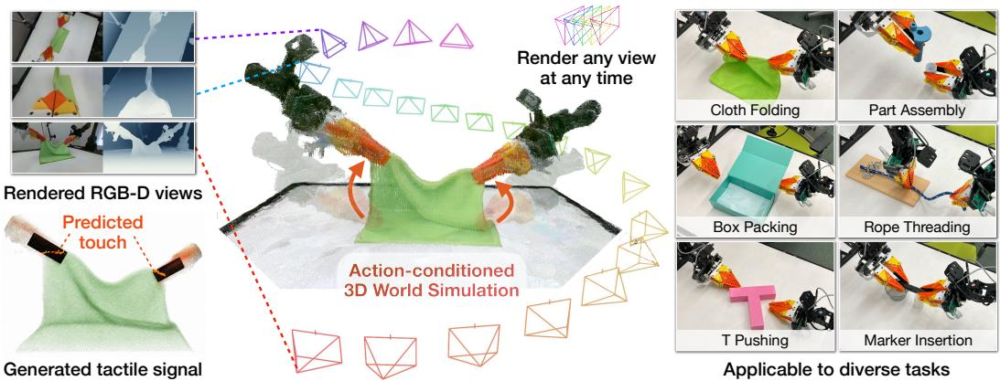  
Figure 1: Overview of 3D World Simulator. We introduce an action-conditioned, multimodal 3D world modeling framework that operates in a unified 3D representation space, jointly predicting 3D geometry (middle), multi-view consistent RGB and depth from novel views (upper left), and spatially aligned tactile signals (bottom left). 3D World Simulator is applicable to a diverse set of tasks, supporting interactive, long horizon data generation at 50 Hz for policy training and evaluation. Project Page: https://jwang771.github. io/3dworldsimulator/.

## ABSTRACT

Predicting how the world evolves in response to robot actions is central to policy learning, evaluation, and planning. However, many action-conditioned world models predict future observations in 2D image or video space without explicitly modeling the underlying 3D scene, making spatial consistency across viewpoints and over long-horizon interactions challenging. We introduce 3D World Simulator, an action-conditioned multimodal world modeling framework that jointly predicts appearance, geometry, and tactile observations from a unified 3D representation. Our approach combines a hybrid particle-voxel autoencoder that compresses point clouds into compact 3D voxel latents with an action-conditioned latent dynamics model that predicts their evolution. The shared 3D representation supports geometrically consistent rendering from arbitrary viewpoints and flexible integration of spatially aligned tactile signals. Our experiments demonstrate interactive, long-horizon, multimodal prediction at 50 Hz. We then show how our model enables scalable data generation for policy training and evaluation using tactile and multi-view visual observations, including wrist-mounted and novel camera views. Furthermore, we scale our method to large datasets containing diverse objects and demonstrate model-based planning with unseen objects and robot configurations. Together, these results highlight the potential of hybrid particle-voxel dynamics as a foundation for multimodal 3D world simulation.

## 1 INTRODUCTION

Predicting how the 3D world evolves in response to interaction is a fundamental capability for intelligent robotic systems, with applications to data generation for policy training (Wang et al., 2026), policy evaluation (Guo et al., 2026b), model-based planning (Huang et al., 2026b), and as backbones for world-action modeling (NVIDIA et al., 2025). Existing action-conditioned world model are predominantly built using 2D video generation backbones. While able to produce photorealistic predictions, these models do not explicitly represent the underlying 3D scene, making it difficult to maintain spatial consistency across viewpoints and to model the precise spatial relationship between contact and geometry. Prior work has explored using 3D representations (Huang et al., 2026b; Zhang et al., 2024b), but these methods typically rely on strong structural assumptions, such as object-specific state representations or explicit correspondences, that can be unreliable in complex interactions and limit broader applicability.

In this work, we present 3D World Simulator, an action-conditioned multimodal world modeling framework that predicts in a unified 3D representation space, providing a common interface capable of generating 3D particles, spatially aligned tactile signals, and multi-view consistent renderings from novel viewpoints. Our model supports interactive, long horizon, multimodal 3D video prediction at 50 Hz, and generalizes to diverse objects and environments when trained at scale.

3D World Simulator consists of two technical components. (1) Hybrid particle-voxel autoencoder. The encoder takes point clouds obtained directly from RGB-D video and compresses them into a compact 3D voxel latent. The decoder progressively upsamples this latent into higher-resolution voxels and then dense 3D particles in a coarse-to-fine manner. Each particle parameterizes a 3D Gaussian that can be rasterized from arbitrary viewpoints (Kerbl et al., 2023), while tactile signals are represented directly as 3D particles within the same output space (Huang et al., 2024; 2025a). (2) 3D latent dynamics model. We learn an action-conditioned dynamics model that predicts the next 3D voxel latent directly. Because this latent encodes the scene as a whole, the dynamics model does not rely on object-specific state representations or explicit correspondences.

A key advantage of our inherently 3D world model is that a single predicted scene state creates a common interface for multiple concurrent capabilities. Since appearance is grounded in a shared 3D Gaussian representation, our model can (1) produce geometrically and multi-view consistent renderings, including from novel and dynamic wrist-mounted camera viewpoints. The same spatial representation provides a (2) flexible and principled way of incorporating multimodal signals. Tactile predictions can be represented directly as 3D particles, remaining geometrically aligned with contacted surfaces. The shared 3D representation also makes our predictions (3) composable with existing 3D assets, including various static backgrounds, objects, and kinematic robot models, enabling additional controllability over the simulated observations from our model.

The 3D World Simulator enables several important downstream applications. We demonstrate interactive, long-horizon, multimodal 3D video prediction across a diverse set of six tasks involving rigid, articulated, and deformable objects, outperforming state of the art 2D video and 3D baselines. Next, 3D World Simulator enables policy training and evaluation, generating synthetic data to train imitation learning policies that rely on visuo-tactile observations, as well as multi-view observations including novel and wrist-mounted camera views. Our model can further be used to evaluate policies, demonstrating strong correlation with real evaluations. Furthermore, 3D World Simulator is scalable to diverse objects. We train 3D World Simulator on the large-scale Deform360 (Li et al., 2026a) dataset, a large-scale multi-view visuo-tactile dataset. Our method outperforms state-of-theart 3D baselines and can be used for zero-shot model-based planning on unseen objects and robot arms.

In summary, our main contributions are: (1) 3D World Simulator, a general action-conditioned multimodal world modeling framework for interactive, long horizon 3D video prediction, (2) hybrid particle-voxel dynamics in a unified 3D representation space, enabling view consistency and flexible integration of multimodal signals, and (3) a unified model that enables a range of applications, including policy training, policy evaluation, and planning.

## 2 RELATED WORKS

2D Action-Conditioned Video Model. Existing 2D action-conditioned video models can predict photorealistic futures (Yang et al., 2023; NVIDIA et al., 2025; Wu et al., 2024b; Jiang et al., 2025b; Agarwal et al., 2026; Liao et al., 2026). They have shown promising results in robotic manipulation applications such as data generation (Wang et al., 2026; Gao et al., 2026), policy evaluation (Guo et al., 2026b; Quevedo et al., 2026; Li et al., 2026b; Huang et al., 2025b; Team et al., 2025), plan ning Zhou et al. (2024); Liang et al. (2024); Chen et al. (2025); Hafner et al. (2025a;b); Du et al. (2023); Assran et al. (2025), action prediction (Cheang et al., 2024; Jang et al., 2025; Hu et al., 2025; Guo et al., 2024; Wu et al., 2024a; Bharadhwaj et al., 2025), policy steering Wu et al. (2025); Jain et al. (2026), and policy improvement (Yin et al., 2026; Guo et al., 2026a). However, they do not explicitly represent the 3D world, making it difficult to enforce spatial consistency and model complicated object interactions. Among these works, Interactive World Simulator is the most closely related to ours Wang et al. (2026). The authors introduce a task-specific 2D action-conditioned video model that supports interactive, stable, and physically plausible long-horizon simulation. However, it predicts in purely pixel space, making prediction from arbitrary viewpoints and spatial consis tency challenging. In contrast, our 3D World Simulator explicitly represents the underlying 3D scene, supporting spatially consistent predictions from novel viewpoint. We show that our model can also accurately model challenging object interactions, including cloth folding and part assembly.

3D Dynamics Models. Many prior works explore modeling object dynamics in the 3D world using various 3D representations, including point cloud (Huang et al., 2026b;a; Bauer et al., 2024), sparse particles (Zhang et al., 2025; Whitney et al., 2024; Huang et al., 2025c; Zhang et al., 2024a; Jiang et al., 2025a; Li et al., 2018), neural radiance fields (Driess et al., 2023), 3D Gaussians (Zhang et al., 2024b; Xie et al., 2024; Shao et al., 2025; Abou-Chakra et al., 2024; Zhang et al., 2024c; Lu et al., 2024; 2025), and 3D mesh (Pfaff et al., 2020). Some of them focus on learning dynamics of specific types of objects, such as elastoplastic objects (Bauer et al., 2024; Shi et al., 2023; 2024), cloth (Lin et al., 2022), fluid (Sanchez-Gonzalez et al., 2020). Among these works, PointWorld and PGND are the closest to ours (Huang et al., 2026b; Zhang et al., 2025). Both train 3D world models in point or particle space and show spatially consistent and physically plausible results. However, both use point tracking to provide training supervision. In contrast, our model does not require point-tracking supervision and is transferable across diverse scenes. In addition, they do not focus on photorealistic 2D image rendering, which is essential for visuomotor policy training and evaluation. Instead, our model supports photorealistic 2D rendering from novel viewpoint, including fixed external cameras and moving wrist cameras, enabling scalable data generation and visuomotor policy evaluation.

Multimodal World Models. Researchers have explored how to incorporate tactile sensing into world models by predicting 2D tactile images alongside 2D visual images (Higuera et al., 2026; Zhang et al., 2026; Huang et al., 2026c; Ma et al., 2026; Wu et al., 2026b; Tian et al., 2019; Lou et al., 2026; Ye et al., 2025; Zang et al., 2026; Yuan et al., 2026; Wu et al., 2026a). In contrast, our model predicts in 3D space with spatial consistency. A closely related work, RoboPack, also models tactile sensing and object interaction dynamics in 3D space to accomplish challenging dense packing tasks (Ai et al., 2024). However, its dynamics model mainly focuses on dense packing tasks and predicts over relatively short horizons.

## 3 METHOD

In this section, we first describe our problem formulation in Section 3.1. Then we will describe how we train our hybrid particle-voxel autoencoder and 3D latent dynamics model respectively in Section 3.2 and Section 3.3. Lastly, we describe how we rollout autoregressively during the inference time in Section 3.5

## 3.1 PROBLEM FORMULATION

We denote the input point clouds at time t as $P _ { t } \in \mathbb { R } ^ { 7 \times n }$ , containing n visual and, when available, tactile points. Each point contains its 3D world coordinates, RGB appearance, and an additional channel reserved for tactile information. Our experiments use the FlexiTac Huang & Li (2026); Huang et al. (2024) tactile sensor, but our method is compatible with various types of sensors. Our goal is to build a model that takes in history point clouds $P _ { t - H : }$ and action $a _ { t }$ to predict next $\hat { P } _ { t + 1 }$ minimizing the difference with ground truth $P _ { t + 1 }$

Our model consists of two parts: a hybrid particle-voxel autoencoder and a 3D latent dynamics model. For the autoencoder, the encoder $E _ { \theta }$ compresses the point cloud $P _ { t }$ into a compact latent $z _ { t } .$ from which a decoder $D _ { \psi }$ then reconstructs the point cloud. To model the dynamics, our 3D latent dynamics model $F _ { \phi }$ takes in latent $z _ { t } ,$ , last H history latents $z _ { t - H : t - 1 }$ , as well as the robot action $a _ { t }$ and then predicts $\hat { z } _ { t + 1 } = F _ { \phi } ( z _ { t - H : t } , a _ { t } )$ .

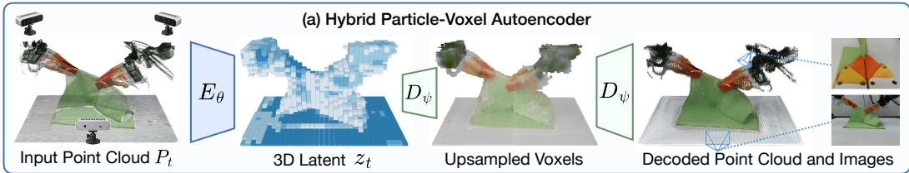

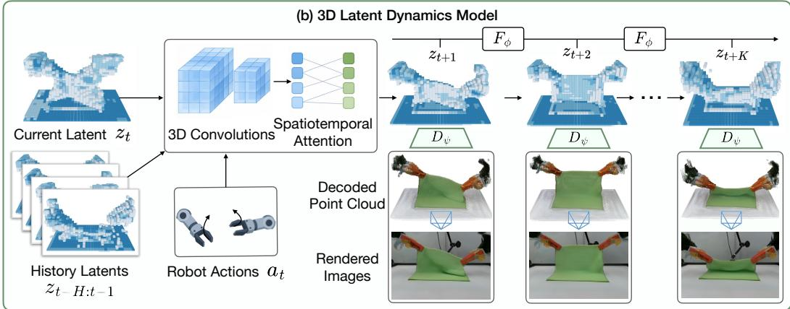  
Figure 2: Overview of Model Architecture. (a) We introduce a hybrid particle-voxel autoencoder that compresses an input point cloud into a compact 3D voxel latent. This voxel latent is progressively upsampled into finer voxels, which are then upsampled into dense visual particles and optional tactile particles. Each visual particle is attached to Gaussian parameters that can be rendered at novel viewpoints. (b) Our 3D latent dynamics model then directly operates on voxel latents produced by the autoencoder. Given robot actions, history latents, and a current latent observation, the dynamics model uses 3D convolutions and spatiotemporal attention to autoregressively predict future voxel latents during open-loop rollouts. These latents can then be decoded into point clouds, multi-view renders, and tactile observations.

## 3.2 HYBRID VOXEL–PARTICLE AUTOENCODER

Sparse voxel encoder. We first voxelize the input point cloud $P _ { t }$ onto a sparse 3D voxel grid. We aggregate points by averaging the features of points that fall within each occupied voxel, producing features only at occupied voxel locations. The encoder $E _ { \theta }$ then applies strided sparse 3D convolutions (Graham et al., 2018) to progressively downsample the voxel input into a compact latent $z _ { t } ,$ avoiding unnecessary computation over empty space. We unit-normalize each latent voxel along the channel dimension before passing the representation to the decoder or latent dynamics model.

Coarse-to-fine particle-voxel decoder. As shown in part (a) of Figure 2, the decoder $D _ { \psi }$ reconstructs the scene from $z _ { t }$ in two stages, upsampling coarse voxels to dense particles.

(i) Voxel Upsampling: the decoder progressively upsamples $z _ { t }$ using transposed 3D convolutions until reaching the desired voxel resolution. At each resolution, the decoder predicts scene occupancy, providing progressively finer estimates of the scene structure at each layer.

(ii) Particle Upsampling: to obtain dense 3D particle prediction, we use a lightweight MLP to predict continuous particle positions given each occupied voxel. Each resulting particle predicts its 3D position and the parameters of a 3D Gaussian, including color, scale, rotation, and opacity, enabling rendering from arbitrary viewpoints.

Training Objective. We train the voxel-particle autoencoder end-to-end using the following loss: $\mathcal { L } _ { \mathrm { { A E } } } = \mathcal { L } _ { \mathrm { v o x e l } } + \mathcal { L } _ { \mathrm { p a r t i c l e } } + \mathcal { L } _ { \mathrm { { r e n d e r } } } + \mathcal { L } _ { \mathrm { c o n s } } .$

(i) Voxel loss $\mathcal { L } _ { \mathrm { v o x e l } }$ . To reconstruct the 3D occupancy, we compare predicted voxel occupancy at each decoder resolution level with the ground truth occupancy and sum the loss across all levels.

(ii) Particle loss $\mathcal { L } _ { \mathrm { { p a r t i c l e } } }$ . To reconstruct accurate particle geometry, we measure the Chamfer distance (CD) (Fan et al., 2017) between predicted particles and ground truth points. Particle color and tactile values are additionally supervised using $\ell _ { 1 }$ error on the matched points.

(iii) Render loss $\mathcal { L } _ { \mathrm { r e n d e r } }$ . Given the predicted 3D Gaussians, we render RGB-D images from the training camera viewpoints and supervise them using a combination of $\ell _ { 1 }$ , SSIM (Wang et al., 2004), and LPIPS (Zhang et al., 2018) losses on RGB and an $\ell _ { 1 }$ loss on valid depth pixels.

(iv) Consistency regularization ${ \mathcal { L } } _ { \mathrm { c o n s } }$ . Different subsamples of the same observation can produce inconsistent latent encodings. We therefore encode two independently subsampled point clouds and penalize the $\ell _ { 2 }$ difference between their latent representations.

## 3.3 3D LATENT DYNAMICS MODEL

After training the particle-voxel autoencoder, we learn an action-conditioned dynamics model $F _ { \phi }$ over its 3D latent representation. As shown in part (b) of Figure 2, at time t, given an input latent $z _ { t } ,$ a history with H previous latents $z _ { t - H : t - 1 }$ , as well as a corresponding robot action $a _ { t } ,$ the model approximates the next latent state $z _ { t + 1 }$ by predicting $\hat { z } _ { t + 1 } = F _ { \phi } \big ( z _ { t - H : t } , a _ { t } \big )$ . The predicted latent can then be decoded into 3D geometry, multi-view visual observations, and tactile signals.

We instantiate our dynamics model as a 3D U-Net (C¸ ic¸ek et al., 2016). We first downsample input latent voxels with 3D convolutional layers and then apply interleaved spatial attention and causal temporal attention (Vaswani et al., 2017; Bertasius et al., 2021). Lastly, the decoder upsamples the predicted latent voxels back to the input latent resolution.

Training Objective. To improve long-horizon inference stability, we predict K−step latents $\hat { z } _ { t + 1 : t + k }$ autoregressively during training and supervise latent predictions using a discounted loss,

$$
\mathcal { L } _ { \mathrm { d y n } } = \frac { 1 } { K } \sum _ { k = 1 } ^ { K } \gamma ^ { k - 1 } | | \hat { z } _ { t + k } - z _ { t + k } | | _ { 2 } ^ { 2 } ,\tag{1}
$$

where $\gamma$ is the discount factor. For stable training, we use a curriculum that gradually increases K during training, similar in spirit to scheduled sampling (Bengio et al., 2015). To further improve the long-horizon inference stability, we add randomly sampled Gaussian noise to each history latent during training. More details of model and training specifications are in Appendix B.

The hybrid particle-voxel autoencoder and 3D latent dynamics model takes around 16 hours each on an RTX 5090 GPU.

## 3.4 UNIFIED COMPOSITION OF SIMULATION ”BACKBONES”

While our model is limited to a specific workspace, to enable larger scale scene simulation, our model can be composed with various 3D Gaussian assets. By composing the raw autoencoder output with diverse static background made up of 3D Gaussians, we can further simulate various types of scenes. We can further utilize kinematic 3D Gaussian robot models to allow for more complete scene simulation, as robot arms may fall outside the specificied workspace. Although our mode does not natively depend on object-specific representations, it can be finetuned to output labels to separate specific scene components like the robot arm, object, and table. Given this separability, we can further insert different robot arms and kinematic models not seen during training, as well as diverse backgrounds.

## 3.5 INFERENCE

At inference time, we roll out the world model autoregressively in open loop. Starting from an initial encoded 3D latent $z _ { 1 }$ , the dynamics model predicts the next 3D latent conditioned on the robot action, and each predicted latent is fed back as input for subsequent steps. Each predicted latent can be decoded into visual and tactile point clouds, as well as 3D Gaussians that can be rendered from arbitrary viewpoints. To render wrist camera views during open-loop rollouts, we fine-tune a prediction head on the decoder.

Step 0  
Step 100  
Ours  
GT  
4DGen  
IWS  
Cosmos  
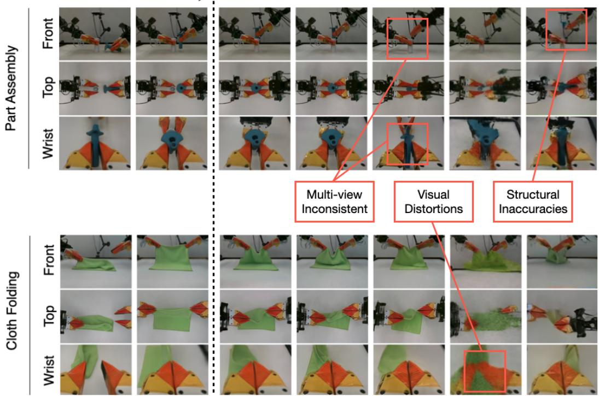  
Figure 3: Qualitative comparison of open-loop multi-view predictions. (Left) Visualization of 3D World Simulator multi-view renders from open-loop rollouts on the Part Assembly and Cloth Folding task. Our model maintains multi-view consistent predictions with strong visual fidelity. (Right) Comparison between our method and baselines on frame 200 of an open-loop rollout. Other baselines display inconsistent predictions between viewpoints, visual distortions, and object and robot structural inaccuracies.

Step 0  
Step 100  
Ours  
GT  
4DGen  
IWS  
Cosmos  
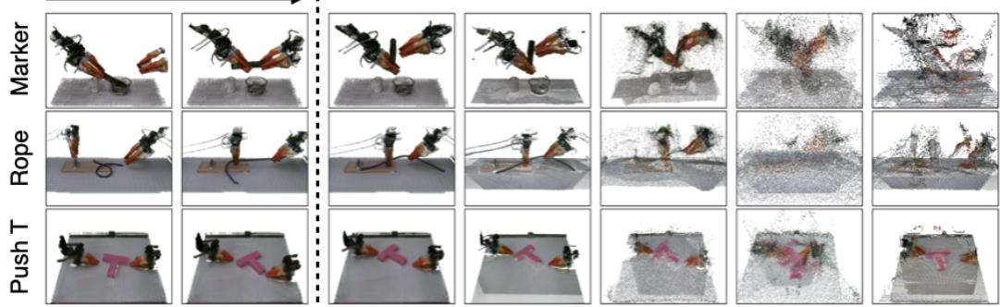  
Figure 4: Qualitative comparison of open-loop point cloud predictions. (Left) Open-loop rollout point cloud visualizations for our method on the Marker Insertion, Rope Threading, and T Pushing task. (Right) Our method maintains consistent point clouds close to ground truth, while other video based methods show misaligned and inaccurate point clouds.

## 4 EXPERIMENTS

Through our experiments, we aim to address three questions: (1) How does the 3D World Simulator compare to baselines in terms of long-horizon prediction of 3D geometry, multi-view consistent renders and tactile signals? (2) Can the 3D World Simulator be used to train and evaluate imitation learning policies, especially those that utilize wrist-mounted cameras, tactile signals, or multi-view observations? (3) Can the 3D World Simulator scale from individual tasks to diverse objects and

Final image

GT

Ours

ParticleFormer

PGND

Initial image  
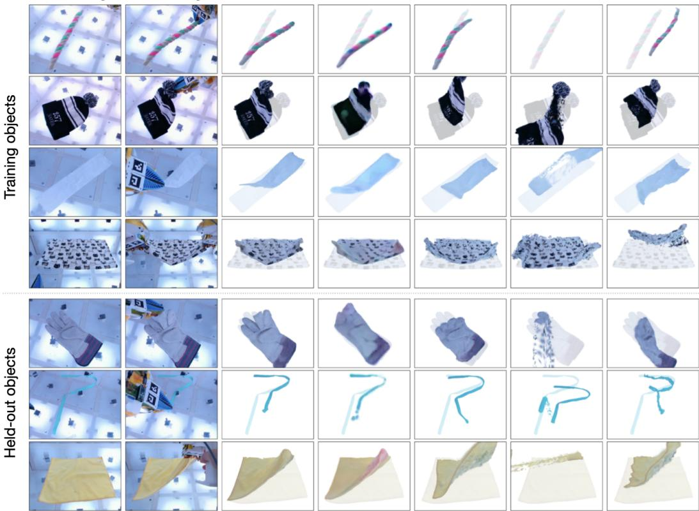  
Figure 5: Qualitative Comparison on Deform360. The left two columns show the starting and end position for each object, while the right columns show rendered Gaussians produced by each method. On both objects seen during training and objects not seen during training, our method has better visually matching geometry compared to baseline methods.

interactions when trained on large-scale data, and be used for downstream planning with unseen objects and robot arms?

## 4.1 EXPERIMENT SETUP

ALOHA Task Setup. We conduct data collection and experimentation using an ALOHA Bimanual Robot (Zhao et al., 2023), paired with FlexiTac (Huang & Li, 2026) tactile sensors on each fingertip. We include six tasks that cover manipulation of deformable, rigid, and articulated objects: Part Assembly, Cloth Folding, T Pushing, Box Packing, Rope Threading, and Marker Insertion. Detailed descriptions and visualizations of each task setup can be found in Appendix C. We collect data via a combination of kinematic devices and keyboard inputs to teleoperate the robot, resulting in around 200 episodes and 2 hours of data for each task.

Deform360 Dataset. To investigate the scalability of 3D World Simulator, we utilize Deform 360 (Li et al., 2026a), a visuo-tactile dataset featuring 198 daily-life objects, 1,980 interaction sequences, and over 215 hours of observations from 41 surround-view cameras and bimanual tactile grippers. Since Deform360 only provides object-centric depth information, we train our world model purely on the object particles unlike the ALOHA setup where we reconstruct the robot and environment surroundings.

## 4.2 2D VIDEO PREDICTION AND 3D PARTICLE BASELINE COMPARISONS

Baselines and Metrics. Across the six ALOHA tasks in Section 4.1, we evaluate 3D World Simulator against both 2D Video Prediction and 3D Particle Baselines on metrics across pixel reconstruction (PSNR and LPIPS), depth prediction (Abs Rel, δ < 1.25 (Eigen et al., 2014)), point cloud reconstruction (Chamfer distance on scene and object points), and tactile signal prediction metrics (L1). We evaluate long horizon prediction by averaging metrics across an open-loop rollout of 200 frames. On the Deform360 dataset, we only compare to 3D particle baselines since per-view scene depth is not contained in the dataset.

<table><tr><td></td><td></td><td colspan="2">Image</td><td colspan="2">Depth</td><td colspan="2">Geometry</td><td>Tactile</td></tr><tr><td></td><td>Method</td><td>PSNR ↑</td><td>LPIPS ↓</td><td>Abs Rel ↓</td><td>δ &lt; 1.25 ↑</td><td>CD↓</td><td>Obj. CD ↓</td><td>L1↓</td></tr><tr><td>Video</td><td>Cosmos</td><td>18.51</td><td>0.441</td><td>0.147</td><td>0.833</td><td>12.43</td><td>16.64</td><td>0.135</td></tr><tr><td></td><td>Robot4DGen</td><td>20.59</td><td>0.340</td><td>0.172</td><td>0.790</td><td>10.43</td><td>15.97</td><td>0.128</td></tr><tr><td></td><td>IWS</td><td>12.59</td><td>0.562</td><td>0.163</td><td>0.791</td><td>10.81</td><td>17.69</td><td>0.207</td></tr><tr><td></td><td>PGND</td><td>一</td><td>一</td><td></td><td>一</td><td>17.11</td><td>25.48</td><td>0.208</td></tr><tr><td>Partticde</td><td>PointWorld</td><td>一</td><td>一</td><td></td><td></td><td>15.32</td><td>21.74</td><td>0.148</td></tr><tr><td></td><td>ParticleFormer</td><td>一</td><td></td><td></td><td></td><td>13.78</td><td>20.23</td><td>0.151</td></tr><tr><td></td><td>Ours</td><td>23.24</td><td>0.240</td><td>0.097</td><td>0.913</td><td>7.72</td><td>11.52</td><td>0.081</td></tr></table>

Table 1: Quantitative Comparison on ALOHA tasks The 3D World Simulator outperforms both 2D video and 3D particle baselines in terms of visual, depth, geometry, and tactile metrics. Results are averaged over 6 tasks and averaged over a horizon of 200 steps. While using explicit 3D, particle baselines degrade over long horizons, particularly around occlusions.  
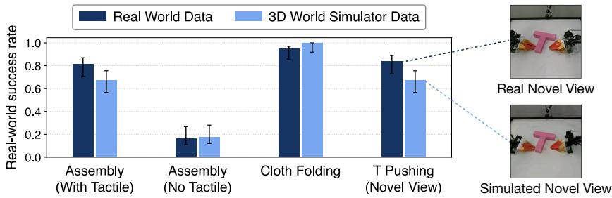  
Figure 6: Policy Training on 3D World Simulator and Real World Data. Imitation learning policies trained using purely 3D World Simulator generated data show comparable performance to policies trained using real world data, across visuo-tactile, multi-view, and novel view observations generated by our model.

For representative 2D video prediction baselines, we include Robot4DGen (Liu et al., 2026), Cosmos (NVIDIA et al., 2025), and Interactive World Simulator (IWS) (Wang et al., 2026). For representative 3D particle baselines, we include ParticleFormer (Huang et al., 2025c), PointWorld (Huang et al., 2026b), and Particle-Grid Neural Dynamics (PGND) (Zhang et al., 2025).

ALOHA Task Results. Quantitative results in Table 1 show that 3D World Simulator outperforms all 2D and 3D baselines across all metrics, including pixel reconstruction, depth prediction, point cloud reconstruction, and tactile signal prediction. Qualitative results in Figure 3 show that 3D World Simulator produces multi-view consistent renders over long horizons, while other 2D video prediction baselines show inconsistency between views, inaccurate dynamics, and accumulated artifacts. Qualitative point cloud reconstructions in Figure 4 show that baseline predictions yield inconsistent point clouds.

Deform360 Results. Table 2 shows that 3D World Simulator outperforms 3D particle baselines in terms of image and geometry metrics on objects seen during training. On objects held-out during training, 3D World Simulator produces better geometric predictions but has worse results on image metrics. This discrepancy can be explained by the fact that the particle baselines output point tracks on prefitted Gaussian Splats, while ours generates appearance from scratch. Qualitative results on the Deform360 dataset in Figure 5 show that our method is able to generate realistic dynamics and appearance on both seen object and held-out during training.

## 4.3 DATA GENERATION FOR POLICY TRAINING

We further evaluate whether 3D World Simulator can act as a scalable data generator, particularly for policies that rely on wrist-mounted cameras, tactile signals, or novel views not captured by the cameras during data collection. We evaluate four imitation learning policies: ACT (Zhao et al., 2023), Diffusion Policy (DP) (Chi et al., 2023), $\pi _ { 0 . 5 }$ (Black et al., 2025), and Cosmos Policy (Kim et al., 2026). We consider three tasks: Part Assembly, Cloth Folding, and T-Pushing. For each task, we collect 100 demonstrations in the real world and in 3D World Simulator as well. We report the mean success rate across the four policy architectures. Detailed descriptions, visualizations, and evaluation criteria are described in Appendix D. Each task isolates a different capability of the sim ulator. Part Assembly evaluates visuo-tactile policy training, T-Pushing evaluates policy learning from novel viewpoints, and Cloth Folding evaluates multi-view consistency using front and wristmounted camera observations. As shown in Figure 6, Part Assembly policies trained on simulated visuo-tactile data achieve performance comparable to those trained on real data and substantially outperform vision-only policies trained on real data, showing the utility of tactile signals generated by our model. Furthermore, Cloth Folding and T-Pushing results indicate the utility of our simulato for multi-view and novel view observations.

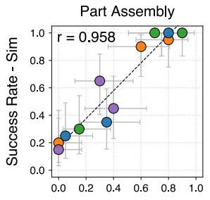

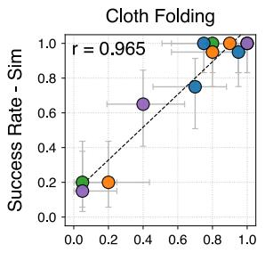

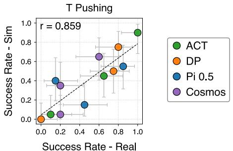

Figure 7: Correlation between simulation and real-world policy performance. Policies evaluated in 3D World Simulator and the real world show strong correlation across all three tasks.  
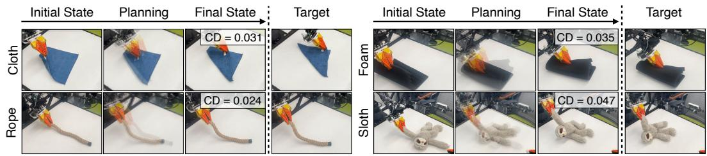  
Figure 8: Model-based planning on unseen objects in the real world. Utilizing the pre-trained 3D World Simulator on Deform360, our model generalizes to downstream model-based planning on four unseen objects and an unseen ALOHA robot arm.

## 4.4 FAITHFUL POLICY EVALUATION

To evaluate whether 3D World Simulator can serve as a faithful proxy for real-world policy evaluation, we examine whether imitation policies show positive correlation when evaluated within our simulator and the real world. We train four imitation learning policies: ACT, DP, $\pi _ { 0 . 5 } ,$ , and Cosmos Policy, and we utilize the same three tasks from policy training in Section 4.3, Part Assembly, Cloth Folding, and T-Pushing. We sample 20 initial configurations for each task. Figure 7 shows that across all three tasks and four policies, real-world policy performance is highly correlated with performance in the 3D World Simulator. The x-axis denotes the real-world success rate while the y-axis denotes the success rate within the world simulator. Each point corresponds to a policy checkpoint at a different training step, while colors denote the policy architecture. Error bars are indicated through Clopper-Pearson confidence intervals, obtained through 20 evaluations per policy both in simulation and the real world.

## 4.5 MODEL-BASED PLANNING ON UNSEEN OBJECTS

We utilize our pre-trained model on the large-scale Deform360 dataset for downstream model-based planning. We utilize an unseen ALOHA single-arm setup with four unseen objects: cloth, rope, foam, and sloth. We utilize Model Predictive Control, using an off-the-shelf implementation of MPPI (Williams et al., 2017) from PGND (Zhang et al., 2025). Figure 8 shows qualitatively and quantitatively that our pre-trained 3D World Simulator can achieve zero-shot planning results.

## 5 CONCLUSION

In this work, we introduced 3D World Simulator, an action-conditioned multimodal world modeling framework that predicts in a unified 3D representation space, creating a common interface to generate 3D particles, multi-view consistent rendered RGB, and tactile predictions. Our unified model enables a range of applications. 3D World Simulator enables the generation of policy training data for visuo-tactile policies, as well as policies that rely on multi-view, novel view, and wrist-mounted camera view observations. We can further evaluate these policies using our model, demonstrating strong correlation between simulation and real world rollouts. When scaled to large scale datasets, 3D World Simulator enables downstream model-based planning on unseen objects and robot configurations. In future work, we plan to extend 3D World Simulator to more diverse and challenging environments, extending its general applicability. Additionally, we further aim to extend 3D World Simulator to larger scale scenes involving multi-room environments and mobile manipulation, enabling increased real world applications.

## ACKNOWLEDGEMENT

This work was partially supported by Analog Devices, the Toyota Research Institute, and NSF Award #2409661. This article solely reflects the opinions and conclusions of its authors and should not be interpreted as necessarily representing the official policies, either expressed or implied, of the sponsors.

## REFERENCES

Jad Abou-Chakra, Krishan Rana, Feras Dayoub, and Niko Suenderhauf. Physically embodied gaussian splatting: A visually learnt and physically grounded 3d representation for robotics. In 8th Annual Conference on Robot Learning, 2024.

Niket Agarwal, Arslan Ali, Jon Allen, Martin Antolini, Adeline Aubame, Alisson Azzolini, Junjie Bai, Maciej Bala, Yogesh Balaji, Josh Bapst, et al. Cosmos 3: Omnimodal world models for physical ai. arXiv preprint arXiv:2606.02800, 2026.

Bo Ai, Stephen Tian, Haochen Shi, Yixuan Wang, Cheston Tan, Yunzhu Li, and Jiajun Wu. Robopack: Learning tactile-informed dynamics models for dense packing. arXiv preprint arXiv:2407.01418, 2024.

Mido Assran, Adrien Bardes, David Fan, Quentin Garrido, Russell Howes, Matthew Muckley, Ammar Rizvi, Claire Roberts, Koustuv Sinha, Artem Zholus, et al. V-jepa 2: Self-supervised video models enable understanding, prediction and planning. arXiv preprint arXiv:2506.09985, 2025.

Dominik Bauer, Zhenjia Xu, and Shuran Song. Doughnet: A visual predictive model for topological manipulation of deformable objects. In European Conference on Computer Vision, pp. 92–108. Springer, 2024.

Samy Bengio, Oriol Vinyals, Navdeep Jaitly, and Noam Shazeer. Scheduled sampling for sequence prediction with recurrent neural networks. In Advances in Neural Information Processing Systems, volume 28, pp. 1171–1179, 2015.

Gedas Bertasius, Heng Wang, and Lorenzo Torresani. Is space-time attention all you need for video understanding? In Proceedings of the 38th International Conference on Machine Learning, pp. 813–824, 2021.

Homanga Bharadhwaj, Debidatta Dwibedi, Abhinav Gupta, Shubham Tulsiani, Carl Doersch, Ted Xiao, Dhruv Shah, Fei Xia, Dorsa Sadigh, and Sean Kirmani. Gen2act: Human video generation in novel scenarios enables generalizable robot manipulation. In 9th Annual Conference on Robot Learning, 2025. URL https://openreview.net/forum?id=HprBJupvvM.

Kevin Black, Noah Brown, James Darpinian, Karan Dhabalia, Danny Driess, Adnan Esmail, Michael Robert Equi, Chelsea Finn, Niccolo Fusai, Manuel Y. Galliker, Dibya Ghosh, Lachy Groom, Karol Hausman, Brian Ichter, Szymon Jakubczak, Tim Jones, Liyiming Ke, Devin LeBlanc, Sergey Levine, Adrian Li-Bell, Mohith Mothukuri, Suraj Nair, Karl Pertsch, Allen Z.

Ren, Lucy Xiaoyang Shi, Laura Smith, Jost Tobias Springenberg, Kyle Stachowicz, James Tanner, Quan Vuong, Homer Walke, Anna Walling, Haohuan Wang, Lili Yu, and Ury Zhilinsky. π : A vision-language-action model with open-world generalization. In Proceedings ofThe 9th Conference on Robot Learning (CoRL), volume 305, pp. 17–40, 2025.

Chi-Lam Cheang, Guangzeng Chen, Ya Jing, Tao Kong, Hang Li, Yifeng Li, Yuxiao Liu, Hongtao Wu, Jiafeng Xu, Yichu Yang, et al. Gr-2: A generative video-language-action model with webscale knowledge for robot manipulation. arXiv preprint arXiv:2410.06158, 2024.

Boyuan Chen, Tianyuan Zhang, Haoran Geng, Caiyi Zhang, Peihao Li, Kiwhan Song, William T Freeman, Jitendra Malik, Pieter Abbeel, Russ Tedrake, et al. Large video planner enables generalizable robot control. arXiv preprint arXiv:2512.15840, 2025.

Cheng Chi, Siyuan Feng, Yilun Du, Zhenjia Xu, Eric Cousineau, Benjamin C. M. Burchfiel, and Shuran Song. Diffusion policy: Visuomotor policy learning via action diffusion. In Proceedings ofRobotics: Science and Systems (RSS), 2023.

Ozg¨ un C¸ ic¸ek, Ahmed Abdulkadir, Soeren S. Lienkamp, Thomas Brox, and Olaf Ronneberger. 3d¨ u-net: Learning dense volumetric segmentation from sparse annotation. In Medical Image Computing and Computer-Assisted Intervention (MICCAI), pp. 424–432, 2016.

Danny Driess, Zhiao Huang, Yunzhu Li, Russ Tedrake, and Marc Toussaint. Learning multi-object dynamics with compositional neural radiance fields. In Conference on robot learning, pp. 1755– 1768. PMLR, 2023.

Yilun Du, Sherry Yang, Bo Dai, Hanjun Dai, Ofir Nachum, Josh Tenenbaum, Dale Schuurmans, and Pieter Abbeel. Learning universal policies via text-guided video generation. Advances in neural information processing systems, 36:9156–9172, 2023.

David Eigen, Christian Puhrsch, and Rob Fergus. Depth map prediction from a single image using a multi-scale deep network. In Advances in Neural Information Processing Systems, volume 27, pp. 2366–2374, 2014.

Haoqiang Fan, Hao Su, and Leonidas J. Guibas. A point set generation network for 3d object reconstruction from a single image. In Proceedings of the IEEE Conference on Computer Vision and Pattern Recognition (CVPR), 2017.

Shenyuan Gao, William Liang, Kaiyuan Zheng, Ayaan Malik, Seonghyeon Ye, Sihyun Yu, Wei-Cheng Tseng, Yuzhu Dong, Kaichun Mo, Chen-Hsuan Lin, et al. Dreamdojo: A generalist robot world model from large-scale human videos. arXiv preprint arXiv:2602.06949, 2026.

Benjamin Graham, Martin Engelcke, and Laurens van der Maaten. 3d semantic segmentation with submanifold sparse convolutional networks. In Proceedings of the IEEE Conference on Computer Vision and Pattern Recognition (CVPR), pp. 9224–9232, 2018.

Yanjiang Guo, Yucheng Hu, Jianke Zhang, Yen-Jen Wang, Xiaoyu Chen, Chaochao Lu, and Jianyu Chen. Prediction with action: Visual policy learning via joint denoising process. Advances in Neural Information Processing Systems, 37:112386–112410, 2024.

Yanjiang Guo, Tony Lee, Lucy Xiaoyang Shi, Jianyu Chen, Percy Liang, and Chelsea Finn. VLAW: Iterative co-improvement of vision-language-action policy and world model. In Forty-third International Conference on Machine Learning, 2026a. URL https://openreview.net/ forum?id=68zOaa2gOf.

Yanjiang Guo, Lucy Shi, Jianyu Chen, and Chelsea Finn. Ctrl-world: A controllable generative world model for robot manipulation. In International Conference on Learning Representations, volume 2026, pp. 6121–6138, 2026b.

Danijar Hafner, Jurgis Pasukonis, Jimmy Ba, and Timothy Lillicrap. Mastering diverse control tasks through world models. Nature, 640(8059):647–653, 2025a.

Danijar Hafner, Wilson Yan, and Timothy Lillicrap. Training agents inside of scalable world models. arXiv preprint arXiv:2509.24527, 2025b.

Kaiming He, Xiangyu Zhang, Shaoqing Ren, and Jian Sun. Deep residual learning for image recognition. In Proceedings of the IEEE Conference on Computer Vision and Pattern Recognition (CVPR), pp. 770–778, 2016.

Carolina Higuera, Sergio Arnaud, Byron Boots, Mustafa Mukadam, Francois Robert Hogan, and Franziska Meier. Visuo-tactile world models, 2026. URL https://arxiv.org/abs/ 2602.06001.

Edward J. Hu, Yelong Shen, Phillip Wallis, Zeyuan Allen-Zhu, Yuanzhi Li, Shean Wang, Lu Wang, and Weizhu Chen. Lora: Low-rank adaptation of large language models. In International Conference on Learning Representations, 2022.

Yucheng Hu, Yanjiang Guo, Pengchao Wang, Xiaoyu Chen, Yen-Jen Wang, Jianke Zhang, Koushil Sreenath, Chaochao Lu, and Jianyu Chen. Video prediction policy: A generalist robot policy with predictive visual representations. In Forty-second International Conference on Machine Learning, 2025. URL https://openreview.net/forum?id=c0dhw1du33.

Binghao Huang and Yunzhu Li. Flexitac: A low-cost, open-source, scalable tactile sensing solution for robotic systems, 2026. URL https://arxiv.org/abs/2604.28156.

Binghao Huang, Yixuan Wang, Xinyi Yang, Yiyue Luo, and Yunzhu Li. 3d-vitac: Learning finegrained manipulation with visuo-tactile sensing. arXiv preprint arXiv:2410.24091, 2024.

Binghao Huang, Jie Xu, Iretiayo Akinola, Wei Yang, Balakumar Sundaralingam, Rowland O’Flaherty, Dieter Fox, Xiaolong Wang, Arsalan Mousavian, Yu-Wei Chao, et al. Vt-refine: Learning bimanual assembly with visuo-tactile feedback via simulation fine-tuning. arXiv preprint arXiv:2510.14930, 2025a.

Mu Huang, Hui Wang, Kerui Ren, Linning Xu, Yunsong Zhou, Mulin Yu, Bo Dai, and Jiangmiao Pang. Soma: A real-to-sim neural simulator for robotic soft-body manipulation. arXiv preprint arXiv:2602.02402, 2026a.

Siqiao Huang, Jialong Wu, Qixing Zhou, Shangchen Miao, and Mingsheng Long. Vid2world: Crafting video diffusion models to interactive world models. arXiv preprint arXiv:2505.14357, 2025b.

Suning Huang, Qianzhong Chen, Xiaohan Zhang, Jiankai Sun, and Mac Schwager. Particleformer: A 3d point cloud world model for multi-object, multi-material robotic manipulation. In Proceedings of the 9th Conference on Robot Learning, volume 305 of Proceedings of Machine Learning Research, pp. 4941–4957, 2025c.

Wenlong Huang, Yu-Wei Chao, Arsalan Mousavian, Ming-Yu Liu, Dieter Fox, Kaichun Mo, and Fei-Fei Li. Pointworld: Scaling 3d world models for in-the-wild robotic manipulation. In Proceedings of the IEEE/CVF Conference on Computer Vision and Pattern Recognition (CVPR), 2026b.

Yunao Huang, Shiyu Sang, Haotao Lu, Suting Ni, Shijie Wu, Ziyang Guo, Ye Shi, and Jingya Wang. Vitacworld: Scaling visuo-tactile world models for contact-rich robot manipulation. arXiv preprint arXiv:2607.22530, 2026c.

Arnav Kumar Jain, Yilin Wu, Jesse Farebrother, Gokul Swamy, and Andrea Bajcsy. Weaver, better, faster, longer: An effective world model for robotic manipulation. arXiv e-prints, pp. arXiv–2606, 2026.

Joel Jang, Seonghyeon Ye, Zongyu Lin, Jiannan Xiang, Johan Bjorck, Yu Fang, Fengyuan Hu, Spencer Huang, Kaushil Kundalia, Yen-Chen Lin, Lo¨ıc Magne, Ajay Mandlekar, Avnish Narayan, You Liang Tan, Guanzhi Wang, Jing Wang, Qi Wang, Yinzhen Xu, Xiaohui Zeng, Kaiyuan Zheng, Ruijie Zheng, Ming-Yu Liu, Luke Zettlemoyer, Dieter Fox, Jan Kautz, Scott Reed, Yuke Zhu, and Linxi Fan. Dreamgen: Unlocking generalization in robot learning through video world models. In 9th Annual Conference on Robot Learning, 2025. URL https://openreview.net/ forum?id=3CnxNqmklv.

Hanxiao Jiang, Hao-Yu Hsu, Kaifeng Zhang, Hsin-Ni Yu, Shenlong Wang, and Yunzhu Li. Phystwin: Physics-informed reconstruction and simulation of deformable objects from videos. In 2025 IEEE/CVF International Conference on Computer Vision (ICCV), pp. 7219–7230. IEEE, 2025a.

Yuxin Jiang, Shengcong Chen, Siyuan Huang, Liliang Chen, Pengfei Zhou, Yue Liao, Xindong He, Chiming Liu, Hongsheng Li, Maoqing Yao, et al. Enerverse-ac: Envisioning embodied environments with action condition. arXiv preprint arXiv:2505.09723, 2025b.

Nikita Karaev, Ignacio Rocco, Benjamin Graham, Natalia Neverova, Andrea Vedaldi, and Christian Rupprecht. Cotracker: It is better to track together. In European Conference on Computer Vision (ECCV), pp. 18–35, 2024.

Bernhard Kerbl, Georgios Kopanas, Thomas Leimkuhler, and George Drettakis. 3d gaussian splat-¨ ting for real-time radiance field rendering. ACM Transactions on Graphics, 42(4):1–14, 2023.

Moo Jin Kim, Yihuai Gao, Tsung-Yi Lin, Yen-Chen Lin, Yunhao Ge, Grace Lam, Percy Liang, Shuran Song, Ming-Yu Liu, Chelsea Finn, and Jinwei Gu. Cosmos policy: Fine-tuning video models for visuomotor control and planning. In International Conference on Learning Representations, 2026.

Hongyu Li, Wanjia Fu, Xiaoyan Cong, Zekun Li, Binghao Huang, Hanxiao Jiang, Xintong He, Yiqing Liang, Rao Fu, Tao Lu, Srinath Sridhar, Kevin A. Smith, George Konidaris, and Yunzhu Li. Deform360: A massive multi-view visuotactile dataset for deformable world models. In European Conference on Computer Vision (ECCV), 2026a.

Yaxuan Li, Junjie Wen, Zhongyi Zhou, Yefei Chen, Chaomin Shen, Yaxin Peng, and Yichen Zhu. Scaling robot policy evaluation via discrete diffusion world model. In Forty-third International Conference on Machine Learning, 2026b. URL https://openreview.net/forum?id= 93uNlQ1Qp0.

Yunzhu Li, Jiajun Wu, Russ Tedrake, Joshua B Tenenbaum, and Antonio Torralba. Learning particle dynamics for manipulating rigid bodies, deformable objects, and fluids. arXiv preprint arXiv:1810.01566, 2018.

Junbang Liang, Ruoshi Liu, Ege Ozguroglu, Sruthi Sudhakar, Achal Dave, Pavel Tokmakov, Shuran Song, and Carl Vondrick. Dreamitate: Real-world visuomotor policy learning via video generation. arXiv preprint arXiv:2406.16862, 2024.

Yue Liao, Pengfei Zhou, Siyuan Huang, Donglin Yang, Shengcong Chen, Yuxin Jiang, Yue Hu, Si Liu, Jianlan Luo, Liliang Chen, et al. Genie envisioner: A unified world foundation platform for robotic manipulation. In International Conference on Learning Representations, volume 2026, pp. 88446–88463, 2026.

Xingyu Lin, Yufei Wang, Zixuan Huang, and David Held. Learning visible connectivity dynamics for cloth smoothing. In Conference on Robot Learning, pp. 256–266. PMLR, 2022.

Zeyi Liu, Shuang Li, Eric Cousineau, Siyuan Feng, Benjamin Burchfiel, and Shuran Song. Geometry-aware 4d video generation for robot manipulation. In International Conference on Learning Representations (ICLR), 2026.

Yunfan Lou, Yifan Ye, Yankai Fu, Jun Cen, Xiaowei Chi, Yaoxu Lyu, Peidong Jia, Sirui Han, Zhihe Lu, and Shanghang Zhang. Dream-tac: A unified tactile world action model for contact-rich robot manipulation. arXiv preprint arXiv:2606.08737, 2026.

Guanxing Lu, Shiyi Zhang, Ziwei Wang, Changliu Liu, Jiwen Lu, and Yansong Tang. Manigaussian: Dynamic gaussian splatting for multi-task robotic manipulation. In European Conference on Computer Vision, pp. 349–366. Springer, 2024.

Guanxing Lu, Baoxiong Jia, Puhao Li, Yixin Chen, Ziwei Wang, Yansong Tang, and Siyuan Huang. Gwm: Towards scalable gaussian world models for robotic manipulation. In 2025 IEEE/CVF International Conference on Computer Vision (ICCV), pp. 9263–9274. IEEE, 2025.

Wenxuan Ma, Chaofan Zhang, Chao Xue, Yinghao Cai, Guocai Yao, Shaowei Cui, and Shuo Wang. Feelworld: Visuo-tactile world model for hierarchical contact prediction and planning. arXiv preprint arXiv:2607.24267, 2026.

NVIDIA, Niket Agarwal, Arslan Ali, Maciej Bala, et al. Cosmos world foundation model platform for physical ai. arXiv preprint arXiv:2501.03575, 2025.

Tobias Pfaff, Meire Fortunato, Alvaro Sanchez-Gonzalez, and Peter W Battaglia. Learning meshbased simulation with graph networks. arXiv preprint arXiv:2010.03409, 2020.

Julian Quevedo, Ansh Kumar Sharma, Yixiang Sun, Varad Suryavanshi, Percy Liang, and Sherry Yang. Worldgym: World model as an environment for policy evaluation. In International Conference on Learning Representations, volume 2026, pp. 78932–78957, 2026.

Alvaro Sanchez-Gonzalez, Jonathan Godwin, Tobias Pfaff, Rex Ying, Jure Leskovec, and Peter Battaglia. Learning to simulate complex physics with graph networks. In International conference on machine learning, pp. 8459–8468. Pmlr, 2020.

Yidi Shao, Mu Huang, Chen Change Loy, and Bo Dai. Gaussim: Foreseeing reality by gaussian simulator for elastic objects. In 2025 IEEE/CVF International Conference on Computer Vision (ICCV), pp. 7841–7850. IEEE, 2025.

Haochen Shi, Huazhe Xu, Samuel Clarke, Yunzhu Li, and Jiajun Wu. Robocook: Long-horizon elasto-plastic object manipulation with diverse tools. arXiv preprint arXiv:2306.14447, 2023.

Haochen Shi, Huazhe Xu, Zhiao Huang, Yunzhu Li, and Jiajun Wu. Robocraft: Learning to see, simulate, and shape elasto-plastic objects in 3d with graph networks. The International Journal ofRobotics Research, 43(4):533–549, 2024.

Gemini Robotics Team, Krzysztof Choromanski, Coline Devin, Yilun Du, Debidatta Dwibedi, Ruiqi Gao, Abhishek Jindal, Thomas Kipf, Sean Kirmani, Isabel Leal, et al. Evaluating gemini robotics policies in a veo world simulator. arXiv preprint arXiv:2512.10675, 2025.

Stephen Tian, Frederik Ebert, Dinesh Jayaraman, Mayur Mudigonda, Chelsea Finn, Roberto Calandra, and Sergey Levine. Manipulation by feel: Touch-based control with deep predictive models. In 2019 International Conference on Robotics and Automation (ICRA), pp. 818–824. IEEE, 2019.

Ashish Vaswani, Noam Shazeer, Niki Parmar, Jakob Uszkoreit, Llion Jones, Aidan N. Gomez, Lukasz Kaiser, and Illia Polosukhin. Attention is all you need. In Advances in Neural Information Processing Systems, volume 30, pp. 5998–6008, 2017.

Yixuan Wang, Rhythm Syed, Fangyu Wu, Mengchao Zhang, Aykut Onol, Jose Barreiros, Hooshang Nayyeri, Tony Dear, Huan Zhang, and Yunzhu Li. Interactive world simulator for robot policy training and evaluation. In Proceedings ofRobotics: Science and Systems (RSS), 2026.

Zhou Wang, Alan C. Bovik, Hamid R. Sheikh, and Eero P. Simoncelli. Image quality assessment: From error visibility to structural similarity. IEEE Transactions on Image Processing, 13(4): 600–612, 2004. doi: 10.1109/TIP.2003.819861.

Bowen Wen, Matthew Trepte, Joseph Aribido, Jan Kautz, Orazio Gallo, and Stan Birchfield. Foundationstereo: Zero-shot stereo matching. In Proceedings of the IEEE/CVF Conference on Computer Vision and Pattern Recognition (CVPR), pp. 5249–5260, 2025.

William Whitney, Tatiana Lopez-Guevara, Tobias Pfaff, Yulia Rubanova, Thomas Kipf, Kimberly Stachenfeld, and Kelsey Allen. Learning 3d particle-based simulators from rgb-d videos. In International Conference on Learning Representations, volume 2024, pp. 50009–50034, 2024.

Grady Williams, Andrew Aldrich, and Evangelos A. Theodorou. Model predictive path integral control: From theory to parallel computation. Journal of Guidance, Control, and Dynamics, 40 (2):344–357, 2017. doi: 10.2514/1.G001921.

Hongtao Wu, Ya Jing, Chilam Cheang, Guangzeng Chen, Jiafeng Xu, Xinghang Li, Minghuan Liu, Hang Li, and Tao Kong. Unleashing large-scale video generative pre-training for visual robot manipulation. In International Conference on Learning Representations, volume 2024, pp. 10641–10662, 2024a.

Jialong Wu, Shaofeng Yin, Ningya Feng, Xu He, Dong Li, Jianye Hao, and Mingsheng Long. ivideogpt: Interactive videogpts are scalable world models. Advances in Neural Information Processing Systems, 37:68082–68119, 2024b.

Siyu Wu, Linjing You, Junjie Zhu, Yaozu Liu, Huang Kaixiang, Chen Yonghang, Jituo Li, Changhao Zhang, Jian Liu, Zhu Hengshuo, et al. Tactile-wam: Touch-aware world action model with tactile asymmetric attention. arXiv preprint arXiv:2606.26663, 2026a.

Yilin Wu, Ran Tian, Gokul Swamy, and Andrea Bajcsy. From foresight to forethought: Vlm-in-theloop policy steering via latent alignment. arXiv preprint arXiv:2502.01828, 2025.

Yilin Wu, Zilin Si, Zeynep Temel, Oliver Kroemer, and Andrea Bajcsy. Inference-time policy steering via vision and touch. arXiv preprint arXiv:2606.14981, 2026b.

Tianyi Xie, Zeshun Zong, Yuxing Qiu, Xuan Li, Yutao Feng, Yin Yang, and Chenfanfu Jiang. Physgaussian: Physics-integrated 3d gaussians for generative dynamics. In 2024 IEEE/CVF Conference on Computer Vision and Pattern Recognition (CVPR), pp. 4389–4398. IEEE, 2024.

Sherry Yang, Yilun Du, Kamyar Ghasemipour, Jonathan Tompson, Leslie Kaelbling, Dale Schuurmans, and Pieter Abbeel. Learning interactive real-world simulators. arXiv preprint arXiv:2310.06114, 2023.

Guo Ye, Zexi Zhang, Xu Zhao, Shang Wu, Haoran Lu, Shihan Lu, and Han Liu. Learning to feel the future: Dreamtacvla for contact-rich manipulation. arXiv preprint arXiv:2512.23864, 2025.

Tenny Yin, Zhiting Mei, Zhonghe Zheng, Miyu Yamane, David Wang, Jade Sceats, Samuel M Bateman, Lihan Zha, Apurva Badithela, Ola Shorinwa, et al. Playworld: Learning robot world models from autonomous play. arXiv preprint arXiv:2603.09030, 2026.

Haoran Yuan, Weigang Yi, Zhenyu Zhang, Wendi Chen, Yuchen Mo, Jiashi Yin, Xinzhuo Li, Xiangyu Zeng, Chuan Wen, Cewu Lu, et al. Vtam: Video-tactile-action models for complex physical interaction beyond vlas. arXiv preprint arXiv:2603.23481, 2026.

Yujie Zang, Yuhang Zheng, Xian Nie, Yupeng Zheng, Shuai Tian, Songen Gu, Chen Gao, Zining Wang, Shuicheng Yan, and Wenchao Ding. Tacforesight: Force-guided tactile world model for contact-rich manipulation. arXiv preprint arXiv:2606.11184, 2026.

Kaifeng Zhang, Baoyu Li, Kris Hauser, and Yunzhu Li. Adaptigraph: Material-adaptive graph-based neural dynamics for robotic manipulation. arXiv preprint arXiv:2407.07889, 2024a.

Kaifeng Zhang, Baoyu Li, Kris Hauser, and Yunzhu Li. Particle-grid neural dynamics for learning deformable object models from rgb-d videos. In Proceedings of Robotics: Science and Systems (RSS), 2025.

Mingtong Zhang, Kaifeng Zhang, and Yunzhu Li. Dynamic 3d gaussian tracking for graph-based neural dynamics modeling. arXiv preprint arXiv:2410.18912, 2024b.

Richard Zhang, Phillip Isola, Alexei A. Efros, Eli Shechtman, and Oliver Wang. The unreasonable effectiveness of deep features as a perceptual metric. In Proceedings of the IEEE Conference on Computer Vision and Pattern Recognition (CVPR), pp. 586–595, 2018.

Tianyuan Zhang, Hong-Xing Yu, Rundi Wu, Brandon Y Feng, Changxi Zheng, Noah Snavely, Jiajun Wu, and William T Freeman. Physdreamer: Physics-based interaction with 3d objects via video generation. In European Conference on Computer Vision, pp. 388–406. Springer, 2024c.

Zhiyuan Zhang, Pokuang Zhou, Kaidi Zhang, Adeesh Desai, Temitope Amosa, Davood Soleymanzadeh, Jiuzhou Lei, Minghui Zheng, and Yu She. Contactworld: What matters in vision-tactile world models for contact-rich manipulation. arXiv preprint arXiv:2606.13877, 2026.

Tony Z. Zhao, Vikash Kumar, Sergey Levine, and Chelsea Finn. Learning fine-grained bimanual manipulation with low-cost hardware. In Proceedings of Robotics: Science and Systems (RSS), 2023.

Gaoyue Zhou, Hengkai Pan, Yann LeCun, and Lerrel Pinto. Dino-wm: World models on pre-trained visual features enable zero-shot planning. arXiv preprint arXiv:2411.04983, 2024.

Yi Zhou, Connelly Barnes, Jingwan Lu, Jimei Yang, and Hao Li. On the continuity of rotation representations in neural networks. In Proceedings of the IEEE/CVF Conference on Computer Vision and Pattern Recognition (CVPR), pp. 5745–5753, 2019.

## APPENDIX CONTENTS

A. Further Experimental Results . 24   
A.1 Deform360 Results . .16   
B. Model and Training Details . . 16   
B.1 Hybrid Particle-Voxel Autoencoder Details 16   
B.2 3D Latent Dynamics Model Details . . 18   
C. ALOHA Task Details . 19   
C.1 ALOHA Task Description and Setup . 19   
C.2 Qualitative Visualizations of Open-Loop Rollouts . . . 19   
C.3 Baseline Details . . 23   
D. Policy Training and Evaluation Details . . 23   
D.1 Evaluation Criteria. .23   
D.2 Task Details. .23   
D.3 Policy Training Details . . . 24   
D.4 Visualization of Real Demonstrations . . 24   
D.5 Visualization of World Model Policy Input . . 25

## A FURTHER EXPERIMENTAL RESULTS

In this section, we provide further experimental details for our method.

## A.0.1 DEFORM360 RESULTS

<table><tr><td></td><td></td><td colspan="3">Training objects</td><td colspan="3">Held-out objects</td></tr><tr><td></td><td>Method</td><td>PSNR ↑</td><td>LPIPS ↓</td><td>CD (mm) ↓</td><td>PSNR ↑</td><td>LPIPS ↓</td><td>CD (mm) ↓</td></tr><tr><td>Particle</td><td>PGND</td><td>14.9</td><td>0.41</td><td>18.6</td><td>12.3</td><td>0.50</td><td>25.2</td></tr><tr><td></td><td>PointWorld</td><td>16.8</td><td>0.34</td><td>12.4</td><td>15.0</td><td>0.58</td><td>14.5</td></tr><tr><td></td><td>ParticleFormer</td><td>18.0</td><td>0.30</td><td>10.5</td><td>15.6</td><td>0.31</td><td>13.4</td></tr><tr><td></td><td>Ours</td><td>18.6</td><td>0.26</td><td>9.6</td><td>14.8</td><td>0.43</td><td>12.1</td></tr></table>

Table 2: Quantitative Comparison on Deform360. Results are averaged over 150 step open-loop rollouts. On objects seen during training, 3D World Simulator outperforms all methods on both image and geometry metrics. On held-out objects, our method retains better geometry but worse rendering quality. This advantage can be explained by particle methods outputting tracks on fitted Gaussian Splats, while our method generates appearance on unseen objects.

## B MODEL AND TRAINING DETAILS

We describe the autoencoder and dynamics model details for both ALOHA datasets and the Deform360 dataset.

## B.1 HYBRID PARTICLE–VOXEL AUTOENCODER

Representation. ALOHA observations represent the cropped manipulation workspace, including robot, object, and tactile observations when available. Deform360 observations represent the object point cloud. All positions are expressed in a common coordinate frame before voxelization.

The encoder produces an eight-channel latent grid for both ALOHA and Deform360 datasets.

Table 3: Exact autoencoder configurations for each dataset.
<table><tr><td>Setting</td><td>ALOHA</td><td>Deform360</td></tr><tr><td>Latent grid (X, Y, Z)</td><td> $3 2 \times 1 6 \times 3 2$ </td><td> $3 2 \times 3 2 \times 3 2$ </td></tr><tr><td>Latent channels</td><td>8</td><td>8</td></tr><tr><td>Workspace extent  $( X , Y , Z )$  , metres</td><td> $0 . 5 2 \times 0 . 3 2 \times 0 . 2 8$ </td><td> $0 . 5 1 5 \times 0 . 5 2 5 \times 0 . 3 8$ </td></tr><tr><td>Sparse encoder widths</td><td>8, 16, 32, 64</td><td>8, 16, 32, 64</td></tr><tr><td>Voxel decoder widths</td><td>256, 128, 64</td><td>320, 160, 80</td></tr><tr><td>Particle-head hidden width</td><td>64</td><td>64</td></tr><tr><td>Particle refinement stages</td><td>2</td><td>2</td></tr><tr><td>Gaussian scales</td><td>Anisotropic</td><td>Anisotropic</td></tr><tr><td>Spherical-harmonic degree</td><td>1</td><td>1</td></tr><tr><td>Tactile supervision</td><td>Enabled</td><td>Disabled</td></tr><tr><td>Maximum input points</td><td>300,000</td><td>50,000</td></tr><tr><td>Batch size per process</td><td>1</td><td>1</td></tr><tr><td>Initial learning rate</td><td> $2 \times 1 0 ^ { - 4 }$ </td><td> $2 \times 1 0 ^ { - 4 }$ </td></tr><tr><td>Minimum learning rate</td><td> $1 0 ^ { - 5 }$ </td><td> $1 0 ^ { - 5 }$ </td></tr><tr><td>Weight decay</td><td> $1 0 ^ { - 4 }$ </td><td> $1 0 ^ { - 4 }$ </td></tr><tr><td>Latent noise standard deviation</td><td>0.1</td><td>0.1</td></tr><tr><td>Consistency coefficient</td><td>100</td><td>100</td></tr><tr><td>KL regularization</td><td>Disabled</td><td>Disabled</td></tr></table>

Decoder. The voxel decoder predicts occupancy at three resolutions and color at the finest resolution. Occupied voxels seed two successive particle-refinement stages. The particle head predicts continuous positions and Gaussian rendering attributes, mainly anisotropic Gaussians and degreeone spherical harmonics.

Voxel supervision. We supervise occupancy using binary cross-entropy at each decoder resolution. Voxel RGB is supervised with an $\ell _ { 1 }$ loss at occupied cells, which includes tactile particles and visual particles.

Thus,

$$
\mathcal { L } _ { \mathrm { v o x e l } } = \sum _ { \ell } \lambda _ { \mathrm { o c c } , \ell } \mathcal { L } _ { \mathrm { B C E } } ^ { ( \ell ) }\tag{2}
$$

For tactile observations, we additionally supervise tactile occupancy with binary cross-entropy and tactile signal values with an $\ell _ { 1 }$ loss at tactile-occupied cells. The tactile terms are omitted when tactile supervision is unavailable. Spatial weighting emphasizes object and contact regions.

Particle supervision. For each occupied seed voxel, let $\hat { P }$ denote its predicted particles and $P$ the ground-truth points in its local voxel neighborhood. We use the local bidirectional Chamfer distance

$$
\mathcal { L } _ { \mathrm { C D } } = \frac { 1 } { | \hat { P } | } \sum _ { \hat { p } \in \hat { P } } \operatorname* { m i n } _ { p \in P } \| \hat { p } - p \| _ { 2 } + \frac { 1 } { | P | } \sum _ { p \in P } \operatorname* { m i n } _ { \hat { p } \in \hat { P } } \| p - \hat { p } \| _ { 2 } .\tag{3}
$$

We average this objective over valid seed neighborhoods and apply it at both particle-refinement stages. Neighborhoods without ground-truth support are excluded from this local matching term.

For color supervision, ground-truth points are assigned to their nearest predicted particle within the neighborhood. The mean color of the assigned points serves as an $\ell _ { 1 }$ target for that particle. The combined particle objective is

$$
\mathcal { L } _ { \mathrm { p a r t i c l e } } = \sum _ { r } \left( \mathcal { L } _ { \mathrm { C D } } ^ { ( r ) } + \mathcal { L } _ { \mathrm { r g b } } ^ { ( r ) } \right) .\tag{4}
$$

Rendering supervision. For a training camera $j ,$ the predicted Gaussians produce an RGB image $\hat { I } _ { j }$ , depth $\hat { D } _ { j }$ , and opacity. Rendering supervision is

$$
\mathcal { L } _ { \mathrm { r e n d e r } } = \lambda _ { \mathrm { R G B } } \left( \mathcal { L } _ { 1 } ^ { \mathrm { R G B } } + \lambda _ { \mathrm { S S I M } } \mathcal { L } _ { \mathrm { S S I M } } + \mathcal { L } _ { \mathrm { L P I P S } } \right) + \mathcal { L } _ { 1 } ^ { \mathrm { D e p t h } }\tag{5}
$$

where

$$
\mathcal { L } _ { \mathrm { S S I M } } = \frac { 1 - \mathrm { S S I M } ( \hat { I } _ { j } , I _ { j } ) } { 2 } ,\tag{6}
$$

The image losses are aggregated over supervised camera views. We use $\lambda _ { \mathrm { R G B } } = 4 , \lambda _ { \mathrm { S S I M } } = 0 . 5$

Subsampling consistency. Two independently sampled point clouds from the same observation are encoded with shared weights. We minimize

$$
\mathcal { L } _ { \mathrm { c o n s } } = \frac { 1 } { c | \Omega _ { t } | } \sum _ { v \in \Omega _ { t } } \left. E _ { \theta } ( P _ { t } ^ { ( 1 ) } ) ( v ) - E _ { \theta } ( P _ { t } ^ { ( 2 ) } ) ( v ) \right. _ { 2 } ^ { 2 } ,\tag{7}
$$

where $\Omega _ { t }$ contains occupied latent cells. When color augmentation is used, both subsamples receive the same color transformation, so consistency does not encourage invariance to object appearance.

Training stages. The reference recipe first trains the voxel autoencoder for 10 epochs. During the following 10 epochs, the voxel autoencoder is frozen while the particle and rendering heads are trained. Subsequent training jointly optimizes the autoencoder and particle heads.

## B.2 3D LATENT DYNAMICS

Per-frame spatial encoder. Let the observed history contain H latent grids, including the most recent observation: $z _ { t - H + 1 } , \ldots , z _ { t }$ . A shared 3D convolutional encoder processes each frame independently, preserving an explicit temporal dimension. Two spatial downsampling stages produce features at one-half and one-quarter of the latent-grid resolution.

Action conditioning. Each observed frame is paired with its corresponding robot state or action descriptor. A future query slot is conditioned on the action for the requested prediction. An MLP embeds the action, relative timestamp, and history-noise level, and injects this conditioning into the feature blocks.

For Deform360, the action descriptor contains each gripper’s 3D position, 6D orientation representation (Zhou et al., 2019), opening, and presence indicator. Positions and orientations are expressed in the same frame as the object latent. For ALOHA, the corresponding descriptor is obtained from the robot kinematics and gripper state.

Optionally, we concatenate four spatial action channels to each frame: a position heatmap and an opening-modulated heatmap for each gripper. The future query receives the target action’s spatial channels. Missing grippers produce zero-valued spatial channels.

Factorized spatial–temporal attention. At the coarsest resolution, the model alternates spatial and temporal attention. Spatial attention operates over all coarse voxels within each frame:

$$
\bar { h } _ { \tau } = h _ { \tau } + \mathrm { S A } ( \mathrm { L N } ( h _ { \tau } ) ) .\tag{8}
$$

Temporal attention then operates across frame slots at each coarse spatial location:

$$
h _ { \tau , v } ^ { \prime } = \bar { h } _ { \tau , v } + \mathrm { T A } _ { \mathrm { c a u s a l } } ( \mathrm { L N } ( \bar { h } _ { \leq \tau , v } ) ) .\tag{9}
$$

Each attention block includes a residual feed-forward network. Spatial positions and temporal offsets are encoded explicitly. The future query may attend to all observed frames but never to future ground-truth latent features.

For a $3 2 ^ { 3 }$ latent, attention is applied to $8 ^ { 3 } = 5 1 2$ spatial tokens per frame. This avoids attention over all $3 2 ^ { 3 }$ fine-grid positions. For the ALOHA grid, the corresponding coarse grid is $8 \times 4 \times 8$

Decoder and skip connections. A shared 3D decoder upsamples the attention features back to the original latent resolution. The predicted future slot uses skip features from the most recent available history frame. During open-loop prediction, this frame may itself be a previous model prediction. No future ground-truth features are used in the skip paths. The output is a direct latent prediction and requires one network evaluation per predicted step.

Table 4: 3D latent dynamics configuration.
<table><tr><td>Setting</td><td>ALOHA</td><td>Deform360</td></tr><tr><td>Latent grid</td><td> $3 2 \times 1 6 \times 3 2$ </td><td>323</td></tr><tr><td>Latent channels</td><td>8</td><td>8</td></tr><tr><td>History frames</td><td>5</td><td>5</td></tr><tr><td>Encoder widths</td><td> $^ { 1 2 8 , 2 5 6 , 5 1 2 }$ </td><td>128, 256, 512</td></tr><tr><td>Convolution kernel</td><td> $3 ^ { 3 }$ </td><td> $3 ^ { 3 }$ </td></tr><tr><td>Spatial downsampling stages</td><td> $2$ </td><td>2</td></tr><tr><td>Attention grid</td><td> $8 \times 4 \times 8$ </td><td> $8 ^ { 3 }$ </td></tr><tr><td>Spatial-temporal block pairs</td><td>4</td><td>4</td></tr><tr><td>Attention heads</td><td>8</td><td>8</td></tr><tr><td>Attention head dimension</td><td>64</td><td>64</td></tr><tr><td>Feed-forward expansion</td><td>2</td><td>2</td></tr><tr><td>Action embedding dimension</td><td>512</td><td> $5 1 2$ </td></tr><tr><td>Predictions per forward pass</td><td>1</td><td>1</td></tr><tr><td>Optimizer</td><td> $\mathrm { A d a m W }$ </td><td> $\mathrm { A d a m W }$ </td></tr><tr><td>Weight decay</td><td> $1 0 ^ { - 4 }$ </td><td> $1 0 ^ { - 4 }$ </td></tr><tr><td>Gradient clipping</td><td>10</td><td>10</td></tr><tr><td>Maximum history-noise std.</td><td>0.4</td><td>0.4</td></tr><tr><td>Rollout discount γ</td><td>0.95</td><td>0.95</td></tr></table>

Autoregressive training. We precompute latent sequences using the frozen autoencoder. Each training example begins with observed history. The model predicts one future latent, appends it to the history, removes the oldest history frame, and repeats. Ground-truth future latents are used only as loss targets.

We use K to denote the number of supervised predictions, so $K = 1$ corresponds to next-frame-only training. This avoids ambiguity with implementations that count only the additional feedback steps. We use a rollout discount of $\gamma = 0 . 9 5$ for the supervised latent predictions, as defined in Section 3.3.

For each history frame, we sample $\sigma _ { \tau } \sim \mathcal { U } ( 0 , \sigma _ { \mathrm { m a x } } )$ and use

$$
\begin{array} { r l r } { \tilde { z } _ { \tau } = z _ { \tau } + \sigma _ { \tau } \epsilon _ { \tau } , } & { { } } & { \epsilon _ { \tau } \sim \mathcal { N } ( 0 , I ) . } \end{array}\tag{10}
$$

The network receives $\sigma _ { \tau }$ as conditioning.

## C ALOHA DATASET TASK SETUP

## Task Descriptions

## C.1 ALOHA TASK DESCRIPTIONS AND SETUP

Part Assembly: The left robot arm grasps the socket while the right arm grasps the plug in various starting positions. The task involves reorienting the plug by the right arm pressing down on the socket, then lifting to insert into the socket.

Cloth Folding: The left robot arm starts by grasping the top left edge of the cloth and lifting it such that the top edge of the cloth straightens. The right robot arm slides its hand across this edge to unfurl the cloth. Then both arms are used to fold the cloth.

T Pushing: Both robot grippers are closed and constrained to the table plane. They are used to push the T block into various positions.

Marker Insertion: The left robot arm grasps the marker in the pencil cup. The right robot arm then grasps the marker and performs in-hand adjustment through sliding and reorienting the marker to a 90 degree angle. The left hand then inserts the marker into the holder.

Rope Threading: The rope starts in a curled and overlapping positions. The right robot arm grasps one end of the rope, while the left robot arm repeatedly slides along the rope until it reaches the other end. Once the left robot arm grasps near the other end of the rope, it inserts it into a pad eye.

Box Packing: The lid of the box starts open and laid on the table. Both robot grippers are used to lift the lid of the box and close it.

## Camera Setup

We utilize three RealSense D455 static stereo cameras including one top-down view camera, and two forward facing cameras on either side of the workspace. In addition, we utilize the two wristmounted RealSense D405 cameras, one mounted on each arm.

## Data Processing

To obtain the pointcloud observation, we utilize FoundationStereo (Wen et al., 2025) to process the stereo observations from each RealSense camera, before back-projecting into the world frame. To obtain tactile-particle locations from the FlexiTac tactile signals, we use forward kinematics using the ALOHA joint positions to calculate the tactile pad positions. We then crop the point cloud using a manually set workspace bounding box.

## C.2 QUALITATIVE VISUALIZATIONS OF OPEN-LOOP ROLLOUTS

Below, we visualize open-loop multi-view renders and point clouds for each of the six tasks from the 3D World Simulator.

Step 0  
Step 50  
Step 100  
Step 150  
Step 200  
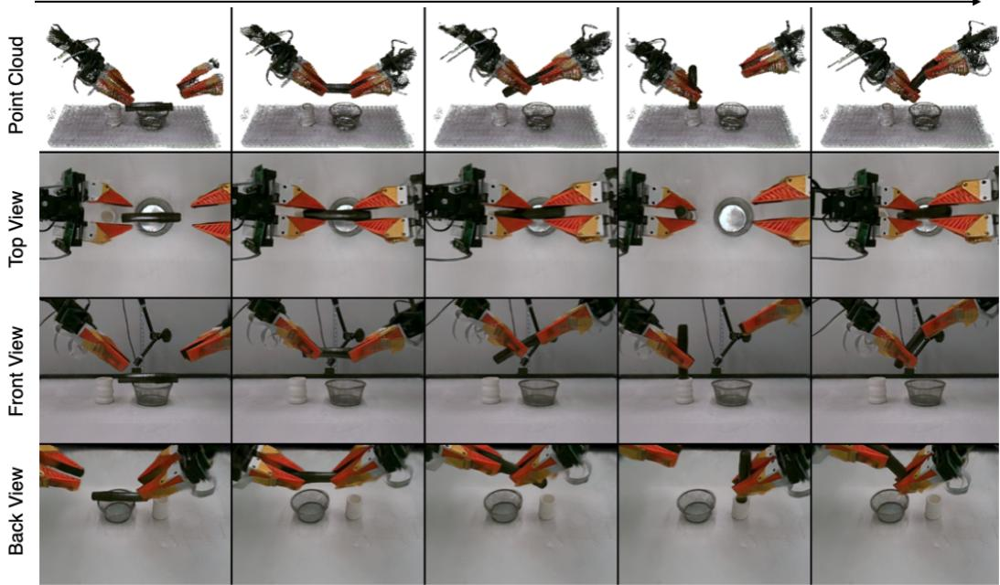  
Figure 9: Marker Insertion open-loop rollout visualization.

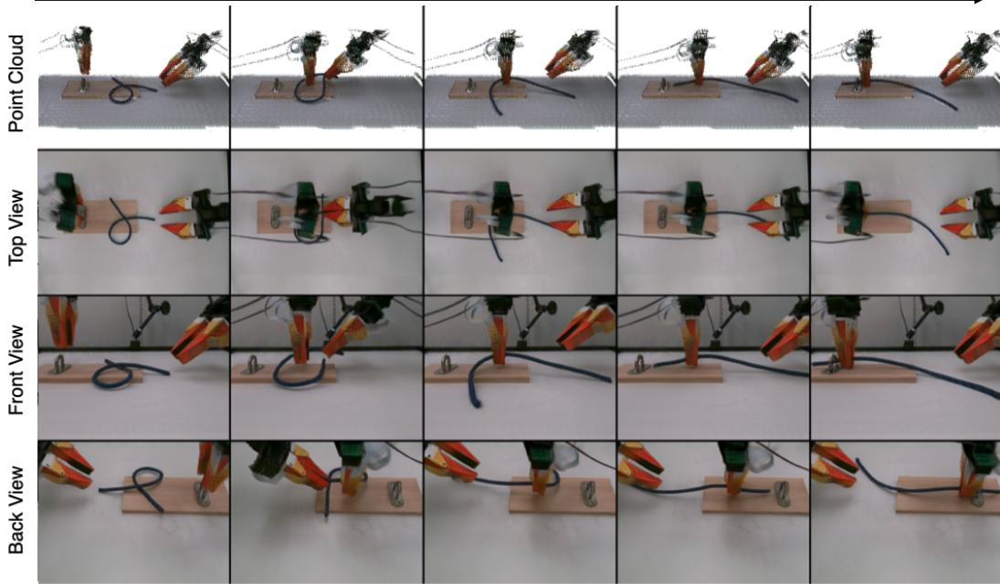  
Figure 10: Rope Threading open-loop rollout visualization.

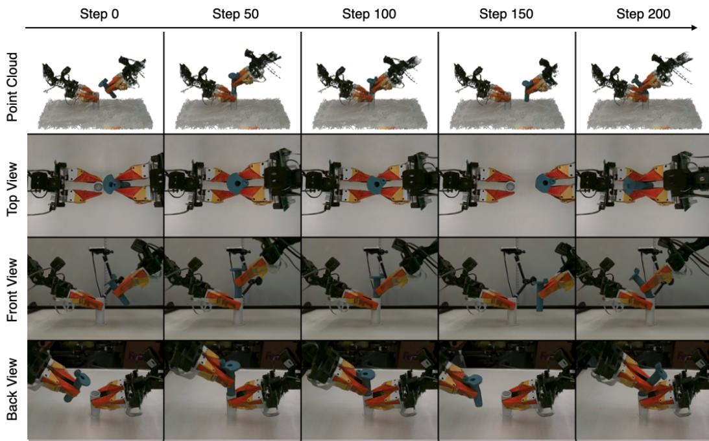  
Figure 11: Part Assembly open-loop rollout visualization.

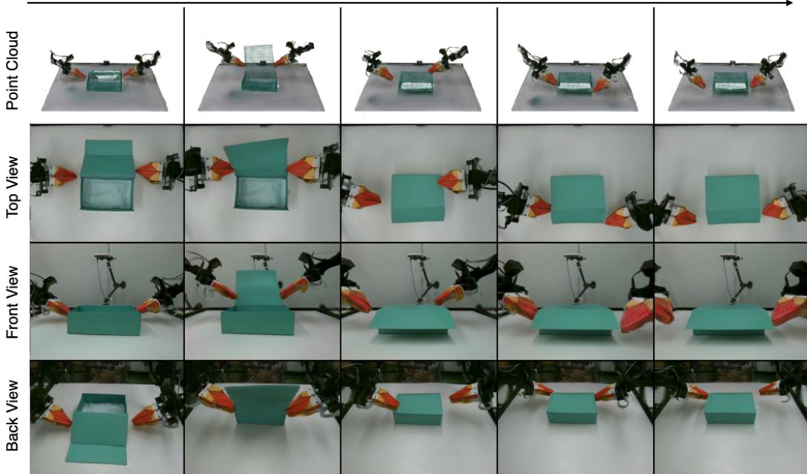  
Figure 12: Box Packing open-loop rollout visualization.

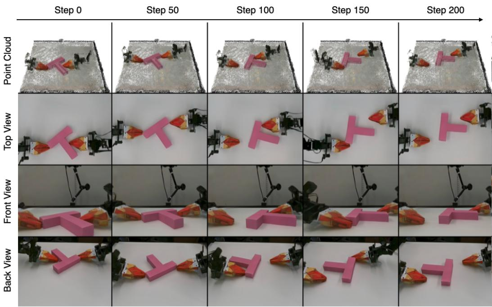  
Figure 13: T Pushing open-loop rollout visualization.

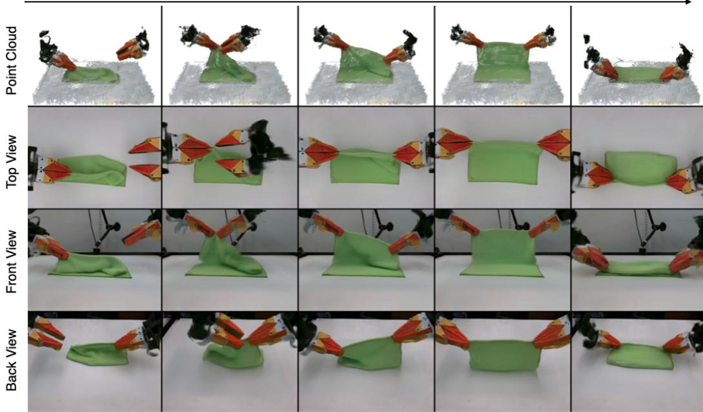  
Figure 14: Cloth Folding open-loop rollout visualization.

## C.3 BASELINE DETAILS

To enable Cosmos to predict depth information and allow multi-view renders, we follow guidelines and concatenate four views in one image, in addition to depth mapped into RGB space. For IWS, we enable the model to predict depth in addition to RGB, and concatenate a latent for each view in accordance to training guidelines. We follow the recipe to train Robot4DGen as it is already designed to be 3D aware and enable multi-view rendering. To train the 3D particle prediction baselines, we utilize CoTracker (Karaev et al., 2024) to obtain point tracks for each object as well as for scene points.

## D POLICY TRAINING AND EVALUATION DETAILS

## D.1 EVALUATION CRITERIA

For evaluation, we define a success in the Assembly task to be whether the plug is successfully inserted into the socket. For cloth folding, if the edge is not grasped, that is judged to be a failure. If the edge is grasped and the mask IoU is higher than 0.6, we judge that to be a success. For T-Pushing, we define a success to be if the mask IoU is above 0.60.

## D.2 TASK DETAILS

Part Assembly. The policy observes only the right wrist-mounted camera, while the socket is heavily occluded in the left hand, making successful insertion dependent on both accurate wristcamera observations and tactile feedback.

T Pushing. We utilize a novel viewpoint that was not seen during world model training. Performance is slightly lower most probably because this novel viewpoint is harder than the top down view for successful task performance, rather than the rendering.

Cloth Folding. The policy is required to slide along the cloth edge which is not visible from the front camera observation. This task shows the usage of multi-view observations.

## D.3 POLICY TRAINING DETAILS

We train ACT, Diffusion Policy (DP), $\pi _ { 0 . 5 } ,$ , and Cosmos on Cloth Folding, Part Assembly, and T-Pushing. Each task contains 100 demonstrations recorded at 10 Hz, with 90 demonstrations used for training and 10 held out. Cloth Folding uses front and wrist-mounted camera observations, Part Assembly uses the wrist-mounted camera together with tactile observations, and T-Pushing uses a single novel camera viewpoint. Real images are color-corrected, cropped, and resized to match the corresponding simulated observations. ACT and DP use $1 2 8 \times 1 2 8$ image inputs, while $\pi _ { 0 . 5 }$ and Cosmos use $2 2 4 \times 2 2 4$ inputs.

For Part Assembly, tactile observations consist of four $1 2 \times 3 2$ tactile pads. We apply a small deadband before normalization and use small tactile augmentation during training; Cloth Folding and T-Pushing do not use tactile inputs.

ACT and DP are trained with batch size 64 for 30,000 updates, while $\pi _ { 0 . 5 }$ uses batch size 8 and is trained for 30,000 updates. ACT predicts 30-action chunks, DP predicts 16-action horizons, and π predicts 30-action chunks. We use the optimizer and learning-rate settings listed in Table 5.

ACT uses an ImageNet-initialized ResNet-18 (He et al., 2016) visual encoder and transformer policy. DP uses a ResNet-18 visual encoder with a conditional temporal U-Net diffusion model. $\pi _ { 0 . 5 }$ is fine-tuned using LoRA (Hu et al., 2022), while Cosmos is initialized from $\mathtt { C o s m o s - P o l i c y - A L O H A - P r e d i c t } 2 \mathrm { - } 2 \mathtt { B } ,$ . We use standard image augmentation techniques like random color jitter, random crop and blur. We also add tactile augmentation to the Part Assembly policy by adding sparse noise, dropout, and Gaussian noise.

Table 5: Policy training configurations.
<table><tr><td></td><td>ACT</td><td>DP</td><td> $\pi _ { 0 . 5 }$ </td><td>Cosmos Policy</td></tr><tr><td>Input resolution</td><td> $1 2 8 ^ { 2 }$ </td><td> $1 2 8 ^ { 2 }$ </td><td> $2 2 4 ^ { 2 }$ </td><td> $2 2 4 ^ { 2 }$ </td></tr><tr><td>Observation history</td><td>1</td><td>2</td><td>1</td><td>1</td></tr><tr><td>Action horizon</td><td>30</td><td>16</td><td>30</td><td>30</td></tr><tr><td>Batch size</td><td>64</td><td>64</td><td>8</td><td>192</td></tr><tr><td>Learning rate</td><td> $1 0 ^ { - 5 }$ </td><td> $1 0 ^ { - 4 }$ </td><td> $2 . 5 { \times } 1 0 ^ { - 5 }$ </td><td> $1 0 ^ { - 4 }$ </td></tr><tr><td>Optimizer</td><td>AdamW</td><td>Adam</td><td>AdamW</td><td>AdamW</td></tr><tr><td>Training updates</td><td>30k</td><td>30k</td><td>30k</td><td>10k</td></tr></table>

## D.4 VISUALIZATION OF REAL DEMOS

We visualize collected demonstrations for each task.

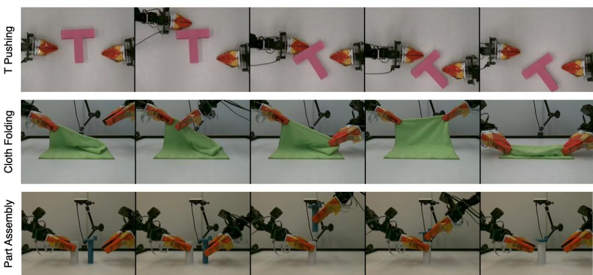

Figure 15: Visualizations of real world imitation learning data for the cloth folding, part assembly, and T pushing task.

## D.5 QUALITATIVE VISUALIZATION OF WORLD MODEL POLICY DATA

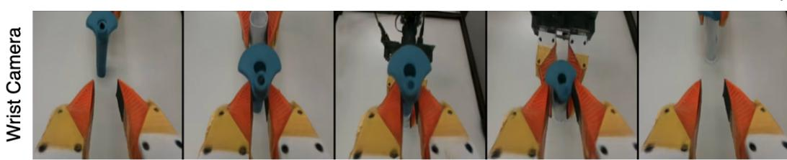  
Figure 16: Visualization of part assembly world model wrist camera input to policies.

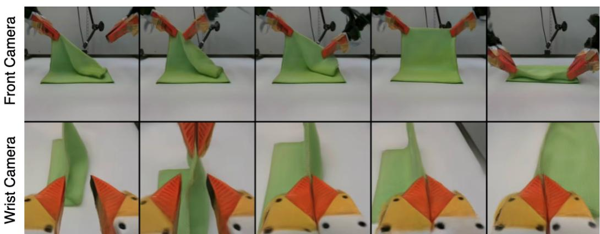  
Figure 17: Visualization of cloth folding world model multi-view input to policies.

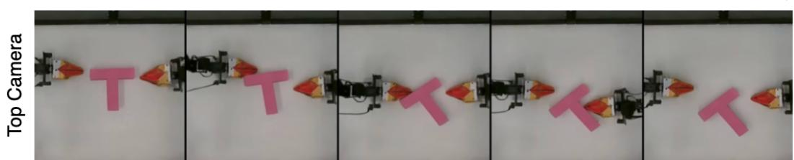  
Figure 18: Visualization of the top down camera view policy input.