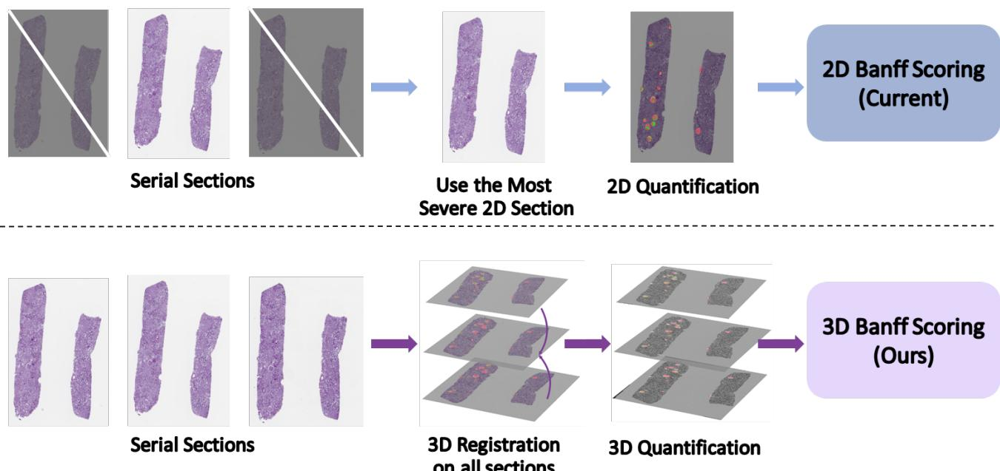
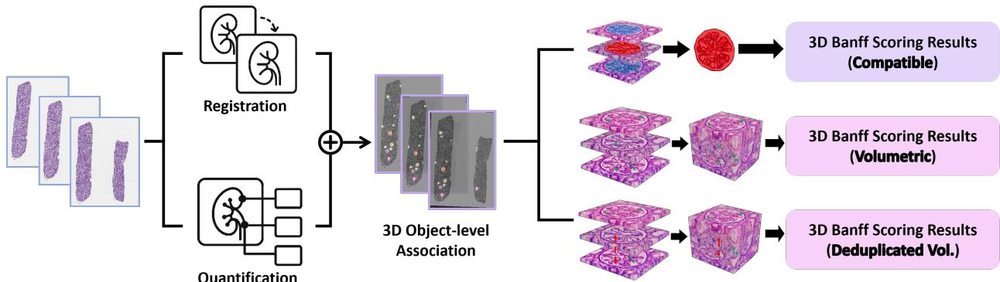
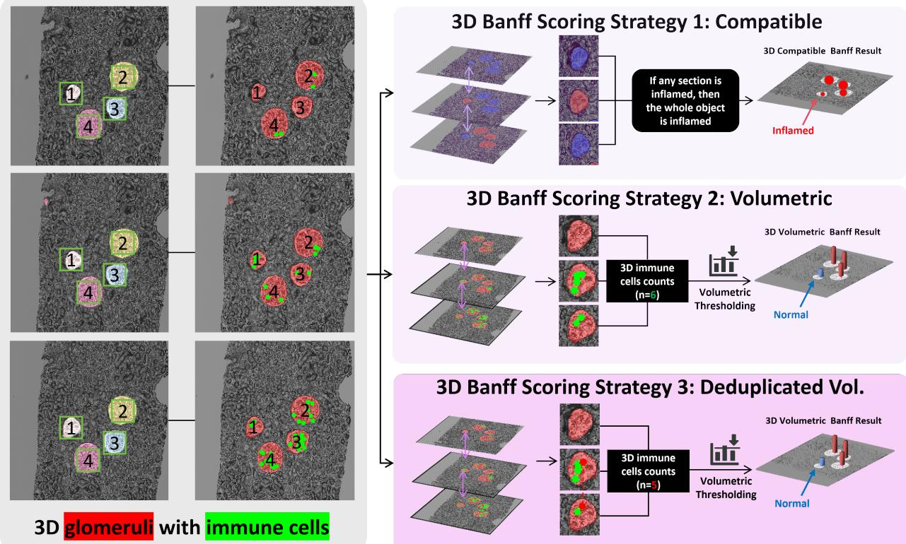
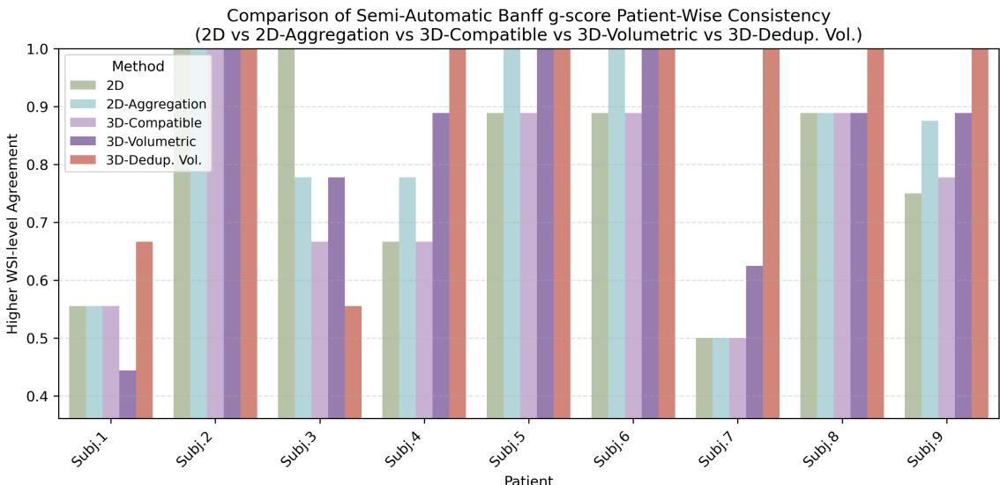
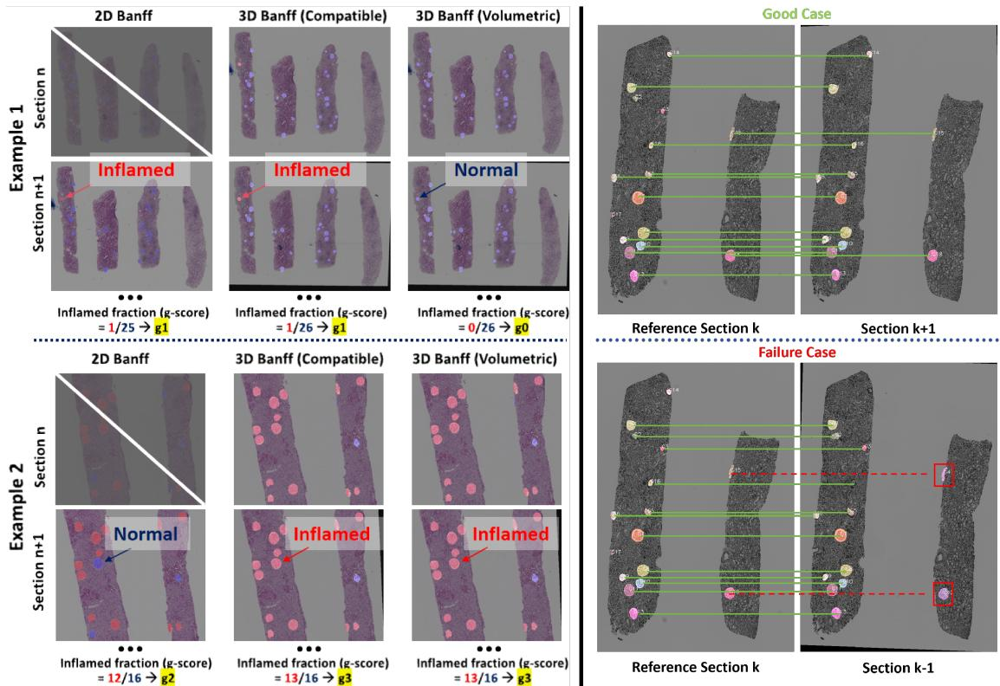
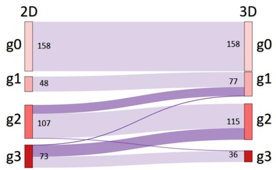
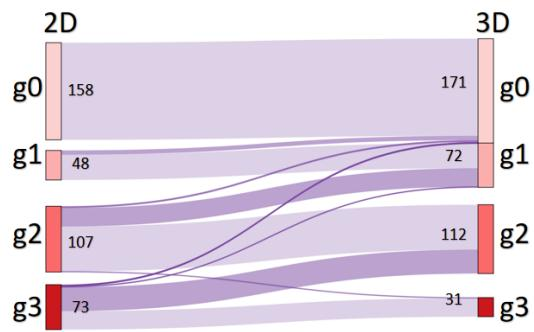

# 3D Banf Glomerulitis Scoring for Kidney Transplant Pathology: Feasibility Study for Volumetric Quantification

Yanfan Zhua, Junchao Zhua, Ruining Dengb, Shilin Zhaoc, Yu Wangc, Yaohong Wangd, Yuechen Yanga, Chongyu Qua, Zhengyi Lua, Juming Xionga, Mengmeng Yinc, Yihan Wangc, Andrew J. Rauchc, Haichun Yangc, and Yuankai Huoa

aVanderbilt University, Nashville TN 37235, USA bWeill Cornell Medicine, New York, NY 10021, USA cVanderbilt University Medical Center, Nashville TN 37232, USA dUT MD Anderson Cancer Center,TX 77030, USA

## ABSTRACT

Quantifying glomerular inflammation in kidney-transplant biopsies is traditionally performed on single wholeslide sections using the Banf ”most-severe section” rule, despite the inherently three-dimensional nature of lesion distribution. This 2D based assessment might lead to instability when inflammation varies across slices. This paper reports a feasibility study examining the technical feasibility and clinical relevance of extending Banf scoring into three dimensions. To this end, we propose a 3D Banf lesion-scoring framework that aligns seria sections, reconstructs glomerular identities across depth, and integrates inflammatory-cell counts in 3D under three scoring strategies: Compatible, Volumetric, and Deduplicated Volumetric. In the experiments, glomerulitis (g-scores) was used as an example Banf metric and applied to multi-section renal allograft biopsies. Our findings indicate that 3D Banf g-scores are more consistent across sections and, under the semi-automatic setting, the Volumetric strategy correlates more strongly with clinical biomarkers than traditional 2D scores. These results show that 3D volumetric quantification ofers promising added value, underscoring the potential benefit of 3Daware Banf scoring for kidney transplant pathology.

Keywords: Banf Classification, Kidney Transplant Pathology, Deep Learning, Digital Pathology

## 1. INTRODUCTION

Renal allograft biopsy is fundamental to diagnosing rejection and determining post-transplant management. The Banf Classification of Allograft Pathology provides the international standard for evaluating renal transplant biopsies, using a set of semiquantitative lesion scores—including interstitial inflammation (i), tubulitis (t), peritubular capillaritis (ptc), intimal arteritis (v), and glomerulitis (g)—to diagnose and grade rejection.1–3 Although a single biopsy block is routinely cut into 20–30 serial sections, each representing a slightly diferent tissue depth, current clinical practice assigns the g-score using only one two-dimensional (2D) histology section—the slice showing the most severe inflammation. This worst-section approach aims to avoid underestimating rejection but is inherently sensitive to sampling variation, sectioning depth, and local tissue distortion. Clinically, glomerular inflammation is a three-dimensional (3D) biological phenomenon, yet its scoring relies on a single 2D snapshot. This mismatch between disease geometry and the evaluation protocol leads to variability in diagnosis and reduces interpretability for both pathologists and clinicians.4, 5

Recent advances in computational pathology have produced accurate models for segmenting glomeruli6–9 and detecting inflammatory cells10, 11 on whole slide images (WSIs).12, 13 However, nearly all existing systems operate strictly in 2D: each WSI is processed independently; predictions are not aligned or reconciled across serial sections; and case-level scoring still selects the single most severe slice, replicating the clinical worstsection paradigm.14–16 These approaches fail to reconstruct the 3D topology of injury, do not assign consistent glomerulus identity across depth, and cannot quantify volumetric inflammatory distribution. From a clinical standpoint, this limits robustness, explainability, and trustworthiness, all essential for adoption of AI tools in routine transplant workflows.

  
Figure 1: 2D Banf scoring vs. 3D Banf scoring. Upper panel: the 2D Banf pipeline analyzes each section independently and assigns the final g-score based on the most severe single section. This “worst-section” rule is sensitive to sampling variability and ignores cross-section correspondence. Lower panel: the proposed 3D Banf framework aligns serial sections and integrates information across depth for volumetric g-score computation.

We propose a shift from 2D slice-based evaluation to biopsy-level 3D volumetric scoring. Our framework aligns serial histology sections, reconstructs glomeruli in 3D, aggregates inflammatory-cell detections, and produces a biopsy-level Banf g-score derived from the full depth of the tissue block. This requires addressing several technica challenges: nonlinear distortions and missing sections that hinder registration; substantial variation in staining and section quality; identity tracking of glomeruli across levels; and designing an interpretable and clinically grounded method for compatible and volumetric aggregation. To overcome these challenges, we developed a unified computational pipeline that integrates robust 2D feature extraction, serial-section registration, glomerulus identity tracking, and 3D g-score computation (Figure 1). Our contributions are as follows:

• This paper presents a feasibility study examining the technical feasibility and clinical relevance of extending Banf scoring from 2D to 3D.

• We propose a computational framework for the quantitative measurement of the widely used Banf g-score, further extending it to 3D through the integration of AI-based section detection, glomerular segmentation, inflammatory-cell detection, and structural alignment across serial histological sections.

• We formulate three biopsy-level 3D Banf g-scoring strategies—Compatible, Volumetric, and Deduplicated Volumetric—that capture diferent aspects of the 3D inflammatory distribution, and benchmark their performance against 2D Banf scoring.

## 2. METHODS

## 2.1 Pipeline Overview and 2D Banf Scoring

Figure 2 illustrates the complete workflow of the proposed 3D Banf lesion scoring pipeline. Raw serial-section WSIs first enter two parallel modules: Registration, which aligns all sections from a biopsy into a common spatial frame, and Quantification, which uses deep-learning models to extract per-section glomerular and inflammatory-cell features. The outputs of these modules are then combined to establish consistent 3D object associations for depth-wise tracking, whereby corresponding glomeruli across sections are linked based on spatial overlap, geometric continuity, and instance-level matching. These associations produce coherent 3D glomerular entities with aggregated inflammatory-cell detections along depth, from which three 3D Banf scoring strategies are derived: Compatible (Banf worst-section rule in 3D), Volumetric (depth-normalized cumulative cel count), and Deduplicated Volumetric (unique-cell volumetric count after cross-section deduplication).

  
Figure 2: Proposed 3D Banf scoring pipeline. Serial sections are registered and quantified in parallel. Their outputs are combined to associate glomeruli across depth, followed by Compatible, Volumetric, and Deduplicated Volumetric scoring.

As a computational baseline consistent with conventional pathology workflows, we implement an automated per-section g-score following the classical Banf definition of glomerulitis. Let $\{ R _ { 1 } , \ldots , R _ { N } \}$ denote the segmented glomeruli and P the detected cells on a given section. Each glomerulus $R _ { k }$ is labeled inflamed if its cell count $\begin{array} { r } { n _ { k } = \sum _ { p _ { i } \in \mathcal { P } } \mathbf { 1 } [ p _ { i } \in R _ { k } ] } \end{array}$ exceeds threshold $\tau { = } 3$ , and the section-level inflamed proportion is

$$
\rho _ { g } = \frac { 1 } { N } \sum _ { k = 1 } ^ { N } \mathbf { 1 } [ n _ { k } > \tau ] ,\tag{1}
$$

The proportion $\rho _ { g }$ is mapped to a Banf-style ordinal score: $g 0$ when $\rho _ { g } = 0 , g 1$ when $0 < \rho _ { g } < 2 5 \% , g 2$ when $2 5 \% \leq \rho _ { g } \leq 7 5 \%$ , and $g 3$ when $\rho _ { g } > 7 5 \%$

This module provides an automated analogue of the traditional per-section Banf assessment. Although simplified and not intended to replicate full morphological interpretation, it captures the core signal of glomerular inflammation and serves as a reproducible reference for comparison with our 3D, cross-section–aggregated scoring (Section 2.2).

## 2.2 Serial-Section Alignment and 3D Banf Scoring Pipeline

For each biopsy case, serial histologic sections are scanned into WSIs and first processed to detect glomeruli and inflammatory cells on a per-section basis. All sections belonging to the same biopsy are aligned into a common spatial frame using a hybrid registration pipeline that combines feature-based matching and afine transformation chaining, modeling global pose variation and slice-to-slice misalignment. After alignment, glomerular masks and features from neighboring sections are compared to evaluate cross-sectional consistency, and corresponding glomerular instances exhibiting suficient spatial overlap, centroid proximity, and morphological continuity are linked across depth. These matched instances are merged through a union–find–based matching procedure to establish stable 3D glomerular identities, which subsequently aggregate inflammatory-cell detections throughout the volume for downstream scoring.

Three distinct 3D scoring strategies are derived from these identities. For glomerulus $G _ { i }$ spanning sections $S _ { i } ,$ with raw per-section cell counts $c _ { i , s }$ and cross-section-deduplicated counts $\tilde { c } _ { i , s } ,$ each strategy defines an aggregate

  
Figure 3: Three 3D Banf scoring strategies enabled by cross-section glomerular alignment. Strategy 1 (Compatible): a glomerulus is labeled inflamed if any of its sectional instances exceeds the cell-count threshold—a direct 3D extension of the Banf worst-section rule. Strategy 2 (Volumetric): immune-cell counts are aggregated across all sections of a 3D glomerulus and compared against a section-normalized threshold, capturing the cumulative inflammatory burden. Strategy 3 (Deduplicated Volumetric): extends Strategy 2 by first deduplicating inflammatory cells that appear in multiple adjacent sections via cross-section cell-instance tracking, yielding a unique-cell volumetric count before thresholding. Inflamed glomeruli are shown in red and non-inflamed in blue.

$C _ { i }$ and threshold $\theta _ { i } { \mathrm { : } }$

$$
\begin{array} { r l } { \mathrm { C o m p a t i b l e } { : } } & { \mathrm { } C _ { i } = \operatorname* { m a x } _ { s \in S _ { i } } c _ { i , s } , \quad \theta _ { i } = \tau _ { \mathrm { c e l l } } , } \\ { \mathrm { V o l u m e t r i c : } } & { \mathrm { } C _ { i } = \sum _ { s \in S _ { i } } c _ { i , s } , \quad \theta _ { i } = \tau _ { \mathrm { c e l l } } | S _ { i } | , } \\ { \mathrm { D e d u p . ~ V o l . } { : } } & { \mathrm { } C _ { i } = \sum _ { s \in S _ { i } } \tilde { c } _ { i , s } , \quad \theta _ { i } = \tau _ { \mathrm { c e l l } } | S _ { i } | , } \end{array}\tag{2}
$$

where $\tilde { c } _ { i , s }$ removes cells already matched to the same glomerular instance in an adjacent section, and $\tau _ { \mathrm { c e l l } } { = } 3$ follows the 2D threshold. Each strategy labels $G _ { i }$ inflamed if $C _ { i } \geq \theta _ { i } ;$ the biopsy-level proportion $\rho _ { g } = \# \{ i$ $C _ { i } \geq \theta _ { i } \} / N$ is then mapped to ordinal Banf categories.

## 3. DATA AND EXPERIMENTS

## 3.1 Dataset

We evaluated our framework on a retrospective cohort of renal allograft biopsies collected at Vanderbilt University Medical Center. The dataset comprises 50 patients and 410 WSIs, with each biopsy block typically sectioned into 20–30 fixed-spacing serial histological levels stained with PAS, H&E, or Jones silver. Multiple WSIs from the same patient may correspond to diferent serial sections from a single biopsy block.

## 3.2 Experimental Setup and Evaluation

Feature Extraction. Sections were detected via a YOLOv8s detector17 (input 1280 px, 50 epochs, fine-tuned from COCO weights); glomeruli were segmented with the KPIs-challenge-winning pipeline;18 and inflammatory cells were localized with a Monkey Challenge detector11 fine-tuned on two pathologist-QA’d biopsy cases (precision 0.81, recall 0.74 on held-out regions).

  
Figure 4: Intra-patient WSI agreement of Banf g-scores under Semi-Automatic pipelines. For each patient, agreement is defined as the proportion of WSIs assigned the same g-score as the modal score across that patient’s sections. Five scoring strategies are evaluated: 2D worst-section scoring, 2D majority-vote aggregation (2D-Aggre.), 3D-Compatible, 3D-Volumetric, and 3D Deduplicated Volumetric (3D-Dedup. Vol.), which further incorporates cross-section cell-instance deduplication. Higher bars represent better consistency.

Registration and 3D Tracking. Serial sections were aligned using XFeat,19 following established principles for multi-gigapixel WSI registration,20 with RANSAC-based afine estimation (threshold 4.0, max size 8192) chained relative to the middle section. Glomerular correspondences across sections were established via dilated IoU (≥0.10, kernel k=4), centroid distance (≤80 px), and area ratio ([0.5, 2.0]), merged with a Union–Find structure. Across 76 WSI cases, the pipeline produced 1,423 3D glomerular tracks (mean 2.46 serial sections per case; mean per-track section coverage: 75.2%). All experiments used NVIDIA A6000 GPUs, Python 3.9, and PyTorch 1.12.

Evaluation Settings. In the semi-automatic setting, a board-certified pathologist performs QA on segmentation and detection outputs (∼1 min/section); all subsequent steps are fully algorithmic. In the fully automatic setting, no human intervention is applied. Because formal expert g-scores were not available for this retrospective cohort, clinical outcomes serve as the reference signal—a standard proxy in the absence of 3D reference standards.4 We report Kendall $\tau _ { b }$ with bootstrap 95% CI and permutation p-values (10,000 draws) between predicted g-scores and 0–6 month changes in serum creatinine (∆sCr), blood urea nitrogen (∆BUN), and creatinine clearance (−∆Ccr) for 8 patients with longitudinal follow-up. Intra-patient WSI agreement (proportion of WSIs matching the modal g-score per patient) is computed across the 9-patient clinical subset and visualized for all 50 patients. A sensitivity analysis was also performed by varying the glomerular matching thresholds (IoU: 0.05–0.20; centroid distance: 60–100 px) to assess robustness of the 3D tracking pipeline.

## 4. RESULTS

Table 1 reports Kendall $\tau _ { b }$ correlations between predicted g-scores and short-term clinical outcomes across five 2D/3D strategies. In the semi-automatic setting, 3D Volumetric and Dedup. 3D achieve the numerically highest correlation for ∆sCr (τ=0.511, 95% CI [−0.15, 0.96], p=0.13). Although the small longitudinal cohort (n=8) precludes statistical significance, identity-aware 3D aggregation consistently improves over single-section 2D (τ=0.308) and over multi-section 2D pooling without tracking (Pooled 2D: τ=0.400), suggesting that crosssection identity tracking—not merely multi-section averaging—contributes additional discrimination. In the fully-automatic setting all 3D methods converge to τ=0.233, with pathologist QA accounting for most of the semi-to-fully-automatic gap (mean patient-level 2D g-score disagreement: 0.39 grade steps). Deduplication removed 1.6% of cross-section cell detections (32/1954) and altered the inflamed status of 2/1,423 glomeruli (0.1%), resulting in no change to any case-level ordinal g-score; both Volumetric and Dedup. 3D therefore yield identical clinical correlations in this cohort. Intra-patient WSI agreement (Figure 4) improves from 82.9% (2D) to 90.8% under Dedup. 3D across the 9-patient clinical subset. Figure 6 shows the g-score distribution shift from

  
Figure 5: Left Panel: Qualitative comparison of glomerular inflammation scoring across three 3D Banf strategies. Upper panel (Case 1): 2D worst-section scoring detects 1/25 inflamed glomeruli (4%, g1); 3D-Compatible identifies 1/26 (3.8%, g1); 3D-Volumetric detects 0/26 (0%, g0). Lower panel (Case 2): 2D scoring finds 12/16 inflamed glomeruli (75%, g2); 3D-Compatible and 3D-Volumetric both detect 13/16 (81.3%, g3). Right Panel: Representative examples of glomerulus identity tracking across serial sections.Upper Panel: Good case. Most glomeruli are consistently matched across adjacent sections, resulting in stable identity propagation (Green lines). Lower Panel: Failure case. While the majority of glomerul are correctly associated, imperfect registration and alignment in individual sections lead to identity breaks(Red dashed lines and boxed regions).

Table 1: Kendall $\tau _ { b }$ between predicted Banf g-scores and clinical outcomes (n=8 patients with 6-month followup). All diferences are non-significant (p>0.10, permutation). Bold: best within each group.
<table><tr><td></td><td colspan="3">Semi-Automatic</td><td colspan="3">Fully-Automatic</td></tr><tr><td>2D Method</td><td>∆sCr↑</td><td>∆BUN↑</td><td>-∆Ccr↑</td><td>∆sCr↑</td><td>∆BUN↑</td><td>-∆Ccr↑</td></tr><tr><td>2D</td><td>0.308</td><td>0.077</td><td>0.154</td><td>0.227</td><td>0.136</td><td>0.045</td></tr><tr><td>Pooled  $\mathrm { 2 D ^ { * } }$ </td><td>0.400</td><td>0.109</td><td>0.255</td><td></td><td></td><td></td></tr><tr><td>Aggre. 2D</td><td>0.462</td><td>0.231</td><td>0.308</td><td>0.227</td><td>0.136</td><td>0.045</td></tr><tr><td></td><td colspan="3">Semi-Automatic</td><td colspan="3">Fully-Automatic</td></tr><tr><td>3D Method</td><td>∆sCr↑</td><td>∆BUN↑</td><td>-∆Ccr↑</td><td>∆sCr↑</td><td>∆BUN↑</td><td>-∆Ccr↑</td></tr><tr><td>Compat. 3D</td><td>0.308</td><td>0.076</td><td>0.153</td><td>0.233</td><td>0.140</td><td>0.047</td></tr><tr><td>Vol. 3D</td><td>0.511</td><td>0.274</td><td>0.353</td><td>0.233</td><td>0.140</td><td>0.047</td></tr><tr><td>Dedup. 3D</td><td>0.511</td><td>0.274</td><td>0.353</td><td>0.233</td><td>0.140</td><td>0.047</td></tr></table>

Pooled 2D: all serial sections pooled without identity tracking; semi-auto only.

  
(a) 3D Compatible Scoring

  
(b) 3D Volumetric Scoring  
Figure 6: Alluvial comparison of section-level 2D g-scores and WSI-level 3D g-scores across 410 WSIs (50 patients) under the fully-automatic pipeline. Each WSI is assigned one 3D score; thick flows indicate frequent grade transitions. The diagram illustrates grade shifts when moving from single-section 2D scoring to: (a) Compatible scoring; and (b) Volumetric scoring.

2D to 3D strategies across all 50 patients. Figure 5 illustrates representative 3D scoring and tracking examples; most mismatches arise from imperfect section registration. Sensitivity analysis shows limited dependence on tracking and registration hyperparameters, with variation ratios ≤5.9% and pairwise disagreement ≤3.9%. The full 3D pipeline takes approximately 125 s per WSI, a 3.34× overhead over 2D-only.

## 5. CONCLUSION

We presented a feasibility study on 3D glomerulitis quantification for renal allograft biopsies, using serial-section alignment, cross-depth glomerulus identity tracking (1,423 3D tracks across 76 WSI cases), and three depthaggregation strategies. The semi-automatic Volumetric strategy yielded the numerically strongest exploratory association with short-term renal function (τ=0.511, 95% CI [−0.15, 0.96] for ∆sCr), outperforming both singlesection 2D and multi-section 2D pooling without tracking (τ=0.400), while Deduplicated scoring improved intra-patient WSI agreement to 90.8%. Expert 3D reference scores and larger multi-center cohorts are needed to confirm clinical validity; the pipeline’s per-WSI overhead remains practical (≈125 s). These results establish technical feasibility and motivate prospective validation of identity-aware 3D Banf glomerulitis scoring.

## ACKNOWLEDGMENTS

This research was supported by NIH R01DK135597 (Huo), DoD HT9425-23-1-0003 (HCY), NSF 2434229 (Huo) and KPMP Glue Grant. This work was also supported by Vanderbilt Seed Success Grant and Vanderbilt-Liverpool Seed Grant. This research was also supported by NIH grants R01EB033385, R01DK132338. We extend gratitude to NVIDIA for their support by means of the NVIDIA hardware grant.

## REFERENCES

[1] Farris, A. B., van der Laak, J., and van Midden, D., “Artificial intelligence-enhanced interpretation of kidney transplant biopsy: focus on rejection,” Current Opinion in Organ Transplantation 30(3), 201–207 (2025).

[2] Banf Foundation for Allograft Pathology, “Central repository for the banf classification,” (2023). Available at https://banfffoundation.org/central-repository-for-banff-classification-resources-3/.

[3] Zhu, Y., Xiong, J., Deng, R., Wang, Y., Wang, Y., Zhao, S., Yin, M., Liu, Y., Yang, H., and Huo, Y., “How close are we? limitations and progress of ai models in banf lesion scoring,” (2025).

[4] Loupy, A., Mengel, M., and Haas, M., “Thirty years of the international banf classification for allograft pathology: the past, present, and future of kidney transplant diagnostics,” Kidney International 101(4), 678–691 (2022).

[5] Huang, S.-C., Lin, Y.-J., Wen, M.-C., Lin, W.-C., Fang, P.-W., Liang, P.-I., Chuang, H.-W., Chien, H.-P., and Chen, T.-D., “Unsatisfactory reproducibility of interstitial inflammation scoring in allograft kidney biopsy,” Scientific Reports 13, 7095 (2023).

[6] Deng, R., Liu, Q., Cui, C., Yao, T., Long, J., Asad, Z., Womick, R. M., Zhu, Z., Fogo, A. B., Zhao, S., Yang, H., and Huo, Y., “Omni-seg: A scale-aware dynamic network for renal pathological image segmentation,” (2023).

[7] Deng, R., Zhu, J., Xiong, J., Cui, C., Yao, T., Guo, J., Lu, S., Lionts, M., Yin, M., Wang, Y., Zhao, S., Tang, Y., Yang, Y., Simonson, P. D., Sabuncu, M. R., Yang, H., and Huo, Y., “Irs: Incremental relationship-guided segmentation for digital pathology,” (2025).

[8] Jiang, L., Chen, W., Dong, B., Mei, K., Zhu, C., Liu, J., Cai, M., Yan, Y., Wang, G., Zuo, L., and Shi, H., “A deep learning–based approach for glomeruli instance segmentation from multistained renal biopsy pathologic images,” The American Journal of Pathology 191(8), 1431–1441 (2021).

[9] Yu, L., Yin, M., Deng, R., Liu, Q., Yao, T., Cui, C., Guo, J., Wang, Y., Wang, Y., Zhao, S., Yang, H., and Huo, Y., “Glo-in-one-v2: Holistic identification of glomerular cells, tissues, and lesions in human and mouse histopathology,” (2024).

[10] Deotale, G., Ambast, A., Ramchandani, L., Das, D. K., and Thomas, T., “Ensemble object detection methodology for automated detection of inflammatory cells in kidney biopsies,” in [MIDL 2025 Short Papers], (2025). short-paper; submission number 23; 3rd place in MONKEY challenge.

[11] Lynn, M. e. a., “Monkey challenge: Inflammatory cell detection in kidney allograft biopsies.” https: //github.com/lynn0304/MONKEY\_CHALLENGE (2023). Leaderboard and details at https://monkey. grand-challenge.org/.

[12] Labrife, M., Woillard, J.-B., Gwinner, W., Braesen, J.-H., Anglicheau, D., Rabant, M., Koshy, P., Naesens, M., and Marquet, P., “Machine learning-supported interpretation of kidney graft elementary lesions in combination with clinical data,” American Journal of Transplantation 22(12), 2821–2833 (2022).

[13] Yi, Z., Xi, C., Menon, M. C., Cravedi, P., Tedla, F., Soto, A., Sun, Z., Liu, K., Zhang, J., Wei, C., Chen, M., Wang, W., Veremis, B., Garcia-Barros, M., Kumar, A., Haakinson, D., Brody, R., Azeloglu, E. U., Gallon, L., O’Connell, P. J., Naesens, M., Shapiro, R., Colvin, R. B., Ward, S., Salem, F., and Zhang, W., “A large-scale retrospective study enabled deep-learning based pathological assessment of frozen procurement kidney biopsies to predict graft loss and guide organ utilization,” Kidney International 105(2), 281–292 (2024).

[14] Hermsen, M., de Bel, T., Den Boer, M., Steenbergen, E. J., Kers, J., Florquin, S., Roelofs, J. J., Stegall, M. D., Alexander, M. P., Smith, B. H., et al., “Deep learning–based histopathologic assessment of kidney tissue,” Journal of the American Society of Nephrology: JASN 30(10), 1968 (2019).

[15] Kers, J., B¨ulow, R. D., Klinkhammer, B. M., Breimer, G. E., Fontana, F., Abiola, A. A., Hofstraat, R., Corthals, G. L., Peters-Sengers, H., Djudjaj, S., von Stillfried, S., H¨olscher, D. L., Pieters, T. T., van Zuilen, A. D., Bemelman, F. J., Nurmohamed, S. A., Naesens, M., Roelofs, J. J. T. H., Florquin, S., Floege, J., Nguyen, T. Q., Kather, J. N., and Boor, P., “Deep learning-based classification of kidney transplant pathology: a retrospective, multicentre, proof-of-concept study,” The Lancet Digital Health 4(1), e18–e26 (2022).

[16] Hermsen, M., Ciompi, F., Adefidipe, A., Denic, A., Dendooven, A., Smith, B. H., van Midden, D., Br¨asen, J. H., Kers, J., Stegall, M. D., B´andi, P., Nguyen, T., Swiderska-Chadaj, Z., Smeets, B., Hilbrands, L. B., and van der Laak, J. A. W. M., “Convolutional neural networks for the evaluation of chronic and inflammatory lesions in kidney transplant biopsies,” The American Journal of Pathology 192(10), 1418–1432 (2022).

[17] Jocher, G. and Ultralytics, “Yolov8: Newest version of yolo by ultralytics.” https://github.com/ ultralytics/ultralytics (2023). Accessed: 2025-01-01.

[18] Cap, Q. H., “A general pipeline for glomerulus whole-slide image segmentation,” in [2025 47th Annual International Conference of the IEEE Engineering in Medicine and Biology Society (EMBC)], 1–5, IEEE (2025).

[19] Potje, G., Cadar, F., Araujo, A., Martins, R., and Nascimento, E. R., “Xfeat: Accelerated features for lightweight image matching,” in [2024 IEEE/CVF Conference on Computer Vision and Pattern Recognition (CVPR)], 2682–2691, IEEE (2024).

[20] Gatenbee, C. D., Baker, A.-M., Prabhakaran, S., Swinyard, O., Slebos, R. J. C., Mandal, G., Mulholland, E., Andor, N., Marusyk, A., Leedham, S., Conejo-Garcia, J. R., Chung, C. H., Robertson-Tessi, M., Graham, T. A., and Anderson, A. R. A., “Virtual alignment of pathology image series for multi-gigapixel whole slide images,” Nature Communications 14, 4502 (2023).