# Annotator-Free Object Detection via Foundation Model Collaboration

Yasiru Ranasinghe, and Vishal M. Patel Johns Hopkins University {dranasi1, vpatel36}@jhu.edu

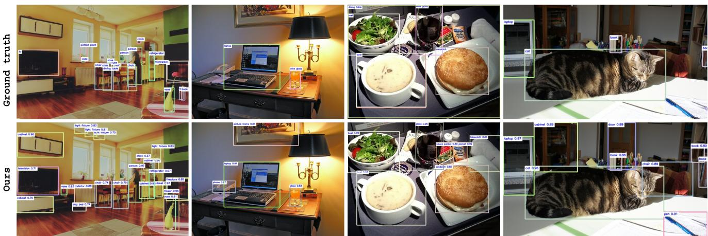  
Figure 1. Qualitative results on COCO 2017 val. Top row: ground-truth annotations. Bottom row: predictions from our label-free detector, obtained by coordinating foundation models without any detection-specific supervision. The proposed method (1) detects mos object classes present in the ground truth, even when expressed with synonymous labels (e.g., television for tv); (2) recovers objects that are missing annotations; and (3) proposes novel classes with no close counterpart in the dataset taxonomy (e.g., dog bed, radiator, pen, cabinet). For evaluation, a detection is considered correct if it has IoU ≥ 0.5 with a ground-truth box and a matching class (accounting for synonym mapping).

## Abstract

Object detection research remains constrained by high annotation costs and the closed-set assumptions ofsupervised models, limiting scalability to novel categories. We present a target-dataset annotation-free object detection framework that eliminates the need for human labeling on the target dataset by leveraging the complementary strengths of pretrained foundation models, including segmentation and vision-language systems, combined with a self-refining training loop. To further reduce reliance on expensive LVLM queries, we introduce a landmark-based clustering mechanism that amortizes labeling across image clusters, improving label consistency while lowering computational cost. Our method autonomously generates segmentation proposals, assigns semantic labels through multimodal reasoning, and iteratively improves both localization and classification using a lightweight open-set detector. This modular pipeline enables adaptation to completely unseen object classes and domains without any human-provided

target-dataset annotations, while maintaining compatibility with existing detection architectures. Evaluations on COCO, LVIS, ODinW-35, and Roboflow-100 demonstrate substantial performance gains over state-of-the-art openvocabulary and long-tail detection methods, achieving 60.8 AP on COCO and 47.4 AP on LVIS under zero-shot settings. Beyond strong benchmark results, our approach provides a scalable foundation for real-world detection systems in unknown environments, where annotation is infeasible.

## 1. Introduction and Related Work

Object detection is a fundamental task in computer vision with applications in autonomous driving, industrial automation, and surveillance [3, 28, 41]. State-of-the-art detectors such as YOLO [20] and DETR [2] achieve strong performance but rely heavily on annotated datasets, requiring precise bounding boxes and labels for every instance. This annotation process can take 5–30 minutes per image for complex datasets like COCO [14], making large-scale training prohibitively expensive. Furthermore, detectors trained on such datasets are constrained to predefined categories, limiting their capacity to recognize novel or long-tail objects [13, 24]. This challenge is illustrated in Fig. 2.

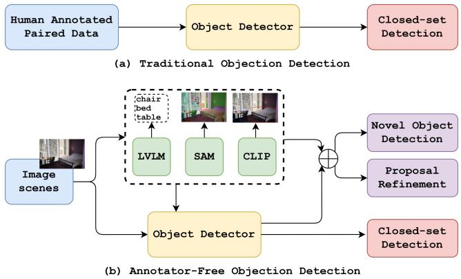  
Figure 2. Traditional object detection requires annotated paired data and remains closed-set. Our annotator-free pipeline relies only on image scenes, generating proposals via foundational models and refining them iteratively to expand to novel categories.

Recent directions attempt to reduce annotation dependency. Novel object detection explores recognizing unseen classes [19, 38]. RNCDL [7] takes a self-supervised approach but cannot assign semantic labels without validation data. Generalized Class Discovery [24] and PromptCAL [35] apply contrastive learning to categorize novel classes, yet they neglect localization [22]. Other works [6] generate outliers to better separate known from unknown classes, but practical deployment remains limited.

Open-vocabulary object detection (OVD) leverages vision-language alignment to expand recognition beyond closed-set constraints. Methods such as GLIP [12], GroundingDINO [15], and YOLO World [4] integrate natural language to detect unseen categories. However, these approaches still depend on closed-set detectors pre-trained on human-annotated data, keeping annotation costs high. While VLMs like CLIP [18] bridge vision and text, their effectiveness relies on supervised training of the detector.

Unsupervised object detection and discovery methods aim to localize and, in some cases, segment objects without any human annotation, typically by exploiting the emergent structure of self-supervised representations. CutLER [26] discovers and segments multiple objects per image using self-supervised features combined with iterative selftraining, without relying on any labels. FreeSOLO [25] produces coarse object masks in a fully unsupervised manner and refines them through self-training for instance segmentation. TokenCut [27] and MaskDistill [23] exploit normalized-cut and self-distillation signals from selfsupervised vision transformers to discover salient object regions without supervision. Complementary to these purely visual approaches, RegionCLIP [39], OWLv2 [17], and Grounded-SAM [21] pair region-level vision-language pretraining or grounding modules with segmentation models such as SAM [11] to enable open-vocabulary localization. While these methods substantially reduce annotation requirements, they either lack the ability to assign open-ended semantic labels (CutLER, FreeSOLO, TokenCut, MaskDistill) or still depend on some form of pre-existing detection or grounding supervision, or curated region-text pairs (RegionCLIP, OWLv2, Grounded-SAM). Our approach differs by coordinating segmentation, vision-language grounding, and LVLM reasoning entirely on the target dataset at training/inference time, without requiring any target-dataset annotations or a fine-tuned detection backbone.

In this work, we propose a target-dataset annotationfree object detection pipeline that eliminates the need for human annotation on the target dataset by adapting pretrained foundation models rather than removing human supervision altogether. Our approach integrates large visionlanguage models [37] and foundational models such as SAM [11], which are themselves trained on human-curated data, to autonomously generate object proposals and semantic labels for the target domain. As shown in Fig. 3, proposals are iteratively refined, enabling the detector to generalize to previously unseen object categories. Unlike OVD, which extends recognition but relies on annotated bases, our method directly adapts to novel environments without prior target-dataset labels. Benchmarks on LVIS and COCO validate that our pipeline reduces annotation costs and also has competitive performance in detecting novel categories.

## Our contributions are:

1. A novel target-dataset annotation-free detection pipeline integrating foundational and vision-language models, removing the need for human annotation on the target dataset.

2. A self-refining mechanism that progressively enhances detection without labeled data.

3. A modular design leveraging pre-trained models, enabling generalization to unseen categories.

4. Extensive experiments showing superior results compared to state-of-the-art on challenging datasets.

## 2. Annotator-free object detection

Annotator-free object detection removes the reliance on human-annotated ground truths, enabling detectors to train without prior category knowledge. In this setting, models encounter both known and unknown objects during inference. The goal is to eliminate annotation costs while improving detection of novel and existing classes. Unlike closed-set detectors that yield zero AP on unseen categories, our self-annotator mechanism, built on YOLO with support from LLMs, CLIP, and SAM, achieves gains in both novel

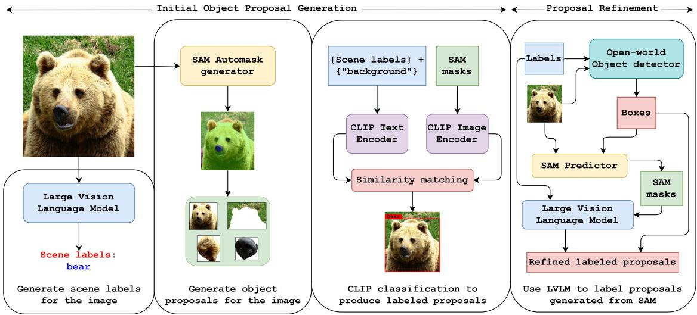  
Figure 3. Proposed annotator-free pipeline. Stage 1: LVLM and SAM generate scene-level labels and object proposals. Stage 2: CLIP encoders assign semantic labels to proposals. Stage 3: an open-set detector trained on these proposals generates refined prompts for SAM, which are re-labeled by the LVLM.

and known AP.

Our approach follows three stages: Self-labeling, where foundation and language models generate bounding boxes and labels without human input, amortized via SAM+CLIP landmark clustering (Sec. 2.1); Detection, where an openset detector trained on these labels recognizes both seen and unseen classes; and Refinement, where SAM, guided by the trained detector, improves proposal quality and localization, as illustrated in Fig. 3.

## 2.1. Deconstructing Dataset Preparation

Landmark-based clustering before LVLM queries. To avoid querying an LVLM on every SAM proposal, we amortize labeling across images. For image $I _ { i } ,$ , we run SAM to obtain masks $\{ m _ { i k } \}$ and form object crops by masking out the background (black by default). Each crop is encoded with CLIP to produce unit-normalized landmark features $\mathbf { z } _ { i k } \in \mathbb { R } ^ { 7 6 8 }$ . We keep up to K=32 largest valid masks per image, yielding the set $Z _ { i } = \left\{ \mathbf { z } _ { i k } \right\} _ { k = 1 } ^ { K _ { i } } \left( K _ { i } \leq K \right)$

Neighbor shortlist. To avoid all-pairs, we compute exact cosine kNN on per-image means $\begin{array} { r } { \bar { \bf z } _ { i } = \frac { 1 } { K _ { i } } \sum _ { k } { \bf z } _ { i k } } \end{array}$ (then $\ell _ { 2 ^ { - } }$ normalize), keeping $K _ { \mathrm { s h o r t } } { = } 7 5$ candidate neighbors.

Image-to-image distance. Given two images i, j with landmark sets $Z _ { i }$ and $Z _ { j }$ , we measure dissimilarity via a symmetric Chamfer over cosine distance:

$$
\begin{array} { r l } & { \displaystyle \boldsymbol { d } ( i , j ) = \frac { 1 } { 2 } \Bigg ( \frac { 1 } { K _ { i } } \sum _ { \mathbf { a } \in Z _ { i } } \operatorname* { m i n } _ { \mathbf { b } \in Z _ { j } } \left( 1 - \mathbf { a } ^ { \top } \mathbf { b } \right) } \\ & { \qquad \quad + \ \frac { 1 } { K _ { j } } \sum _ { \mathbf { b } \in Z _ { j } } \operatorname* { m i n } _ { \mathbf { a } \in Z _ { i } } \left( 1 - \mathbf { a } ^ { \top } \mathbf { b } \right) \Bigg ) . } \end{array}\tag{1}
$$

Sparse landmark graph. For an image i we sort its neighbors by $d ( i , j )$ and retain an edge (i, j) iff all filters pass: 1. kNN: j lies among the top-k nearest of i by d;

2. Local percentile: $d ( i , j ) \leq \tau _ { i }$ , where $\tau _ { i }$ is the p-th percentile of $\{ d ( i , \ell ) \}$ over the shortlist of i;

3. Global cutoff: $d ( i , j ) \le \tau _ { g }$ , the global percentile (e.g., median) over all shortlisted distances (optionally tightened via a shared-neighborhood constraint |NN(i) ∩ $\operatorname { N N } ( j ) | \geq s ,$ , where NN(·) are the Stage-B kNN lists).

We symmetrize with a mutual requirement (keep (i, j) only if both i keeps j and j keeps i). Connected components of this sparse graph define image clusters.

Medoids and label propagation. For each component C we select a medoid image by maximizing degree and, as a tiebreak, minimizing the sum of in-cluster distances:

$$
i ^ { \star } \ = \ \arg \operatorname* { m a x } _ { i \in \mathcal { C } } \big ( \deg ( i ) , - \sum _ { j \in \mathcal { C } , j \neq i } d ( i , j ) \big ) .
$$

We query the LVLM only on medoids to obtain scene/object labels and propagate those labels to all images within the same component, reducing LVLM usage from $O ( \sum _ { i } K _ { i } )$ per-dataset proposals to $O ( C )$ queries while improving intra-cluster label consistency. We optionally repeat this clustering-and-labeling procedure across iterations to improve coverage: after each round, we (i) prune noisy SAM masks and re-compute landmarks for uncertain images using the newly assigned labels, and (ii) optionally update the detector (YOLO) on the current pseudo-labels, before rebuilding the shortlist and graph.

Producing Object Labels. The initial step in annotatorfree object detection is autonomously generating semantic labels for detected objects, removing reliance on manual annotation. We leverage large vision-language models (VLMs) such as GPT-4o and CogVLM, which act as general-purpose observers, autonomously recognizing and describing objects present in a scene without any prior exposure or explicit definition of existing classes. Given an input image region $\mathbf { x } _ { r }$ , the visual encoder $\mathcal { F } _ { v } ^ { ( \mathrm { V L M } ) }$ and multimodal fusion module $\mathcal { G } _ { f } ^ { ( \mathrm { V L M } ) }$ directly produce text outputs:

$$
\mathbf { T } = \mathcal { G } _ { f } ^ { ( \mathrm { V L M } ) } \left( \mathcal { F } _ { v } ^ { ( \mathrm { V L M } ) } ( \mathbf { x } _ { r } ) \right) ,
$$

where T represents descriptive object labels or captions reflecting objects the VLM inherently recognizes, without predefined label sets – enabling flexible labeling and novel category discovery.

Producing Bounding Box Proposals. The second step autonomously generates bounding box proposals to localize objects within images, using a segmentation-based proposal generation module $( \mathcal { F } _ { \mathrm { s e g } } )$ – specifically SAM [11] – that produces segmentation masks $\mathcal { M } = \{ m _ { i } \} _ { i = 1 } ^ { N } ,$ , from which bounding boxes $\boldsymbol { B } = \{ b _ { i } \} _ { i = 1 } ^ { N }$ are derived. Because SAM is trained on vast and diverse data, it generalizes across classes and domains without fine-tuning, yielding precise, reliable bounding-box proposals even in completely unknown environments.

Assigning Labels to Bounding Box Proposals. After independently generating semantic labels and bounding box proposals, the next critical step involves matching these semantic labels to the bounding box proposals. Since segmentation masks lack inherent semantic labels, this matching step requires aligning visual embeddings of bounding boxes with textual embeddings of semantic labels. A suitable model for this matching step must operate within a unified embedding space for visual and textual data. Given visual embeddings for each bounding box proposal and textual embeddings for candidates, the matching’s given by:

$$
y _ { i } = \underset { c \in \mathcal { C } } { \arg \operatorname* { m a x } } \ \mathrm { s i m } ( \phi _ { b } ( b _ { i } ) , \phi _ { l } ( c ) ) .
$$

This matching strategy enables effective assignment of labels to proposals, balancing accuracy and inference. Here $b _ { i }$ is the i-th proposal; $\mathcal { C }$ is the candidate label set including background; $\phi _ { b } ( \cdot ) \in \mathbb { R } ^ { d }$ is the image encoder producing a unit-normalized embedding; $\phi _ { \ell } ( \cdot ) \in \mathbb { R } ^ { d }$ is the text encoder applied to a prompt producing a unit-normalized embedding; sim $( \mathbf { u } , \mathbf { v } ) { = } \mathbf { u } ^ { \top } \mathbf { v }$ denotes cosine similarity for unit vectors; and $y _ { i }$ is the assigned label for proposal $b _ { i }$

## 2.2. Self-labeling for proposal generation

The self-labeling stage involves generating initial bounding boxes as illustrated in Fig. 3 and object labels for YOLO World. This stage combines several foundational models to complement each other’s abilities. SAM produces segmentation masks for a given scene, aiding in Region of Interest (ROI) or proposal generation. Large language models (LLMs) or large vision-language models (LVLMs) are capable of identifying objects present in the scene, helping to construct scene labels. CLIP provides strong zero-shot classification capabilities to ground object proposals from SAM with scene labels derived from LLMs.

SAM is a foundational segmentation model that can produce high-precision segmentation masks for objects in a scene. However, SAM requires input prompts to segment specific objects from the scene. Since there is no way to prompt SAM without a supervised object detector, SAM can be configured to produce all possible segmentation masks for the scene. This approach, however, results in unnecessary segmentation masks, including backgrounds, redundant masks, fine-grained parts, and noisy segmentations. To enable annotator-free object detection, these unnecessary segmentations should be removed to yield appropriate object proposals for detector training.

Large vision-language models are trained on vast datasets and have a large capacity for parameterized knowledge. This capacity enables LVLMs to perform zero-shot inference for objects present in a scene without prior exposure to specific training or testing distributions. However, due to their high capacity, LVLMs have significant inference times, which leads to high computational costs when filtering out unnecessary object proposals from SAM, making the pipeline impractical for real-time applications.

Since LVLMs have slow inference times for object labeling, we employ CLIP for pre-filtering. CLIP, a visionlanguage model, is smaller in size compared to both SAM and LVLMs. Given the input image proposals and text proposals, CLIP assigns labels from a predefined label set significantly faster than any LVLM. Additionally, due to CLIP’s architecture, it produces confidence scores for each object proposal’s labels, enabling benefits such as Non-Maximum Suppression for redundancy removal.

## 2.3. Implementing the detector

In the scene-level label generation, we begin by using the text prompt “Generate the list of general labels of the objects present in the scene.” However, this approach does not guarantee that the object labels generated for instances of the same object class will be consistent. For example, “television” and $\mathbf { \ddot { \rho } } _ { \mathbf { \hat { \rho } } ^ { \mathbf { ( v ) } } }$ refer to the same object category but are linguistically different labels. This issue creates a run-off problem for object classes and leads to label redundancy. To mitigate this, we construct a dictionary to update the learned object categories. The dictionary is initialized without any prior knowledge of object classes, and it is updated as new categories are learned. Furthermore, for each object label produced by the LVLM, we search for similar labels or synonyms in the dictionary using the instruction “Replace the labels in the {label list} with similar labels present in the {dictionary}” to remove redundant labels. Because LVLM

APIs (e.g., GPT-4o) are not guaranteed to produce deterministic outputs across repeated calls or successive passes over the dataset, we freeze the label dictionary D once it converges (i.e., no new categories are added over a full pass through the dataset) and use this fixed dictionary for all subsequent proposal generation and evaluation. This prevents label-space drift caused by API non-determinism from affecting the reported results.

In the object-level label generation, we use text embeddings from the CLIP text encoder for scene-level labels and additionally append the class tag “background” to filter out unnecessary segmentations. To assign a label, we consider each segmentation instance: the segmented area is cropped using bounding boxes from SAM’s postprocessing. Then, the cropped image is multiplied by the binary segmentation mask to capture the region of interest (ROI) and exclude unnecessary parts from the cropped image. This step helps prevent background segmentation masks from being mislabeled as object labels, as the bounding box corresponding to the segmentation mask might include objects from other categories. Besides preventing background mislabeling, this also reduces cross-labeling of objects.

Once the CLIP labels are obtained, objects labeled as “background” are removed from the object proposals. To further reduce redundancy among object proposals, we apply Non-Maximum Suppression using CLIP scores as the confidence values. After generating the final object proposals for the dataset, we train YOLO World to develop a supervised object detector capable of performing OWD.

## 2.4. Proposal refinement

Once the open-world object detector is trained, we use the scene-level labels to perform inference. However, this inference stage operates under a closed-set setting, meaning we only consider the categories included in the dictionary developed during the proposal generation phase. Next, we use the bounding boxes from YOLO World as box prompts for SAM to refine segmentations and eliminate unnecessary segmentations that were generated during the self-labeling process. The supervised detector significantly reduces the number of proposals generated for a scene while also improving the quality of SAM’s segmentation masks.

Due to the substantial reduction in object proposals, we employ an LVLM to generate refined labels for these proposals during the refinement stage. This step leverages the classification head of YOLO World, which uses the CLIP text encoder, making the classification head functionally equivalent to object-level label generation, as seen in the self-labeling stage. In this process, the LVLM acts as a validator for the labels generated by CLIP, yielding more accurate labels for object proposals. To ensure coherence between object-level labels and scene-level labels within the dictionary, we prompt the LVLM with the instruction, “Pick a label from the {label list} for the object,” which helps assign a consistent label. After refining the object proposals, we retrain the open-set object detector with the improved proposals, further enhancing detection performance. Algorithm 1 summarizes the complete self-labeling and training process.

<table><tr><td>Algorithm 1 Self-Labeling and Training Process</td></tr><tr><td>1: Input: Image x</td></tr><tr><td>2: Initialize: Label dictionary D 3: Produce scene-level labels  $\mathcal { L } _ { \mathrm { s c e n e } }$  for the image x using</td></tr><tr><td>LVLM 4: Realign labels  $\mathcal { L } _ { \mathrm { s c e n e } }$  with the existing labels in the dic-</td></tr><tr><td>tionary D and update D for new labels 5: Generate segmentation masks M for the image x using</td></tr><tr><td>SAM 6: Classify the object proposals in M using CLIP with</td></tr><tr><td>scene-level labels  $\mathcal { L } _ { \mathrm { s c e n e } }$  7: Train YOLO World using the proposals generated for</td></tr><tr><td>the dataset 8: Produce box prompts  $\mathbf { b } _ { \mathrm { p r o m p t } }$  using the trained detector</td></tr><tr><td>for SAM 9: Label the object proposals P using LVLM to improve</td></tr><tr><td>self-labeling quality 10: Retrain detector with the improved object proposals P</td></tr></table>

## 2.5. Novel object detection

Process for Detecting Novel Object Classes. To detect novel object classes, we follow a process similar to the refinement stage. First, we generate scene-level labels for the scene and provide these labels to the open-set detector. The detector then produces regions of interest (ROIs), labels, and confidence scores for each detected object in the scene. From the scene-level labels, we separate the known and novel categories present in the scene. This allows us to focus on distinguishing high-confidence known categories from potential novel classes. For known categories, CLIP confidence scores tend to be higher for familiar class labels than for novel ones (reflecting CLIP’s pretraining bias toward frequently-seen concepts, which yields tighter image-text alignment), aiding in differentiating known objects from unknown ones. For object proposals with low confidence scores, we extract the corresponding bounding boxes and follow the procedure from the refinement stage to label these as novel classes. This approach allows for accurate labeling of novel objects within the scene.

## 3. Experiments and Results

In Sec. 3.1, we outline the implementation settings for our study. We then present our main findings in Sec. 3.2, where we compare our approach to leading models, GDINO [15]

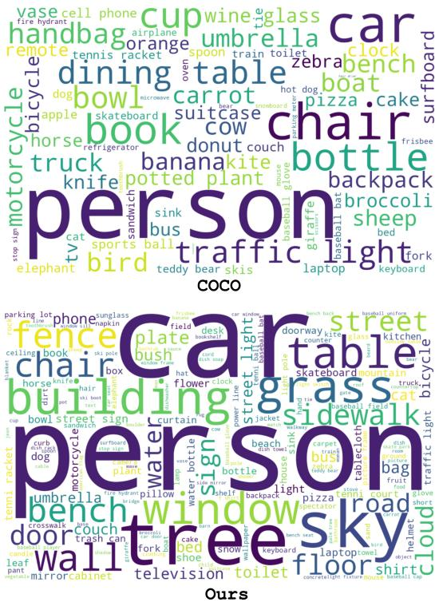  
Figure 4. Word clouds of COCO ground-truth instances (top) and our pseudo-labeled annotations (bottom). The proposed annotation scheme preserves relative class frequencies (e.g., person, car, table) while introducing additional categories (e.g., fence, building, window), thereby enriching label diversity. This demonstrates that our method not only captures the underlying distribution but also scales to novel concepts beyond the original dataset.

and T-Rex2 [10]. Lastly, in Sec. 3.4, we provide extensive ablation studies that highlight the practical advantages of our proposed approach.

## 3.1. Implementation Details

Datasets: We evaluate on five benchmarks: COCO [14], LVIS [9], ODinW-35 [12], Roboflow-100 [5], and a COCO Open-Vocabulary Detection (OVD) split. COCO (2017 val) covers 80 classes, while the OVD split partitions 48 known and 17 novel classes. LVIS provides 1,203 categories for large-vocabulary evaluation. ODinW-35 and Roboflow-100 further test adaptability across varied domains, using their full validation splits without additional training data.

LVLMs: We employ two models: (i) GPT-4o, via API, for scene-level labeling, and (ii) CogVLM, open-source, for object-level labeling and for realigning scene labels with the label dictionary.

YOLO World: Built on MMYOLO/MMDetection, trained with AdamW (lr=0.002, wd=0.05) for 100 epochs on 8 NVIDIA A5000 GPUs (batch size 64). Following prior work, we apply color, affine, flip, and mosaic augmentations

Table 1. Annotator-free object detection performance comparison on COCO val and LVIS minival. We consider the zero-shot evaluation of state-of-the-art long tail object detectors and open vocabulary object detectors for comparison.
<table><tr><td>Model</td><td>Backbone</td><td>COCO val</td><td>LVIS</td></tr><tr><td>GLIP-L [12]</td><td>Swin-L</td><td>49.8</td><td>26.9</td></tr><tr><td>DINOv [34]</td><td>Swin-L</td><td>46.2</td><td></td></tr><tr><td>GDINO-L [15]</td><td>Swin-L</td><td>48.4</td><td>27.4</td></tr><tr><td>T-Rex2 (Text) [10]</td><td>Swin-L</td><td>52.2</td><td>45.8</td></tr><tr><td>T-Rex2 (Visual) [10]</td><td>Swin-L</td><td>46.5</td><td>45.3</td></tr><tr><td>DetCLIPv3 [31]</td><td>Swin-T</td><td>47.2</td><td>47.0</td></tr><tr><td>DetCLIPv3 [31]</td><td>Swin-L</td><td>48.5</td><td>48.8</td></tr><tr><td>Ours</td><td>Swin-T</td><td>57.2</td><td>46.2</td></tr><tr><td>Ours</td><td>YOLO</td><td>60.8</td><td>47.4</td></tr></table>

during pre-training.

Evaluation protocol: Unless otherwise noted, all quantitative results reported in Tabs. 1 to 4 use the standard AP@[.50:.95] metric under strict, exact category-name matching against each benchmark’s ground-truth taxonomy; a prediction whose label does not exactly match a ground-truth category name is counted as a false positive even if it names a synonymous concept (e.g., “television” vs. “tv”). This differs from the qualitative teaser in Fig. 1, whose caption explicitly credits a detection as correct under IoU ≥ 0.5 with a synonym-mapped class label.

## 3.2. Annotator-free object detection

The performance on COCO val2017 and LVIS minival datasets is compared with state-of-the-art object detectors in Tab. 1. For a fair comparison, we evaluate all methods under a zero-shot setting, ensuring no prior access to the test set’s ground truth data. Our proposed method achieves a substantial improvement, with a 16.5% gain on COCO compared to long-tail detectors such as T-Rex2 and a 25.6% improvement over open-vocabulary detectors like GDINO. On LVIS, our method further surpasses long-tail detectors by 5% and open-vocabulary detectors by 72%. The label distributions visualized in Fig. 4 further confirm that our pseudo-labeling scheme preserves COCO’s class frequencies while introducing new categories. Qualitative examples are further illustrated in Fig. 6. To verify that these gains are not an artifact of the YOLO backbone, we additionally trained our pipeline using a Swin-T backbone [16], achieving 57.2 AP on COCO and 46.2 AP on LVIS (Tab. 1), confirming that our pseudo-labeling pipeline provides substantial gains regardless of the detector architecture.

The performance of our method on ODinW-35 val and Roboflow-100 val datasets is presented in Tab. 2. These datasets are designed to evaluate in-the-wild object detection performance. Our proposed method achieves a 17% improvement over long-tail object detectors and a

Table 2. Annotator-free object detection performance comparison on ODinW-35 val and Roboflow-100 val. We consider the zero-shot evaluation of state-of-the-art long tail object detectors and open vocabulary object detectors for comparison.
<table><tr><td>Model</td><td>Backbone</td><td>ODinW</td><td>Roboflow</td></tr><tr><td>GLIP-L [12]</td><td>Swin-L</td><td>23.4</td><td>8.6</td></tr><tr><td>DINOv [34]</td><td>Swin-L</td><td>15.7</td><td></td></tr><tr><td>GDINO-L [15]</td><td>Swin-L</td><td>22.3</td><td>8.3</td></tr><tr><td>T-Rex2 (Text) [10]</td><td>Swin-L</td><td>22.0</td><td>10.5</td></tr><tr><td>T-Rex2 (Visual) [10]</td><td>Swin-L</td><td>27.8</td><td>18.5</td></tr><tr><td>Ours</td><td>Swin-T</td><td>30.1</td><td>20.8</td></tr><tr><td>Ours</td><td>YOLO</td><td>32.5</td><td>23.7</td></tr></table>

Table 3. Comparison for novel object detection with other stateof-the-art methods. Performance is evaluated on a novel, known, and all classes on COCO OVD split following a generalized openvocabulary detection setting.
<table><tr><td>Method</td><td>Backbone</td><td>Novel</td><td>Known</td><td>All</td></tr><tr><td>OVR-CNN [33]</td><td>RN50</td><td>22.8</td><td>46.0</td><td>39.9</td></tr><tr><td>ViLD [8]</td><td>ViT-B/32</td><td>27.6</td><td>59.5</td><td>51.3</td></tr><tr><td>Detic [40]</td><td>RN50</td><td>27.8</td><td>47.1</td><td>45.0</td></tr><tr><td>OV-DETR [32]</td><td>ViT-B/32</td><td>29.4</td><td>61.0</td><td>52.7</td></tr><tr><td>BARON [29]</td><td>RN50</td><td>34.0</td><td>60.4</td><td>53.5</td></tr><tr><td>CORA [30]</td><td>RN50x4</td><td>41.7</td><td>44.5</td><td>43.8</td></tr><tr><td>CoFoMo [1]</td><td>ResNet101</td><td>50.3</td><td>49.8</td><td>49.9</td></tr><tr><td>SAS-Det [36]</td><td>ResNet101</td><td>37.4</td><td>58.5</td><td>53.0</td></tr><tr><td>DetCLIPv3 [31]</td><td>Swin-T</td><td>54.7</td><td>42.8</td><td>46.9</td></tr><tr><td>Ours</td><td>Swin-T</td><td>56.3</td><td>62.7</td><td>58.3</td></tr><tr><td>Ours</td><td>YOLO</td><td>55.9</td><td>64.6</td><td>59.1</td></tr></table>

45% improvement over open-vocabulary object detectors on ODinW. On Roboflow, we observe even greater gains, with improvements of 28% and 86% for long-tail and openvocabulary detection schemes, respectively. The ability to perform object detection in the wild without human annotations highlights the value of our pipeline, as it enables the development of automatic target recognition systems for unknown environments and niche object categories. The same Swin-T backbone described above achieves 30.1 AP on ODinW and 20.8 AP on Roboflow (Tab. 2), consistent with the backbone-parity trend observed on COCO and LVIS.

## 3.3. Novel object detection

To evaluate the performance of our method on the COCO Open-Vocabulary Detection (OVD) split, we trained on 48 base COCO classes and tested it on 17 novel classes. To ensure a fair comparison with other methods, we trained the detector on the base classes using ground truth data for object detection, consistent with the approach taken by previous methods. Unlike existing OVD methods [15], our approach does not rely on any additional training datasets.

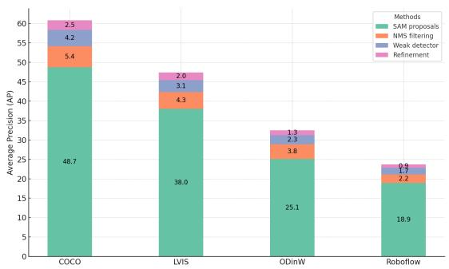  
Figure 5. Ablation of performance improvement across pipeline stages (proposal generation, inference, refinement).

Despite this, our method outperforms state-of-the-art approaches by a significant margin, as shown in Tab. 3. Specifically, we observe a 1.2-point improvement in $\mathsf { A P } _ { 5 0 }$ on novel classes (55.9 vs. 54.7) over the strongest competing method, DetCLIPv3 [31], underscoring the effectiveness of our approach relative to prior OVD methods. The Swin-T backbone variant introduced in Sec. 3.2 shows a similar trend on this split, achieving 56.3/62.7/58.3 $\mathsf { A P } _ { 5 0 }$ on novel/known/all classes, respectively (Tab. 3).

Additionally, we analyzed the pipeline’s performance for novel classes using an object detector trained with our annotator-free detection approach. For the base classes, this detector achieved an $\mathsf { A P } _ { 5 0 }$ of 48.9, while for novel classes, we observed an $\mathsf { A P } _ { 5 0 }$ of 55.9. Unlike the results in Tab. 3, where the base-class detector is trained using ground-truth annotations for fair comparison with prior OVD methods, the detector analyzed here is trained entirely through our annotator-free pipeline, without any ground-truth base-class labels; this is why its base-class $\mathsf { A P } _ { 5 0 }$ (48.9) differs from, and is not directly comparable to, the ground-truth-trained variant reported in Tab. 3. These results nonetheless demonstrate that with a sufficiently trained object detector, the proposed pipeline can effectively perform open-vocabulary detection without any ground-truth supervision at all.

## 3.4. Ablation study

Performance gain at different stages: The object detection performance at different stages of the proposed method is shown in Fig. 5. Results are provided for four datasets under an annotator-free detection scheme. For the ablation study, we evaluate the original object proposals generated by SAM, followed by proposals filtered using Non-Maximum Suppression (NMS) with CLIP scores. Next, we report detection performance from the trained object detector using the self-labeled dataset, and finally, we present the performance of the complete pipeline after refining the object proposal generation process.

As seen in Fig. 5, the largest improvement is achieved at the original object proposal stage, demonstrating the effectiveness of foundation models in generating proposals for annotator-free object detection. Notably, this stage operates independently of any standard object detector and requires no hyperparameter tuning, making it a fully trainingfree process. Despite its simplicity, this stage yields performance on par with zero-shot evaluations and surpasses open-vocabulary detectors like GroundingDINO.

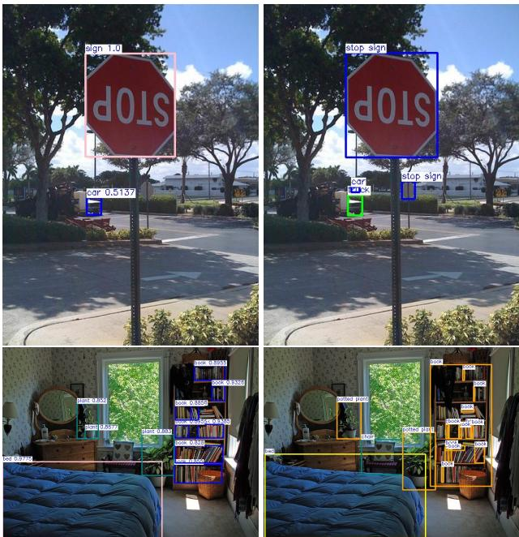  
Figure 6. Qualitative results for the detection performance of the proposed annotator-free method. The predicted detection results are on the left column, and the ground truth results are on the right.

The performance gain observed in the NMS filtering stage is due to the removal of overlapping proposals generated in the prior stage. Subsequently, the detection performance after primary training on the object detector shows an incremental boost across all four datasets. This improvement is attributed to enhanced bounding box detection accuracy, indicating the generalization benefits of a trained detector over other training-free methods.

Robustness under domain shift: To test generalization beyond our four main benchmarks, we evaluate on a synthetic domain-shift dataset containing both known and novel categories unseen during training (Applied Intuition simulator; full setup and per-class results in the supplementary material, Tab. 4). As shown in Fig. 7, GroundingDINO can localize novel objects but often assigns incorrect classes, whereas our approach produces more accurate and consistent recognition. Our pipeline achieves 43.7/32.8/38.8 AP50 on novel/known/overall classes, outperforming GLIP-L, T-Rex2, and GDINO-L.

Computational cost: Proposal generation is the main overhead, with LVLM queries costing roughly one second per scene. We avoid labeling all SAM segmentations directly, using CLIP as a pre-filter to cut labeling cost by 60×. Our landmark-based clustering (Sec. 2.1) queries the LVLM only on cluster medoids and propagates labels across the cluster, dropping per-image labeling time from 15–20 minutes to ∼45 seconds (∼20–27×).

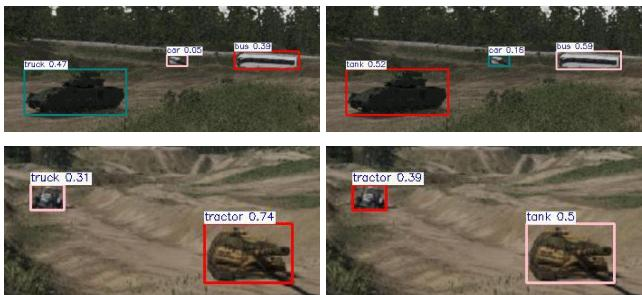  
Figure 7. Open-world detectors for novel object categories under domain shift. The detection performance for GroundingDINO (left column) are compared with the proposed novel object detection (right column).

## 3.5. Limitations

Despite strong results, our pipeline has notable limitations (Figs. 6 and 7) such as: LVLM mislabeling of ambiguous or occluded objects propagates into the pseudo-labels used for training. Localization quality is bounded by SAM’s segmentation, which degrades under low contrast, clutter, or fine-grained/overlapping parts. Labeling is also sensitive to LVLM prompt phrasing, only partially mitigated by the label dictionary (Sec. 2.1). Finally, LVLM queries remain the dominant computational cost; our medoid-based clustering substantially reduces this (15–20 min to ∼ 45 s per image), but the label-quality trade-off remains uncharacterized.

## 4. Conclusion

We introduced a novel annotator-free object detection framework that leverages large language and foundational models to eliminate human labeling. By automatically generating proposals and refining them iteratively, our modular pipeline integrates seamlessly with existing open-set detectors, boosting performance on both known and novel classes. Beyond strong results in zero-shot and openvocabulary settings, our approach demonstrates robustness under domain shifts, outperforming state-of-the-art methods such as GroundingDINO. These findings highlight the scalability and adaptability of our method, making it a practical solution for real-world detection in unstructured environments with minimal human intervention.

## References

[1] Rohit Bharadwaj, Muzammal Naseer, Salman Khan, and Fahad Shahbaz Khan. Enhancing novel object detec-

tion via cooperative foundational models. arXiv preprint arXiv:2311.12068, 2023. 7

[2] Nicolas Carion, Francisco Massa, Gabriel Synnaeve, Nicolas Usunier, Alexander Kirillov, and Sergey Zagoruyko. End-toend object detection with transformers. In European Conference on Computer Vision, pages 213–229. Springer, 2020. 1

[3] Chenyi Chen, Ari Seff, Alain Kornhauser, and Jianxiong Xiao. Deepdriving: Learning affordance for direct perception in autonomous driving. In 2015 IEEE International Conference on Computer Vision (ICCV), pages 2722–2730, 2015. 1

[4] Tianheng Cheng, Lin Song, Yixiao Ge, Wenyu Liu, Xinggang Wang, and Ying Shan. Yolo-world: Real-time open-vocabulary object detection. In Proceedings of the IEEE/CVF Conference on Computer Vision and Pattern Recognition, pages 16901–16911, 2024. 2

[5] Floriana Ciaglia, Francesco Saverio Zuppichini, Paul Guerrie, Mark McQuade, and Jacob Solawetz. Roboflow 100: A rich, multi-domain object detection benchmark. ArXiv, abs/2211.13523, 2022. 6

[6] Xuefeng Du, Zhaoning Wang, Mu Cai, and Yixuan Li. Vos: Learning what you don’t know by virtual outlier synthesis, 2022. 2

[7] Vladimir Fomenko, Ismail Elezi, Deva Ramanan, Laura Leal-Taix’e, and Aljosa Oˇ sep. Learning to discover and de-ˇ tect objects. In Advances in Neural Information Processing Systems, 2022. 2

[8] Xiuye Gu, Tsung-Yi Lin, Weicheng Kuo, and Yin Cui. Open-vocabulary object detection via vision and language knowledge distillation, 2022. 7

[9] Agrim Gupta, Piotr Dollar, and Ross Girshick. Lvis: A ´ dataset for large vocabulary instance segmentation, 2019. 6

[10] Qing Jiang, Feng Li, Zhaoyang Zeng, Tianhe Ren, Shilong Liu, and Lei Zhang. T-rex2: Towards generic object detection via text-visual prompt synergy. In European Conference on Computer Vision, pages 38–57. Springer, 2025. 6, 7, 1

[11] Alexander Kirillov, Eric Mintun, Nikhila Ravi, Hanzi Mao, Chloe Rolland, Laura Gustafson, Tete Xiao, Spencer Whitehead, Alexander C. Berg, Wan-Yen Lo, Piotr Dollar, and´ Ross Girshick. Segment anything. In Proceedings of the IEEE/CVF International Conference on Computer Vision, pages 4015–4026, 2023. 2, 4

[12] Liunian Harold Li\*, Pengchuan Zhang\*, Haotian Zhang\*, Jianwei Yang, Chunyuan Li, Yiwu Zhong, Lijuan Wang, Lu Yuan, Lei Zhang, Jenq-Neng Hwang, Kai-Wei Chang, and Jianfeng Gao. Grounded language-image pre-training. In CVPR, 2022. 2, 6, 7, 1

[13] Yu Li, Tao Wang, Bingyi Kang, Sheng Tang, Chunfeng Wang, Jintao Li, and Jiashi Feng. Overcoming classifier imbalance for long-tail object detection with balanced group softmax. In Proceedings of the IEEE/CVF conference on computer vision and pattern recognition, pages 10991– 11000, 2020. 2

[14] Tsung-Yi Lin, Michael Maire, Serge Belongie, James Hays, Pietro Perona, Deva Ramanan, Piotr Dollar, and C Lawrence´ Zitnick. Microsoft coco: Common objects in context. In

Computer Vision–ECCV 2014: 13th European Conference, Zurich, Switzerland, September 6-12, 2014, Proceedings, Part V 13, pages 740–755. Springer, 2014. 2, 6

[15] Shilong Liu, Zhaoyang Zeng, Tianhe Ren, Feng Li, Hao Zhang, Jie Yang, Chunyuan Li, Jianwei Yang, Hang Su, Jun Zhu, and Lei Zhang. Grounding dino: Marrying dino with grounded pre-training for open-set object detection. In European Conference on Computer Vision, pages 38–55. Springer, 2024. 2, 5, 6, 7, 1

[16] Ze Liu, Yutong Lin, Yue Cao, Han Hu, Yixuan Wei, Zheng Zhang, Stephen Lin, and Baining Guo. Swin transformer: Hierarchical vision transformer using shifted windows. In 2021 IEEE/CVF international conference on computer vision (ICCV), pages 9992–10002. Ieee, 2021. 6

[17] Matthias Minderer, Alexey Gritsenko, and Neil Houlsby. Scaling open-vocabulary object detection. In Advances in Neural Information Processing Systems, 2023. 2

[18] Alec Radford, Jong Wook Kim, Chris Hallacy, Aditya Ramesh, Gabriel Goh, Sandhini Agarwal, Girish Sastry, Amanda Askell, Pamela Mishkin, Jack Clark, Gretchen Krueger, and Ilya Sutskever. Learning transferable visual models from natural language supervision. In Proceedings of the 38th International Conference on Machine Learning, pages 8748–8763. PMLR, 2021. 2

[19] Shafin Rahman, Salman Khan, and Fatih Porikli. Zero-shot object detection: Learning to simultaneously recognize and localize novel concepts. In Asian Conference on Computer Vision, pages 547–563. Springer, 2018. 2

[20] J Redmon. You only look once: Unified, real-time object detection. In Proceedings ofthe IEEE conference on computer vision and pattern recognition, 2016. 1

[21] Tianhe Ren, Shilong Liu, Ailing Zeng, Jing Lin, Kunchang Li, He Cao, Jiayu Chen, Xinyu Huang, Yukang Chen, Feng Yan, Zhaoyang Zeng, Hao Zhang, Feng Li, Jie Yang, Hongyang Li, Qing Jiang, and Lei Zhang. Grounded sam: Assembling open-world models for diverse visual tasks. arXiv preprint arXiv:2401.14159, 2024. 2

[22] Mamshad Nayeem Rizve, Navid Kardan, Salman Khan, Fahad Shahbaz Khan, and Mubarak Shah. Openldn: Learning to discover novel classes for open-world semi-supervised learning. In European Conference on Computer Vision, pages 382–401. Springer, 2022. 2

[23] Wouter Van Gansbeke, Simon Vandenhende, and Luc Van Gool. Discovering object masks with transformers for unsupervised semantic segmentation. arXiv preprint arXiv:2206.06363, 2022. 2

[24] Sagar Vaze, Kai Han, Andrea Vedaldi, and Andrew Zisser man. Generalized category discovery. In Proceedings of the IEEE/CVF Conference on Computer Vision and Pattern Recognition, pages 7492–7501, 2022. 2

[25] Xinlong Wang, Zhiding Yu, Shalini De Mello, Jan Kautz, Anima Anandkumar, Chunhua Shen, and Jose M. Alvarez. Freesolo: Learning to segment objects without annotations. In Proceedings of the IEEE/CVF Conference on Computer Vision and Pattern Recognition, pages 14176–14186, 2022. 2

[26] Xudong Wang, Rohit Girdhar, Stella X. Yu, and Ishan Misra. Cutler: Cut and learn for unsupervised object detection and

instance segmentation. In Proceedings of the IEEE/CVF Conference on Computer Vision and Pattern Recognition, pages 3124–3134, 2023. 2

[27] Yangtao Wang, Xi Shen, Shell Xu Hu, Yuan Yuan, James L. Crowley, and Dominique Vaufreydaz. Self-supervised transformers for unsupervised object discovery using normalized cut. In Proceedings of the IEEE/CVF Conference on Computer Vision and Pattern Recognition, pages 14543–14553, 2022. 2

[28] Yingjie Wang, Qiuyu Mao, Hanqi Zhu, Jiajun Deng, Yu Zhang, Jianmin Ji, Houqiang Li, and Yanyong Zhang. Multimodal 3d object detection in autonomous driving: a survey. International Journal of Computer Vision, pages 1–31, 2023. 1

[29] Size Wu, Wenwei Zhang, Sheng Jin, Wentao Liu, and Chen Change Loy. Aligning bag of regions for openvocabulary object detection, 2023. 7

[30] Xiaoshi Wu, Feng Zhu, Rui Zhao, and Hongsheng Li. Cora: Adapting clip for open-vocabulary detection with region prompting and anchor pre-matching, 2023. 7

[31] Lewei Yao, Renjie Pi, Jianhua Han, Xiaodan Liang, Hang Xu, Wei Zhang, Zhenguo Li, and Dan Xu. Detclipv3: Towards versatile generative open-vocabulary object detection. In Proceedings of the IEEE/CVF Conference on Computer Vision and Pattern Recognition, pages 27391–27401, 2024. 6, 7

[32] Yuhang Zang, Wei Li, Kaiyang Zhou, Chen Huang, and Chen Change Loy. Open-vocabulary DETR with conditional matching. In Lecture Notes in Computer Science, pages 106– 122. Springer Nature Switzerland, 2022. 7

[33] Alireza Zareian, Kevin Dela Rosa, Derek Hao Hu, and Shih-Fu Chang. Open-vocabulary object detection using captions, 2021. 7

[34] Hao Zhang, Feng Li, Shilong Liu, Lei Zhang, Hang Su, Jun Zhu, Lionel M. Ni, and Heung-Yeung Shum. Dino: Detr with improved denoising anchor boxes for end-to-end object detection, 2022. 6, 7

[35] Sheng Zhang, Salman Khan, Zhiqiang Shen, Muzammal Naseer, Guangyi Chen, and Fahad Shahbaz Khan. Promptcal: Contrastive affinity learning via auxiliary prompts for generalized novel category discovery. In Proceedings of the IEEE/CVF Conference on Computer Vision and Pattern Recognition, pages 3479–3488, 2023. 2

[36] Shiyu Zhao, Samuel Schulter, Long Zhao, Zhixing Zhang, Yumin Suh, Manmohan Chandraker, Dimitris N Metaxas, et al. Taming self-training for open-vocabulary object detection. In Proceedings of the IEEE/CVF Conference on Computer Vision and Pattern Recognition, pages 13938–13947, 2024. 7

[37] Wayne Xin Zhao, Kun Zhou, Junyi Li, Tianyi Tang, Xiaolei Wang, Yupeng Hou, Yingqian Min, Beichen Zhang, Junjie Zhang, Zican Dong, et al. A survey of large language models. arXiv preprint arXiv:2303.18223, 2023. 2

[38] Zhong-Qiu Zhao, Peng Zheng, Shou-tao Xu, and Xindong Wu. Object detection with deep learning: A review. IEEE transactions on neural networks and learning systems, 30 (11):3212–3232, 2019. 2

[39] Yiwu Zhong, Jianwei Yang, Pengchuan Zhang, Chunyuan Li, Noel Codella, Liunian Harold Li, Luowei Zhou, Xiyang Dai, Lu Yuan, Yin Li, and Jianfeng Gao. Regionclip: Region-based language-image pretraining. In Proceedings of the IEEE/CVF Conference on Computer Vision and Pat tern Recognition, pages 16793–16803, 2022. 2

[40] Xingyi Zhou, Rohit Girdhar, Armand Joulin, Philipp Krahenb¨ uhl, and Ishan Misra. Detecting twenty-thousand¨ classes using image-level supervision, 2022. 7

[41] Zhengxia Zou, Keyan Chen, Zhenwei Shi, Yuhong Guo, and Jieping Ye. Object detection in 20 years: A survey. Proceed ings ofthe IEEE, 111(3):257–276, 2023. 1

# Annotator-Free Object Detection via Foundation Model Collaboration

Supplementary Material

## 5. Additional Experimental Details

In our proposed work, we demonstrated the performance of the proposed pipeline on novel object detection under domain shift by compiling a dataset of simulated images using a graphic simulator.

In this experiment, we consider the detection performance of the proposed pipeline when changes are introduced to the environment and sensor. To simulate the change in environment, we use an outdoor environment in the simulator. The sensor changes are introduced by the color and texture gap between real and synthetic images. We refer to this cumulative gap between the real images and simulated images as the domain shift.

To study the performance under domain shift, we need to introduce the domain gap during inference from the proposed pipeline. For that, we train the object detector on the COCO dataset as explained in the main paper for the annotator-free object detection task. Then, we use this pretrained object detector to perform inference on the simulated dataset.

The simulated dataset was constructed using the Applied Intuition simulator. Here, we used five known and novel classes. The known classes: car, airplane, bus, truck, and bicycle, already exist in the COCO categories. The novel classes: tank, tractor, helicopter, scooter, and excavator do not appear in the training distribution. Below we provide some sample images from the simulated dataset.

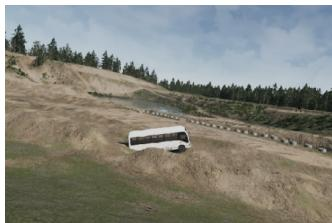  
bus

  
airplane

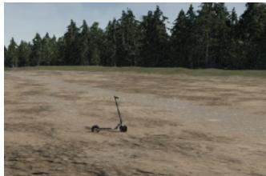  
scooter

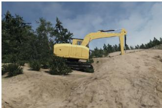  
excavator  
Figure 8. Sample images from the simulated dataset.

Quantitative comparisons in Tab. 4 report results separately for known and novel categories, similar to openvocabulary evaluations. Our pipeline achieves a clear advantage on novel classes while maintaining strong performance on known categories, driven by the LLM-based classification branch, which supplies a broader and more adaptive vocabulary than conventional open-vocabulary or openset detectors. Note that relative rankings among baselines on this synthetic benchmark can differ from the main paper’s COCO/LVIS/ODinW/Roboflow results: for instance, GLIP-L outperforms T-Rex2 on novel classes here despite the opposite trend there, because this dataset’s scene distribution and novel-category composition (e.g., tanks, tractors) differ substantially from those benchmarks.

Table 4. Comparison for novel object detection under domain shift with other state-of-the-art methods. Performance is evaluated on novel, known, and overall classes.
<table><tr><td>Method</td><td>Backbone</td><td>Novel</td><td>Known</td><td>Overall</td></tr><tr><td>GLIP-L [12]</td><td>Swin-L</td><td>35.1</td><td>12.6</td><td>24.9</td></tr><tr><td>T-Rex2 [10]</td><td>Swin-L</td><td>31.9</td><td>21.2</td><td>27.1</td></tr><tr><td>GDINO-L [15]</td><td>Swin-L</td><td>38.4</td><td>26.5</td><td>33.0</td></tr><tr><td>Ours</td><td>YOLO</td><td>43.7</td><td>32.8</td><td>38.8</td></tr></table>

## 6. Annotation-Free Detection Pipeline: Clarifications

## 6.1. Pipeline Design and Novelty

Unlike DetCLIPv3, RegionCLIP, VLDet, or T-Rex2, which all depend on labeled datasets or pre-trained supervised components, our pipeline is target-dataset annotation-free. It is built upon:

• SAM for class-agnostic proposal generation,

• CLIP and LVLMs for label assignment,

• Self-refinement via re-prompting with trained detectors.

This design enables detector training without any targetdataset annotations, using only unannotated images. Our modular approach integrates pseudo-labeling, open-world reasoning, and label refinement into a single end-to-end framework.

## 6.2. Handling Noisy SAM Proposals

SAM’s automatic mode may produce over- or undersegmented regions. We address this via:

1. CLIP-based filtering (threshold = 0.5),

2. NMS filtering (IoU threshold = 0.6),

3. Self-refinement with learned detector.

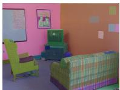  
(a) SAM Masks

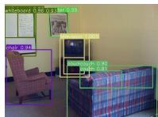  
(b) CLIP Filter

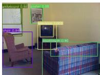  
(c) NMS Filter  
Figure 9. Noise reduction steps for SAM proposals.

## 7. Efficiency and Foundational Model Usage

Foundational models (CLIP, GPT-4o, CogVLM) are only used during offline proposal labeling. The final deployed detector is a real-time YOLO-based model.

• CLIP filtering occurs early to reduce load.

• GPT-4o is used only once to generate the label dictionary.

• LVLMs are used in refinement (Step 9), limited to fewer high-confidence regions.

Average LVLM runtime is 1–2s per image, occurring entirely offline.

## 8. Rare Class Generalization

We evaluated the model on the LVIS rare class subset. The results were:

$$
\cdot \ \mathbf { A } \mathbf { P } _ { \mathrm { a l l } } = 4 7 . 4
$$

$$
\mathbf { A P _ { r } } = 4 6 . 1
$$

This small drop suggests better robustness to class imbalance compared to models like T-Rex2.

## 9. Scalability of Label Dictionary

While the label dictionary theoretically incurs $O ( n ^ { 2 } )$ complexity due to transformer attention, we use:

• Hashmap-based caching of label outputs,

• Amortized O(1) lookups for repeated scenes.

This allows the system to scale efficiently even with large vocabularies.

## 10. Parameter Summary

• CLIP Score Threshold (Step 6): 0.5

• NMS IoU Threshold: 0.6

• LVLMs: Used for semantic refinement, no confidence scores

• Detector: YOLO World with default configs