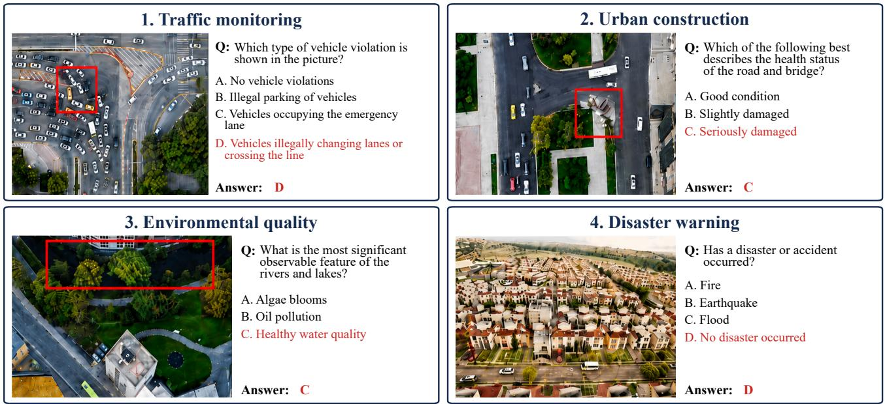
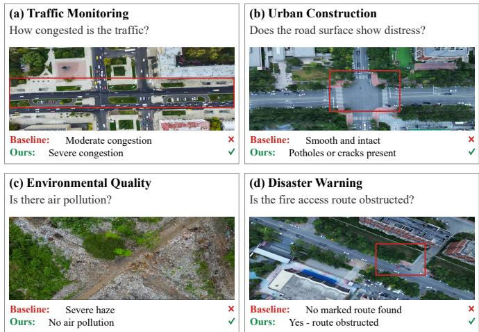

# BENCHMARKING FINE-GRAINED VISUAL REASONING FOR REMOTE SENSING IN URBAN MANAGEMENT

Jiawei Zhang1, Rizhao Cai2, Dayan Guan1

1School of Electronics and Information Engineering, Harbin Institute of Technology, 150000 Harbin, China. 2 Huawei International PTE LTd, 486066 Singapore, Singapore.

Abstract—Fine-grained visual reasoning is essential for remote sensing in urban management, yet remains underexplored in the evaluation of multimodal large language models (MLLMs). We introduce UMBench, a fine-grained urban remote sensing benchmark built from unmanned aerial vehicle (UAV) images for multiple urban management tasks such as traffic monitoring, urban construction, environmental quality, and disaster warning. Evaluations on UMBench reveal that current MLLMs often rely on scene-level priors and overlook fine-grained visual evidence. To address this issue, we further propose a novel evidence-first chainof-thought method that directs models to inspect fine-grained visual evidence in a training-free manner. Experiments show that our method can improve the performance of both open-source and commercial MLLMs on UMBench.

Index Terms—Multimodal Large Language Models, Trainingfree Method, Remote Sensing, Urban Management.

## I. INTRODUCTION

Remote sensing (RS) has become an important information source for urban management, supporting a range of applications, including urban sustainability monitoring, disaster risk management, and observation of diverse urban environments [1–3]. In these applications, effective image understanding should not stop at scene-level recognition, but should support task-specific reasoning based on fine-grained visual evidence [4, 5]. Since such reasoning tasks are often task-dependent and difficult to cover with a fixed set of predefined labels, MLLMs offer a flexible interface for interpreting RS images through natural-language queries and linking fine-grained visual evidence to task-specific reasoning. However, fine-grained visual reasoning in urban management remains underexplored in MLLM evaluation.

Existing RS evaluation benchmarks primarily focus on scene-level visual capabilities [6]. However, models may rely on scene-level priors, inferring answers from overall scene context or common object co-occurrence rather than from fine-grained visual evidence, a failure mode related to object hallucination in vision-language models [7]. For example, scene-level questions may ask whether an image contains a road, while fine-grained questions ask whether a vehicle crosses a lane line or whether local cracks exist. Traditional datasets, such as RSVQA [8], mainly evaluate scene classification or generic question answering, where many answers can be inferred from scene-level information without explicitly testing fine-grained visual evidence. Even high-resolution benchmarks, such as FloodNet [9], primarily evaluate scene classification or generic question answering, focusing on scene-level understanding or binary classification. Existing evaluations rarely test the intersection of fine-grained visual inspection and logical reasoning. In real-world RS applications, targets can be minute, ambiguous, and embedded in complex backgrounds. Current evaluations do not test whether an MLLM discerns these fine-grained visual details or guesses from scene-level priors.

To address this gap, we introduce UMBench, an Urban Management Benchmark for fine-grained visual reasoning in complex RS scenarios. It is built from 583 UAV images and contains 2,733 expert-curated QA pairs spanning traffic monitoring, urban construction, environmental quality, and disaster warning. UMBench tests whether models can combine fine-grained visual inspection with reasoning instead of relying on scene-level priors.

To reduce reliance on scene-level priors, we propose a training-free evidence-first chain-of-thought (CoT) prompting method [10]. The method guides models to inspect finegrained visual evidence before making a final choice. Since it requires no model fine-tuning or access to model weights, it can be applied to both open-source MLLMs and commercial MLLMs. Experiments on representative Qwen-VL, InternVL, and commercial models show that the proposed method improves performance across different access settings.

The main contributions of this work are summarized as follows.

• We propose UMBench, the first urban remote sensing benchmark for fine-grained visual reasoning in urban management.

• We design a novel training-free method to guide MLLMs to focus on fine-grained visual evidence rather than scenelevel priors.

• The designed method is applicable to both open-source and commercial MLLMs due to its training-free property.

## II. UMBENCH DATASET

In this work, fine-grained visual reasoning denotes questions that cannot be solved from a global scene category alone. A correct answer must be supported by fine-grained evidence, including small-object inspection, attribute judgment, spatialrelation reasoning, or explicit verification against a plausible scene-level prior. This distinction is important for urban management because visually similar scenes may encode different operational states, such as lawful traffic versus lane crossing, intact pavement versus local cracking, or normal water surfaces versus inundation.

  
Fig. 1. Overview of UMBench. Red boxes are manually added for visualization only and are not provided to models during evaluation. Each example illustrates a compact multiple-choice question that requires fine-grained visual reasoning rather than scene-level priors.

UMBench comprises 583 UAV images covering urban environments, complementing large-scale RS vision-language resources [11, 12]. The processed images are stored in PNG format, with the longer side resized to 800 pixels while preserving aspect ratio; GSD metadata was not available from the processed files. The image pool includes intersections, parking lots, residential blocks, construction zones, rivers, parks, green spaces, and open fields. Rather than treating high pixel resolution as the primary contribution, UMBench emphasizes task-relevant evidence such as vehicles, lane markings, barriers, pavement texture, water surfaces, vegetation patterns, and object relations. Blurred, overexposed, ambiguous, and near-duplicate images were removed during quality control.

As illustrated in Fig. 1, the benchmark organizes 2,733 QA pairs into four application groups: Traffic Monitoring evaluates vehicle behavior, congestion, parking use, and lane relations; Urban Construction examines buildings, roads, and construction conditions; Environmental Quality covers water, vegetation, waste, and air-quality evidence; and Disaster Warning targets inundation, collapse, fire, obstruction, and infrastructure risks. A QA pair may receive multiple application tags, yielding 3,305 cumulative tag assignments (TM/UC/EQ/DW: 1,129/755/992/429).

Each instance is a multiple-choice question designed to resist answers based on scene-level priors. Annotators first identified a visually verifiable evidence region, formulated a question whose answer depends on that region, and then constructed scene-compatible distractors that differ in finegrained visual evidence. All QA pairs were manually curated and reviewed by an expert team for visual verifiability, distractor plausibility, and ambiguity. Disagreements were resolved through consensus discussion, and ambiguous cases with unclear evidence or multiple plausible answers were revised or removed. Since labels were finalized through consensusbased expert curation, we report this quality-control protocol rather than an independent inter-annotator agreement score. The complete set is reserved for zero-shot evaluation without task-specific training.

## III. EVIDENCE-FIRST COT METHOD

As discussed, current MLLMs may rely on scene-level priors when analyzing complex remote sensing imagery, allowing macroscopic context to override fine-grained visual evidence. Inspired by CoT and multimodal reasoning prompts [10, 13], we propose a lightweight, training-free evidencefirst Chain-of-Thought prompting method. Instead of asking the model to reason freely, the method imposes an explicit evidence bottleneck: the model must first ground the question in visible local cues, then suppress scene-level priors, and finally map the verified evidence to a constrained option. This ordering is designed for UMBench, where distractors are often semantically plausible at the scene level but inconsistent with small visual details.

This design can be viewed as a compact verify-then-answer framework, as summarized in Fig. 2. It requires no fine-tuning or access to model weights, and can therefore be applied to both open-source and commercial models. The framework contains three modules. Visual Grounding asks the model to inspect local objects, attributes, and spatial relations before using high-level semantics. Prior Suppression weakens answers supported only by scene type or common co-occurrence patterns. Standardized Output constrains the response to a final option letter, making evaluation robust to verbose outputs.

Input Configuration: ⟨Image⟩, ⟨Question⟩, ⟨Choices⟩   
Instruction Template:   
[Visual Grounding]   
Inspect fine visual details first.   
[Prior Suppression]   
Do not answer from scene type or semantic plausibility alone.   
Briefly cite concrete image evidence, then choose the best   
option.   
[Output Formatting]   
End with: Final Answer: <Option Letter>  
Fig. 2. Evidence-first prompting template. The model grounds local cues, suppresses unsupported scene-level priors, and returns a standardized option.

The ordered stages prevent a fluent but unsupported conclusion from bypassing visual verification. Because the image, options, decoding configuration, and model parameters remain unchanged, the method isolates the effect of evidence-oriented prompting without introducing additional supervision or taskspecific training.

## IV. EXPERIMENTS AND RESULTS

## A. Experimental Setup

We evaluate MLLMs under two complementary access settings. In the local setting, three compact open-source models are deployed under the same preprocessing and inference environment, providing a reproducible test of the method on resource-conscious systems. In the cloud setting, three commercial models are queried without access to their weights, testing whether the same prompt-level intervention transfers to black-box services. All experiments are zero-shot and use identical images, questions, options, and decoding settings across models; only the prompting instruction changes. All models receive the processed PNG images without red-box annotations: local models use their official image processors and default visual-token settings, while commercial models receive the same images through provider APIs. We use fixed decoding settings when available and report exact top-1 accuracy on the full benchmark. Outputs without a valid final option are counted as incorrect.

We additionally compare direct answering with standard zero-shot CoT, which appends “Let’s think step by step” to elicit intermediate reasoning [14], and our evidence-first CoT. This control distinguishes gains attributable to generic, longer reasoning from those obtained by explicitly grounding the decision in local visual evidence. All three variants use the same samples and require a final option letter for automatic matching.

## B. Main Results and Analysis

Tables I and II summarize the results under two access settings: open-source MLLMs and commercial MLLMs. Table I shows that evidence-first CoT improves the overall accuracy of all three open-source models, with the largest gain observed on InternVL3.5-8B. Table II shows that the same training-free method can also be applied to commercial MLLMs, where Grok-4.20 obtains a clear overall improvement.

  
Fig. 3. Representative corrections by evidence-first CoT on Qwen3-VL-8B. Direct answering tends to follow scene-level priors, while our prompt recovers the correct option from fine-grained visual evidence. Red boxes are for visualization only.

TABLE I  
RESULTS OF OUR METHOD AND OPEN-SOURCE MLLMS ON UMBENCH.
<table><tr><td>Method</td><td>TM</td><td>UC</td><td>EQ</td><td>DW</td><td>Avg</td></tr><tr><td>Qwen3-VL-8B [15] + Ours</td><td>50.13 43.58</td><td>51.33</td><td>49.19</td><td>55.94</td><td>50.04</td></tr><tr><td>Qwen3-VL-8B InternVL3.5-8B [16] + Ours</td><td>45.88</td><td>52.98 46.75</td><td>46.77 47.48</td><td>48.25 54.55</td><td>47.35 46.62</td></tr><tr><td>InternVL3.5-8B Qwen2.5-VL-7B [17] + Ours</td><td>41.90</td><td>47.55</td><td>39.11</td><td>47.55</td><td>42.47</td></tr><tr><td>Qwen2.5-VL-7B</td><td>40.48 35.87</td><td>42.25 42.78</td><td>47.28 50.10</td><td>54.31 45.92</td><td>44.56 43.13</td></tr></table>

TABLE II  
RESULTS OF OUR METHOD AND COMMERCIAL MLLMS ON UMBENCH.
<table><tr><td>Method</td><td>TM</td><td>UC</td><td>EQ</td><td>DW</td><td>Avg</td></tr><tr><td>Gemini-3-Flash [18] + Ours Gemini-3-Flash</td><td>52.09 51.90</td><td>56.95 55.63</td><td>51.82 50.10</td><td>59.38 57.11</td><td>52.97 51.58</td></tr><tr><td>Grok-4.20 [19] + Ours Grok-4.20</td><td>48.36 46.77</td><td>50.33 54.17</td><td>46.77 33.67</td><td>61.54 42.19</td><td>48.57</td></tr><tr><td>GPT-4o [20] + Ours GPT-40</td><td>49.07 45.97</td><td>53.25 47.68</td><td>47.78 45.87</td><td>59.21 51.98</td><td>44.97 49.27 46.03</td></tr></table>

Table III further isolates the effect of prompt structure on the three locally deployed open-source models. ZS-CoT raises InternVL3.5-8B from 42.47 to 44.31 and Qwen2.5- VL-7B from 43.13 to 43.57, whereas evidence-first CoT reaches 46.62 and 44.56, respectively. Thus, unconstrained step-by-step reasoning provides only part of the gain; explicitly verifying visual evidence is more effective overall.

The direct-answer results show that current MLLMs still struggle with UMBench. Without explicit visual verification, models may select distractors that are consistent with scenelevel priors while overlooking the fine-grained visual evidence required by the question. Evidence-first CoT reduces some of these errors by guiding models to inspect fine-grained visual evidence before selecting an option. The qualitative comparisons in Fig. 3 illustrate representative corrections across the four task groups, including congestion assessment, road distress, environmental evidence, and emergency-access

TABLE III  
COMPARISON OF OUR METHOD AND ZS-COT [14] ON OPEN-SOURCEMLLMS USING UMBENCH.
<table><tr><td>Method</td><td>TM</td><td>UC</td><td>EQ</td><td>DW</td><td>Avg</td></tr><tr><td> $\overline { { \mathrm { Q w e n } 3 \mathrm { - } \mathrm { V L } \mathrm { - } 8 \mathrm { B } + \mathrm { O u r s } } }$ </td><td>50.13</td><td>51.33</td><td>49.19</td><td>55.94</td><td>50.04</td></tr><tr><td> $\mathrm { Q w e n 3 - V L - 8 B + Z S - C o T \ [ 1 4 ] }$ </td><td>45.26</td><td>47.68</td><td>45.97</td><td>55.48</td><td>46.51</td></tr><tr><td> $\overline { { \mathrm { I n t e r n V L 3 . 5  – 8 B + O u r s } } }$   $\operatorname { I n t e r n V L 3 . 5 - 8 B } + Z \mathrm { S - C o T } \ [ 1 4 ]$ </td><td>45.88 42.60</td><td>46.75 46.62</td><td>47.48 46.27</td><td>54.55 50.35</td><td>46.62</td></tr><tr><td> $\overline { { \mathrm { Q w e n } 2 . 5 \mathrm { - } \mathrm { V L } \mathrm { - } 7 \mathrm { B } + \mathrm { O u r s } } }$ </td><td>40.48</td><td>42.25</td><td>47.28</td><td>54.31</td><td>44.31</td></tr><tr><td> $\hat { \mathrm { Q w e n } } 2 . 5 { \mathrm { - } } \mathrm { V L } { \mathrm { - } } 7 \mathrm { B } + \mathrm { Z S } { \mathrm { - } } \mathrm { C o T } \ [ 1 4 ]$ </td><td>39.42</td><td>41.85</td><td>45.26</td><td>54.78</td><td>44.56</td></tr><tr><td></td><td></td><td></td><td></td><td></td><td>43.57</td></tr></table>

obstruction.

Across these cases, evidence-first CoT does not add external knowledge, but redirects the model from scene-level priors to fine-grained visual evidence, such as vehicle density, pavement texture, pollution cues, and access-route continuity. This suggests that the method helps models use visual evidence more effectively, although prompting alone cannot fully solve fine-grained visual reasoning.

## V. CONCLUSION

In this paper, we introduce UMBench, a remote sensing Urban Management Benchmark for evaluating fine-grained visual reasoning in MLLMs. UMBench contains 2,733 questionanswer pairs across multiple urban management tasks and tests whether models can answer questions based on fine-grained visual evidence rather than scene-level priors. Our evaluations on locally deployed open-source models and cloud-hosted commercial models highlight two findings: 1) current MLLMs still struggle to consistently use fine-grained visual evidence; 2) the proposed evidence-first CoT prompting method improves performance without extra training or access to model weights, although the gains remain model- and task-dependent. Comparisons with ZS-CoT further show the value of explicit visual evidence inspection over generic step-by-step reasoning. These results suggest that future RS-specific MLLMs should strengthen fine-grained visual grounding, small-object perception, and attribute-level reasoning. UMBench provides a focused benchmark for studying fine-grained visual reasoning in urban remote sensing.

## VI. AKNOWLEDGEMENT

This research was supported by ”the Key Research and Development Program of Heilongjiang Province under Grant 2026ZX01A07” and was funded by the National High-Level Young Talent Program Project.

## REFERENCES

[1] N. Kadhim, M. Mourshed, and M. Bray, “Advances in remote sensing applications for urban sustainability,” Euro-Mediterranean Journal for Environmental Integration, vol. 1, no. 1, p. 7, 2016.

[2] S. Ghaffarian, N. Kerle, and T. Filatova, “Remote sensing-based proxies for urban disaster risk management and resilience: A review,” Remote sensing, vol. 10, no. 11, p. 1760, 2018.

[3] G. Chen, Y. Zhou, J. A. Voogt, and E. C. Stokes, “Remote sensing of diverse urban environments: From the single city to multiple cities,” Remote Sensing of Environment, vol. 305, p. 114108, 2024.

[4] H. Jiang, J. Yin, Q. Wang, J. Feng, and G. Chen, “Eaglevision: Object-level attribute multimodal llm for remote sensing,” arXiv preprint arXiv:2503.23330, 2025.

[5] K. Li, T. Wang, D. Wang, Y. Zhu, Y. Zhang, T. Lei, and Q. Wang, “Provg: Progressive visual grounding via language decoupling for remote sensing imagery,” arXiv preprint arXiv:2604.01893, 2026.

[6] X. Li, J. Ding, and M. Elhoseiny, “Vrsbench: A versatile vision-language benchmark dataset for remote sensing image understanding,” Advances in Neural Information Processing Systems, vol. 37, pp. 3229–3242, 2024.

[7] Y. Li, Y. Du, K. Zhou, J. Wang, X. Zhao, and J.-R. Wen, “Evaluating object hallucination in large visionlanguage models,” in Proceedings of the 2023 conference on empirical methods in natural language processing, 2023, pp. 292–305.

[8] S. Lobry, D. Marcos, J. Murray, and D. Tuia, “Rsvqa: Visual question answering for remote sensing data,” IEEE Transactions on Geoscience and Remote Sensing, vol. 58, no. 12, pp. 8555–8566, 2020.

[9] M. Rahnemoonfar, T. Chowdhury, A. Sarkar, D. Varshney, M. Yari, and R. R. Murphy, “Floodnet: A high resolution aerial imagery dataset for post flood scene understanding,” IEEE Access, vol. 9, pp. 89 644–89 654, 2021.

[10] J. Wei, X. Wang, D. Schuurmans, M. Bosma, F. Xia, E. Chi, Q. V. Le, D. Zhou et al., “Chain-of-thought prompting elicits reasoning in large language models,” Advances in neural information processing systems, vol. 35, pp. 24 824–24 837, 2022.

[11] Z. Zhang, T. Zhao, Y. Guo, and J. Yin, “Rs5m and georsclip: A large-scale vision-language dataset and a large vision-language model for remote sensing,” IEEE Transactions on Geoscience and Remote Sensing, vol. 62, pp. 1–23, 2024.

[12] F. Liu, D. Chen, Z. Guan, X. Zhou, J. Zhu, Q. Ye, L. Fu, and J. Zhou, “Remoteclip: A vision language foundation model for remote sensing,” IEEE Transactions on Geoscience and Remote Sensing, vol. 62, pp. 1–16, 2024.

[13] Z. Zhang, A. Zhang, M. Li, H. Zhao, G. Karypis, and A. Smola, “Multimodal chain-of-thought reasoning in language models,” arXiv preprint arXiv:2302.00923, 2023.

[14] T. Kojima, S. S. Gu, M. Reid, Y. Matsuo, and Y. Iwasawa, “Large language models are zero-shot reasoners,” Advances in neural information processing systems, vol. 35, pp. 22 199–22 213, 2022.

[15] S. Bai, Y. Cai, R. Chen et al., “Qwen3-vl technical report,” 2025. [Online]. Available: https://arxiv.org/abs/ 2511.21631

[16] W. Wang, Z. Gao, L. Gu, H. Pu, L. Cui, X. Wei, Z. Liu, L. Jing, S. Ye, J. Shao et al., “Internvl3. 5: Advancing open-source multimodal models in versatility, reasoning, and efficiency,” arXiv preprint arXiv:2508.18265, 2025.

[17] S. Bai, K. Chen, X. Liu et al., “Qwen2.5-vl technical report,” 2025. [Online]. Available: https://arxiv.org/abs/ 2502.13923

[18] Google DeepMind, “Gemini 3 Flash Model Card,” https: //deepmind.google/models/model-cards/, Dec. 2025.

[19] xAI, “Grok 4.20 system card,” Technical report, 2026.

[20] OpenAI, “GPT-4o System Card,” https://openai.com/ index/gpt-4o-system-card/, Aug. 2024.