# Beyond Infraction Scores: Failure-Boundary Profiles for Closed-Loop Evaluation of Driving and Robot Navigation Agents

Milan Bulat Social Chaos Lab speedy.milan@gmail.com

Gino Ardelean Social Chaos Lab ginoardelean@gmail.com

Ellington Kirby valeo.ai ellington.kirby@valeo.com

## Abstract

Closed-loop driving benchmarks in CARLA rank agents by a driving score that multiplies route completion by an infraction penalty. This score does not distinguish an agent that stops in front of an obstacle from one that pushes past it. In a corridor closed by two parked cars, for example, one agent that drives through with contact averages 52.2 on the blocked widths, while the agents that stop average between 37.8 and 40.6. We propose failure-boundary profiles, an evaluation in which each scenario family varies one measured factor, such as corridor width or the time gap in oncoming traffic, and each variant is certified from measurement as one where the agent should proceed or one where it should stop. Along this axis we estimate two curves per agent, commitment (the probability of attempting the passage) and competence (the probability ofpassing without contact), and locate where each crosses one half, with intervals that account for the simulator’s run-to-run variance. The certified labels also give a summary metric, decision accuracy, which credits clean passes on passable variants and stops on blocked ones. We evaluate seven driving agents on seven CARLAfamilies. The rule-based expert reaches a decision accuracy of0.74 and TFv6, the highestscoring learned agent, 0.60. Agents with similar driving scoresfail in different ways, and agents that reliably stop at a blocked corridor still rarely wait for a gap in oncoming traffic. We also apply the method, unchanged, to a warehouse robot in Isaac Sim. The navigation policy we test stops at blocked gaps in only one of three families, and two fine-tuned versions of it pass more gaps cleanly but no longer stop at all.

## 1. Introduction

Recent CARLA-based benchmarks such as Bench2Drive and Fail2Drive [7, 10] evaluate agents with the Driving Score (DS), which multiplies an agent’s route completion by an infraction penalty. The route is predefined for each scenario, and the infractions cover collisions, traffic-rule violations and blocking. The intent is that a single number captures good driving.

These benchmarks probe a wide range of behaviors through scenario construction: merging, obeying traffic signals, and deviating from the usual route geometry. Bench2Drive observed that long routes entangle different failure modes and make aggregate metrics hard to interpret, and moved to short routes with one scenario each. We argue that even a per-scenario driving score cannot explain why two agents differ, because it mixes two separate questions: whether the agent attempts a maneuver, and whether it carries it out without contact.

We therefore evaluate agents along controlled axes instead of fixed routes. A scenario family varies one measured factor, such as the free width of a corridor or the time gap in oncoming traffic, and holds the rest of the scene constant. Each variant is certified from measurement: a corridor is passable or blocked according to its geometry, and a gap in oncoming traffic is usable or one to wait for according to the traffic that actually occurs. Along each axis we estimate two curves per agent. Commitment is the probability that the agent attempts the passage, and competence is the probability that it passes without contact. The point where a curve crosses one half is afailure boundary, which we report with an interval reflecting the simulator’s run-torun variance. Where commitment is higher than competence, the agent keeps attempting a passage it can no longer complete, and the width of that region differs from agent to agent. Since every variant carries a label, each run can also be scored as right or wrong, a clean pass where passage is possible and a stop where it is not. We call the resulting summary decision accuracy. We apply this to seven driving agents on seven families, producing curves that show each agent’s commitment-competence gap, and we analyze the failures behind it.

The same curves and the same decision accuracy carry over to robot navigation without modification. We test a world-model-based navigation policy in simulation, producing similar failure-boundary curves, and demonstrate the effects of a simple fine-tuning strategy.

Our contributions are:

(i) a pipeline that turns natural-language requests into scenario families whose variants differ in one measured factor and are certified passable or blocked, with the spawned geometry checked in the simulator;

(ii) failure-boundary profiles, i.e. commitment and competence curves along a certified axis, with boundaries and intervals that account for the simulator’s run-torun nondeterminism;

(iii) decision accuracy, a summary metric that credits a clean pass on variants certified passable and a stop on variants certified blocked;

(iv) an evaluation of seven driving agents on seven CARLA families and of a warehouse robot on three Isaac Sim families. Agents with similar driving scores fail in different ways, within a family the driving score can rank an agent that never stops above agents that stop correctly, and learned agents rarely wait for a gap in oncoming traffic, including those that stop at a blocked corridor.

(v) the ten scenario families, the measurement chain and the records of all seventeen campaigns in a public repository, and the simulator evidence the scores were based on in a dataset on the Hugging Face Hub.

## 2. Related Work

We review closed-loop evaluation of driving agents, the evaluation of robot navigation, and scenario generation.

Closed-loop evaluation of generalization. Most closedloop evaluation of end-to-end driving runs in the CARLA simulator [4]. The CARLA Leaderboard [2] scores agents on long predefined routes with the driving score, the product of route completion and an infraction penalty, and Leaderboard 2.0 extends the routes with a large set of interactive scenarios. Bench2Drive [10] argues that long routes entangle failure modes and replaces them with short routes containing one scenario each, reporting driving score and success rate per ability. Fail2Drive [7], on which this work builds most directly, pairs in-distribution routes with shifted counterparts in which only the targeted factor changes (200 routes in all), and reports an average success-rate drop of 22.8% for state-of-the-art agents under these shifts. We reuse its framework, several of its scenario classes and its extended expert, and evaluate an overlapping set of agents.

Our work differs from Fail2Drive in five respects. Fail2Drive measures whether performance drops between two conditions, whereas we sweep a measured factor over many certified variants and locate, with an interval, where an agent’s behavior changes. Fail2Drive reports driving score, success rate and their harmonic mean; we show that the driving score can rank an agent that forces its way past a blockage above one that stops, and we add a decision accuracy computed against certified labels. Fail2Drive uses the expert’s performance as its passability check, while we certify each variant from its own measurement and check it offline and in the simulator. The difference matters in practice: on our machine-intrusion family the expert hits the obstacle in every run although every variant is passable, so an expert-based check would have labeled the family blocked. We also include impassable variants on purpose, so that an agent cannot score well by committing everywhere. Finally, the oncoming-flow families add time as an axis, by varying the gap available to cross. PlanT [6, 18] studies generalization failures with an object-centric representation and shows a lack of robustness to simple object perturbations. Simulators based on neural rendering [16, 25] bring realistic sensor input to closed-loop evaluation and are a natural next step, but their cost currently makes the repeated runs that boundary profiling needs too expensive, and certifying their geometry is still an open problem.

Robot navigation evaluation. Mobile robot navigation has the same aggregation problem. BARN [17] benchmarks ground navigation through cluttered environments of graded difficulty, which is the closest existing analog to a swept axis. Metrics based on reaching the goal have the same weakness as the driving score: when the goal cannot be reached through a gap, a correct stop in front of it and a failure look the same. We evaluate X-Mobility [12], an end-to-end navigation policy trained with world modeling, on a warehouse robot in Isaac Sim [15]. Each gap is certified passable or blocked and a detour through a neighboring aisle is always available, so stopping, waiting and going around can all be scored.

Scenario generation. Parameterized scenarios are standard in CARLA through ScenarioRunner [1] and Open-SCENARIO, and probabilistic languages such as Scenic [5] describe distributions over scenes. A large body of work generates safety-critical scenarios adversarially, perturbing traffic participants until the agent fails [8, 23], and recent work writes scenarios from natural language with large language models [21, 24]. Closest to our goal, performanceboundary search in autonomous-vehicle testing looks for the region of a parameter space where a system’s behavior changes [13]. Failure search finds individual failures; we measure where behavior changes along a certified axis, with its uncertainty, and compare that location across agents. Our pipeline also gives different guarantees. A constrained planner turns a natural-language request into a declarative plan, a deterministic solver builds each variant, and each variant is measured and checked, offline and in the simulator. Every variant therefore carries a certified label. A second check on the recorded runs catches problems that the offline measurement cannot, such as oncoming cars that collide with each other (Section 3.4).

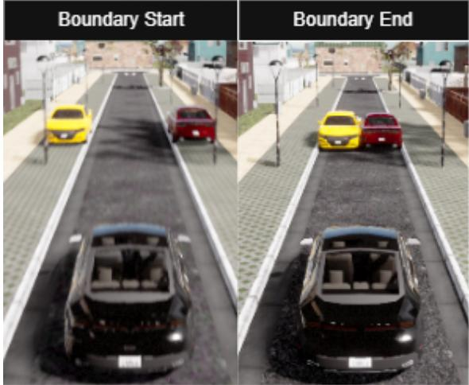  
Figure 1. The two ends of the Charger gauntlet. Left: the widest variant, with two cars parked on the shoulders and a 3.64 m free corridor between them. Right: the narrowest variant, where the two cars close the corridor completely.

## 3. Method

In Section 3.1 we first motivate the introduction of failureboundary profiling with an illustrative case study. In Section 3.2 we describe newly developed metrics to explore failure-boundary profiles. In Section 3.3 we introduce the new set of scenario families, one failure-boundary profile each, created by the Social Chaos Lab (SCL) pipeline. Finally, in Section 3.4 we illustrate the steps of the SCL scenario generation pipeline.

## 3.1. A Case Study in Failure Profiling

We consider a constructed scenario in which route completion and infraction score become opposite objectives.

In this scenario the ego vehicle must pass between two cars parked on the two shoulders of the road. Neither car impinges upon the drivable surface, and thus the vehicle should drive straight through.

We then systematically reduce the spacing between these two vehicles, thereby reducing the drivable corridor. Figure 1 shows the two ends of this scenario. By repeating evaluations of the agent at each reduction in corridor width, we obtain a curve over the variations in agent performance.

Figure 2 shows two baseline agents (TFv6 [14] and BridgeDrive [11]) varied over corridor width. We measure two quantities across repetitions: the CARLA Driving Score, and a new measure detailed further in Section 3.2, the probability that the agent attempts to continue along the route.

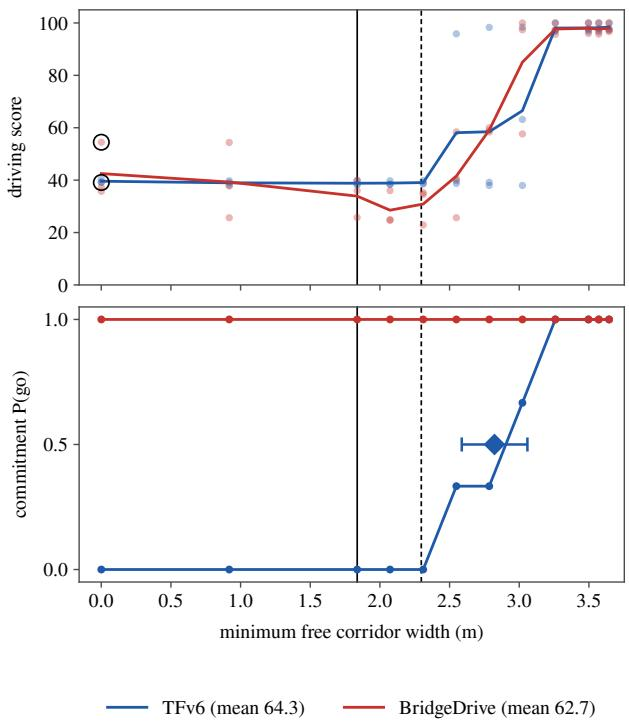  
Figure 2. Driving score and commitment on the Charger gauntlet. TFv6 and BridgeDrive, three traffic seeds each, against the minimum free corridor width. Top: driving score of each run (dots) and the mean per width (lines); the circled pair is the same width and seed, the fully closed corridor at seed 2, where TFv6 stops (39.1) and BridgeDrive continues past the blockage with contact (54.5). Bottom: commitment per width; the diamond marks TFv6’s commitment boundary with its bootstrap interval. Solid line: body width, 1.84 m; dashed line: policy floor, 2.30 m.

Figure 2 illustrates the tension between route completion and infraction score: the agent can win a higher driving score by trading infractions for progress. Looking at commitment, we can see a clear boundary at which point the TFv6 [14] agent refuses to attempt the gap. The BridgeDrive [11] agent meanwhile attempts the gap no matter the width. This curve represents a failure-boundary profile: a measure of an agent’s behavior over a specific, controlled change. This type of evaluation in simulation allows fine-grained analysis of an agent’s generalization capacity over specific criteria.

Creating this type of scenario family would typically be a tedious process of iterative work in the simulator. In Section 3.4 we detail the automated pipeline built to generate these scenario families.

## 3.2. Measuring Failure-Boundary Profiles

This section defines the two curves of a failure-boundary profile, the boundary on each, and a summary metric, decision accuracy.

<table><tr><td></td><td colspan="3">Mean DS</td><td colspan="3">Blocked widths</td></tr><tr><td>Agent</td><td>All</td><td>Pass.</td><td>Block.</td><td>n</td><td>Stop</td><td>Contact</td></tr><tr><td>PlanT 2.0*</td><td>72.5</td><td>86.7</td><td>44.0</td><td>12</td><td>3</td><td>6</td></tr><tr><td>HiP-AD</td><td>71.5</td><td>87.7</td><td>39.2</td><td>12</td><td>11</td><td>1</td></tr><tr><td>SimLingo</td><td>67.8</td><td>75.5</td><td>52.2</td><td>12</td><td>0</td><td>12</td></tr><tr><td>TF++</td><td>65.6</td><td>78.1</td><td>40.6</td><td>12</td><td>12</td><td>0</td></tr><tr><td>TFv6</td><td>64.3</td><td>76.9</td><td>39.1</td><td>12</td><td>12</td><td>0</td></tr><tr><td>BridgeDrive</td><td>62.7</td><td>76.0</td><td>36.1</td><td>12</td><td>0</td><td>12</td></tr><tr><td>Expert</td><td>59.2</td><td>69.9</td><td>37.8</td><td>12</td><td>12</td><td>0</td></tr></table>

Table 1. Driving score split by certified passability. Mean driving score on the Charger gauntlet (three traffic seeds) over all runs, over the eight passable widths and over the four blocked widths (0.00 to 2.07 m), with the outcomes of the runs on the blocked widths. Stop: the agent stops before the blockage. Contact: any contact with the blockage, whether the agent continued past it or not. Rows are ordered by the mean over all runs. ∗Checkpoint 1; its other 3 blocked runs complete the 2.07 m width without contact.

Let a scenario family $\mathcal { F }$ schedule one certified axis $x \ \in \ { \mathcal { X } } \ \subset \ \mathbb { R } \ ( { \mathrm { e . g } }$ . minimum free corridor width in meters, or crossing time gap in seconds), realized at variants $x _ { 1 } < \cdots < x _ { V }$ . For agent $^ { a , }$ each closed-loop run r at variant $x _ { v }$ under traffic seed s yields an outcome $o _ { r } \in \mathcal { O }$ from the family-aware outcome taxonomy, the set of run outcomes the scorer distinguishes for that family (Section 3.4). Two binary events are read from $o _ { r }$ :

Gr = ⊮{agent a attempts the passage in run r}, (a go)

(1)

$$
C _ { r } = \mathcal { k } \{ o _ { r } = \mathrm { C L E A N ~ P A S S } \} .\tag{2}
$$

Commitment The commitment curve of agent a on family $\mathcal { F }$ is

$$
P _ { \mathrm { g o } } ^ { a } ( x ) = \mathrm { P r } \big [ G = 1 \big | x , a , \mathcal { F } \big ] ,\tag{3}
$$

the probability that the agent commits to the passage at axis value x.

Competence The competence curve of agent a on family $\mathcal { F }$ is

$$
P _ { \mathrm { c l e a n } } ^ { a } ( x ) = \mathrm { P r } \bigl [ C = 1 \bigr | x , a , \mathcal { F } \bigr ] ,\tag{4}
$$

the probability that the agent passes cleanly at axis value $x .$

The two curves are estimated separately, each over the runs that can be scored for it. A late commitment, where the agent passes only after the scenario’s time limit has expired, counts as a go but is left out of competence, so the estimated curves need not satisfy $P _ { \mathrm { c l e a n } } \leq P _ { \mathrm { g o } }$ at every x.

Boundary For a curve $P ~ \in ~ \{ P _ { \mathrm { g o } } , P _ { \mathrm { c l e a n } } \}$ with the family’s orientation $\sigma \in \{ + 1 , - 1 \}$ (passage easier as σx grows), the boundary is the $\begin{array} { r } { p \ = \ \frac { 1 } { 2 } } \end{array}$ crossing of the fitted curve, for $\sigma = + 1$

$$
\begin{array} { r } { x ^ { \star } = \operatorname* { i n f } \{ x \in \mathcal { X } : \hat { P } ( x ) \geq \frac { 1 } { 2 } \} , } \end{array}\tag{5}
$$

and for $\sigma = - 1$ the supremum of the same set, estimated by a logistic fit $\hat { P } ( x ) = \left( 1 + e ^ { - \beta \sigma ( x - x ^ { \star } ) } \right) ^ { - 1 }$ . Four cases arise. When at least one variant has mixed outcomes, the fit is constrained and the boundary is its midpoint. When every failing variant lies on one side of every passing one, there is nothing to fit, and the boundary is the midpoint of the two adjacent variants between which the outcome flips, reported as a separation bracket $[ x _ { \mathrm { f a i l } } , x _ { \mathrm { p a s s } } ]$ . When the fit does not converge, as with a single mixed variant between the two sides, the bracket of the last failing and the first passing variant takes its place. When the observed rate never crosses one half in the tested range, no boundary is reported, and the panel title names the case $( ^ { 6 6 } \mathrm { f l a t } ^ { \prime 3 }$ , “not located in range” or “below tested range”). We treat each run as an independent Bernoulli draw and pool the traffic seeds within a variant as a stratum, since a fixed seed does not reproduce a run (Section 4.2). A fitted boundary carries a bootstrap interval that resamples the runs within each variant holding more than one; a bracket is its own interval; a flat curve carries a Wilson interval on its level.

The commitment-competence gap, $\Delta ^ { a } ( x ) = { \cal P } _ { \mathrm { g o } } ^ { a } ( x ) -$ $P _ { \mathrm { c l e a n } } ^ { a } ( x )$ , covers the axis values where the agent still commits but no longer passes cleanly; the profile figures draw it in orange. Where this region lies, and how wide it is, differs considerably between agents.

Decision Accuracy Commitment and competence describe what an agent does. Decision accuracy compares this with what it should have done, using the label that every variant carries. On the static-obstacle and warehouse families the pipeline certifies each variant from its measured geometry as passable or blocked against a declared floor: for the vehicle the policy floor, its body width plus a mirror allowance and a clearance margin on each side; for the robot its width measured at each height (Section 3.4). On the oncoming-flow families a gap certificate labels each variant and seed from the realized traffic as usable, conditional or wait (Section 3.4). The correct outcome is a clean pass on a passable or usable variant and a stop on a blocked or wait one. A go that ends in contact does not count as correct, since an agent that cannot complete a passage should not attempt it. For agent a on family ${ \mathcal { F } } ,$ with $C = 1$ for a passage without contact,

$$
\begin{array} { r l } & { \mathrm { D A } _ { \mathcal { F } } ^ { a } = \frac { 1 } { 2 } \Big ( \mathrm { P r } \big [ G = 1 , C = 1 \big | \mathrm { p a s s a b l e } \big ] } \\ & { \qquad + \mathrm { P r } \big [ G = 0 \big | \mathrm { b l o c k e d } \big ] \Big ) , } \end{array}\tag{6}
$$

the balanced accuracy over the two classes. A late commitment counts as a miss on the passable side, and anomalous runs, those that complete a variant certified blocked without contact, are excluded. An agent that always stops scores $\textstyle { \frac { 1 } { 2 } } ;$ an agent that always goes scores at most ${ \frac { 1 } { 2 } } ,$ , and less for every passable variant it does not pass cleanly. The peragent summary averages $\mathrm { D A } _ { \mathcal { F } } ^ { a }$ with equal weight over the families that contain a stop side; families with only passable variants do not enter it. Its 95% interval is a bootstrap that resamples runs within each family and side (10,000 replicates). Conditional flow variants, where only a rolling crossing fits the gap, are reported separately and enter neither side.

We report decision accuracy alongside the driving score. The driving score mixes route completion with infraction penalties, so on a blocked variant continuing past the obstacle with contact can score higher than stopping in front of it (Table 1). The two labels differ in kind: a blocked width is fixed by geometry against the policy floor, whereas a wait window is a timing rule the certificate states, a kinematic floor plus a declared margin. Both are conventions with declared constants; Section 4.3 reports how the ranking responds to each.

## 3.3. Scenario Families

We use the SCL pipeline (Section 3.4) to author ten scenario families, each measuring a different failure-boundary profile: seven driving families in CARLA and three warehouse families in Isaac Sim. Figure 3 shows one picture of each.

1. Charger Gauntlet: Two parked Dodge Chargers narrow the corridor across the passability threshold, with the narrowest variants certified blocked. Axis: minimum free corridor width, 12 variants, 3 seeds.

2. Machine Intrusion: A vending machine intrudes on the lane. Axis: intrusion depth in meters, 12 variants, 3 traffic seeds.

3. Corridor Width: A vending machine stands on the left curb and two street barriers, moved in from the right, pinch the corridor between them. Axis: minimum free corridor width in meters, 10 variants, 3 seeds.

4. Identity Ladder: Fourteen roadside objects at one certified intrusion, 0.5 m, with about 8 m free corridor. Axis: object identity with geometry fixed, 14 variants, 3 seeds.

5. Cluttered Intrusion: Vending machine plus two waste bins arranged irregularly. Axis: maximum route intrusion, 12 variants, 3 seeds.

6. Oncoming Flow Speed: Signalized left turn across a single-lane oncoming flow at the Town03 junction, flow speed swept with spacing fixed. Axis: crossing time gap, 11 variants, 3 seeds.

7. Oncoming Flow Spacing: Signalized left turn, spacing between oncoming cars swept with speed fixed. Axis: crossing time gap, 11 variants, 3 seeds.

8. Warehouse: Slab Pincer: Two abstract heavy slabs narrow a warehouse aisle to a single central gap. Axis: minimum free gap, 12 variants from 2.5 m to a closed aisle, 5 policy samples.

9. Warehouse: Floor Stock: Pushcarts and pallets already in the warehouse are repositioned to narrow the aisle.

Axis: minimum free gap, 12 variants, 5 policy samples.

10. Warehouse: Composed Stacks: Cartons stacked as a picker would leave them narrow the aisle. Axis: minimum free gap, 10 variants, 5 policy samples.

In every warehouse family the neighboring aisle stays open, so stopping or detouring is always a fair choice, and the narrowest gaps are certified blocked: four on the slab pincer and the floor stock, three on the composed stacks, where two further widths lie too close to the robot’s width to be labeled passable or blocked at the measurement’s resolution and are set aside (Section 3.4).

## 3.4. The Scenario Generation Pipeline

Figure 4 shows the pipeline. It takes a source scenario and a natural-language intent and produces a scenario family whose variants differ in exactly one measured factor, then runs, scores and certifies campaigns on it. The stages are as follows.

Scenario importer. A source scenario (for example a Fail2Drive scenario on a Leaderboard 2.0 route, or a manually created scenario) is imported into a measured scenario: the route, the placed actors and the drivable envelope, with curb lines measured from the map rather than taken from the OpenDRIVE bounds.

Agent planner. The prompt states the intent in plain language: which factor to sweep, over what range, and what to hold constant (Section 3.3). The planner turns it into a declarative plan under a capability profile that fixes the ego’s policy constants, such as the mirror allowance and clearance margin.

Solver and validation. A deterministic solver realizes each variant from the plan, locates the factor’s feasible domain by scan and bisection over the feasibility predicate, and densifies the schedule where a transition is expected. Each variant is measured (minimum free corridor width, maximum route intrusion, required lateral deviation, closest approach; realization tolerance ±5 mm), assigned passable or blocked from that geometry, and checked by validators for collision-free placement, stable support, connected ego passage and family membership. A candidate that fails is rejected.

Scenario family. The accepted variants form the family: a manifest with the measured axis value per variant and one compiled route file each. Before any campaign each placed object is countersigned in the simulator: spawned headless, settled and read back, with at most 10 mm of planar drift between authored and spawned pose. The countersignature helps catch misplaced objects: of 23 candidate objects for the identity ladder, seven pass every offline check and then tip, roll, sink or fall through the road under run-time physics, and are rejected; two more fail the offline checks, leaving the fourteen objects of the family.

Flow certification. The oncoming-flow variants have no geometric passability, and traffic cannot be countersigned the way a placed object can. They are certified in four layers instead, three of them after the runs, from the recordings. (i) At generation, the manifest declares each variant’s nominal factor, the flow speed or the spawn interval, and the crossing gap derived from it; the validators check family membership and that the route compiles. The nominal gap only identifies the variant and is never used as a measurement. (ii) The conflict lane. A scoring file stores the polygon of the junction’s conflicting driving lane, built from the map. A separate check runs it against CARLA’s offline map API: the connector lane exists exactly once in the declared junction, every recorded ego spawn reaches it, every flow car spawns on an incoming lane the map declares, and every declared cell holds exactly its variants’ recordings. (iii) The gap certificate. For each variant and seed, the certificate measures what the traffic did: each car’s arrival at and departure from the ego’s crossing region, the part of the conflict lane its body sweeps on a reference clean crossing. From these it derives the local headways and the occupancy of the crossing. Every run is read only until the ego enters the oncoming lane. The usable window is the median headway minus the median occupancy. It is compared with two floors measured from the vehicle’s recordings in the first four campaigns of each family, each plus a declared margin of 0.5 s. The first is the time to cross from rest, covering the standstill-to-exit distance at the vehicle’s peak acceleration of 7.04 m/s2: 2.02 s on the speed sweep and 1.81 s on the spacing sweep. The second is the time of a rolling crossing at the recorded entry speed: 1.00 s on both sweeps. A window that fits a crossing from rest is usable, one that fits only a rolling crossing is conditional, and one that fits neither is a wait window; a variant whose seeds disagree is mixed and is labeled per seed, and a seed in which no car completed its passage through the crossing before the ego entered has no measured window and enters neither side. The comparison always uses the realized window rather than the nominal one, because short gaps stretch on congested seeds. Since the label depends only on the traffic, a wait and a collision on the same variant and seed are judged against the same window. (iv) The defect register. A variant whose realized traffic differs from the declared traffic is removed from the bands by a declared entry that records the evidence. This happens once, for the shortest spacing variant: its cars, spawned 0.45 s apart, collide with each other and reset before the ego arrives in every run, and the variant is excluded from every score (grey in Figure 10).

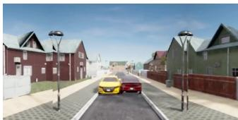  
(a) Charger gauntlet

  
(b) Machine intrusion

  
(c) Corridor width

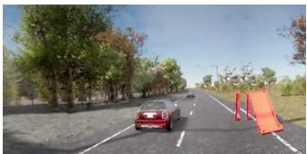  
(d) Identity ladder

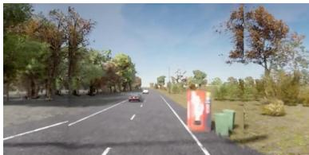  
(e) Cluttered intrusion

  
(f) Oncoming flow speed

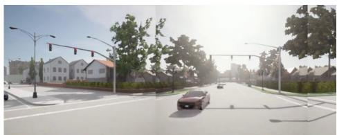  
(g) Oncoming flow spacing

  
(h) Warehouse: slab pincer

  
(i) Warehouse: floor stock

  
(j) Warehouse: composed stacks

Figure 3. The ten scenario families. One picture per family, cut from the recordings of the campaigns the paper reports: (a) to (g) the front cameras of TFv6 in the CARLA families, (h) to (j) the top-down view of the warehouse families. (a) The Charger gauntlet at its closed end, the two parked cars meeting across the lane. (b) The vending machine at the lane edge, the shallowest intrusion of the sweep. (c) The narrowest corridor: two street barriers in a row on the right, opposite the vending machine on the left curb. (d) The identity ladder with the slide in place. (e) The cluttered intrusion, the machine and two bins at the lane edge. (f) The slowest oncoming flow and (g) a mid-range spacing, the car waiting at the junction to turn left across the oncoming lane. (h) The slab pincer at a gap certified blocked, (i) the floor stock and (j) the composed stacks at their narrowest passable gaps, the robot approaching the row.  
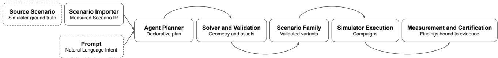  
Figure 4. The Social Chaos Lab scenario-generation pipeline. A source scenario and a natural-language intent enter the pipeline; an agent planner turns the intent into a declarative plan, a deterministic solver realizes and validates each variant, and the accepted variants form a scenario family whose placed objects are countersigned in the simulator before campaigns run; campaigns are then run, scored and certified.

Scoring uses all four layers. A flow collision is a contact with a scenario actor, and a stall is a timeout at the junction. Commitment and competence are fitted on the measured gap. Decision accuracy credits a clean crossing of a usable window and a wait at a wait window (Section 3.2), while conditional windows are scored from the recorded entry state and reported separately. Every scoring document references the conflict lane, the certificate and the defect register by hash. The certificate has three limits. A wait window is a rule that it states, which is weaker than the physical impossibility of a blocked width. A platoon whose cars leave no gap between them is a wait window by construction rather than by measurement. And the flow can only be certified after the campaign has run.

Warehouse certification. The warehouse families pass through the same stages with a different backend. Each variant is written as an Isaac Sim stage, and its free gap is measured on an occupancy grid at 1 cm resolution built from the stage. The label is then decided per height slab: the grid holds one layer per centimeter of height with the collision geometry inside that slab, each layer is eroded by the robot’s width measured at that height (in the simulator, by closing two walls on the robot slab by slab until they touch; at most 0.494 m, at the wheels), and a connectivity test certifies whether the robot’s center has a path through the gap that is free in every slab at once, and whether it can detour through the neighboring aisle. A gap too close to the robot’s width for the measurement to decide at its resolution is refused and reported rather than labeled, and its runs are set aside from every curve. Stacked stock is placed as dynamic bodies that settle under physics; the settled poses are read back and countersigned before any run, and the parts stand as static colliders at those poses during a run. The simulation is audited bit-exact, so repeated runs sample the policy, not the simulator. All warehouse results come from one simulator vintage (Isaac Sim 5.1 on one GPU type), and results from different vintages are never pooled.

Simulator execution. A campaign declares its grid (variants, agents, repetitions) and runs it with recordings on. Because closed-loop outcomes are not deterministic at a fixed traffic seed (Section 4.2), each run is treated as one independent draw and a variant’s seeds are pooled.

Measurement and certification. Runs are classified by the family-aware outcome taxonomy, collisions are attributed to obstacle or traffic from the recorder, trajectory metrics are extracted, and the boundary estimator of Section 3.2 is run per agent and family.

## 4. Experiments

Section 4.1 describes the simulators, agents and protocol, and Section 4.2 the run-to-run variance the protocol accounts for. Section 4.3 reports the results family by family, and Section 4.4 re-measures one agent across training.

## 4.1. Evaluation Environment and Baselines

Driving agents are evaluated in the CARLA simulator [4], the standard open-source driving simulator, on scenarios that build on the Bench2Drive and Fail2Drive families. The warehouse robot is evaluated in NVIDIA Isaac Sim [15] on the three warehouse families. Each agent is evaluated on every family of its domain, with the two exceptions noted below.

## Baselines.

• TFv6 [14]: the sensor agent of the LEAD paper, a transformer-based planner in the TransFuser lineage, with one wide camera, LiDAR and radar. We evaluate its flagship configuration with a RegNetY-032 image backbone, the configuration whose published scores the Fail2Drive comparison reports.

• BridgeDrive [11]: an anchor-guided diffusion bridge planner. TFv6 and BridgeDrive are the two top agents on Fail2Drive.

• TF++ [9]: the TransFuser++ sensor agent shipped with the Fail2Drive framework.

• PlanT 2.0 [6]: a privileged planner operating on objectlevel inputs rather than sensors.

• SimLingo [19]: a vision-language driving agent on an InternVL2-1B backbone.

• HiP-AD [22]: a six-camera end-to-end agent which uses a multi-granularity planning query representation and deformable attention.

• Expert (PDM-Lite) [20]: the privileged rule-based autopilot shipped with the Fail2Drive framework. We use it as a reference rather than as a competing agent, because its obstacle avoidance is a scripted route shift around the registered obstacle. It serves as a feasibility witness and a conservative reference line. It does not register the corridor-width family’s barriers and is absent from that family.

Every agent is evaluated at three traffic seeds per variant (seeds 0 to 2); where a campaign ran more seeds, only the first three are used. PlanT 2.0 did not run the identity ladder.

Warehouse agents. The robot is a wheeled warehouse platform driven by X-Mobility [12], an end-to-end navigation policy, run as its released checkpoint and as two finetunes of it (Section 4.4). A scripted expert that reads the stage serves as the warehouse reference: it takes every passable gap and detours through the neighboring aisle at every blocked one. Isaac Sim is audited bit-exact on our setup, so repeats sample the policy rather than the simulator; each gap is run with five policy samples.

## 4.2. Variance in CARLA

CARLA outcomes are not repeatable, even at a fixed traffic seed, a known property of game-engine simulators [3]. Running the same variant and seed five times, twice from a byte-identical command, produces two different outcomes, with driving scores of 53.7 and 32.2; the runs match exactly until a collision, where the physics engine diverges. A single run is therefore only one sample of the outcome. We treat every run as an independent draw, run each variant under several seeds and pool them within the variant, and report each boundary with a bootstrap interval that resamples the runs within each variant, so that the simulator’s noise widens the interval instead of moving the estimate. When the behavior is stable the intervals are tight; the expert’s gauntlet boundary, for instance, is identical at all three seeds.

## 4.3. Results

We first compare the two summary scores across agents and test how decision accuracy depends on the certification constants. We then report each family with its per-agent profiles, the CARLA families first and the warehouse last.

Overview. Table 2 reports the driving score and decision accuracy, each averaged over the certified families that contain variants where the correct call is to stop. Among the driving agents the expert has the highest decision accuracy (0.74, 95% interval [0.67, 0.81]) and TFv6 the highest of the learned agents (0.60 [0.53, 0.68]). The two intervals overlap, as do those of TFv6 and PlanT 2.0 at its first checkpoint (0.56 [0.50, 0.61]), so the order at the top should be read as a point estimate. The driving score ranks the first three rows of Table 2 in the same order as decision accuracy, but not the rest. BridgeDrive has the fourth-highest driving score (71.8) but the lowest decision accuracy of any driving agent (0.26). It never stops at a blocked width, and passes cleanly in only 21 of its 40 runs on passable widths and usable windows. TF++, which stops at every blocked width of the gauntlet, has the lowest driving score (59.5) and a decision accuracy of 0.49. On the gauntlet’s blocked widths TF++ and TFv6 stop on all 12 and HiP-AD on 11 of 12, while BridgeDrive and SimLingo never stop on one, and PlanT 2.0 stops on 3 of 12 at one checkpoint and on none at the other two. On the oncoming-flow wait windows few learned agents wait: TFv6 waits on 6 of its 29 windows, BridgeDrive on 3 and every other learned agent on none, against 13 of 29 for the expert. In the warehouse, X-Mobility scores 0.34. It passes cleanly in 40 of its 115 runs on passable gaps and stops at blocked gaps only on the composed stacks. A score of 0.50 marks an agent that passes cleanly on every passable variant and never stops, as PlanT 2.0 does at its third checkpoint; a score below 0.50 is lower than an agent that stops everywhere would receive. The driving score cannot separate stopping from continuing, because continuing past a blockage with contact scores as well as or better than stopping in front of it (Table 1).

<table><tr><td>Agent</td><td>Avg. DS</td><td>Avg. DA [95% CI]</td></tr><tr><td>Driving (CARLA)</td><td></td><td></td></tr><tr><td>Expert (reference)</td><td>79.8</td><td>0.74 [0.67, 0.81]</td></tr><tr><td>TFv6</td><td>75.5</td><td>0.60 [0.53, 0.68]</td></tr><tr><td>PlanT 2.0 (ckpt 1)</td><td>72.6</td><td>0.56 [0.50, 0.61]</td></tr><tr><td>PlanT 2.0 (ckpt 3)</td><td>71.4</td><td>0.50 [0.50, 0.50]</td></tr><tr><td>TF++</td><td>59.5</td><td>0.49 [0.41, 0.57]</td></tr><tr><td>PlanT 2.0 (ckpt 2)</td><td>70.4</td><td>0.47 [0.42, 0.50]</td></tr><tr><td>HiP-AD</td><td>70.4</td><td>0.44 [0.39, 0.49]</td></tr><tr><td>SimLingo</td><td>63.0</td><td>0.28 [0.19, 0.36]</td></tr><tr><td>BridgeDrive</td><td>71.8</td><td>0.26 [0.18, 0.35]</td></tr><tr><td>Warehouse (Isaac Sim)</td><td></td><td></td></tr><tr><td></td><td></td><td></td></tr><tr><td>X-Mobility</td><td></td><td>0.34 [0.30, 0.38]</td></tr></table>

Table 2. Driving score and decision accuracy per agent. Both averaged with equal weight over the certified families that contain variants where the correct call is to stop. Driving: the Charger gauntlet (four certified blocked widths) and the two oncomingflow sweeps (wait windows labeled by the gap certificate; the de fective shortest spacing variant is excluded). Warehouse: the slab pincer, floor stock and composed stacks, which have no driving score. Avg. DS: mean CARLA driving score. Avg. DA: decision accuracy, the balanced mean of the clean-pass rate on passable or usable variants and the stop rate on blocked or wait variants, with a 95% bootstrap interval over runs, of zero width where every run on each side has the same outcome. Rows are ordered by Avg. DA within each block; bold marks the best learned driving agent in each column.

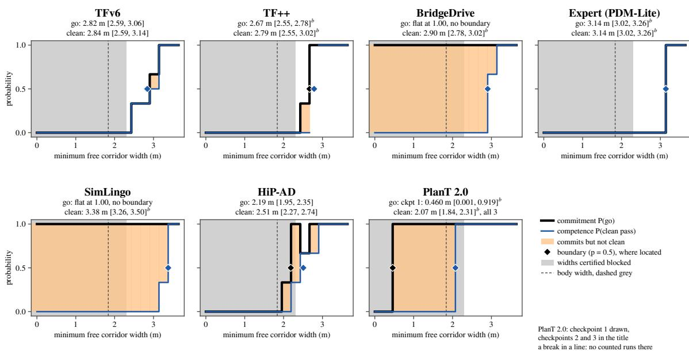  
Figure 5. Failure-boundary profiles on the Charger gauntlet. Twelve widths, three traffic seeds per agent. Each panel is one agent. Black: commitment, the share of runs in which the agent attempts the passage. Blue: competence, the share of runs that pass without contact. Orange: widths where the agent commits but does not pass cleanly. Grey: widths certified blocked, below the 2.30 m policy floor; the dashed line marks the 1.84 m body width. A diamond marks each located boundary at one half. Panel titles give each boundary with its 95% bootstrap interval or, where the outcomes are separated or the fit does not converge, its bracket (b): the pair of adjacent widths between which the observed rate crosses one half. A title reads “flat” where every run has the same outcome, “not located in range” where the fitted curve crosses one half outside the tested range, and “below tested range” where the observed rate stays above one half at every tested value. PlanT 2.0: checkpoint 1 is drawn; the panel title gives the boundaries of checkpoints 2 and 3 where located.

Robustness to the certification constants. Both labels rest on declared constants: the gauntlet’s 2.30 m policy floor and the gap certificate’s 0.5 s margin. Re-labeling the flow windows with margins from 0 to 1 s, and separately counting the 2.07 m gauntlet width, which is wider than the car but narrower than the policy floor, as passable, leaves both ends of the ranking unchanged. The expert stays first (0.70 to 0.83), TFv6 second (0.58 to 0.64), and SimLingo and BridgeDrive last (0.22 to 0.33); only the middle group, PlanT 2.0’s checkpoints, TF++ and HiP-AD (0.43 to 0.56), changes order. As at the 0.5 s margin, each traffic seed keeps its own window, so at every margin a seed is labeled from the gap it actually offered, and the seeds of one variant may fall into different bands.

The failure-boundary profiles show where each agent’s commitment exceeds its competence. No single agent is best on every family: SimLingo passes the narrowest corridor of any agent in the corridor-width family yet needs the widest corridor of any agent on the Charger gauntlet, while HiP-AD, the last to pass cleanly in the corridor-width family, passes the gauntlet more narrowly than any other sensorbased agent (2.51 m). A profile therefore describes an agent on a particular family, and does not reduce to one aggregate score. The following paragraphs report each family in turn.

Charger gauntlet. Two parked cars narrow the corridor from 3.64 m to fully closed; the four narrowest widths are certified blocked (Figure 5). The expert commits only where it can pass: both of its boundaries sit at 3.14 m (bracket [3.02, 3.26]), identical at all three seeds. TFv6 behaves the same way at a narrower width, with commitment and competence boundaries 2 cm apart (2.82 m [2.59, 3.06] and 2.84 m [2.59, 3.14]); it stops in all 12 of its blocked runs and refuses 8 of its 24 runs on passable widths. TF++ commits earlier than it can execute (commitment 2.67 m, competence 2.79 m).

HiP-AD also has a commitment boundary (2.19 m [1.95, 2.35]) and stops in 11 of its 12 blocked runs. BridgeDrive and SimLingo commit at every width, including the closed corridor, and pass cleanly only from 2.90 m and 3.38 m respectively; below that they continue with contact, and BridgeDrive displaces a parked car by up to 55 m. The driving score can reward driving through a blocked corridor: on the blocked widths SimLingo has the highest mean score of any agent (52.2), while the agents that stop in all their blocked runs score between 37.8 and 40.6. BridgeDrive, which also never stops, is the exception, with a mean of

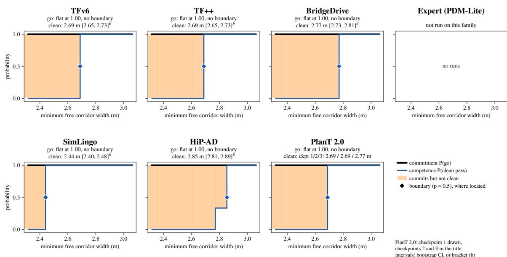

Figure 6. Failure-boundary profiles on the corridor-width family. Ten widths, three traffic seeds; every variant is certified passable. Panels and colors as in Figure 5. The expert does not register these barriers and was not run.  
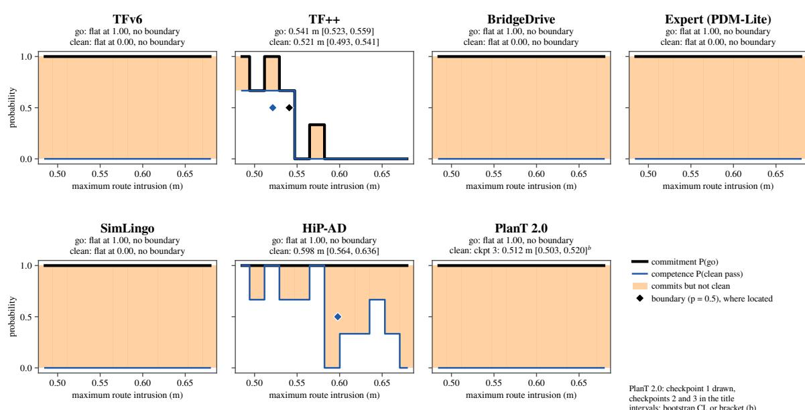  
Figure 7. Failure-boundary profiles on the machine intrusion. Twelve intrusion depths, three traffic seeds; every variant is certified passable, the deepest leaving 2.32 m of free corridor. Each panel is one agent. Black: commitment, the share of runs in which the agent attempts the passage. Blue: competence, the share of runs that pass without contact. Orange: depths where the agent commits but does not pass cleanly. Panel titles give each boundary with its interval.

36.1 on the same widths, below every agent that stops (Table 1).

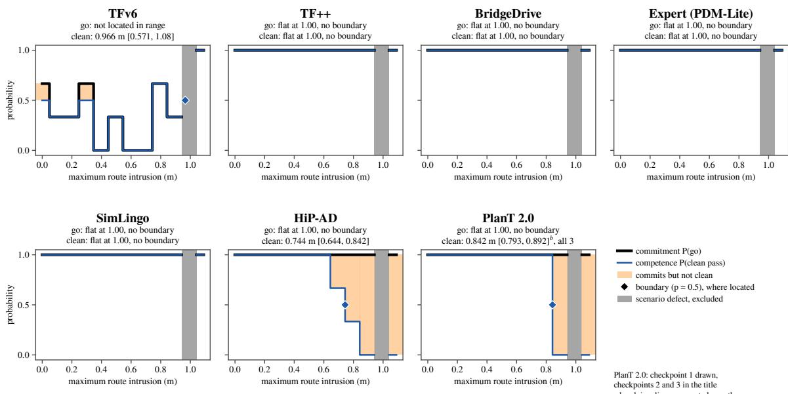

Figure 8. Failure-boundary profiles on the cluttered intrusion. Twelve intrusion depths, three traffic seeds; every variant is certified passable. Panels and colors as in Figure 5; intrusion grows to the right. Grey: the 0.99 m variant, a scenario defect (the vending machine tips over the moment it is placed, before any car arrives), excluded from every score.
<table><tr><td>Object</td><td>Expert</td><td>TFv6</td><td></td><td>TF++ BridgeD. SimLingo HiP-AD</td><td></td><td></td></tr><tr><td>Vending machine</td><td>3/3</td><td>1/3·2R</td><td>3/3</td><td>1/3·2L</td><td>3/3</td><td>3/3</td></tr><tr><td>Plastic chair</td><td>3/3</td><td>1/3·2R</td><td>3/3</td><td>3/3</td><td>3/3</td><td>3/3</td></tr><tr><td>12 other objects</td><td>36/36</td><td>36/36</td><td>36/36</td><td>36/36</td><td>36/36</td><td>36/36</td></tr></table>

Table 3. Identity ladder. Fourteen roadside objects at one certified intrusion (0.5 m, about 8 m free corridor), three traffic seeds each. Cells give clean passes out of runs; R: refusal, L: late commit; shading marks cells with fewer clean passes than runs. The twelve other objects are the dog house, street barrier, traffic warning, mailbox, playground slide, plastic table, traffic cone, trampoline, barbecue grill, iron plank, waste bin and cardboard box.

Corridor width. Two street barriers, moved in from the right against a vending machine on the left curb, narrow the corridor from 3.06 m to 2.32 m; every width is certified passable (Figure 6). Every agent commits at every width, so the family separates agents by competence alone. SimLingo passes cleanly down to 2.44 m, the narrowest of any agent; TFv6, TF++ and two of PlanT 2.0’s checkpoints from 2.69 m; BridgeDrive and PlanT’s third checkpoint from 2.77 m; and HiP-AD from 2.85 m. Below these widths agents scrape the barriers rather than stop. Some clean passes are also near misses: 15 of the 42 clean passes of TFv6, TF++ and BridgeDrive cleared a barrier by less than the mirror allowance (0.13 m) yet scored 86 to 97. The expert does not register these barriers and is not run.

Machine intrusion. A vending machine intrudes 0.49 to 0.68 m into the lane, always leaving at least 2.32 m of free corridor (Figure 7). The expert, whose demonstrations trained TFv6 and BridgeDrive, contacts the machine in all 36 of its runs; TFv6, BridgeDrive and SimLingo do the same, and PlanT 2.0 passes cleanly in only 6 of 108 runs. Two agents behave differently. TF++ passes cleanly at the shallowest depths and refuses the deeper ones (8 clean passes, 25 refusals, 3 contacts), with commitment and competence boundaries at 0.54 and 0.52 m. HiP-AD passes cleanly in 20 of 36 runs (competence boundary 0.60 m [0.56, 0.64]). Among TFv6, TF++, BridgeDrive and the expert, the driving score ranks the expert, which contacts the machine in every run, highest (63.5), and TF++, the only one of the four that ever passes it cleanly, lowest (50.8), largely because TF++ refuses the deeper variants.

Cluttered intrusion. A vending machine and two waste bins intrude up to 1.09 m into an otherwise open road (Figure 8). TF++, SimLingo and the expert pass cleanly in every run, and BridgeDrive in 34 of 36, with two late commitments. TFv6 refuses in 20 of its 36 runs, starting at the shallowest variants where nothing intrudes into the lane, which suggests that it reacts to the cluttered scene rather than to the intrusion itself. It passes cleanly in every run only at the deepest variant. The second-deepest variant (0.99 m) is a scenario defect: the vending machine tips over the moment the harness places it, in every run and before any car arrives, so it is excluded from every score. HiP-AD’s and PlanT 2.0’s competence boundaries on the remaining variants are 0.74 m [0.64, 0.84] and 0.84 m [0.79, 0.89].

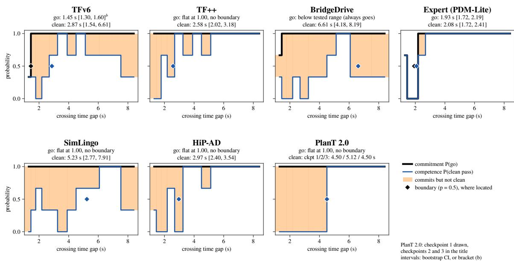  
Figure 9. Failure-boundary profiles on the oncoming-flow speed sweep. Eleven crossing time gaps, three traffic seeds; larger gaps are easier. Panels and colors as in Figure 5. A go is entry into the oncoming lane while the flow is active.

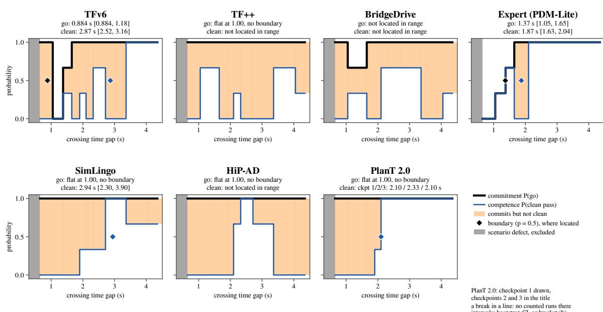  
Figure 10. Failure-boundary profiles on the oncoming-flow spacing sweep. Eleven crossing time gaps, three traffic seeds; larger gaps are easier. Panels and colors as in Figure 5. A go is entry into the oncoming lane while the flow is active. Grey: the shortest spacing variant, at 0.45 s, a scenario defect excluded from every score.

Identity ladder. Fourteen roadside objects are placed at one certified intrusion, 0.5 m into the lane with about 8 m of free corridor, so the intrusion and the free corridor are the same for every object (Table 3); the objects themselves differ in size and shape. TFv6 refuses the vending machine and the plastic chair at two of three seeds each, while passing the other twelve objects cleanly at every seed. With three seeds per object, these are 4 refusals in 42 runs. This suggests that the object rather than the intrusion changes TFv6’s decision, but more samples per object would be needed to confirm it. BridgeDrive late-commits on the vending machine at two of three seeds. The expert, TF++, SimLingo and HiP-AD pass all fourteen objects in every run, so the effect depends on the agent and not only on the objects.

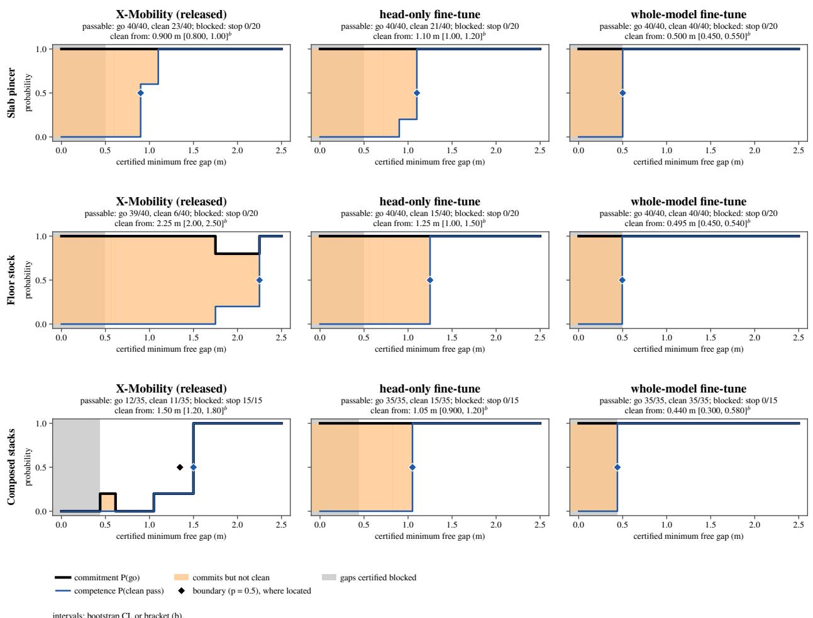  
Figure 11. Failure-boundary profiles in the warehouse. Three warehouse families in Isaac Sim, each narrowing a robot’s aisle to a single gap from 2.5 m to a closed aisle, with the neighboring aisle open as a detour; twelve certified gaps on the slab pincer and the floor stock, ten on the composed stacks, five policy samples each. Rows: families. Columns: the released X-Mobility checkpoint and its two fine-tunes, both trained on demonstrations from the slab pincer and the floor stock; the composed stacks are held out. The released checkpoint and the fine-tunes were measured on the same gaps of each family. Black: commitment, the share of samples that attempt the gap. Blue: competence, the share that pass through it without contact. Orange: gaps the robot attempts but does not pass cleanly. Grey: gaps certified blocked. A diamond marks each located boundary at one half. Panel titles give the go and clean-pass counts on passable gaps, the stop count on blocked gaps, and the competence boundary with its interval or bracket (b).

Oncoming flow. Two families sweep the time gap in a single-lane oncoming flow at a signalized left turn across oncoming traffic, once by flow speed and once by car spacing (Figs. 9 and 10). The oncoming flow is the most challenging setting in the evaluation, both for the agents and for locating a boundary: agents typically cannot time the crossing consistently, and their profiles are far from monotone. Most agents commit at nearly every gap, so their profiles differ in competence. On the speed sweep the expert commits only where it can pass (commitment 1.93 s, competence 2.08 s); competence boundaries are located for TF++ (2.58 s), HiP-AD (2.97 s) and PlanT 2.0 (4.50 to

5.12 s across checkpoints), while TFv6, BridgeDrive and SimLingo collide at easy gaps as well as hard ones, so their competence boundaries carry intervals that span most of the tested range (2.87 s [1.54, 6.61], 6.61 s [4.18, 8.19] and 5.23 s [2.77, 7.91]). On the spacing sweep the expert’s competence boundary is 1.87 s, TFv6’s 2.87 s and SimLingo’s 2.94 s. Against the gap certificate, the flow families show the same pattern as the gauntlet, with a moving obstacle. Every agent goes on every usable window, but on the 29 wait windows per agent the expert waits 13 times, TFv6 6 times, BridgeDrive 3 times and every other learned agent never. The expert also crosses cleanly on every usable window, while most learned agents fail to cross cleanly on some of them; HiP-AD crosses cleanly on none of its six usable spacing windows. Decision accuracy on the flow families is therefore 0.79 and 0.68 for the expert and 0.00 to 0.62 for the learned agents. The conditional windows, where only a rolling crossing fits, separate the agents the other way: PlanT 2.0 and HiP-AD take every one with a rolling entry and SimLingo all but one, while the expert takes none, because it always enters from rest. The shortest spacing variant is a scenario defect, in which the oncoming cars collide with each other before the ego arrives, and is excluded from every score.

Warehouse. The three warehouse families narrow a robot’s aisle to a single gap, from 2.5 m down to a closed aisle, while the neighboring aisle stays open (Figure 11, left column). The scripted expert takes every passable gap and detours at every blocked one, 12 of 12 correct calls on the slab pincer and the floor stock and 10 of 10 on the composed stacks. The released X-Mobility checkpoint fails differently in each family. On the slab pincer it commits at every gap and passes cleanly only from 0.90 m (bracket [0.80, 1.00]); 37 of its 60 samples in the family end in contact. On the floor stock it commits at 39 of 40 passable samples but passes cleanly only from 2.25 m (bracket [2.00, 2.50]). On the composed stacks it commits only from 1.8 m and touches a stack once in 50 samples: it waits in front of nearly every narrower gap, so it stops at all 15 blocked samples but passes cleanly on only 11 of 35 passable ones. The robot never takes the open neighboring aisle: across all three families, released or fine-tuned, it never attempts a detour, and either commits or waits. The two curves and decision accuracy apply to this simulator, robot and policy without any changes.

## 4.4. Re-measuring an Agent Across Training

Because a family is defined by a measured axis rather than a fixed route, the same profiles can be re-measured on each new version of an agent. We illustrate this with two finetunes of the released X-Mobility checkpoint (Figure 11, middle and right columns). A head-only fine-tune adapts the policy heads, and a whole-model fine-tune adapts the full network. Both are trained on demonstrations from the slab pincer and the floor stock; the composed stacks are held out.

Both fine-tunes pass more passable gaps cleanly in total. The head-only fine-tune lowers the competence boundary by about a meter on the floor stock (from 2.25 to 1.25 m) and by half a meter on the held-out composed stacks (from 1.50 to 1.05 m), but raises it on the slab pincer, from 0.90 to 1.10 m, passing 21 of 40 cleanly against the released checkpoint’s 23 of 40. The whole-model fine-tune passes every passable gap cleanly in all three families, including the held-out one. On blocked gaps, however, both get worse: neither stops at a single blocked gap in any family. The change is largest on the held-out composed stacks (Figure 12). There the released checkpoint waits in front of nearly every gap below 1.8 m, stopping at all 15 blocked samples but passing only 11 of 35 passable ones. The whole-model fine-tune commits at every gap, passes every passable one cleanly, and goes on all 15 blocked samples, every one of which ends in contact (0 of 15 stops). The head-only fine-tune also goes on all 15.

Decision accuracy alone would not reveal this. The whole-model fine-tune’s mean rises from 0.34 to 0.50, the value of an agent that passes every passable gap cleanly and never stops. On the held-out stacks it falls (0.66 to 0.50), because a perfect passable side replaces a perfect blocked side. The head-only fine-tune’s mean falls to 0.22. The gain in clean passage and the loss of the decision to stop only become visible when the two sides are read separately. The released checkpoint and the fine-tunes are measured on the same certified gaps of each family (twelve, twelve and ten), so the boundaries compare directly. The blocked-side change, from 15 of 15 stops to none, holds at every blocked gap.

Code and data. The measurement and certification stage of the pipeline, the ten scenario families and the records of the seventeen campaigns are in the public repository, at tag v1.0-paper. The simulator output of every campaign and the scored results computed from it are on the Hugging Face Hub (DOI 10.57967/hf/11195), one archive per campaign, named by the hash of its contents and pinned by the records. Every measured figure, table and number in this paper is computed from these files by the released code, and the scenario family figure is cut from the recordings. The warehouse runner, the CARLA map and the agents checkpoints are not part of the release; the driving agents are available from their authors.

## 5. Conclusion

The driving score used by closed-loop CARLA benchmarks does not separate an agent’s decision to stop from its decision to continue. On the Charger gauntlet, an agent that never stops at a blocked width scores higher than the agents that always stop, while a second agent that never stops scores lower than them. Failure-boundary profiles address this by sweeping a single certified factor and estimating commitment and competence along it. This separates the decision to attempt a maneuver from the ability to carry it out, locates where each changes, and reports that location with an interval that accounts for the simulator’s run-to-run variance. Decision accuracy then credits a clean pass where the certified label says go and a stop where it says stop.

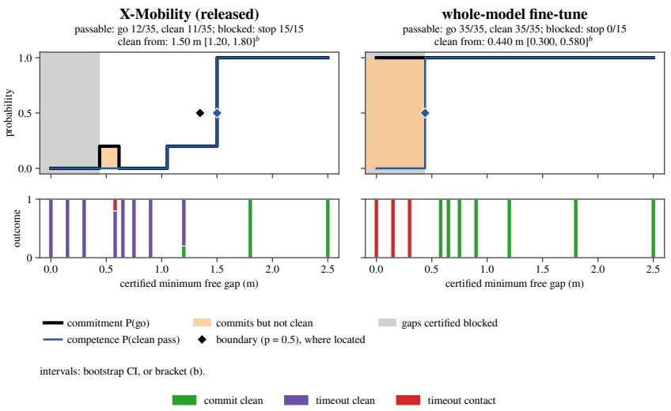  
Figure 12. X-Mobility before and after fine-tuning, on the held-out composed stacks. Five policy samples per certified gap for the released checkpoint (left) and the whole-model fine-tune (right), on the same ten gaps. Top: commitment (black), the share of samples that decide to go, and competence (blue), the share that pass cleanly, against the certified minimum free gap; diamonds mark the located boundaries, orange the gaps where the robot commits but does not pass cleanly, and grey the gaps certified blocked. Panel titles give the go and clean-pass counts on passable gaps, the stop count on blocked gaps, and the competence boundary with its bracket. Bottom: the outcome of each sample at each gap: commit clean, a passage without contact; timeout clean, the robot neither passes nor touches anything before the time limit, its way of stopping; timeout contact, the time limit reached after a contact.

Compared with the expert, the learned driving agents differ most on the stop side. They wait for at most 6 of 29 gaps in oncoming traffic, against 13 for the expert. On passable variants, several of them pass cleanly more often than the expert, which is conservative on the gauntlet and hits the vending machine in every run. The warehouse policy stops at blocked gaps in only one of three families. Since the families are defined by measured axes rather than fixed routes, the same profiles can be measured again for each new version of an agent, to see whether a boundary moved, in which direction and by how much. For two fine-tunes of the warehouse policy, this shows better clean passage together with the loss of every stop (Section 4.4). We think this is where the method is most useful: telling developers where their agent’s commitment exceeds its competence, and whether their usual metric would have caught it.

Limitations. All of our results come from simulation. They compare agents within CARLA and within Isaac Sim, and do not yet tell us whether the same failure boundaries appear on real vehicles or robots.

The labels that decision accuracy relies on are conventions we state explicitly rather than facts we can measure without assumptions. Whether a corridor counts as blocked depends on the policy floor, and whether a gap in oncoming traffic counts as usable depends on the margin of the gap certificate. Within the range we tested, changing these constants leaves the strongest and weakest agents in place but reorders the agents in between, so the middle of the ranking should be read with care. The summary itself rests on only three families that contain a stop side, and the expert we compare against is a scripted planner that serves as a reference, not as an upper bound on good driving.

The precision of the profiles is limited by the number of runs behind them. With three seeds per variant, the intervals of neighboring agents often overlap, and boundaries that lie closer together than their intervals should not be read as different. More runs near each boundary would help, but evaluation is already costly: running all seven driving agents takes roughly 220 hours on a single GPU, which may be out of reach for teams with limited compute. The warehouse study is narrower still. It covers one robot and one policy in three versions, and the two fine-tuned versions were trained on two of its three families, so only the composed stacks are a held-out test.

## References

[1] CARLA Team. ScenarioRunner for CARLA. https: //github.com/carla- simulator/scenario\_ runner, 2018. Accessed 2026-09-27. 2

[2] CARLA Team. CARLA autonomous driving leaderboard. https://leaderboard.carla.org, 2019. Accessed 2026-09-27. 2

[3] Greg Chance, Abanoub Ghobrial, Kevin McAreavey, Severin Lemaignan, Tony Pipe, and Kerstin Eder. On determinism of game engines used for simulation-based autonomous vehicle verification. IEEE Transactions on Intelligent Transportation Systems, 23(11):20538–20552, 2022. 8

[4] Alexey Dosovitskiy, German Ros, Felipe Codevilla, Antonio Lopez, and Vladlen Koltun. CARLA: An open urban driving simulator. In Conference on Robot Learning (CoRL), 2017. 2, 7

[5] Daniel J. Fremont, Tommaso Dreossi, Shromona Ghosh, Xiangyu Yue, Alberto L. Sangiovanni-Vincentelli, and Sanjit A. Seshia. Scenic: A language for scenario specification and scene generation. In ACM SIGPLAN Conference on Programming Language Design and Implementation (PLDI), 2019. 2

[6] Simon Gerstenecker, Andreas Geiger, and Katrin Renz. PlanT 2.0: Exposing biases and structural flaws in closedloop driving. arXiv preprint arXiv:2511.07292, 2025. 2, 7

[7] Simon Gerstenecker, Andreas Geiger, and Katrin Renz. Fail2Drive: Benchmarking closed-loop driving generalization. arXiv preprint arXiv:2604.08535, 2026. 1, 2

[8] Niklas Hanselmann, Katrin Renz, Kashyap Chitta, Apratim Bhattacharyya, and Andreas Geiger. KING: Generating safety-critical driving scenarios for robust imitation via kinematics gradients. In European Conference on Computer Vision (ECCV), 2022. 2

[9] Bernhard Jaeger, Kashyap Chitta, and Andreas Geiger. Hidden biases of end-to-end driving models. In IEEE/CVF International Conference on Computer Vision (ICCV), 2023. 7

[10] Xiaosong Jia, Zhenjie Yang, Qifeng Li, Zhiyuan Zhang, and Junchi Yan. Bench2Drive: Towards multi-ability benchmarking of closed-loop end-to-end autonomous driving. In Advances in Neural Information Processing Systems (NeurIPS), Datasets and Benchmarks Track, 2024. 1, 2

[11] Shu Liu, Wenlin Chen, Weihao Li, Zheng Wang, Lijin Yang, Jianing Huang, Yipin Zhang, Zhongzhan Huang, Ze Cheng, and Hao Yang. BridgeDrive: Diffusion bridge policy for closed-loop trajectory planning in autonomous driving. In International Conference on Learning Representations (ICLR), 2026. 3, 7

[12] Wei Liu, Huihua Zhao, Chenran Li, Joydeep Biswas, Billy Okal, Pulkit Goyal, Yan Chang, and Soha Pouya. X-MOBILITY: End-to-end generalizable navigation via world modeling. arXiv preprint arXiv:2410.17491, 2024. 2, 8

[13] Galen E. Mullins, Paul G. Stankiewicz, R. Chad Hawthorne, and Satyandra K. Gupta. Adaptive generation of challenging scenarios for testing and evaluation of autonomous vehicles. Journal ofSystems and Software, 137:197–215, 2018. 2

[14] Long Nguyen, Micha Fauth, Bernhard Jaeger, Daniel Dauner, Maximilian Igl, Andreas Geiger, and Kashyap Chitta. LEAD: Minimizing learner-expert asymmetry in end to-end driving. In IEEE/CVF Conference on Computer Vi sion and Pattern Recognition (CVPR), 2026. 3, 7

[15] NVIDIA. Isaac Sim. https://developer.nvidia. com/isaac/sim, 2025. Version 5.1. 2, 7

[16] NVIDIA, Yulong Cao, Riccardo de Lutio, Sanja Fidler, Guillermo Garcia Cobo, Zan Gojcic, Maximilian Igl, Boris Ivanovic, Peter Karkus, Janick Martinez Esturo, Marco Pavone, Aaron Smith, Ellie Tanimura, Michal Tyszkiewicz, Michael Watson, Qi Wu, and Le Zhang. Alpasim: A modular, lightweight, and data-driven research simulator for autonomous driving, 2025. 2

[17] Daniel Perille, Abigail Truong, Xuesu Xiao, and Peter Stone. Benchmarking metric ground navigation. In 2020 IEEE International Symposium on Safety, Security, and Rescue Robotics (SSRR), pages 116–121. IEEE, 2020. 2

[18] Katrin Renz, Kashyap Chitta, Otniel-Bogdan Mercea, A. Sophia Koepke, Zeynep Akata, and Andreas Geiger. PlanT: Explainable planning transformers via object-level representations. In Conference on Robot Learning (CoRL), 2022. 2

[19] Katrin Renz, Long Chen, Elahe Arani, and Oleg Sinavski. SimLingo: Vision-only closed-loop autonomous driving with language-action alignment. In IEEE/CVF Conference on Computer Vision and Pattern Recognition (CVPR), 2025. 7

[20] Chonghao Sima, Katrin Renz, Kashyap Chitta, Li Chen, Hanxue Zhang, Chengen Xie, Jens Beißwenger, Ping Luo, Andreas Geiger, and Hongyang Li. DriveLM: Driving with graph visual question answering. In European Conference on Computer Vision (ECCV), 2024. 8

[21] Shuhan Tan, Boris Ivanovic, Xinshuo Weng, Marco Pavone, and Philipp Kraehenbuehl. Language conditioned traffic generation. In Conference on Robot Learning (CoRL), 2023. 2

[22] Yingqi Tang, Zhuoran Xu, Zhaotie Meng, and Erkang Cheng. HiP-AD: Hierarchical and multi-granularity planning with deformable attention for autonomous driving in a single decoder. In Proceedings of the IEEE/CVF Interna tional Conference on Computer Vision (ICCV), 2025. 8

[23] Jingkang Wang, Ava Pun, James Tu, Sivabalan Manivasagam, Abbas Sadat, Sergio Casas, Mengye Ren, and Raquel Urtasun. AdvSim: Generating safety-critical scenarios for self-driving vehicles. In IEEE/CVF Conference on Computer Vision and Pattern Recognition (CVPR), 2021. 2

[24] Jiawei Zhang, Chejian Xu, and Bo Li. ChatScene: Knowledge-enabled safety-critical scenario generation for autonomous vehicles. In IEEE/CVF Conference on Com puter Vision and Pattern Recognition (CVPR), 2024. 2

[25] Hongyu Zhou, Longzhong Lin, Jiabao Wang, Yichong Lu, Dongfeng Bai, Bingbing Liu, Yue Wang, Andreas Geiger, and Yiyi Liao. Hugsim: A real-time, photo-realistic and closed-loop simulator for autonomous driving. arXiv preprint arXiv:2412.01718, 2024. 2