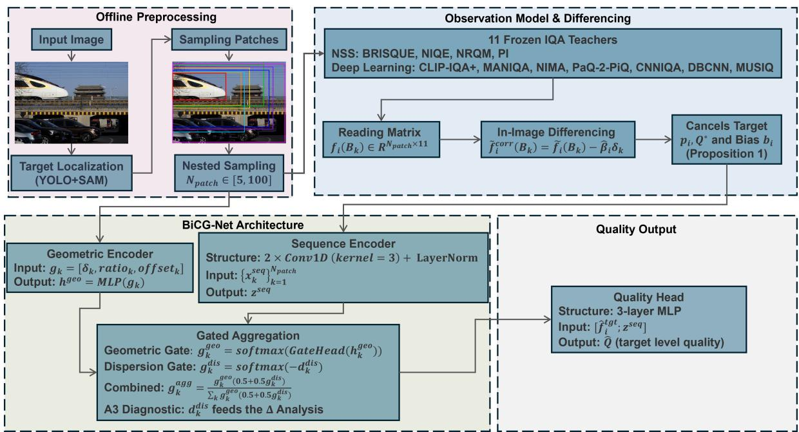
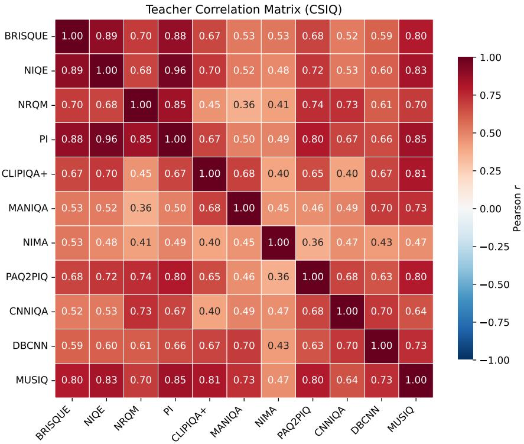
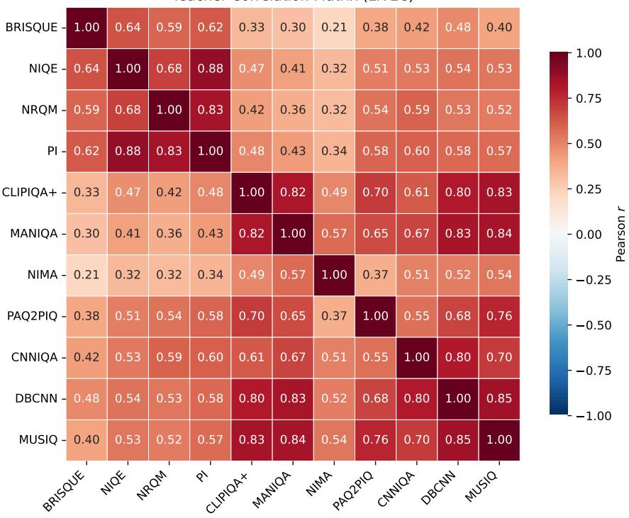

# BiCG-Net: Target-Specific Image Quality Assessment via Observation Modeling and In-Image Diferencing

Yang Yibua, Cui Tingqionga, Lei Liminga, Xiong Haoa, Xu Junb, Liu Siyuanc, Huang Guanghuib,∗

aCRRC Chongqing Co., Ltd., Chongqing, China

bCollege of Mathematics and Statistics, Chongqing University, Chongqing, China cState Key Laboratory of Mechanical Transmission for Advanced Equipment, Chongqing University, Chongqing, China

## Abstract

We estimate the quality of a specific target region (e.g., a train body) in an image, rather than the quality of the whole image. This target-level task difers fundamentally from whole-image No-Reference Image Quality Assessment (NR-IQA): when the target occupies only a small fraction of the frame, the whole-image score is dominated by background, and no public benchmark provides target-level human Mean Opinion Score (MOS). We therefore estimate target quality by nested sampling—a sequence of patches expanding outward from the target box—and infer quality from the relative structure of this sequence rather than from any single patch. This motivates BiCG-Net, a student network that distills an 11-teacher ensemble through a linear observation model and an in-image diferencing mechanism, which provably cancels the target term and the teacher-specific bias. We train and test the student independently on each dataset, and separately evaluate zero-shot transfer across benchmarks. On CSIQ and LIVEC, where the target-level task degenerates to whole-image assessment, the student reaches PLCCs of 0.9009 and 0.9133 against human MOS, exceeding the best single teacher and the teacher consensus on both datasets. On a self-built MOS-free railway dataset, the student reaches a PLCC of 0.9855 against the weak label, not human MOS. The student, distilled from these teachers, exceeds its own teachers because it is not trained to mimic any of them: it learns a new mapping from the relative structure of teacher readings to the ground-truth label. A residual analysis on CSIQ and LIVEC compares the student’s prediction with the teacher consensus. The residual is significantly correlated with background contamination, teacher dispersion, and label extremity, showing that the student extracts information the consensus does not contain. Under CSIQto-LIVEC transfer, the frozen student reaches a PLCC of 0.8416 against human MOS on LIVEC, exceeding the consensus by 0.1947. We position BiCG-Net as an ofline target-level quality auditing and label-generation engine. Its 39,482-parameter student is compact by design, acting as a unifying layer that maps the 11 heterogeneous teacher readings onto a common quality scale.

Keywords: No-reference image quality assessment, Target-specific quality, Observation model, In-image diferencing, Multi-teacher consensus

## 1. Introduction

Deploying an image quality assessment (IQA) system in practical vision pipelines requires estimating the quality of a specific target region, not of the whole image. Consider a railway rolling-stock inspection system: the train body typically occupies only a small fraction of the frame, while the rest is background clutter, track ballast, and vegetation. A whole-image quality score is therefore dominated by irrelevant background and provides little information about the target itself. In such settings, the primary objective is the accuracy of target-level quality estimation: downstream operations depend on high-fidelity, deterministic quality labels, and a fast but inaccurate score is of little use. Establishing target-level accuracy without resorting to expensive, logistically prohibitive target-level re-annotation campaigns is therefore the core requirement.

This target-level requirement becomes especially stringent when the quality labels are used for downstream generative-AI training and data curation. Generative models are sensitive to their training distributions: training on blurred, specularly reflective, or partially occluded targets leads to structural artifacts and inherited motion blur in the synthesized output. The fidelity of target-level quality labels therefore bounds the synthesis capability of downstream architectures, making accurate target-level assessment a prerequisite for ofline data curation.

An intuitive baseline is to apply of-the-shelf No-Reference IQA (NR-IQA) models directly to the local region of interest. However, contemporary NR-IQA methodologies are predominantly tailored for global, whole-image quality prediction [1, 2, 3]. Classical statistical schemes like BRISQUE [4] and NIQE [5] extract natural scene statistics across the entire spatial domain, whereas deep paradigms such as MUSIQ [6], MANIQA [7], and CLIP-IQA+ [8] aggregate global representations contextualized via transformer blocks or vision-language foundation models. These methods operate under the monolithic assumption that the entire frame constitutes a singular, homogeneous quality unit, which collapses when the target occupies only a small fraction of the frame: the aggregated score is then dominated by background, while the structural integrity of the target is heavily contaminated. This motivates nested sampling: instead of scoring a single target crop, we score a sequence of nested patches and infer the target quality from how teacher readings change as the patch expands outward.

Our goal is to assign a reliable quality score to a specific target in an image without target-level MOS. This motivates BiCG-Net, which models each teacher reading as a linear decomposition of five latent quantities (target quality, teacher bias, area efect, background content, and noise) and cancels the target term and teacher bias by in-image diferencing— subtracting the readings of two patches in the same image. In the experiments, the student is trained and tested independently on each dataset, and evaluated separately under zero-shot cross-dataset transfer.

Public benchmarks provide only whole-image human MOS, not target-level MOS. To validate the target-level formulation on these benchmarks, we deliberately designate a center 1/9 area as the pseudo-target and expand the nested sampling until the patch boundary coincides with the full frame.1 Because the ultimate sampling patch is the whole image, the target-level evaluation mathematically degenerates to a global prediction, allowing us to leverage whole-image human MOS to validate the target-level formulation.

We evaluate on three datasets: two public MOS benchmarks (CSIQ and LIVEC) and one self-built MOS-free railway dataset. On CSIQ and LIVEC, where the target-level task degenerates to whole-image assessment, the student reaches PLCCs of 0.9009 and 0.9133 against human MOS, exceeding both the best single teacher and the teacher consensus on both datasets. On the self-built MOS-free railway dataset, the student reaches a PLCC of 0.9855 against the weak label (a consensus of teacher readings), not human MOS. Under a strictly zero-shot CSIQ-to-LIVEC transfer, the frozen student reaches a PLCC of 0.8416, exceeding the consensus by +0.1947; the reverse direction essentially matches the consensus, an asymmetry we hypothesize to reflect the information-coverage gap of the source manifold and analyze further through the ∆ diagnostics in Section 5.5.

This gap cannot be attributed to network capacity alone; it stems from the mathematical structure of raw teacher readings. When a whole-image IQA teacher evaluates an expanded patch that encloses the target, its scalar output is jointly governed by five latent quantities: the target quality, the teacher-specific bias, the area efect, the background content, and measurement noise. Because these components are individually latent and underdetermined, simple arithmetic averaging across an ensemble propagates both the teacher bias and the background contribution into the final supervision signal. When the target occupies only a small fraction of the frame, these two components dominate the average, causing consensus networks to output background-driven scores rather than target-level quality.

The core mathematical insight is that, although the five components are individually unobserved, the target quality and the teacher-specific bias remain invariant within a single image, whereas the area efect and the background content vary across the patch sequence. Taking the diference between any two patches in the same image therefore cancels the target term and the teacher bias, leaving only the area efect, the background diference, and noise. By compensating for the area efect through a dedicated geometric encoder, the residual reduces to a pure background-and-noise term, a property we term in-image diferencing. Because the operation is performed within a single image, the resulting statistics are withinimage invariant by construction, free from the absolute scales and site-specific biases of the teacher models. BiCG-Net builds on this mechanism to estimate target quality without target-level MOS.

The main contributions of this work are as follows:

1. A nested-sampling formulation with provable bias elimination. We formulate target quality as a relative property of a nested patch sequence and prove that inimage diferencing exactly eliminates the target term and the teacher systematic bias, delivering a bias-eliminated supervision signal for multi-teacher distillation.

2. A formal underdetermined observation model. We formalize raw teacher readings as a linear decomposition of five latent variables, and prove that conventional consensus aggregation is vulnerable when the target occupies only a small fraction of the frame, because unmodeled teacher biases and background content leak into the average.

3. An interpretable four-module architecture. We design BiCG-Net as a direct mathematical reflection of the observation components: per-teacher scaling, observation correction, sequence encoding, and gated aggregation. The architecture is compact by design, so that it learns to reconcile the 11 heterogeneous teacher readings rather than memorize individual teachers.

4. A validation across perceptual and deployment tracks with a ∆ diagnostic. We separate perceptual validity (MOS benchmarks) from deployment usability (the MOS-free dataset), and characterize information beyond the teacher ensemble through a $\Delta$ analysis that explains both the in-distribution gains and the asymmetric transfer (the CSIQ-to-LIVEC gain vs. the flat reverse direction).

## 2. Related Work

## 2.1. Whole-Image No-Reference Image Quality Assessment

No-Reference Image Quality Assessment (NR-IQA) aims to predict the perceptual quality of an image without access to a pristine reference. The field has evolved through three distinct generations, which we review below; a comprehensive survey of DNN-based methods can be found in [9].

Hand-crafted statistics. The first generation relies on the theory of Natural Scene Statistics (NSS), assuming that natural images occupy a characteristic subspace of the image space and that distortions push them away from this subspace. BRISQUE [4] extracts Generalized Gaussian Distribution (GGD) features from normalized luminance coeficients to quantify blur and noise. NIQE [5] constructs a Multivariate Gaussian (MVG) model of natural image statistics and measures the deviation of the test image from the natural-image manifold. These methods are computationally eficient and mathematically interpretable, but their hand-crafted features have limited capacity to capture complex, unknown distortion manifolds, and they operate on the whole image as a single quality unit.

Deep CNN and transformer models. The second generation began with end-to-end quality regression. Bosse et al. [10] introduced a deep CNN with separate branches for distortion and content, while Kang et al. [11] proposed one of the earliest CNN-based NR-IQA models. DBCNN [12] combines a distortion branch and a content branch to capture both low-level artifacts and high-level semantics. Transformer-based models such as MUSIQ [6] and MANIQA [7] leverage multi-scale attention to capture long-range dependencies, while You and Korhonen [13] adapt vision transformers directly to NR-IQA. These models substantially improve accuracy on public benchmarks such as CSIQ, LIVEC, and KonIQ-10k [14], but they all operate under the same monolithic assumption: the entire frame constitutes a single quality unit.

Vision-language IQA. The third generation integrates vision-language models into quality prediction. CLIP-IQA+ [8] leverages CLIP’s image-text alignment to predict quality through textual prompts. Q-Align [15] teaches large multimodal models to score images via discrete text-defined levels. TOPIQ [16] adopts a top-down approach from semantics to distortions. Zoom-IQA [17] introduces reliable region-aware reasoning for quality assessment. More recently, Liao et al. [18] observe that the magnitude of CLIP features, not just the cosine similarity, is strongly correlated with perceptual quality, and propose a magnitude-aware fusion scheme. Ramesh et al. [19] integrate scene depth into the quality regression pipeline, showing improved generalization to natural distortions such as haze and low-light. These models, however, also operate on the whole image, without explicit target-level supervision.

Despite this progress, these methods share a common limitation: quality is treated as a global property of the entire frame. When the target of interest occupies only a small fraction of the image—as in railway inspection, where the train body may cover less than 20% of the pixels—global aggregation is heavily dominated by irrelevant background variables such as the sky, track ballast, or surrounding vegetation. This monolithic assumption causes stateof-the-art whole-image models to degrade severely in target-level evaluation—estimating the quality of a specific target region rather than the whole image (Section 1)—with their PLCC dropping to 0.8230 on our benchmark (Section 5.1).

These three generations share a common whole-image assumption; the following subsections review the lines that attempt to move beyond it.

## 2.2. Multi-Teacher Aggregation and Consensus

A common strategy for improving NR-IQA robustness is to aggregate the outputs of multiple pretrained models. Multi-teacher distillation transfers knowledge from an ensemble of teachers to a student network; in the IQA context, a simpler alternative is consensus aggregation, which computes a weighted average of teacher scores, often using medianbased or Gaussian-weighted aggregation to suppress outliers. This strategy is attractive because it requires no additional training and can leverage the complementary strengths of diverse IQA backbones—NSS methods capture low-level statistics, CNN methods capture learned distortion features, and CLIP-based methods capture semantic quality. BiCG-Net follows the distillation route, but replaces the heuristic average with in-image diferencing (Section 3.2).

These methods, however, treat aggregation as a heuristic and assume that individual teacher biases cancel out under averaging. Our observation model (Section 3.2) proves that this assumption is flawed: the target term and the teacher bias are entangled in each reading, and simple averaging inevitably propagates both into the weak label. When the target occupies only a small fraction of the frame, the bias and background terms dominate the average, causing consensus to degrade; for example, under the CSIQ-to-LIVEC shift, consensus achieves a PLCC of only 0.6469 (Section 5.3), while our method reaches 0.8416. This motivates in-image diferencing (Section 3.2), which eliminates bias by construction rather than by statistical cancellation.

## 2.3. Region- and Target-Oriented Quality Assessment

To address the spatial selectivity limitation of whole-image IQA, a line of work has explored quality assessment on regions of interest (ROIs) or specific semantic targets.

Trafic scenarios. RTSIQA [20] is the most closely related work because it also targets region-level quality in real-world scenes: it constructs a database and method specifically for trafic scenes. However, RTSIQA still requires region-level MOS for training and does not address cross-dataset transfer. Lu et al. [21] evaluate quality in predefined areas of trafic targets, but rely on static geometric priors.

Patch-based methods. Other methods use saliency maps, manual bounding boxes, or patch decomposition to constrain the evaluation region. PaQ-2-PiQ [22] maps patch-level quality to picture-level quality via learned aggregation. These methods partially alleviate background contamination but still lack an explicit mechanism for separating target quality from background contributions. Patch-based aggregation typically computes a simple arithmetic mean across patches, which propagates background interference from non-target patches into the final score.

Existing region-oriented methods, therefore, still face three challenges: (i) reliance on static or manually defined boundaries, (ii) absence of an explicit background suppression mechanism, and (iii) lack of cross-dataset transfer. Our method addresses all three through in-image diferencing (Section 3.2) and adaptive target localization (Section 3.1.1).

Localization and segmentation tools. Precise target localization and segmentation provide the spatial foundation for target-specific quality assessment. YOLO [23] introduced a unified object detection framework that localizes targets with a single forward pass, and subsequent variants have made it a standard tool for industrial inspection. The Segment Anything Model (SAM) [24] enables prompt-driven, pixel-level segmentation of arbitrary objects; combined with a bounding-box prompt from an object detector, it produces highquality masks that purify the target region and remove background interference. In our framework, YOLO and SAM are used only during ofline preprocessing to localize and purify the target, and the quality assessment itself does not depend on the foundation models at inference time. This distinguishes our approach from end-to-end foundation-model pipelines.

## 2.4. Cross-Dataset Image Quality Assessment

The practical deployment of IQA systems requires generalization across domains, yet most existing methods are evaluated under the assumption that training and test data are drawn from the same distribution.

Domain adaptation for IQA. A number of works have explored domain adaptation for IQA. MetaIQA [25] applies meta-learning to learn a prior that can be quickly adapted to new domains. Madhusudana et al. [26] leverage contrastive learning to learn domain-invariant representations. These methods typically require either target-domain data during adaptation or a meta-training procedure, both of which are impractical in industrial deployments where target-domain labels are unavailable.

Cross-dataset distillation. Gao et al. [27] propose a cross-dataset distillation framework in which a student aligns its representation with teachers trained on diferent datasets, achieving an SRCC of 0.964 on CSIQ. However, it requires access to both source and target domain data during training, and relies on teacher models that are themselves trained on annotated datasets.

Cross-dataset transfer. Other works study cross-dataset IQA, where a model trained on one dataset is directly applied to another. This corresponds to the L2 setting in our experiments (Section 5.3). These studies typically report significant performance drops under domain shift, with PLCC decreasing by 0.1–0.2 or more.

Existing cross-dataset IQA methods, however, either require target-domain adaptation or report substantial performance degradation under shift. In contrast, our method achieves cross-dataset transfer without any target-domain labels, by exploiting a structural property of teacher readings—the in-image diferencing mechanism—that cancels teacher bias within an image. We do not report zero-shot transfer from the self-built dataset to the public benchmarks, because the two settings difer in task definition: the self-built dataset is annotated at the target level, whereas CSIQ and LIVEC provide whole-image MOS. Such a transfer would conflate task mismatch with domain shift and is therefore not directly comparable.

## 2.5. Weak-Label and Pseudo-Label Generation

Beyond cross-dataset transfer, the supervision signal itself must be generated without target-level MOS. This places our method in the broader family of weakly supervised learning. Weak-label generation produces supervision from model predictions, typically by selecting high-confidence samples, and noisy label learning models label noise explicitly to prevent corrupted supervision from degrading downstream performance.

Pseudo-labeling for IQA. Recent work has explored semi-supervised learning to reduce the annotation burden. CPL-IQA [28] introduces a semi-supervised blind IQA (BIQA) framework that combines a small set of labeled images with a large set of unlabeled images. It converts MOS scalars into vector labels via entropy minimization, then iteratively refines them using a manifold-based label propagation strategy with confidence-quantifiable pseudo-labels. This approach substantially reduces the need for manual annotation while maintaining strong performance on authentic distortion benchmarks.

CPL-IQA, however, assumes that a small set of labeled images is available to initialize the label propagation process, and relies on confidence estimation to filter unreliable pseudolabels—a statistical heuristic without a bias-elimination guarantee. In our target-specific setting, no target-level human MOS exists. In contrast, in-image diferencing eliminates teacher bias by construction, without requiring confidence estimation or labeled seed data.

## 2.6. Positioning of This Work

Having reviewed the related lines, we now position our work against the most closely related ones. Table 1 summarizes the diferences between our method and the most closely related lines of work.

The key distinction is not only what we estimate (target-level quality without MOS) but how: nested sampling turns background contamination from a nuisance into a signal, which existing ROI-based and whole-image methods do not exploit.

Table 1: Comparison with related work. Cross-data denotes cross-dataset transfer.
<table><tr><td>Method</td><td>Target -level</td><td>No MOS</td><td>Cross -data</td><td>Prov- able</td><td>Multi- teacher</td><td>Bg. supp.</td></tr><tr><td>Whole-image NR-IQA</td><td>X</td><td>X</td><td>X</td><td>X</td><td>X</td><td>X</td></tr><tr><td>Multi-teacher consensus</td><td>X</td><td>V</td><td>X</td><td>X</td><td>√</td><td>X</td></tr><tr><td>ROI-based IQA</td><td>√</td><td>X</td><td>X</td><td>X</td><td>X</td><td>X</td></tr><tr><td>Cross-dataset IQA</td><td>X</td><td>X</td><td>√</td><td>X</td><td>X</td><td>X</td></tr><tr><td>BiCG-Net (Ours)</td><td>V</td><td>V</td><td>V</td><td>√</td><td>√</td><td>√</td></tr></table>

Despite the extensive literature reviewed above, three open problems remain: (i) no MOS-free supervision for target-level IQA; (ii) no provable bias elimination in multi-teacher aggregation; and (iii) no bias-eliminated supervision for cross-dataset transfer.

To our knowledge, BiCG-Net is among the first frameworks that unify: (i) target-level quality assessment, (ii) supervision without target-level human MOS, (iii) cross-dataset transferability, (iv) a provable bias-elimination mechanism, (v) multi-teacher aggregation, and (vi) explicit background suppression. The in-image diferencing property introduced in Section 3 provides the theoretical foundation for (ii) and (iv), while the empirical results in Section 5 demonstrate (i), (iii), (v), and (vi).

Comparison with RTSIQA. RTSIQA [20] constructs a database and method specifically for real-world trafic scenes. While RTSIQA also targets region-level quality, it difers from our method in three key aspects: (i) RTSIQA requires region-level MOS for training, whereas our method requires no target-level MOS; (ii) RTSIQA does not address crossdataset transfer, whereas our method explicitly evaluates it; and (iii) RTSIQA does not provide a formal bias-elimination mechanism, whereas our in-image diferencing provides a provable foundation.

## 3. Method

## 3.1. Problem Formulation and Spatial Foundation

## 3.1.1. Target Localization and Nested Sampling

Given an input image $I \in \mathbb { R } ^ { W \times H \times 3 } ,$ , our goal is to estimate the quality $\hat { Q }$ of a specific target region, rather than that of the whole image. The target region is specified by a bounding box $B _ { \mathrm { m i n } }$ that covers the semantic object of interest. To obtain $B _ { \mathrm { m i n } }$ , a pretrained YOLO detector [23] first produces an initial box, which is then fed as a prompt into the Segment Anything Model (SAM) [24] to yield a pixel-level mask. The mask is cleaned by morphological closing to fill small holes, and the minimum bounding rectangle of the cleaned mask is taken as the refined box. The process is iterated until the IoU between consecutive boxes falls below $\tau _ { \mathrm { { I o U } } }$ . The final box $B _ { \mathrm { m i n } }$ is treated as a fixed input during quality assessment; both YOLO and SAM are applied ofline and are not fine-tuned on our data.

From $B _ { \mathrm { m i n } }$ , a set of $N _ { \mathrm { p a t c h } }$ nested patches $\{ B _ { k } \} _ { k = 1 } ^ { N _ { \mathrm { p a t c h } } }$ is generated by progressively expanding outward, such that $B _ { \operatorname* { m i n } } \subseteq B _ { k }$ for all k. For each patch, a pretrained IQA teacher $i \ ( i = 1 , \ldots , T$ , with $T = 1 1 )$ produces a scalar reading $f _ { i } ( B _ { k } )$ . To describe the spatia relationship between each patch and the target, we define three geometric quantities:

$$
\delta _ { k } = 1 - \frac { | B _ { \operatorname* { m i n } } | } { | B _ { k } | } , \quad \delta _ { k } \in [ 0 , 1 ] ,\tag{1}
$$

$$
\mathrm { a r e a \_ r a t i o } _ { k } = \frac { | B _ { \mathrm { m i n } } | } { | B _ { k } | } = 1 - \delta _ { k } ,\tag{2}
$$

$$
\mathrm { o f f s e t } _ { k } = \sqrt { \left( \frac { c x _ { k } - c x _ { \mathrm { m i n } } } { W } \right) ^ { 2 } + \left( \frac { c y _ { k } - c y _ { \mathrm { m i n } } } { H } \right) ^ { 2 } } ,\tag{3}
$$

where $\left( { c x } _ { k } , { c y } _ { k } \right)$ and $( c x _ { \mathrm { m i n } } , c y _ { \mathrm { m i n } } )$ denote the centers of $B _ { k }$ and $B _ { \mathrm { m i n } }$ , respectively. These three quantities form the geometric vector $\mathbf { g } _ { k } = [ \delta _ { k }$ , area\_ratio , ofse $\mathrm { t } _ { k } ] \in \mathbb { R } ^ { 3 }$ . The first two enter the observation model (Section 3.2); all three are consumed by the geometric encoder (Section 3.3.2). Sampling patches are sorted by $\delta _ { k }$ in ascending order, so that the sequence preserves the spatial cascading structure from the target outward.

## 3.1.2. Notation

Table 2 summarizes the symbols used throughout this section.

Table 2: Notation.
<table><tr><td></td><td>Symbol Meaning</td><td>Symbol</td><td>Meaning</td></tr><tr><td>I</td><td>Input image</td><td> $s _ { i } ^ { \mathrm { e f f } }$ </td><td>Effective per-teacher scale</td></tr><tr><td> $B _ { \mathrm { m i n } }$ </td><td>Target bounding box</td><td> $\tilde { f } _ { i } ( B _ { k } )$ </td><td>Normalized teacher reading</td></tr><tr><td> $B _ { \mathrm { m a x } }$ </td><td>Full-image box</td><td> $\tilde { f } _ { i } ^ { \mathrm { c o r r } } ( B _ { k } )$ </td><td>Background-corrected reading</td></tr><tr><td> $B _ { k }$ </td><td>k-th sampling patch</td><td> ${ \hat { \beta } } _ { i }$ </td><td>Predicted area coefficient</td></tr><tr><td> $N _ { \mathrm { p a t c h } }$ </td><td>Number of sampling patches</td><td> $w _ { i } ^ { \mathrm { c r e d } }$ </td><td>Teacher credibility</td></tr><tr><td> $T$ </td><td>Number of teachers  $( T = 1 1 )$ </td><td> $d _ { k } ^ { \mathrm { { d i s } } }$ </td><td>Cross-teacher dispersion</td></tr><tr><td> $f _ { i } ( B _ { k } )$ </td><td>Raw reading of teacher i</td><td> $\mathbf { h } _ { k } ^ { \mathrm { g e o } }$ </td><td>Geometric embedding</td></tr><tr><td> $p _ { i }$ </td><td>Polarity of teacher i (±1)</td><td> $\mathbf { x } _ { k } ^ { \mathrm { { s e q } } }$ </td><td>Sequence-encoder input</td></tr><tr><td> $Q _ { \mathrm { t a r g e t } } ^ { * }$ </td><td>Underlying target quality</td><td> $\mathbf { z } ^ { \mathrm { s e q } }$   $\mathbf { \Pi } _ { \mathbf { 0 } } \mathbf { \Pi } ^ { \mathrm { g e o } }$ </td><td>Sequence feature</td></tr><tr><td> $b _ { i }$ </td><td>Systematic bias of teacher i</td><td> $g _ { k } ^ { \mathrm { { o } } }$ </td><td>Geometric gate</td></tr><tr><td> $\beta _ { i }$ </td><td>Area-effect slope</td><td> $g _ { k } ^ { \mathrm { d i s } }$ </td><td>Dispersion gate</td></tr><tr><td> $\gamma _ { i }$ </td><td>Background-content coefficient</td><td> ${ g } _ { k } ^ { \mathrm { a g g } }$ </td><td>Combined aggregation gate</td></tr><tr><td> $\delta _ { k }$ </td><td>Difference-area ratio</td><td> $f _ { i }$ </td><td>Aggregated teacher response</td></tr><tr><td> $\phi _ { k }$ </td><td>Background content</td><td> $\hat { f } _ { i } ^ { \mathrm { t g t } }$  A</td><td>Bias-free response</td></tr><tr><td> $\epsilon _ { i , k }$ </td><td>Measurement noise</td><td> $Q _ { \mathrm { r a w } }$ </td><td>Raw quality head output</td></tr><tr><td> $s _ { i } ^ { \mathrm { b a s e } }$ </td><td>Global scale of teacher i</td><td> $\lambda ^ { \mathrm { q u a l } } , b ^ { \mathrm { q u a l } }$ </td><td>Quality scale and bias</td></tr><tr><td> $\eta _ { i }$ </td><td>Learnable log-scale correction</td><td> $\hat { Q }$ </td><td>Estimated target quality</td></tr></table>

## 3.2. Observation Model and In-Image Diferencing

Observation model. We model the reading of teacher i on sampling patch $B _ { k }$ as a linear decomposition of five components:

$$
f _ { i } ( B _ { k } ) = p _ { i } Q _ { \mathrm { t a r g e t } } ^ { * } + b _ { i } + \beta _ { i } \delta _ { k } + \gamma _ { i } \phi _ { k } + \epsilon _ { i , k } .\tag{4}
$$

The first term $p _ { i } Q _ { \mathrm { t a r g e t } } ^ { \ast }$ captures the target quality contribution, where $p _ { i } \in \{ + 1 , - 1 \}$ encodes the polarity of the teacher. The second term $b _ { i }$ is the systematic bias of teacher i, which is independent of the patch index k. The third term $\beta _ { i } \delta _ { k }$ accounts for the area efect, and the fourth term $\gamma _ { i } \phi _ { k }$ captures the background content. The fifth term $\epsilon _ { i , k }$ is measurement noise. Underdetermined structure. All five quantities in Eq. (4) are unobserved, and no direct separation is possible even with pixel-perfect localization. This underdetermined structure is the root cause of the failure of simple averaging across teachers.

In-image diferencing. Our core observation is that although the five terms are individually unknown, two of them—the target quality $Q _ { \mathrm { t a r g e t } } ^ { * }$ and the teacher bias $b _ { i } { \mathrm { - a r e } }$ strictly invariant within a single image. In contrast, $\delta _ { k }$ and $\phi _ { k }$ vary dynamically with k. Therefore, taking the diference between any two patches $B _ { j }$ and $B _ { k }$ within the same image completely cancels out the target term and the teacher bias.

Proposition 1 (In-Image Diferencing). For any two sampling patches $B _ { j }$ and $B _ { k }$ within the same image, after subtracting an estimate of the area efect $\beta _ { i } \delta _ { k }$ (Section 3.3.2), the following identity holds:

$$
\tilde { f } _ { i } ^ { c o r r } ( B _ { j } ) - \tilde { f } _ { i } ^ { c o r r } ( B _ { k } ) = \gamma _ { i } [ \phi _ { j } - \phi _ { k } ] + \epsilon _ { i , j } - \epsilon _ { i , k } .\tag{5}
$$

The target term $p _ { i } Q _ { t a r g e t } ^ { * }$ and the systematic bias $b _ { i }$ are exactly eliminated.

Proof. By Eq. (4), for patches $B _ { j }$ and $B _ { k }$ :

$$
\begin{array} { r l r } & { } & { f _ { i } ( B _ { j } ) - f _ { i } ( B _ { k } ) = p _ { i } Q _ { \mathrm { t a r g e t } } ^ { * } + b _ { i } + \beta _ { i } \delta _ { j } + \gamma _ { i } \phi _ { j } + \epsilon _ { i , j } } \\ & { } & { ~ - \left( p _ { i } Q _ { \mathrm { t a r g e t } } ^ { * } + b _ { i } + \beta _ { i } \delta _ { k } + \gamma _ { i } \phi _ { k } + \epsilon _ { i , k } \right) } \\ & { } & { ~ = \beta _ { i } ( \delta _ { j } - \delta _ { k } ) + \gamma _ { i } ( \phi _ { j } - \phi _ { k } ) + \epsilon _ { i , j } - \epsilon _ { i , k } . } \end{array}\tag{6}
$$

After subtracting the area-efect term $\hat { \beta } _ { i } \delta _ { k }$ from each reading, the residual diference becomes Eq. (5). Both $p _ { i } Q _ { \mathrm { t a r g e t } } ^ { \ast }$ and $b _ { i }$ vanish because they are identical for $B _ { j }$ and $B _ { k }$ within the same image. □

This property is experimentally validated in Section 5.3.

Per-teacher scaling. Before diferencing, each reading is polarity-corrected and normalized by a per-teacher scale $s _ { i } ^ { \mathrm { e f f } }$ , yielding $\tilde { f } _ { i } ( B _ { k } ) = p _ { i } f _ { i } ( B _ { k } ) / s _ { i } ^ { \mathrm { e f f } }$ . Because $p _ { i } / s _ { i } ^ { \mathrm { e f f } }$ is a non-zero constant with fixed sign for teacher i, the ordering of the readings is preserved:

Proposition 2 (Within-Teacher Order Preservation). For any teacher i and patches $B _ { j } , B _ { k }$ 2 $\tilde { f } _ { i } ( B _ { j } ) > \tilde { f } _ { i } ( B _ { k } ) \iff f _ { i } ( B _ { j } ) > f _ { i } ( B _ { k } )$

Proof. $\widetilde { f } _ { i } ( B _ { j } ) - \widetilde { f } _ { i } ( B _ { k } ) = ( p _ { i } / s _ { i } ^ { \mathrm { e f f } } ) ( f _ { i } ( B _ { j } ) - f _ { i } ( B _ { k } ) )$ , and $p _ { i } / s _ { i } ^ { \mathrm { e f f } }$ has fixed sign within teacher i. □

Within-image invariance. Because the diferencing is performed within an image, both the target quality term $p _ { i } Q _ { \mathrm { t a r g e t } } ^ { \ast }$ and the teacher bias $b _ { i }$ are eliminated from the residual. The resulting statistics therefore depend only on the relative background content across patches, not on the absolute scale or bias of the teacher. This within-image invariance is a necessary condition for cross-benchmark transfer without target-domain labels; the empirical evidence is provided in Section 5.3.

Consensus baseline. Throughout the paper, we use the arithmetic mean of the T teacher readings on the target box as the consensus baseline:

$$
{ \mathrm { c o n s e n s u s } } = { \frac { 1 } { T } } \sum _ { i = 1 } ^ { T } f _ { i } ( B _ { \operatorname* { m i n } } ) .\tag{7}
$$

The consensus represents the knowledge that a naive multi-teacher aggregation would transfer. For weak-label generation on the self-built dataset, we use a Gaussian-weighted variant, described in Section 3.4.

## 3.3. Network Architecture

  
Figure 1: Overview of the BiCG-Net pipeline. The target box is localized by YOLO and SAM, expanded into a nested patch sequence sorted by $\delta _ { k }$ , read by 11 frozen IQA teachers, corrected, encoded, gated, and mapped to the target-level score $\hat { Q }$

Overview. Figure 1 summarizes the pipeline, which consists of four modules operating on the intra-image statistics derived from Section 3.2. The first three modules correspond to specific terms of the observation model: per-teacher scale (Section 3.3.1), area-efect correction (Section 3.3.2), and sequence encoding (Section 3.3.3). The fourth module (Section 3.3.4) aggregates the corrected readings through two gates. The dispersion gate in this final module is deliberately designed as a diagnostic pathway (feeding the $\Delta$ analysis in Section 3.5) rather than an accuracy-oriented one; its accuracy contribution is quantified separately in the ablation study of Section 5.4.

## 3.3.1. Per-Teacher Scale

The readings of diferent teachers are on diferent numerical scales. We first apply the polarity $p _ { i }$ ofline, so that all teacher readings follow the convention “higher is better.” In the network, the polarity-corrected reading is normalized by a global scale estimated from the training set:

$$
s _ { i } ^ { \mathrm { b a s e } } = \mathrm { m e d i a n } _ { g , k } \left| f _ { i } ( B _ { k } ) \right| .\tag{8}
$$

A learnable log-scale correction $\eta _ { i }$ is then applied:

$$
s _ { i } ^ { \mathrm { e f f } } = s _ { i } ^ { \mathrm { b a s e } } \cdot \exp ( \eta _ { i } ) ,\tag{9}
$$

where $\eta _ { i }$ is initialized to zero and $s _ { i } ^ { \mathrm { e f f } }$ is clamped to $[ 1 0 ^ { - 6 } , 1 0 ^ { 6 } ]$ to prevent numerical instability. The normalized reading is

$$
\tilde { f } _ { i } ( B _ { k } ) = \frac { p _ { i } \cdot f _ { i } ( B _ { k } ) } { s _ { i } ^ { \mathrm { e f f } } } .\tag{10}
$$

## 3.3.2. Observation Correction

The geometric vector $\mathbf { g } _ { k }$ is encoded into a 64-dimensional embedding through a two-layer MLP:

$$
\mathbf { h } _ { k } ^ { \mathrm { g e o } } = \operatorname { G e o E n c o d e r } ( \mathbf { g } _ { k } ) \in \mathbb { R } ^ { 6 4 } .\tag{11}
$$

To maintain a stable and robust background correction across all patches, a per-image area coeficient is predicted by pooling the geometric embeddings:

$$
\hat { \beta } _ { i } = \mathrm { T e a c h e r B G E n c o d e r } \left( \frac { 1 } { N _ { \mathrm { p a t c h } } } \sum _ { k = 1 } ^ { N _ { \mathrm { p a t c h } } } { \bf h } _ { k } ^ { \mathrm { g e o } } \right) .\tag{12}
$$

The background correction is then applied:

$$
\tilde { f } _ { i } ^ { \mathrm { c o r r } } ( B _ { k } ) = \tilde { f } _ { i } ( B _ { k } ) - \hat { \beta } _ { i } \cdot \delta _ { k } .\tag{13}
$$

This correction removes the area-induced bias from the raw reading, leaving only the target quality, systematic bias, background content, and noise.

The teacher credibility is computed from the within-image variance of the corrected readings:

$$
w _ { i } ^ { \mathrm { c r e d } } = \mathrm { s o f t m a x } \left( - \mathrm { V a r } _ { k } [ \tilde { f } _ { i } ^ { \mathrm { c o r r } } ( B _ { k } ) ] \right) .\tag{14}
$$

## 3.3.3. Sequence Encoder

Because sampling patches form a nested sequence, their local patterns contain structural information that simple aggregation cannot capture. Each patch is encoded into a $( T + 2 )$ dimensional vector:

$$
\mathbf { x } _ { k } ^ { \mathrm { s e q } } = \left[ \widetilde { f } _ { 1 } ^ { \mathrm { c o r r } } ( B _ { k } ) , \ldots , \widetilde { f } _ { T } ^ { \mathrm { c o r r } } ( B _ { k } ) , \delta _ { k } , d _ { k } ^ { \mathrm { d i s } } \right] \in \mathbb { R } ^ { T + 2 } ,\tag{15}
$$

where

$$
d _ { k } ^ { \mathrm { d i s } } = \operatorname { V a r } _ { i } \left[ \tilde { f } _ { i } ^ { \mathrm { c o r r } } ( B _ { k } ) \right]\tag{16}
$$

is the cross-teacher dispersion on patch $B _ { k }$ . The sequence $\{ \mathbf { x } _ { k } ^ { \mathrm { s e q } } \} _ { k = 1 } ^ { N _ { \mathrm { p a t c h } } }$ is processed by two 1D convolutional layers with kernel size 3, padding 1, and 64 output channels each:

$$
\begin{array} { r } { \mathbf { H } ^ { ( 1 ) } = \mathrm { R e L U } ( \mathrm { C o n v } 1 \mathrm { D } _ { 6 4 } ( \mathbf { X } ) ) , } \end{array}\tag{17}
$$

$$
{ \bf H } ^ { ( 2 ) } = \mathrm { R e L U } ( \mathrm { C o n v 1 D } _ { 6 4 } ( { \bf H } ^ { ( 1 ) } ) ) ,\tag{18}
$$

followed by a masked mean pooling and a layer normalization to yield the final sequence feature:

$$
\mathbf { z } ^ { \mathrm { s e q } } = \mathrm { L a y e r N o r m } \left( \frac { \sum _ { k } \mathrm { m a s k } _ { k } \cdot \mathbf { H } _ { k } ^ { ( 2 ) } } { \sum _ { k } \mathrm { m a s k } _ { k } } \right) \in \mathbb { R } ^ { 6 4 } .\tag{19}
$$

## 3.3.4. Target Quality Aggregation

To aggregate the corrected readings, we introduce two adaptive gates. First, a geometric gate emphasizes patches whose spatial layout is most representative of the core target:

$$
g _ { k } ^ { \mathrm { g e o } } = \mathrm { s o f t m a x } _ { k } \left( \mathrm { G a t e H e a d } ( \mathbf { h } _ { k } ^ { \mathrm { g e o } } ) \right) ,\tag{20}
$$

where the mask is applied before the softmax to ensure padded patches receive zero weight. Second, a dispersion gate acts as a reliability filter, downweighting patches with high crossteacher disagreement:

$$
\begin{array} { r } { g _ { k } ^ { \mathrm { d i s } } = \mathrm { s o f t m a x } _ { k } ( - d _ { k } ^ { \mathrm { d i s } } ) , \quad \tilde { g } _ { k } ^ { \mathrm { d i s } } = 0 . 5 + 0 . 5 \cdot g _ { k } ^ { \mathrm { d i s } } \in [ 0 . 5 , 1 . 0 ] . } \end{array}\tag{21}
$$

We map the dispersion gate to [0.5, 1.0] to prevent complete suppression, as occasional teacher disagreements may occur even for high-quality targets due to difering feature biases. The two gates are combined and renormalized:

$$
g _ { k } ^ { \mathrm { a g g } } = \frac { g _ { k } ^ { \mathrm { g e o } } \cdot \tilde { g } _ { k } ^ { \mathrm { d i s } } } { \sum _ { k ^ { \prime } } g _ { k ^ { \prime } } ^ { \mathrm { g e o } } \cdot \tilde { g } _ { k ^ { \prime } } ^ { \mathrm { d i s } } } .\tag{22}
$$

The aggregated teacher response is

$$
\bar { f } _ { i } = \sum _ { k } g _ { k } ^ { \mathrm { a g g } } \cdot \tilde { f } _ { i } ^ { \mathrm { c o r r } } ( B _ { k } ) .\tag{23}
$$

The teacher bias $b _ { i }$ is predicted by a two-layer MLP bias head from the target-box readings:

$$
b _ { i } = \mathrm { B i a s H e a d } ( \tilde { f } _ { i } ( B _ { \mathrm { m i n } } ) ) .\tag{24}
$$

The bias-free aggregated response and the raw quality estimate are:

$$
\hat { f } _ { i } ^ { \mathrm { t g t } } = \bar { f } _ { i } - b _ { i } ,\tag{25}
$$

$$
\begin{array} { r } { \hat { Q } _ { \mathrm { r a w } } = \mathrm { Q u a l i t y H e a d } \left( [ \hat { f } _ { i } ^ { \mathrm { t g t } } ; \mathbf { z } ^ { \mathrm { s e q } } ] \right) , } \end{array}\tag{26}
$$

where QualityHead is a three-layer MLP with hidden dimension 256. The final target quality estimate is

$$
\hat { Q } = \lambda ^ { \mathrm { q u a l } } \cdot \hat { Q } _ { \mathrm { r a w } } + b ^ { \mathrm { q u a l } } ,\tag{27}
$$

where $\lambda ^ { \mathrm { q u a l } }$ and $b ^ { \mathrm { q u a l } }$ are learnable scalar parameters initialized to 1 and 0, respectively.

## 3.4. Loss Function and Kendall log1p

The network is trained with six complementary losses that jointly constrain the corrected readings, the aggregated response, and the final quality estimate:

$$
{ \cal L } _ { \mathrm { b g } } = \mathrm { m e a n } _ { i } \mathrm { V a r } _ { k } \left[ \tilde { f } _ { i } ^ { \mathrm { c o r r } } ( B _ { k } ) \right] ,\tag{28}
$$

$$
\begin{array} { r } { L _ { \mathrm { c r o s s } } = \mathrm { m e a n } _ { k } \mathrm { V a r } _ { i } \left[ \tilde { f } _ { i } ^ { \mathrm { c o r r } } ( B _ { k } ) \right] , } \end{array}\tag{29}
$$

$$
L _ { \mathrm { t a r g e t } } = \mathrm { M S E } ( \hat { Q } , \mathrm { w e a k \_ l a b e l } ) ,\tag{30}
$$

$$
L _ { \mathrm { b i a s } } = \mathrm { m e a n } _ { i } b _ { i } ^ { 2 } ,\tag{31}
$$

$$
L _ { \mathrm { c o u p l i n g } } = \mathrm { M S E } ( \bar { f } _ { i } , \hat { Q } _ { \mathrm { r a w } } + b _ { i } ) ,\tag{32}
$$

$$
L _ { \mathrm { s c a l e } } = \mathrm { m e a n } _ { i } \eta _ { i } ^ { 2 } .\tag{33}
$$

The $L _ { \mathrm { t a r g e t } }$ term anchors the prediction to the absolute quality scale, while the background structure is captured by the remaining five losses and the gating module.

Supervision signal. For CSIQ and LIVEC, the human MOS is used directly as weak\_label. For the self-built dataset, since no target-level MOS is available, the weak label is generated by the procedure below.

Weak-label generation. For the self-built dataset, we first fit a within-image linear model $\tilde { f } _ { i } ( B _ { k } ) = \alpha _ { i } + \beta _ { i } \delta _ { k }$ for each teacher and subtract the area efect to obtain $\hat { f } _ { i } ( B _ { k } )$ . The teachers are partitioned into two groups: $F _ { B }$ (NSS-based and hand-crafted) and $F _ { C }$ (deeplearning). A Gaussian-weighted consensus is computed within each group, denoted $S _ { b }$ and $S _ { c }$ respectively. The balanced weak label is

$$
\mathrm { w e a k \_ l a b e l } = 0 . 5 \cdot S _ { b } + 0 . 5 \cdot S _ { c } ,\tag{34}
$$

where the 0.5/0.5 weighting prevents either teacher family from dominating the supervision signal.

Kendall log1p correction. To balance these losses automatically, we adopt the Kendall homoscedastic uncertainty framework [29]:

$$
L = \sum _ { j \in \mathcal { I } } \left( \frac { L _ { j } } { 2 \sigma _ { j } ^ { 2 } } + \log \sigma _ { j } \right) ,\tag{35}
$$

where ${ \mathcal { I } } = \{ \mathrm { b g } \}$ , cross, target, bias, coupling, scale}. The original formulation is unbounded below: as $\sigma _ { j }  0$ , the term log $\sigma _ { j }  - \infty$ . We replace the logarithmic penalty with a log1p form:

$$
L = \sum _ { j \in \mathcal { T } } \left( \frac { L _ { j } } { 2 \sigma _ { j } ^ { 2 } } + \alpha \cdot \log ( 1 + \sigma _ { j } ^ { 2 } ) \right) , \quad \alpha = 0 . 5 .\tag{36}
$$

Proposition 3 (Boundedness of Kendall log1p). For each loss term $j$ with $L _ { j } \ \geq \ 0$ , the function $g _ { j } ( \sigma _ { i } ^ { 2 } ) = L _ { j } / ( 2 \sigma _ { i } ^ { 2 } ) + \alpha \log ( 1 + \sigma _ { i } ^ { 2 } )$ (with $\alpha > 0 )$ admits a unique global minimum at $\sigma _ { j } ^ { 2 * } > 0$ satisfying $\bar { \alpha ( \sigma _ { j } ^ { 2 * } ) ^ { 2 } } = L _ { j } ( 1 + \sigma _ { j } ^ { 2 * } ) \ ' 2$ . Consequently, the total loss $E q$ . (36) is bounded below.

Proof. Let $u = \sigma _ { i } ^ { 2 } > 0$ . Then $g _ { j } ( u ) = L _ { j } / ( 2 u ) + \alpha \log ( 1 + u )$ . The derivative is $g _ { j } ^ { \prime } ( u ) =$ $- L _ { j } / ( 2 u ^ { 2 } ) + \alpha / ( \dot { 1 } + u )$ . Setting $g _ { j } ^ { \prime } ( u ) = 0$ yields $\alpha u ^ { 2 } = L _ { j } ( 1 + u ) / 2$ , which has a unique positive root u∗ (the left-hand side is increasing in u and the right-hand side is linear). Since $g _ { j } ^ { \prime } ( u ) < 0$ for $u < u ^ { * }$ and $g _ { j } ^ { \prime } ( u ) > 0$ for $u > u ^ { * } , u ^ { * }$ is the unique global minimum. Hence $g _ { j }$ is bounded below, and so is the total loss. □

Optimization. We use AdamW with $1 0 ^ { - 3 }$ for model parameters and $1 0 ^ { - 2 }$ for $\sigma _ { j }$ , weight decay $1 0 ^ { - 4 }$ , and gradient clipping at 1.0. The $\sigma _ { j }$ are initialized to zero.

## 3.5. ∆ Structure Analysis

The training losses do not directly reveal what the student has learned beyond the teachers. To diagnose this, we define the residual $\Delta = \hat { Q } -$ consensus. Assuming both estimators approximate $Q _ { \mathrm { t a r g e t } } ^ { * }$ with independent errors $\eta ^ { \mathrm { s t u } }$ and $\eta ^ { \mathrm { c o n s } }$ , the residual becomes $\Delta = \eta ^ { \mathrm { s t u } } - \eta ^ { \mathrm { c o n s } }$

Proposition 4 (Elimination of $Q _ { \mathrm { t a r g e t } } ^ { * } )$ . The residual $\Delta$ does not contain the target quality term $Q _ { t a r g e t } ^ { * }$

Proof. Let $\hat { Q } = Q _ { \mathrm { t a r g e t } } ^ { * } + \eta ^ { \mathrm { s t u } }$ and consensus $= Q _ { \mathrm { t a r g e t } } ^ { * } + \eta ^ { \mathrm { c o n s } }$ , where $\eta ^ { \mathrm { s t u } }$ and $\eta ^ { \mathrm { c o n s } }$ denote the estimation errors. Substituting into $\Delta = \hat { Q } - \mathrm { c o n s e n s u s }$ yields $\Delta = \eta ^ { \mathrm { s t u } } - \eta ^ { \mathrm { c o n s } }$ , which is independent of $Q _ { \mathrm { t a r g e t } } ^ { * }$ □

Any significant correlation between $\Delta$ and a physical quantity indicates that BiCG-Net and consensus difer along that dimension. Let $B _ { \mathrm { m a x } }$ denote the full-image box. We consider

five physically interpretable quantities:

$$
D _ { \mathrm { t g t - b g } } = \sum _ { i } { \omega _ { i } [ \tilde { f } _ { i } ^ { \mathrm { c o r r } } ( B _ { \mathrm { m i n } } ) - \tilde { f } _ { i } ^ { \mathrm { c o r r } } ( B _ { \mathrm { m a x } } ) ] } ,\tag{37}
$$

$$
\begin{array} { r } { D _ { \mathrm { c l e a n } } ^ { \mathrm { d i s } } = \mathrm { m e a n } _ { k } \mathrm { V a r } _ { i } [ \tilde { f } _ { i } ^ { \mathrm { c o r r } } ( B _ { k } ) ] - \mathrm { m e a n } _ { i } [ \epsilon _ { i , k } ^ { 2 } ] , } \end{array}\tag{38}
$$

$$
C _ { \mathrm { i n t r a } } = 1 - \frac { \mathrm { V a r } _ { k } [ \tilde { f } _ { i } ^ { \mathrm { c o r r } } ( B _ { k } ) ] } { \mathrm { m e a n } _ { k } [ \tilde { f } _ { i } ^ { \mathrm { c o r r } } ( B _ { k } ) ] } ,\tag{39}
$$

$$
E _ { \mathrm { w l } } = | \mathrm { w e a k \_ l a b e l } - 0 . 5 | ,\tag{40}
$$

$$
S _ { \mathrm { a r e a } } = \mathrm { m e a n } _ { i } | \hat { \beta } _ { i } | .\tag{41}
$$

We exclude three model-internal quantities (teacher-credibility entropy, sampling count, and geometric-gate entropy) because they are not physical quantities and are highly correlated with $D _ { \mathrm { t g t - b g } }$ and $D _ { \mathrm { c l e a n } } ^ { \mathrm { d i s } }$ in preliminary runs.

Significant correlations between $\Delta$ and any of the retained quantities provide direct evidence that BiCG-Net extracts information beyond consensus. The $\Delta$ analysis is reported on CSIQ and LIVEC, the two benchmarks with human MOS; on the self-built dataset no target-level MOS exists, so $\Delta$ is interpreted against geometric and dispersion quantities in Section 5.1. The experimental results are reported in Section 5.5.

## 4. Experiments

## 4.1. Datasets

We evaluate on three datasets: one self-built railway dataset and two public benchmarks (CSIQ and LIVEC). Table 3 summarizes the task definitions. Each dataset is trained and tested independently (L1); no model trained on one dataset is evaluated on another, except in the explicit cross-dataset transfer experiments of Section 5.3 (L2), where the source-domain student is frozen and applied zero-shot.

Table 3: Task definition across the three datasets. The self-built dataset is a genuine target-level task; CSIQ and LIVEC are evaluated under the degenerated whole-image setting. All within-domain (L1) results train and test on the same dataset; cross-dataset (L2) results are reported separately in Table 9.
<table><tr><td></td><td>Self-built</td><td>CSIQ</td><td>LIVEC</td></tr><tr><td>Train/Test</td><td>Same dataset</td><td>Same dataset</td><td>Same dataset</td></tr><tr><td>Input</td><td>target box + patches</td><td>whole image</td><td>whole image</td></tr><tr><td>Output</td><td>target-level quality</td><td>frame-level MOS</td><td>frame-level MOS</td></tr><tr><td>Supervision</td><td>weak label</td><td>human MOS</td><td>human MOS</td></tr><tr><td>Split</td><td>image-level</td><td>reference-level</td><td>random</td></tr></table>

Self-built dataset. This dataset comprises 2,816 high-resolution images captured from unconstrained railway scenes. Each image is annotated with a target bounding box enclosing the train body, which is obtained via $\mathrm { Y O L O } + \mathrm { S A M } + \mathrm { I o U }$ refinement (Section 3.1.1). The objective of this task is to estimate target-level quality. Given that no target-level human MOS is available, the supervision signal relies on a weak label generated by the consensus algorithm (Section 3.4). The dataset is split at the image level into 2,252 training images and 564 test images using an 8:2 ratio with seed 42. Out of the 2,252 training images, 2,235 are valid, while 17 are skipped because their target boxes yield fewer than the minimum number of sampling patches. Similarly, among the 564 test images, 559 are valid, and the remaining 5 are skipped for the same reason. All reported test metrics on this self-built dataset are computed directly against the generated weak labels.

The two tracks serve complementary roles: CSIQ and LIVEC provide perceptual ground truth for validating the diferencing mechanism against human MOS, while the self-built dataset validates the same mechanism against a weak-label consensus in the deployment scenario. The shared architecture and diferencing mechanism link the two: the MOS benchmarks establish perceptual validity, and the self-built results demonstrate that this validity transfers to the unannotated industrial setting.

CSIQ. 30 reference images, each distorted by six distortion types (blur, contrast, fnoise, jpeg, jpeg2000, noise) at five levels, yielding 900 images. After removing 34 images without MOS, 866 valid images remain.2 The dataset is split at the reference-image level into 24 training references (693 images) and 6 test references (173 images). Task: whole-image MOS.

LIVEC. 1,162 authentic images with realistic distortions, no reference images, no distortion labels. The dataset is split randomly at the image level into 929 training images and 233 test images (8:2). Task: whole-image MOS.

Why these three, and how they are split. The self-built dataset represents the deployment scenario (target-level quality); CSIQ provides a controlled distortion manifold; LIVEC provides an unconstrained benchmark. Together they cover the spectrum from controlled to in-the-wild settings. Because the three dataset structures difer, their splitting strategies also difer; all splits use an 8:2 ratio and the same random seed (42) to ensure reproducibility. Target boxes for the public datasets. For CSIQ and LIVEC, no target-level MOS is available. We therefore use a centered box with an area ratio of $1 / 9$ as the target box $B _ { \mathrm { m i n } } ,$ so that the target-level task degenerates to whole-image quality assessment.

## 4.2. Implementation Details

Teacher ensemble. The 11 teachers cover three complementary categories: classical NSSbased (BRISQUE [4], NIQE [5]), hand-crafted perceptual (NRQM [30], PI [31]), and deep learning (CLIP-IQA+ [8], MANIQA [7], NIMA [32], PaQ-2-PiQ [22], CNNIQA [11], DBCNN [12], MUSIQ [6]). No teacher is fine-tuned, so the student learns from a fixed ensemble. The polarity $p _ { i }$ of each teacher is fixed ofline: BRISQUE, NIQE, NRQM, and PI are negative (lower is better), while the remaining seven are positive.

Student network. BiCG-Net instantiates the four modules of Section 3.3 with a compact design (39,482 trainable parameters), orders of magnitude smaller than the teacher ensemble it distills from. The geometric encoder and teacher background encoder are two-layer MLPs with 64 and 128 hidden units; the sequence encoder has two 1D convolutional layers with 64 channels and kernel size 3; the quality head is a three-layer MLP with hidden dimension 256.

Data processing. For each image, the target box is first localized by YOLOv8 and refined by SAM 2.0 (Section 3.1.1); both models are applied ofline and are not fine-tuned on our data. Then $N _ { \mathrm { p a t c h } } \in [ 1 0 , 1 0 0 ]$ sampling patches are generated by expanding outward from the target box and sorted by $\delta _ { k }$ in ascending order. Each teacher is applied to every patch, yielding a reading matrix of size $N _ { \mathrm { p a t c h } } \times T$ The readings are polarity-corrected, normalized by the per-teacher scale, and corrected for the area efect (Section 3.3.2). In the extreme of-center analysis of Section 4.3, the nested subset is deliberately pushed down to $N _ { \mathrm { { p a t c h } } } \in [ 5 , 7 ]$

Training. AdamW is used with $1 0 ^ { - 3 }$ for model parameters and $1 0 ^ { - 2 }$ for log-sigma parameters, weight decay $1 0 ^ { - 4 }$ , and gradient clipping at 1.0. Epochs are set to 150 for the self-built dataset and 100 for CSIQ/LIVEC; the best checkpoint is selected by test PLCC, which introduces a mild optimistic bias in the reported within-domain numbers. No data augmentation is applied.

Table 4: Training configuration.
<table><tr><td>Parameter</td><td>Self-built</td><td>CSIQ</td><td>LIVEC</td></tr><tr><td>Epochs</td><td>150</td><td>100</td><td>100</td></tr><tr><td>Best epoch</td><td>110</td><td>50</td><td>100</td></tr><tr><td>Batch size</td><td>8</td><td>8</td><td>8</td></tr><tr><td>Learning rate</td><td> $1 0 ^ { - 3 }$ </td><td> $1 0 ^ { - 3 }$ </td><td> $1 0 ^ { - 3 }$ </td></tr><tr><td>σ learning rate</td><td> $1 0 ^ { - 2 }$ </td><td> $1 0 ^ { - 2 }$ </td><td> $1 0 ^ { - 2 }$ </td></tr><tr><td>Weight decay</td><td> $1 0 ^ { - 4 }$ </td><td> $1 0 ^ { - 4 }$ </td><td> $1 0 ^ { - 4 }$ </td></tr><tr><td>α (Kendall)</td><td>0.5</td><td>0.5</td><td>0.5</td></tr><tr><td>Gradient clip</td><td>1.0</td><td>1.0</td><td>1.0</td></tr><tr><td>Sequence dim</td><td>64</td><td>64</td><td>64</td></tr><tr><td>Hidden dim</td><td>256</td><td>256</td><td>256</td></tr><tr><td>Eval interval</td><td>5</td><td>5</td><td>5</td></tr><tr><td>Supervision</td><td>Weak label</td><td>MOS</td><td>MOS</td></tr><tr><td>Split</td><td>Image-level</td><td>Reference-level</td><td>Random</td></tr></table>

Computational cost. The teacher ensemble dominates the ofline pipeline, accounting for 99.96% of the total latency (Table C.16); this cost is incurred only once during dataset construction. The student network’s inference overhead is negligible, and the pipeline bottleneck resides in the teacher ensemble. All timings are measured on dual NVIDIA GTX 1080 Ti GPUs with 32 GB RAM and an Intel Core i7-6800K CPU.

## 4.3. Experimental Design and Rationale

The design answers three questions: (i) is the student network efective within a domain? (ii) does it generalize across datasets? (iii) which modules are necessary? Table 5

summarizes the three lines.

Table 5: Three experimental lines.
<table><tr><td>Line</td><td>Train</td><td>Test</td><td>Tests</td></tr><tr><td>L1</td><td>Same dataset</td><td>Same dataset</td><td>Within-domain effectiveness</td></tr><tr><td>L2</td><td>CSIQ/LIVEC</td><td>LIVEC/CSIQ</td><td>Cross-dataset transfer</td></tr><tr><td>L3</td><td>Same dataset</td><td>Same dataset</td><td>Module necessity</td></tr></table>

Baselines. We compare against three types of baselines:

• Best single teacher. The strongest individual IQA model on each dataset. All teacher models are evaluated using their oficial pre-trained weights without any finetuning on our self-built railway dataset. On CSIQ and LIVEC, these weights correspond to models that may have been exposed to similar data during their original training, representing a strong, domain-adapted upper bound.

• Teacher consensus. The arithmetic mean of the 11 teacher readings (Eq. (7)), representing the knowledge that a naive multi-teacher aggregation would transfer.

• State-of-the-art whole-image NR-IQA models. Models such as MUSIQ and MANIQA, testing whether our framework exceeds the direct output of individual foundation models.

L1: Within-domain. Train and test on the same dataset, establishing the upper-bound performance when training and test distributions match.

L2: Cross-dataset transfer. Train on one public dataset, test on the other, without any target-domain fine-tuning or labels. Both datasets have whole-image MOS, so the comparison is not confounded by supervision quality. In L2, the student is evaluated under a strict zero-shot setting: the model weights, per-teacher base scales, and log-sigma parameters are all frozen at their source-domain values.

Baseline asymmetry in L2. The teacher models are evaluated with their oficial pretrained weights, which likely overlap with the target datasets, giving them an inherent advantage. In contrast, our student network is strictly zero-shot: it is applied to the target domain without any exposure to its data. Therefore, any cross-dataset gains over the teachers indicate that the in-image diferencing mechanism cancels teacher bias under the CSIQ-to-LIVEC shift. We do not report zero-shot transfer from the self-built dataset to the public benchmarks, because the two settings difer in task definition (target-level versus whole-image MOS); such a transfer would conflate task mismatch with domain shift and is therefore not directly comparable.

L3: Ablation. Disable each module in turn and measure the performance drop across all three datasets to verify that the conclusions are not dataset-specific. The full configuration list (A0–A7) is reported in Section 5.4.

Of-center anchor design. Due to spatial jitter in the fixed 50-box template, strict containment breaks. We adopt domain-specific stratification: CSIQ uses percentile anchors (25/50/75%) pushing the ofset to 0.115; LIVEC uses percentile extraction under a sparse manifold, yielding ofsets of 0.052, 0.080, and 0.107. Both push $N _ { \mathrm { p a t c h } } \in [ 5 , 7 ]$ , probing the boundary where spatial shift and information scarcity coincide.

## 5. Results

## 5.1. Within-Domain Results and Main Findings

We first evaluate the within-domain setting (L1), where training and test distributions match. Table 6 reports the main results across the three datasets. All numbers are computed from the JSON/CSV outputs of the training and evaluation scripts; no post-hoc adjustments are applied.

Table 6: Main results on the three datasets.
<table><tr><td></td><td colspan="2">Self-built</td><td colspan="2">CSIQ</td><td colspan="2">LIVEC</td></tr><tr><td>Method</td><td>PLCC</td><td>MAE</td><td>PLCC</td><td>MAE</td><td>PLCC</td><td>MAE</td></tr><tr><td>Best single teacher</td><td>0.8230</td><td>1.2989</td><td>0.7715</td><td>0.1354</td><td>0.8443</td><td>0.0948</td></tr><tr><td>Teacher consensus</td><td>0.8642</td><td>0.0551</td><td>0.7427</td><td>0.1385</td><td>0.6469</td><td>0.1375</td></tr><tr><td>BiCG-Net</td><td>0.9855</td><td>0.0198</td><td>0.9009</td><td>0.0891</td><td>0.9133</td><td>0.0719</td></tr></table>

Note: The self-built dataset is evaluated against the weak label, whereas CSIQ and LIVEC are evaluated against human MOS. Since the weak label is derived from a Gaussian-weighted consensus, the consensus baseline naturally has a low MAE on the self-built dataset; its lower PLCC indicates a poorer rank ordering.

Why the student exceeds the teachers. On all three datasets, the student outperforms both the best single teacher and the teacher consensus. This may seem counter-intuitive for a distilled model, but it follows directly from the training objective: the student is not trained to mimic any individual teacher, but to predict the ground-truth label from the relative structure of the teacher readings. The $L _ { \mathrm { t a r g e t } }$ term anchors the prediction to the absolute quality scale, while the background structure is captured by the remaining five losses. By aggregating complementary information across teachers and patches, the student extracts intra-image cues that no single teacher or consensus average can represent.

On the self-built weak label. A naive distillation student fitted to a weak label derived from the teacher consensus would trivially achieve a high PLCC, which could be mistaken for a circular validation. However, our architecture and experimental setup explicitly break this circularity. First, the student is not trained to minimize the distance to individual teacher outputs; it minimizes $L _ { \mathrm { t a r g e t } }$ against the consensus, while the remaining five losses enforce structural invariance and background suppression (Section 3.4). Second, the achieved PLCC of 0.9855 is not merely a fit to the consensus: the $\Delta$ analysis (Table 7) shows that the residual $\Delta = \hat { Q }$ − weak\_label is significantly correlated with physically interpretable quantities (e.g., $D _ { \mathrm { t g t - b g } }$ and $D _ { \mathrm { c l e a n } } ^ { \mathrm { d i s } } )$ . If the student were simply memorizing the consensus, this residual would be pure noise and uncorrelated with any physical quantity. Therefore, the high PLCC on the self-built dataset demonstrates the model’s ability to capture the underlying structure of the weak supervision, not a circular reproduction of the teacher outputs.

Self-built $\Delta$ analysis. Following the same diagnostic logic as in Section 5.5, we analyze the residual on the self-built dataset. Since no target-level MOS exists, $\Delta = \hat { Q } -$ weak\_label is interpreted against geometric and dispersion quantities. Table 7 reports the Pearson correlation between $\Delta$ and five quantities on the 559 valid test images. The residual is significantly correlated with $D _ { \mathrm { t g t - b g } } \left( r = - 0 . 3 9 2 1 , p < 0 . 0 0 1 \right) , D _ { \mathrm { c l e a n } } ^ { \mathrm { d i s } } \left( r = + 0 . 5 5 2 6 , p < 0 . 0 0 1 \right)$ , and teacher-credibility entropy (r = +0.1126, p = 0.008), while the correlation with $C _ { \mathrm { i n t r a } }$ $( p = 0 . 2 3 7 )$ and $S _ { \mathrm { a r e a } } ~ ( p = 0 . 7 7 2 )$ is not significant. This pattern indicates that on the selfbuilt dataset the student departs from the weak label mainly along the background-diference and teacher-dispersion axes, consistent with the MOS-benchmark findings in Section 5.5.

Table 7: Self-built $\Delta$ analysis (559 test images), where $\Delta = \hat { Q }$ − weak\_label.
<table><tr><td>Quantity  $r \ ( \mathrm { w i t h \ } \Delta )$ </td><td>p</td></tr><tr><td> $D _ { \mathrm { t g t - b g } }$ </td><td>-0.3921  $< 0 . 0 0 1$ </td></tr><tr><td> $D _ { \mathrm { c l e a n } } ^ { \mathrm { d i s } }$ </td><td>+0.5526  $< 0 . 0 0 1$ </td></tr><tr><td> $H _ { w }$ </td><td>+0.1126 0.008</td></tr><tr><td> $C _ { \mathrm { i n t r a } }$   $S _ { \mathrm { a r e a } }$ </td><td>-0.0467 0.237 +0.0083 0.772</td></tr></table>

Note: $D _ { \mathrm { t g t - b g : } }$ target-vs-background diference; $D _ { \mathrm { c l e a n } } ^ { \mathrm { d i s } }$ : cross-teacher dispersion; $H _ { w }$ : teacher-credibility entropy. The $p \mathrm { - }$ values are from permutation tests.

## 5.2. Spatial Robustness under Of-Center Anchors

Beyond standard center anchors, we evaluate whether the student remains stable when the target box is deliberately shifted away from the image center. Table 8 reports the dual-domain of-center anchor perturbation results.

Spatial robustness. Despite the disjoint distortion manifolds, the two datasets yield consistent conclusions. Under extreme ofsets (0.115 on CSIQ, 0.107 on LIVEC), PLCC degradation stays strictly within 3.6% (CSIQ: $\Delta \mathrm { P L C C } \le - 0 . 0 1 9$ ; LIVEC: $\Delta \mathrm { P L C C } \le - 0 . 0 3 6 )$ and per-image correlation remains exceptionally high $( r \geq 0 . 9 5 2 )$ The non-monotonic recovery at the severe level is consistent with the information-coverage efect analyzed in Section 5.5, not with a simple monotonic degradation with ofset.

Length-matched control. Truncating the LIVEC center sequence to $N _ { \mathrm { { p a t c h } } } = 6$ yields a PLCC of 0.8603; the same-length of-center sequence (Severe: 0.8837) slightly outperforms it, as larger spatial coverage provides richer background gradients. Subset length is therefore ruled out as the source of the observed degradation.

Table 8: Dual-domain of-center anchor perturbation results $( N _ { \mathrm { p a t c h } } \leq 7 )$
<table><tr><td>Dataset</td><td>Level</td><td>Offset</td><td> $N _ { \mathrm { p a t c h } }$ </td><td>PLCC</td><td>∆PLCC</td><td>r</td></tr><tr><td>CSIQ</td><td>Center</td><td>0.010</td><td>50</td><td>0.9009</td><td></td><td></td></tr><tr><td></td><td>Mild</td><td>0.055</td><td>7</td><td>0.8815</td><td>-0.0194</td><td>0.9846</td></tr><tr><td></td><td>Moderate</td><td>0.096</td><td>7</td><td>0.8838</td><td>-0.0171</td><td>0.9847</td></tr><tr><td></td><td>Severe</td><td>0.115</td><td>5</td><td>0.8846</td><td>-0.0163</td><td>0.9851</td></tr><tr><td>LIVEC</td><td>Center</td><td>0.010</td><td>50</td><td>0.9133</td><td></td><td></td></tr><tr><td></td><td>Mild</td><td>0.052</td><td>6</td><td>0.8777</td><td>-0.0356</td><td>0.9535</td></tr><tr><td></td><td>Moderate</td><td>0.080</td><td>6</td><td>0.8862</td><td>-0.0271</td><td>0.9525</td></tr><tr><td></td><td>Severe</td><td>0.107</td><td>6</td><td>0.8837</td><td>-0.0296</td><td>0.9524</td></tr></table>

Note: r denotes the per-image Pearson correlation between the predicted and ground-truth scores. ∆PLCC is the drop relative to the center anchor.

## 5.3. Cross-Dataset Transfer

The cross-dataset setting (L2) measures the zero-shot transferability of the learned representation. Table 9 reports the cross-dataset transfer results. When trained on CSIQ and tested on LIVEC, the student achieves a PLCC of 0.8416, which exceeds the consensus (0.6469) by +0.1947. When trained on LIVEC and tested on CSIQ, the student achieves a PLCC of 0.7422, which is essentially equal to the consensus (0.7427), with $\delta _ { \mathrm { P L C C } } = - 0 . 0 0 0 5$

Table 9: Cross-dataset transfer results.
<table><tr><td>Train → Test</td><td>PLCC</td><td>SRCC</td><td>KRCC</td><td>MAE</td></tr><tr><td> $\mathrm { C S I Q } \to \mathrm { C S I Q }$ </td><td>0.9009</td><td>0.8664</td><td>0.6825</td><td>0.0891</td></tr><tr><td> $\mathbf { C S I Q } \to \mathbf { L I V E C }$ </td><td>0.8416</td><td>0.8204</td><td>0.6283</td><td>0.0938</td></tr><tr><td> $\mathrm { L I V E C } \to \mathrm { L I V E C }$ </td><td>0.9133</td><td>0.8865</td><td>0.7101</td><td>0.0719</td></tr><tr><td> $\mathbf { L I V E C } \to \mathbf { C S I Q }$ </td><td>0.7422</td><td>0.7438</td><td>0.5355</td><td>0.1386</td></tr></table>

Note: All student models are frozen at their source-domain weights (zero-shot) during the target-domain evaluation.

Asymmetry and the zero-shot advantage. The transfer results are asymmetric. The CSIQ → LIVEC transfer succeeds, with the student substantially exceeding the consensus. Conversely, the LIVEC → CSIQ transfer exhibits a relative degradation, with the student essentially matching the consensus.

A fundamental asymmetry in the evaluation protocol must be noted: the teacher models (e.g., MUSIQ) are evaluated with their oficial weights, which likely overlap with the target datasets, giving them an inherent domain-adapted advantage. Under the CSIQ → LIVEC transfer, our strictly zero-shot student (PLCC 0.8416) closely matches the best single teacher (MANIQA, PLCC 0.8443) and completely surpasses the consensus (0.6469). Under the reverse transfer (LIVEC → CSIQ), the student achieves a PLCC of 0.7422. Although this is slightly below the best teacher (MUSIQ, 0.7715), it still matches the consensus baseline (0.7427) and its SRCC (0.7438) is substantially higher than that of the consensus under the same transfer (0.5355).

We hypothesize that the asymmetry reflects a diference in source-manifold coverage rather than in dataset size. CSIQ covers a narrow, controlled set of six synthetic distortion types, whereas LIVEC covers a broader, uncontrolled set of authentic distortions. Transferring from CSIQ to LIVEC is a move from a narrower to a broader distortion manifold, in which the representation learned on the source still carries transferable structure. The reverse direction is a move from a broader to a narrower manifold: the source does not expose the learner to the specific controlled distortions of CSIQ, so the representation has little additional distortion-type coverage to contribute. This hypothesis is consistent with the observed pattern but is not isolated from other factors (dataset size, MOS scale) in the present experiments; a controlled study that fixes size while varying coverage remains future work (Section 6.2).

Under CSIQ-to-LIVEC, the student both gains globally (+0.1947) and difers from consensus along physically interpretable axes. Under LIVEC-to-CSIQ, the global PLCC is flat, yet the subgroup analysis in Appendix Appendix B shows that on the $\mathrm { l o w } { - } D _ { \mathrm { c l e a n } } ^ { \mathrm { d i s } }$ subgroup— where consensus collapses to 0.1325—the student still achieves 0.7896. This is consistent with the information-coverage hypothesis: the source manifold does not cover the target’s distortion types, so the student cannot rely on a transferred prior and must instead exploit within-image structure that remains available in the target domain. A flat aggregate therefore reflects information complementarity under a strong domain-adapted baseline, not a failure of the diferencing mechanism.

## 5.4. Ablation Studies

The ablation configurations (L3) each disable one specific module of the student network. Table 10 lists the configurations and the operation used to disable each module. The ablation is performed by freezing the trained model and modifying the forward pass at inference time; no retraining is involved. This protocol isolates the direct contribution of each module under identical initial conditions.

Table 11 reports the PLCC and MAE for all configurations across the three datasets. Module importance. Table 12 summarizes the module ranking by mean $\delta _ { \mathrm { P L C C } }$ over the three datasets. Per-teacher scale (A5), scale correction (A6), and sequence encoder (A1) are the most important modules; background correction (A7) has moderate importance; geometric gate $\left( { \mathrm { A 2 / A 4 } } \right)$ has small importance; dispersion gate (A3) is accuracy-redundant $( \Delta = 0 . 0 0 0 0$ on all three datasets). The A5–A6 ranking is dataset-dependent: A5 dominates on the self-built dataset (large scale mismatch), while A6 dominates on CSIQ and LIVEC (base scales already near optimal). The mean over the three datasets places A5 first, consistent with the large scale mismatch of the 11-teacher ensemble.

The diagnostic role of A3. A3 (the dispersion gate) leaves PLCC unchanged under center anchors $( \Delta = 0 . 0 0 0 0 )$ , which might suggest it could be removed. However, A3 serves a dual role. In terms of accuracy, it is a passive reliability filter that does not afect the final prediction under well-centered anchors. In terms of diagnostics, the statistic $d _ { k } ^ { \mathrm { d i s } }$ that feeds A3 is precisely the quantity used to compute $D _ { \mathrm { c l e a n } } ^ { \mathrm { d i s } }$ in the $\Delta$ analysis (Section 5.5). Removing A3 from the architecture would sever this diagnostic pathway and reduce the residual analysis to a purely post-hoc statistical exercise. We therefore retain A3 as an architectural interface for interpretability, while acknowledging that its accuracy contribution is nominal. Designing an active dispersion gate that genuinely improves accuracy under extreme shifts remains an open problem.

Table 10: Ablation configurations.
<table><tr><td>ID</td><td>Configuration</td><td>Disabling operation</td></tr><tr><td>A0 Full model</td><td></td><td></td></tr><tr><td></td><td>A1 No sequence encoder</td><td> $\mathbf { z } ^ { \mathrm { s e q } } = 0$ </td></tr><tr><td></td><td>A2 No geometric gate</td><td> $g _ { k } ^ { \mathrm { g e o } } = 1 / N _ { \mathrm { p a t c h } }$ </td></tr><tr><td></td><td>A3 No dispersion gate</td><td> $\tilde { g } _ { k } ^ { \mathrm { d i s } } = 1$ </td></tr><tr><td></td><td>A4 No both gates</td><td> $g _ { k } ^ { \mathrm { \ddot { a g g } } } = 1 / N _ { \mathrm { p a t c h } }$ </td></tr><tr><td></td><td>A5 No per-teacher scale</td><td> $s _ { i } ^ { \mathrm { e f f } } = 1$ </td></tr><tr><td></td><td>A6 No scale correction</td><td> $\eta _ { i } = 0$ </td></tr><tr><td></td><td>A7 No background correction</td><td> $\hat { \beta } _ { i } = 0$ </td></tr></table>

Note: A0 is the full model; A1–A7 each disable one module at inference time; no retraining is involved.

Table 11: Ablation results on the three datasets.
<table><tr><td colspan="3"></td><td colspan="2">CSIQ</td><td colspan="2">LIVEC</td></tr><tr><td>Config</td><td>PLCC</td><td>MAE</td><td>PLCC</td><td>MAE</td><td>PLCC</td><td>MAE</td></tr><tr><td>A0 (full)</td><td>0.9855</td><td>0.0198</td><td>0.9009</td><td>0.0891</td><td>0.9133</td><td>0.0719</td></tr><tr><td>A1 (no seq.)</td><td>0.8421</td><td>0.4437</td><td>0.7415</td><td>0.1429</td><td>0.8145</td><td>0.1023</td></tr><tr><td>A2 (no geo.)</td><td>0.9331</td><td>0.0431</td><td>0.8792</td><td>0.0968</td><td>0.9091</td><td>0.0733</td></tr><tr><td>A3 (no disp.)</td><td>0.9855</td><td>0.0198</td><td>0.9009</td><td>0.0891</td><td>0.9133</td><td>0.0719</td></tr><tr><td>A4 (no both)</td><td>0.9332</td><td>0.0431</td><td>0.8792</td><td>0.0968</td><td>0.9090</td><td>0.0733</td></tr><tr><td>A5 (no scale)</td><td>0.2475</td><td>39.2301</td><td>0.7612</td><td>0.1387</td><td>0.7557</td><td>0.1168</td></tr><tr><td>A6 (no corr.)</td><td>0.9855</td><td>0.0198</td><td>0.6358</td><td>0.1687</td><td>0.7362</td><td>0.1123</td></tr><tr><td>A7 (no bg.)</td><td>0.8604</td><td>0.3140</td><td>0.8615</td><td>0.1056</td><td>0.8640</td><td>0.0889</td></tr></table>

Note: A1: no sequence encoder; A2: no geometric gate; A3: no dispersion gate; A4: no both gates; A5: no per-teacher scale; A6: no scale correction; A7: no background correction.

Table 12: Module importance ranking across the three datasets.
<table><tr><td>Rank</td><td>Module</td><td>Self-built</td><td>CSIQ</td><td>LIVEC</td><td>Mean</td></tr><tr><td>1</td><td>Per-teacher scale (A5)</td><td>-0.7380</td><td>-0.1397</td><td>-0.1576</td><td>-0.3451</td></tr><tr><td>2</td><td>Scale correction (A6)</td><td>0.0000</td><td>-0.2649</td><td>-0.1771</td><td>-0.1473</td></tr><tr><td>3</td><td>Sequence encoder (A1)</td><td>-0.1434</td><td>-0.1594</td><td>-0.0988</td><td>-0.1339</td></tr><tr><td>4</td><td>Background correction (A7)</td><td>-0.1251</td><td>-0.0394</td><td>-0.0493</td><td>-0.0713</td></tr><tr><td>5</td><td>Geometric gate (A2/A4)</td><td>-0.0524</td><td>-0.0217</td><td>-0.0042</td><td>-0.0261</td></tr><tr><td>6</td><td>Dispersion gate (A3)</td><td>0.0000</td><td>0.0000</td><td>0.0000</td><td>0.0000</td></tr></table>

Note: Sorted by mean $\delta _ { \mathrm { P L C C } }$ . A6 has no efect on the self-built dataset because the learned log-scale correction is already near zero. A5 has the largest drop because the self-built teachers are on very diferent numerical scales.

Note on A5. Removing the per-teacher scale (A5) causes a catastrophic failure on the self-built dataset (MAE = 39.2301). This reflects a numerical-scale mismatch rather than a structural failure. The raw teacher readings span a wide numerical range (e.g., PaQ-2-PiQ is on the order of 70, whereas CLIP-IQA+ is below 1), while the weak label generated by the consensus is normalized to a small range. Without $s _ { i } ^ { \mathrm { e f f } }$ , the unnormalized input pushes the predicted $\hat { Q }$ to a scale of tens, and the resulting MSE gradient diverges during training. On CSIQ and LIVEC, where the ground-truth MOS is already on a larger scale, A5 degrades gracefully (MAE ≈ 0.13), confirming that the catastrophic failure is specific to the target scale of the self-built dataset. A monotone rescaling of each teacher would not change PLCC, but the relative weighting across teachers is what $s _ { i } ^ { \mathrm { e f f } }$ controls; removing it therefore destroys the numerical conditioning of the network input. We intentionally did not clamp the output because the failure itself demonstrates the necessity of $s _ { i } ^ { \mathrm { e f f } }$ for numerical stability.

## 5.5. ∆ Structure Analysis

The ablation established which modules are necessary; the ∆ analysis addresses a stronger question: whether the student learns information that the consensus does not contain. This is the central test of the learning claim, because $\Delta = \hat { Q }$ − consensus is computed against human MOS on both benchmarks, and a student that merely reweights the teachers would produce a $\Delta$ uncorrelated with any physical quantity. The formal definition of $\Delta$ and the candidate quantities are given in Section 3.5. Here, we report the empirical results by analyzing the residual $\Delta = { \hat { Q } } - \mathrm { c o n s e n s u s }$ and its correlation with five physically interpretable quantities: $D _ { \mathrm { t g t - b g } } , D _ { \mathrm { c l e a n } } ^ { \mathrm { d i s } } , C _ { \mathrm { i n t r a } } , E _ { \mathrm { w l } }$ , and $S _ { \mathrm { a r e a } } .$ . The $\Delta$ analysis is reported on CSIQ and LIVEC, the two benchmarks with human MOS; on the self-built dataset no target-level MOS exists, so $\Delta$ is interpreted against geometric and dispersion quantities in Section 5.1.

Tables 13 and 14 report the results on CSIQ and LIVEC after training. On CSIQ, the diferences on $D _ { \mathrm { c l e a n } } ^ { \mathrm { d i s } } , \ C _ { \mathrm { i n t r a } }$ , and $E _ { \mathrm { w l } }$ are significant; on LIVEC, all five quantities are significantly diferent from zero. The $D _ { \mathrm { c l e a n } } ^ { \mathrm { d i s } }$ row is the most informative: consensus error is −0.8834 against MOS, while the student error is −0.0770, i.e., consensus is almost anticorrelated with MOS on high-dispersion samples, whereas the student is not. This is the signature of learning beyond the ensemble, not of reweighting it.

Table 13: ∆ structure analysis on CSIQ after training.
<table><tr><td>Quantity</td><td>BiCG-Net error</td><td>Consensus error</td><td>Fisher z</td><td> $p$ </td></tr><tr><td> $D _ { \mathrm { t g t - b g } }$ </td><td>+0.0660</td><td>+0.0567</td><td>0.193</td><td>0.847</td></tr><tr><td> $D _ { \mathrm { c l e a n } } ^ { \mathrm { d i s } }$ </td><td>-0.0770</td><td>-0.8834</td><td>27.296</td><td>0.00</td></tr><tr><td> $C _ { \mathrm { i n t r a } }$ </td><td>+0.1672</td><td>+0.3064</td><td>-3.071</td><td> $2 . 1 \times 1 0 ^ { - 3 }$ </td></tr><tr><td> $E _ { \mathrm { w l } }$ </td><td>-0.0508</td><td>-0.3347</td><td>6.174</td><td> $6 . 7 \times 1 0 ^ { - 1 0 }$ </td></tr><tr><td> $S _ { \mathrm { a r e a } }$ </td><td>-0.1627</td><td>-0.2469</td><td>1.828</td><td>0.068</td></tr></table>

Note: Error = Pearson correlation between the estimator’s deviation from MOS (estimator − MOS) and the corresponding physical quantity; a negative value means the deviation is anti-correlated with that quantity.

Table 14: ∆ structure analysis on LIVEC after training.
<table><tr><td>Quantity</td><td>BiCG-Net error</td><td>Consensus error</td><td>Fisher z</td><td> $p$ </td></tr><tr><td> $D _ { \mathrm { t g t - b g } }$ </td><td>+0.0705</td><td>+0.1863</td><td>-2.837</td><td> $4 . 6 \times 1 0 ^ { - 3 }$ </td></tr><tr><td> $D _ { \mathrm { c l e a n } } ^ { \mathrm { d i s } }$ </td><td>-0.1946</td><td>-0.6938</td><td>15.843</td><td>0.00</td></tr><tr><td> $C _ { \mathrm { i n t r a } }$ </td><td>+0.0179</td><td>+0.1869</td><td>-4.122</td><td> $3 . 8 \times 1 0 ^ { - 5 }$ </td></tr><tr><td> $E _ { \mathrm { w l } }$ </td><td>-0.0628</td><td>-0.1976</td><td>3.308</td><td> $9 . 4 \times 1 0 ^ { - 4 }$ </td></tr><tr><td> $S _ { \mathrm { a r e a } }$ </td><td>-0.1117</td><td>-0.3380</td><td>5.769</td><td> $8 . 0 \times 1 0 ^ { - 9 }$ </td></tr></table>

Note: Error = Pearson correlation between the estimator’s deviation from MOS (estimator − MOS) and the corresponding physical quantity.

Summary of $\Delta$ analysis. This is why the student exceeds the teachers: the residual $\Delta$ is significantly correlated with several physically interpretable quantities, showing that the student is not a re-weighting of teacher outputs. The pattern difers: on CSIQ, the student difers from consensus mainly on dispersion, consistency, and extremity; on LIVEC, the student difers on all five quantities. The significant correlations indicate that the residual carries information beyond consensus, as predicted by Proposition 4. This confirms that BiCG-Net captures background-aware cues and teacher dispersion patterns that a simple weighted average omits.

## 6. Conclusion

## 6.1. Summary of Findings

This work addressed target-level image quality assessment without target-level human MOS. We formalized the teacher reading as an underdetermined observation model, proved that in-image diferencing exactly cancels the target term and the teacher-specific bias, and designed BiCG-Net as a compact student network that aggregates the resulting intra-image statistics. On the two MOS benchmarks, BiCG-Net achieves PLCCs of 0.9009 (CSIQ) and 0.9133 (LIVEC), both outperforming the best single teacher and the teacher consensus against human MOS. On a self-built MOS-free railway dataset, it achieves a PLCC of 0.9855 against the weak label. Under strictly zero-shot CSIQ-to-LIVEC transfer, the frozen student reaches a PLCC of 0.8416, exceeding the consensus by +0.1947.

The key contributions are threefold: a nested-sampling formulation with provable bias elimination; an interpretable four-module architecture with a bounded objective; and a dualtrack validation with a residual diagnostic. Two findings deserve emphasis. First, a distilled student can exceed its teachers because it is not trained to mimic any individual teacher, but to predict the ground-truth label from the relative structure of the teacher readings; a residual analysis confirms that this departure from consensus is significantly correlated with physically interpretable quantities. Second, the dispersion gate (A3) does not contribute to accuracy (∆PLCC = 0.0000 across all three datasets); it is a diagnostic module whose statistic $d _ { k } ^ { \mathrm { d i s } }$ feeds the residual analysis. We therefore position BiCG-Net as an ofline targetlevel quality auditing and label-generation engine: its 39,482-parameter student is compact by design, and the pipeline bottleneck resides in the teacher ensemble.

## 6.2. Limitations and Future Work

## Several limitations suggest directions for future work.

The diagnostic role of A3. The dispersion gate (A3) leaves PLCC unchanged under center anchors, and the of-center analysis showed that teacher disagreement is not monotonically driven by of-centering. A3 is therefore a diagnostic module rather than an accuracy-oriented one. Designing a gating mechanism that improves accuracy under extreme spatial shifts remains an open question.

Alignment with human perception on the self-built dataset. While the $\Delta$ analysis (Table 7) confirms that the student captures structural information beyond a simple consensus average, the 0.9855 PLCC is measured against the weak label itself. It therefore reflects the model’s fidelity to the weak supervision, not direct agreement with human perception. Future work will introduce a subset of human MOS annotations for the self-built dataset to measure the correlation between the weak label and human judgment, thereby establishing the absolute perceptual ceiling of this track.

Asymmetric transfer. Cross-dataset transfer is asymmetric: CSIQ → LIVEC succeeds, but LIVEC → CSIQ is essentially flat. We hypothesize an information-coverage asymmetry, but this is not isolated from other factors (dataset size, MOS scale) in the present experiments. A controlled study that fixes dataset size while varying distortion coverage remains future work.

Sparse of-center anchors. Due to randomized jitter in the fixed sampling template, legally nested anchors beyond ofset 0.115 are extremely sparse. Future work will regenerate strictly nested patches from original images to probe larger ofsets without sacrificing subset density.

Extensions. The framework can be extended to multi-object scenarios within the same frame, and to other industrial pipelines (e.g., power-line diagnostics and wind-turbine blade monitoring) with small target coverage and no target-level annotation. Empirical validation in these settings remains future work.

## Acknowledgments

This work was supported by CRRC Chongqing Co., Ltd., under the project titled “Development of an Artificial Intelligence Large Model for Urban Transportation Vehicle Exterior Styling and Industrial Design” (Project No. 2024CCA572). The authors gratefully acknowledge the comprehensive financial and technical support provided for this research.

## Data and Code Availability

The source code and dataset generated and analyzed during the current study are publicly available in the GitHub repository https://github.com/cqugege/BiCG-Net.

## Conflict of Interest

The authors declare that they have no known competing financial interests or personal relationships that could have appeared to influence the work reported in this paper.

## Appendix A. Teacher Correlation Matrix

Figure A.2 and Figure A.3 report the pairwise Pearson correlation among the 11 teachers on CSIQ and LIVEC, respectively. On CSIQ $( n = 8 6 6 )$ , the correlations range from $r =$ 0.363 to $r = 0 . 9 5 5$ (median $r = 0 . 6 6 7 )$ ; on LIVEC $( n = 1 , 1 6 2 )$ , they range from $r = 0 . 2 1 5$ to $r = 0 . 8 8 1$ (median $r = 0 . 5 4 4 )$ . In both datasets, no pair reaches $r = 1$ , indicating that the 11 teachers are not redundant and that the ensemble covers complementary aspects of image quality. The NIQE–PI pair is the most redundant across both datasets, whereas the deep-learning teachers (e.g., NIMA, MANIQA) are weakly correlated with the traditional ones on LIVEC (r as low as 0.215). This observation justifies our choice of combining both families in the ensemble.

  
Figure A.2: Pairwise Pearson correlation among the 11 teachers on CSIQ (n = 866).

Teacher Correlation Matrix (LIVEC)  
  
Figure A.3: Pairwise Pearson correlation among the 11 teachers on LIVEC (n = 1, 162).

## Appendix B. Grouped Analysis

Table B.15 reports the PLCC of BiCG-Net and the consensus on subgroups defined by the tertiles of $D _ { \mathrm { t g t - b g } }$ and $D _ { \mathrm { c l e a n } } ^ { \mathrm { d i s } } ,$ as defined in Section 3.5. The student network remains stable across all subgroups, whereas the consensus collapses on the low- $D _ { \mathrm { c l e a n } } ^ { \mathrm { d i s } }$ subgroup of CSIQ $( \mathrm { P L C C } = 0 . 1 3 2 5 )$ , where BiCG-Net still achieves 0.7896. This highlights the robustness of our method in cases where teacher disagreements are minimal.

Table B.15: Grouped PLCC on CSIQ and LIVEC (after training).
<table><tr><td rowspan="2">Grouping</td><td rowspan="2">Subgroup</td><td colspan="2">CSIQ</td><td colspan="2">LIVEC</td></tr><tr><td>BiCG-Net</td><td>Consensus</td><td>BiCG-Net</td><td>Consensus</td></tr><tr><td rowspan="3"> $D _ { \mathrm { t g t - b g } }$ </td><td>Low</td><td>0.8986</td><td>0.7530</td><td>0.9032</td><td>0.4940</td></tr><tr><td>Mid</td><td>0.8696</td><td>0.7247</td><td>0.8876</td><td>0.6565</td></tr><tr><td>High</td><td>0.9102</td><td>0.7460</td><td>0.9367</td><td>0.7041</td></tr><tr><td rowspan="3"> $D _ { \mathrm { c l e a n } } ^ { \mathrm { d i s } }$ </td><td>Low</td><td>0.7896</td><td>0.1325</td><td>0.8855</td><td>0.5984</td></tr><tr><td>Mid</td><td>0.7606</td><td>0.4055</td><td>0.9133</td><td>0.7552</td></tr><tr><td>High</td><td>0.9105</td><td>0.8043</td><td>0.9353</td><td>0.6895</td></tr></table>

Note: Subgroups are defined by the tertiles of $D _ { \mathrm { t g t - b g } }$ and $D _ { \mathrm { c l e a n } } ^ { \mathrm { d i s } }$ (see Section 3.5).

## Appendix C. Computational Cost Breakdown

Table C.16 reports the per-stage latency breakdown of the full pipeline. The 11-teacher IQA scoring stage dominates the runtime, accounting for 99.96% of the total pipeline time, whereas the proposed student network adds only 0.0013 s (0.0001% of the total).

Table C.16: Per-stage latency breakdown. The 11-teacher scoring dominates the pipeline. The 294 images are processed on 2 GPUs; timings are per-image wall-clock.
<table><tr><td>Stage</td><td>Mean (s)</td><td>Std (s)</td><td>Share (%)</td></tr><tr><td>Target Detection (YOLO)</td><td>0.04095</td><td>0.01571</td><td>0.00325</td></tr><tr><td>Fine Segmentation (SAM)</td><td>0.44472</td><td>0.06726</td><td>0.03533</td></tr><tr><td>Topological Analysis</td><td>0.01734</td><td>0.02841</td><td>0.00138</td></tr><tr><td>Patch Sampling</td><td>0.000338</td><td>0.0000937</td><td>0.0000269</td></tr><tr><td>Baseline 11-IQA Scoring</td><td>1258.248</td><td>1101.410</td><td>99.9599</td></tr><tr><td>BiCG-Net Inference</td><td>0.001335</td><td>0.001112</td><td>0.000106</td></tr><tr><td>Total Pipeline</td><td>1258.753</td><td>1101.442</td><td>100.0</td></tr></table>

Table C.17 further decomposes the 11-teacher cost. NRQM and PI alone account for 83.1% of the total teacher time.

Table C.17: Per-teacher inference cost, aggregated over the 294 evaluation samples.
<table><tr><td>Teacher</td><td>Mean (s)</td><td>Std (s)</td><td>Total over 294 samples (s)</td><td>Share (%)</td></tr><tr><td>BRISQUE</td><td>5.545</td><td>0.869</td><td>1630.30</td><td>0.441</td></tr><tr><td>CLIP-IQA+</td><td>7.636</td><td>6.267</td><td>2244.87</td><td>0.607</td></tr><tr><td>MANIQA</td><td>130.362</td><td>13.751</td><td>38326.29</td><td>10.361</td></tr><tr><td>NIQE</td><td>5.995</td><td>1.121</td><td>1762.46</td><td>0.476</td></tr><tr><td>NIMA</td><td>8.374</td><td>0.924</td><td>2461.86</td><td>0.666</td></tr><tr><td>PaQ-2-PiQ</td><td>1.816</td><td>1.002</td><td>533.88</td><td>0.144</td></tr><tr><td>CNNIQA</td><td>38.064</td><td>62.737</td><td>11190.72</td><td>3.025</td></tr><tr><td>DBCNN</td><td>6.193</td><td>9.218</td><td>1820.69</td><td>0.492</td></tr><tr><td>MUSIQ</td><td>8.604</td><td>19.099</td><td>2529.53</td><td>0.684</td></tr><tr><td>NRQM</td><td>521.227</td><td>496.012</td><td>153240.69</td><td>41.425</td></tr><tr><td>PI</td><td>524.435</td><td>503.494</td><td>154183.76</td><td>41.680</td></tr></table>

## References

[1] Z. Wang, A. C. Bovik, H. R. Sheikh, E. P. Simoncelli, Image quality assessment: From error visibility to structural similarity, IEEE Transactions on Image Processing 13 (4) (2004) 600–612.

[2] Q. Mao, et al., No-reference image quality assessment: Past, present, and future, Expert Systems 42 (3) (2025) e13842.

[3] D. Ghadiyaram, A. C. Bovik, Perceptual quality prediction on authentically distorted images, Journal of Vision 17 (1) (2017) 32–32.

[4] A. Mittal, A. K. Moorthy, A. C. Bovik, No-reference image quality assessment in the spatial domain, IEEE Transactions on Image Processing 21 (12) (2012) 4695–4708.

[5] A. Mittal, R. Soundararajan, A. C. Bovik, Making a "completely blind" image quality analyzer, IEEE Signal Processing Letters 20 (3) (2012) 209–212.

[6] J. Ke, Q. Wang, Y. Wang, P. Milanfar, F. Yang, Musiq: Multi-scale image quality transformer, in: Proceedings of the IEEE/CVF International Conference on Computer Vision (ICCV), 2021, pp. 5148–5157.

[7] S. Yang, T. Wu, S. Shi, S. Lao, Y. Gong, M. Cao, J. Wang, Y. Yang, Maniqa: Multidimension attention network for no-reference image quality assessment, in: Proceedings of the IEEE/CVF Conference on Computer Vision and Pattern Recognition Workshops (CVPRW), 2022, pp. 1191–1200.

[8] J. Wang, K. C. Chan, C. C. Loy, Exploring CLIP for assessing the look and feel of images, in: Proceedings of the AAAI Conference on Artificial Intelligence, Vol. 37, 2023, pp. 2555–2563. doi:10.1609/aaai.v37i2.25353.

[9] X. Yang, T. Wang, J. Hu, A survey of dnn methods for blind image quality assessment, IEEE Access 7 (2019) 123788–123806.

[10] S. Bosse, D. Maniry, K.-R. Müller, T. Wiegand, W. Samek, Deep neural networks for no-reference and full-reference image quality assessment, IEEE Transactions on Image Processing 27 (1) (2018) 206–219.

[11] L. Kang, P. Ye, Y. Li, D. Doermann, Convolutional neural networks for no-reference image quality assessment, in: Proceedings of the IEEE Conference on Computer Vision and Pattern Recognition (CVPR), 2014, pp. 1733–1740.

[12] W. Zhang, K. Ma, J. Yan, D. Deng, Z. Wang, Blind image quality assessment using a deep bilinear convolutional neural network, IEEE Transactions on Circuits and Systems for Video Technology 30 (1) (2020) 36–47.

[13] J. You, J. Korhonen, Transformer for image quality assessment, in: Proceedings of the IEEE International Conference on Image Processing (ICIP), 2021, pp. 1389–1393.

[14] V. Hosu, H. Lin, T. Sziranyi, D. Saupe, Koniq-10k: An ecologically valid database for deep learning of blind image quality assessment, IEEE Transactions on Image Processing 29 (2020) 4041–4056.

[15] C. Chen, H. Wu, et al., Q-align: Teaching lmms for visual scoring via discrete textdefined levels, in: Proceedings of the International Conference on Machine Learning (ICML), 2024, pp. 2341–2355.

[16] C. Chen, J. Mo, J. Hou, H. Wu, L. Liao, W. Sun, Q. Yan, W. Lin, Topiq: A top-down approach from semantics to distortions for image quality assessment, IEEE Transactions on Image Processing 33 (2024) 2404–2418.

[17] G. Liang, J. Wang, Z. Wu, S. Zhou, Zoom-iqa: Image quality assessment with reliable region-aware reasoning, arXiv preprint arXiv:2601.02918 (2026).

[18] Z. Liao, D. Wu, Z. Shi, S. Mai, H. Zhu, L. Zhu, Y. Jiang, B. Chen, Beyond cosine similarity: Magnitude-aware clip for no-reference image quality assessment, in: Proceedings of the AAAI Conference on Artificial Intelligence, Vol. 40, 2026, pp. 6934–6942. doi:10.1609/aaai.v40i9.37627.

[19] V. Ramesh, J.-L. Liu, H. Wang, M. J. Islam, Dgiqa: Depth-guided feature attention and refinement for generalizable image quality assessment, arXiv preprint arXiv:2505.24002 (2025).

[20] F. Lu, H. Ni, Y. Huang, N. Guo, K. Zhang, W. Sun, X. Min, Rtsiqa: A database and method for real-world trafic scenes image quality assessment, Displays 92 (2025) 103299.

[21] Z. Lu, G. Qi, H. Yu, Y. Yan, Image quality assessment for specific areas of trafic targets, Geomatics and Information Science of Wuhan University 50 (2025) 2064–2071.

[22] Z. Ying, H. Niu, P. Gupta, D. Mahajan, D. Ghadiyaram, A. Bovik, From patches to pictures (paq-2-piq): Mapping the perceptual space of picture quality, in: Proceedings of the IEEE/CVF Conference on Computer Vision and Pattern Recognition (CVPR), 2020, pp. 3575–3585.

[23] J. Redmon, S. Divvala, R. Girshick, A. Farhadi, You only look once: Unified, real-time object detection, in: Proceedings of the IEEE/CVF Conference on Computer Vision and Pattern Recognition (CVPR), 2016, pp. 779–788.

[24] A. Kirillov, E. Mintun, N. Ravi, H. Mao, C. Rolland, L. Gustafson, T. Xiao, S. Whitehead, A. C. Berg, W.-Y. Lo, et al., Segment anything, in: Proceedings of the IEEE/CVF International Conference on Computer Vision (ICCV), 2023, pp. 4015–4026.

[25] H. Zhu, L. Li, J. Wu, W. Dong, G. Shi, Metaiqa: Deep meta-learning for no-reference image quality assessment, in: Proceedings of the IEEE/CVF Conference on Computer Vision and Pattern Recognition (CVPR), 2020, pp. 14143–14152.

[26] P. C. Madhusudana, N. Birkbeck, Y. Wang, B. Adsumilli, A. C. Bovik, Image quality assessment using contrastive learning, IEEE Transactions on Image Processing 31 (2022) 4149–4161.

[27] T. Gao, W. Jin, B. Lai, Z. Chen, R. Hu, Y. Zhang, P. Dai, Cross-dataset distillation with multi-tokens for image quality assessment, in: Pattern Recognition and Computer Vision (PRCV 2023), Vol. 14430 of Lecture Notes in Computer Science, Springer, Singapore, 2024, pp. 384–395. doi:10.1007/978-981-99-8537-1\_31.

[28] Y. Zhong, C. Yang, S. Zhao, T. Jiang, Semi-supervised blind quality assessment with confidence-quantifiable pseudo-label learning for authentic images, in: Proceedings of the 42nd International Conference on Machine Learning (ICML), Vol. 267 of Proceedings of Machine Learning Research, PMLR, 2025, iCML 2025 Poster.

[29] A. Kendall, Y. Gal, R. Cipolla, Multi-task learning using uncertainty to weigh losses for scene geometry and semantics, in: Proceedings of the IEEE/CVF Conference on Computer Vision and Pattern Recognition (CVPR), 2018, pp. 7482–7491.

[30] C. Ma, C.-Y. Yang, X. Yang, M.-H. Yang, Learning a no-reference quality metric for single-image super-resolution, Computer Vision and Image Understanding 158 (2017) 1–15. doi:10.1016/j.cviu.2016.12.008.

[31] Y. Blau, T. Michaeli, The perception-distortion tradeof, in: Proceedings of the IEEE Conference on Computer Vision and Pattern Recognition (CVPR), 2018, pp. 6228– 6237.

[32] H. Talebi, P. Milanfar, Nima: Neural image assessment, IEEE Transactions on Image Processing 27 (8) (2018) 3998–4011.