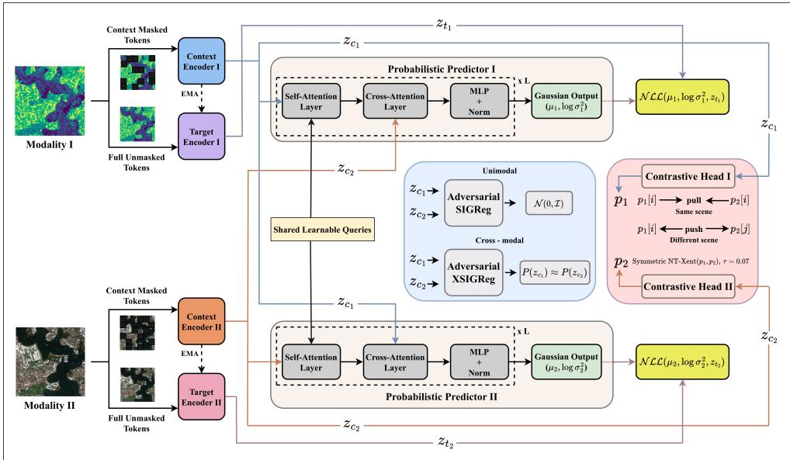
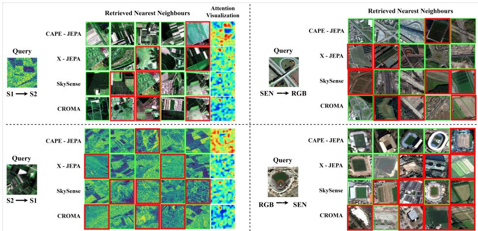
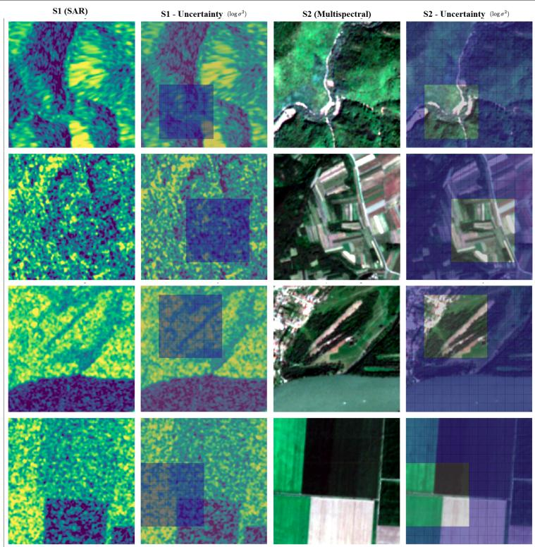

# CAPE-JEPA — Cross-modal Adversarial Probabilistic Embedding JEPA

Aniket Junghare

aniketjunghare.iitb@gmail.com

Indian Institute of Technology Bombay Mumbai, India

Biplab Banerjee

6getbiplab@gmail.com

## Abstract

Cross-modal remote sensing image retrieval (RS-CMIR) requires representations that are simultaneously modality-invariant and semantically discriminative, despite the profound physical gap between heterogeneous sensors such as Synthetic Aperture Radar (SAR) and multispectral imagery. Recent JEPA-based Predictive self-supervised approaches such as X-JEPA [8] formulate cross-modal alignment as a deterministic latent forecasting task, implicitly assuming uniform patch predictability and leaving crossmodal distributional alignment unaddressed. We propose CAPE-JEPA, a probabilis tic cross-modal Joint Embedding Predictive Architecture with three contributions: (i) a cross-attentional Gaussian predictor outputting per-patch parameters $( \mu , \sigma ^ { 2 } )$ conditioned on opposite-modality context, trained via negative log-likelihood to model inherent cross-sensor prediction uncertainty; (ii) adversarial distributional regularization combining unimodal isotropic Gaussian regularization with a novel cross-modal adversarial variant that aligns modality distributions via worst-case Epps-Pulley characteristic function tests without explicit sample pairing; and (iii) in-training contrastive learning with attention-pooled heads for scene-level discriminative grounding. Evaluated on BigEarthNet-14K (BEN-14K) and fMoW across SAR, multispectral, and RGB modalities, CAPE-JEPA surpasses X-JEPA by up to 13.74 points on BEN-14K and 15.59 points on fMoW, outperforming all baselines including SkySense and CROMA across both unimodal and cross-modal directions while using fewer parameters (407.30M vs. 432.72M).

## Introduction

iThe proliferation of multi-sensor satellite constellations has produced vast, heterogeneous remote sensing (RS) archives spanning Synthetic Aperture Radar (SAR), multispectral, and ahigh-resolution optical imagery [12, 18, 34]. Cross-modal remote sensing image retrieval (RS-CMIR) aims to retrieve semantically relevant images across sensor modalities [8, 15], and is central to applications such as disaster response, land-use monitoring, and environmental analysis [18, 33]. The task is fundamentally challenging: SAR measures microwave backscatter sensitive to surface texture and dielectric properties, while multispectral sensors capture reflected solar radiation across discrete spectral bands [22, 36]. This physical divergence means semantically identical scenes appear visually uncorrelated across modalities, rendering pixel-level comparison ineffective and demanding representations that are simultaneously modality-invariant and semantically discriminative [8, 26]. In disaster response, fusing SAR’s all-weather structural sensitivity with multispectral spectral richness is critical. Yet no retrieval framework has closed the distributional gap between these sensors in a principled, uncertainty-aware manner.

Self-supervised learning (SSL) has emerged as the dominant approach for cross-modal alignment [15, 41], bypassing the need for manually annotated paired data across heterogeneous RS sensor pairs [8, 15]. Contrastive methods [6, 20] learn representations by pulling together views of the same scene while pushing apart negatives, but suffer from a structural false-negative problem in RS: visually dissimilar scenes from different sensors routinely share semantic categories $( e . g . ,$ , flooded cropland in SAR and dry cropland in multispectral belong to the same land-cover class), causing contrastive objectives to push apart semantically equivalent embeddings and destabilise the learned space [8, 41]. Masked image modelling (MIM) approaches [10, 21] sidestep this by reconstructing masked pixel regions without requiring negative pairs. However, pixel-space reconstruction rewards modality-specific appearance cues such as speckle statistics, spectral profiles, and resolution artefacts, which must be abstracted away for cross-modal retrieval [8, 15].

Joint Embedding Predictive Architectures (JEPAs) [1, 24] offer a principled alternative: a predictor $P _ { \phi }$ estimates the target encoder’s latent representation $\mathbf { z } _ { t }$ of masked patches from visible context $\mathbf { z } _ { c } .$ operating entirely in semantic space without pixel decoding. I-JEPA [1] established this paradigm for unimodal visual learning, and REJEPA [7] first adapted it to RS for unimodal retrieval. X-JEPA [8] extended the paradigm to cross-modal RS via a cross-attentional predictor, shared learnable queries, and a geometry-aware Predic-

<table><tr><td>Method</td><td>PT DA</td><td>DG</td><td>LS</td><td></td><td>MN</td></tr><tr><td>MAE []</td><td>x</td><td>X</td><td>X</td><td>x</td><td>X</td></tr><tr><td>I-JEPA [0]</td><td>x</td><td>x</td><td>x</td><td>√</td><td>x</td></tr><tr><td>X-JEPA [8]</td><td>x</td><td>x</td><td>x</td><td>√</td><td>J</td></tr><tr><td>CAPE-JEPA (ours)</td><td>L</td><td>√</td><td>一</td><td>L</td><td>L</td></tr></table>

Table 1: How is CAPE-JEPA different? PP: probabilistic prediction; DA: distributional alignment; DG: discriminative grounding; LS: latent-space SSL; CM: cross-modal RS image retrieval.

tion Space Alignment (PSA) loss. Despite strong results, X-JEPA exhibits two fundamental limitations that motivate our work, summarised alongside related methods in Table 1 and through the theoretical analysis in Section 3.8.

(1) Deterministic prediction under inherent cross-sensor uncertainty. X-JEPA’s predictor regresses a single point estimate $\hat { \mathbf { z } } _ { t } = P _ { \phi } ( \mathbf { z } _ { c } ^ { \mathrm { l o c a l } } , \mathbf { z } _ { c } ^ { \mathrm { o p p } } )$ per masked patch, where $\mathbf { z } _ { c } ^ { \mathrm { l o c a l } }$ and $\pmb { z } _ { c } ^ { \mathrm { o p p } }$ denote same-modality and opposite-modality context embeddings respectively, implicitly treating all regions as equally predictable. In practice, clouds, SAR speckle, mixed landcover transitions, and acquisition noise introduce substantial spatially non-uniform ambiguity: multiple valid latent representations may correspond to a single masked patch depending on sensor geometry and noise realisation. Forcing deterministic regression under such ambiguity produces overconfident embeddings that conflate uncertain regions with highconfidence predictions [23, 32], distorting the nearest-neighbour geometry that retrieval relies on. Following Kendall and Gal [23], we distinguish aleatoric uncertainty (irreducible sensor noise, e.g. SAR speckle) from epistemic uncertainty (model limitations given finite context), neither of which is representable by a point-estimate predictor.

(2) Geometrically disjoint modality distributions. X-JEPA’s PSA loss enforces structural consistency between paired local predictions but does not constrain the marginal embedding distributions $P ( \mathbf { z } ^ { ( a ) } )$ and $P ( \mathbf { z } ^ { ( \bar { b } ) } )$ globally, where superscripts (a) and (b) index the two sensor modalities. Even when local pairwise geometry is preserved, the two modalities may occupy disjoint regions of the embedding manifold [26]. This modality gap directly degrades nearest-neighbour retrieval, as queries and gallery items from different modalities are never co-located in the shared space.

Research questions. These limitations motivate three concrete questions to address:

1. Can cross-sensor prediction uncertainty be explicitly modelled in latent space, and does doing so improve retrieval geometry?

2. Can the modality gap be closed globally without explicit sample pairing, and what is the right distributional objective to achieve this?

3. Are probabilistic prediction and distributional alignment individually sufficient, or must they be jointly trained with a discriminative objective to prevent collapse?

Proposed approach. We propose CAPE-JEPA (Cross-modal Adversarial Probabilistic Joint Embedding Predictive Architecture), which answers all three questions through a unified probabilistic-distributional framework. Rather than suppressing cross-sensor uncertainty, CAPE-JEPA replaces deterministic latent regression with a Gaussian conditional predictor that outputs a per-patch mean and variance for each masked region, trained via negative log-likelihood to adaptively down-weight ambiguous patches while preserving strong supervision on predictable regions. CAPE-JEPA then enforces global distributional convergence between the two modality embedding distributions via adversarial characteristic function tests [3, 13] that actively seek out and penalise worst-case directions of cross-modal divergence, without requiring explicit sample pairing. Finally, an in-training contrastive objective [6] with attention-pooled heads anchors scene-level semantic structure within the geometrically aligned space, preventing distributional regularization from collapsing interclass discriminability. In summary, our major contributions are:

• Probabilistic cross-modal predictor: The first uncertainty-aware latent predictor for RS-CMIR, modelling per-patch mean and variance via Gaussian NLL [23, 32] to capture both aleatoric and epistemic cross-sensor uncertainty.

• Adversarial distributional regularization: A novel cross-modal regularizer (XSI-GReg) that closes the modality gap [26] via worst-case Epps-Pulley projections [13], provably more powerful than random-projection approaches such as SIGReg [3] (Standard Isotropic Gaussian Regularization) in the population limit.

• Unified predictive-contrastive pretraining: In-training InfoNCE [6] with attentionpooled heads anchors scene-level discrimination within the aligned space, necessary to prevent semantic collapse.

• Theoretical analysis and State-of-the-art on two RS-CMIR benchmarks: Besides showing theoretical superiority against X-JEPA in Section 3.8, CAPE-JEPA surpasses X-JEPA [8] by up to 13.74 and 15.59 F1@5 points on BEN-14K and fMoW, outperforming all baselines with fewer parameters (407.30M vs. 432.72M).

## 2 Related Work

Self-Supervised Learning (SSL) for Remote Sensing. Contrastive methods [6, 20] learn representations by pulling together augmented views while pushing apart negatives, but are fragile in RS: seasonal variation and sensor differences create false negatives that destabilise training [8, 29]. MIM approaches [10, 19, 21, 30] bypass this via masked pixel reconstruction, but pixel-space objectives emphasise sensor-specific texture cues such as speckle, spectral profiles, resolution artefacts, limiting cross-modal transferability [8].

Cross-Modal Representation Learning. CROMA [15] combines contrastive and masked reconstruction losses for SAR–multispectral alignment; SkySense [18] scales this to multiple sensors via multi-stage pretraining; DeCUR [42] explicitly decouples shared semantic from modality-specific features via redundancy-aware decorrelation. Despite strong alignment, these methods either anchor learning to low-level pixel reconstruction or suffer from false-negative sensitivity [8]. CAPE-JEPA instead operates entirely in latent space with probabilistic prediction and adversarial distributional regularization.

Remote Sensing Foundation Models. AnySat [2], Galileo [35], and Panopticon [38] demonstrate strong transfer across diverse RS tasks via large-scale multi-sensor pretraining. However, all employ deterministic prediction objectives and do not address cross-modal retrieval or cross-sensor prediction uncertainty, the two gaps CAPE-JEPA specifically targets.

JEPA-Based Predictive Architectures. JEPAs [1, 24] reformulate SSL as latent-space forecasting, yielding more abstract representations than pixel reconstruction [1, 4]. REJEPA [7] first adapted this to RS for unimodal retrieval; X-JEPA [8] extended it to the cross-modal setting via cross-attentional prediction and a geometry-aware PSA loss. However, X-JEPA employs deterministic prediction and leaves global cross-modal distributional alignment unaddressed [26]. CAPE-JEPA resolves both via probabilistic Gaussian prediction [23, 32], adversarial XSIGReg [13], and in-training InfoNCE [6].

Probabilistic and Uncertainty-Aware SSL. Kendall and Gal [23] distinguish aleatoric from epistemic uncertainty, both relevant in noisy RS observations; Sluijterman et al. [32] establish optimal NLL training for mean-variance networks; probabilistic embeddings in supervised metric learning [31] show distributions better capture label ambiguity than point estimates. Yet uncertainty-aware learning remains underexplored in SSL, where deterministic embeddings implicitly assume uniform patch predictability [1, 8], an assumption particularly harmful in RS given clouds, SAR speckle, and mixed land-cover boundaries. CAPE-JEPA addresses this with probabilistic Gaussian prediction trained via NLL.

Distributional Alignment and Embedding Geometry. Uniformity and alignment objectives [40] prevent collapse on the unit hypersphere; the Epps-Pulley statistic [13] offers a non-parametric alternative via empirical characteristic functions, applied in SIGReg [3] to enforce isotropic Gaussian structure on unimodal embeddings. CAPE-JEPA extends this to the cross-modal setting via XSIGReg, an adversarial two-sample EP test that targets worstcase projection directions of cross-modal divergence, which is more powerful than random projections and requiring no explicit sample pairing.

## 3 Proposed Methodology

## 3.1 Problem Formulation

Let $\mathcal { X } = \{ x _ { i } ^ { ( a ) } \} _ { i = 1 } ^ { N }$ and $\mathcal { Y } = \{ x _ { i } ^ { ( b ) } \} _ { i = 1 } ^ { N }$ denote images from heterogeneous RS modalities a and b (e.g., S1 SAR and S2 multispectral), where each pair $( x _ { i } ^ { ( a ) } , x _ { i } ^ { ( b ) } )$ captures semantically related scenes from different sensors. The objective of RS-CMIR is to retrieve the most semantically relevant images from modality b given a query from modality a, and vice versa, without human annotations or pixel-level correspondence.

Following the JEPA paradigm [1, 24], we formulate representation learning as a latent prediction task: given visible context patches from both modalities, predict the latent embeddings of masked patches conditioned on cross-modal context. Critically, unlike deterministic JEPA formulations [1, 8] that regress a single point estimate $\hat { \mathbf { z } } _ { t } = P _ { \phi } ( \mathbf { z } _ { c } )$ , CAPE-JEPA models this as a conditional Gaussian distribution:

  
Figure 1: Overview of CAPE-JEPA. For each modality, a context encoder processes visible patches while an EMA target encoder generates stable prediction targets. The probabilistic cross-modal predictor outputs per-patch Gaussian parameters $( \mu , \sigma ^ { 2 } )$ conditioned on opposite-modality context. SIGReg enforces isotropic Gaussian structure on each modality’s embeddings while XSIGReg aligns the cross-modal distributions via adversarial worst-case projections. In-training InfoNCE provides scene-level discriminative grounding.

$$
\begin{array} { r } { p ( \mathbf { z } _ { t } \mid \mathbf { z } _ { c } ^ { \mathrm { l o c a l } } , \mathbf { z } _ { c } ^ { \mathrm { o p p } } ) = \mathcal { N } \Big ( \mu _ { \phi } , \mathrm { d i a g } ( \sigma _ { \phi } ^ { 2 } ) \Big ) , } \end{array}\tag{1}
$$

where $\mu _ { \phi } \in \mathbb { R } ^ { N _ { \mathrm { m a s k } } \times D }$ and $\sigma _ { \phi } ^ { 2 } \in \mathbb { R } ^ { N _ { \mathrm { m a s k } } \times D }$ are the predicted per-patch mean and variance, respectively, output by a cross-attentional network conditioned on same-modality context $\mathbf { z } _ { c } ^ { \mathrm { l o c a l } }$ and opposite-modality context $\pmb { z } _ { c } ^ { \mathrm { o p p } }$ . This formulation is the foundation of CAPE-JEPA’s superiority over X-JEPA: by explicitly representing prediction uncertainty, the model avoids the overconfident embedding distortions that arise when a deterministic predictor is forced to regress under inherent cross-sensor ambiguity.

## 3.2 Architecture Overview

CAPE-JEPA comprises four Vision Transformer (ViT) encoders [11] and two probabilistic cross-modal predictors, as illustrated in Figure 1. For each modality $s \in \{ a , b \}$ , a context encoder $E _ { \theta } ^ { ( s ) }$ processes visible patches, and an EMA target encoder $E _ { \theta ^ { \prime } } ^ { ( s ) }$ generates stable prediction targets [1, 17]. Target encoders are updated via exponential moving average:

$$
\theta ^ { \prime }  m \theta ^ { \prime } + ( 1 - m ) \theta ,\tag{2}
$$

with momentum m annealed from 0.996 to 1.0. Target encoder parameters receive no gradients, ensuring stable regression targets throughout training.

Patch Encoding. Each $H \times W$ image is divided into non-overlapping $1 6 \times 1 6$ patches, yielding $N = H W / 2 5 6$ tokens. Each patch is linearly projected to a D-dimensional embedding and summed with a learnable sinusoidal positional encoding [37], producing $\mathbf { x } \in \mathbb { R } ^ { N \times D }$ . A prepended CLS token aggregates global context but is excluded from pooling at inference. Complementary Masking. We partition patches into context and target sets via a complementary strategy. A binary mask $\mathcal { M } ^ { ( a ) } \subset \{ 1 , \ldots , N \}$ is sampled for modality a with ratio $r \in [ 0 . 1 5 , 0 . 2 5 ]$ ; modality $b \mathbf { \bar { s } }$ context mask is its complement: $\mathcal { M } ^ { ( b ) } = \{ 1 , \therefore , N \} \setminus \mathcal { M } ^ { ( a ) }$ What modality a observes as context, modality b must predict, and vice versa. Here $\mathbf { z } _ { c } ^ { ( b , \mathrm { l o c a l } ) }$ denotes the local same-modality context of modality b, i.e., the unmasked patches of modality b. Unlike the independent masking of X-JEPA [8], this hard structural constraint forces each predictor to genuinely exploit opposite-modality features rather than reconstructing from local context alone. We note that the ablation in Table 4 shows complementary masking underperforms on S2→S1 in isolation; this reflects that independent masking preserves more local S2 context which benefits SAR retrieval when S2 features are already discriminative, but complementary masking yields superior cross-modal performance overall with the full objective. Theoretical justification for complementary masking is provided in Section 5 of the supplementary.

Inference. The context encoder processes the full unmasked image. Patch tokens (excluding CLS) are mean-pooled to a single D-dimensional embedding, optionally projected through the alignment head, and compared via cosine similarity for nearest-neighbour retrieval.

## 3.3 Probabilistic Cross-Modal Predictor

The core architectural novelty of CAPE-JEPA is replacing the deterministic predictor of X-JEPA with a probabilistic Gaussian predictor [23, 32]. The motivation is principled: in RS imagery, clouds, SAR speckle, mixed land-cover boundaries, and acquisition noise mean that a single masked patch $x _ { t } ^ { ( a ) }$ has multiple plausible latent representations given any finite opposite-modality context. Forcing a point estimate onto this one-to-many mapping produces systematically overconfident embeddings that distort nearest-neighbour geometry. Modelling the full conditional distribution (Eq. 1) resolves this by adaptively allocating predictive confidence in proportion to regional ambiguity.

CrossAttentionBlock. Each block performs three sequential operations [37]: self-attention over query tokens, cross-attention where query tokens attend to opposite-modality context $\mathbf { c } ^ { \mathrm { { o p p } } }$ as keys and values, and an MLP with layer normalisation. In the cross-attention step, the query x is not separately layer-normalised as it has already passed through the selfattention residual which applies layer normalisation; only the opposite-modality context $\mathbf { c } ^ { \mathrm { { o p p } } }$ is normalised before serving as keys and values.

Shared Learnable Queries. Each predictor maintains $Q { = } 8$ learnable query tokens $\mathbf { s } \in$ $\mathbb { R } ^ { Q \times P }$ acting as modality-agnostic semantic anchors, enabling consistent cross-modal information routing [8].

Token Sequence and Gaussian Output. The predictor input concatenates shared queries, projected local context tokens, and positionally-encoded mask tokens:

$$
\mathbf { q } = \left[ \mathbf { s } \parallel \mathrm { p r o j } ( \mathbf { z } _ { c } ^ { \mathrm { l o c a l } } ) \parallel ( \mathbf { e } _ { \mathrm { m a s k } } + \mathrm { p r o j } ( \mathbf { e } _ { \mathrm { p o s } } ) ) \right] ,\tag{3}
$$

where $\mathbf { z } _ { c } ^ { \mathrm { l o c a l } } \in \mathbb { R } ^ { ( N - N _ { \mathrm { m a s k } } ) \times D }$ are context tokens from the query modality, $\mathbf { e } _ { \mathrm { m a s k } } \in \mathbb { R } ^ { N _ { \mathrm { m a s k } } \times D }$ is a learnable mask token [21], and $\mathbf { e } _ { \mathrm { p o s } } \in \mathbb { R } ^ { N \times D }$ encodes patch positions. Opposite-modality context $\pmb { z } _ { c } ^ { \mathrm { o p p } }$ enters as cross-attention keys and values in each block. After $L { = } 1 2$ stacked blocks, the final $N _ { \mathrm { m a s k } }$ tokens are projected to 2D dimensions and split:

$$
\left( \mu _ { \phi } , \log \sigma _ { \phi } ^ { 2 } \right) = P _ { \phi } \left( \mathbf { z } _ { c } ^ { \mathrm { { l o c a l } } } , \mathbf { z } _ { c } ^ { \mathrm { { o p p } } } \right) ,\tag{4}
$$

with $\mu _ { \phi }$ , log $\sigma _ { \phi } ^ { 2 } \in \mathbb R ^ { B \times N _ { \mathrm { m a s k } } \times D }$ , where B is the batch size.

Gaussian NLL Loss. The predictor maximises the likelihood of target embeddings ${ \bf z } _ { t } =$ $E _ { \theta ^ { \prime } } ( \mathbf { x } _ { t } )$ under the predicted distribution [32]:

$$
\mathcal { L } _ { \mathrm { N L L } } = \mathbb { E } \left[ \frac { ( \mathbf { z } _ { t } - \boldsymbol { \mu } _ { \phi } ) ^ { 2 } } { 2 \sigma _ { \phi } ^ { 2 } } + \frac { 1 } { 2 } \log \sigma _ { \phi } ^ { 2 } \right] ,\tag{5}
$$

where the expectation is over samples and masked patches, and operations are element-wise over latent dimensions $d \in \{ 1 , \ldots , D \}$ . The explicit averaging constant $\frac { 1 } { B { \cdot } N _ { \mathrm { m a s k } } { \cdot } D }$ is given in the supplementary material. The log $\sigma _ { \phi } ^ { 2 }$ term prevents variance collapse to zero, while large $\sigma _ { \phi } ^ { 2 }$ incurs a regularization penalty that discourages uninformative predictions. These two competing forces adaptively down-weight ambiguous patches without discarding their supervision signal, yielding a strictly richer learning objective than X-JEPA’s L2 regression, as formalised in Proposition 1 (Section 3.8).

## 3.4 Distributional Regularization

${ \mathcal { L } } _ { \mathrm { N L L } }$ governs patch-level uncertainty but leaves the global embedding geometry unconstrained [26]. Collapsed dimensions, anisotropy, or modality-specific offset (the modality gap) distort nearest-neighbour relations even when local predictions are accurate [40]. We address this with two complementary regularizers at different levels of granularity.

Unimodal SIGReg. We adopt SIGReg [3] to enforce approximately isotropic Gaussian structure on each modality’s context embeddings $\mathbf { z } _ { c } ^ { ( s ) } \in \mathbb { R } ^ { D }$ independently. Random onedimensional projections $y _ { i } = \mathbf { z } _ { i } ^ { ( s ) \top } \mathbf { v } , \mathbf { v } \sim \mathcal { N } ( \mathbf { 0 } , \mathbf { I } )$ , are compared to a standard Gaussian via the Epps-Pulley (EP) characteristic function statistic $\mathcal { D } _ { \mathrm { E P } }$ [13], which measures distributional discrepancy non-parametrically via the empirical characteristic function. This is averaged over $K { = } 6 4$ random directions:

$$
\mathcal { L } _ { \mathrm { S I G } } = \frac { 1 } { K } \sum _ { k = 1 } ^ { K } \mathcal { D } _ { \mathrm { E P } } \left( \left\{ \mathbf { z } _ { i } ^ { ( s ) \top } \mathbf { v } _ { k } \right\} _ { i = 1 } ^ { B } \right) , \quad s \in \{ a , b \} .\tag{6}
$$

Cross-Modal XSIGReg. SIGReg regularizes each modality independently but does not close the gap between ${ \cal P } ( { \bf z } _ { c } ^ { ( a ) } )$ and $P ( \mathbf { z } _ { c } ^ { ( b ) } )$ . Moreover, random projections may systematically miss the geometrically significant directions along which the two distributions diverge most in high dimensions. We address both limitations with a novel adversarial two-sample EP test [13, 16]: an adversarial projection direction $\mathbf { v } ^ { * } \in \mathbb { S } ^ { D - 1 }$ is sought to maximise crossmodal distributional discrepancy, while encoder parameters minimise it:

$$
\mathcal { L } _ { \mathrm { X S I G } } = \operatorname* { m a x } _ { \mathbf { v } \in \mathbb { S } ^ { D - 1 } } \mathcal { D } _ { \mathrm { E P } } \left( \{ \mathbf { z } _ { i } ^ { ( a ) \top } \mathbf { v } \} , \{ \mathbf { z } _ { i } ^ { ( b ) \top } \mathbf { v } \} \right) .\tag{7}
$$

This min-max saddle-point problem [16] is optimised by alternating gradient steps: v is updated by gradient ascent with step size $\eta _ { \mathrm { a d v } } { = } 0 . 0 1$ and re-projected onto $\mathbb { S } ^ { D - 1 }$ after each step; encoder parameters are updated by gradient descent. v is re-initialised from $\mathcal { N } ( \mathbf { 0 } , \mathbf { I } )$ at the start of each training iteration. We perform $T { = } 5$ ascent steps per encoder update, sufficient for stable convergence in practice; the EP statistic’s smoothness and boundedness [13] provide more favourable optimisation landscape properties than unbounded GAN-style objectives [16]. Unlike SIGReg’s random projections, XSIGReg actively identifies and closes the worst-case cross-modal divergence direction, making it suitable for eliminating the modality gap [26].

## 3.5 Scene-Level Discriminative Supervision

Distributional regularization aligns the geometry of the embedding space but provides no between-class discriminative signal: both modalities may converge to the same well conditioned distribution while remaining semantically flat [6, 26]. We resolve this tension with in-training InfoNCE [6] computed directly during pretraining.

Contrastive Head. Each modality has a dedicated contrastive head: a learned-query attention pooling layer [25] followed by a two-layer MLP $f _ { s } : \mathbb { R } ^ { D } \xrightarrow { } \mathbb { R } ^ { 5 1 2 } \xrightarrow { } \mathbb { R } ^ { 2 5 6 }$ with GELU as the activation function to maintain consistency with the ViT backbone [11] and preserve smooth gradient flow for the probabilistic representations. Let $\mathbf { h } _ { i } ^ { ( s ) } = f _ { s } \Big ( \mathrm { A t t n P o o l } ( \mathbf { z } _ { c , i } ^ { ( s ) } ) \Big )$ denote the unprojected representation of scene i from modality s. The $\ell _ { 2 }$ -normalised projection is then:

$$
\mathbf { p } _ { i } ^ { ( s ) } = \frac { \mathbf { h } _ { i } ^ { ( s ) } } { \left\| \mathbf { h } _ { i } ^ { ( s ) } \right\| _ { 2 } } , \quad s \in \{ a , b \} .\tag{8}
$$

Symmetric NT-Xent Loss. Given paired projections $\{ \mathbf { p } _ { i } ^ { ( a ) } , \mathbf { p } _ { i } ^ { ( b ) } \} _ { i = 1 } ^ { B }$ , where $\mathbf { p } _ { i } ^ { ( s ) } \in \mathbb { R } ^ { 2 5 6 }$ denotes the $\ell _ { 2 }$ -normalised projection of scene i from modality s:

$$
\mathcal { L } _ { \mathrm { N C E } } = - \frac { 1 } { 2 B } \sum _ { i = 1 } ^ { B } \left[ \log \frac { e ^ { { \mathbf { p } _ { i } ^ { ( a ) \top } \mathbf { p } _ { i } ^ { ( b ) } } / { \tau } } } { \sum _ { j = 1 } ^ { B } e ^ { { \mathbf { p } _ { i } ^ { ( a ) \top } \mathbf { p } _ { j } ^ { ( b ) } } / { \tau } } } + \log \frac { e ^ { { \mathbf { p } _ { i } ^ { ( b ) \top } \mathbf { p } _ { i } ^ { ( a ) } } / { \tau } } } { \sum _ { j = 1 } ^ { B } e ^ { { \mathbf { p } _ { i } ^ { ( b ) \top } \mathbf { p } _ { j } ^ { ( a ) } } / { \tau } } } \right] ,\tag{9}
$$

with temperature $\scriptstyle \tau = 0 . 0 7$ [6]. Positives are paired cross-modal embeddings of the same scene; negatives are all other B−1 in-batch samples. Both directions (modality a querying b, and vice versa) are computed symmetrically.

## 3.6 Total Training Objective

The complete CAPE-JEPA objective combines all four terms:

$$
\begin{array} { r } { \mathcal { L } = \mathcal { L } _ { \mathrm { N L L } } + \lambda _ { 1 } \mathcal { L } _ { \mathrm { S I G } } + \lambda _ { 2 } \mathcal { L } _ { \mathrm { X S I G } } + \lambda _ { 3 } \mathcal { L } _ { \mathrm { N C E } } , } \end{array}\tag{10}
$$

with the λs selected through grid search. ${ \mathcal { L } } _ { \mathrm { N L L } }$ and $\mathcal { L } _ { \mathrm { S I G } }$ are applied symmetrically to both modalities. Only context encoders and predictors receive gradients; target encoders are updated solely via EMA (Eq. 2). The three objectives operate at complementary levels of granularity: $\mathcal { L } _ { \mathrm { N L I } }$ at the patch level, $\mathcal { L } _ { \mathrm { S I G } } / \mathcal { L } _ { \mathrm { X S I G } }$ at the distribution level, and $\mathcal { L } _ { \mathrm { N C E } }$ at the scene level. As confirmed by the component ablation (Table 3), each term is load-bearing: XSI-GReg without InfoNCE causes cross-modal performance degradation (−2.03 on S2→S1) because distributional alignment without discriminative grounding erases semantic separation; InfoNCE without XSIGReg collapses cross-modal geometry (−8.89 on S2→S1) because contrastive clusters resist distributional alignment. Only the full objective satisfies all three levels.

## 3.7 Post-Pretraining Alignment

Following pretraining, context encoders are frozen and contrastive heads are fine-tuned using $\mathcal { L } _ { \mathrm { N C E } } ~ ( \mathrm { E q . ~ 9 ) }$ with paired cross-modal samples as positives. This alignment stage is an integral part of the CAPE-JEPA training pipeline and is not applicable to baselines. Notably, even without this alignment stage (0 epochs, Table 7), CAPE-JEPA achieves $\mathrm { S } 1  \mathrm { S } 2 = 7 3 . 5 7$ and ${ \displaystyle \mathrm { S } 2 \mathrm { \to } \mathrm { S } 1 = 6 6 . 0 2 }$ vs X-JEPA’s 62.74 and 62.98 respectively, confirming that the core pretraining objective itself drives the improvement independently of the alignment stage.

## 3.8 Theoretical Analysis: Why CAPE-JEPA Outperforms X-JEPA

We formalise the advantage of CAPE-JEPA over X-JEPA through three arguments.

Proposition 1 (NLL subsumes L2 under uncertainty). Let $\mathbf { z } _ { t }$ be a target embedding and let the predictor output $( \mu _ { \phi } , \sigma _ { \phi } ^ { 2 } )$ . The Gaussian NLL (Eq. 5) reduces to scaled L2 when $\displaystyle \sigma _ { \phi } ^ { 2 } = c \mathbf { 1 }$ for constant $c > 0$ , recovering X-JEPA’s objective as a special case. Under non-uniform predictability, which is the realistic RS setting, minimising LNL ${ \mathcal { L } } _ { \mathrm { N L L } }$ yields lower expected retrieval distortion than L2, since it adaptively re-weights each patch’s gradient by $1 / \bar { \sigma } _ { \phi } ^ { 2 }$ , suppressing the influence of inherently ambiguous patches. We note this constitutes a design motivation rather than a formal bound.

Proposition 2 (XSIGReg closes the modality gap). Let $\Delta _ { \mathrm { g a p } }$ (Eq. 11) denote the worst-case projected distributional discrepancy between modalities:

$$
\Delta _ { \mathrm { g a p } } = \operatorname* { s u p } _ { \mathbf { v } \in \mathbb { S } ^ { D - 1 } } \mathcal { D } _ { \mathrm { E P } } \left( \{ \mathbf { z } _ { i } ^ { ( a ) \top } \mathbf { v } \} , \{ \mathbf { z } _ { i } ^ { ( b ) \top } \mathbf { v } \} \right) .\tag{11}
$$

X-JEPA’s unbounded PSA loss does not penalise $\Delta _ { \mathrm { g a p } } . \ \mathcal { L } _ { \mathrm { X S I G } }$ directly minimises $\Delta _ { \mathrm { g a p } }$ via the saddle-point update, driving both modality distributions toward the same isotropic Gaussian, which is a necessity for unbiased nearest-neighbour retrieval across modalities [26]. Empirically, CAPE-JEPA achieves a significantly lower Fréchet distance between S1 and S2 distributions (CAPE-JEPA: 10.8 vs. X-JEPA: 22.9), confirming that XSIGReg closes the modality gap in practice (see Section 6 of the supplementary).

Proposition 3 (Complementary necessity of three-level objectives). We decompose the retrieval error as $\varepsilon = \varepsilon _ { \mathrm { p a t c h } } + \varepsilon _ { \mathrm { d i s t } } + \varepsilon _ { \mathrm { d i s c } }$ , where $\varepsilon _ { \mathrm { p a t c h } }$ measures patch-level prediction distortion (deviation of $\mu _ { \phi }$ from $\mathbf { z } _ { t }$ weighted by ambiguity), $\varepsilon _ { \mathrm { d i s t } }$ measures the modality gap $\Delta _ { \mathrm { { g a p } } } ~ ( \mathrm { { E q . } ~ 1 1 ) }$ , and $\varepsilon _ { \mathrm { d i s c } }$ measures between-class discriminative failure (overlap of classconditional embedding distributions). ${ \mathcal { L } } _ { \mathrm { N L I } }$ bounds $\varepsilon _ { \mathrm { p a t c h } }$ but leaves $\varepsilon _ { \mathrm { d i s t } }$ and $\varepsilon _ { \mathrm { d i s c } }$ unconstrained; $\mathcal { L } _ { \mathrm { S I G } } + \mathcal { L } _ { \mathrm { X S I G } }$ bound $\varepsilon _ { \mathrm { d i s t } }$ but provide no discriminative signal, allowing $\varepsilon _ { \mathrm { d i s c } }$ to grow; $\mathcal { L } _ { \mathrm { N C E } }$ bounds $\varepsilon _ { \mathrm { d i s c } }$ but does not constrain $\varepsilon _ { \mathrm { d i s t } }$ . Only the full objective (Eq. 10) simultaneously bounds all three components. This decomposition is a design rationale grounded in the functional roles of each loss term; the empirical validity of the argument is confirmed by the component ablation (Table 3), where removing any single term degrades precisely the error component it governs, and this pattern holds consistently under both F1@5 and mAP (Table 1 of the supplementary). Extended theoretical analysis is provided in Section 4 of the supplementary.

## 4 Experimental Evaluations

Datasets Description. We validate CAPE-JEPA on the following benchmark datasets, following the literature [8]: (i) BigEarthNet-14K (BEN-14K). BEN-14K [33] contains 14,832 strictly paired Sentinel-1 (S1) SAR [34] and Sentinel-2 (S2) multispectral [12] patches. S1 images provide two polarisation channels (VV: vertical-vertical, VH: vertical-horizontal) at 10 m resolution; S2 images provide 10 spectral bands at 10–20 m resolution. Each patch is annotated with 19 multi-label land-cover classes following the CORINE Land Cover taxonomy [5]. We use the standard train/val/test split and evaluate on the validation set following the protocol of [8], where the validation set is used for final reporting to ensure comparability with prior work. Hyperparameters are tuned on the training set only. (ii) fMoW-Sentinel. fMoW-Sentinel [9, 10] extends the Functional Map of the World dataset with Sentinel-2 multispectral imagery [12] (13 channels) paired with RGB optical images (3 channels) across 62 semantic categories. Unlike BEN-14K, fMoW uses class-mode pairing: images from the same class are treated as semantic positives during evaluation. The dataset contains approxi mately 363,000 training and 53,000 test images. Following [8], we evaluate on the validation set. Extended dataset descriptions and evaluation protocol details are provided in Section 1 of the supplementary.

Table 2: Retrieval performance (F1@5, %) on BEN-14K and fMoW. Best results in bold. † denotes methods not originally designed for cross-modal retrieval. Methods are grouped by paradigm: MIM-based , cross-modal SSL , and JEPA-based . (‡see footnote)
<table><tr><td rowspan="2">Method</td><td rowspan="2">Params (M)</td><td colspan="4">BEN-14K</td><td colspan="4">fMoW</td></tr><tr><td colspan="2">Unimodal</td><td colspan="2">Cross-modal</td><td colspan="2">Unimodal</td><td colspan="2">Cross-modal</td></tr><tr><td></td><td></td><td>S1→S1</td><td>S2→S2</td><td>S1→S2 S2→S1</td><td></td><td>RGB→RGB</td><td>SEN→SEN</td><td>RGB→SEN</td><td>SEN→RGB</td></tr><tr><td>MAE []</td><td>224.87</td><td>60.81</td><td>72.04</td><td>41.78</td><td>46.12</td><td>58.73</td><td>61.18</td><td>34.23</td><td>35.12</td></tr><tr><td>MAE-RVSA† []</td><td>227.75</td><td>55.40</td><td>71.47</td><td>36.66</td><td>38.05</td><td>55.26</td><td>60.28</td><td>40.46</td><td>38.65</td></tr><tr><td>SatMAE† []</td><td>329.40</td><td>70.86</td><td>78.71</td><td>49.57</td><td>52.48</td><td>61.68</td><td>56.63</td><td>50.21</td><td>51.05</td></tr><tr><td>SatMAE++ []</td><td>329.14</td><td>67.29</td><td>76.48</td><td>50.21</td><td>54.98</td><td>60.09</td><td>57.75</td><td>50.39</td><td>50.03</td></tr><tr><td>CrossMAE† 口</td><td>250.57</td><td>66.45</td><td>71.28</td><td>49.46</td><td>48.71</td><td>66.71</td><td>63.46</td><td>48.21</td><td>51.78</td></tr><tr><td>CSMAE-SESD []</td><td>210.64</td><td>70.62</td><td>39.01</td><td>38.74</td><td>38.42</td><td>51.56</td><td>41.09</td><td>30.87</td><td>30.84</td></tr><tr><td>SkySense []</td><td>398.04</td><td>69.87</td><td>73.42</td><td>50.26</td><td>52.11</td><td>68.81</td><td>67.45</td><td>51.62</td><td>52.41</td></tr><tr><td>CROMA []</td><td>310.54 250.54</td><td>68.48</td><td>72.71</td><td>46.53</td><td>48.61</td><td>65.23</td><td>66.73</td><td>49.71</td><td>47.68</td></tr><tr><td>DeCUR []</td><td></td><td>71.26</td><td>75.36</td><td>40.78</td><td>41.83</td><td>63.42</td><td>60.17</td><td>48.12</td><td>45.43</td></tr><tr><td>REJEPA []</td><td>197.09</td><td>76.38</td><td>75.42</td><td>55.46</td><td>56.32</td><td>73.53</td><td>75.87</td><td>50.08</td><td>49.85</td></tr><tr><td>X-JEPA []</td><td>432.72</td><td>72.31</td><td>77.24</td><td>62.74</td><td>62.98</td><td>73.59</td><td>77.08</td><td>52.86</td><td>54.68</td></tr><tr><td>CAPE-JEPA (MSE)</td><td>406.52</td><td>73.50</td><td>70.44</td><td>66.34</td><td>65.71</td><td>73.21</td><td>74.16</td><td>56.49</td><td>62.83</td></tr><tr><td>CAPE-JEPA (ours)</td><td>407.30</td><td>79.22</td><td>80.64</td><td>76.48</td><td>76.50</td><td>77.76</td><td>79.06</td><td>61.02</td><td>70.27</td></tr></table>

‡X-JEPA [8] originally reported trainable parameters only, excluding EMA target encoders and predictor; we report the full parameter count for fair comparison. CAPE-JEPA (MSE) denotes the deterministic variant replacing ${ \mathcal { L } } _ { \mathrm { N L L } }$ with MSE loss.

Selection of Competitors. We compare against eleven self-supervised RS methods: MAE [21], MAE-RVSA [39], SatMAE [10], SatMAE++ [30], CrossMAE [14], CSMAE-SESD [19], SkySense [18], CROMA [15], DeCUR [42], REJEPA [7], and X-JEPA [8]. All methods use ViT-B/16 [11] except SkySense (398M, its own backbone). Results are reported as F1@5, standard for RS-CMIR evaluation [8]; mAP results confirming consistent trends are provided in the supplementary material.

Implementation Details. CAPE-JEPA uses a ViT-B backbone [11] (D=768, depth 12, 12 heads) for all four encoders, with predictor hidden size P=384 (which also serves as the shared query embedding dimension in Eq. 3), depth 12, and Q=8 shared learnable queries. Complementary masking ratio is 0.15–0.25. We train for 300 epochs with AdamW [28], peak learning rate $1 \times 1 0 ^ { - 3 }$ , batch size 64, cosine decay [27], and 2-epoch warmup. EMA momentum is annealed from 0.996 to 1.0 [1, 17]. Loss weights $\lambda _ { 1 } { = } 0 . 0 1 , \lambda _ { 2 } { = } 0 . 0 0 0 5 , \lambda _ { 3 } { = } 0 . 1 5 ;$ sensitivity analysis is in the supplementary. Projection heads are aligned post-pretraining using InfoNCE [6]. Experiments run on four NVIDIA A100 GPUs. Additional implementation details including variance clamping, NLL averaging, and XSIGReg hyperparameters are provided in Section 3 of the supplementary.

## 4.1 Comparisons to the Literature

Table 2 reports retrieval performance across all eight directions on BEN-14K and fMoW. MIM-based methods struggle in cross-modal settings despite strong unimodal performance:

  
Figure 2: Qualitative cross-modal retrieval results for queries on BEN-14K (S1→S2 and S2→S1, left) and fMoW (SEN→RGB and RGB→SEN, right). The query image is identical across all methods. Retrieved images are marked with green borders for correct retrievals and red borders for incorrect retrievals. The attention visualization column (BEN-14K) shows cross-modal attention maps from the final cross-attention layer, highlighting discriminative regions.

MAE achieves only 41.78 F1@5 on S1→S2, confirming that reconstructing SAR speckle and multispectral spectral profiles in pixel space actively hinders modality-invariant representation learning. CSMAE-SESD collapses specifically on S2→S2 (39.01) despite reasonable S1→S1 performance (70.62), highlighting that pixel-space reconstruction of multispectral spectral profiles overfits to low-level spectral texture cues that do not transfer to semantic similarity. Cross-modal SSL methods (CROMA, SkySense, DeCUR) improve by learning jointly across sensors, yet remain limited by false-negative sensitivity in semantically dense RS scenes and the absence of global distributional alignment. REJEPA demonstrates the advantage of latent prediction over pixel reconstruction, while X-JEPA establishes a strong cross-modal JEPA baseline (62.74, 62.98 on BEN-14K cross-modal directions).

CAPE-JEPA achieves state-of-the-art on all eight directions. On BEN-14K, it surpasses X-JEPA by 6.91, 3.40, 13.74, and 13.52 F1@5 points on S1→S1, S2→S2, S1→S2, and S2→S1 respectively. The cross-modal gains are particularly significant in the RS context: SAR and multispectral sensors capture fundamentally different physical phenomena, making cross-modal retrieval the hardest direction and the one where deterministic predictors fail most severely due to irreducible SAR speckle uncertainty. On fMoW, CAPE-JEPA surpasses X-JEPA by 4.17, 1.98, 8.16, and 15.59 F1@5 points on RGB→RGB, SEN→SEN, RGB→SEN, and SEN→RGB respectively. Notably, CAPE-JEPA outperforms SkySense [18] (398.04M) and CROMA [15] (310.54M), both pretrained on substantially larger corpora, while using fewer parameters than X-JEPA (407.30M vs. 432.72M). t-SNE and modality gap visualizations confirming distributional alignment are provided in Section 6 of the supplementary (Fréchet distance: CAPE-JEPA 10.8 vs. X-JEPA 22.9).

Figure 2 shows top-5 retrievals across four cross-modal directions against X-JEPA [8], SkySense [18], and CROMA [15]. CAPE-JEPA consistently retrieves semantically coherent scenes despite stark visual differences across modalities, while baselines retrieve fewer relevant images. Failure cases involve spectrally ambiguous land-cover boundaries where multiple semantic classes co-exist at the patch scale.

  
Figure 3: Per-patch predictive uncertainty $( \log \sigma ^ { 2 } )$ for four S1–S2 scene pairs (rows: mountain/river, agricultural, grasslands/urban, agricultural). Uncertainty is shown as a boxed overlay on the masked region for both S1 SAR (col. 2) and S2 multispectral (col. 4).

In terms of predictive uncertainty estimation, Figure 3 visualises the per-patch logvariance log $\sigma ^ { 2 }$ output by the CAPE-JEPA probabilistic predictor for four S1–S2 scene pairs. Context patches are shown as boxed overlays on the masked region for which no prediction is made. Two consistent patterns emerge across samples. First, high uncertainty concentrates at semantically ambiguous regions: land-cover boundaries where multiple classes co-exist at the patch scale, SAR speckle-dominated areas where microwave backscatter is inherently stochastic, and urban–vegetation transitions where spectral signatures vary sharply within a single patch. Second, low uncertainty characterises semantically homogeneous regions such as uniform cropland and open water, where the opposite modality provides strong predictive constraints. This spatial structure confirms that the Gaussian NLL loss [23, 32] does not degenerate to uniform variance but learns to allocate predictive confidence in proportion to cross-modal ambiguity, using the variance signal to down-weight ambiguous patches during training and preventing the overconfident embeddings that arise when a deterministic predictor [8] treats all patches as equally predictable. Additional uncertainty visualizations covering diverse land cover types are provided in Section 7 of the supplementary.

## 4.2 Ablation Analysis

In each ablation, one design choice is varied while all other hyperparameters are held at default values; rows with suboptimal configurations are therefore not directly comparable to the main comparison table (Table 2).

Component Ablation (Table 3). The base model using only $\mathcal { L } _ { \mathrm { N L I } }$ already achieves competitive cross-modal performance (72.25, 71.16 on S1→S2 and S2→S1), confirming that cross-attention over opposite-modality context provides a strong inductive bias. Adding SI-GReg [3, 13] provides consistent gains primarily on unimodal directions (S1→S1: +3.61, S2→S2: +1.58), by stabilising each modality’s embedding space independently, with marginal gains on cross-modal directions. Critically, neither XSIGReg nor InfoNCE is effective in isolation: XSIGReg without InfoNCE causes cross-modal performance degradation (S2→S1: −2.03) as distributional alignment collapses inter-class structure without discriminative grounding; InfoNCE without XSIGReg collapses S2→S1 by 8.89 points as contrastive clusters resist cross-modal geometric alignment. Only the full objective achieves optimal performance; Consistent mAP trends are in Table 1 of the supplementary.

Table 3: Component ablation on BEN-14K (F1@5, %).
<table><tr><td>SIGReg</td><td>XSIGReg</td><td>NCE</td><td>S1→S1</td><td>S2→S2</td><td>S1→S2</td><td>S2→S1</td></tr><tr><td>x</td><td>x</td><td>x</td><td>70.42</td><td>65.12</td><td>72.25</td><td>71.16</td></tr><tr><td>√</td><td>x</td><td>x</td><td>74.03</td><td>66.70</td><td>72.35</td><td>71.50</td></tr><tr><td>√</td><td>√</td><td>x</td><td>75.24</td><td>68.41</td><td>74.05</td><td>74.47</td></tr><tr><td>√</td><td>x</td><td>√</td><td>73.50</td><td>70.44</td><td>72.83</td><td>67.61</td></tr><tr><td>√</td><td>√</td><td>√</td><td>79.22</td><td>80.64</td><td>76.48</td><td>76.50</td></tr></table>

Probabilistic vs. Deterministic Prediction. CAPE-JEPA (MSE) denotes a deterministic variant that replaces ${ \mathcal { L } } _ { \mathrm { N L L } }$ with MSE loss. Table 2 shows gains of 4.53 –10.79 F1@5 from probabilistic modeling across all cross-modal directions.

Masking Strategy (Table 4). Complementary masking outperforms independent masking on three of four directions, with a dramatic +8.05 gain on S2→S2, by forcing each predictor to exploit opposite-modality features. The single exception (S2→S1) reflects that independent masking preserves more local S2 context, benefiting SAR retrieval when S2 features are already discriminative. Consistent mAP trends are in Table 2 of the supplementary.

Table 4: Masking strategy ablation on BEN-14K (F1@5, %).
<table><tr><td>Strategy</td><td></td><td>S1→S1 S2→S2 S1→S2 S2→S1</td><td></td><td></td></tr><tr><td>Independent</td><td>66.81</td><td>72.12</td><td>73.17</td><td>75.94</td></tr><tr><td>Complementary</td><td>79.04</td><td>80.17</td><td>75.16</td><td>74.04</td></tr></table>

Masking Ratio (Table 5). Lower ratios (0.15–0.25) yield better unimodal performance while higher ratios (0.40–0.75) improve S2→S1 with significant unimodal degradation (−5.17 on S1→S1),confirming aggressive masking trades representation quality for cross-modal reliance. Consistent mAP trends for masking ratio are in Table 3 of the supplementary.

Backbone Scaling (Table 6). Scaling from ViT-S to ViT-L does not yield monotonic improvement: ViT-B is consistently best for cross-modal retrieval (S2→S1: 76.35), while ViT-L underperforms on three of four directions, suggesting BEN-14K is too small to saturate the larger backbone. ViT-S outperforms ViT-B on S1→S1 (76.15 vs. 75.86), suggesting smaller backbones generalise better on the noisier SAR modality at this data scale. Note that backbone ablation numbers differ from Table 2, which uses the full configuration including all three objectives and post-pretraining alignment, whereas this ablation varies only the backbone. Consistent mAP trends are in Table 4 of the supplementary.

Table 5: Masking ratio ablation on BEN-14K (F1@5, %).
<table><tr><td>Ratio</td><td>S1→S1</td><td>S2→S2</td><td>S1→S2</td><td>S2→S1</td></tr><tr><td>0.15–0.25</td><td>78.68</td><td>72.44</td><td>71.21</td><td>71.37</td></tr><tr><td>0.30-0.50</td><td>77.37</td><td>69.67</td><td>72.05</td><td>73.46</td></tr><tr><td>0.40–0.75</td><td>73.51</td><td>67.76</td><td>69.78</td><td>76.15</td></tr></table>

Table 6: Backbone scaling ablation on BEN-14K (F1@5, %).
<table><tr><td>Backbone</td><td>Params</td><td>S1→S1</td><td>S2→S2</td><td>S1→S2</td><td>S2→S1</td></tr><tr><td>ViT-S</td><td>104.2M</td><td>76.15</td><td>77.80</td><td>73.81</td><td>66.92</td></tr><tr><td>ViT-B</td><td>407.3M</td><td>75.86</td><td>79.92</td><td>74.53</td><td>76.35</td></tr><tr><td>ViT-L</td><td>928.4M</td><td>78.29</td><td>76.95</td><td>73.15</td><td>73.35</td></tr></table>

Alignment Epochs (Table 7). S1→S1, S2→S2, and S2→S1 peak at 25 epochs. Extended alignment overfits to unimodal discriminative structure, catastrophically degrading crossmodal geometry (S2→S1 drops from 76.18 at 25 to 66.92 at 100 epochs). We use 25 alignment epochs in the final model. This post-pretraining alignment stage is integral to the CAPE-JEPA training pipeline and is not applicable to baselines, which do not employ a predictive pretraining objective. Minor differences from the main results (Table 2) reflect that this ablation uses a fixed configuration rather than the optimal hyperparameter combination. Consistent mAP trends for alignment epochs are in Table 5 of the supplementary material. Regularization Weight (Table 8). $\lambda _ { 1 }$ controls the strength of isotropic Gaussian conditioning. Values too small allow dimensional collapse and anisotropy; values too large overregularize, suppressing discriminative structure. $\lambda _ { 1 } { = } 0 . 0 1$ achieves the best cross-modal performance on both directions. Consistent mAP trends are in Table 8 of the supplementary.

Table 7: Alignment epochs on BEN-14K (F1@5, %).
<table><tr><td>Epochs S1→S1</td><td>S2→S2</td><td></td><td>S1→S2 S2→S1</td></tr><tr><td>0</td><td>70.17 75.70</td><td>73.57</td><td>66.02</td></tr><tr><td>25</td><td>79.22 79.82</td><td>75.06</td><td>76.18</td></tr><tr><td>50</td><td>75.10 76.90</td><td>76.48</td><td>67.49</td></tr><tr><td>100</td><td>76.15 75.43</td><td>73.81</td><td>66.92</td></tr></table>

Table 8: Regularization weight $\lambda _ { 1 }$ on BEN-14K (F1@5, %).
<table><tr><td> $\lambda _ { 1 }$ </td><td>S1→S1 S2→S2</td><td></td><td>2 S1→S2 S2→S1</td><td></td></tr><tr><td>0.005</td><td>77.70</td><td>68.04</td><td>69.93</td><td>69.86</td></tr><tr><td>0.01</td><td>79.22</td><td>80.64</td><td>76.48</td><td>76.50</td></tr><tr><td>0.05</td><td>66.29</td><td>69.65</td><td>73.18</td><td>76.64</td></tr></table>

## 5 Takeaways

We presented CAPE-JEPA, a probabilistic cross-modal Joint Embedding Predictive Architecture for remote sensing image retrieval that addresses three fundamental limitations of deterministic cross-modal prediction: overconfident patch-level embeddings from deterministic prediction, geometrically disjoint modality distributions, and semantic collapse in the absence of discriminative grounding. By modelling cross-sensor prediction as a Gaussian distribution, enforcing distributional alignment through adversarial characteristic function tests, and anchoring scene-level discrimination via in-training InfoNCE, CAPE-JEPA learns representations that are simultaneously uncertainty-aware, geometrically well-conditioned, and semantically discriminative. Evaluated on BEN-14K and fMoW, CAPE-JEPA surpasses the strongest baseline X-JEPA by up to 13.74 F1@5 points on BEN-14K cross-modal retrieval and 15.59 points on fMoW, while using fewer parameters (407.30M vs. 432.72M). Ablation studies confirm that probabilistic prediction, distributional alignment, and discriminative grounding are complementary and each necessary for optimal cross-modal performance.

Acknowledgements. This work was supported by the IIT Bombay-HRTI Centre of Excellence in Vision, Multimodal AI & Geo Intelligence (VIMAGE) and the Anusandhan National Research Foundation (ANRF), Government of India, through the Core Research Grant (CRG/2023/004389).

## References

[1] Mahmoud Assran, Quentin Duval, Ishan Misra, Piotr Bojanowski, Pascal Vincent, Michael Rabbat, Yann LeCun, and Nicolas Ballas. Self-supervised learning from images with a joint-embedding predictive architecture. In 2023 IEEE/CVF Conference on Computer Vision and Pattern Recognition (CVPR), pages 15619–15629. IEEE, 2023.

[2] Guillaume Astruc, Nicolas Gonthier, Clement Mallet, and Loic Landrieu. Anysat: One earth observation model for many resolutions, scales, and modalities. In 2025 IEEE/CVF Conference on Computer Vision and Pattern Recognition (CVPR), pages 19530–19540. IEEE, 2025.

[3] Randall Balestriero and Yann LeCun. Lejepa: Provable and scalable self-supervised learning without the heuristics. arXiv preprint arXiv:2511.08544, 2025.

[4] Adrien Bardes, Quentin Garrido, Jean Ponce, Xinlei Chen, Michael Rabbat, Yann Le-Cun, Mahmoud Assran, and Nicolas Ballas. Revisiting feature prediction for learning visual representations from video. arXiv preprint arXiv:2404.08471, 2024.

[5] M. Bossard, Ján Feranec, and Ján Otahel. Corine land cover technical guide - addendum 2000. 2000. URL https://api.semanticscholar.org/CorpusID: 130352001.

[6] Ting Chen, Simon Kornblith, Mohammad Norouzi, and Geoffrey Hinton. A simple framework for contrastive learning of visual representations. In International conference on machine learning, pages 1597–1607. PmLR, 2020.

[7] Shabnam Choudhury, Yash Salunkhe, Sarthak Mehrotra, and Biplab Banerjee. Rejepa: A novel joint-embedding predictive architecture for efficient remote sensing image retrieval. In 2025 IEEE/CVF Conference on Computer Vision and Pattern Recognition Workshops (CVPRW), pages 2364–2373. IEEE, 2025.

[8] Shabnam Choudhury, Yash Salunkhe, Vaibhav Rajan, Subhasis Chaudhuri, and Biplab Banerjee. X-jepa: A novel joint learning cross-modal predictive alignment framework for remote sensing image retrieval. In Proceedings ofthe IEEE/CVF Winter Conference on Applications ofComputer Vision (WACV), pages 4355–4364, March 2026.

[9] Gordon Christie, Neil Fendley, James Wilson, and Ryan Mukherjee. Functional map of the world. In 2018 IEEE/CVF conference on computer vision and pattern recognition, pages 6172–6180. IEEE, 2018.

[10] Yezhen Cong, Samar Khanna, Chenlin Meng, Patrick Liu, Erik Rozi, Yutong He, Marshall Burke, David Lobell, and Stefano Ermon. Satmae: Pre-training transformers for temporal and multi-spectral satellite imagery. Advances in Neural Information Processing Systems, 35:197–211, 2022.

[11] Alexey Dosovitskiy, Lucas Beyer, Alexander Kolesnikov, Dirk Weissenborn, Xiaohua Zhai, Thomas Unterthiner, Mostafa Dehghani, Matthias Minderer, Georg Heigold, Sylvain Gelly, et al. An image is worth 16x16 words: Transformers for image recognition at scale. arXiv preprint arXiv:2010.11929, 2020.

[12] M. Drusch, U. Del Bello, S. Carlier, O. Colin, V. Fernandez, F. Gascon, B. Hoersch, C. Isola, P. Laberinti, and P. Martimort. Sentinel-2: Esa’s optical high-resolution mission for gmes operational services. Remote Sensing of Environment, 120:25–36, May 2012. doi: 10.1016/j.rse.2011.11.026.

[13] T.W. Epps and Lawrence B. Pulley. A test for normality based on the empirical characteristic function. Biometrika, 70(3):723–726, 1983.

[14] Letian Fu, Long Lian, Renhao Wang, Baifeng Shi, Xudong Wang, Adam Yala, Trevor Darrell, Alexei A. Efros, and Ken Goldberg. Rethinking patch dependence for masked autoencoders. arXiv preprint arXiv:2401.14391, 2024.

[15] Anthony Fuller, Koreen Millard, and James Green. Croma: Remote sensing representations with contrastive radar-optical masked autoencoders. Advances in Neural Information Processing Systems, 36:5506–5538, 2023.

[16] Ian J Goodfellow, Jean Pouget-Abadie, Mehdi Mirza, Bing Xu, David Warde-Farley, Sherjil Ozair, Aaron Courville, and Yoshua Bengio. Generative adversarial nets. Advances in neural information processing systems, 27, 2014.

[17] Jean-Bastien Grill, Florian Strub, Florent Altché, Corentin Tallec, Pierre Richemond, Elena Buchatskaya, Carl Doersch, Bernardo Avila Pires, Zhaohan Guo, Mohammad Gheshlaghi Azar, et al. Bootstrap your own latent-a new approach to self-supervised learning. Advances in neural information processing systems, 33:21271–21284, 2020.

[18] Xin Guo, Jiangwei Lao, Bo Dang, Yingying Zhang, Lei Yu, Lixiang Ru, Liheng Zhong, Ziyuan Huang, Kang Wu, Dingxiang Hu, et al. Skysense: A multi-modal remote sensing foundation model towards universal interpretation for earth observation imagery. In 2024 IEEE/CVF Conference on Computer Vision and Pattern Recognition (CVPR), pages 27662–27673. IEEE, 2024.

[19] Jakob Hackstein, Gencer Sumbul, Kai Norman Clasen, and Begüm Demir. Exploring masked autoencoders for sensor-agnostic image retrieval in remote sensing. IEEE Transactions on Geoscience and Remote Sensing, 63:1–14, 2024.

[20] Kaiming He, Haoqi Fan, Yuxin Wu, Saining Xie, and Ross Girshick. Momentum contrast for unsupervised visual representation learning. In 2020 IEEE/CVF conference on computer vision and pattern recognition (CVPR), pages 9726–9735. IEEE, 2020.

[21] Kaiming He, Xinlei Chen, Saining Xie, Yanghao Li, Piotr Dollár, and Ross Girshick. Masked autoencoders are scalable vision learners. In 2022 IEEE/CVF conference on computer vision and pattern recognition (CVPR), pages 15979–15988. IEEE, 2022.

[22] John R. Jensen. Remote Sensing of the Environment: An Earth Resource Perspective. Pearson Education India, New Delhi, India, 2nd edition, 2009. ISBN 978-81-317- 1680-9.

[23] Alex Kendall and Yarin Gal. What uncertainties do we need in bayesian deep learning for computer vision? Advances in neural information processing systems, 30, 2017.

[24] Yann LeCun. A path towards autonomous machine intelligence. https:// openreview.net/forum?id=BZ5a1r-kVsf, 2022.

[25] Juho Lee, Yoonho Lee, Jungtaek Kim, Adam Kosiorek, Seungjin Choi, and Yee Whye Teh. Set transformer: A framework for attention-based permutation-invariant neural networks. In International conference on machine learning, pages 3744–3753. PMLR, 2019.

[26] Victor Weixin Liang, Yuhui Zhang, Yongchan Kwon, Serena Yeung, and James Y Zou. Mind the gap: Understanding the modality gap in multi-modal contrastive representation learning. Advances in Neural Information Processing Systems, 35:17612–17625, 2022.

[27] Ilya Loshchilov and Frank Hutter. Sgdr: Stochastic gradient descent with warm restarts. arXiv preprint arXiv:1608.03983, 2016.

[28] Ilya Loshchilov and Frank Hutter. Decoupled weight decay regularization. arXiv preprint arXiv:1711.05101, 2017.

[29] Oscar Manas, Alexandre Lacoste, Xavier Giró-i Nieto, David Vazquez, and Pau Rodriguez. Seasonal contrast: Unsupervised pre-training from uncurated remote sensing data. In 2021 IEEE/CVF International Conference on Computer Vision (ICCV), pages 9394–9403. IEEE, 2021.

[30] Mubashir Noman, Muzammal Naseer, Hisham Cholakkal, Rao Muhammad Anwer, Salman Khan, and Fahad Shahbaz Khan. Rethinking transformers pre-training for multi-spectral satellite imagery. In Proceedings ofthe IEEE/CVF Conference on Computer Vision and Pattern Recognition, pages 27811–27819, 2024.

[31] Yichun Shi and Anil K Jain. Probabilistic face embeddings. In Proceedings of the IEEE/CVF international conference on computer vision, pages 6902–6911, 2019.

[32] Laurens Sluijterman, Eric Cator, and Tom Heskes. Optimal training of mean variance estimation neural networks. arXiv preprint arXiv:2302.08875, 2023.

[33] Gencer Sumbul, Marcela Charfuelan, Begüm Demir, and Volker Markl. Bigearthnet: A large-scale benchmark archive for remote sensing image understanding. In IGARSS 2019-2019 IEEE international geoscience and remote sensing symposium, pages 5901– 5904. IEEE, 2019.

[34] Ramón Torres, Paul Snoeij, Malcolm Davidson, David Bibby, and Svein Lokas. The sentinel-1 mission and its application capabilities. 2012 IEEE International Geoscience and Remote Sensing Symposium, pages 1703–1706, 2012. URL https://api. semanticscholar.org/CorpusID:27132996.

[35] Gabriel Tseng, Anthony Fuller, Marlena Reil, Henry Herzog, Patrick Beukema, Favyen Bastani, James R Green, Evan Shelhamer, Hannah Kerner, and David Rolnick. Galileo: Learning global & local features of many remote sensing modalities. arXiv preprint arXiv:2502.09356, 2025.

[36] Fawwaz T. Ulaby and David G. Long. Microwave Radar and Radiometric Remote Sensing. University of Michigan Press, Ann Arbor, MI, USA, 2014. ISBN 978-0-472- 11935-6.

[37] Ashish Vaswani, Noam Shazeer, Niki Parmar, Jakob Uszkoreit, Llion Jones, Aidan N Gomez, Łukasz Kaiser, and Illia Polosukhin. Attention is all you need. Advances in neural information processing systems, 30, 2017.

[38] Leonard Waldmann, Ando Shah, Yi Wang, Nils Lehmann, Adam Stewart, Zhitong Xiong, Xiao Xiang Zhu, Stefan Bauer, and John Chuang. Panopticon: Advancing any-sensor foundation models for earth observation. In Proceedings of the IEEE/CVF Conference on Computer Vision and Pattern Recognition, pages 2229–2239, 2025.

[39] Di Wang, Qiming Zhang, Yufei Xu, Jing Zhang, Bo Du, Dacheng Tao, and Liangpei Zhang. Advancing plain vision transformer toward remote sensing foundation model. IEEE transactions on geoscience and remote sensing, 61:1–15, 2022.

[40] Tongzhou Wang and Phillip Isola. Understanding contrastive representation learning through alignment and uniformity on the hypersphere. In International conference on machine learning, pages 9929–9939. PMLR, 2020.

[41] Yi Wang, Conrad M Albrecht, Nassim Ait Ali Braham, Lichao Mou, and Xiao Xiang Zhu. Self-supervised learning in remote sensing: A review. IEEE Geoscience and Remote Sensing Magazine, 10(4):213–247, 2022.

[42] Yi Wang, Conrad M Albrecht, Nassim Ait Ali Braham, Chenying Liu, Zhitong Xiong, and Xiao Xiang Zhu. Decoupling common and unique representations for multimodal self-supervised learning. In European Conference on Computer Vision, pages 286–303. Springer, 2024.