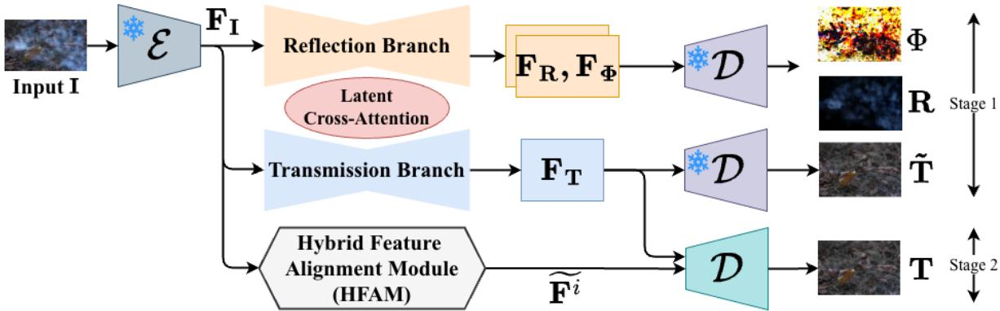
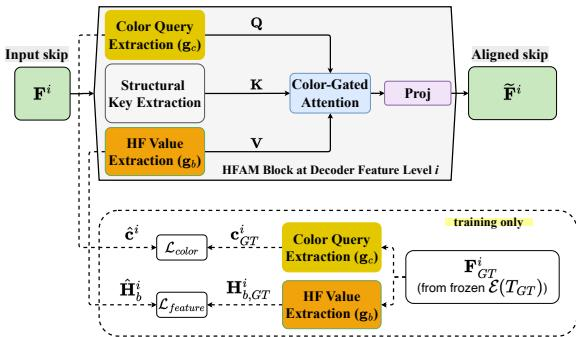
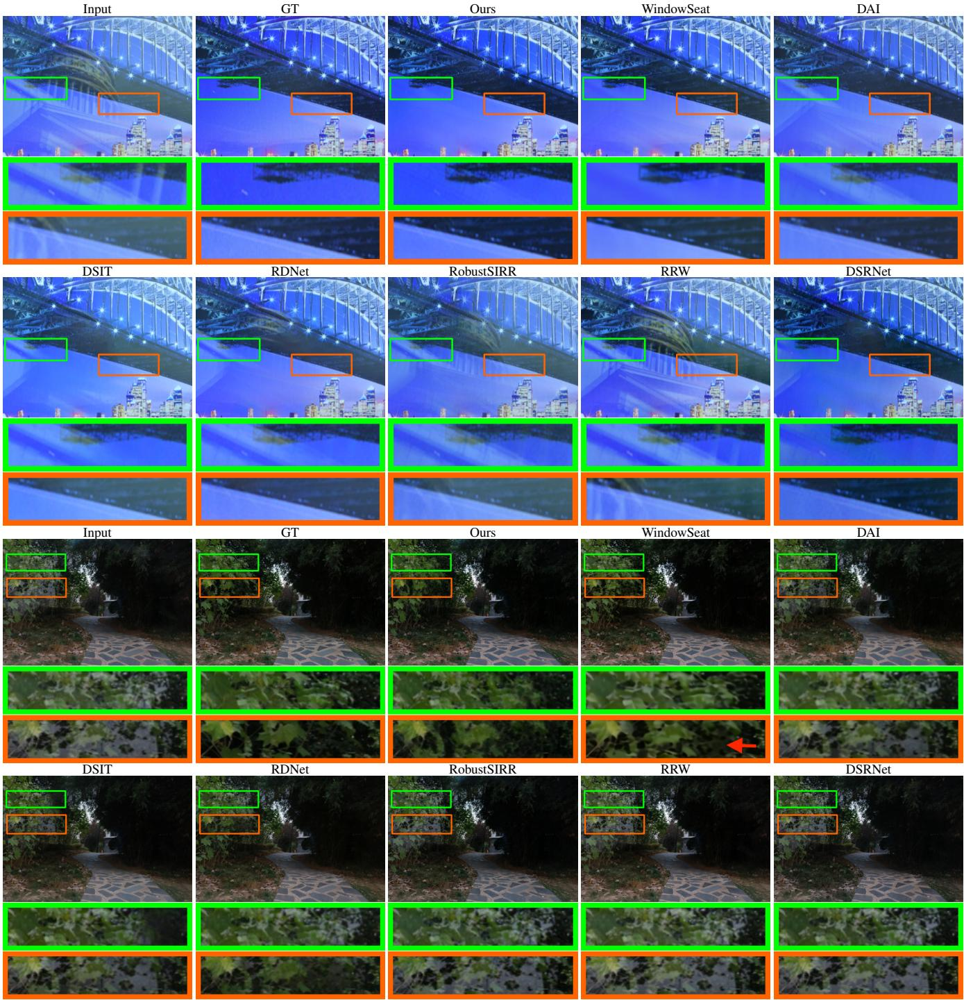

# CLEAR: Color-Texture Latent Alignment for Single Image Reflection Removal

Tu Vo Sheir A. Zaheer Chan Y. Park

KC Machine Learning Lab

tuvv@kc-ml2.com, sheir@kc-ml2.com, chan.y.park@kc-ml2.com

## Abstract

Single Image Reflection Removal (SIRR) seeks to recover the transmitted scene from a photograph captured through glass. Recent latent restoration methods use pretrained generative priors, but many recover detail by feeding highfrequency features from the degraded input back into the decoder. This works for degradations such as blur, noise, or haze, where input detail mostly belongs to the scene. It is less suitable for SIRR, where reflections add a second structured layer; directly reusing the input’s skip connections can sharpen the image while also bringing reflection edges back. Latent compression also introduces color drift andfine-detail loss. We propose CLEAR (Color-Texture LatEnt Alignment for Single Image Reflection Removal), a deterministic, single-timestep, non-iterative latentframework that uses a pretrained latent diffusion backbone as a natural-image prior. A physics-guided separator organizes the prediction around the transmission, reflection, and residue formation model and outputs coarse layer latents in one forward pass. The Hybrid Feature Alignment Module (HFAM) then treats input-derived skips as contaminated layer-mixture features. It rectifies their high-frequency content with a clean-transmission-aligned color query, learnedfrom the inputfeatures themselves under ground-truthfeature supervision, keeping transmissionconsistent texture while attenuating reflection-colored detail. CLEAR achieves the best average across fidelity and perceptual metrics on six real-world benchmarks and the lowest LPIPS on every dataset, with the largest gains on the hardest benchmarks.

## 1. Introduction

Photographs taken through glass often contain unwanted reflections, where a mirrored scene is overlaid on the intended background. The captured image is the sum of a transmission layer (the background) and a reflection layer (the mirrored scene). Single Image Reflection Removal (SIRR) aims to recover the clean transmission from this mixture [2, 4, 7, 8, 10, 21, 41, 46, 60]. Clean transmission improves everyday photography and also helps downstream vision tasks such as detection, segmentation, and recognition, whose accuracy drops when the input carries reflections. The task is ill-posed: many transmission–reflection pairs can produce the same observation [8], so any method must rely on learned priors.

CNN-based methods [7, 12, 13, 38, 59, 64] work well with large datasets and semantic priors, but tend to over-smooth heavily contaminated regions and lose highfrequency detail. To recover this detail, recent work builds on pre-trained latent generative models [6, 8, 30, 36], which carry natural-image priors and can fill in plausible texture where the input is ambiguous.

These generative approaches treat reflection removal as a generic conditional restoration problem: they condition on mixed input and recover detail by reusing input-derived features during decoding [8, 10, 55]. Latent restoration decoders make this explicit. SLURPP [49], for example, restores high-frequency detail by adding skip connections from the degraded input image into the decoder (input skips). This is the right choice when the degradation removes information: in underwater imaging, blur, or noise, the input’s high-frequency content mostly belongs to the scene, so copying it back recovers real detail.

Reflection removal is the case where this fails. Reflection does not remove information; it adds extraneous structure, and the input’s high-frequency content includes the reflection’s own edges. Feeding the input back into the decoder therefore reintroduces the reflections that the network just removed, producing residual ghosting and structural inconsistencies [4, 12, 41, 50]. Decoder-side detail recovery for SIRR is therefore more than a sharpening problem. The skip stream is itself a layer mixture, and the model must decide which high-frequency channels belong to the transmission before they enter the decoder. Working in a compressed latent space adds two additional problems: the high VAE compression ratio shifts colors, and the regression objective loses fine detail.

CLEAR addresses these issues with a deterministic, single-timestep, non-iterative latent framework that uses a pretrained latent diffusion backbone as a naturalimage prior (no random sampling, no noise schedule) and pairs it with explicit transmission–reflection decomposition. CLEAR is a two-stage pipeline: a dual-branch latent separator (Stage 1) and a decoder augmented with the Hybrid Feature Alignment Module (HFAM, Stage 2). Stage 1 is a physics-guided latent separator for single-image SIRR that predicts transmission, reflection, and residue latents in one forward pass under the residue-based image formation of DSRNet [12]; its two branches exchange information through latent cross-attention to suppress correlated, entangled features. Following DSRNet, the residual is tied to transmission and reflection only through the reconstruction loss, not through an explicit function.

This coarse transmission is largely reflection-free but, as noted above, carries a color shift from latent compression and has lost fine detail. The decoder restores that detail from the input’s skip features, but those features carry the reflection. At each decoder scale, HFAM learns to transform the input-derived high-frequency skips toward cleantransmission feature statistics, using the ground-truth transmission features only as training targets. The transform is driven by a color query that HFAM computes from the input skips but trains to match the clean transmission’s color, so transmission-consistent texture is kept, reflection-colored detail is attenuated, and the latent color shift is corrected. Because the detail is aligned to the clean target rather than copied from the input, the reflection is suppressed rather than reintroduced.

## Our contributions are:

• We instantiate the explicit transmission–reflection– residue formation model $( \mathbf { I } = \mathbf { T } + \mathbf { R } + \Phi )$ as the prediction target of a deterministic latent separator, jointly predicting the transmission, reflection, and a learned residue $( F _ { T } , F _ { R } , F _ { \Phi } )$ in a single forward pass for single-image reflection removal.

• We show that direct input-skip reuse, effective for information-loss degradations, reintroduces reflections in SIRR because the input’s high-frequency content includes the reflection’s own edges. HFAM aligns contaminated input skips toward clean-transmission feature statistics before they enter the decoder.

• We test the mechanism on six real-world benchmarks, sub-path ablations, global color-fix comparisons, parameter-matched backbones, and a full-reference reflection-leakage metric with paired-bootstrap confidence intervals. The full method improves PSNR by 0.61 dB, SSIM by 0.037, and LPIPS by 33% (0.159→0.106) over the strongest single-timestep baseline, DAI.

## 2. Related Work

## 2.1. Single Image Reflection Removal

SIRR methods fall broadly into optimization-based and deep learning-based approaches.

Optimization-based methods. Early works relied on handcrafted priors to distinguish the transmission layer from the reflection. Levin and Weiss [20] separated reflections using gradient sparsity priors. Li and Brown [23] used relative smoothness, assuming that the reflection is more out-offocus than the transmission. Shih et al. [35] exploited ghosting cues from double-pane glass, and others explored convex optimization [53] and region-aware priors [40]. While foundational, these methods struggle with sharp reflections and complex non-linear superpositions [47].

Deep learning-based methods. Following the first generic deep architecture for layer separation [4], many works added reflection-specific modules: multi-scale and cooperative edge guidance (CRRN [41], CORRN [42]), misaligneddata training (ERRNet [46]), cascaded refinement (IB-CLN [21]), perceptual losses [59], and location-aware processing [2]. The dual-stream paradigm of YTMT [11] and DSRNet [12] is most relevant to us; DSRNet models a learnable residue to capture non-linearities in the superposition, and we follow this residue formulation. Recent methods extend robustness and capacity: adversarial robustness (RobustSIRR [38]), the large-scale RRW dataset [64], transformer attention (DSIT [13]), reversible layers (RD-Net [61]), and inter-layer complementarity (ILCT) [15], alongside work on data synthesis and physical modeling [18, 62, 63]. More recently, Kee et al. [16] remove reflections end-to-end from RAW photographs, optionally using an opposite-facing context photo; complementary multi-cue setups (flash/no-flash [45], polarization) ease separation but require specialized captures, whereas CLEAR takes a single display-referred RGB image. Our dualbranch decomposition shares this stream-based lineage but operates in a compressed generative latent space.

## 2.2. Generative Priors for Image Restoration

Pre-trained generative models [30] are now useful restoration priors. Pixel-space conditional methods (SR3 [32], Palette [31]) concatenate the degraded input with the latent to guide an iterative reverse process. In reflection removal, L-DiffER [8] guides iterative denoising with text descriptions that lack spatial precision, while Flash-Split [45] uses iterative dual-branch latent diffusion with paired flash/noflash captures.

A separate line of work maps the input to the output in one step [33, 37, 43, 54]. For reflection removal, DAI [10] uses a single-timestep backbone conditioned on mixed input via ControlNet [57], which leaves residual reflections in heavily corrupted regions; WindowSeat [55] adapts a large DiT [27] but its stochastic objective tends to oversmooth content. Deterministic single-timestep latent decomposition has also been used for underwater restoration [49]. CLEAR instead makes the explicit transmission/reflection/residue decomposition the network’s prediction target, and its decoder changes the role of input skips: instead of copying them as high-frequency detail, HFAM aligns their detail to the clean transmission (Sec. 3).

Latent-space alignment and decoder refinement. A known failure mode of VAE-based latent restoration [19, 30] is that the decoder shifts colors and loses highfrequency detail. Existing remedies are mostly global or post-hoc. StableSR [44] applies wavelet- and AdaINbased color correction after decoding, following classic appearance transfer that matches channel-wise feature statistics [5, 14, 29]. Learned feature modulation, such as FiLM [28], conditions features with per-channel scale and shift parameters. These operate on global statistics or apply a single transform across space, so they can fix overall color but cannot decide which spatial textures to keep. HFAM instead performs a learned color-texture alignment inside the decoder: it learns a clean-transmission-aligned chromatic signature from the input-derived skips and uses it to reweight high-frequency subbands [48] channel-wise at each scale, so color correction and texture selection are coupled rather than handled separately. We compare against these global color-fix baselines in Sec. 4. The residue term in our layer model is a learned residual in the spirit of DSR-Net [12], tied to the layers only through the reconstruction loss. Two choices separate our approach from prior latentprior SIRR: we align the input-derived skip detail to the clean transmission rather than copying it in, and HFAM targets the chromatic and high-frequency degradations specific to latent regression.

## 3. Method

## 3.1. Preliminaries

We distinguish a Stage (a sequential pipeline component: Stage 1 disentangles the latent mixture, Stage 2 refines it via HFAM) from a Step (the number of forward evaluations N); CLEAR runs N=1 without a sampling loop (details in the supplement).

Image formation model. The linear model I = T + R [4] is simple but ignores light attenuation through glass [39]. Weighted [41, 50] and spatial alpha-matting variants (I = $\mathbf { W } \circ \mathbf { T } + ( 1 - \mathbf { W } ) \circ \mathbf { R } )$ improve realism but require a hardto-estimate pixel-wise map W. Following DSRNet [12], where a residual non-linearity is shown to be easier to estimate than a per-pixel W and to outperform the linear reconstruction, we adopt the residue-based formation:

$$
\mathbf { I } = \mathbf { T } + \mathbf { R } + \boldsymbol { \Phi } ,\tag{1}
$$

where $\Phi$ is a learned residual term that absorbs non-linear deviations from the additive base. Following DSRNet, Φ is predicted by the network, not computed as an explicit function of T and R; it is tied to them only through the reconstruction constraint in Eq. (2); the additive layers then capture the dominant content and the residual absorbs nonlinear effects such as saturation [12]. An audit over all 1,040 benchmark images shows Φ carries only 0.00082% of the $R + \Phi \mathbb { L } 1$ energy, is non-zero in 80% of images, and is localized to saturated pixels (details in the supplement). The supplement shows an example decomposition into the recovered layers and residual.

Latent generative priors. Stable Diffusion [30] provides a pre-trained VAE latent space and U-Net prior. We reuse these weights only as a natural-image prior and train a direct deterministic restoration mapping; there is no noise schedule, no added Gaussian noise, and no iterative reverse chain. The supplement gives the exact single-timestep/SDv2 adaptation.

## 3.2. Pipeline Overview

As shown in Fig. 1, the contaminated image I is projected to a latent $F _ { I } = \mathcal { E } ( \mathbf { I } )$ by the frozen VAE encoder. This latent feeds a dual-path latent separator of two symmetric U-Net branches initialized from identical pre-trained weights [30]. Two-branch layouts are common in layer separation [11, 12]; related latent work has also used dual branches for paired flash/no-flash separation [45]. CLEAR uses this layout for a SIRR-specific latent prediction structure: one branch predicts the transmission latent $F _ { T }$ , while the other predicts the reflection and residue latents $F _ { R } , F _ { \Phi }$ so that the output follows the residue formation model in Eq. (1). The branches interact through latent cross-attention to identify and suppress correlated, entangled features. All latents are produced in one feed-forward pass through the dual-branch separator without iterative denoising steps or noise schedule.

## 3.3. Stage 1: Latent Signal Disentanglement

Stage 1 directly optimizes the dual-path network to decompose the latent mixture. Unlike noise-prediction models [6, 8], it performs a single-timestep latent projection of $F _ { I }$ into $F _ { T } , F _ { R } , F _ { \Phi }$ satisfying the residue constraint of Eq. (1). The objective combines per-layer fidelity, a selfsupervised reconstruction term, and a gradient-domain exclusion term:

$$
\mathcal { L } _ { \mathrm { S 1 } } = \lambda _ { T } \mathcal { L } _ { T } + \lambda _ { R } \mathcal { L } _ { R } + \lambda _ { r e c } \mathcal { L } _ { r e c } + \lambda _ { e x c } \mathcal { L } _ { e x c } ,\tag{2}
$$

where $\mathcal { L } _ { r e c } = \| \mathbf { I } - \left( \mathbf { T } + \mathbf { R } + \Phi \right) \|$ 1 forces the predicted layers and residual to recombine into the input, which prevents plausible but unfaithful content. Each $\begin{array} { r } { \dot { \mathcal { L } _ { k } } = \mathcal { L } _ { k } ^ { 1 } + \mathbf { \bar { \mathcal { L } } } _ { k } ^ { \mathrm { S S I M } } . } \end{array}$ + $\mathcal { L } _ { k } ^ { \mathrm { L P I P S } } , k \in \{ \mathbf { T } , \mathbf { R } \}$ , supervises individual layer fidelity in pixel, structural, and perceptual terms. The exclusion loss $\mathcal { L } _ { e x c }$ [59] decorrelates transmission and reflection gradients to enforce pixel-level independence. For real data lacking ground-truth R, the reflection terms are masked out.

  
Figure 1. Pipeline overview. Stage 1 (latent disentanglement): the input is encoded by a frozen SDv2 VAE [30] and processed by two U-Net branches that exchange information via latent cross-attention, predicting transmission and reflection/residue latents in a single deterministic step. Stage 2 (feature alignment): the transmission latent is decoded by a cross-latent decoder augmented at every scale by the HFAM, which injects high-frequency detail and chromatic cues. During training the HFAM is supervised with ground-truth features extracted by the same frozen encoder. Snowflakes mark frozen modules; trainable modules are unmarked.

  
Figure 2. HFAM at one decoder scale. Input skip $\mathbf { F } ^ { i }$ yields color query $Q ,$ structural key $K ,$ , and high-frequency value V (DWT); color-gated channel attention reweights V toward cleantransmission statistics (supervised at training, computed from $\mathbf { F } ^ { i }$ at inference). Applied at all decoder scales.

## 3.4. Stage 2: Decoder Refinement via HFAM

Motivation. Stage 1 yields a largely reflection-free transmission, but it is blurry: the high latent compression ratio and the deterministic objective both cost high-frequency detail, and decoding also drifts in color. Restoring that detail requires a high-frequency source, and the only adequate signal is the input image. This poses a dilemma specific to reflection removal. Direct input skips work when the degradation only removes information: the input’s highfrequency content then belongs to the true scene and is merely attenuated, so copying it back restores real detail. For reflection, this no longer holds because the input’s highfrequency content also contains the reflection’s own edges, and copying it back reintroduces the reflection. HFAM turns skip injection into an alignment problem. It keeps the input skip-connections, whose detail is needed, but does not copy them directly. Instead, it learns to align the input-derived skip features to the clean (ground-truth) transmission, reweighting high-frequency texture with a cleantransmission-aligned color query so that reflection-colored detail is attenuated before it reaches the decoder.

Color-gated channel attention. HFAM is applied at each decoder scale $i \in \{ 1 , \ldots , 4 \}$ , while the decoder is seeded by the Stage-1 transmission latent. From the input-derived skip feature $F ^ { i } \in \mathbb { R } ^ { C \times H \times W }$ it forms three role-specialized projections:

• a color query Q from a learned color descriptor $\hat { \mathbf { c } } ^ { i }$ of $F ^ { i }$ (a global channel-statistics chromatic signature; justified below), supervised during training to match the groundtruth transmission’s color so the query carries the cleanscene color;

• a structural key K from $F ^ { i }$ via $1 \times 1$ convolution;

• a high-frequency value V from a single-level Haar discrete wavelet transform (DWT) [48] of $F ^ { i }$ : the high-pass subbands {LH, HL, HH} pass through a 1×1 convolution and are recombined by the inverse DWT to isolate edges and texture. The DWT/IDWT are fixed and differentiable; only the value, attention, and output projections are learned.

After $\ell _ { 2 }$ -normalizing $Q$ and K, HFAM applies a multi-head channel-wise (transposed) attention [56]:

$$
\widetilde { F } ^ { i } = \mathrm { P r o j } \left( \mathrm { S o f t m a x } ( \hat { Q } \hat { K } ^ { \top } ) V \right) , \qquad \hat { Q } \hat { K } ^ { \top } \in \mathbb { R } ^ { C \times C } .\tag{3}
$$

The affinity is computed across channels, not across space (cost is linear in the number of pixels). Because the query is trained to the clean transmission color, the attention amplifies high-frequency texture favored by the cleantransmission-aligned query and attenuates the reflectioncolored channels. A zero-initialized convolution then passes ${ \widetilde { F } } ^ { i }$ into the decoder skip at scale i.

Color descriptor. This color descriptor pools global channel statistics of $F ^ { i }$ , following classic appearance-transfer results: spatial-mean channel statistics describe an image’s global appearance with color as the dominant component (AdaIN [14]; Gatys et al. [5]), and per-channel global statistics suffice for color transfer (Reinhard et al. [29]). Because SDv2 VAE is trained to reconstruct RGB, its latent channel statistics correlate strongly with color, so the pooled descriptor is a compact chromatic signature.

Alignment to the clean manifold. HFAM is trained to map these input-derived features to the clean transmission. We pass the ground-truth transmission through the same frozen encoder E to obtain target features $F _ { G T } ^ { i } ,$ used as supervision targets only. From the input skip $F ^ { i }$ , HFAM predicts an aligned color descriptor $\hat { \mathbf { c } } ^ { i } = g _ { c } ( F ^ { i } )$ and high-frequency subbands $\hat { \mathbf { H } } _ { b } ^ { i } \ = \ g _ { b } ( F ^ { i } )$ with learned heads $g _ { c } , g _ { b }$ $\mathsf { A p - }$ plying the same heads to the GT feature gives the targets ${ \bf c } _ { \mathrm { G T } } ^ { i } = g _ { c } ( F _ { G T } ^ { i } )$ and $\mathbf { H } _ { b , \mathrm { G T } } ^ { i } = g _ { b } ( F _ { G T } ^ { i } )$ , against which we supervise two alignment losses at each scale. The GT-side descriptor outputs are detached (stop-gradient); the alignment losses update the shared heads $g _ { c } , g _ { b }$ through the input arm only.

$$
\mathcal { L } _ { c o l o r } = \sum _ { i } \left\| \hat { \mathbf { c } } ^ { i } - \mathbf { c } _ { G T } ^ { i } \right\| _ { 1 } ,\tag{4}
$$

$$
\mathcal { L } _ { f e a t u r e } = \sum _ { i } \sum _ { b \in \{ L H , H L , H H \} } \Vert \hat { \mathbf { H } } _ { b } ^ { i } - \mathbf { H } _ { b , \mathrm { G T } } ^ { i } \Vert _ { 1 } ,\tag{5}
$$

with $\mathcal { L } _ { H F A M } = \mathcal { L } _ { c o l o r } + \mathcal { L } _ { f e a t u r e } .$ . The targets $F _ { G T } ^ { i }$ enter only these losses, never the decoded output; at inference, HFAM applies the learned $g _ { c } , g _ { b }$ to $F ^ { i }$ alone $( Q , K ,$ V all derive from $F ^ { i } )$ . The full Stage 2 objective adds the decoded-transmission fidelity term ${ \mathcal { L } } _ { T } \left( { \boldsymbol { \ell } } _ { 1 } \right.$ , SSIM, LPIPS):

$$
\begin{array} { r } { \mathcal { L } _ { \mathrm { S } 2 } = \lambda _ { 1 } \mathcal { L } _ { T } + \lambda _ { 2 } \mathcal { L } _ { H F A M } . } \end{array}\tag{6}
$$

Relation to prior latent refinement. HFAM differs from existing decoder-side techniques in both what it aligns and how. Direct input-skip decoders copy input detail into the decoder unchanged; HFAM treats those skips as mixedlayer evidence and aligns their usable detail to the clean target manifold, so reflection edges are suppressed rather than reintroduced. Post-hoc color fixes [44] and featuremodulation layers [28] match only global statistics or apply a single transform across space; HFAM’s color-gated attention couples color correction to channel-wise texture selection. The color and high-frequency paths are also complementary, not redundant, as the ablation in Sec. 4 confirms.

## 3.5. Implementation Details

We implement CLEAR in PyTorch [26] with a two-stage training strategy on 84,425 pairs matching DAI’s composition [10] for a controlled comparison: DRR [10] (23,303), synthetic COCO [24]/PASCAL VOC [3] samples (60,833) generated following Hu et al. [12], and Nature [21] (200) plus Zhang et al. [59] (89) real training splits. Both U-Net branches and the VAE start from pre-trained SDv2 checkpoints [30]; HFAM is randomly initialized. The VAE encoder stays frozen, and Stage 1 remains frozen during Stage 2 training; only the decoder D and HFAM are fine-tuned.

## 4. Experiments

## 4.1. Training and Inference

The two stages are trained sequentially on a single NVIDIA A6000 with AdamW [25] (lr $1 \times 1 0 ^ { - 5 }$ , batch size 2), at $5 1 2 ^ { 2 }$ (Stage 1) and $7 6 8 ^ { 2 }$ (Stage 2) with standard augmentation; each stage runs ∼100K iterations. We set λ = $\lambda _ { R } = \lambda _ { r e c } = \lambda _ { e x c } = 0 . 2 5$ and $\lambda _ { 1 } = \lambda _ { 2 } = 0 . 5$ . At inference the pipeline is feed-forward and ground-truth-free. At $7 6 8 ^ { 2 }$ , CLEAR performs four encoder forwards, two U-Net-branch forwards, and two decoder forwards (the crosslatent decoder for T; the original VAE decoder with R/Φ batched): ≈16.0T MACs (31.9T FLOPs), 0.556 s on one A6000.

## 4.2. Comparison with State of the Art

We evaluate on six benchmarks: Nature [21], SIR2 [39], Real20 [59], DRR-C, DRR-S [10], and OpenRR-1k [51]. We compare CLEAR against RobustSIRR [38], RRW [64], DSIT [13], DSRNet [12], RDNet [61], DAI [10], and WindowSeat [55]. Following the adaptation protocol of DAI [10], every method is fine-tuned on our identical training data and evaluated with the same testing scripts, so the comparison isolates architectural and methodological differences rather than training-data advantages. L-DiffER [8] and DPIT [15] have no public code at the time of writing and cannot be reproduced. GenSIRR [22] is concurrent; we run its released checkpoint without refitting, as it likewise does not refit prior methods, and report it separately in Tab. 3. We report PSNR and SSIM for fidelity and LPIPS [58], MANIQA [52], and QUALICLIP [1] for perceptual quality.

Quantitative results. Tab. 1 shows that CLEAR has the best average across all five metrics and the lowest LPIPS on every dataset, with the largest SSIM and perceptual gains on the harder DRR-C, DRR-S, and OpenRR-1k benchmarks. Some competitors reach higher PSNR on individual datasets (e.g. DAI on Real20), but PSNR alone does not capture perceived quality for this ill-posed task; the no-reference MANIQA and QUALICLIP scores, closest to ground truth among all methods (supplementary material), corroborate LPIPS.

## 4.3. Qualitative Results

Fig. 3 visually compares the outputs. CNN-based methods [12, 13, 38, 61, 64] and DAI [10] often leave highfrequency artifacts or over-smoothed textures when reflections are strongly entangled with the scene, while WindowSeat [55] can produce plausible but incorrect content. Our deterministic two-stage method removes reflections more cleanly and keeps structure and color closer to the ground truth. In the supplementary material (Reflection Layer Disentanglement), we compare predicted reflection layers: CLEAR isolates reflection texture with less transmission leakage than the pixel-space dual-stream methods (DSRNet, DSIT, RDNet), including DSRNet, whose residue model it adapts to the latent space.

Table 1. Quantitative comparison on six real-world benchmarks. ↑/↓ indicate higher/lower is better. Best in bold, second-best underlined.
<table><tr><td rowspan="2">Dataset (size)</td><td rowspan="2">Metric</td><td colspan="8">Method</td></tr><tr><td>RobustSIRR</td><td>RRW</td><td>DSIT</td><td>DSRNet</td><td>RDNet</td><td>DAI</td><td>WindowSeat</td><td>Ours</td></tr><tr><td rowspan="5">Nature (20)</td><td>PSNR↑</td><td>20.84</td><td>25.64</td><td>26.24</td><td>21.06</td><td>25.91</td><td>27.05</td><td>27.00</td><td>26.45</td></tr><tr><td>SSIM↑</td><td>0.766</td><td>0.832</td><td>0.831</td><td>0.799</td><td>0.832</td><td>0.846</td><td>0.839</td><td>0.867</td></tr><tr><td>LPIPS↓</td><td>0.229</td><td>0.178</td><td>0.190</td><td>0.194</td><td>0.173</td><td>0.212</td><td>0.208</td><td>0.126</td></tr><tr><td>MANIQA↑</td><td>0.481</td><td>0.457</td><td>0.461</td><td>0.483</td><td>0.478</td><td>0.446</td><td>0.464</td><td>0.516</td></tr><tr><td>QUALICLIP↑</td><td>0.720</td><td>0.708</td><td>0.715</td><td>0.716</td><td>0.707</td><td>0.663</td><td>0.657</td><td>0.721</td></tr><tr><td rowspan="5">SIR² (500)</td><td>PSNR↑</td><td>22.10</td><td>25.19</td><td>25.48</td><td>24.48</td><td>26.01</td><td>27.31</td><td>27.57</td><td>27.71</td></tr><tr><td>SSIM↑</td><td>0.874</td><td>0.904</td><td>0.916</td><td>0.911</td><td>0.917</td><td>0.931</td><td>0.913</td><td>0.934</td></tr><tr><td>LPIPS↓</td><td>0.172</td><td>0.141</td><td>0.122</td><td>0.128</td><td>0.122</td><td>0.110</td><td>0.119</td><td>0.092</td></tr><tr><td>MANIQA↑</td><td>0.497</td><td>0.479</td><td>0.505</td><td>0.511</td><td>0.512</td><td>0.487</td><td>0.470</td><td>0.513</td></tr><tr><td>QUALICLIP↑</td><td>0.643</td><td>0.632</td><td>0.657</td><td>0.669</td><td>0.662</td><td>0.658</td><td>0.600</td><td>0.679</td></tr><tr><td rowspan="5">Real20 (20)</td><td>PSNR↑</td><td>21.54</td><td>22.59</td><td>23.66</td><td>21.23</td><td>23.04</td><td>25.23</td><td>24.30</td><td>23.74</td></tr><tr><td>SSIM↑</td><td>0.778</td><td>0.795</td><td>0.804</td><td>0.772</td><td>0.815</td><td>0.840</td><td>0.797</td><td>0.824</td></tr><tr><td>LPIPS↓</td><td>0.207</td><td>0.198</td><td>0.172</td><td>0.210</td><td>0.178</td><td>0.161</td><td>0.198</td><td>0.160</td></tr><tr><td>MANIQA↑</td><td>0.461</td><td>0.450</td><td>0.475</td><td>0.464</td><td>0.480</td><td>0.440</td><td>0.443</td><td>0.483</td></tr><tr><td>QUALICLIP↑</td><td>0.677</td><td>0.665</td><td>0.694</td><td>0.719</td><td>0.684</td><td>0.672</td><td>0.635</td><td>0.729</td></tr><tr><td rowspan="5">DRR-C (200)</td><td>PSNR↑</td><td>20.44</td><td>21.14</td><td>21.41</td><td>20.38</td><td>21.65</td><td>23.83</td><td>22.64</td><td>25.02</td></tr><tr><td>SSIM↑</td><td>0.725</td><td>0.731</td><td>0.718</td><td>0.736</td><td>0.730</td><td>0.840</td><td>0.709</td><td>0.919</td></tr><tr><td>LPIPS↓</td><td>0.277</td><td>0.274</td><td>0.280</td><td>0.213</td><td>0.272</td><td>0.170</td><td>0.292</td><td>0.117</td></tr><tr><td>MANIQA↑</td><td>0.458</td><td>0.446</td><td>0.470</td><td>0.480</td><td>0.473</td><td>0.451</td><td>0.466</td><td>0.490</td></tr><tr><td>QUALICLIP↑</td><td>0.739</td><td>0.726</td><td>0.732</td><td>0.744</td><td>0.740</td><td>0.746</td><td>0.726</td><td>0.782</td></tr><tr><td rowspan="5">DRR-S (200)</td><td>PSNR↑</td><td>19.79</td><td>22.17</td><td>22.70</td><td>20.71</td><td>23.17</td><td>27.21</td><td>25.79</td><td>28.35</td></tr><tr><td>SSIM↑</td><td>0.775</td><td>0.794</td><td>0.802</td><td>0.802</td><td>0.808</td><td>0.901</td><td>0.811</td><td>0.942</td></tr><tr><td>LPIPS↓</td><td>0.246</td><td>0.228</td><td>0.224</td><td>0.214</td><td>0.217</td><td>0.119</td><td>0.215</td><td>0.080</td></tr><tr><td>MANIQA↑</td><td>0.520</td><td>0.484</td><td>0.508</td><td>0.524</td><td>0.514</td><td>0.497</td><td>0.496</td><td>0.553</td></tr><tr><td>QUALICLIP↑</td><td>0.723</td><td>0.706</td><td>0.723</td><td>0.726</td><td>0.726</td><td>0.728</td><td>0.711</td><td>0.731</td></tr><tr><td rowspan="5">OpenRR-1k (100)</td><td>PSNR↑</td><td>22.15</td><td>23.83</td><td>24.48</td><td>20.65</td><td>23.73</td><td>25.27</td><td>25.58</td><td>28.27</td></tr><tr><td>SSIM↑</td><td>0.831</td><td>0.833</td><td>0.830</td><td>0.822</td><td>0.833</td><td>0.854</td><td>0.792</td><td>0.950</td></tr><tr><td>LPIPS↓</td><td>0.197</td><td>0.195</td><td>0.200</td><td>0.203</td><td>0.188</td><td>0.183</td><td>0.218</td><td>0.062</td></tr><tr><td>MANIQA↑</td><td>0.456</td><td>0.432</td><td>0.456</td><td>0.449</td><td>0.458</td><td>0.438</td><td>0.453</td><td>0.470</td></tr><tr><td>QUALICLIP↑</td><td>0.724</td><td>0.695</td><td>0.715</td><td>0.715</td><td>0.723</td><td>0.709</td><td>0.714</td><td>0.742</td></tr><tr><td rowspan="5">Average (1040)</td><td>PSNR↑</td><td>21.14</td><td>23.43</td><td>23.99</td><td>21.42</td><td>23.92</td><td>25.98</td><td>25.48</td><td>26.59</td></tr><tr><td>SSIM↑</td><td>0.791</td><td>0.815</td><td>0.817</td><td>0.809</td><td>0.822</td><td>0.869</td><td>0.810</td><td>0.906</td></tr><tr><td>LPIPS↓</td><td>0.221</td><td>0.202</td><td>0.198</td><td>0.201</td><td>0.192</td><td>0.159</td><td>0.208</td><td>0.106</td></tr><tr><td>MANIQA↑</td><td>0.479</td><td>0.458</td><td>0.479</td><td>0.485</td><td>0.486</td><td>0.460</td><td>0.465</td><td>0.504</td></tr><tr><td>QUALICLIP↑</td><td>0.704</td><td>0.689</td><td>0.706</td><td>0.714</td><td>0.707</td><td>0.696</td><td>0.674</td><td>0.731</td></tr></table>

## 4.4. Analysis and Ablation Studies

We ablate the pipeline on Nature, Real20, and SIR2 (Tab. 2) and check whether the gains stem from scale or from the method. The supplement reports Stage 1 branch/init, reconstruction, exclusive, and cross-attention ablations, plus no-reference IQA calibration.

Stage 2 refinement. Stage 1 alone (row 1) separates the layers structurally but leaves blurred textures and residual artifacts. Adding the Stage 2 refinement path raises PSNR across all datasets and confirms that the two-stage design is needed; the qualitative effect is shown in the supplement.

  
Figure 3. Visual comparison against all methods on $\mathrm { S I R ^ { 2 } }$ [39] (top two rows) and Nature [21] (bottom two rows). Our method yields cleaner separation and recovers structural detail and texture more faithfully. Zoom in for detail.

Residue term (Φ). Adding the learned residue Φ (row 3) lets the network account for non-linear effects such as saturation, improving structural fidelity, especially on Real20 and Nature where the linear model ${ \bf I } = { \bf T } + { \bf R }$ is often violated. A residual term adds degrees of freedom, but following [12] we find it easier to estimate than a per-pixel alpha map and it empirically beats the strictly linear model. HFAM and its sub-paths. The full HFAM (last row) is best on every benchmark while matching or staying close to the best SSIM. The two paths are complementary: from the

Table 2. Ablation of Stage 2 refinement, the Residue (Φ), and HFAM sub-paths (HF high-frequency, Color) across three benchmarks. Best in bold.
<table><tr><td rowspan="2">S2</td><td rowspan="2">Φ</td><td colspan="2">HFAM</td><td colspan="2">Nature</td><td colspan="2">Real20</td><td colspan="2"> $S I R ^ { 2 }$ </td></tr><tr><td>HF</td><td>Color</td><td>PSNR</td><td>SSIM</td><td>PSNR</td><td>SSIM</td><td>PSNR</td><td>SSIM</td></tr><tr><td>×</td><td>X</td><td>X</td><td>X</td><td>25.09</td><td>0.838</td><td>23.52</td><td>0.779</td><td>26.34</td><td>0.904</td></tr><tr><td>√</td><td>X</td><td>X</td><td>X</td><td>25.32</td><td>0.847</td><td>23.52</td><td>0.819</td><td>26.41</td><td>0.932</td></tr><tr><td>√</td><td>√</td><td>X</td><td>X</td><td>26.02</td><td>0.865</td><td>23.60</td><td>0.824</td><td>26.57</td><td>0.933</td></tr><tr><td>√</td><td>√</td><td>X</td><td>√</td><td>26.15</td><td>0.869</td><td>23.52</td><td>0.823</td><td>26.65</td><td>0.934</td></tr><tr><td>√</td><td>√</td><td>√</td><td>X</td><td>26.04</td><td>0.868</td><td>23.73</td><td>0.823</td><td>26.69</td><td>0.932</td></tr><tr><td>√</td><td>√</td><td>√</td><td>√</td><td>26.45</td><td>0.867</td><td>23.74</td><td>0.824</td><td>27.71</td><td>0.934</td></tr></table>

Stage-2 + Φ baseline, the color and high-frequency paths each improve PSNR on their own, and combining them is best (Tab. 2). This indicates HFAM does more than global color correction: the two paths are the query and value of one attention operator; each is weak alone, and only together do they amplify transmission-colored channels while attenuating reflection-colored ones. The effect is largest on $\mathrm { S I R ^ { 2 } }$ , where reflections are strong and chromatically distinct (mechanism detailed in the supplementary material). On color fidelity, the full model also reduces the CIEDE2000 color-difference metric $\Delta E _ { 0 0 }$ [34] by 4.2% over the Stage-2+Φ baseline on $\mathrm { S I R ^ { 2 } }$ (4.983→4.774), substantiating the color-correction claim with a perceptual color-difference metric. On the 454 $\mathrm { S I R ^ { 2 } }$ images with physical reflection GT, the full model also cuts the reflection leakage metric leakage corr from 0.2657 to 0.2243 (-15.6%; paired bootstrap,10k resamples, 95% CI [−0.052, −0.031]; more details in supplement).

Capacity vs. methodology. We show that the gains come from the method, not the capacity, with four controlled comparisons (Tab. 3). CLEAR beats DAI [10] when both are trained on the identical data (Sec. 3), which rules out a data advantage. It still beats DAI after swapping SDv2 for the lightweight BK-SDM-Small [17] backbone (1.29B total parameters, below DAI’s 1.74B), so the gains cannot come from model size. In Stage 2, HFAM (22.44M) beats a generic refiner matched to its parameters and FLOPs (22.35M; 25.80/0.861/0.152). A half-size HFAM (halved HCCM channels; 26.25/0.903/0.108) also beats that refiner, by +0.45 dB PSNR, +0.042 SSIM, −0.044 LPIPS.

How detail enters Stage 2. We compare alternative ways of injecting high-frequency detail into the decoder from the same Stage 1 output (Tab. 4). Copying the input skips directly recovers sharpness over the no-refinement floor (26.21 vs. 25.96 PSNR) but reintroduces reflection structure, so it trails HFAM on every metric. Two standard post-hoc color fixes, a low-frequency wavelet fix and an AdaIN-style per-channel mean/std fix [44], match only global statistics and fall below the no-refinement baseline. HFAM is the best on all three metrics, showing that Stage 2 does more than skip copying or global color correction.

Table 3. Capacity, inference cost, and quality (averaged over all benchmarks; time on one A6000). ‡A generic Stage-2 refiner matched to HFAM’s parameters (22.35M) and FLOPs, and a half-size HFAM (halved HCCM channels), trained under identical schedules.
<table><tr><td>Method</td><td>Total</td><td>Train.</td><td>Time (s)</td><td>PSNR↑</td><td>SSIM↑</td><td>LPIPS↓</td></tr><tr><td>DAI [10]</td><td>1.74B</td><td>0.95B</td><td>0.40</td><td>25.98</td><td>0.869</td><td>0.159</td></tr><tr><td>GenSIRR [22]†</td><td>12.11B</td><td>12.02B</td><td>53.8</td><td>26.47</td><td>0.879</td><td>0.130</td></tr><tr><td>Ours (BK-SDM-Small)</td><td>1.29B</td><td>1.08B</td><td>0.42</td><td>26.24</td><td>0.908</td><td>0.117</td></tr><tr><td>Ours (SDv2)</td><td>2.27B</td><td>1.84B</td><td>0.56</td><td>26.59</td><td>0.906</td><td>0.106</td></tr><tr><td>Ours (generic S2 refiner)‡</td><td>2.27B</td><td>1.84B</td><td>0.57</td><td>25.80</td><td>0.861</td><td>0.152</td></tr><tr><td>Ours (half-size HFAM)‡</td><td>2.27B</td><td>1.82B</td><td>0.54</td><td>26.25</td><td>0.903</td><td>0.108</td></tr></table>

Table 4. Stage 2 detail-injection alternatives applied to the same Stage 1 output (averaged over six benchmarks).
<table><tr><td>Method</td><td>PSNR↑</td><td>SSIM↑</td><td>LPIPS↓</td></tr><tr><td>Stage 1 only (no Stage 2)</td><td>25.96</td><td>0.891</td><td>0.115</td></tr><tr><td>Stage 1 + copy input skips</td><td>26.21</td><td>0.896</td><td>0.112</td></tr><tr><td>Stage 1 + Wavelet fix</td><td>22.54</td><td>0.825</td><td>0.160</td></tr><tr><td>Stage 1 + AdaIN fix</td><td>23.42</td><td>0.825</td><td>0.158</td></tr><tr><td> $\mathrm { S t a g e \ 1 + H F A M \left( o u r s \right) }$ </td><td>26.59</td><td>0.906</td><td>0.106</td></tr></table>

## 5. Conclusion

We presented CLEAR, a deterministic, single-timestep, non-iterative latent framework for single image reflection removal that structures the first stage with the transmission, reflection, and residue formation model and aligns inputderived skip detail to the clean transmission with HFAM’s color-gated attention, restoring detail while reducing reflection leakage. Parameter-matched and matched-data studies attribute the gains to the method, not scale; six benchmarks show improved perceptual quality and structural fidelity over prior single-timestep baselines.

Scope and limitations. CLEAR targets the single-image setting and does not use multi-image, flash/no-flash, or polarization cues, so it relies entirely on learned priors. Like any learned solver for this ill-posed task, it can hallucinate where the input is genuinely ambiguous, most visibly when the reflection is nearly opaque or the transmission is severely attenuated (failure cases in the supplement). Working in a compressed latent space also caps the high-frequency detail recoverable at decode, an upper bound that HFAM mitigates but cannot remove. Future work includes extending the alignment principle to multi-cue settings and reducing computational cost: parameter-efficient fine-tuning (e.g., LoRA [9]) could reduce training memory, while distillation to smaller backbones could reduce inference cost. Maintaining CLEAR’s perceptual gains while improving pixel fidelity on Nature and Real20 under these changes is left to future work.

## References

[1] Lorenzo Agnolucci, Leonardo Galteri, and Marco Bertini. Quality-aware image-text alignment for opinion-unaware image quality assessment. arXiv preprint arXiv:2403.11176, 2024. 5

[2] Zheng Dong, Ke Xu, Yin Yang, Hujun Bao, Weiwei Xu, and Rynson WH Lau. Location-aware single image reflection removal. In ICCV, 2021. 1, 2

[3] Mark Everingham, Luc Van Gool, Christopher K. I. Williams, John Winn, and Andrew Zisserman. The pascal visual object classes (voc) challenge. IJCV, 88(2):303–338, 2010. 5

[4] Qingnan Fan, Jia Yang, Gang Hua, Baoquan Chen, and David Wipf. A generic deep architecture for single image reflection removal and image smoothing. In ICCV, 2017. 1, 2, 3

[5] Leon A Gatys, Alexander S Ecker, and Matthias Bethge. Image style transfer using convolutional neural networks. In CVPR, pages 2414–2423, 2016. 3, 5

[6] Jonathan Ho, Ajay Jain, and Pieter Abbeel. Denoising diffusion probabilistic models. In NeurIPS, 2020. 1, 3

[7] Yuchen Hong, Yakun Chang, Jinxiu Liang, Lei Ma, Tiejun Huang, and Boxin Shi. Light flickering guided reflection removal. IJCV, 2024. 1

[8] Yuchen Hong, Haofeng Zhong, Shuchen Weng, Jinxiu Liang, and Boxin Shi. L-differ: Single image reflection removal with language-based diffusion model. In ECCV, 2024. 1, 2, 3, 5

[9] Edward J Hu, Yelong Shen, Phillip Wallis, Zeyuan Allen-Zhu, Yuanzhi Li, Shean Wang, Lu Wang, and Weizhu Chen. Lora: Low-rank adaptation of large language models. arXiv preprint arXiv:2106.09685, 2021. 8

[10] Jichen Hu, Chen Yang, Zanwei Zhou, Jiemin Fang, Qi Tian, and Wei Shen. Dereflection any image with diffusion priors and diversified data. arXiv preprint arXiv:2503.17347, 2025. 1, 2, 5, 8

[11] Qiming Hu and Xiaojie Guo. Trash or treasure? an interactive dual-stream strategy for single image reflection separation. In NeurIPS, 2021. 2, 3

[12] Qiming Hu and Xiaojie Guo. Single image reflection separation via component synergy. In ICCV, 2023. 1, 2, 3, 5, 7

[13] Qiming Hu, H Wang, and Xiaojie Guo. Single image reflection separation via dual-stream interactive transformers. In NeurIPS, 2024. 1, 2, 5

[14] Xun Huang and Serge Belongie. Arbitrary style transfer in real-time with adaptive instance normalization. In ICCV, pages 1501–1510, 2017. 3, 5

[15] Yue Huang, Zi’ang Li, Tianle Hu, Jie Wen, Guanbin Li, Jinglin Zhang, Guoxu Zhou, and Xiaozhao Fang. Single image reflection separation via dual prior interaction transformer, 2026. 2, 5

[16] Eric Kee, Adam Pikielny, Kevin Blackburn-Matzen, and Marc Levoy. Removing reflections from raw photos. In Proceedings of the IEEE/CVF Conference on Computer Vision and Pattern Recognition (CVPR), pages 161–171, 2025. 2

[17] Bo-Kyeong Kim, Hyoung-Kyu Song, Thibault Castells, and Shinkook Choi. Bk-sdm: A lightweight, fast, and cheap version of stable diffusion. arXiv preprint arXiv:2305.15798, 2023. 8

[18] Soomin Kim, Yuchi Huo, and Sung-Eui Yoon. Single image reflection removal with physically-based training images. In CVPR, 2020. 2

[19] Diederik P Kingma and Max Welling. Auto-encoding varia tional bayes. arXiv preprint arXiv:1312.6114, 2013. 3

[20] Anat Levin and Yair Weiss. User assisted separation of re flections from a single image using a sparsity prior. IEEE TPAMI, 2007. 2

[21] Chao Li, Yixiao Yang, Kun He, Stephen Lin, and John E Hopcroft. Single image reflection removal through cascaded refinement. In CVPR, 2020. 1, 2, 5, 7

[22] Mingjia Li, Jin Hu, Hainuo Wang, Qiming Hu, Jiarui Wang, and Xiaojie Guo. Rectifying latent space for generative single-image reflection removal. In CVPR, 2026. 5, 8

[23] Yu Li and Michael S Brown. Single image layer separation using relative smoothness. In CVPR, 2014. 2

[24] Tsung-Yi Lin, Michael Maire, Serge Belongie, James Hays, Pietro Perona, Deva Ramanan, Piotr Dollar, and C Lawrence´ Zitnick. Microsoft coco: Common objects in context. In ECCV, pages 740–755. Springer, 2014. 5

[25] Ilya Loshchilov and Frank Hutter. Decoupled weight decay regularization. In ICLR, 2019. 5

[26] Adam Paszke, Sam Gross, Francisco Massa, Adam Lerer, James Bradbury, Gregory Chanan, Trevor Killeen, Zeming Lin, Natalia Gimelshein, Luca Antiga, Alban Desmaison, Andreas Kopf, Edward Yang, Zach DeVito, Martin Raison,¨ Alykhan Tejani, Sasank Chilamkurthy, Benoit Steiner, Lu Fang, Junjie Bai, and Soumith Chintala. PyTorch: an imperative style, high-performance deep learning library. Curran Associates Inc., 2019. 5

[27] William Peebles and Saining Xie. Scalable diffusion models with transformers. 2023. 3

[28] Ethan Perez, Florian Strub, Harm de Vries, Vincent Dumoulin, and Aaron Courville. FiLM: Visual reasoning with a general conditioning layer. In AAAI, 2018. 3, 5

[29] Erik Reinhard, Michael Adhikhmin, Bruce Gooch, and Peter Shirley. Color transfer between images. IEEE Computer Graphics and Applications, 21(5):34–41, 2001. 3, 5

[30] Robin Rombach, Andreas Blattmann, Dominik Lorenz, Patrick Esser, and Bjorn Ommer. High-resolution image syn-¨ thesis with latent diffusion models. In CVPR, 2022. 1, 2, 3, 4, 5

[31] Chitwan Saharia, William Chan, Huiwen Chang, Chris Lee, Jonathan Ho, Tim Salimans, David Fleet, and Mohammad Norouzi. Palette: Image-to-image diffusion models. In Pro ceedings of the ACM SIGGRAPH Conference Proceedings, 2022. 2

[32] Chitwan Saharia, Jonathan Ho, William Chan, Tim Salimans, David J Fleet, and Mohammad Norouzi. Image superresolution via iterative refinement. IEEE TPAMI, 2022. 2

[33] Axel Sauer and et al. Adversarial diffusion distillation. In ECCV, 2024. 2

[34] Gaurav Sharma, Wencheng Wu, and Edul N. Dalal. The ciede2000 color-difference formula: Implementation notes, supplementary test data, and mathematical observations. Color Research & Application, 30(1):21–30, 2005. 8

[35] YiChang Shih, Dilip Krishnan, Fredo Durand, and William T Freeman. Reflection removal using ghosting cues. In CVPR, 2015. 2

[36] Jiaming Song, Chenlin Meng, and Stefano Ermon. Denoising diffusion implicit models. In ICLR, 2021. 1

[37] Yang Song, Prafulla Dhariwal, Mark Chen, and Ilya Sutskever. Consistency models. arXiv preprint arXiv:2303.01469, 2023. 2

[38] Zhenbo Song, Zhenyuan Zhang, Kaihao Zhang, Wenhan Luo, and Jianfeng Lu. Robust single image reflection removal against adversarial attacks. In CVPR, 2023. 1, 2, 5

[39] Renjie Wan, Boxin Shi, Ling-Yu Duan, Ah-Hwee Tan, and Alex C. Kot. Benchmarking single-image reflection removal algorithms. In International Conference on Computer Vision (ICCV), 2017. 3, 5, 7

[40] Renjie Wan, Boxin Shi, Ling-Yu Duan, Ah-Hwee Tan, Wen Gao, and Alex C Kot. Region-aware reflection removal with unified content and gradient priors. In IEEE TIP, 2018. 2

[41] Renjie Wan, Boxin Shi, Ling-Yu Duan, Ah-Hwee Tan, and Alex C Kot. Crrn: Multi-scale guided concurrent reflection removal network. In CVPR, 2018. 1, 2, 3

[42] Renjie Wan, Boxin Shi, Haoliang Li, Ling-Yu Duan, Ah-Hwee Tan, and Alex C Kot. Corrn: Cooperative reflection removal network. IEEE TPAMI, 2019. 2

[43] J Wang and et al. Osdface: One-step diffusion model for face restoration. In CVPR, 2025. 2

[44] Jianyi Wang, Zongsheng Yue, Shangchen Zhou, Kelvin C.K. Chan, and Chen Change Loy. StableSR: Exploiting diffusion prior for real-world image super-resolution – color correction module. https://github.com/pkuliyi2015/sdwebui-stablesr, 2023. 3, 5, 8

[45] Tianfu Wang, Mingyang Xie, Haoming Cai, Sachin Shah, and Christopher A Metzler. Flash-split: 2d reflection removal with flash cues and latent diffusion separation. In CVPR, pages 5688–5698, 2025. 2, 3

[46] Kaixuan Wei, Jiaolong Yang, Ying Fu, David Wipf, and Hua Huang. Single image reflection removal exploiting misaligned training data and network enhancements. In CVPR, 2019. 1, 2

[47] Qiang Wen, Yinjie Tan, Jing Qin, Wenxi Liu, Guoqiang Han, and Shengfeng He. Single image reflection removal beyond linearity. In CVPR, 2019. 2

[48] Moritz Wolter, Felix Blanke, Jochen Garcke, and Charles Tapley Hoyt. ptwt - the pytorch wavelet toolbox. Journal of Machine Learning Research, 2024. 3, 4

[49] Jiayi Wu, Tianfu Wang, Md Abu Bakr Siddique, Md Jahidul Islam, Cornelia Fermuller, Yiannis Aloimonos, and Christopher A Metzler. Single-step latent diffusion for underwater image restoration. arXiv preprint, 2025. 1, 3

[50] Jie Yang, Dong Gong, Lingqiao Liu, and Qinfeng Shi. Seeing deeply and bidirectionally: A deep learning approach for single image reflection removal. In ECCV, 2018. 1, 3

[51] Kangning Yang, Ling Ouyang, Huiming Sun, Jie Cai, Lan Fu, Jiaming Ding, Chiu Man Ho, and Zibo Meng. Openrr-1k: A scalable dataset for real-world reflection removal, 2025. 5

[52] Sidi Yang, Tianhe Wu, Shuwei Shi, Shanshan Lao, Yuan Gong, Mingdeng Cao, Jiahao Wang, and Yujiu Yang. Maniqa: Multi-dimension attention network for no-reference image quality assessment. In CVPR, pages 1191–1200, 2022. 5

[53] Yang Yang, Wenye Ma, Yin Zheng, Jian-Feng Cai, and Weiyu Xu. Fast single image reflection suppression via con vex optimization. In CVPR, 2019. 2

[54] Zongsheng Yue, Jianyi Wang, and Chen Change Loy. Resshift: Efficient diffusion model for image superresolution by residual shifting. In NeurIPS, 2024. 2

[55] Daniyar Zakarin, Thiemo Wandel, Anton Obukhov, and Dengxin Dai. Reflection removal through efficient adapta tion of diffusion transformers, 2025. 1, 2, 5, 6

[56] Syed Waqas Zamir, Aditya Arora, Salman Khan, Munawar Hayat, Fahad Shahbaz Khan, and Ming-Hsuan Yang. Restormer: Efficient transformer for high-resolution image restoration. In CVPR, 2022. 4

[57] Lvmin Zhang, Anyi Rao, and Maneesh Agrawala. Adding conditional control to text-to-image diffusion models. In ICCV, 2023. 2

[58] Richard Zhang, Phillip Isola, Alexei A Efros, Eli Shechtman, and Oliver Wang. The unreasonable effectiveness of deep features as a perceptual metric. In CVPR, 2018. 5

[59] Xuaner Zhang, Ren Ng, and Qifeng Chen. Single image reflection separation with perceptual losses. In CVPR, 2018. 1, 2, 3, 5

[60] Ya-Nan Zhang, Linlin Shen, and Qiufu Li. Content and gra dient model-driven deep network for single image reflection removal. In ACM MM, page 6802–6812, 2022. 1

[61] Hao Zhao, Mingjia Li, Qiming Hu, and Xiaojie Guo. Reversible decoupling network for single image reflection removal. In CVPR, 2025. 2, 5

[62] Qian Zheng, Jinnan Chen, Zhaopeng Lu, Boxin Shi, Xudong Jiang, Kim-Hui Yap, Ling-Yu Duan, and Alex C Kot. What does plate glass reveal about camera calibration? In CVPR, 2020. 2

[63] Qian Zheng, Boxin Shi, Jinnan Chen, Xudong Jiang, Ling-Yu Duan, and Alex C Kot. Single image reflection removal with absorption effect. In CVPR, 2021. 2

[64] Yurui Zhu, Xueyang Fu, Peng-Tao Jiang, Hao Zhang, Qibin Sun, Jinwei Chen, Zheng-Jun Zha, and Bo Li. Revisiting single image reflection removal in the wild. In CVPR, 2024. 1, 2, 5