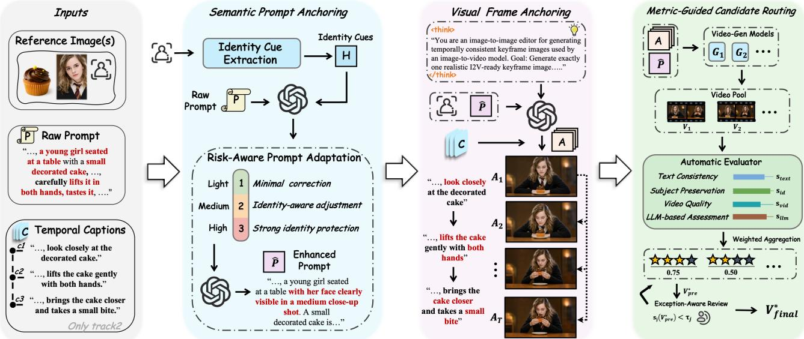
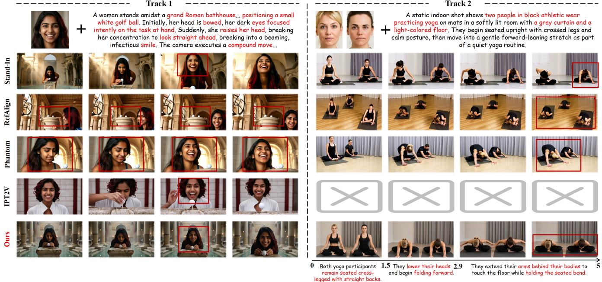

# Chronos: Sequential Identity-Preserving Video Generation by Temporal Anchoring

Mengqi Huang∗ University of Science and Technology of China Hefei, Anhui, China huangmq@ustc.edu.cn

Yijing Tu University of Science and Technology of China Hefei, Anhui, China tuyijing@mail.ustc.edu.cn

Ning Tong South China University of Technology Guangzhou, Guangdong, China 202364810141@mail.scut.edu.cn

Wenchuan Wang∗ University of Science and Technology of China Hefei, Anhui, China wenc\_k@mail.ustc.edu.cn

Zhike Liu University of Science and Technology of China Hefei, Anhui, China liuzhike@mail.ustc.edu.cn

Xuecheng Qi Independent Researcher Hangzhou, Zhejiang, China xuechengqi7@gmail.com

Xiaoxiao Sheng   
Huawei Inc.   
Shanghai, China   
shengxiaoxiao@sjtu.edu.cn

Zhendong Mao† University of Science and Technology of China Hefei, Anhui, China zdmao@ustc.edu.cn

Luoni Wang University of Science and Technology of China Hefei, Anhui, China wangluoni@mail.ustc.edu.cn

Tianyu Huang   
Huawei Inc.   
Shanghai, China   
tyhuang0428@gmail.com

Yongdong Zhang University of Science and Technology of China Hefei, Anhui, China zhyd73@ustc.edu.cn

## Reference Image

Track 1: Facial identity-preserving video generation A woman amidst the towering, dust-mote filled shelves of a quiet antique bookshop, vigorously spray-painting neon graffiti onto a weathered wooden crate,... a compound camera move slowly dollies forward and tilts right.

  
- - - Track 2: Sequential action identity-preserving video generation - - - - - - A static shot shows an elderly couple sitting close together on a light gray sofa in a bright, cozy living room ...

  
0 The couple looks closely at 1.9 The man lifts one hand in a 3.2 The woman laughs and leans back 5 s the laptop screen. sudden excited gesture. slightly while staying beside him. A black-and-white cat sits on the floor near a wooden glass-front cabinet while a gray cat rests at right ...

  
The black-and-white cat sits facing the camera.

  
The black-and-white cat 3.9 licks its front paw.

  
The black-and-white cat lifts its head and looks around.

Figure 1: Generated results of our proposed Chronos. Chronos enables multi-subject video generation with precise and flexible temporal control. Given reference images, a raw prompt, and optional temporal captions, Chronos generates text-aligned, high-quality videos with high identity fidelity. Red text highlights key elements in long instructions.

## Abstract

Identity-preserving video generation aims to synthesize highquality and visually realistic videos from textual and visual conditions while faithfully maintaining the subject’s identity across diverse motions. Prior methods have extensively introduced reference-guided control signals and identity-aware conditioning to improve facial alignment from reference images. However, improving static identity alignment alone creates a fundamental tension between identity fidelity and temporal controllability, which frequently causes identity drift or motion suppression under large pose variations and multi-segment sequential actions. To address this, we propose Chronos, a framework that unifies single-segment facial identity preservation and multi-segment sequential action generation under a common temporal formulation. Specifically, Chronos integrates Semantic Prompt Anchoring to adaptively refine the user prompt, Visual Frame Anchoring to transform conditions into visually grounded keyframe anchors for visual guidance, and Metric-Guided Candidate Routing to select the highest-quality videos from heterogeneous generators via multi-dimensional evaluation. Extensive evaluations demonstrate the superiority of our approach, which achieved first place in both Track 1 and Track 2 of the ACM MM 2026 Identity-Preserving Video Generation Challenge, demonstrating its efectiveness across both facial identity preservation and sequential action generation settings.

## CCS Concepts

• Computing methodologies → Computational photography.

## Keywords

Video Generation; Difusion Transformer; AIGC; Multi-Modal Generation; Identity-Preserving Video Generation

## ACM Reference Format:

Mengqi Huang, Wenchuan Wang, Zhendong Mao, Yijing Tu, Zhike Liu, Luoni Wang, Ning Tong, Xiaoxiao Sheng, Tianyu Huang, Xuecheng Qi, and Yongdong Zhang. 2026. Chronos: Sequential Identity-Preserving Video Generation by Temporal Anchoring. In Proceedings ofthe 34th ACM International Conference on Multimedia (MM ’26), November 10–14, 2026, Rio de Janeiro, Brazil. ACM, New York, NY, USA, 8 pages. https://doi.org/10.1145/ 3767308.3837689

## 1 Introduction

Recent advances in generative modeling [5, 9, 11, 19, 22, 25, 28, 36– 38, 40, 42, 50] have substantially improved visual realism, controllability, and generation fidelity across diverse visual domains. In video generation, modern Text-to-Video (T2V) [15–17, 34, 45], Image-to-Video (I2V) [2, 4, 43, 48], and First-Last-Frame-to-Video (FLF2V) [1, 6, 13, 18, 20] models can synthesize high-quality videos from diverse textual and visual conditions, enabling applications in content creation, virtual character generation, and personalized media. Nevertheless, faithful subject identity preservation remains challenging, particularly under large pose variations, non-frontal viewpoints, occlusions, and multi-subject interactions, where the reference identity can be easily weakened or confused across frames.

Prior methods have introduced identity-aware conditioning from reference inputs, ranging from frequency-domain facial representations in ConsistID [47] to joint identity-semantic modeling in PersonalVideo [24]. Recent reference-guided methods, such as RefAlign [39], Phantom [27], Stand-In [44], and VACE [21], further validate reference images as an efective control signal for identity preservation. However, improving reference-based identity alignment alone is insuficient for video generation, where identity must be preserved jointly with motion, scene composition, and temporal progression. This creates a fundamental tension between identity fidelity and temporal controllability, i.e., overly strong identity constraints can suppress motion diversity, restrict camera freedom, and introduce temporal rigidity, while weak identity conditioning often causes identity drift under small faces, occlusions, non-frontal views, or action-induced appearance changes. The challenge becomes more pronounced in multi-subject and sequential-action settings, where the model must preserve distinct identities while maintaining coherent transitions across multiple temporal phases.

To address these challenges, we propose Chronos, a trainingfree framework for identity-preserving video generation. It unifies facial identity preservation and sequential-action generation under a common temporal formulation. Technically, given reference images, a raw prompt, and optional temporal captions, Chronos first performs Semantic Prompt Anchoring to extract compact, reliable identity cues from the reference images and conservatively refines the prompt. Instead of over-specifying appearance details, this module adaptively adjusts visibility and viewpoint cues based on the estimated generation risk, improving identity preservation while maintaining the original scene semantics and motion intent. We further introduce Visual Frame Anchoring, which transforms the enhanced textual condition and reference identity into visually grounded frame anchors. In the single-segment setting, VFA generates a high-fidelity first-frame anchor to provide a stable initialization for image-to-video generation. In the sequential-action setting, it constructs temporally grounded key frames in a cascaded manner, enabling diferent action phases to be guided by identityconsistent visual anchors. By reducing the ambiguity of text-only conditioning, these anchors provide stronger visual guidance for challenging pose, viewpoint, and action transitions. Finally, we introduce Metric-Guided Candidate Routing to exploit the complementary strengths of heterogeneous video generators. Given the enhanced prompts and generated visual anchors, the generator pool produces diverse candidate videos. An automatic evaluation system scores each candidate across multiple complementary dimensions. Based on these scores, the final output is selected through metricguided routing, while an exception-aware review mechanism filters candidates with severe failures in critical dimensions before final acceptance.

Our contributions are summarized as follows:

• Chronos unifies single-segment facial identity preservation and multi-segment sequential action generation under a common temporal anchoring formulation, providing a consistent frame work for identity-preserving video generation across diferent temporal granularities.

• Chronos employs Semantic Prompt Anchoring and Visual Frame Anchoring to bridge semantic and visual grounding gaps in the generation conditions, improving identity constraints and temporal controllability in a training-free manner. Meanwhile, the Metric-Guided Candidate Routing leverages heterogeneous video generators and multi-dimensional evaluation to select high-quality videos while filtering critical failure cases.

• Chronos achieves first place in both Track 1 and Track 2 of the ACM MM 2026 Identity-Preserving Video Generation Challenge, demonstrating its efectiveness across both facial identity preservation and sequential action generation settings.

## 2 Related Work

## 2.1 Identity-Preserving Video Generation

In identity-preserving video generation [14, 21, 24, 27, 40, 44, 47], balancing textual controllability with faithful identity preservation remains a fundamental challenge. ID-Animator [14] introduces a face adapter to encode identity-relevant facial attributes. ConsistID [47] extracts frequency-domain facial features to construct identity representations, while PersonalVideo [24] jointly models identity consistency and semantic consistency for personalized video generation. Despite notable progress in identity-preserving generation, maintaining rich and natural motion dynamics remains challenging, as identity constraints may often limit temporal variation in generated videos. To mitigate this issue, MagicID [23] develops a dedicated framework for generating identity-consistent videos with enhanced motion dynamics. More recently, Phantom [27] and VACE [21] further highlight the promise of reference-guided video generation for controllable identity preservation. Moreover, Stand-In [44] proposes a novel, lightweight adapter-free framework for identity-preserving generation, while RefAlign [39] further improves subject consistency and overall video quality. In the ACM MM 2025 Identity-Preserving Video Generation Challenge, TPIGE [12] and IPT2V [41] present lightweight yet efective pipelines. We propose a training-free framework for identitypreserving video generation, which unifies single-segment facial identity preservation and multi-segment sequential action generation under a common temporal anchoring formulation.

## 2.2 Multi-Subject Identity Preservation

Multi-subject identity preservation remains challenging, as generated videos must preserve the distinct identities of multiple subjects while maintaining temporal consistency across frames. Subject-to-Video (S2V) approaches such as VACE [21] and Phantom [27] have advanced multi-subject identity preservation through reference-guided video generation. To alleviate the entanglement between foreground subjects and background regions, Kaleido [49] introduces R-RoPE to handle background disentanglement. Nevertheless, existing approaches face challenges in maintaining temporal consistency while preserving subject identities. Motion Character [10] introduces an efective framework for generating identity-preserving and motion-controllable videos. Furthermore, ID-Crafter [31] achieves competitive performance in multi-subject identity preservation and temporal consistency. To enhance multisubject identity preservation and temporal consistency, we propose a keyframe-guided framework that fuses multi-reference information into identity-aware starting frames and leverages first-last-frame video generation to ensure seamless transitions between segments.

## 3 Methodology

## 3.1 Overview

Given reference images ${ \boldsymbol { \mathit { I } } } ,$ , a raw prompt �, and optional temporal captions $C = \{ c _ { t } \} _ { t = 1 } ^ { T }$ , Chronos aims to generate a video � that maintains the target identity while remaining consistent with the specified scene, action, and temporal progression. We unify facial identity-preserving generation (Track 1) and sequential action identity-preserving generation (Track 2) under a common temporal formulation, with Track 1 as the single-segment case $( T = 1 )$ and Track 2 as the multi-segment case $( T > 1 )$

As detailed in 2, Chronos consists of three stages: (1) we perform conservative Semantic Prompt Anchoring (SPA), which extracts compact, confident identity cues from the reference images and uses them to adaptively refine the raw prompt. This design improves identity preservation without over-constraining the prompt, thereby maintaining camera diversity, motion amplitude, and the original scene semantics. (2) we introduce Visual Frame Anchoring (VFA), which constructs visual anchors for downstream generation. In Track 1, VFA produces a single first frame anchor $A _ { 1 }$ . In Track 2, it further generates temporally grounded anchors $\{ A _ { t } \} _ { t = 1 } ^ { T }$ to guide diferent action phases when additional visual constraints are needed. (3) Metric-Guided Candidate Routing (MGCR) feeds the adapted textual conditions and generated visual anchors into a pool of video generators to obtain diverse candidates. These candidates are then evaluated across identity preservation, visual quality, and action-timeline alignment to select the best video.

## 3.2 Semantic Prompt Anchoring

To mitigate identity drift induced by challenging camera viewpoints, distant framing, or occlusions in the raw prompt �, we introduce a non-intrusive Semantic Prompt Anchoring (SPA) module. Given the reference images I and the raw prompt �, the module refines the textual description to strengthen identity constraints while faithfully preserving the original scene semantics, style, and motion dynamics. This process consists of two steps:

• Identity Cue Extraction. We first employ a GPT model [35] conditioned on I to extract a compact identity representation �. To preserve the original scene semantics, this step discards transient attributes, such as clothing and background context, and distills only reliable, invariant biometric cues.

• Risk-Aware Prompt Adaptation. Given � and �, the model estimates potential risks in image-to-video generation and maps them to a discrete augmentation score � ∈ {1, 2, 3}, where larger values indicate stronger prompt intervention. Then the model [35] generates the enhanced prompt �ˆ by adding concise viewpoint and visibility cues under fidelitypreserving editing instruction.

By decoupling visual identity parsing from textual adaptation, this design provides a robust conditioning basis for downstream video synthesis, improving identity preservation while maintaining consistency with the original prompt.

  
Figure 2: Our framework of Chronos. Given reference images, a raw prompt, and optional temporal captions, the pipeline first performs Semantic Prompt Anchoring, then generates frame anchors through Visual Frame Anchoring, where Track 1 uses a single anchor $A _ { 1 } ,$ and Track 2 may use additional segment-level anchors $\{ A _ { t } \} _ { t = 2 } ^ { T } .$ The enhanced prompt and anchors are passed to track-specific video generators, followed by metric-guided evaluation and automatic routing to obtain the final video.

## 3.3 Visual Frame Anchoring

Although the enhanced prompt $\hat { P }$ strengthens textual identity constraints, text-only conditioning remains insuficient when the target pose, action, or camera viewpoint substantially deviates from the reference image. We therefore introduce Visual Frame Anchoring (VFA), a training-free visual anchoring mechanism that uses a high quality image-to-image synthesis operator $\Phi _ { \mathrm { I 2 I } }$ to produce visually grounded key frames from the reference identity and task-specific textual conditions. Specifically, VFA takes three multimodal inputs: the reference images I, the enhanced prompt ${ \hat { P } } ,$ and a structured instruction template $S _ { \mathrm { V F A } }$ . The anchoring workflow is adapted to the requirements of both evaluation tracks:

• Track 1: The operator $\Phi _ { \mathrm { I 2 I } }$ is executed with ${ \cal { T } } , \hat { \cal { P } } ,$ and $S _ { \mathrm { V F A } }$ to synthesize a single first-frame anchor $A _ { 1 }$

• Track 2: VFA further incorporates sequential motion captions $C = \{ c _ { t } \} _ { t = 1 } ^ { T }$ . It first generates the initial anchor $A _ { 1 }$ using the first caption $c _ { 1 } ,$ , the enhanced prompt, and the reference images. Subsequent anchors are then synthesized in a cascaded manner by reusing previously generated key frames as visual conditions.

Consequently, the generated anchors serve as visual guidance for downstream video generation, helping maintain identity preservation across complex pose, action, and behavioral transitions.

## 3.4 Metric-Guided Candidate Routing

Given the enhanced prompt $\hat { P }$ and VFA-derived visual anchors ${ \mathcal { A } } ,$ , we introduce Metric-Guided Candidate Routing (MGCR) to automatically identify the most reliable video from a heterogeneous generator pool based on multi-dimensional evaluation. With a set of video generators $\mathcal { G } = \{ G _ { k } \} _ { k = 1 } ^ { K }$ , we produce a candidate set:

$$
\mathcal { V } = \{ V _ { k } \mid V _ { k } = G _ { k } ( \hat { P } , \mathcal { A } ) , G _ { k } \in \mathcal { G } \} .\tag{1}
$$

Rather than relying on a single generator, this design leverages the complementary capabilities of diferent models in identity preservation, prompt adherence, and visual fidelity. For candidate routing, we employ an automatic evaluation system that measures each video across complementary criteria, including text consistency, multi-subject identity preservation, motion amplitude, visual quality, and LLM-based holistic assessment [46]. The evaluator maps each candidate video $V _ { k }$ to a normalized score vector:

$$
\begin{array} { r } { \pmb { s } ( V _ { k } ) = \mathopen { } \mathclose \bgroup \mathopen { } \mathclose \bgroup \mathopen { } \mathclose \bgroup \mathopen { } \mathclose \bgroup \mathopen { } \mathclose \bgroup \mathopen { } \mathclose \bgroup \mathopen { } \mathclose \bgroup \mathopen { } \mathclose \bgroup \mathopen { } \mathclose \bgroup \mathopen { } \mathclose \bgroup \mathopen { } \mathclose \bgroup \mathopen { } \mathclose \bgroup \left[ s _ { \mathrm { t e x t } } , s _ { \mathrm { i d } } , s _ { \mathrm { s u b j } } , s _ { \mathrm { m o t i o n } } , s _ { \mathrm { q u a l } } , s _ { \mathrm { l l m } } \aftergroup \egroup \aftergroup \egroup \aftergroup \egroup \aftergroup \egroup \aftergroup \egroup \aftergroup \egroup \aftergroup \egroup \aftergroup \egroup \aftergroup \egroup \aftergroup \egroup \aftergroup \egroup \aftergroup \egroup \right] , } \end{array}\tag{2}
$$

where each dimension captures a complementary aspect of generation fidelity. We then compute the final routing score:

$$
R ( V _ { k } ) = \sum _ { j } \lambda _ { j } s _ { j } ( V _ { k } ) ,\tag{3}
$$

and the highest-scoring output is selected as:

$$
V ^ { * } = \arg \operatorname* { m a x } _ { V _ { k } \in \mathcal { V } } R ( V _ { k } ) .\tag{4}
$$

To improve robustness, we further introduce an exceptionaware review mechanism. A selected candidate is not directly accepted if it exhibits an abnormally low score in any critical dimension, even when its aggregated routing score remains high. Formally, we assign the selected result to the human review set whenever it violates any critical metric constraint:

$$
\exists j \in { \mathcal { T } } \mathrm { c r i t } , \quad s _ { j } ( V ^ { * } ) < \tau _ { j } ,\tag{5}
$$

where $\mathcal { T } _ { \mathrm { c r i t } }$ denotes the set of critical metrics and $\tau _ { j }$ is the corresponding failure threshold. This mechanism retains the eficiency

Table 1: Challenge Results of the Top Three Teams. Chronos achieves the first place in both Track 1 and Track 2.
<table><tr><td colspan="3">Track 1: Facial Identity-Preserving</td><td colspan="3">Track 2: Sequential Action Identity-Preserving</td></tr><tr><td>Team</td><td>Final Score↓</td><td>Rank</td><td>Team</td><td>Final Score↓</td><td>Rank</td></tr><tr><td>USTC-CMI</td><td>2.5</td><td>1</td><td>USTC-CMI</td><td>1.25</td><td>1</td></tr><tr><td>MIPL_Video</td><td>2.5</td><td>1</td><td>WislabGDUT</td><td>1.8125</td><td>2</td></tr><tr><td>xuanyuan_fuxi</td><td>3</td><td>3</td><td>USTC-AC</td><td>2.9375</td><td>3</td></tr></table>

Table 2: Quantitative comparison of Diferent Methods on Track 1 and Track 2. Chronos achieves the highest Total Score in both Track 1 and Track 2, demonstrating its superior overall performance. The best results are highlighted in bold.
<table><tr><td rowspan="2">Method</td><td>Identity Consistency</td><td colspan="2">Text Alignment</td><td colspan="4">Video Quality</td><td rowspan="2">Total Score↑</td></tr><tr><td>Subject Score↑</td><td>GMEScore↑</td><td>GMEScore_Seg↑</td><td>Aesthetic Score↑</td><td>Motion Amplitude↑</td><td>Motion Smoothness↑</td><td>Natural Score↑</td></tr><tr><td>Track 1</td><td></td><td></td><td></td><td></td><td></td><td></td><td></td><td></td></tr><tr><td>Stand-In-14B [44]</td><td>0.2396</td><td>0.6286</td><td></td><td>0.4878</td><td>0.4589</td><td>0.9112</td><td>0.5550</td><td>0.5042</td></tr><tr><td>RefAlign-14B [39]</td><td>0.7996</td><td>0.6342</td><td></td><td>0.4758</td><td>0.2946</td><td>0.9637</td><td>0.4837</td><td>0.6214</td></tr><tr><td>Phantom-14B [27]</td><td>0.7165</td><td>0.6242</td><td></td><td>0.5041</td><td>0.2102</td><td>0.8882</td><td>0.5712</td><td>0.6211</td></tr><tr><td>IPT2V-14B [41]</td><td>0.5387</td><td>0.5572</td><td></td><td>0.4940</td><td>0.3864</td><td>0.9004</td><td>0.5387</td><td>0.5614</td></tr><tr><td>USTC-CMI(Chronos)</td><td>0.6840</td><td>0.6411</td><td></td><td>0.5984</td><td>0.4306</td><td>0.9709</td><td>0.6725</td><td>0.6769</td></tr><tr><td>Track 2</td><td></td><td></td><td></td><td></td><td></td><td></td><td></td><td></td></tr><tr><td>Stand-In-14B [44]</td><td>0.1844</td><td>0.7268</td><td>0.5663</td><td>0.4836</td><td>0.3027</td><td>0.9191</td><td>0.6350</td><td>0.5100</td></tr><tr><td>RefAlign-14B [39]</td><td>0.3877</td><td>0.6996</td><td>0.5392</td><td>0.4930</td><td>0.1620</td><td>0.9838</td><td>0.5812</td><td>0.5430</td></tr><tr><td>Phantom-14B [27]</td><td>0.4136</td><td>0.7170</td><td>0.5432</td><td>0.5268</td><td>0.2110</td><td>0.9613</td><td>0.6387</td><td>0.5725</td></tr><tr><td>USTC-CMI(Chronos)</td><td>0.4400</td><td>0.6907</td><td>0.5407</td><td>0.6009</td><td>0.1479</td><td>0.9950</td><td>0.70625</td><td>0.6102</td></tr></table>

of automatic routing while reducing the risk of severe failure cases being silently selected as final submissions.

## 4 Experiments

## 4.1 Setup

Challenge Setup. Identity-Preserving Video Generation (IPVG) task aims to maintain the consistency ofthe given reference identity along the text-to-video generation process. This year’s IPVG grand challenge includes two tracks: Facial Identity-Preserving Video Generation (Track1) and Sequential Action Identity-Preserving Video Generation (Track2). The challenge website is https://hidreamai.github.io/ipvg-challenge-2026.github.io

Models. We instantiate the generator pool with Wan2.2 I2V-14B [38] for both Track 1 and Track 2, complemented by Seedance [33] for Track 1 and Wan FLF2V [38] for Track 2. Both SPA and VFA are implemented with GPT-based models [29, 30].

Baseline. To validate the efectiveness of our method, we compare Chronos on the IPVG task with state-of-the-art methods, including Stand-In [44], RefAlign [39], and Phantom [27]. In addition, we also compare with IPT2V [41] on Track 1.

Metrics. We use an automatic evaluation system to score generated videos across three dimensions: Identity is evaluated using FaceSim-Cur [8] for humans and YOLO-World-based crop similarity [7] for other subjects. Text alignment uses GMEScore [46]. Video quality uses Aesthetic Score(AS) [32], Motion Amplitude(MA) [3], Motion Smoothness(MS) [26], and Natural Score(NS) [46].

## 4.2 Quantitative Results

As illustrated in Tab. 1, the proposed Chronos achieves first place in both Track 1 and Track 2 of the ACM MM 2026 Identity-Preserving Video Generation Challenge.

Chronos achieves the highest Total Score in both Track 1 and Track 2, demonstrating its superior overall performance, as presented in Tab. 2. In Track 1, Chronos outperforms the runner-up RefAlign by approximately 9.0% in Total Score. While RefAlign yields higher facial similarity, it compromises visual quality, motion smoothness, and naturalness. Conversely, Chronos strikes a superior balance, maintaining strong facial fidelity while ranking first in Text Alignment, AS, MS, and NS. In Track 2, Chronos improves the Total Score by 6.6% over the runner-up Phantom, securing the highest Subject Score for multi-reference consistency across diverse entities, while also ranking first in key visual quality metrics.

## 4.3 Qualitative Results

Qualitative experiments in Fig. 3 show that while Stand-In and IPT2V generate actions corresponding to the prompt, they sufer from low identity consistency. Conversely, Phantom maintains better identity consistency but fails to perform the prompt-specified action, whereas RefAlign sufers from poor text alignment and fails to capture the quantity relationships of the subjects. In contrast, Chronos achieves high identity fidelity while accurately executing the corresponding motion. Furthermore, owing to the introduction of the proposed VFA module, Chronos yields more aesthetically pleasing and highly controllable visual layouts.

## 4.4 Ablation Study

Due to the high evaluation cost, we conduct ablation studies on a representative subset of the first 100 cases, where the observed trends remain consistent with those of the full evaluation set. Using VACE [21] as the baseline, we progressively evaluate the efectiveness of each proposed strategy. Tab. 3 reports the ablation results of our core modules on both Track 1 and Track 2. First, SPA consistently strengthens identity preservation, leading to improved

Track 1  
Track 2  
Table 3: Quantitative ablation studies on each component on Track 1 and Track 2. Chronos achieves the highest Total Score in both tracks, validating the individual and synergistic contributions of each module toward improving overall video quality.
<table><tr><td rowspan="2">Method</td><td rowspan="2">Identity Consistency</td><td colspan="2">Text Alignment</td><td colspan="4">Video Quality</td><td rowspan="2">Total Score↑</td></tr><tr><td>Subject Score↑ GMEScore↑</td><td>GMEScore-Seg↑</td><td>Aesthetic Score↑</td><td>Motion Amplitude↑</td><td>Motion Smoothness↑</td><td>Natural Score↑</td></tr><tr><td>Track 1</td><td></td><td></td><td></td><td></td><td></td><td></td><td></td><td></td></tr><tr><td>baseline</td><td>0.7511</td><td>0.6188</td><td></td><td>0.5001</td><td>0.1827</td><td>0.9548</td><td>0.5775</td><td>0.6353</td></tr><tr><td>+ SPA</td><td>0.7557</td><td>0.6176</td><td></td><td>0.5030</td><td>0.1763</td><td>0.9529</td><td>0.5875</td><td>0.6394</td></tr><tr><td>+ SPA &amp; VFA (use Seedance)</td><td>0.6736</td><td>0.6357</td><td></td><td>0.5824</td><td>0.4996</td><td>0.9645</td><td>0.6475</td><td>0.6646</td></tr><tr><td>+ SPA &amp; VFA (use Wan)</td><td>0.6816</td><td>0.6650</td><td></td><td>0.6000</td><td>0.3652</td><td>0.9508</td><td>0.5800</td><td>0.6487</td></tr><tr><td>USTC-CMI(Chronos)</td><td>0.6981</td><td>0.6475</td><td></td><td>0.6063</td><td>0.4798</td><td>0.9762</td><td>0.6675</td><td>0.6833</td></tr><tr><td>Track 2</td><td></td><td></td><td></td><td></td><td></td><td></td><td></td><td></td></tr><tr><td>baseline</td><td>0.4576</td><td>0.6872</td><td>0.5504</td><td>0.5278</td><td>0.1893</td><td>0.9632</td><td>0.6300</td><td>0.5803</td></tr><tr><td>+ SPA &amp; VFA (use Wan I2V-14B)</td><td>0.5338</td><td>0.6741</td><td>0.5502</td><td>0.6131</td><td>0.1963</td><td>0.9825</td><td>0.6450</td><td>0.6177</td></tr><tr><td>+ SPA &amp; VFA (use Wan FLF2V-14B)</td><td>0.5911</td><td>0.6771</td><td>0.5473</td><td>0.6439</td><td>0.1505</td><td>0.9956</td><td>0.6625</td><td>0.6417</td></tr><tr><td>USTC-CMI(Chronos)</td><td>0.6085</td><td>0.6761</td><td>0.5496</td><td>0.6406</td><td>0.1743</td><td>0.9944</td><td>0.6850</td><td>0.6530</td></tr></table>

  
Figure 3: Visualization results of diferent methods on Track 1 (left) and Track 2 (right). For Track 1, while Stand-In and IPT2V generate actions corresponding to the prompt, they sufer from low identity consistency; conversely, RefAlign and Phantom maintain better identity consistency but fail to perform the prompt-specified action (e.g., placing a golf ball). In contrast, Chronos achieves high identity fidelity while accurately executing the corresponding motion. For Track 2, Chronos demonstrates robust responsiveness to sequential actions and achieves superior temporal and multi-reference identity consistency.

Subject Score on Track 1. Second, VFA further improves visual quality across diferent generator backbones, including Seedance and Wan variants, with notable gains in AS and NS. Chronos achieves the strongest performance on both tracks, validating the efectiveness and complementary benefits of the proposed components.

## 5 Conclusion

In this paper, we presented Chronos, a novel training-free framework for identity-preserving video generation that unifies singlesegment facial identity preservation and multi-segment sequential action generation within a common temporal formulation. Chronos first extracts compact identity cues from reference images to adaptively adjust visibility and viewpoint cues in the textual prompt, ensuring identity fidelity without compromising the original scene semantics or motion intent. It then transforms these enhanced conditions into visually and temporally grounded anchors in a cascaded manner, reducing the ambiguity of text-only conditioning and providing robust guidance for identity preservation under challenging pose variations and complex action transitions. Finally, an automatic multi-dimensional evaluation system scores and selects optimal outputs from heterogeneous video generators, leveraging their complementary strengths while incorporating an exceptionaware mechanism to filter critical generation failures. Extensive evaluations demonstrate the superiority of Chronos, which achieved first place in both Track 1 and Track 2 ofthe ACM MM 2026 Identity-Preserving Video Generation Challenge.

## Acknowledgments

This research is supported by the Artificial Intelligence National Science and Technology Major Project 2023ZD0121200, and the Na tional Natural Science Foundation of China under Grant 623B2094.

## References

[1] Wenbo Bao, Wei-Sheng Lai, Chao Ma, Xiaoyun Zhang, Zhiyong Gao, and Ming Hsuan Yang. 2019. Depth-aware video frame interpolation. In Proceedings of the IEEE/CVF conference on computer vision and pattern recognition. 3703–3712.

[2] Andreas Blattmann, Tim Dockhorn, Sumith Kulal, Daniel Mendelevitch, Maciej Kilian, Dominik Lorenz, Yam Levi, Zion English, Vikram Voleti, Adam Letts, et al. 2023. Stable video difusion: Scaling latent video difusion models to large datasets. arXiv preprint arXiv:2311.15127 (2023).

[3] Gary Bradski, Adrian Kaehler, et al. 2000. OpenCV. Dr. Dobb’s journal of software tools 3, 2 (2000), 1–81.

[4] Haoxin Chen, Menghan Xia, Yingqing He, Yong Zhang, Xiaodong Cun, Shaoshu Yang, Jinbo Xing, Yaofang Liu, Qifeng Chen, Xintao Wang, et al. 2023. Videocrafter1: Open difusion models for high-quality video generation. arXiv preprint arXiv:2310.19512 (2023).

[5] Nan Chen, Mengqi Huang, Yihao Meng, and Zhendong Mao. 2025. Longanima tion: Long animation generation with dynamic global-local memory. In Proceedings of the IEEE/CVF International Conference on Computer Vision. 10032–10042.

[6] Xinyuan Chen, Yaohui Wang, Lingjun Zhang, Shaobin Zhuang, Xin Ma, Jiashuo Yu, Yali Wang, Dahua Lin, Yu Qiao, and Ziwei Liu. 2023. Seine: Short-to-long video difusion model for generative transition and prediction. In The Twelfth International Conference on Learning Representations.

[7] Tianheng Cheng, Lin Song, Yixiao Ge, Wenyu Liu, Xinggang Wang, and Ying Shan. 2024. Yolo-world: Real-time open-vocabulary object detection. In Proceedings of the IEEE/CVF conference on computer vision and pattern recognition. 16901–16911.

[8] Jiankang Deng, Jia Guo, Niannan Xue, and Stefanos Zafeiriou. 2019. Arcface: Additive angular margin loss for deep face recognition. In Proceedings of the IEEE/CVF conference on computer vision and pattern recognition. 4690–4699.

[9] Patrick Esser, Sumith Kulal, Andreas Blattmann, Rahim Entezari, Jonas Müller, Harry Saini, Yam Levi, Dominik Lorenz, Axel Sauer, Frederic Boesel, et al. 2024. Scaling rectified flow transformers for high-resolution image synthesis. In Fortyfirst international conference on machine learning.

[10] Haopeng Fang, Di Qiu, Binjie Mao, and He Tang. 2026. MotionCharacter: Fine-Grained Motion Controllable Human Video Generation. In Proceedings ofthe AAAI Conference on Artificial Intelligence, Vol. 40. 3831–3839.

[11] Fengyi Fu, Mengqi Huang, Shaojin Wu, Yunsheng Jiang, Yufei Huo, Hao Li, Yinghang Song, Fei Ding, Jianzhu Guo, Qian He, et al. 2026. Lance: Unified multimodal modeling by multi-task synergy. arXiv preprint arXiv:2605.18678 (2026).

[12] Jiayi Gao, Changcheng Hua, Qingchao Chen, Yuxin Peng, and Yang Liu. 2025. Identity-Preserving Text-to-Video Generation via Training-Free Prompt, Image, and Guidance Enhancement. In Proceedings ofthe 33rd ACM International Conference on Multimedia, MM 2025, Dublin, Ireland, October 27-31, 2025, Cathal Gurrin, Klaus Schoefmann, Min Zhang, Luca Rossetto, Stevan Rudinac, Duc-Tien Dang Nguyen, Wen-Huang Cheng, Phoebe Chen, andJenny Benois-Pineau (Eds.). ACM, 13751–13757. doi:10.1145/3746027.3761989

[13] Yuwei Guo, Ceyuan Yang, Anyi Rao, Maneesh Agrawala, Dahua Lin, and Bo Dai. 2024. Sparsectrl: Adding sparse controls to text-to-video difusion models. In European Conference on Computer Vision. Springer, 330–348.

[14] Xuanhua He, Quande Liu, Shengju Qian, Xin Wang, Tao Hu, Ke Cao, Keyu Yan, Man Zhou, and Jie Zhang. 2024. ID-Animator: Zero-Shot Identity-Preserving Human Video Generation. CoRR abs/2404.15275 (2024). arXiv:2404.15275 doi:10. 48550/ARXIV.2404.15275

[15] Jonathan Ho, William Chan, Chitwan Saharia, Jay Whang, Ruiqi Gao, Alexey Gritsenko, Diederik P Kingma, Ben Poole, Mohammad Norouzi, David J Fleet, et al. 2022. Imagen video: High definition video generation with difusion models. arXiv preprint arXiv:2210.02303 (2022).

[16] Jonathan Ho, Tim Salimans, Alexey Gritsenko, William Chan, Mohammad Norouzi, and David J Fleet. 2022. Video difusion models. Advances in neural information processing systems 35 (2022), 8633–8646.

[17] Wenyi Hong, Ming Ding, Wendi Zheng, Xinghan Liu, and Jie Tang. 2022. Cogvideo: Large-scale pretraining for text-to-video generation via transformers. arXiv preprint arXiv:2205.15868 (2022).

[18] Siddhant Jain, Daniel Watson, Eric Tabellion, Ben Poole, Janne Kontkanen, et al. 2024. Video interpolation with difusion models. In Proceedings ofthe IEEE/CVF Conference on Computer Vision and Pattern Recognition. 7341–7351.

[19] Weinan Jia, Yuning Lu, Mengqi Huang, Hualiang Wang, Binyuan Huang, Nan Chen, Mu Liu, Jidong Jiang, and Zhendong Mao. 2025. Moga: Mixture-of-groups attention for end-to-end long video generation. arXiv preprint arXiv:2510.18692 (2025).

[20] Huaizu Jiang, Deqing Sun, Varun Jampani, Ming-Hsuan Yang, Erik Learned-Miller, and Jan Kautz. 2018. Super slomo: High quality estimation of multiple intermediate frames for video interpolation. In Proceedings ofthe IEEE conference on computer vision and pattern recognition. 9000–9008.

[21] Zeyinzi Jiang, Zhen Han, Chaojie Mao, Jingfeng Zhang, Yulin Pan, and Yu Liu. 2025. VACE: All-in-One Video Creation and Editing. In IEEE/CVF International Conference on Computer Vision, ICCV2025, Honolulu, HI, USA, October 19-25, 2025. IEEE, 17191–17202. doi:10.1109/ICCV51701.2025.01597

[22] Weijie Kong, Qi Tian, Zijian Zhang, Rox Min, Zuozhuo Dai, Jin Zhou, Jiangfeng Xiong, Xin Li, Bo Wu, Jianwei Zhang, et al. 2024. Hunyuanvideo: A systematic framework for large video generative models.

[23] Hengjia Li, Lifan Jiang, Xi Xiao, Tianyang Wang, Hongwei Yi, Boxi Wu, and Deng Cai. 2025. Magicid: Hybrid preference optimization for id-consistent and dynamic-preserved video customization. In Proceedings of the IEEE/CVF International Conference on Computer Vision. 12737–12746.

[24] Hengjia Li, Haonan Qiu, Shiwei Zhang, Xiang Wang, Yujie Wei, Zekun Li, Yingya Zhang, Boxi Wu, and Deng Cai. 2025. Personalvideo: High id-fidelity video customization without dynamic and semantic degradation. In Proceedings ofthe IEEE/CVF International Conference on Computer Vision. 19406–19416.

[25] Yijing Lin, Mengqi Huang, Shuhan Zhuang, and Zhendong Mao. 2025. Realgeneral: Unifying visual generation via temporal in-context learning with video models. In Proceedings ofthe IEEE/CVF International Conference on Computer Vision. 14994–15004.

[26] Xinran Ling, Chen Zhu, Meiqi Wu, Hangyu Li, Xiaokun Feng, Cundian Yang, Aiming Hao, Jiashu Zhu, Jiahong Wu, and Xiangxiang Chu. 2025. Vmbench: A benchmark for perception-aligned video motion generation. In Proceedings ofthe IEEE/CVF International Conference on Computer Vision. 13087–13098.

[27] Lijie Liu, Tianxiang Ma, Bingchuan Li, Zhuowei Chen, Jiawei Liu, Gen Li, Siyu Zhou, Qian He, and Xinglong Wu. 2025. Phantom: Subject-consistent video generation via cross-modal alignment. In Proceedings ofthe IEEE/CVFInternational Conference on Computer Vision. 14951–14961.

[28] Zhendong Mao, Mengqi Huang, Fei Ding, Mingcong Liu, Qian He, and Yongdong Zhang. 2025. RealCustom++: Representing Images as Real Textual Word for Real-Time Customization. IEEE Transactions on Pattern Analysis and Machine Intelligence (2025).

[29] OpenAI. 2026. GPT-5.4. Web page. Retrieved June 1, 2026 from https://openai. com/zh-Hans-CN/index/introducing-gpt-5-4/

[30] OpenAI. 2026. Introducing ChatGPT Images 2.0. https://openai.com/index/ introducing-chatgpt-images-2-0/. Accessed: 2026-06-01.

[31] Panwang Pan, Jingjing Zhao, Yuchen Lin, Chenguo Lin, Chenxin Li, Hengyu Liu, Tingting Shen, and Yadong Mu. 2025. ID-Crafter: VLM-Grounded Online RL for Compositional Multi-Subject Video Generation.

[32] C Schuhmann. 2024. Christophschuhmann/improved-aesthetic-predictor (2024).

[33] Team Seedance, De Chen, Liyang Chen, Xin Chen, Ying Chen, Zhuo Chen, Zhuowei Chen, Feng Cheng, Tianheng Cheng, Yufeng Cheng, et al. 2026. Seedance 2.0: Advancing video generation for world complexity.

[34] Uriel Singer, Adam Polyak, Thomas Hayes, Xi Yin, Jie An, Songyang Zhang, Qiyuan Hu, Harry Yang, Oron Ashual, Oran Gafni, et al. 2022. Make-a-video: Text-to-video generation without text-video data. arXiv preprint arXiv:2209.14792 (2022).

[35] Aaditya Singh, Adam Fry, Adam Perelman, Adam Tart, Adi Ganesh, Ahmed El-Kishky, Aidan McLaughlin, Aiden Low, AJ Ostrow, Akhila Ananthram, et al. 2025. Openai gpt-5 system card.

[36] Keyu Tu, Mengqi Huang, Zhuowei Chen, and Zhendong Mao. 2025. A4A: Adapter for Adapter Transfer via All-for-All Mapping for Cross-Architecture Models. In Proceedings ofthe Computer Vision and Pattern Recognition Conference. 18476– 18485.

[37] Yijing Tu, Shaojin Wu, Mengqi Huang, Wenchuan Wang, Yuxin Wang, Chunxiao Liu, and Zhendong Mao. 2026. Stream-T1: Test-Time Scaling for Streaming Video Generation. arXiv preprint arXiv:2605.04461 (2026).

[38] Team Wan, Ang Wang, Baole Ai, Bin Wen, Chaojie Mao, Chen-Wei Xie, Di Chen, Feiwu Yu, Haiming Zhao, Jianxiao Yang, et al. 2025. Wan: Open and advanced large-scale video generative models.

[39] Lei Wang, YuXin Song, Ge Wu, Haocheng Feng, Hang Zhou, Jingdong Wang, Yaxing Wang, and Jian Yang. 2026. RefAlign: Representation Alignment for Reference-to-Video Generation. CoRR abs/2603.25743 (2026). arXiv:2603.25743 doi:10.48550/ARXIV.2603.25743

[40] Wenchuan Wang, Mengqi Huang, Yijing Tu, and Zhendong Mao. 2025. Dualreal: Adaptive joint training for lossless identity-motion fusion in video customization. In Proceedings of the IEEE/CVF International Conference on Computer Vision. 16565– 16575.

[41] Yuji Wang, Moran Li, Xiaobin Hu, Ran Yi, Jiangning Zhang, Han Feng, Weijian Cao, Yabiao Wang, Chengjie Wang, and Lizhuang Ma. 2025. Identity-preserving text-to-video generation guided by simple yet efective spatial-temporal decou pled representations. In Proceedings of the 33rd ACM International Conference on Multimedia. 13743–13750.

[42] Bin Wu, Mengqi Huang, Shaojin Wu, Weinan Jia, Yuxin Wang, Zhendong Mao, and Yongdong Zhang. 2026. Stream-R1: Reliability-Perplexity Aware Reward

Distillation for Streaming Video Generation. arXiv preprint arXiv:2605.03849 (2026).

[43] Jinbo Xing, Menghan Xia, Yong Zhang, Haoxin Chen, Wangbo Yu, Hanyuan Liu, Gongye Liu, Xintao Wang, Ying Shan, and Tien-Tsin Wong. 2024. Dynami crafter: Animating open-domain images with video difusion priors. In European Conference on Computer Vision. Springer, 399–417.

[44] Bowen Xue, Zheng-Peng Duan, Qixin Yan, Wenjing Wang, Hao Liu, Chun-Le Guo, Chongyi Li, Chen Li, and Jing Lyu. 2026. Stand-in: A lightweight and plug and-play identity control for video generation. In Proceedings of the IEEE/CVF conference on computer vision and pattern recognition.

[45] Zhuoyi Yang, Jiayan Teng, Wendi Zheng, Ming Ding, Shiyu Huang, Jiazheng Xu, Yuanming Yang, Wenyi Hong, Xiaohan Zhang, Guanyu Feng, et al. 2025. Cogvideox: Text-to-video difusion models with an expert transformer. In International Conference on Learning Representations, Vol. 2025. 83048–83077.

[46] Shenghai Yuan, Xianyi He, Yufan Deng, Yang Ye, Jinfa Huang, Chongyang Ma, Jiebo Luo, Li Yuan, et al. 2026. Opens2v-nexus: A detailed benchmark and million scale dataset for subject-to-video generation. Advances in Neural Information

Processing Systems 38 (2026).

[47] Shenghai Yuan, Jinfa Huang, Xianyi He, Yunyang Ge, Yujun Shi, Liuhan Chen, Jiebo Luo, and Li Yuan. 2025. Identity-preserving text-to-video generation by frequency decomposition. In Proceedings of the Computer Vision and Pattern Recognition Conference. 12978–12988.

[48] Shiwei Zhang, Jiayu Wang, Yingya Zhang, Kang Zhao, Hangjie Yuan, Zhiwu Qin, Xiang Wang, Deli Zhao, and Jingren Zhou. 2023. I2vgen-xl: High-quality imageto-video synthesis via cascaded difusion models. arXiv preprint arXiv:2311.04145 (2023).

[49] Zhenxing Zhang, Jiayan Teng, Zhuoyi Yang, Tiankun Cao, Cheng Wang, Xiaotao Gu, Jie Tang, Dan Guo, and Meng Wang. 2025. Kaleido: Open-Sourced Multi-Subject Reference Video Generation Model. CoRR abs/2510.18573 (2025). arXiv:2510.18573 doi:10.48550/ARXIV.2510.18573

[50] Yang Zheng, Mengqi Huang, Nan Chen, and Zhendong Mao. 2026. Pro3d-editor: A progressive-views perspective for consistent and precise 3d editing. Advances in Neural Information Processing Systems 38 (2026), 129917–129941.